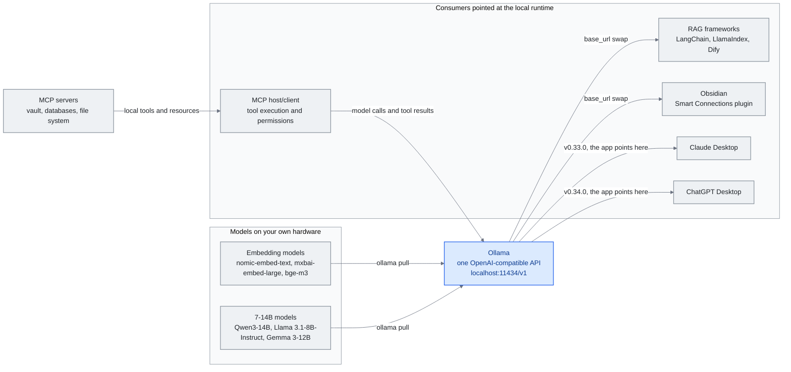

# Chapter 12: Local Models for Knowledge Engineering

> **In one sentence:** Local models move inference onto your own hardware, reducing provider exposure and per-token API bills while adding local operating costs.
>
> **Why it matters:** Sensitive knowledge and personal fine-tuning make the inference boundary an architectural choice; tools, logs and synchronization still need their own controls.
>
> **Reading time:** ~14 min (3,121 words / 230 wpm)

*Figure: Pattern 1 of the Integration Patterns section -- Ollama sitting between downloaded models and their consumers through one OpenAI-compatible endpoint. Pattern 3 adds an MCP host/client that connects local knowledge servers to model calls; the inference endpoint does not itself provide MCP orchestration. The framework and plugin edges show a base-URL change, while the desktop-app edges show the late-2026 inverse: vendor apps selecting the local runtime.*



The previous chapters describe a knowledge engineering stack that largely assumes cloud API access -- sending your context window to Anthropic, OpenAI, or Google and getting a response back. This works well for most users. But there is a growing segment of practitioners for whom cloud inference is either impractical or undesirable: those working with sensitive corporate data, those in jurisdictions with strict data residency requirements, and those who want to close the loop entirely by fine-tuning models on their own compiled knowledge.

This chapter covers the intersection of local models and knowledge engineering. It does not cover GPU purchasing guides, benchmark comparisons, or quantization techniques -- those topics are well-served by other resources. Instead, it focuses on the architectural decisions that matter when you bring the model inside your own infrastructure.

---

## Why Local Matters for Knowledge Engineering

Three forces are driving the adoption of local models in knowledge systems:

**Privacy as architecture, not policy.** Cloud-backed RAG can send retrieved document chunks to a provider. Local inference removes that model-provider transfer when the full path stays local. Tool calls, telemetry, logs and synchronization still need review. Some legal, healthcare and government workloads require such a boundary; the requirement depends on the deployment.

**Cost at scale.** A knowledge system that runs continuous background processes -- vault linting, automatic note compilation, periodic re-indexing -- can generate thousands of API calls per day. Local execution removes the per-token provider bill, but electricity, hardware capacity and maintenance still cost money. For always-on knowledge maintenance (the Lint operation from Karpathy's architecture), compare those costs with API usage rather than assuming free inference.

**The fine-tuning endgame.** This is perhaps the most compelling reason. Once your knowledge base reaches sufficient quality -- hundreds of well-structured, cross-linked notes compiled through the Ingest operation -- it becomes a pristine synthetic dataset. You can fine-tune a small local model on this dataset, producing a model that inherently "knows" your domain without needing retrieval at runtime. The knowledge is in the weights, not the context window.

---

## Architecture: Where Local Models Fit

Not every component of a knowledge harness benefits equally from local inference. Here is where local models provide the most value:

### Embedding Models (High Value)

Embedding is the foundation of any RAG pipeline. Every time you add a note to your vault, it needs to be converted to a vector for similarity search. This is a high-volume, low-complexity operation -- perfect for local inference.

Popular choices:
- **nomic-embed-text** (137M parameters): Strong general-purpose embeddings, runs on CPU
- **mxbai-embed-large** (335M): Higher quality, still manageable on modest hardware
- **bge-m3** (568M): Multilingual, excellent for vaults with mixed-language content

These models are small enough to run on any modern laptop without a GPU. The quality difference between local and cloud embeddings (OpenAI's text-embedding-3, Cohere's embed) has narrowed significantly -- for most knowledge management use cases, local embeddings are sufficient.

Running locally via Ollama:
```
ollama pull nomic-embed-text
```

### Query and Reasoning (Medium Value)

Using a local model to answer questions about your vault -- the Query operation -- is where the trade-offs become more nuanced. Cloud models (Claude Opus, GPT-4o) are still meaningfully better at complex reasoning, multi-step synthesis, and nuanced instruction-following. But for straightforward retrieval-based Q&A ("what did I write about X last month?"), local models in the 7-14B parameter range perform well.

Practical options:
- **Qwen3-14B**: Strong multilingual performance, Apache 2.0 license
- **Llama 3.1-8B-Instruct**: An 8B instruction-tuned option; Llama 3.3 is a separate 70B model
- **DeepSeek-R1-Distill-Qwen-7B**: Reasoning capabilities distilled from the full R1, MIT license
- **Gemma 3-12B**: Google's efficient architecture, good at structured output

The pattern that works best is a **tiered approach**: use a local model for routine queries and vault maintenance, escalate to a cloud API for complex synthesis and creative tasks. This mirrors how the harness engineering principle of progressive disclosure applies to model selection -- use the minimum capable model for each task.

### Knowledge Compilation (High Value)

The Ingest operation -- reading raw sources and compiling them into structured wiki pages -- is surprisingly well-suited to local models. The task is well-defined: read an article, extract key points, generate a structured note with wikilinks. A 14B model with good instruction-following can handle this reliably, especially when the output format is specified precisely in the system prompt.

This is where the economics argument is strongest. If your Web Clipper captures 5-10 articles per day, local compilation can keep the knowledge base growing without a per-token API bill, subject to available compute and operating costs.

### Vault Maintenance (High Value)

The Lint operation -- scanning for contradictions, staleness, and orphaned notes -- is a batch process that benefits from local inference. It can run hourly, daily, or continuously within the machine's compute budget. A local model scans the vault and generates a health report; keeping that workflow private also requires local tools and storage.

---

## The Fine-Tuning Endgame

Andrej Karpathy outlined a vision that many practitioners are now pursuing: once your LLM-maintained wiki reaches sufficient quality, use it to fine-tune a personal Small Language Model (SLM).

The workflow:

1. **Compile** your knowledge base through months of Ingest operations. The wiki grows to hundreds of well-structured, interlinked notes.
2. **Extract** training pairs from the wiki: each note becomes a (question, answer) pair, or a (context, completion) pair.
3. **Fine-tune** a small model (1-3B parameters) on this dataset using LoRA or QLoRA.
4. **Deploy** the fine-tuned model locally. It now answers questions about your domain from its weights, without needing retrieval.

This does not replace RAG entirely -- the fine-tuned model still benefits from retrieval for recent information and specific details. But it dramatically reduces the retrieval burden. The model "knows" the foundational concepts, relationships, and patterns in your domain. RAG only needs to supplement with new or highly specific information.

The tools for this pipeline are mature:
- **Unsloth** for efficient fine-tuning (2x faster, 60% less memory)
- **Axolotl** for managed training configurations
- **MLX** (Apple Silicon) or **llama.cpp** for local inference of the fine-tuned model

---

## Integration Patterns

### Pattern 1: Ollama as Universal Backend

Ollama provides a unified interface for running local models with an OpenAI-compatible API. This means any tool that works with the OpenAI API can be pointed at a local model by changing the base URL:

```
base_url: http://localhost:11434/v1
model: qwen3:14b
```

This works with LangChain, LlamaIndex, Dify, and most RAG frameworks. For Obsidian users, plugins like Smart Connections can be configured to use a local Ollama model instead of cloud APIs.

In late 2026 the pattern acquired an inverse. Instead of third-party tools pointing at Ollama, the closed-model vendors' own first-party desktop apps began pointing at it. Ollama **v0.33.0** (August 21, 2026) shipped configuration for Claude Desktop to use Ollama as a third-party gateway provider; **v0.34.0** (September 5, 2026) added ChatGPT Desktop integration, so Ollama models can be selected inside ChatGPT Desktop itself, configured through the Ollama macOS app. The same v0.34.0 release also added OpenAI-compatible client tool search, response compaction, and faster structured output on Apple Silicon. The consequence for a local knowledge harness is narrow but real: the consumer chat client is no longer a reason to route a query off the machine, because the client can be repointed at a model running on it. This is the vendor-application counterpart to the OS-level `LanguageModel` protocol discussed below --- the same first-class-local-backend move, arriving from the closed-model vendors rather than from the platform owner.

### Pattern 2: Hybrid Cloud-Local

The most practical architecture for most users:
- **Local**: Embeddings, vault maintenance, routine queries, knowledge compilation
- **Cloud**: Complex reasoning, creative synthesis, multi-step agent workflows

This gives you the privacy and cost benefits of local inference for high-volume operations, while retaining access to frontier model capabilities for tasks that genuinely require them.

### Pattern 3: MCP with Local Models

The integration needs an **MCP host/client**, as [Chapter 7](07-mcp.md) illustrates. The host discovers server tools, passes tool definitions and results through the model API, executes authorized calls, and enforces permissions. Ollama supplies inference; an OpenAI-compatible endpoint alone is not an MCP host. The harness can remain local when the host, servers, model and storage all run locally.

---

## 2026: Local Models Get an OS-Native API and Vendor QAT

Three 2026 releases changed the local-inference picture this chapter describes.

**Apple opens Foundation Models to any provider (WWDC26, June 8).** Apple's Foundation Models framework --- the same Swift API that powers Apple Intelligence, with streaming, tool calling, and `@Generable` structured output --- shipped a public **`LanguageModel` / `LanguageModelExecutor` protocol**, and Apple ships a reference **`MLXLanguageModel`** backend that loads any mlx-community model from Hugging Face at runtime and caches it on disk. For local knowledge engineering this matters: local open-source models become a *first-class, OS-native backend* rather than a third-party integration. A macOS or iOS knowledge app can now target one Swift API and swap between Apple's on-device model and a downloaded open-weight model without rewriting its inference layer (Anthropic and Google are shipping conforming Swift packages). The Ollama-as-universal-backend pattern above gains an Apple-native sibling.

**Gemma 4 QAT (June 5).** Google published **quantization-aware training checkpoints** for all five Gemma 4 sizes (E2B, E4B, 12B, 26B-A4B, and 31B), simulating 4-bit precision *during* training so the quantized weights recover most of the BF16 quality rather than losing it at post-hoc compression. The release shipped **day-one artifacts across llama.cpp (GGUF), Ollama, LM Studio, and MLX**, with vLLM support day-one for E2B, E4B, 12B, and 31B --- the 26B-A4B MoE was excluded from the vLLM w4a16-ct QAT format because its 704-wide expert dimension loses too much quality at 4-bit. On memory: Google's own blog publishes no percentage figure; a third-party analysis estimates roughly **72% VRAM reduction versus BF16**, while Google's own stated figure is only that E2B drops under 1GB via a mobile format. The beat worth noting is the *release pattern itself*: vendor-native QAT plus simultaneous multi-runtime day-one distribution is becoming the default shape of a serious open-weight launch, which lowers the friction of the "run it locally" decision this chapter argues for.

**Meta ships an open-weight model built for local agents (Muse Glimmer, August 10).** Meta Superintelligence Labs released **Muse Glimmer**, a 30B dense model distilled from the closed Muse Spark, under Apache 2.0 --- positioned explicitly as an open agentic model for on-device use rather than a scaled-down research artifact. At 4-bit quantization it comes in under 20GB, sized deliberately for the 24-32GB memory budget of a single consumer GPU, Mac or PC. Meta's own benchmarks report **DFlash** speculative-decoding speedups of **3.1x on an RTX 5090**, **1.8x on M5-Max**, and **1.5x on M4-Max**, plus benchmark superiority over Gemma4-31B and Qwen3.6-27B --- these are Meta's own figures, not independently reproduced. What distinguishes the release from a typical weights drop is distribution: near-day-zero runtime support across Hugging Face, Ollama, llama.cpp, MLX, ExecuTorch, LM Studio, Unsloth, vLLM, SGLang, Together AI, Fireworks AI, and OpenRouter. Every open-weight model this book has covered so far in the local-deployment context has been server-class only (Chapter 9's Kimi K3, explicitly excluded from the local story at 2.8T parameters); Muse Glimmer is the first US-frontier-lab model designed and benchmarked, from the outset, for single-consumer-GPU local agent use, shipped with the same vendor-native-QAT-plus-multi-runtime-day-one pattern the Gemma 4 QAT release modeled above. The pattern this chapter flagged as Google's is no longer Google-specific. (Meta separately said a later release of Muse Spark 1.2 weights is coming; that is a distinct, undated event and is not covered here.)

---

## Local Context and Decision Services

**Shared context on the device (September 23, 2026).** Liquid AI announced **Liquid Context** optimized for Qualcomm's Hexagon NPU: a locally maintained, permissioned context layer that embedded, cloud and hybrid agents can consume. Context maintenance and the agent using it become separate components, extending [Chapter 6's memory architecture](06-agent-memory.md) beyond per-agent stores. The announcement is OEM-facing; its examples are illustrative, not evidence of broadly shipped consumer devices. A local memory layer also does not make connected cloud agents local.

**Typed local decisions (September 29, 2026).** Ollama 0.35 introduced **`/v1/systemone`**, accepting state and named typed questions and returning bounded decisions with probabilities. Nimble 9B and experimental Tev1 models make routing, triage and moderation possible through a local decision interface rather than a generated prose answer. The architectural change is the interface, not a benchmark ranking. Probabilities still need workload-specific validation; deterministic host code should enforce permissions and escalation rules.

Cross-vendor convergence followed on **October 1**, when Cloudflare announced Apache 2.0 **Clef/Clef-flash** with Jev-compatible typed outputs; Ollama announced local and cloud Clef support on **October 19**. This extends the same decision contract across deployment locations. These are vendor release announcements, not independent evidence of calibrated decisions or safe autonomous execution.

---

## What This Chapter Does Not Cover

This chapter intentionally omits:
- **Hardware recommendations**: GPU selection, VRAM requirements, and cloud GPU rental are covered extensively in resources like r/LocalLLaMA's wiki and the Ollama documentation.
- **Model benchmarks**: Rankings change monthly. Check the [Open LLM Leaderboard](https://huggingface.co/spaces/open-llm-leaderboard/open_llm_leaderboard) for current standings.
- **Quantization details**: GGUF formats, INT4 vs INT8, and quality/speed trade-offs are well-documented in the llama.cpp and Ollama communities.
- **Training infrastructure**: Multi-GPU setups, distributed training, and cloud training platforms are outside the scope of knowledge engineering.

The focus here is on the architectural question: where do local models fit in your knowledge harness, and how do they change what is possible?

---

## Key Takeaways

1. **Local embedding is a strong default to evaluate.** It reduces model-provider exposure and per-token bills, with hardware and operating costs still to budget.

2. **Tiered inference is the pragmatic choice.** Local for routine operations, cloud for complex reasoning. Do not force a 7B model to do what a frontier model does better.

3. **The compilation use case is underappreciated.** Running Ingest locally moves recurring work from a provider bill to your own compute budget.

4. **Fine-tuning is the endgame, not the starting point.** Build the wiki first. Compile hundreds of quality notes. Then fine-tune. The quality of the training data -- your wiki -- determines the quality of the resulting model.

5. **Privacy is an architecture decision.** Sensitive knowledge calls for explicit inference, tool, storage and synchronization boundaries; local inference controls one part of that path.

---

## Three things to take away

- **Local inference controls a data boundary.** It reduces provider exposure only when tools, logs and synchronization respect the intended boundary too.
- **The economics change on always-on work.** Embeddings, knowledge compilation and the Lint pass trade per-token API bills for local hardware and operating costs.
- **Local services now include context and decisions.** Liquid Context's announced shared memory layer and Ollama's typed decision endpoint separate recurring context maintenance and bounded judgments from general text generation.

---

## Sources

- Ollama: [https://ollama.ai](https://ollama.ai)
- Ollama. FAQ (read October 31, 2026). [https://docs.ollama.com/faq](https://docs.ollama.com/faq) -- local versus cloud processing; `OLLAMA_NO_CLOUD=1` disables cloud models and web search.
- Liquid AI. "Liquid AI, in Collaboration with Qualcomm Technologies, Brings Personal AI Context to Devices Powered by Snapdragon" (September 23, 2026). [https://www.liquid.ai/blog/liquid-context-qualcomm](https://www.liquid.ai/blog/liquid-context-qualcomm) -- vendor announcement of an OEM-facing, permissioned local context layer; illustrative experiences, not a consumer deployment census.
- Ollama. "Ollama now supports Jev-style decision models" (September 29, 2026). [https://ollama.com/blog/ollama-now-supports-jev-style-decision-models](https://ollama.com/blog/ollama-now-supports-jev-style-decision-models) -- Ollama 0.35 `/v1/systemone` interface and local launch models.
- Cloudflare. "Introducing Clef: our open-source decision models, and new RL fine-tuning platform" (October 1, 2026). [https://blog.cloudflare.com/clef-decision-models](https://blog.cloudflare.com/clef-decision-models) -- Apache 2.0 weights and Jev-compatible decision API; benchmark claims are the vendor's.
- Ollama. "Clef is available on Ollama's cloud" (October 19, 2026). [https://registry.ollama.com/blog/clef](https://registry.ollama.com/blog/clef) -- vendor-hosted article also documents local execution support.
- Meta. Llama model cards: [https://huggingface.co/meta-llama/Llama-3.1-8B-Instruct](https://huggingface.co/meta-llama/Llama-3.1-8B-Instruct) (July 23, 2024) and [https://huggingface.co/meta-llama/Llama-3.3-70B-Instruct](https://huggingface.co/meta-llama/Llama-3.3-70B-Instruct) (December 6, 2024) -- distinguish the 8B instruction-tuned example from Llama 3.3's 70B release.
- DeepSeek. DeepSeek-R1 repository and distilled-model list (January 2025). [https://github.com/deepseek-ai/DeepSeek-R1](https://github.com/deepseek-ai/DeepSeek-R1) -- exact `DeepSeek-R1-Distill-Qwen-7B` model identifier.
- Ollama. Release v0.33.0 (August 21, 2026). [https://github.com/ollama/ollama/releases/tag/v0.33.0](https://github.com/ollama/ollama/releases/tag/v0.33.0) --- Claude Desktop configurable to use Ollama as a third-party gateway provider.
- Ollama. Release v0.34.0 (September 5, 2026). [https://github.com/ollama/ollama/releases/tag/v0.34.0](https://github.com/ollama/ollama/releases/tag/v0.34.0) --- ChatGPT Desktop integration via the Ollama macOS app; OpenAI-compatible client tool search, response compaction, and faster structured output on Apple Silicon.
- llama.cpp: [https://github.com/ggml-org/llama.cpp](https://github.com/ggml-org/llama.cpp)
- Unsloth: [https://github.com/unslothai/unsloth](https://github.com/unslothai/unsloth)
- Karpathy, Andrej. "LLM Wiki" pattern --- Gist defining the raw → wiki → schema layered architecture and the Ingest / Compile / Lint / Query operations referenced throughout this chapter. [https://gist.github.com/karpathy/442a6bf555914893e9891c11519de94f](https://gist.github.com/karpathy/442a6bf555914893e9891c11519de94f)
- Open LLM Leaderboard: [https://huggingface.co/spaces/open-llm-leaderboard](https://huggingface.co/spaces/open-llm-leaderboard)
- Nomic Embed: [https://huggingface.co/nomic-ai/nomic-embed-text-v1.5](https://huggingface.co/nomic-ai/nomic-embed-text-v1.5)
- r/LocalLLaMA: [https://reddit.com/r/LocalLLaMA](https://reddit.com/r/LocalLLaMA)
- Apple. "Bring an LLM provider to the Foundation Models framework," WWDC26 Session 339 (June 8, 2026). [https://developer.apple.com/videos/play/wwdc2026/339/](https://developer.apple.com/videos/play/wwdc2026/339/) and Session 241 [https://developer.apple.com/videos/play/wwdc2026/241/](https://developer.apple.com/videos/play/wwdc2026/241/) --- public `LanguageModel` / `LanguageModelExecutor` Swift protocol; reference `MLXLanguageModel` backend for Hugging Face mlx-community models.
- Google. "Quantization-Aware Training for Gemma 4" (June 5, 2026). [https://blog.google/innovation-and-ai/technology/developers-tools/quantization-aware-training-gemma-4/](https://blog.google/innovation-and-ai/technology/developers-tools/quantization-aware-training-gemma-4/) --- QAT checkpoints for all five sizes; day-one llama.cpp / Ollama / LM Studio / MLX; vLLM day-one except the 26B-A4B MoE. Third-party VRAM analysis (~72% vs BF16; Google's own figure only that E2B drops under 1GB via a mobile format): [https://runaihome.com/blog/gemma-4-qat-local-ai-hardware-update-2026/](https://runaihome.com/blog/gemma-4-qat-local-ai-hardware-update-2026/).
- Meta Superintelligence Labs. "Introducing Muse Glimmer: an open agentic model" (August 10, 2026). [https://research.meta.ai/blog/introducing-muse-glimmer-open-agentic-model](https://research.meta.ai/blog/introducing-muse-glimmer-open-agentic-model) --- 30B dense, Apache 2.0, distilled from Muse Spark; DFlash speedup and benchmark figures are Meta's own. Secondary: Phoronix [https://phoronix.com/news/Meta-Muse-Glimmer](https://phoronix.com/news/Meta-Muse-Glimmer) ; CNBC [https://www.cnbc.com/2026/08/10/meta-muse-glimmer-open-weight-ai.html](https://www.cnbc.com/2026/08/10/meta-muse-glimmer-open-weight-ai.html) ; Ghacks (August 11, 2026) [https://www.ghacks.net/2026/08/11/meta-releases-muse-glimmer-a-30-billion-parameter-open-weight-ai-model-that-runs-on-a-single-consumer-gpu/](https://www.ghacks.net/2026/08/11/meta-releases-muse-glimmer-a-30-billion-parameter-open-weight-ai-model-that-runs-on-a-single-consumer-gpu/).

---

*Previous: [Chapter 11 - Key Moments in LLM Knowledge Engineering](11-timeline.md)*

*Next: [Chapter 13 - Loop Engineering](13-loop-engineering.md)*
