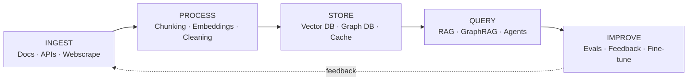

<!-- translation-sync:start -->
> 與 2026-10-31 英文版同步的機器輔助譯文，已作結構與內容覆核。程式碼和圖中標籤保留原文；閱讀時間按英文原文估算。
> [English source](../README.md) · [Sync record](SYNC.md)
<!-- translation-sync:end -->

<a id="the-map-everyones-missing-llm-knowledge-engineering-in-2026"></a><!-- i18n-anchor -->

# 每個人都遺漏的地圖：2026 年 LLM 知識工程全景

[English](../README.md) | **繁體中文** | [简体中文](README_zh-CN.md) | [日本語](README_ja.md) | [한국어](README_ko.md) | [Español](README_es.md)

[線上閱讀指南](https://kennethlaw325.github.io/awesome-llm-knowledge-systems/) · [選擇閱讀路徑](#which-path-should-you-take) · [時間線](chapters/zh/11-timeline.md) · [更新日誌](../CHANGELOG.md)

> 我分析了 50+ 份 awesome 列表、綜述和指南，沒有一份把這些線索串聯起來。RAG 論文不提系統編排工程，記憶框架忽略技能系統，MCP 文件跳過漸進式披露。這份指南繪製了完整的地圖。

<a id="october-2026-update"></a><!-- i18n-anchor -->

## 2026 年十月更新

本版聚焦系統之間的邊界：誰負責持久上下文，誰處理相互衝突的記憶，以及智慧體監控器實際能看到什麼。

- **記憶需要糾錯與責任歸屬。** Notion 十月 13 日釋出的版本將共享工作區與技能及訪問控制連線起來；Cognee 十月 29 日的版本將衝突處理結果持久儲存，並在支撐資料發生變化時使其失效。參見[第 06 章](chapters/zh/06-agent-memory.md)與[第 08 章](chapters/zh/08-tools-landscape.md)。
- **本地推理承擔不止一種任務。** Liquid AI 九月 23 日的公告將裝置上的上下文與使用它的智慧體分離。Ollama 九月 29 日的決策端點針對有界判斷返回帶型別的決策及機率。參見[第 12 章](chapters/zh/12-local-models.md)。
- **長期執行的智慧體需要在交接後仍然有效的邊界。** 十月 14 日的客戶案例描述了支援多日工作的外層編排系統；十月的研究則考察評估環境的隔離，以及跨上下文壓縮和多個智慧體的監控。參見[第 04 章](chapters/zh/04-harness-engineering.md)與[第 13 章](chapters/zh/13-loop-engineering.md)。
- **互操作性不等於安全保證。** Agent Skills 十月 22 日的公告記錄了更多平臺的採用情況。可移植規範統一技能後設資料與指令，路由和強制執行仍由宿主負責。[第 05 章](chapters/zh/05-skill-systems.md)區分了這些責任；[第 14 章](chapters/zh/14-graph-engineering.md)更新了一個仍有爭議的術語所依據的證據。

[更新日誌](../CHANGELOG.md)記錄事實更正與維護工作。五個譯本涵蓋本英文版的 README、全部 14 章及術語表。解決翻譯疑問時，英文原文仍是參考依據；各版均保留來源日期與證據侷限。

<details>
<summary>用 30 秒觀看各層如何連線（動畫）</summary>


[觀看或下載 MP4](../diagrams/knowledge-map.mp4) · [靜態地圖](../diagrams/evolution-stack.png)

這段無聲動畫介紹已經穩定的層次與閱讀路徑。迴圈工程和圖工程仍是新興或有爭議的話題，尚不能視為已確立的額外世代。

</details>

<details>
<summary><b>上次更新：2026 年九月</b>（展開）</summary>

2026 年九月中旬的更新增加了十個時間線條目，其中九個來自外部，另一個是本指南自身的存續檢查結果，並將內容整合進十章及術語表。貫穿其中的主線是安全層開始追趕此前落後的基礎能力：首個實際釋出的 AI 智慧體執行時檢測產品 CrowdStrike Falcon Guardian 面世，同日 AIR 結束隱身運營，公佈 $50M 融資及暴露面的測量結果；OpenAI 釋出首個被其列為網路安全 *Critical* 級別的模型，並在廣泛開放的版本中加入拒絕執行約定；Anthropic 九月威脅報告則指控若干具名中國實驗室開展工業規模的蒸餾。同一時期，第 14 章自行設定的九月存續檢查關口也到期，結論分成兩部分：該術語透過了關口規定的傳播測試，但它作為獨立工程層的地位尚未得到證明。這輪更新承接八月下旬的浪潮（一週內太平洋兩岸的編排層相繼開源）與八月上旬的浪潮（Metis）。以下按時間倒序排列（完整時間記錄見 [CHANGELOG.md](../CHANGELOG.md)）：

- **九月 15 日，第 14 章的存續檢查關口到期**：對本指南七月公佈的關口進行檢查後，結論分成兩部分：術語透過了預定的傳播測試，證據包括八月至九月的獨立文章，以及教授智慧體組織這一含義的付費課程；但在所檢查的文件中未發現廠商採用，生產案例研究一項也只能追溯性地由 Anthropic 六月 2025 多智慧體研究系統滿足。它作為獨立工程層的地位仍未得到證明，繼續留在編號世代之外（[第 14 章 §14.7](chapters/zh/14-graph-engineering.md)、[第 01 章](chapters/zh/01-evolution.md)、[第 11 章](chapters/zh/11-timeline.md)、術語表）
- **九月 11 日，Salesforce 為 Agentforce 釋出長週期執行時**：它提供跨會話持續存在的記憶、讓計劃跨會話繼續執行的持久執行，以及執行中的動態引導，與七個按崗位劃分的智慧體一同公佈；Hunter 是首個試用該執行時的智慧體。這補上了 AWS 在底層提供 14 天會話之後的需求側一半，不過"pursues goals across days and weeks"是 Salesforce 自己的主張，負責展示此能力的 Hunter 到 2026 年十一月才正式釋出（[第 04 章 §4.9](chapters/zh/04-harness-engineering.md)、[第 11 章](chapters/zh/11-timeline.md)）
- **九月 10 日，Anthropic 威脅報告指控工業規模蒸餾**：九月威脅情報報告指控 Moonshot AI 透過 5,380 個欺詐賬戶將 Kimi 客戶請求轉送至 Claude，其中一個十天叢集接近 300,000 次請求，五月至七月累計超過 23 million 次互動；報告還將同一時期超過 151 million 次互動歸於 Alibaba，並同時點名 DeepSeek、Z.ai、小米、MiniMax 及 SenseTime。所有數字均為 Anthropic 對競爭對手的指控，未經獨立裁定，均取自報告本身的蒸餾章節（[第 09 章](chapters/zh/09-china-ecosystem.md)、[第 11 章](chapters/zh/11-timeline.md)）
- **九月 4 日，智慧體記憶能否經受模型升級？** 一項對照研究發現，更換模型時，固定模式的圖記憶幾乎不變，準確率變化為 0.0004 正負 0.0020；壓縮筆記則波動 +9.91 或 -13.28 個點。研究將約 80% 的筆記退化歸因於*寫入*時丟棄的資訊，因此在壓縮內容旁儲存原始來源，才使修復成為可能：在兩個受測遷移方向之一的 48 個案例中修復了 34 個。研究只有兩位作者、48 個合成案例，提出的設計規則建立在有限證據之上（[第 06 章](chapters/zh/06-agent-memory.md)、[第 02 章](chapters/zh/02-knowledge-layer.md)、[第 11 章](chapters/zh/11-timeline.md)）
- **九月 3 日，GPT-6 Astra 跨過 OpenAI 的 Critical 網路安全門檻**：它是 OpenAI 在自身 Preparedness Framework 下首個列為網路安全 Critical 級別的模型。已釋出模型拒絕生成概念驗證漏洞利用等工作，OpenAI 將 Daybreak 與 Daybreak Blue 列為向經過稽核的防禦者開放的計劃路徑；模型本身廣泛推出，企業工作區在釋出時預設關閉訪問。同一份安全概述還報告思維鏈的可監控性*下降*，包括故意降低表現卻未被發現的情況。ExploitBench 的 100% 對比 78.5%、ExploitGym 的 42.4%、SRE-Bench 首次嘗試的 88.0%，全部是 OpenAI 自報、在未啟用生產防護時測得的數字（[第 04 章 §4.2](chapters/zh/04-harness-engineering.md)、[第 11 章](chapters/zh/11-timeline.md)）
- **九月 1 日，技能安全走向商業化：Falcon Guardian 與 AIR 的 $50M**：CrowdStrike 推出 Falcon Guardian，先盤點 Windows 與 macOS 端點上已知及未納管的 AI 智慧體，再執行策略與執行時檢測。這是首個回應 §5.10 從釋出時掃描走向執行時隔離這一論點的已釋出產品，但取得的兩個來源均未提供有效性數字。同日 AIR 結束隱身運營，公佈 $50M 融資，並報告 17,800+ 個公共 AI 外掛、約 6.7M 次安裝依賴不受信任的外部指令源；這些均為其自報數字，方法未公開（[第 05 章 §5.10](chapters/zh/05-skill-systems.md)、[第 11 章](chapters/zh/11-timeline.md)）
- **八月 20 日，StateMemBench 將新事實取代舊事實納入記憶評估維度**：234 個跨會話場景在中途修改事實、約束或決定，再檢查記憶層返回的是當前有效值還是被取代的舊值。這是繼 GateMem（訪問控制）、MemSyco-Bench（迎合）之後的第三個治理維度，也是三者中首個同時提出修復方法，而非只報告未達標結果的研究。StateMem 報告在 DeepSeek-V4-Flash 上當前狀態準確率達到 1.8x；作為六個後端的包裝層，控制新增上下文後仍提升 +15 至 +32 個點。數字均為論文自報，尚未復現（[第 06 章](chapters/zh/06-agent-memory.md)、[第 11 章](chapters/zh/11-timeline.md)）
- **七月 30 日，Gemini Enterprise Agent Platform 的 Memory Bank 正式釋出**：Agent Memory Bank 將對話上下文提取進開發者定義的模式；Agent Runtime 讓智慧體持續執行最長七天；Agent Identity 將智慧體設為原生 IAM 型別，另有 Agent Gateway 與 Agent Registry，五項能力一同正式釋出。所有能力描述均來自 Google；這是 Vertex AI Memory Bank 在七月 2025 公開預覽後更名後繼產品的正式釋出，而非首次公告。四天後 TencentDB 跟進，使託管記憶成為雲廠商的一類產品（[第 06 章](chapters/zh/06-agent-memory.md)、[第 04 章 §4.9](chapters/zh/04-harness-engineering.md)、[第 11 章](chapters/zh/11-timeline.md)）
- **七月 29-30 日，兩天三篇記憶論文**：首篇系統研究 Markdown 目錄樹記憶模式的論文（arXiv 2607.26637）發現，儲存變大後，保持組織有序可將檢索成本大致減半，但除最強管理智慧體外，組織結構都會退化，且所有受測智慧體都未能將有序組織轉化為更好的答案；MemTxn 為記憶*寫入*設定事務邊界（arXiv 2607.27834），在作者自建的小型驗證集上接受 60 個有來源支援的更新、拒絕 179 個構造的負例，另一個團隊三天前的 MemTX 則讓事務記憶成為兩項獨立提案，而非一條研究線；Memory Decoder at Scale（arXiv 2607.27919）報告，一個 6.9B 記憶模組讓 410M Pythia 基礎模型超過 Pythia-12B 在 17 項基準上的平均成績，總引數減少 39%，這些是作者自報數字。檔案系統、受治理的儲存與模型權重，在四十八小時內各有一項結果（[第 06 章](chapters/zh/06-agent-memory.md)、[第 11 章](chapters/zh/11-timeline.md)）
- **七月 29 日，中國模型包攬 OpenRouter 周榜前五**：小米 MiMo-V2.5 位居 #1，領先 DeepSeek、MiniMax、Qwen 和 Kimi，這是 OpenRouter 全球每週 token 使用排名首次由中國模型包攬前五，九月初仍保持領先。OpenRouter 釋出的是實時滾動榜單，沒有歷史檔案，因此包攬排名與份額數字均依賴二手分析；七月包攬前五附近的轉送流量"more than 60%"與九月初的"46.4%"是分別報告的不同測量值，不能連線成趨勢線（[第 09 章](chapters/zh/09-china-ecosystem.md)、[第 11 章](chapters/zh/11-timeline.md)）

*較早幾輪更新（完整細節見 [CHANGELOG.md](../CHANGELOG.md)）：*

- **八月 22 日，新 MCP 路線圖**：最終規範釋出後不到四周，核心維護者正式規定治理機制，包括貢獻者階梯、工作組 SEP 分流、功能生命週期及棄用策略，並列出五個重點：智慧體訊息基礎能力，其中 *Tasks 正走向核心*；適用於本地部署的 HTTP 原生傳輸；透過 DPoP 與 Workload Identity Federation 實現智慧體身份；大型目錄的工具結果處理及漸進式發現；SDK 一致性（[第 07 章](chapters/zh/07-mcp.md)、[第 11 章](chapters/zh/11-timeline.md)）
- **八月 19 日，OpenAI 將 Codex 重新定位為平臺**：`codex exec`、Codex SDK 與 *app-server* 以 Apache 2.0 協議作為解耦的編排產品釋出，模型訪問仍屬專有。需注意，`openai/codex` 從四月 2025 起就已公開並採用 Apache-2.0，因此這是重新定位，並非首次開源；ARC-AGI-3 從 13.3%→38.3%、輸出 token 減少至原來的 6x 分之一，也都是 OpenAI 自報的數字（[第 04 章 §4.7](chapters/zh/04-harness-engineering.md)、[第 11 章](chapters/zh/11-timeline.md)）
- **八月 19 日，Anthropic Skills API 正式釋出**：`/v1/skills` 結束測試階段，釋出說明日期為八月 19 日，配套部落格為八月 20 日，是更大一輪生產智慧體正式釋出的一部分。十二天前，GitHub 託管技能已讓 Managed Agents 在會話開始時自動發現已掛載倉庫的 `.claude/skills`，Anthropic 自身文件指出，該倉庫會直接成為智慧體*信任邊界*的一部分，沒有稽核步驟（[第 05 章 §5.2](chapters/zh/05-skill-systems.md)、[第 11 章](chapters/zh/11-timeline.md)）
- **八月 13 日，DeepSeek Harness（dsh）**：採用 MIT 許可證的智慧體編排層，其模型介面卡、工具登錄檔、會話日誌、沙箱、儲存、排程器與 UI 均為可替換外掛（"Cordis"），並以僅追加日誌記錄每次上下文注入。11 天內取得 190,630 stars / 21,319 forks（GitHub API，八月 24 日檢查），將中國開源優先的邏輯從權重延伸到編排層（[第 09 章](chapters/zh/09-china-ecosystem.md)、[第 11 章](chapters/zh/11-timeline.md)）
- **八月 10 日，Meta Muse Glimmer**：從 Muse Spark 蒸餾而來、面向本地智慧體構建的 30B 稠密 Apache-2.0 模型，在 4-bit 下低於 20GB，可執行於單張消費級 GPU；Ollama、llama.cpp、MLX、ExecuTorch、vLLM 等均提供 day-0 支援。這是美國前沿實驗室首次面向單 GPU 本地場景而非伺服器級開放權重推出產品，所有加速與基準數字均為 Meta 自報（[第 12 章](chapters/zh/12-local-models.md)、[第 11 章](chapters/zh/11-timeline.md)）
- **八月 7 日，Claude Code 釋出跨會話智慧體訊息**：`ListAgents` 與 `SendMessage` 讓具名會話相互可定址，並提供每個會話的入站接受／暫存／拒絕治理；歷史、檔案與許可權批准均不會跨越邊界。大型廠商釋出了第 14 章的*組織圖*基礎能力，卻從未使用"graph engineering"一詞（[第 14 章 §14.2](chapters/zh/14-graph-engineering.md)、[第 11 章](chapters/zh/11-timeline.md)）
- **八月 6 日，Paperclip 技能攻擊活動**：冒充的 `paperclipai` 與 `browser-use` 組織釋出技能，七月 5 日仍然無害，七月 11 日被武器化，並升至熱門 #8。載荷透過四種獨立觸發機制掃描 138 個憑證路徑，>1.7M 安裝計數是彙總值，不代表獨立智慧體數量。這體現了檢查時到使用時的攻擊模式，從單個假技能擴充套件到整個家族（[第 05 章 §5.10](chapters/zh/05-skill-systems.md)、[第 11 章](chapters/zh/11-timeline.md)）
- **八月 6 日，AWS AgentCore 的 Temporal Policies 與 Runtime Instances 正式釋出**：使用新的 Apache-2.0 Dogwood 策略語言編寫，按智慧體*先前會話歷史*評估工具呼叫，執行確定性、預設拒絕的授權。同日正式釋出的 Runtime Instances 可讓客戶自行選擇的 EC2 會話執行最長 14 天，相比之下，無伺服器預設值為 8 小時（[第 04 章 §4.1](chapters/zh/04-harness-engineering.md)、[第 11 章](chapters/zh/11-timeline.md)、術語表）
- **八月 3 日，TencentDB Agent Memory v2.0 增加團隊記憶**：四類帶版本的記憶資產上方，設有私有／團隊／受限／智慧體*可見性層級*，並提供相容 Anthropic 與 OpenAI 協議的 Memory Proxy 和 L0-L3 蒸餾。這是首個回應 GateMem 所發現的沒有框架滿足訪問控制維度的已釋出方案，但每項治理主張均為 Tencent 自報，尚無獨立基準（[第 06 章](chapters/zh/06-agent-memory.md)、[第 11 章](chapters/zh/11-timeline.md)）
- **八月 2 日，智慧體的實用線上 KV-cache 壓縮**：首個系統研究*智慧體軌跡*壓縮的工作發現，立即壓縮會降低準確率；等到智慧體後續查詢可充當代理查詢訊號時再壓縮，能恢復大部分表現；token 驅逐優於注意力匹配重建，快取減少 80%，吞吐量甚至高於完全不壓縮（[第 03 章 §3.3](chapters/zh/03-context-engineering.md)、[第 11 章](chapters/zh/11-timeline.md)）
- **七月 29 日，MemTensor 的 Metis 提出記憶基礎模型**：MemTensor（上海）也是六月智慧體原生記憶綜述背後的實驗室，此次與中國人民大學／NUS／SJTU／同濟大學的合作者提出，把智慧體記憶作為 *transformer 主幹內部持久的引數化狀態*，而非外部儲存：凍結 Qwen3.5 主幹（4B/9B/27B），只訓練受 Fast-Weight-Programming 啟發的"hyper memory block"與"local memory block"，在推理時透過無梯度的 EMA 式過程更新。論文字身報告固定大小壓縮下的長期資訊丟失，以及"information confusion in some cases, possibly caused by the blending of semantics within the latent space"（[第 06 章](chapters/zh/06-agent-memory.md)、[第 11 章](chapters/zh/11-timeline.md)、術語表）
- **七月 29 日，LangChain 釋出 Deep Agents v0.7**：移除框架預設的基礎系統提示，將內建工具描述縮短 43%；在三個模型系列的評估中發現待辦列表規劃支架沒有可測收益後，改為由使用者主動啟用，使預設智慧體每回合的基礎輸入 token 減少約 65%（~6k 至 ~2k）。這是本指南壓力測試原則的生產實踐（[第 04 章 §4.8](chapters/zh/04-harness-engineering.md)、[第 11 章](chapters/zh/11-timeline.md)）
- **七月 29 日，MinIO 釋出 AIStor Memory**：基於物件儲存，為智慧體記憶、工作區狀態與憑證提供底層服務，定位是用持久、客戶自有、完整保真的記錄，替代手工拼裝的向量儲存、後設資料資料庫與憑證工具組合（[第 11 章](chapters/zh/11-timeline.md)）
- **七月 28 日，MCP 2026-07-28 最終規範釋出**：這是加入授權以來最大的修訂，包含*無狀態請求／響應核心*、Multi Round-Trip Requests（SEP-2322）、RFC 9207 簽發者驗證、以 Client ID Metadata Documents 取代 Dynamic Client Registration，以及正式的擴充套件框架；Roots／Sampling／Logging／HTTP+SSE 的棄用視窗為 12 個月（[第 07 章](chapters/zh/07-mcp.md)、[第 11 章](chapters/zh/11-timeline.md)、術語表）
- **七月 24 日，Claude Opus 5**：價格與 Opus 4.8 相同，是 Fable 5 的一半；1M 上下文／128K 輸出、*五級 `effort` 調節*、付費 Fast 模式，以及對話中修改工具而不使提示快取失效的測試功能。基準數字均為 Anthropic 自報（[第 04 章 §4.10](chapters/zh/04-harness-engineering.md)、[第 11 章](chapters/zh/11-timeline.md)）
- **七月 17-22 日，新增第 14 章：圖工程**：六週內第二個新層名稱有了完整章節：Steinberger 七月 17-18 日的催化帖子、Thakker 對組織圖／工作圖的區分、Perez 以*錨點*約束的迴圈監督迴圈、TrueFoundry 與 Eigent 的受治理拓撲，以及 LangChain 帶雙重意味的"3 Years of Graph Engineering with LangGraph"回應。本章將這個僅出現兩週的概念界定為*新興且有爭議*，給予懷疑者同等分量，明確設定 2026 年九月存續檢查關口，並在 September 15, 2026 檢查：傳播存續，獨立層地位未證（[第 14 章](chapters/zh/14-graph-engineering.md)、[第 01 章](chapters/zh/01-evolution.md)、術語表）
- **七月 18 日，Anthropic 解決 Fable 5 訂閱訪問安排**：Max 與 Team Premium 從七月 20 日起永久保留 Fable 5，適用每週用量限制的 50%；Pro 與 Team Standard 則轉為使用點數計價，結束六月 12 日出口管制暫停所開啟的階段（[第 11 章](chapters/zh/11-timeline.md)）
- **七月 17 日，Moonshot 釋出 Kimi K3**：2.8T 引數（MoE），是迄今釋出過的最大開放權重模型，具備 1M 上下文與原生視覺；作為開放權重模型登頂 Arena 前端編碼榜，權重在七月 27 日隨後以 Moonshot 自訂 Kimi K3 License 釋出，按公司自身說法屬於"open weight,"而非"open source"。它僅適用於伺服器級部署，因此擴大了開放權重前沿，卻未改變本地部署情況（[第 09 章](chapters/zh/09-china-ecosystem.md)、[第 11 章](chapters/zh/11-timeline.md)）
- **七月 17 日，WAIC 2026 與 WAICO 成立**：上海世界人工智慧大會達成建立世界人工智慧合作組織的協議，這是首個專門面向 AI 的政府間組織，總部位於上海（[第 09 章](chapters/zh/09-china-ecosystem.md)、[第 11 章](chapters/zh/11-timeline.md)）
- **七月 14 日，新增第 13 章：迴圈工程**：2026 年六月的"loop engineering"框架有了完整章節，涵蓋 Peter Steinberger 的催化帖子、Addy Osmani 的命名文章與"Own the Outer Loop"後續、Boris Cherny、Rajasekaran 的生成器／評估器分離、Stripe 的 minions、LangChain 的四層階梯與採用訊號。本章將這個僅出現五週、尚無學術文獻的概念界定為*新興且有爭議*（[第 13 章](chapters/zh/13-loop-engineering.md)、[第 01 章](chapters/zh/01-evolution.md)、術語表）

</details>

---

## TL;DR（重點摘要）

- **提示工程只是起點。** 這個領域經歷了三個世代：提示工程（2022-2024）、上下文工程（2025）與系統編排工程（2026）。每一層包含前一層；2026 年中又出現有爭議的第四層*迴圈工程*（[第 13 章](chapters/zh/13-loop-engineering.md)）。六週後出現第五項主張*圖工程*，其存續檢查關口在 September 15, 2026 執行：它仍作為多智慧體協調的爭議性名稱流傳，但獨立第五層的地位尚未得到證明（[第 14 章](chapters/zh/14-graph-engineering.md)）。
- **RAG 與長上下文解決不同的約束。** 請在自己的工作負載上測試檢索質量、來源新鮮度、延遲與成本，再選擇和組合兩者（[第 02 章](chapters/zh/02-knowledge-layer.md)）。
- **上下文工程關注呼叫周圍的資訊，而非呼叫本身。** Andrej Karpathy 在 2025 年中的重新界定，將焦點從精心撰寫提示詞轉為動態構建整個上下文視窗。
- **系統編排工程是作業系統層。** Birgitta Böckeler 在 Martin Fowler 的 *Exploring Generative AI* 備忘錄系列（2026 年四月），以及 OpenAI Codex 團隊的編排設計框架，將這一理念正式化：模型是 CPU，上下文是 RAM，編排層則是協調一切的 OS。
- **此前沒有一份指南將這些全部串聯起來。** RAG、知識圖譜、長上下文、MCP、技能路由、記憶系統與漸進式披露都屬於同一個生態系統。這就是它的地圖。

---

<a id="start-here"></a><!-- i18n-anchor -->

## 從這裡開始

AI 工具每年都在變得更聰明，但只有在正確的時間接收到正確的資訊，才能發揮作用。本指南解釋其運作方式，從告訴 AI 該做什麼的基礎，一直到圍繞 AI 模型設計完整系統。

把 AI 想象成第一天上班的優秀新員工。提示工程是交給他一項任務；上下文工程是提供完成任務所需的全部背景；系統編排工程則設計他的整個工作環境，包括桌面、工具、歸檔系統和團隊結構，讓他能持續發揮最佳表現。本指南涵蓋這三個層面，並說明它們如何連線。

如果你剛接觸這個主題，先看[術語表](glossary_zh.md)，瞭解關鍵概念。如果你在開發 AI 應用，直接進入下方章節。如果只想瞭解全貌，可檢視本頁後面的生態系統地圖。

---

<a id="which-path-should-you-take"></a><!-- i18n-anchor -->

## 你應該走哪條路？

不知道從哪裡開始？選擇最符合你的描述：

- **"I just want to understand what all these AI buzzwords mean."**：先看[術語表](glossary_zh.md)，再讀[第 1 章：三個世代](chapters/zh/01-evolution.md)。
- **"I'm building an AI application."**：依次閱讀[第 02 章：RAG、長上下文與知識圖譜](chapters/zh/02-knowledge-layer.md)、[第 03 章：上下文工程](chapters/zh/03-context-engineering.md)、[第 04 章：系統編排工程](chapters/zh/04-harness-engineering.md)。
- **"I want to make my AI tools work better."**：依次閱讀[第 05 章：技能系統](chapters/zh/05-skill-systems.md)、[第 06 章：智慧體記憶](chapters/zh/06-agent-memory.md)、[第 10 章：案例研究](chapters/zh/10-case-study.md)。
- **"I want my agents to run without me pushing every step."**：閱讀[第 13 章：迴圈工程](chapters/zh/13-loop-engineering.md)，再讀[第 04 章：系統編排工程](chapters/zh/04-harness-engineering.md)與[第 06 章：智慧體記憶](chapters/zh/06-agent-memory.md)。
- **"I'm wiring multiple agents together."**：閱讀[第 14 章：圖工程](chapters/zh/14-graph-engineering.md)，再讀[第 13 章：迴圈工程](chapters/zh/13-loop-engineering.md)與[第 04 章：系統編排工程](chapters/zh/04-harness-engineering.md)。
- **"I want to see real examples."**：直接閱讀[第 10 章：案例研究](chapters/zh/10-case-study.md)。
- **"I work with Chinese AI tools."**：從[第 09 章：中國 AI 生態系統](chapters/zh/09-china-ecosystem.md)開始。
- **"I want the complete picture."**：從第 1 章開始，從頭讀到尾。

---

<a id="use-cases"></a><!-- i18n-anchor -->

## 用例

本指南幫助你為以下真實場景設計系統。每行連結到相應構建最重要的章節：

| 場景 | 你要構建的系統 | 核心章節 |
|----------|---------------------|---------------|
| **個人第二大腦** | 透過自然語言查詢，搜尋個人筆記、論文與網頁摘錄 | [第 02 章](chapters/zh/02-knowledge-layer.md) · [第 05 章](chapters/zh/05-skill-systems.md) · [第 08 章](chapters/zh/08-tools-landscape.md) |
| **公司內部知識庫** | 員工查詢政策／手冊／操作規程，嚴格限制幻覺並要求引用來源 | [第 02 章](chapters/zh/02-knowledge-layer.md) · [第 04 章](chapters/zh/04-harness-engineering.md) · [第 06 章](chapters/zh/06-agent-memory.md) |
| **開發文件助手** | 工程師跨多個倉庫查詢程式碼庫／API 文件／過去事故覆盤 | [第 02 章](chapters/zh/02-knowledge-layer.md) · [第 05 章](chapters/zh/05-skill-systems.md) · [第 07 章](chapters/zh/07-mcp.md) |
| **支援／質量保證智慧體** | 客戶或內部工單 → 理解上下文、引用來源並保留後續記憶的回覆 | [第 03 章](chapters/zh/03-context-engineering.md) · [第 06 章](chapters/zh/06-agent-memory.md) · [第 04 章](chapters/zh/04-harness-engineering.md) |
| **領域知識自動化** *（法律、醫療、金融、工程）* | 重用數十年的領域文件；受監管、涉及敏感智慧財產權，通常需要本地模型與審計軌跡 | [第 02 章](chapters/zh/02-knowledge-layer.md) · [第 09 章](chapters/zh/09-china-ecosystem.md) · [第 12 章](chapters/zh/12-local-models.md) |

如果你的場景無法完全歸入其中一類，它可能是幾類的組合；從最接近的一行開始，再作調整。

---

<a id="the-evolution"></a><!-- i18n-anchor -->

## 演變


*圖：每個世代包含前一代，而非取代它。最外側兩個框使用虛線，因為它們是主張，尚非已確立的層次。本指南將迴圈工程列為新興概念；第 14 章在 September 15, 2026 的檢查發現，圖工程作為流傳的術語存續下來，但其獨立層地位仍未得到證明。*

<details>
<summary>演進地圖的文字版</summary>

```
2022-2024               2025                    2026                    2026 (mid)?             2026 (late)??
PROMPT ENG        -->   CONTEXT ENG       -->   HARNESS ENG       -->   LOOP ENG (emerging) --> GRAPH ENG (contested)
                        (Karpathy)              (Fowler, OpenAI)        (Steinberger, Osmani)   (Steinberger, Perez)

"Craft the              "Construct the          "Orchestrate the        "Design the system      "Wire the org
 perfect prompt"        dynamic context         entire system           that prompts            of agents that
                        window"                 around the model"       the agent"              run the loops"
```

</details>

每個世代都包含前一代，而非取代它。系統編排工程包含上下文工程，後者又包含提示工程。迴圈工程是仍有爭議的第四層，包裹前三層：系統按計時器執行編排層、生成輔助智慧體，並自行提供反饋。[第 14 章](chapters/zh/14-graph-engineering.md)討論的圖工程，是 2026 年七月提出的主張，還要再包裹這一層，將多個迴圈連成經過設計的組織。該章在 September 15, 2026 對自身存續關口的檢查，有意保留了問題：術語確實在流傳，但所檢查文件中未發現廠商採用；兩家廠商不使用該名稱便釋出了相應治理能力；它究竟是真正的第五層，還是 LangChain 所反駁的已有三年實踐換個新名字，尚未得到證明。

---

<a id="the-lifecycle"></a><!-- i18n-anchor -->

## 生命週期

生態系統地圖說明各個組成部分**是什麼**；生命週期說明**資料如何在這些部分之間流動**：

<details>
<summary>生命週期的文字版</summary>

```
                    ┌───── feedback ──────────────┐
                    ▼                             │
 INGEST  ───▶ PROCESS  ───▶ STORE  ───▶ QUERY ───▶ IMPROVE
    │             │            │          │           │
 Docs          Chunking      Vector DB    RAG        Evals
 APIs          Embeddings    Graph DB     GraphRAG   Feedback
 Web clips     Cleaning      Cache        Agents     Fine-tune
 Crawlers      Multi-modal   Long doc     Tool use   Skill updates
    │             │            │          │           │
   Ch02       Ch02 · Ch03    Ch02-08    Ch02-07     Ch06
```

</details>



每個生產系統的資料都會經過全部五個階段，即使有些階段並未顯式呈現。良好的編排設計使**每個階段都可檢查、可替換**。第 02 章涵蓋攝取／處理／儲存，第 03–07 章涵蓋查詢，第 06 章與第 10 章涵蓋改進。

---

<a id="ecosystem-map"></a><!-- i18n-anchor -->

## 生態系統地圖


*[檢視互動式 HTML 版本](../diagrams/ecosystem-map.html)*

<details>
<summary>生態系統地圖的文字版</summary>

```
+---------------------------+     +---------------------------+     +---------------------------+
|    KNOWLEDGE SOURCES      |     |   CONTEXT ENGINEERING     |     |   HARNESS ENGINEERING     |
|                           |     |                           |     |                           |
|  +---------------------+ | --> |  +---------------------+ | --> |  +---------------------+ |
|  | RAG Pipelines       | |     |  | Dynamic Context     | |     |  | Skill Systems       | |
|  | - Self-RAG          | |     |  |   Assembly          | |     |  | - Routing Logic     | |
|  | - Corrective RAG    | |     |  |                     | |     |  | - Progressive       | |
|  | - Adaptive RAG      | |     |  | KV-Cache            | |     |  |   Disclosure        | |
|  +---------------------+ |     |  |   Optimization      | |     |  +---------------------+ |
|                           |     |  |                     | |     |                           |
|  +---------------------+ |     |  | System Prompts      | |     |  +---------------------+ |
|  | Knowledge Graphs    | |     |  |   + Instructions    | |     |  | Memory Frameworks   | |
|  | - GraphRAG          | |     |  |                     | |     |  | - Short-term        | |
|  | - Entity Relations  | |     |  | Tool Definitions    | |     |  | - Long-term         | |
|  | - Multi-hop Queries | |     |  |   + Schemas         | |     |  | - Episodic          | |
|  +---------------------+ |     |  |                     | |     |  +---------------------+ |
|                           |     |  | Few-shot Examples   | |     |                           |
|  +---------------------+ |     |  |                     | |     |  +---------------------+ |
|  | Long Context        | |     |  | Conversation        | |     |  | MCP / Tool Layer    | |
|  | - 1M+ token windows | |     |  |   History           | |     |  | - Protocol Std      | |
|  | - Static doc ingest | |     |  +---------------------+ |     |  | - Tool Routing      | |
|  +---------------------+ |     +---------------------------+     |  | - Auth + Sandboxing | |
+---------------------------+                                       |  +---------------------+ |
                                                                    |                           |
                                                                    |  +---------------------+ |
                                                                    |  | Agent Runtime       | |
                                                                    |  | - Planning Loops    | |
                                                                    |  | - Error Recovery    | |
                                                                    |  | - Multi-agent       | |
                                                                    |  |   Coordination      | |
                                                                    |  +---------------------+ |
                                                                    +---------------------------+
```

</details>

---

<a id="table-of-contents"></a><!-- i18n-anchor -->

## 目錄

<a id="chapters"></a><!-- i18n-anchor -->

### 章節

| # | 章節 | 說明 |
|---|---------|-------------|
| 01 | [三個世代](chapters/zh/01-evolution.md) | 從提示工程到上下文工程，再到系統編排工程 |
| 02 | [RAG、長上下文與知識圖譜](chapters/zh/02-knowledge-layer.md) | 知識檢索層：什麼有效、什麼無效，以及混合方案為何勝出 |
| 03 | [上下文工程](chapters/zh/03-context-engineering.md) | 填充上下文視窗的藝術：KV-cache、100:1 比率、動態組裝 |
| 04 | [系統編排工程](chapters/zh/04-harness-engineering.md) | 圍繞模型構建 OS：引導、感測器，以及 6x 效能差距 |
| 05 | [技能系統與技能圖](chapters/zh/05-skill-systems.md) | 從平面檔案到可遍歷的圖：漸進式披露的實踐 |
| 06 | [智慧體記憶](chapters/zh/06-agent-memory.md) | 缺失的一層：情景、語義與程式性記憶架構 |
| 07 | [MCP：勝出的標準](chapters/zh/07-mcp.md) | Model Context Protocol：從釋出到每月 97M+ 次下載（Q1 2026） |
| 08 | [AI 原生知識管理](chapters/zh/08-tools-landscape.md) | 工具全景：Notion AI、Obsidian、Mem，以及 AI 原生能力的缺口 |
| 09 | [中國 AI 生態系統](chapters/zh/09-china-ecosystem.md) | Dify、RAGFlow、DeepSeek、Kimi：平行的創新世界 |
| 10 | [案例研究：真實世界的知識編排系統](chapters/zh/10-case-study.md) | 一位開發者如何構建完整編排系統，並減少 65% token |
| 11 | [時間線](chapters/zh/11-timeline.md) | LLM 知識工程的關鍵時刻，2022-2026 |
| 12 | [知識工程的本地模型](chapters/zh/12-local-models.md) | 在本地執行知識編排系統：嵌入、RAG、編譯，以及微調的最終路線 |
| 13 | [迴圈工程](chapters/zh/13-loop-engineering.md) | 新興第四層：設計替你提示智慧體的系統，以及它是否自成一個世代 |
| 14 | [圖工程](chapters/zh/14-graph-engineering.md) | 有爭議的第五項主張：連線智慧體組織；透過 2026 年九月的傳播檢查，但獨立層地位仍未獲證明 |

---

<a id="why-this-guide-exists"></a><!-- i18n-anchor -->

## 本指南為何存在

2026 年的 LLM 生態系統存在碎片化問題：缺的不是資訊，而是互不相連的資訊太多。

有大規模 RAG 綜述、全面的提示工程指南、MCP 規範文件、智慧體框架比較與記憶系統論文。每一份單獨看都很出色，卻沒有一份說明這些部分如何拼合。

本指南就是缺失的連線層。它將 RAG 連到上下文工程，再連到系統編排工程與智慧體執行時，並指出每個邊界上真正重要的決策。

---

<a id="contributing"></a><!-- i18n-anchor -->

## 貢獻

歡迎貢獻。這是一份經過篩選整理的指南，新增內容應幫助完善這張地圖。

- **新增資源：**[提交 Pull Request](https://github.com/kennethlaw325/awesome-llm-knowledge-systems/pulls)，規範見 [CONTRIBUTING.md](../CONTRIBUTING.md)
- **推薦資源：**[新建 Issue](https://github.com/kennethlaw325/awesome-llm-knowledge-systems/issues/new?template=suggest-resource.md)
- **報告失效連結：**[新建 Issue](https://github.com/kennethlaw325/awesome-llm-knowledge-systems/issues/new?template=report-broken-link.md)
- **討論：**[加入討論](https://github.com/kennethlaw325/awesome-llm-knowledge-systems/discussions)
- **翻譯：**翻譯 PR 放在 `/translations/`，保持相同檔案結構。現有譯本：[繁體中文](README-zh.md) | [簡體中文](README_zh-CN.md) | [日本語](README_ja.md) | [한국어](README_ko.md) | [Español](README_es.md)

語氣請保持專業、易懂，註明來源，不作炒作。

---

<a id="license"></a><!-- i18n-anchor -->

## 許可證

MIT 許可證。詳情見 [LICENSE](../LICENSE)。

可按你的需要使用。歡迎註明出處，但不作要求。

---

*英文版更新於 2026 年十月 31 日。來源日期與證據侷限記錄於各章。*
