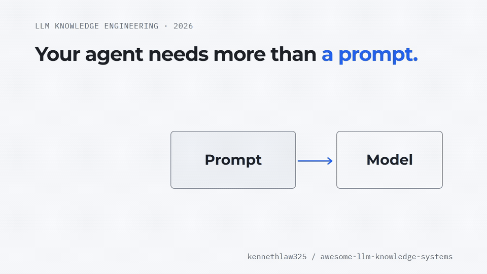
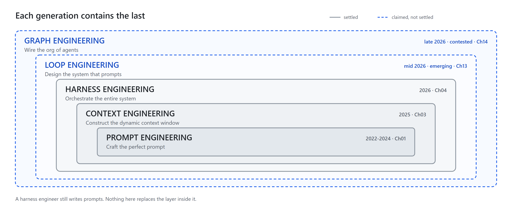
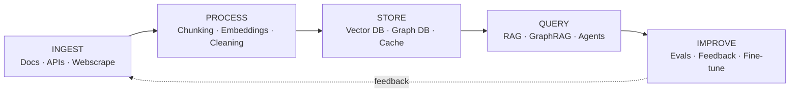
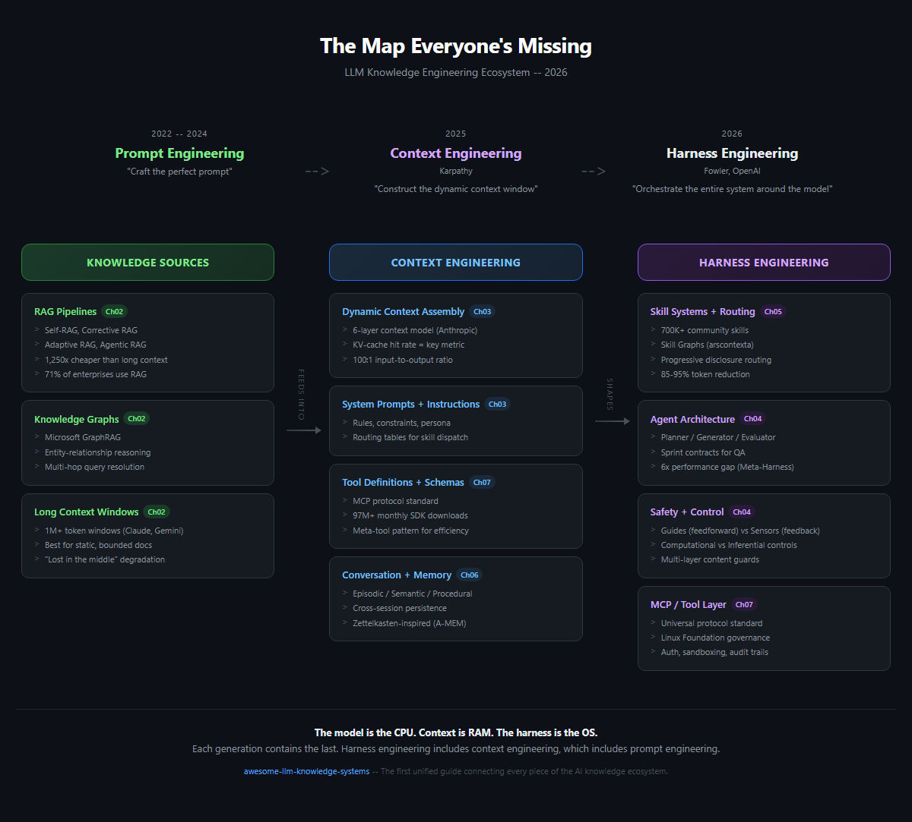

<!-- translation-sync:start -->
> Traducción asistida por máquina sincronizada con la edición inglesa de 2026-10-31, con revisión de estructura y contenido. El código y las etiquetas de los diagramas conservan el original; los tiempos de lectura se estiman a partir del inglés.
> [English source](../README.md) · [Sync record](SYNC.md)
<!-- translation-sync:end -->

<a id="the-map-everyones-missing-llm-knowledge-engineering-in-2026"></a><!-- i18n-anchor -->

# El mapa que todos pasan por alto: ingeniería del conocimiento para LLM en 2026

[English](../README.md) | [繁體中文](README-zh.md) | [简体中文](README_zh-CN.md) | [日本語](README_ja.md) | [한국어](README_ko.md) | **Español**

[Lea la guía en línea](https://kennethlaw325.github.io/awesome-llm-knowledge-systems/) · [Elija una ruta de lectura](#which-path-should-you-take) · [Cronología](chapters/es/11-timeline.md) · [Registro de cambios](../CHANGELOG.md)

> Analicé 50+ listas awesome, revisiones y guías; ninguna conectaba todas las piezas. Los artículos sobre RAG no mencionan la ingeniería de harness. Los frameworks de memoria ignoran los sistemas de habilidades. La documentación de MCP omite la divulgación progresiva. Esta guía traza el mapa completo.

<a id="october-2026-update"></a><!-- i18n-anchor -->

## Actualización de octubre de 2026

Esta edición examina los límites entre sistemas: quién es responsable del contexto persistente, quién resuelve los recuerdos contradictorios y qué puede observar realmente el monitor de un agente.

- **La memoria necesita corrección y responsables definidos.** La versión de Notion del 13 de octubre conecta un espacio de trabajo compartido con habilidades y controles de acceso; la versión de Cognee del 29 de octubre hace persistentes las resoluciones de conflictos y las invalida cuando cambian los datos que las respaldan. Véanse [Ch06](chapters/es/06-agent-memory.md) y [Ch08](chapters/es/08-tools-landscape.md).
- **La inferencia local tiene más de una función.** El anuncio de Liquid AI del 23 de septiembre separa el contexto del dispositivo de los agentes que lo utilizan. El endpoint de decisiones de Ollama del 29 de septiembre devuelve decisiones tipadas y probabilidades para juicios acotados. Véase [Ch12](chapters/es/12-local-models.md).
- **Los agentes de larga duración necesitan límites que sobrevivan a los traspasos.** Un caso de cliente del 14 de octubre describe un harness externo para tareas de varios días; la investigación de octubre examina la contención de las evaluaciones y la supervisión a través de la compactación y de múltiples agentes. Véanse [Ch04](chapters/es/04-harness-engineering.md) y [Ch13](chapters/es/13-loop-engineering.md).
- **La interoperabilidad no garantiza la seguridad.** El anuncio de Agent Skills del 22 de octubre registra una adopción más amplia entre plataformas. La especificación portátil normaliza los metadatos y las instrucciones de las habilidades, mientras que los sistemas anfitriones siguen siendo responsables del enrutamiento y de hacer cumplir las reglas. [Ch05](chapters/es/05-skill-systems.md) separa estas responsabilidades; [Ch14](chapters/es/14-graph-engineering.md) actualiza la evidencia sobre un término que sigue siendo controvertido.

El [registro de cambios](../CHANGELOG.md) recoge las correcciones factuales y el mantenimiento. Las cinco ediciones traducidas abarcan el README de esta edición en inglés, los 14 capítulos y el glosario. El original en inglés sigue siendo la referencia para resolver dudas de traducción; todas las ediciones conservan las fechas de las fuentes y los límites de la evidencia.

<details>
<summary>Vea el mapa conectado en 30 segundos (animación)</summary>



[Ver o descargar el MP4](../diagrams/knowledge-map.mp4) · [Mapa estático](../diagrams/evolution-stack.png)

La animación sin sonido presenta las capas consolidadas y los itinerarios de lectura. La ingeniería de bucles y la ingeniería de grafos siguen siendo temas emergentes o controvertidos, no generaciones adicionales consolidadas.

</details>

<details>
<summary><b>Actualización anterior: septiembre de 2026</b> (desplegar)</summary>

La oleada de mediados de septiembre de 2026 añade diez entradas a la cronología —nueve externas y el resultado de la evaluación de supervivencia de esta propia guía— e integraciones en diez capítulos y el glosario. El hilo conductor es una capa de seguridad que alcanza por fin a las capacidades básicas a las que iba siguiendo: el primer producto comercializado de detección durante la ejecución para agentes de IA (Falcon Guardian de CrowdStrike) llega el mismo día en que AIR sale del modo confidencial con $50M y una medición de la superficie expuesta; OpenAI publica el primer modelo que clasifica como *Critical* para ciberseguridad e incorpora un contrato de rechazo a una versión de amplia disponibilidad; y el informe de amenazas de septiembre de Anthropic alega destilación a escala industrial por parte de laboratorios chinos identificados por su nombre. En ese mismo periodo venció la evaluación de supervivencia de septiembre del capítulo 14, con un veredicto dividido: el término superó la prueba de circulación definida por el criterio, pero no está demostrado que constituya una capa de ingeniería distinta. Esta oleada se apoya en la de finales de agosto (la capa de harness se abre como código abierto a ambos lados del Pacífico en una misma semana) y la de principios de agosto (Metis). En orden de más reciente a más antiguo (registro cronológico completo: [CHANGELOG.md](../CHANGELOG.md)):

- **15 de septiembre: vence la evaluación de supervivencia del capítulo 14** — se comprueba el criterio publicado por esta guía en julio y el veredicto se divide: el término superó la prueba de circulación definida (ensayos independientes durante agosto y septiembre, más un curso de pago que enseña su sentido de organización de agentes), pero no se encontró adopción por proveedores en la documentación revisada; el requisito de un caso de producción solo se satisface retrospectivamente con el sistema de investigación multiagente de Anthropic de junio de 2025; y su condición de capa de ingeniería distinta sigue sin demostrarse y queda fuera de las generaciones numeradas ([Ch14 §14.7](chapters/es/14-graph-engineering.md), [Ch01](chapters/es/01-evolution.md), [Ch11](chapters/es/11-timeline.md), glosario)
- **11 de septiembre: Salesforce publica un entorno de ejecución de largo horizonte para Agentforce** — memoria que persiste entre sesiones, ejecución duradera que mantiene un plan activo a través de ellas y ajustes de dirección durante la ejecución, anunciado junto con siete agentes delimitados por función laboral, con Hunter como primero en probar el entorno; es la mitad de la demanda que corresponde a las sesiones de 14 días incorporadas por AWS a la infraestructura, aunque "pursues goals across days and weeks" es una afirmación de Salesforce y Hunter, el agente creado para demostrarlo, alcanza la disponibilidad general en noviembre de 2026 ([Ch04 §4.9](chapters/es/04-harness-engineering.md), [Ch11](chapters/es/11-timeline.md))
- **10 de septiembre: el informe de amenazas de Anthropic alega destilación a escala industrial** — el informe de inteligencia de amenazas de septiembre alega que Moonshot AI enrutó solicitudes de clientes de Kimi hacia Claude mediante 5,380 cuentas fraudulentas, con cerca de 300,000 solicitudes concentradas en diez días y más de 23 millones de intercambios entre mayo y julio; atribuye más de 151 millones de intercambios a Alibaba en ese mismo periodo e identifica también a DeepSeek, Z.ai, Xiaomi, MiniMax y SenseTime; todas las cifras son alegaciones de Anthropic contra competidores, sin resolución independiente, extraídas de la sección de destilación del propio informe ([Ch09](chapters/es/09-china-ecosystem.md), [Ch11](chapters/es/11-timeline.md))
- **4 de septiembre: ¿sobrevive la memoria del agente a una actualización del modelo?** — un estudio controlado encuentra que la memoria en grafos de esquema fijo permanece casi invariable al cambiar de modelo (la precisión varía 0.0004 más o menos 0.0020), mientras que las notas comprimidas oscilan +9.91 o -13.28 puntos; atribuye aproximadamente el 80% de su degradación a información descartada al *escribir* la memoria, por lo que conservar la fuente sin procesar junto a la versión comprimida permite repararla (34 de 48 casos, en una de las dos direcciones de migración probadas); dos autores y 48 casos sintéticos: una regla de diseño con una base de evidencia limitada ([Ch06](chapters/es/06-agent-memory.md), [Ch02](chapters/es/02-knowledge-layer.md), [Ch11](chapters/es/11-timeline.md))
- **3 de septiembre: GPT-6 Astra supera el umbral de ciberseguridad Critical de OpenAI** — es el primer modelo que OpenAI clasifica como Critical para ciberseguridad según su Preparedness Framework; el modelo publicado rechaza tareas como generar exploits de prueba de concepto, y OpenAI identifica Daybreak y Daybreak Blue como la vía prevista para defensores verificados, mientras despliega ampliamente el acceso, desactivado por defecto en los espacios empresariales durante el lanzamiento; el mismo informe de seguridad señala una *disminución* de la capacidad de supervisar la cadena de pensamiento, incluida la ocultación deliberada de capacidades que permanece sin detectar; ExploitBench 100% frente a 78.5%, ExploitGym 42.4% y SRE-Bench 88.0% en el primer intento son cifras de OpenAI, medidas sin las salvaguardias de producción ([Ch04 §4.2](chapters/es/04-harness-engineering.md), [Ch11](chapters/es/11-timeline.md))
- **1 de septiembre: la seguridad de las habilidades se comercializa con Falcon Guardian y los $50M de AIR** — CrowdStrike lanza Falcon Guardian, que inventaría agentes de IA conocidos y no registrados en dispositivos Windows y macOS y aplica políticas y detección durante la ejecución: es el primer producto comercializado que responde al argumento de §5.10 sobre pasar del escaneo al publicar a la contención en ejecución, sin cifras de eficacia en ninguna de las dos fuentes consultadas; ese mismo día AIR sale del modo confidencial con $50M e informa de 17,800+ complementos públicos de IA, con aproximadamente 6.7M instalaciones, dependientes de fuentes externas de instrucciones no confiables; son cifras propias con una metodología no publicada ([Ch05 §5.10](chapters/es/05-skill-systems.md), [Ch11](chapters/es/11-timeline.md))
- **20 de agosto: StateMemBench añade la sustitución por información más reciente como eje de evaluación de memoria** — 234 escenarios de varias sesiones modifican un hecho, una restricción o una decisión a mitad del recorrido y preguntan si la capa de memoria devuelve el valor vigente o el sustituido; es el tercer eje de gobernanza tras GateMem (control de acceso) y MemSyco-Bench (complacencia), y el primero que llega con una solución en lugar de un resultado nulo: StateMem informa de una precisión del estado actual de 1.8x en DeepSeek-V4-Flash y, como envoltorio de seis backends, de +15 a +32 puntos tras controlar el contexto añadido; todas son cifras del artículo, sin replicación ([Ch06](chapters/es/06-agent-memory.md), [Ch11](chapters/es/11-timeline.md))
- **30 de julio: Memory Bank alcanza la disponibilidad general en Gemini Enterprise Agent Platform** — Agent Memory Bank (contexto de conversación extraído a un esquema definido por el desarrollador), Agent Runtime con agentes continuos de hasta siete días, Agent Identity como tipo nativo de IAM, Agent Gateway y Agent Registry: cinco capacidades alcanzan juntas la disponibilidad general; todas sus descripciones proceden de Google, y se trata de la disponibilidad general del sucesor renombrado de la vista previa pública de Vertex AI Memory Bank de julio de 2025, no de un primer anuncio; junto con TencentDB cuatro días después, convierte la memoria gestionada en una categoría de proveedores de nube ([Ch06](chapters/es/06-agent-memory.md), [Ch04 §4.9](chapters/es/04-harness-engineering.md), [Ch11](chapters/es/11-timeline.md))
- **29-30 de julio: tres artículos sobre memoria en dos días** — el primer estudio sistemático del patrón de memoria basado en árboles de directorios Markdown (arXiv 2607.26637; organizar el almacén reduce aproximadamente a la mitad el coste de recuperación cuando crece, aunque la organización se deteriora con todos los agentes gestores salvo el más potente y ninguno de los evaluados convierte esa organización en mejores respuestas); el límite transaccional de MemTxn en torno a las *escrituras* en memoria (arXiv 2607.27834; 60 actualizaciones respaldadas por las fuentes aceptadas y 179 casos negativos construidos rechazados en el pequeño conjunto de validación de los autores, mientras MemTX, de otro equipo y publicado tres días antes, convierte la memoria transaccional en dos propuestas independientes en lugar de una sola línea); y Memory Decoder at Scale (arXiv 2607.27919; un módulo de memoria de 6.9B lleva una base Pythia de 410M por encima del promedio de Pythia-12B en 17 benchmarks con un 39% menos de parámetros totales, según los autores): el sistema de archivos, el almacén gobernado y los pesos obtuvieron cada uno un resultado en cuarenta y ocho horas ([Ch06](chapters/es/06-agent-memory.md), [Ch11](chapters/es/11-timeline.md))
- **29 de julio: los modelos chinos copan los cinco primeros puestos semanales de OpenRouter** — MiMo-V2.5 de Xiaomi ocupa el #1, por delante de DeepSeek, MiniMax, Qwen y Kimi; son los primeros cinco puestos íntegramente chinos en la clasificación semanal global de uso de tokens de OpenRouter, con el liderazgo mantenido a principios de septiembre; OpenRouter publica una vista móvil en directo, sin archivo histórico, por lo que tanto esos cinco puestos como las cuotas se basan en análisis secundarios; "more than 60%" del tráfico enrutado en torno al hito de julio y "46.4%" a principios de septiembre son mediciones distintas comunicadas por separado, nunca combinadas como una tendencia ([Ch09](chapters/es/09-china-ecosystem.md), [Ch11](chapters/es/11-timeline.md))

*De oleadas anteriores (detalles completos en [CHANGELOG.md](../CHANGELOG.md)):*

- **22 de agosto: nueva hoja de ruta de MCP** — menos de cuatro semanas después de la especificación final, los mantenedores principales formalizan la gobernanza (Contributor Ladder, triaje de SEP por grupos de trabajo, ciclo de vida de funciones y política de retirada) y definen cinco prioridades: capacidades básicas de mensajería entre agentes con *Tasks avanzando hacia el núcleo*, transporte nativo HTTP para despliegues locales, identidad de agentes mediante DPoP y Workload Identity Federation, manejo de resultados de herramientas y descubrimiento progresivo en catálogos grandes, y conformidad de los SDK ([Ch07](chapters/es/07-mcp.md), [Ch11](chapters/es/11-timeline.md))
- **19 de agosto: OpenAI reposiciona Codex como plataforma** — `codex exec`, el SDK de Codex y *app-server* se publican con Apache 2.0 como un producto de harness desacoplado, mientras el acceso al modelo sigue siendo propietario; `openai/codex` es público y tiene licencia Apache-2.0 desde abril de 2025, por lo que se trata de un reposicionamiento, no de su primera apertura; la mejora en ARC-AGI-3 de 13.3%→38.3% con 6x menos tokens de salida es una cifra de OpenAI ([Ch04 §4.7](chapters/es/04-harness-engineering.md), [Ch11](chapters/es/11-timeline.md))
- **19 de agosto: la API de Skills de Anthropic alcanza la disponibilidad general** — `/v1/skills` sale de beta (nota de versión del 19 de agosto y artículo complementario del 20 de agosto) dentro de una oleada más amplia de disponibilidad general para agentes de producción; doce días antes, las habilidades alojadas en GitHub permitían a Managed Agents descubrir automáticamente el directorio `.claude/skills` de un repositorio montado al comenzar la sesión, y la propia documentación de Anthropic indica que el repositorio pasa a formar parte del *límite de confianza* del agente sin un paso de revisión ([Ch05 §5.2](chapters/es/05-skill-systems.md), [Ch11](chapters/es/11-timeline.md))
- **13 de agosto: DeepSeek Harness (dsh)** — un harness de agentes con licencia MIT cuyos adaptador de modelo, registro de herramientas, registro de sesiones, sandbox, almacenamiento, planificador e interfaz son complementos intercambiables ("Cordis"), con un registro de solo anexado de cada inyección de contexto; 190,630 estrellas / 21,319 bifurcaciones en 11 días (API de GitHub, comprobada el 24 de agosto) extienden la lógica china de priorizar el código abierto desde los pesos hasta el harness ([Ch09](chapters/es/09-china-ecosystem.md), [Ch11](chapters/es/11-timeline.md))
- **10 de agosto: Meta Muse Glimmer** — un modelo denso de 30B con licencia Apache-2.0, destilado de Muse Spark y diseñado para agentes locales (menos de 20GB a 4 bits, una sola GPU de consumo), con soporte desde el día 0 en Ollama, llama.cpp, MLX, ExecuTorch, vLLM y otros; es el primer laboratorio estadounidense de frontera que publica para el uso local con una sola GPU, en lugar de pesos abiertos para servidores; todas las cifras de aceleración y benchmarks proceden de Meta ([Ch12](chapters/es/12-local-models.md), [Ch11](chapters/es/11-timeline.md))
- **7 de agosto: Claude Code incorpora mensajería entre agentes de distintas sesiones** — `ListAgents` y `SendMessage` permiten que las sesiones con nombre se dirijan unas a otras, con controles de aceptar / retener / rechazar mensajes entrantes por sesión, sin que el historial, los archivos ni las aprobaciones de permisos crucen el límite; un proveedor importante publica la capacidad básica de *grafo organizativo* del capítulo 14 sin utilizar la expresión "graph engineering" ([Ch14 §14.2](chapters/es/14-graph-engineering.md), [Ch11](chapters/es/11-timeline.md))
- **6 de agosto: campaña de habilidades Paperclip** — organizaciones que suplantaban a `paperclipai` y `browser-use` publicaron habilidades benignas el 5 de julio, convertidas en maliciosas el 11 de julio y situadas en el #8 de tendencias; la carga recorrió 138 rutas de credenciales mediante cuatro mecanismos de activación independientes, y el contador de >1.7M instalaciones es agregado, no de agentes únicos: el patrón de tiempo de comprobación frente a tiempo de uso pasa de una habilidad falsa a toda una familia ([Ch05 §5.10](chapters/es/05-skill-systems.md), [Ch11](chapters/es/11-timeline.md))
- **6 de agosto: AWS AgentCore publica Temporal Policies y Runtime Instances en disponibilidad general** — autorización determinista que deniega por defecto y evalúa cada llamada a una herramienta según el *historial previo de la sesión* del agente, escrita en el nuevo lenguaje de políticas Dogwood con licencia Apache-2.0; se publica el mismo día que Runtime Instances, cuyas sesiones EC2 elegidas por el cliente duran hasta 14 días, frente a las 8 horas predeterminadas del entorno sin servidor ([Ch04 §4.1](chapters/es/04-harness-engineering.md), [Ch11](chapters/es/11-timeline.md), glosario)
- **3 de agosto: TencentDB Agent Memory v2.0 añade memoria de equipo** — *niveles de visibilidad* privado / equipo / restringido / agente sobre cuatro tipos de activos de memoria versionados, un Memory Proxy compatible con los protocolos de Anthropic y OpenAI, y destilación L0-L3: la primera respuesta publicada al eje de control de acceso para el que GateMem no encontró ningún framework que lo satisficiera; todas las afirmaciones de gobernanza proceden de Tencent y no existe un benchmark independiente ([Ch06](chapters/es/06-agent-memory.md), [Ch11](chapters/es/11-timeline.md))
- **2 de agosto: compactación práctica en línea de la caché KV para agentes** — el primer estudio sistemático de compactación en *trayectorias de agentes*: compactar inmediatamente reduce la precisión; esperar a que las consultas posteriores del propio agente actúen como señal de consulta sustitutiva recupera la mayor parte; y expulsar tokens supera la reconstrucción por coincidencia de atención: una reducción de caché del 80% con mayor rendimiento que sin compactación ([Ch03 §3.3](chapters/es/03-context-engineering.md), [Ch11](chapters/es/11-timeline.md))
- **29 de julio: Metis de MemTensor propone modelos fundacionales de memoria** — MemTensor (Shanghái), el laboratorio de la revisión de junio sobre memoria nativa de agentes, con coautores de Renmin University / NUS / SJTU / Tongji, propone la memoria del agente como *estado paramétrico persistente dentro del propio núcleo del transformer*, en vez de un almacén externo: un núcleo Qwen3.5 congelado (4B/9B/27B) en el que solo se entrenan un "hyper memory block" y un "local memory block", inspirados en Fast Weight Programming, actualizados durante la inferencia mediante una pasada de estilo EMA sin gradientes; el artículo reconoce pérdida de información a largo plazo con compresión de tamaño fijo y "information confusion in some cases, possibly caused by the blending of semantics within the latent space" ([Ch06](chapters/es/06-agent-memory.md), [Ch11](chapters/es/11-timeline.md), glosario)
- **29 de julio: LangChain publica Deep Agents v0.7** — elimina el prompt de sistema básico predeterminado del framework, recorta un 43% las descripciones de las herramientas incorporadas y hace opcional la estructura de planificación basada en una lista de tareas, después de que evaluaciones con tres familias de modelos no encontraran mejoras medibles; reduce aproximadamente un 65% los tokens de entrada básicos de un turno de agente predeterminado (~6k a ~2k): un ejemplo en producción de la disciplina de pruebas de resistencia de esta guía ([Ch04 §4.8](chapters/es/04-harness-engineering.md), [Ch11](chapters/es/11-timeline.md))
- **29 de julio: MinIO publica AIStor Memory** — una capa respaldada por almacenamiento de objetos para memoria del agente, estado del espacio de trabajo y credenciales, planteada como sustituta de una pila montada a mano de almacén vectorial, base de datos de metadatos y herramientas de credenciales, con un registro duradero, íntegro y propiedad del cliente ([Ch11](chapters/es/11-timeline.md))
- **28 de julio: se publica la especificación final MCP 2026-07-28** — la mayor revisión desde que se añadió la autorización: un *núcleo de solicitudes y respuestas sin estado*, Multi Round-Trip Requests (SEP-2322), validación del emisor conforme a RFC 9207, Client ID Metadata Documents que sustituyen a Dynamic Client Registration y un marco formal de extensiones, con un periodo de retirada de 12 meses para Roots / Sampling / Logging / HTTP+SSE ([Ch07](chapters/es/07-mcp.md), [Ch11](chapters/es/11-timeline.md), glosario)
- **24 de julio: Claude Opus 5** — mantiene el precio de Opus 4.8, la mitad que Fable 5; contexto de 1M / salida de 128K, un *selector `effort` de cinco niveles*, modo Fast de pago y cambios de herramientas a mitad de conversación sin invalidar la caché del prompt (beta); las cifras de benchmarks son afirmaciones de Anthropic ([Ch04 §4.10](chapters/es/04-harness-engineering.md), [Ch11](chapters/es/11-timeline.md))
- **17-22 de julio: nuevo capítulo 14, Ingeniería de grafos** — el segundo nombre de capa en seis semanas recibe un capítulo completo: la publicación catalizadora de Steinberger del 17-18 de julio; la distinción entre grafo organizativo y grafo de trabajo (Thakker); bucles que supervisan bucles sujetos a *anclas* (Perez); topologías gobernadas (TrueFoundry, Eigent); y la respuesta de doble filo de LangChain, "3 Years of Graph Engineering with LangGraph"; se presenta como *emergente y controvertido*, con dos semanas de existencia, dando el mismo peso a los escépticos y fijando una evaluación de supervivencia explícita para septiembre de 2026; comprobada el 15 de septiembre de 2026: la circulación sobrevivió, pero su condición de capa distinta no está demostrada ([Ch14](chapters/es/14-graph-engineering.md), [Ch01](chapters/es/01-evolution.md), glosario)
- **18 de julio: Anthropic resuelve el acceso a Fable 5 por suscripción** — Max y Team Premium conservan Fable 5 permanentemente desde el 20 de julio, al 50% de los límites de uso semanales, mientras Pro y Team Standard pasan a tarifas con créditos de uso; se cierra así el recorrido iniciado por la suspensión por controles de exportación del 12 de junio ([Ch11](chapters/es/11-timeline.md))
- **17 de julio: Moonshot publica Kimi K3** — con 2.8T parámetros (MoE), el mayor modelo de pesos abiertos publicado hasta entonces, contexto de 1M y visión nativa; encabeza la clasificación de programación frontend de Arena como modelo de pesos abiertos, con pesos publicados el 27 de julio bajo la licencia específica Kimi K3 de Moonshot ("open weight," según la empresa, no "open source"); requiere servidores, por lo que amplía la frontera de pesos abiertos sin cambiar el panorama del despliegue local ([Ch09](chapters/es/09-china-ecosystem.md), [Ch11](chapters/es/11-timeline.md))
- **17 de julio: WAIC 2026 y fundación de WAICO** — la World AI Conference de Shanghái produce el acuerdo que establece la World Artificial Intelligence Cooperation Organization, la primera organización intergubernamental dedicada a la IA, con sede en Shanghái ([Ch09](chapters/es/09-china-ecosystem.md), [Ch11](chapters/es/11-timeline.md))
- **14 de julio: nuevo capítulo 13, Ingeniería de bucles** — el marco de junio de 2026 de "loop engineering" recibe un capítulo completo: la publicación catalizadora de Peter Steinberger, el ensayo en que Addy Osmani le da nombre y su continuación "Own the Outer Loop", Boris Cherny, la separación entre generador y evaluador (Rajasekaran), los minions de Stripe, los cuatro niveles apilados de LangChain y las señales de adopción; se presenta como *emergente y controvertido*, con cinco semanas de existencia y todavía sin literatura académica ([Ch13](chapters/es/13-loop-engineering.md), [Ch01](chapters/es/01-evolution.md), glosario)

</details>

---

## TL;DR

- **La ingeniería de prompts fue solo el comienzo.** El campo ha evolucionado a través de tres generaciones: ingeniería de prompts (2022-2024), ingeniería de contexto (2025) e ingeniería de harness (2026). Cada capa incorpora la anterior, y a mediados de 2026 surgió una cuarta capa controvertida, la *ingeniería de bucles* ([Ch13](chapters/es/13-loop-engineering.md)). Seis semanas después llegó una quinta propuesta, la *ingeniería de grafos*, sometida a una evaluación de supervivencia comprobada el 15 de septiembre de 2026: siguió circulando como nombre controvertido para la coordinación multiagente, pero no está demostrado que sea una quinta capa distinta ([Ch14](chapters/es/14-graph-engineering.md)).
- **RAG y el contexto largo resuelven restricciones diferentes.** Elíjalos y combínelos evaluando la calidad de recuperación, la actualización de las fuentes, la latencia y el coste en su propia carga de trabajo ([Ch02](chapters/es/02-knowledge-layer.md)).
- **La ingeniería de contexto se trata de lo que rodea a la llamada, no de la llamada en sí.** El replanteamiento de Andrej Karpathy a mediados de 2025 cambió el enfoque de la elaboración de prompts a la construcción de toda la ventana de contexto dinámicamente.
- **La ingeniería de harness es la capa del sistema operativo.** Birgitta Böckeler (en la serie de memorandos *Exploring Generative AI* de Martin Fowler, abril de 2026) y el enfoque de diseño de harness del equipo Codex de OpenAI formalizaron esta idea: el modelo es la CPU, el contexto es la RAM y el harness es el sistema operativo que lo orquesta todo.
- **Hasta ahora, ninguna guía había conectado todas estas piezas.** RAG, grafos de conocimiento, contexto largo, MCP, enrutamiento de habilidades, sistemas de memoria y divulgación progresiva forman parte de un mismo ecosistema. Este es el mapa.

---

<a id="start-here"></a><!-- i18n-anchor -->

## Empiece aquí

Las herramientas de inteligencia artificial son cada año más inteligentes, pero solo funcionan bien cuando reciben la información correcta en el momento adecuado. Esta guía explica cómo funciona, desde los conceptos básicos para decirle a una IA qué hacer hasta el diseño de sistemas completos en torno a modelos de IA.

Piense en la IA como un nuevo empleado brillante en su primer día. La ingeniería de prompts consiste en asignarle una tarea. La ingeniería de contexto le proporciona toda la información que necesita para hacerla bien. La ingeniería de harness diseña todo su entorno de trabajo —escritorio, herramientas, sistema de archivos y estructura del equipo— para que pueda rendir al máximo de forma constante. Esta guía cubre los tres niveles y muestra cómo se conectan.

Si es nuevo en este tema, comience con el [Glosario](glossary_es.md) para obtener definiciones de términos clave. Si crea aplicaciones de IA, pase directamente a los capítulos siguientes. Si solo desea tener una visión general, mire el diagrama del mapa del ecosistema más abajo en esta página.

---

<a id="which-path-should-you-take"></a><!-- i18n-anchor -->

## ¿Qué camino debería tomar?

¿No sabe por dónde empezar? Elija la descripción que mejor encaje con su situación:

- **"I just want to understand what all these AI buzzwords mean."** -- Comience con el [Glosario](glossary_es.md), luego lea el [Capítulo 1: Las Tres Generaciones](chapters/es/01-evolution.md).
- **"I'm building an AI application."** -- Lea [Ch02: RAG, contexto largo y gráficos de conocimiento](chapters/es/02-knowledge-layer.md), luego [Ch03: Ingeniería de Contexto](chapters/es/03-context-engineering.md), luego [Ch04: Ingeniería de Harness](chapters/es/04-harness-engineering.md).
- **"I want to make my AI tools work better."** -- Lea [Ch05: Sistemas de habilidades](chapters/es/05-skill-systems.md), después [Ch06: Memoria de agentes](chapters/es/06-agent-memory.md) y [Ch10: Estudio de caso](chapters/es/10-case-study.md).
- **"I want my agents to run without me pushing every step."** -- Lea [Ch13: Ingeniería de Bucles](chapters/es/13-loop-engineering.md), luego [Ch04: Ingeniería de Harness](chapters/es/04-harness-engineering.md) y [Ch06: Memoria del agente](chapters/es/06-agent-memory.md).
- **"I'm wiring multiple agents together."** -- Lea [Cap.14: Ingeniería de Grafos](chapters/es/14-graph-engineering.md), luego [Ch13: Ingeniería de Bucles](chapters/es/13-loop-engineering.md) y [Ch04: Ingeniería de Harness](chapters/es/04-harness-engineering.md).
- **"I want to see real examples."** -- Vaya directamente a [Capítulo 10: Estudio de caso](chapters/es/10-case-study.md).
- **"I work with Chinese AI tools."** -- Comience con [Capítulo 09: El ecosistema de IA chino](chapters/es/09-china-ecosystem.md).
- **"I want the complete picture."** -- Lea de adelante hacia atrás, comenzando con el capítulo 1.

---

<a id="use-cases"></a><!-- i18n-anchor -->

## Casos de uso

Esta guía le ayuda a diseñar sistemas para estos escenarios reales. Cada fila enlaza con los capítulos más relevantes para ese proyecto:

| Escenario | Qué está construyendo | Capítulos principales |
|----------|---------------------|---------------|
| **Segundo cerebro personal** | Notas personales, artículos y recortes web que se pueden buscar mediante consultas en lenguaje natural | [Ch02](chapters/es/02-knowledge-layer.md) · [Ch05](chapters/es/05-skill-systems.md) · [Ch08](chapters/es/08-tools-landscape.md) |
| **Base de conocimientos interna de una empresa** | Los empleados consultan políticas / manuales / guías operativas: baja tolerancia a las alucinaciones y citas obligatorias | [Ch02](chapters/es/02-knowledge-layer.md) · [Ch04](chapters/es/04-harness-engineering.md) · [Ch06](chapters/es/06-agent-memory.md) |
| **Asistente de documentación para desarrolladores** | Los ingenieros consultan bases de código / documentación de API / análisis de incidentes anteriores en entornos con múltiples repositorios | [Ch02](chapters/es/02-knowledge-layer.md) · [Ch05](chapters/es/05-skill-systems.md) · [Ch07](chapters/es/07-mcp.md) |
| **Agente de soporte/control de calidad** | Tickets internos o de cliente → respuestas contextuales con fuentes citadas y memoria de seguimiento | [Ch03](chapters/es/03-context-engineering.md) · [Ch06](chapters/es/06-agent-memory.md) · [Ch04](chapters/es/04-harness-engineering.md) |
| **Automatización del conocimiento en dominios específicos** *(derecho, salud, finanzas, ingeniería)* | Reutilizar décadas de documentos del dominio: regulados, sensibles en materia de propiedad intelectual y, a menudo, con necesidad de modelos locales y trazabilidad de auditoría | [Ch02](chapters/es/02-knowledge-layer.md) · [Ch09](chapters/es/09-china-ecosystem.md) · [Ch12](chapters/es/12-local-models.md) |

Si su escenario no encaja perfectamente, probablemente sea una composición de estos: comience desde la fila más cercana y adáptese.

---

<a id="the-evolution"></a><!-- i18n-anchor -->

## La evolución



*Figura: Cada generación incorpora la anterior en lugar de sustituirla. Las dos exteriores se dibujan con líneas de puntos porque son propuestas, no capas consolidadas: la ingeniería de bucles se sigue aquí como emergente, y la evaluación del capítulo 14 del 15 de septiembre de 2026 encontró que la ingeniería de grafos sobrevivió como término en circulación, mientras su condición de capa distinta seguía sin demostrarse.*

<details>
<summary>Versión de texto del mapa de evolución</summary>

```
2022-2024               2025                    2026                    2026 (mid)?             2026 (late)??
PROMPT ENG        -->   CONTEXT ENG       -->   HARNESS ENG       -->   LOOP ENG (emerging) --> GRAPH ENG (contested)
                        (Karpathy)              (Fowler, OpenAI)        (Steinberger, Osmani)   (Steinberger, Perez)

"Craft the              "Construct the          "Orchestrate the        "Design the system      "Wire the org
 perfect prompt"        dynamic context         entire system           that prompts            of agents that
                        window"                 around the model"       the agent"              run the loops"
```

</details>

Cada generación incorpora la anterior en lugar de sustituirla. La ingeniería de harness incluye la ingeniería de contexto, que incluye la ingeniería de prompts. La ingeniería de bucles, una cuarta capa todavía controvertida, envuelve las tres: es el sistema que ejecuta el harness con un temporizador, crea asistentes y vuelve a introducir sus resultados como entrada. La ingeniería de grafos, la propuesta de julio de 2026 tratada en [Ch14](chapters/es/14-graph-engineering.md), abarcaría incluso ese nivel: conectar varios bucles en una organización diseñada; la comprobación del 15 de septiembre de 2026 del criterio de supervivencia de ese capítulo dejó deliberadamente abierta la cuestión: el término circula, pero no se encontró adopción por proveedores en la documentación revisada; dos proveedores publicaron la gobernanza que describe sin emplear el nombre; y su condición de verdadera quinta capa, en vez de una práctica de tres años con nuevo nombre (el contraargumento de LangChain), sigue sin demostrarse.

---

<a id="the-lifecycle"></a><!-- i18n-anchor -->

## El ciclo de vida

El mapa del ecosistema muestra **qué piezas existen**. El ciclo de vida muestra **cómo circulan los datos entre ellas**:

<details>
<summary>Versión de texto del ciclo de vida</summary>

```
                    ┌───── feedback ──────────────┐
                    ▼                             │
 INGEST  ───▶ PROCESS  ───▶ STORE  ───▶ QUERY ───▶ IMPROVE
    │             │            │          │           │
 Docs          Chunking      Vector DB    RAG        Evals
 APIs          Embeddings    Graph DB     GraphRAG   Feedback
 Web clips     Cleaning      Cache        Agents     Fine-tune
 Crawlers      Multi-modal   Long doc     Tool use   Skill updates
    │             │            │          │           │
   Ch02       Ch02 · Ch03    Ch02-08    Ch02-07     Ch06
```

</details>



Todos los sistemas de producción mueven los datos por las cinco etapas, aunque algunas sean implícitas. Un buen diseño de harness permite **inspeccionar y sustituir cada etapa**. Ch02 cubre Ingesta/Procesamiento/Almacenamiento; Ch03–Ch07 cubren Consulta; Ch06 y Ch10 cubren Mejora.

---

<a id="ecosystem-map"></a><!-- i18n-anchor -->

## Mapa del ecosistema



*[Ver versión HTML interactiva](../diagrams/ecosystem-map.html)*

<details>
<summary>Versión de texto del mapa del ecosistema</summary>

```
+---------------------------+     +---------------------------+     +---------------------------+
|    KNOWLEDGE SOURCES      |     |   CONTEXT ENGINEERING     |     |   HARNESS ENGINEERING     |
|                           |     |                           |     |                           |
|  +---------------------+ | --> |  +---------------------+ | --> |  +---------------------+ |
|  | RAG Pipelines       | |     |  | Dynamic Context     | |     |  | Skill Systems       | |
|  | - Self-RAG          | |     |  |   Assembly          | |     |  | - Routing Logic     | |
|  | - Corrective RAG    | |     |  |                     | |     |  | - Progressive       | |
|  | - Adaptive RAG      | |     |  | KV-Cache            | |     |  |   Disclosure        | |
|  +---------------------+ |     |  |   Optimization      | |     |  +---------------------+ |
|                           |     |  |                     | |     |                           |
|  +---------------------+ |     |  | System Prompts      | |     |  +---------------------+ |
|  | Knowledge Graphs    | |     |  |   + Instructions    | |     |  | Memory Frameworks   | |
|  | - GraphRAG          | |     |  |                     | |     |  | - Short-term        | |
|  | - Entity Relations  | |     |  | Tool Definitions    | |     |  | - Long-term         | |
|  | - Multi-hop Queries | |     |  |   + Schemas         | |     |  | - Episodic          | |
|  +---------------------+ |     |  |                     | |     |  +---------------------+ |
|                           |     |  | Few-shot Examples   | |     |                           |
|  +---------------------+ |     |  |                     | |     |  +---------------------+ |
|  | Long Context        | |     |  | Conversation        | |     |  | MCP / Tool Layer    | |
|  | - 1M+ token windows | |     |  |   History           | |     |  | - Protocol Std      | |
|  | - Static doc ingest | |     |  +---------------------+ |     |  | - Tool Routing      | |
|  +---------------------+ |     +---------------------------+     |  | - Auth + Sandboxing | |
+---------------------------+                                       |  +---------------------+ |
                                                                    |                           |
                                                                    |  +---------------------+ |
                                                                    |  | Agent Runtime       | |
                                                                    |  | - Planning Loops    | |
                                                                    |  | - Error Recovery    | |
                                                                    |  | - Multi-agent       | |
                                                                    |  |   Coordination      | |
                                                                    |  +---------------------+ |
                                                                    +---------------------------+
```

</details>

---

<a id="table-of-contents"></a><!-- i18n-anchor -->

## Tabla de contenidos

<a id="chapters"></a><!-- i18n-anchor -->

### Capítulos

| # | Capítulo | Descripción |
|---|---------|-------------|
| 01 | [Las tres generaciones](chapters/es/01-evolution.md) | De la ingeniería de prompts a la ingeniería de contexto y la ingeniería de harness |
| 02 | [RAG, contexto largo y grafos de conocimiento](chapters/es/02-knowledge-layer.md) | La capa de recuperación del conocimiento: qué funciona, qué no y por qué gana el enfoque híbrido |
| 03 | [Ingeniería de contexto](chapters/es/03-context-engineering.md) | El arte de llenar la ventana de contexto: caché KV, proporción 100:1 y ensamblaje dinámico |
| 04 | [Ingeniería de harness](chapters/es/04-harness-engineering.md) | Construir el sistema operativo alrededor del modelo: guías, sensores y una diferencia de rendimiento de 6x |
| 05 | [Sistemas de habilidades y grafos de habilidades](chapters/es/05-skill-systems.md) | De archivos planos a grafos navegables: divulgación progresiva en la práctica |
| 06 | [Memoria de agentes](chapters/es/06-agent-memory.md) | La capa que falta: arquitecturas de memoria episódica, semántica y procedimental |
| 07 | [MCP: el estándar que se impuso](chapters/es/07-mcp.md) | Model Context Protocol: desde su lanzamiento hasta 97M+ descargas mensuales (Q1 de 2026) |
| 08 | [Gestión del conocimiento nativa de IA](chapters/es/08-tools-landscape.md) | Panorama de herramientas: Notion AI, Obsidian, Mem y la brecha de las herramientas nativas de IA |
| 09 | [El ecosistema de IA chino](chapters/es/09-china-ecosystem.md) | Dify, RAGFlow, DeepSeek, Kimi: un universo paralelo de innovación |
| 10 | [Estudio de caso: un harness de conocimiento real](chapters/es/10-case-study.md) | Cómo un desarrollador construyó un harness completo con una reducción de tokens del 65% |
| 11 | [Cronología](chapters/es/11-timeline.md) | Hitos de la ingeniería del conocimiento para LLM, 2022-2026 |
| 12 | [Modelos locales para la ingeniería del conocimiento](chapters/es/12-local-models.md) | Ejecutar su harness de conocimiento localmente: embeddings, RAG, compilación y el ajuste fino como destino final |
| 13 | [Ingeniería de bucles](chapters/es/13-loop-engineering.md) | La cuarta capa emergente: diseñar el sistema que proporciona prompts al agente y determinar si constituye una generación propia |
| 14 | [Ingeniería de grafos](chapters/es/14-graph-engineering.md) | La quinta propuesta controvertida: conectar la organización de agentes; superó la evaluación de circulación de septiembre de 2026, pero sigue sin demostrarse como capa distinta |

---

<a id="why-this-guide-exists"></a><!-- i18n-anchor -->

## Por qué existe esta guía

El ecosistema de LLM en 2026 tiene un problema de fragmentación. No falta información: sobra información desconectada.

Hay revisiones extensas sobre RAG. Guías completas de ingeniería de prompts. Especificaciones de MCP. Comparativas de frameworks de agentes. Artículos sobre sistemas de memoria. Cada recurso es excelente por separado. Ninguno muestra cómo encajan las piezas.

Esta guía aporta esa capa que falta. Conecta RAG con la ingeniería de contexto, esta con la ingeniería de harness y esta última con los entornos de ejecución de agentes; muestra qué decisiones importan en cada límite.

---

<a id="contributing"></a><!-- i18n-anchor -->

## Cómo contribuir

Las contribuciones son bienvenidas. Esta es una guía con selección editorial: las propuestas deben reforzar el mapa.

- **Añadir un recurso:** [Enviar una pull request](https://github.com/kennethlaw325/awesome-llm-knowledge-systems/pulls); consulte las pautas en [CONTRIBUTING.md](../CONTRIBUTING.md)
- **Sugerir un recurso:** [Abrir una incidencia](https://github.com/kennethlaw325/awesome-llm-knowledge-systems/issues/new?template=suggest-resource.md)
- **Informar de un enlace roto:** [Abrir una incidencia](https://github.com/kennethlaw325/awesome-llm-knowledge-systems/issues/new?template=report-broken-link.md)
- **Debatir:** [Participar en la conversación](https://github.com/kennethlaw325/awesome-llm-knowledge-systems/discussions)
- **Traducciones**: Las pull requests de traducción van en `/translations/`. Mantenga la misma estructura de archivos. Traducciones disponibles: [繁體中文](README-zh.md) | [简体中文](README_zh-CN.md) | [日本語](README_ja.md) | [한국어](README_ko.md) | [Español](README_es.md)

Mantenga un tono profesional y accesible. Cite las fuentes. Evite la exageración.

---

<a id="license"></a><!-- i18n-anchor -->

## Licencia

Licencia MIT. Consulte [LICENSE](../LICENSE) para más detalles.

Úselo como prefiera. Se agradece la atribución, pero no es obligatoria.

---

*Edición en inglés actualizada: 31 de octubre de 2026. Los capítulos registran las fechas de las fuentes y los límites de la evidencia.*
