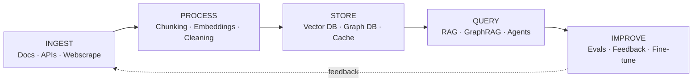

<!-- translation-sync:start -->
> 2026-10-31 の英語版に同期した機械支援翻訳です。構造と内容を確認しています。コードと図中ラベルは原文のまま、読書時間は英語原文の推定値です。
> [English source](../README.md) · [Sync record](SYNC.md)
<!-- translation-sync:end -->

<a id="the-map-everyones-missing-llm-knowledge-engineering-in-2026"></a><!-- i18n-anchor -->

# 誰もつなげてこなかった全体図：2026年の LLM ナレッジエンジニアリング

[English](../README.md) | [繁體中文](README-zh.md) | [简体中文](README_zh-CN.md) | **日本語** | [한국어](README_ko.md) | [Español](README_es.md)

[オンラインで読む](https://kennethlaw325.github.io/awesome-llm-knowledge-systems/) · [読む順序を選ぶ](#which-path-should-you-take) · [年表](chapters/ja/11-timeline.md) · [変更履歴](../CHANGELOG.md)

> 50+ の awesome list、サーベイ、ガイドを分析しましたが、どれも全体のつながりを示していませんでした。RAG の論文はハーネスエンジニアリングに触れず、記憶フレームワークはスキルシステムを扱わず、MCP の文書は段階的開示を飛ばしています。このガイドは、それらを結びつけた全体像を示します。

<a id="october-2026-update"></a><!-- i18n-anchor -->

## 2026年十月の更新

本版は、システム間の境界を追う。永続的なコンテキストを誰が所有するのか、矛盾するメモリを誰が解決するのか、エージェントの監視機構は実際に何を見られるのか、という問いである。

- **メモリには訂正と所有権が必要だ。** Notion の十月13日のリリースは、共有ワークスペースをスキルとアクセス制御に結びつける。Cognee の十月29日のリリースは、競合に対する解決判断を永続化し、根拠データが変わると無効にする。[Ch06](chapters/ja/06-agent-memory.md) と [Ch08](chapters/ja/08-tools-landscape.md) を参照。
- **ローカル推論の役割は一つではない。** Liquid AI の九月23日の発表は、デバイス上のコンテキストと、それを使うエージェントを分離する。Ollama の九月29日の判断エンドポイントは、範囲を限定した判断について、型付きの判断と確率を返す。[Ch12](chapters/ja/12-local-models.md) を参照。
- **長時間稼働するエージェントには、引き継ぎ後も維持される境界が必要だ。** 十月14日の顧客事例は、複数日にわたる作業のための外側のハーネスを説明する。十月の研究は、評価の封じ込めと、圧縮や複数エージェントをまたぐ監視を調べる。[Ch04](chapters/ja/04-harness-engineering.md) と [Ch13](chapters/ja/13-loop-engineering.md) を参照。
- **相互運用性は安全性の保証ではない。** Agent Skills の十月22日の発表は、より広いプラットフォームでの採用を記録する。移植可能な仕様はスキルのメタデータと指示を標準化するが、ルーティングと強制の責任は引き続きホストが負う。[Ch05](chapters/ja/05-skill-systems.md) はこの責任を分けて説明し、[Ch14](chapters/ja/14-graph-engineering.md) は、なお議論のある用語について証拠を更新する。

[変更履歴](../CHANGELOG.md)には事実の訂正と保守作業を記録している。五つの翻訳版は、この英語版の README、全14章、用語集を網羅する。翻訳上の疑問を解消する際の基準は英語原文であり、情報源の日付と証拠の限界はすべての版に引き継がれる。

<details>
<summary>つながった全体図を30秒で見る（アニメーション）</summary>


[MP4 を再生・ダウンロード](../diagrams/knowledge-map.mp4) · [静止画の全体図](../diagrams/evolution-stack.png)

音声のないアニメーションで、確立した層と読む順序を紹介する。ループエンジニアリングとグラフエンジニアリングは、新興または議論のあるトピックであり、確立した追加の世代ではない。

</details>

<details>
<summary><b>前回の更新：2026年九月</b>（展開）</summary>

2026年九月半ばの更新では、外部の九件と本ガイド自身の存続ゲートの結果を合わせて十件の年表項目を追加し、十章と用語集に反映した。一貫するのは、これまで遅れていたセキュリティ層がプリミティブに追いつく流れである。AI エージェント向けの初の提供済みランタイム検知製品 CrowdStrike Falcon Guardian と同じ日に、AIR が$50Mの調達と露出面の測定を携えてステルス状態を脱した。OpenAI はサイバーセキュリティで初めて *Critical* と指定するモデルを広く公開し、拒否の契約を組み込んだ。Anthropic の九月脅威レポートは、中国の研究所を名指しして工業規模の蒸留を申し立てた。同じ時期、第14章の九月存続ゲートも期限を迎えた。用語は定めた継続使用テストを通過したが、独立したエンジニアリング層としての地位は未証明、という二つの判断である。八月後半の更新（一週間以内に太平洋の両側でハーネス層がオープンソース化）と八月前半の Metis の流れを引き継ぐ。以下は新しい順（完全な日付順ログは [CHANGELOG.md](../CHANGELOG.md)）：

- **九月15日、第14章の存続ゲートが期限を迎えた**：七月に公表したゲートを検証し、判断は二つに分かれた。八月・九月の独立した論考と、エージェント組織という意味を教える有料講座により、定めた継続使用テストは通過した。一方、確認した文書にベンダーの採用は見つからず、本番事例の指標は Anthropic の2025年六月のマルチエージェント研究システムによって遡及的に満たすだけで、独立した層の地位は未証明のまま、番号付き世代の外に置く（[Ch14 §14.7](chapters/ja/14-graph-engineering.md)、[Ch01](chapters/ja/01-evolution.md)、[Ch11](chapters/ja/11-timeline.md)、用語集）。
- **九月11日、Salesforce が Agentforce 向け長期ランタイムを公開**：セッション間で保持するメモリ、計画を跨いで継続する永続実行、実行途中の動的ステアリングを、七つの職務別エージェント群とともに発表し、Hunter が最初の試験利用者となった。AWS が基盤に用意した14日セッションに対する需要側の半分である。ただし "pursues goals across days and weeks" は Salesforce 自身の主張で、実証役の Hunter の一般提供は2026年十一月となる（[Ch04 §4.9](chapters/ja/04-harness-engineering.md)、[Ch11](chapters/ja/11-timeline.md)）。
- **九月10日、Anthropic の脅威レポートが工業規模の蒸留を申し立て**：Moonshot AI が5,380の不正アカウント経由で Kimi 利用者の要求を Claude に回し、十日間の集中期間で約300,000件、五月から七月に23 × 百万回超のやり取りを行ったとする。同じ期間に Alibaba に151 × 百万回超を帰し、DeepSeek、Z.ai、Xiaomi、MiniMax、SenseTime も名指しする。数値はすべて競合に対する Anthropic の申し立てであり、独立した裁定はない。本ガイドはレポート自身の蒸留節から直接読んだ（[Ch09](chapters/ja/09-china-ecosystem.md)、[Ch11](chapters/ja/11-timeline.md)）。
- **九月4日、モデル更新をエージェントのメモリは生き延びるか**：統制研究では、固定スキーマのグラフメモリはモデル交換でもほぼ不変（精度変動0.0004 ± 0.0020）だが、圧縮ノートは+9.91または-13.28ポイント変動した。劣化の約80%は*書き込み時*の情報廃棄に起因し、生の情報源を圧縮表現とともに残すことで修復が可能になる（試した二方向の移行の片方で48件中34件）。著者二人、合成48事例という狭い証拠に基づく設計則である（[Ch06](chapters/ja/06-agent-memory.md)、[Ch02](chapters/ja/02-knowledge-layer.md)、[Ch11](chapters/ja/11-timeline.md)）。
- **九月3日、GPT-6 Astra が OpenAI のサイバーセキュリティ Critical 閾値を越える**：Preparedness Framework で同社が初めて Critical と呼ぶモデル。提供モデルは概念実証用の exploit 生成などを拒否し、審査済み防御者向けの予定経路として Daybreak と Daybreak Blue を挙げる。一方、アクセス自体は広く展開され、企業ワークスペースは公開時に既定で無効だった。同じ安全性概要は、検出されない能力隠しを含め、思考連鎖の監視可能性が*低下*すると報告する。ExploitBench 100%対78.5%、ExploitGym 42.4%、SRE-Bench 初回88.0%は、いずれも本番の安全策なしで測った OpenAI 自身の数値である（[Ch04 §4.2](chapters/ja/04-harness-engineering.md)、[Ch11](chapters/ja/11-timeline.md)）。
- **九月1日、スキルのセキュリティが商用化：Falcon Guardian と AIR の$50M**：CrowdStrike は、Windows / macOS 上の既知・未把握の AI エージェントを棚卸しし、方針の強制と実行時検知を行う Falcon Guardian を公開した。§5.10の、公開時走査から実行時封じ込めへという論点に初めて提供済み製品で答えるが、取得した二情報源に有効性の数値はない。同日 AIR は$50Mとともにステルス状態を脱し、17,800以上の公開 AI アドオン、約6.7Mインストールが信頼できない外部指示に依存すると報告した。未公開の方法による同社独自の数値である（[Ch05 §5.10](chapters/ja/05-skill-systems.md)、[Ch11](chapters/ja/11-timeline.md)）。
- **八月20日、StateMemBench が新しい状態による旧値の失効をメモリ評価軸に追加**：234の複数セッションシナリオで、途中で事実、制約、判断を修正し、メモリが現在の値と失効した値のどちらを返すかを問う。GateMem（アクセス制御）、MemSyco-Bench（迎合性）に続く第三のガバナンス軸で、三つの中で初めて否定的な結果だけでなく対策も示す。StateMem は DeepSeek-V4-Flash で現在状態の精度1.8x、六バックエンドのラッパーとして追加コンテキストを統制後も+15～+32ポイントと報告する。すべて論文独自の数値で、再現検証はない（[Ch06](chapters/ja/06-agent-memory.md)、[Ch11](chapters/ja/11-timeline.md)）。
- **七月30日、Gemini Enterprise Agent Platform の Memory Bank が一般提供**：開発者定義スキーマに会話コンテキストを抽出する Agent Memory Bank、最長七日間の連続エージェント向け Agent Runtime、ネイティブ IAM 型の Agent Identity、Agent Gateway、Agent Registry の五機能が同時に一般提供となった。能力説明はすべて Google によるもので、初の発表ではなく、2025年七月の Vertex AI Memory Bank 公開プレビューの改称後継版の一般提供である。四日後の TencentDB と合わせ、マネージドメモリをクラウドベンダーのカテゴリにする（[Ch06](chapters/ja/06-agent-memory.md)、[Ch04 §4.9](chapters/ja/04-harness-engineering.md)、[Ch11](chapters/ja/11-timeline.md)）。
- **七月29-30日、二日間で三本のメモリ論文**：Markdown のディレクトリツリー型メモリの初の体系的研究（arXiv 2607.26637。大規模化すると整理で検索費用はほぼ半減するが、最強の管理エージェント以外では整理が崩れ、整理を回答改善につなげたエージェントはない）、メモリの*書き込み*を囲む MemTxn のトランザクション境界（arXiv 2607.27834。著者の小さな検証集合で根拠のある60更新を受理し、構成した179の負例を拒否。別チームの MemTX も三日前にあり、独立した二提案になった）、Memory Decoder at Scale（arXiv 2607.27919。6.9Bメモリモジュールが410Mの Pythia を Pythia-12B の17ベンチマーク平均より上に押し上げ、総パラメータは39%少ない。著者独自の数値）。四十八時間でファイルシステム、管理ストア、重みにそれぞれ結果が出た（[Ch06](chapters/ja/06-agent-memory.md)、[Ch11](chapters/ja/11-timeline.md)）。
- **七月29日、中国モデルが OpenRouter の週間上位五位を独占**：Xiaomi の MiMo-V2.5 が#1、DeepSeek、MiniMax、Qwen、Kimi が続き、世界週間トークン利用ランキングで初めてすべて中国モデルとなった。九月初めにも首位が続く。OpenRouter は履歴保存のないローリングランキングを公開するため、独占とシェアの数字はいずれも二次分析に依存する。七月の "more than 60%" と九月初めの "46.4%" は別々に報告された異なる測定であり、推移として結ばない（[Ch09](chapters/ja/09-china-ecosystem.md)、[Ch11](chapters/ja/11-timeline.md)）。

*以前の更新から（詳細は [CHANGELOG.md](../CHANGELOG.md)）：*

- **八月22日、MCP の新ロードマップ**：最終仕様から四週間足らずで、主要保守者は Contributor Ladder、作業部会による SEP の選別、機能ライフサイクル、廃止方針を制度化し、五つの優先事項を示した。*Tasks のコア移行*を含むエージェント間メッセージング、ローカル向け HTTP ネイティブ通信、DPoP と Workload Identity Federation によるエージェント ID、大規模カタログの結果処理と段階的探索、SDK の適合性である（[Ch07](chapters/ja/07-mcp.md)、[Ch11](chapters/ja/11-timeline.md)）。
- **八月19日、OpenAI が Codex をプラットフォームに再位置づけ**：`codex exec`、Codex SDK、*app-server* を Apache 2.0 の独立したハーネス製品として提供し、モデルアクセスは独自提供に残す。`openai/codex` は2025年四月以来公開され Apache-2.0 だったため、初のソース公開ではない。ARC-AGI-3 が13.3%→38.3%、出力トークン6x削減という数字は OpenAI 自身による（[Ch04 §4.7](chapters/ja/04-harness-engineering.md)、[Ch11](chapters/ja/11-timeline.md)）。
- **八月19日、Anthropic の Skills API が一般提供**：`/v1/skills` が本番エージェント向けの一般提供群の中でベータを終了した（リリースノートは八月19日、関連ブログは八月20日）。十二日前には GitHub 上のスキルにより、Managed Agents がセッション開始時にマウントしたリポジトリの `.claude/skills` を自動発見できるようになった。同社文書も、レビューなしにリポジトリがエージェントの*信頼境界*へ入ると明記する（[Ch05 §5.2](chapters/ja/05-skill-systems.md)、[Ch11](chapters/ja/11-timeline.md)）。
- **八月13日、DeepSeek Harness（dsh）**：モデルアダプター、ツール登録、セッションログ、サンドボックス、ストレージ、スケジューラ、UI のすべてを交換可能なプラグイン（"Cordis"）とする MIT ライセンスのハーネス。すべてのコンテキスト注入を追記専用ログに残す。11日で190,630スター / 21,319フォーク（GitHub API、八月24日確認）を得て、中国のオープンソース優先の論理を重みからハーネスへ広げた（[Ch09](chapters/ja/09-china-ecosystem.md)、[Ch11](chapters/ja/11-timeline.md)）。
- **八月10日、Meta Muse Glimmer**：Muse Spark から蒸留した30B dense、Apache-2.0のローカルエージェント向けモデル。4-bitで20GB未満、一般向け単一 GPU に対応し、Ollama、llama.cpp、MLX、ExecuTorch、vLLM などが day-0対応する。サーバークラスの重みでなく単一 GPU のローカル用途に出す米国最先端研究所初の例だが、高速化とベンチマークの数字はすべて Meta による（[Ch12](chapters/ja/12-local-models.md)、[Ch11](chapters/ja/11-timeline.md)）。
- **八月7日、Claude Code がセッション間のエージェント通信を提供**：`ListAgents` と `SendMessage` で名前付きセッション同士を指定でき、受信側はセッションごとに受理／保留／拒否を管理する。履歴、ファイル、権限の承認は境界を越えない。主要ベンダーが "graph engineering" を使わず、第14章の *org graph* のプリミティブを提供した（[Ch14 §14.2](chapters/ja/14-graph-engineering.md)、[Ch11](chapters/ja/11-timeline.md)）。
- **八月6日、Paperclip スキルの攻撃活動**：`paperclipai` と `browser-use` を偽装した組織が、七月5日には無害、七月11日に武器化されたスキルを公開し、人気#8になった。ペイロードは四つの独立したトリガーから138の認証情報パスを収集した。>1.7Mの導入カウンターは集計値であり、侵害された固有エージェント数ではない。審査時と利用時の隙間を突く同じパターンが、一つの偽スキルから一群へ拡大した（[Ch05 §5.10](chapters/ja/05-skill-systems.md)、[Ch11](chapters/ja/11-timeline.md)）。
- **八月6日、AWS AgentCore の Temporal Policies と Runtime Instances が一般提供**：Apache-2.0 の新ポリシー言語 Dogwood による決定論的な deny-by-default 認可は、ツール呼び出しをエージェントの*それまでのセッション履歴*に照らして評価する。同日一般提供の Runtime Instances は、顧客が選ぶ EC2 セッションを最長14日稼働させ、サーバーレス既定の8時間を延ばす（[Ch04 §4.1](chapters/ja/04-harness-engineering.md)、[Ch11](chapters/ja/11-timeline.md)、用語集）。
- **八月3日、TencentDB Agent Memory v2.0 が Team Memory を追加**：四つのバージョン管理されたメモリ資産型に private / team / restricted / agent の*可視性階層*を設け、Anthropic / OpenAI 双方のプロトコルに対応する Memory Proxy と L0-L3 蒸留を備える。GateMem が満たすフレームワークはないとしたアクセス制御軸に対する初の提供済みの答えだが、ガバナンスの主張はすべて Tencent 自身によるもので、独立したベンチマークはない（[Ch06](chapters/ja/06-agent-memory.md)、[Ch11](chapters/ja/11-timeline.md)）。
- **八月2日、エージェント向けの実用的なオンライン KV-cache 圧縮**：*エージェントの実行経路*に対する圧縮の初の体系的研究。直ちに圧縮すると精度が落ちるが、エージェント自身の後続クエリが代理クエリ信号になるまで遅らせると、大半が回復する。トークン退去はアテンション一致による再構築に勝り、キャッシュ80%削減と、圧縮しない場合より高いスループットを得た（[Ch03 §3.3](chapters/ja/03-context-engineering.md)、[Ch11](chapters/ja/11-timeline.md)）。
- **七月29日、MemTensor の Metis がメモリ基盤モデルを提案**：六月のエージェントネイティブなメモリ調査を出した上海の MemTensor と、Renmin University / NUS / SJTU / Tongji の共著者は、外部ストアでなく、*Transformer 本体内の永続的なパラメトリック状態*としてメモリを提案する。凍結した Qwen3.5（4B/9B/27B）に、Fast-Weight-Programming に着想した "hyper memory block" と "local memory block" だけを訓練し、推論時は勾配を使わない EMA 型処理で更新する。論文自身が、固定容量への圧縮による長期情報の喪失と "information confusion in some cases, possibly caused by the blending of semantics within the latent space" を報告する（[Ch06](chapters/ja/06-agent-memory.md)、[Ch11](chapters/ja/11-timeline.md)、用語集）。
- **七月29日、LangChain が Deep Agents v0.7 を公開**：既定の基本システムプロンプトを削除し、組み込みツール説明を43%削減。三つのモデル群の評価で測定可能な効果がなかった todo リストの計画用足場を任意にした。通常ターンの基本入力は約65%減（~6kから~2k）となり、本ガイドのストレステスト規律を本番で示す例となった（[Ch04 §4.8](chapters/ja/04-harness-engineering.md)、[Ch11](chapters/ja/11-timeline.md)）。
- **七月29日、MinIO が AIStor Memory を公開**：エージェントメモリ、ワークスペース状態、認証情報をオブジェクトストレージで支える層。ベクトルストア、メタデータ DB、認証情報ツールの手組みを、顧客所有で永続的かつ情報を欠落させない記録に置き換える位置づけである（[Ch11](chapters/ja/11-timeline.md)）。
- **七月28日、MCP 2026-07-28 仕様の最終版を公開**：認可導入以来最大の改訂。*ステートレスな要求／応答コア*、Multi Round-Trip Requests（SEP-2322）、RFC 9207 に基づく issuer 検証、Dynamic Client Registration に代わる Client ID Metadata Documents、正式な拡張フレームワークを導入し、Roots / Sampling / Logging / HTTP+SSE に12か月の廃止猶予を設ける（[Ch07](chapters/ja/07-mcp.md)、[Ch11](chapters/ja/11-timeline.md)、用語集）。
- **七月24日、Claude Opus 5**：Opus 4.8 と同料金、Fable 5 の半額で、1Mコンテキスト / 128K出力、*五段階の `effort` 調整*、有料 Fast mode、プロンプトキャッシュを無効化しない会話途中のツール変更（ベータ）を提供する。ベンチマーク値は Anthropic 自身の主張である（[Ch04 §4.10](chapters/ja/04-harness-engineering.md)、[Ch11](chapters/ja/11-timeline.md)）。
- **七月17-22日、新しい第14章 Graph Engineering**：六週間で二つ目の層の名称を一章で扱う。Steinberger の七月17-18日の投稿、Thakker の org-graph / work-graph の区別、Perez の*アンカー*に支えられ互いを監督するループ、TrueFoundry / Eigent の管理されたトポロジー、LangChain の両義的な "3 Years of Graph Engineering with LangGraph" を検討する。誕生二週間の*新興かつ議論のある*ものと位置づけ、懐疑派にも同じ重みを与え、2026年九月の存続ゲートを明示した。2026年九月15日の確認では、用語の継続使用は存続、独立した層は未証明となった（[Ch14](chapters/ja/14-graph-engineering.md)、[Ch01](chapters/ja/01-evolution.md)、用語集）。
- **七月18日、Anthropic が Fable 5 の契約アクセスを決着**：七月20日から Max / Team Premium は週間利用枠の50%で Fable 5 を恒久的に利用可能、Pro / Team Standard は使用量クレジット料金へ移る。六月12日の輸出規制による停止から続いた流れを閉じる（[Ch11](chapters/ja/11-timeline.md)）。
- **七月17日、Moonshot が Kimi K3 を公開**：2.8Tパラメータ（MoE）で公開済み最大のオープンウェイトモデル。1Mコンテキストとネイティブな視覚能力を備え、オープンウェイトとして Arena のフロントエンドコーディング首位となった。七月27日に独自の Kimi K3 License で重みを公開する。同社の表現は "open weight," であって "open source" ではない。サーバークラス専用のため、公開重みの最前線は広がっても、ローカル展開の事情は変わらない（[Ch09](chapters/ja/09-china-ecosystem.md)、[Ch11](chapters/ja/11-timeline.md)）。
- **七月17日、WAIC 2026 と WAICO 設立**：上海の World AI Conference で World Artificial Intelligence Cooperation Organization の設立合意が成立した。AI 専門の初の政府間組織で、上海を本部とする（[Ch09](chapters/ja/09-china-ecosystem.md)、[Ch11](chapters/ja/11-timeline.md)）。
- **七月14日、新しい第13章 Loop Engineering**：2026年六月の "loop engineering" の枠組みを一章で扱う。Peter Steinberger の投稿、Addy Osmani の命名論考と続編 "Own the Outer Loop"、Boris Cherny、Rajasekaran の生成役と評価役の分離、Stripe の minions、LangChain の四段のループ、採用の兆候を追う。誕生五週間で学術文献もない、*新興かつ議論のある*ものとして位置づける（[Ch13](chapters/ja/13-loop-engineering.md)、[Ch01](chapters/ja/01-evolution.md)、用語集）。

</details>

---

## TL;DR（要点まとめ）

- **プロンプトエンジニアリングは始まりにすぎなかった。** Prompt Engineering（2022-2024）、Context Engineering（2025）、Harness Engineering（2026）の三世代へ進化し、各層は以前の層を包含する。2026年半ばには議論のある第四層 *loop engineering* が現れた（[Ch13](chapters/ja/13-loop-engineering.md)）。六週間後には第五層の主張 *graph engineering* が現れ、2026年九月15日に存続ゲートを確認した。マルチエージェント調整の議論ある名称として使われ続けているが、独立した第五層は未証明である（[Ch14](chapters/ja/14-graph-engineering.md)）。
- **RAG と長いコンテキストは異なる制約を解く。** 自分のワークロードで検索品質、情報源の鮮度、遅延、費用を試し、選択・組み合わせる（[Ch02](chapters/ja/02-knowledge-layer.md)）。
- **Context engineeringは呼び出しそのものではなく、呼び出しの周囲に注目する。** Andrej Karpathyが2025年半ばに再定義し、焦点をプロンプトの設計からコンテキストウィンドウ全体の動的構築へと移しました。
- **Harness engineeringはオペレーティングシステム層。** Birgitta Böckeler（Martin Fowlerの *Exploring Generative AI* シリーズ、2026年四月）とOpenAI Codexチームのharness設計フレーミングがこれを定式化しました。モデルはCPU、コンテキストはRAM、ハーネスはすべてを統括するOSです。
- **今まで、これらすべてを繋げたガイドは存在しなかった。** RAG、ナレッジグラフ、ロングコンテキスト、MCP、スキルルーティング、メモリシステム、プログレッシブ・ディスクロージャーはすべて一つのエコシステムの一部です。これがその地図です。

---

<a id="start-here"></a><!-- i18n-anchor -->

## ここから始めよう

AIツールは年々賢くなっていますが、正しい情報を正しいタイミングで受け取ったときにのみ最高のパフォーマンスを発揮します。このガイドはその仕組みを説明します——AIに何をすべきか伝える基本から、AIモデルを中心にシステム全体を設計するところまで。

AIを優秀な新入社員の初日だと想像してください。Prompt engineeringは一つのタスクを与えること。Context engineeringはタスクを遂行するために必要なすべての背景情報を与えること。Harness engineeringは仕事環境全体を設計すること——デスク、ツール、ファイルシステム、チーム構成——安定して最高のパフォーマンスを発揮できるようにすること。このガイドはこの三つの層すべてをカバーし、それらがどう繋がるかを示します。

初めての方は、まず [用語集](glossary_ja.md) で主要な用語の定義を確認してください。AIアプリケーションを開発している方は、以下の章に直接進んでください。全体像だけ知りたい方は、このページの下にあるEcosystem Map（エコシステムマップ）をご覧ください。

---

<a id="which-path-should-you-take"></a><!-- i18n-anchor -->

## どの読む順序を選ぶべきか

どこから始めるか迷う場合は、自分に最も合う説明を選ぼう。

- **"I just want to understand what all these AI buzzwords mean."**：[Glossary](glossary_ja.md) から始め、[Chapter 1: The Three Generations](chapters/ja/01-evolution.md) を読む。
- **"I'm building an AI application."**：[Ch02: RAG, Long Context & Knowledge Graphs](chapters/ja/02-knowledge-layer.md)、[Ch03: Context Engineering](chapters/ja/03-context-engineering.md)、[Ch04: Harness Engineering](chapters/ja/04-harness-engineering.md) の順で読む。
- **"I want to make my AI tools work better."**：[Ch05: Skill Systems](chapters/ja/05-skill-systems.md)、[Ch06: Agent Memory](chapters/ja/06-agent-memory.md)、[Ch10: Case Study](chapters/ja/10-case-study.md) の順で読む。
- **"I want my agents to run without me pushing every step."**：[Ch13: Loop Engineering](chapters/ja/13-loop-engineering.md) を読み、次に [Ch04: Harness Engineering](chapters/ja/04-harness-engineering.md) と [Ch06: Agent Memory](chapters/ja/06-agent-memory.md) を読む。
- **"I'm wiring multiple agents together."**：[Ch14: Graph Engineering](chapters/ja/14-graph-engineering.md) を読み、次に [Ch13: Loop Engineering](chapters/ja/13-loop-engineering.md) と [Ch04: Harness Engineering](chapters/ja/04-harness-engineering.md) を読む。
- **"I want to see real examples."**：[Ch10: Case Study](chapters/ja/10-case-study.md) へ直接進む。
- **"I work with Chinese AI tools."**：[Ch09: The Chinese AI Ecosystem](chapters/ja/09-china-ecosystem.md) から始める。
- **"I want the complete picture."**：第1章から順に通読する。

---

<a id="use-cases"></a><!-- i18n-anchor -->

## ユースケース

このガイドは以下の現実のシナリオに合わせたシステム設計を支援します。各行は、そのシナリオで最も重要な章へのリンクです：

| シナリオ | 何を構築しているか | 中核となる章 |
|----------|--------------------|--------------|
| **個人のセカンドブレイン** | 個人のメモ、論文、ウェブクリップを自然言語クエリで検索可能にする | [Ch02](chapters/ja/02-knowledge-layer.md) · [Ch05](chapters/ja/05-skill-systems.md) · [Ch08](chapters/ja/08-tools-landscape.md) |
| **社内ナレッジベース** | 従業員がポリシー／ハンドブック／ランブックを照会——ハルシネーション許容度が低く、引用必須 | [Ch02](chapters/ja/02-knowledge-layer.md) · [Ch04](chapters/ja/04-harness-engineering.md) · [Ch06](chapters/ja/06-agent-memory.md) |
| **開発者ドキュメントアシスタント** | エンジニアが複数リポジトリにまたがるコードベース／APIドキュメント／過去のインシデントポストモーテムを照会 | [Ch02](chapters/ja/02-knowledge-layer.md) · [Ch05](chapters/ja/05-skill-systems.md) · [Ch07](chapters/ja/07-mcp.md) |
| **サポート／QAエージェント** | 顧客または社内チケット → 引用元付きの文脈対応の返信＋フォローアップメモリ | [Ch03](chapters/ja/03-context-engineering.md) · [Ch06](chapters/ja/06-agent-memory.md) · [Ch04](chapters/ja/04-harness-engineering.md) |
| **ドメイン特化ナレッジ自動化** *（法務、医療、金融、エンジニアリング）* | 数十年分のドメイン文書を再利用——規制対象、知財センシティブ、しばしばローカルモデルと監査ログが必要 | [Ch02](chapters/ja/02-knowledge-layer.md) · [Ch09](chapters/ja/09-china-ecosystem.md) · [Ch12](chapters/ja/12-local-models.md) |

シナリオがきれいに当てはまらない場合、それは恐らくこれらの組み合わせです——最も近い行から始めて適応させてください。

---

<a id="the-evolution"></a><!-- i18n-anchor -->

## 進化の歴程


*図：各世代は前の世代を置き換えず、包含する。外側の二層を破線にしたのは、確立した層でなく主張だからだ。loop engineering は新興として追跡する。第14章の2026年九月15日のゲートでは、graph engineering という用語は使われ続けていたが、独立した層の地位は未証明だった。*

<details>
<summary>進化の全体図のテキスト版</summary>

```
2022-2024               2025                    2026                    2026 (mid)?             2026 (late)??
PROMPT ENG        -->   CONTEXT ENG       -->   HARNESS ENG       -->   LOOP ENG (emerging) --> GRAPH ENG (contested)
                        (Karpathy)              (Fowler, OpenAI)        (Steinberger, Osmani)   (Steinberger, Perez)

"Craft the              "Construct the          "Orchestrate the        "Design the system      "Wire the org
 perfect prompt"        dynamic context         entire system           that prompts            of agents that
                        window"                 around the model"       the agent"              run the loops"
```

</details>

各世代は前の世代を置き換えるのでなく、包含する。harness engineering は context engineering を含み、context engineering は prompt engineering を含む。なお議論のある第四層 loop engineering は三つすべてを包み、ハーネスをタイマーで動かし、補助役を生成し、自身へ結果を返すシステムである。[Ch14](chapters/ja/14-graph-engineering.md) で扱う2026年七月の主張 graph engineering は、複数ループを設計された組織に結び、さらに外側を包むものになるはずだ。同章の2026年九月15日の存続ゲートは、意図的に問いを開いたままにした。用語は使われ続けるが、確認した文書にベンダーの採用は見つからず、二社が名称を使わずそのガバナンスを提供していた。本当に第五層なのか、LangChain の反論のように三年前からの実践に新しい名を付けただけなのかは、未証明である。

---

<a id="the-lifecycle"></a><!-- i18n-anchor -->

## ライフサイクル

エコシステムマップは**部品が何か**を示します。ライフサイクルは**データが部品の間をどう流れるか**を示します：

<details>
<summary>ライフサイクルのテキスト版</summary>

```
                    ┌───── feedback ──────────────┐
                    ▼                             │
 INGEST  ───▶ PROCESS  ───▶ STORE  ───▶ QUERY ───▶ IMPROVE
    │             │            │          │           │
 Docs          Chunking      Vector DB    RAG        Evals
 APIs          Embeddings    Graph DB     GraphRAG   Feedback
 Web clips     Cleaning      Cache        Agents     Fine-tune
 Crawlers      Multi-modal   Long doc     Tool use   Skill updates
    │             │            │          │           │
   Ch02       Ch02 · Ch03    Ch02-08    Ch02-07     Ch06
```

</details>



すべての本番システムは、暗黙的なものも含めてデータを五つの段階に流します。良いハーネス設計は**各段階を検査可能かつ置換可能にします**。Ch02はIngest／Process／Store、Ch03–Ch07はQuery、Ch06とCh10はImproveをカバーします。

---

<a id="ecosystem-map"></a><!-- i18n-anchor -->

## エコシステムの全体図


*[インタラクティブな HTML 版を見る](../diagrams/ecosystem-map.html)*

<details>
<summary>エコシステムの全体図のテキスト版</summary>

```
+---------------------------+     +---------------------------+     +---------------------------+
|    KNOWLEDGE SOURCES      |     |   CONTEXT ENGINEERING     |     |   HARNESS ENGINEERING     |
|                           |     |                           |     |                           |
|  +---------------------+ | --> |  +---------------------+ | --> |  +---------------------+ |
|  | RAG Pipelines       | |     |  | Dynamic Context     | |     |  | Skill Systems       | |
|  | - Self-RAG          | |     |  |   Assembly          | |     |  | - Routing Logic     | |
|  | - Corrective RAG    | |     |  |                     | |     |  | - Progressive       | |
|  | - Adaptive RAG      | |     |  | KV-Cache            | |     |  |   Disclosure        | |
|  +---------------------+ |     |  |   Optimization      | |     |  +---------------------+ |
|                           |     |  |                     | |     |                           |
|  +---------------------+ |     |  | System Prompts      | |     |  +---------------------+ |
|  | Knowledge Graphs    | |     |  |   + Instructions    | |     |  | Memory Frameworks   | |
|  | - GraphRAG          | |     |  |                     | |     |  | - Short-term        | |
|  | - Entity Relations  | |     |  | Tool Definitions    | |     |  | - Long-term         | |
|  | - Multi-hop Queries | |     |  |   + Schemas         | |     |  | - Episodic          | |
|  +---------------------+ |     |  |                     | |     |  +---------------------+ |
|                           |     |  | Few-shot Examples   | |     |                           |
|  +---------------------+ |     |  |                     | |     |  +---------------------+ |
|  | Long Context        | |     |  | Conversation        | |     |  | MCP / Tool Layer    | |
|  | - 1M+ token windows | |     |  |   History           | |     |  | - Protocol Std      | |
|  | - Static doc ingest | |     |  +---------------------+ |     |  | - Tool Routing      | |
|  +---------------------+ |     +---------------------------+     |  | - Auth + Sandboxing | |
+---------------------------+                                       |  +---------------------+ |
                                                                    |                           |
                                                                    |  +---------------------+ |
                                                                    |  | Agent Runtime       | |
                                                                    |  | - Planning Loops    | |
                                                                    |  | - Error Recovery    | |
                                                                    |  | - Multi-agent       | |
                                                                    |  |   Coordination      | |
                                                                    |  +---------------------+ |
                                                                    +---------------------------+
```

</details>

---

<a id="table-of-contents"></a><!-- i18n-anchor -->

## 目次

<a id="chapters"></a><!-- i18n-anchor -->

### 章

| # | 章 | 説明 |
|---|---|------|
| 01 | [三つの世代](chapters/ja/01-evolution.md) | プロンプトエンジニアリングからコンテキストエンジニアリング、ハーネスエンジニアリングへ |
| 02 | [RAG、ロングコンテキスト＆ナレッジグラフ](chapters/ja/02-knowledge-layer.md) | 知識検索層——何が有効で、何が無効で、なぜハイブリッドが勝つのか |
| 03 | [Context Engineering（コンテキスト工学）](chapters/ja/03-context-engineering.md) | コンテキストウィンドウを埋める技術——KV-cache、100:1比率、動的アセンブリ |
| 04 | [Harness Engineering（ハーネス工学）](chapters/ja/04-harness-engineering.md) | モデルの周りにOSを構築——ガイド、センサー、6倍のパフォーマンスギャップ |
| 05 | [スキルシステム＆スキルグラフ](chapters/ja/05-skill-systems.md) | フラットファイルから走査可能なグラフへ——プログレッシブ・ディスクロージャーの実践 |
| 06 | [エージェントメモリ](chapters/ja/06-agent-memory.md) | 欠けている層——エピソード記憶、意味記憶、手続き記憶のアーキテクチャ |
| 07 | [MCP：普及を勝ち取った標準](chapters/ja/07-mcp.md) | Model Context Protocol：公開から月間97M以上のダウンロードへ（2026年Q1） |
| 08 | [AI ネイティブ知識管理](chapters/ja/08-tools-landscape.md) | ツールランドスケープ——Notion AI、Obsidian、Mem、AIネイティブギャップ |
| 09 | [中国AIエコシステム](chapters/ja/09-china-ecosystem.md) | Dify、RAGFlow、DeepSeek、Kimi——イノベーションの並行宇宙 |
| 10 | [ケーススタディ：実世界のナレッジハーネス](chapters/ja/10-case-study.md) | 一人の開発者が完全なハーネスを構築し65%のトークン削減を達成した方法 |
| 11 | [タイムライン](chapters/ja/11-timeline.md) | LLMナレッジエンジニアリングの重要な瞬間、2022-2026 |
| 12 | [ローカルモデルとナレッジエンジニアリング](chapters/ja/12-local-models.md) | 自分のハードウェアでナレッジハーネスを動かす——Embedding、RAG、コンパイル、ファインチューニングのエンドゲーム |
| 13 | [Loop Engineering（ループエンジニアリング）](chapters/ja/13-loop-engineering.md) | 新興の第四層——エージェントにプロンプトを送るシステムを設計すること、そしてそれが独自の世代なのかどうか |
| 14 | [グラフエンジニアリング](chapters/ja/14-graph-engineering.md) | 議論のある第五層の主張。エージェント組織をつなぐ。2026年九月の継続使用ゲートは通過したが、独立した層はなお未証明 |

---

<a id="why-this-guide-exists"></a><!-- i18n-anchor -->

## このガイドが存在する理由

2026年のLLMエコシステムには断片化の問題があります。情報が不足しているのではなく、互いに繋がっていない情報が過剰なのです。

RAGに関する大規模な調査があります。包括的なプロンプトエンジニアリングガイドがあります。MCP仕様書があります。エージェントフレームワークの比較があります。メモリシステムの論文があります。それぞれ単独では優れています。しかし、それらのピースがどう組み合わさるかを示すものはありません。

このガイドがその欠けている層です。RAGをcontext engineeringに、context engineeringをharness engineeringに、harness engineeringをエージェントランタイムに接続し、各境界で重要な意思決定を示します。

---

<a id="contributing"></a><!-- i18n-anchor -->

## 貢献するには

貢献を歓迎する。本ガイドは精選した資料であり、追加の提案は全体図を強くするものにしてほしい。

- **資料を追加する：** [プルリクエストを送る](https://github.com/kennethlaw325/awesome-llm-knowledge-systems/pulls)。指針は [CONTRIBUTING.md](../CONTRIBUTING.md) を参照。
- **資料を提案する：** [Issue を開く](https://github.com/kennethlaw325/awesome-llm-knowledge-systems/issues/new?template=suggest-resource.md)。
- **切れたリンクを報告する：** [Issue を開く](https://github.com/kennethlaw325/awesome-llm-knowledge-systems/issues/new?template=report-broken-link.md)。
- **議論する：** [議論に参加する](https://github.com/kennethlaw325/awesome-llm-knowledge-systems/discussions)。
- **翻訳：** 翻訳 PR は `/translations/` に置き、同じファイル構造を維持する。提供中の翻訳：[繁體中文](README-zh.md) | [简体中文](README_zh-CN.md) | [日本語](README_ja.md) | [한국어](README_ko.md) | [Español](README_es.md)

専門的でありながら読みやすい語調を保ち、情報源を引用する。誇張は避ける。

---

<a id="license"></a><!-- i18n-anchor -->

## ライセンス

MIT License。詳細は [LICENSE](../LICENSE) を参照。

自由にお使いください。帰属表示は必須ではありませんが、歓迎します。

---

*英語版の更新日：2026年十月31日。情報源の日付と証拠の限界は各章に記録されている。*
