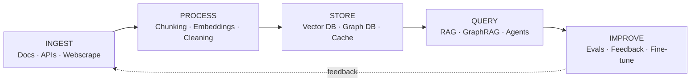

<!-- translation-sync:start -->
> 2026-10-31 영문판과 동기화한 기계 보조 번역입니다. 구조와 내용을 검토했습니다. 코드와 도표 라벨은 원문을 유지하며 읽기 시간은 영어 원문 기준 추정치입니다.
> [English source](../README.md) · [Sync record](SYNC.md)
<!-- translation-sync:end -->

<a id="the-map-everyones-missing-llm-knowledge-engineering-in-2026"></a><!-- i18n-anchor -->

# 모두가 놓치고 있는 지도: 2026년 LLM 지식 공학 완전 가이드

[English](../README.md) | [繁體中文](README-zh.md) | [简体中文](README_zh-CN.md) | [日本語](README_ja.md) | **한국어** | [Español](README_es.md)

[온라인 가이드 읽기](https://kennethlaw325.github.io/awesome-llm-knowledge-systems/) · [읽기 경로 선택](#which-path-should-you-take) · [연표](chapters/ko/11-timeline.md) · [변경 이력](../CHANGELOG.md)

> 50개 이상의 추천 목록, 조사 논문, 가이드를 분석했지만 서로의 연결을 보여 주는 것은 없었다. RAG 논문은 하네스 엔지니어링을 언급하지 않고, 메모리 프레임워크는 스킬 시스템을 다루지 않으며, MCP 문서는 점진적 공개를 건너뛴다. 이 가이드는 전체 지도를 그린다.

<a id="october-2026-update"></a><!-- i18n-anchor -->

## October 2026 업데이트

이번 판은 지속적 컨텍스트를 누가 소유하는지, 충돌하는 메모리를 누가 해결하는지, 에이전트 모니터가 실제로 무엇을 볼 수 있는지 등 시스템 사이의 경계를 따라간다.

- **메모리에는 수정과 소유 주체가 필요하다.** Notion의 October 13 출시는 공유 작업 공간을 스킬과 접근 통제에 연결한다. Cognee의 October 29 출시는 충돌 해결을 지속적으로 저장하고 근거 데이터가 바뀌면 무효화한다. [Ch06](chapters/ko/06-agent-memory.md)과 [Ch08](chapters/ko/08-tools-landscape.md) 참조.
- **로컬 추론이 맡는 일은 하나가 아니다.** Liquid AI의 September 23 발표는 기기 내 컨텍스트와 이를 쓰는 에이전트를 분리한다. Ollama의 September 29 판단 엔드포인트는 범위가 제한된 판단을 위해 유형이 지정된 결정과 확률을 반환한다. [Ch12](chapters/ko/12-local-models.md) 참조.
- **장기 실행 에이전트에는 인계 후에도 유지되는 경계가 필요하다.** October 14 고객 사례는 여러 날에 걸친 작업의 외부 하네스를 설명한다. October 연구는 압축과 여러 에이전트에 걸친 평가 격리와 모니터링을 살핀다. [Ch04](chapters/ko/04-harness-engineering.md)와 [Ch13](chapters/ko/13-loop-engineering.md) 참조.
- **상호운용성이 안전을 보장하지는 않는다.** Agent Skills의 October 22 발표는 더 넓은 플랫폼 채택을 기록한다. 이식 가능한 명세는 스킬 메타데이터와 지시를 표준화하지만, 라우팅과 집행의 책임은 여전히 호스트에 있다. [Ch05](chapters/ko/05-skill-systems.md)는 이 책임들을 구분하며, [Ch14](chapters/ko/14-graph-engineering.md)는 아직 논쟁적인 용어의 증거를 갱신한다.

[변경 이력](../CHANGELOG.md)은 사실 수정과 유지 관리 작업을 기록한다. 다섯 번역판은 이 영문판의 README, 14개 장 전체, 용어집을 다룬다. 번역상의 의문은 영어 원문을 기준으로 해결하며, 원문의 날짜와 증거 한계는 모든 판에 그대로 적용된다.

<details>
<summary>연결된 지도를 30초 애니메이션으로 보기</summary>


[MP4 재생 또는 다운로드](../diagrams/knowledge-map.mp4) · [정적 지도](../diagrams/evolution-stack.png)

이 무음 애니메이션은 안정적인 계층과 읽기 경로를 소개한다. 루프와 그래프 엔지니어링은 확립된 추가 세대가 아니라 여전히 떠오르거나 논쟁 중인 주제다.

</details>

<details>
<summary><b>이전 업데이트: September 2026</b> (펼치기)</summary>

mid-September 2026 업데이트는 외부 사건 아홉 개와 이 가이드 자체의 생존 판정 결과를 더해 연표 항목 열 개를 추가하고, 열 개 장과 용어집에 반영한다. 전체 흐름은 보안 계층이 뒤따르던 기본 기능을 따라잡는 것이다. AI 에이전트를 위한 최초의 출시된 실행 중 탐지 제품(CrowdStrike의 Falcon Guardian)이 AIR의 $50M 투자 유치 및 노출된 공격 표면 측정 공개와 같은 날 등장한다. OpenAI는 사이버보안에서 처음으로 *Critical*로 지정한 모델을 출시하며, 널리 제공하는 출시판에 거절 계약을 명시한다. Anthropic의 September 위협 보고서는 이름을 밝힌 중국 연구소들이 산업 규모로 증류했다고 주장한다. 같은 기간 14장 자체의 September 생존 판정 기한이 도래했고 결과는 갈렸다. 용어는 명시된 유통 검사를 통과했지만 독립적인 엔지니어링 계층이라는 지위는 입증되지 않았다. 이번 업데이트는 late-August 흐름(일주일 안에 태평양 양쪽에서 하네스 계층을 오픈소스로 공개)과 early-August 흐름(Metis)에 이어진다. 최신순으로 정리했다(전체 시간순 기록: [CHANGELOG.md](../CHANGELOG.md)):

- **September 15, 14장 생존 판정 기한 도래**: 이 가이드가 July에 발표한 기준을 점검했고 결과는 갈렸다. 용어는 명시된 유통 검사(August와 September의 독립적인 글, 에이전트 조직이라는 의미를 가르치는 유료 강좌)를 통과했다. 그러나 확인한 문서에서는 공급업체 채택을 찾지 못했고, 실서비스 사례 요건은 Anthropic의 June 2025 다중 에이전트 연구 시스템이 사후적으로만 충족한다. 독립적인 엔지니어링 계층이라는 지위는 여전히 입증되지 않아 번호를 붙인 세대 바깥에 둔다([Ch14 §14.7](chapters/ko/14-graph-engineering.md), [Ch01](chapters/ko/01-evolution.md), [Ch11](chapters/ko/11-timeline.md), 용어집).
- **September 11, Salesforce가 Agentforce 장기 실행 환경 출시**: 세션 사이에 유지되는 메모리, 여러 세션에 걸쳐 계획을 계속 실행하는 지속 실행, 실행 중 동적 조향을 직무 범위가 정해진 일곱 에이전트 제품군과 함께 발표했다. Hunter가 이 실행 환경의 첫 시범 적용 대상이다. AWS가 기반에 넣은 14일 세션의 수요 측에 해당하지만, "pursues goals across days and weeks"는 Salesforce 자체 주장이고 이를 보여 주는 Hunter의 정식 출시는 November 2026이다([Ch04 §4.9](chapters/ko/04-harness-engineering.md), [Ch11](chapters/ko/11-timeline.md)).
- **September 10, Anthropic 위협 보고서가 산업 규모의 증류 주장**: September 위협 정보 보고서는 Moonshot AI가 사기 계정 5,380개로 Kimi 고객 요청을 Claude에 라우팅했으며, 열흘간 약 300,000개 요청이 집중됐고 May-July에 23백만 회 이상의 교환이 있었다고 주장한다. 같은 기간 Alibaba에는 151백만 회 이상을 귀속시키고 DeepSeek, Z.ai, Xiaomi, MiniMax, SenseTime도 거론한다. 모든 수치는 경쟁업체에 대한 Anthropic의 주장이며 독립적인 판단을 거치지 않았다. 보고서 자체의 증류 절을 기준으로 읽었다([Ch09](chapters/ko/09-china-ecosystem.md), [Ch11](chapters/ko/11-timeline.md)).
- **September 4, 에이전트 메모리는 모델 업그레이드를 견디는가?**: 통제 연구에서 고정 스키마 그래프 메모리는 모델 교체에도 거의 변하지 않았지만(정확도 변화 0.0004, 오차 범위 ±0.0020), 압축 노트는 +9.91 또는 -13.28점 움직였다. 노트 성능 저하의 약 80%는 *기록* 시점에 버린 정보 때문이라고 분석했다. 따라서 압축본 옆에 원본을 보관해야 복구가 가능하다(시험한 두 이전 방향 중 하나에서 48개 중 34개 사례). 저자 두 명, 합성 사례 48개라는 좁은 증거 기반 위의 설계 규칙이다([Ch06](chapters/ko/06-agent-memory.md), [Ch02](chapters/ko/02-knowledge-layer.md), [Ch11](chapters/ko/11-timeline.md)).
- **September 3, GPT-6 Astra가 OpenAI의 Critical 사이버보안 기준 넘음**: Preparedness Framework에서 OpenAI가 사이버보안 Critical로 부른 첫 모델이다. 출시된 모델은 개념 증명 익스플로잇 생성 같은 작업을 거절하고, OpenAI는 심사된 방어자를 위한 예정 경로로 Daybreak와 Daybreak Blue를 명시한다. 접근은 널리 확대되지만 출시 시 기업 작업 공간에는 기본으로 꺼져 있다. 같은 안전 개요는 탐지되지 않는 고의적 성능 저하를 포함해 사고 사슬 모니터링 가능성의 *감소*도 보고한다. ExploitBench 100% 대 78.5%, ExploitGym 42.4%, SRE-Bench 첫 시도 88.0%는 모두 실서비스 안전장치 없이 측정한 OpenAI 자체 수치다([Ch04 §4.2](chapters/ko/04-harness-engineering.md), [Ch11](chapters/ko/11-timeline.md)).
- **September 1, 스킬 보안의 상용화: Falcon Guardian과 AIR의 $50M**: CrowdStrike가 Windows와 macOS 엔드포인트의 알려진 AI 에이전트와 비인가 AI 에이전트 목록을 만들고 정책 집행 및 실행 중 탐지를 적용하는 Falcon Guardian을 출시했다. §5.10의 게시 시점 검사에서 실행 중 격리로 옮겨 가야 한다는 주장에 대응하는 첫 출시 제품이며, 확보한 두 출처 어느 쪽에도 효능 수치는 없다. 같은 날 AIR는 $50M 투자와 함께 비공개 활동을 끝내고, 신뢰할 수 없는 외부 지시 소스에 의존하는 공개 AI 부가 기능 17,800개 이상과 약 6.7M 설치를 보고했다. 방법론이 공개되지 않은 자체 수치다([Ch05 §5.10](chapters/ko/05-skill-systems.md), [Ch11](chapters/ko/11-timeline.md)).
- **August 20, StateMemBench가 최신 상태 대체를 메모리 평가 축으로 추가**: 다중 세션 시나리오 234개에서 도중에 사실, 제약, 결정을 수정한 뒤 메모리 계층이 현재 유효한 값과 대체된 값 중 무엇을 반환하는지 묻는다. GateMem(접근 통제), MemSyco-Bench(아첨)에 이은 세 번째 통제 축이며, 셋 중 처음으로 무효 결과만이 아닌 해결책을 함께 제시했다. StateMem은 DeepSeek-V4-Flash에서 현재 상태 정확도 1.8x를 보고하고, 여섯 백엔드를 감싸는 방식으로 추가 컨텍스트를 통제한 뒤 +15에서 +32점 향상을 보고했다. 모두 논문 자체 수치이며 재현되지 않았다([Ch06](chapters/ko/06-agent-memory.md), [Ch11](chapters/ko/11-timeline.md)).
- **July 30, Gemini Enterprise Agent Platform의 Memory Bank 정식 출시**: 대화 컨텍스트를 개발자 정의 스키마로 추출하는 Agent Memory Bank, 최대 칠 일간 연속 실행하는 Agent Runtime, 기본 IAM 유형인 Agent Identity, Agent Gateway, Agent Registry라는 다섯 기능이 함께 정식 출시됐다. 기능 설명은 모두 Google 자체 설명이며, 첫 발표가 아니라 July 2025 Vertex AI Memory Bank 공개 미리보기의 이름을 바꾼 후속 제품이 정식 출시된 것이다. 나흘 뒤 TencentDB까지 더해져 관리형 메모리가 클라우드 공급업체의 제품 범주가 된다([Ch06](chapters/ko/06-agent-memory.md), [Ch04 §4.9](chapters/ko/04-harness-engineering.md), [Ch11](chapters/ko/11-timeline.md)).
- **July 29-30, 이틀간 메모리 논문 세 편**: 마크다운 디렉터리 트리 메모리 패턴의 최초 체계적 연구(arXiv 2607.26637; 저장소가 커지면 정리 상태를 유지하는 것이 검색 비용을 대략 절반으로 줄이지만, 가장 강력한 관리 에이전트 외에는 정리 상태가 악화되고 측정한 어떤 에이전트도 정리를 더 좋은 답으로 연결하지 못함), 메모리 *쓰기*에 트랜잭션 경계를 두는 MemTxn(arXiv 2607.27834; 저자 자체의 작은 검증 집합에서 출처가 뒷받침하는 갱신 60개 수락, 구성한 부정 예시 179개 거절; 사흘 전 다른 팀의 MemTX와 함께 트랜잭션 메모리가 한 흐름이 아닌 두 독립 제안이 됨), Memory Decoder at Scale(arXiv 2607.27919; 6.9B 메모리 모듈로 410M Pythia 기반 모델이 총매개변수를 39% 적게 쓰면서 Pythia-12B의 17개 벤치마크 평균을 넘었다는 저자 자체 수치). 사십팔 시간 안에 파일 시스템, 통제되는 저장소, 가중치 각각에서 결과가 나왔다([Ch06](chapters/ko/06-agent-memory.md), [Ch11](chapters/ko/11-timeline.md)).
- **July 29, 중국 모델이 OpenRouter 주간 상위 다섯 자리 독점**: Xiaomi MiMo-V2.5가 #1로 DeepSeek, MiniMax, Qwen, Kimi를 앞섰다. OpenRouter 세계 주간 토큰 사용 순위 최초의 중국 모델 상위 다섯 독점이며 early September에도 선두를 유지했다. OpenRouter는 과거 보관 없이 실시간 이동 순위를 공개하므로 독점과 점유율 수치는 모두 이차 분석에 의존한다. July 독점 무렵의 "more than 60%" 트래픽과 early-September의 "46.4%"는 별도로 보고된 서로 다른 측정값이며 추세선으로 연결하지 않는다([Ch09](chapters/ko/09-china-ecosystem.md), [Ch11](chapters/ko/11-timeline.md)).

*이전 업데이트에서 (전체 내용: [CHANGELOG.md](../CHANGELOG.md)):*

- **August 22, 새 MCP 로드맵**: 최종 명세 후 사 주도 지나기 전에 핵심 유지 관리자가 Contributor Ladder, 작업 그룹 SEP 분류, 기능 수명 주기와 폐기 정책으로 운영 체계를 공식화했다. 또한 *Tasks의 핵심 편입*, 로컬 배포용 HTTP 네이티브 전송, DPoP 및 Workload Identity Federation 기반 에이전트 ID, 도구 결과 처리와 대규모 목록의 점진적 탐색, SDK 적합성이라는 다섯 우선순위를 명시했다([Ch07](chapters/ko/07-mcp.md), [Ch11](chapters/ko/11-timeline.md)).
- **August 19, OpenAI가 Codex를 플랫폼으로 재정의**: `codex exec`, Codex SDK, *app-server*가 분리된 하네스 제품으로 Apache 2.0 하에 출시됐으며 모델 접근은 독점 방식으로 남는다. `openai/codex`는 April 2025부터 이미 공개됐고 Apache-2.0이었으므로 최초 오픈소스화가 아닌 재포지셔닝이다. ARC-AGI-3 13.3%→38.3%, 출력 토큰 6x 감소 수치는 OpenAI 자체 수치다([Ch04 §4.7](chapters/ko/04-harness-engineering.md), [Ch11](chapters/ko/11-timeline.md)).
- **August 19, Anthropic Skills API 정식 출시**: `/v1/skills`가 더 넓은 실서비스 에이전트 정식 출시 흐름 속에서 베타를 벗어났다(출시 노트 August 19, 관련 블로그 August 20). 열이틀 전에는 GitHub 호스팅 스킬을 통해 Managed Agents가 세션 시작 시 마운트한 저장소의 `.claude/skills`를 자동 발견하게 됐다. Anthropic 자체 문서는 검토 단계 없이 저장소가 에이전트의 *신뢰 경계*에 포함된다고 명시한다([Ch05 §5.2](chapters/ko/05-skill-systems.md), [Ch11](chapters/ko/11-timeline.md)).
- **August 13, DeepSeek Harness (dsh)**: 모델 어댑터, 도구 레지스트리, 세션 로그, 샌드박스, 저장소, 스케줄러, UI 모두 교체 가능한 플러그인("Cordis")인 MIT 라이선스 에이전트 하네스다. 컨텍스트 주입 전체를 추가 전용 로그에 기록한다. 11일간 별 190,630개 / 포크 21,319개(GitHub API, August 24 확인)를 기록하며 중국의 오픈소스 우선 논리를 가중치에서 하네스로 확장했다([Ch09](chapters/ko/09-china-ecosystem.md), [Ch11](chapters/ko/11-timeline.md)).
- **August 10, Meta Muse Glimmer**: Muse Spark에서 증류한 30B 밀집 Apache-2.0 모델로 로컬 에이전트용이다(4비트에서 20GB 미만, 단일 소비자용 GPU). Ollama, llama.cpp, MLX, ExecuTorch, vLLM 등에서 day-0 지원을 제공한다. 서버급 공개 가중치 대신 단일 GPU 로컬 용도를 겨냥해 출시한 최초의 미국 최첨단 연구소이며, 속도 향상과 벤치마크 수치는 모두 Meta 자체 수치다([Ch12](chapters/ko/12-local-models.md), [Ch11](chapters/ko/11-timeline.md)).
- **August 7, Claude Code가 세션 간 에이전트 메시지 제공**: `ListAgents`와 `SendMessage`로 이름이 있는 세션끼리 연락할 수 있게 됐다. 각 세션이 수신을 수락 / 보류 / 거부할 수 있으며, 이력, 파일, 권한 승인은 경계를 넘지 않는다. 대형 공급업체가 "graph engineering"이라는 말을 전혀 쓰지 않으면서 14장의 *조직 그래프* 기본 기능을 출시한 것이다([Ch14 §14.2](chapters/ko/14-graph-engineering.md), [Ch11](chapters/ko/11-timeline.md)).
- **August 6, Paperclip 스킬 공격**: `paperclipai`와 `browser-use`를 사칭한 조직이 July 5에는 무해했지만 July 11에 무기화돼 인기 #8에 오른 스킬을 게시했다. 페이로드는 네 독립 트리거 메커니즘으로 자격 증명 경로 138개를 훑었다. >1.7M 설치 수는 고유 에이전트가 아닌 합산값이다. 검사 시점과 사용 시점의 간극을 이용한 패턴이 가짜 스킬 하나에서 전체 제품군으로 확대된 사례다([Ch05 §5.10](chapters/ko/05-skill-systems.md), [Ch11](chapters/ko/11-timeline.md)).
- **August 6, AWS AgentCore: Temporal Policies + Runtime Instances 정식 출시**: 새 Apache-2.0 Dogwood 정책 언어로 작성하며, 도구 호출을 에이전트의 *이전 세션 이력*과 대조하는 결정론적 기본 거부 인가다. Runtime Instances의 정식 출시와 같은 날 제공됐다. Runtime Instances의 고객 선택 EC2 세션은 서버리스 기본 8시간에 비해 최대 14일간 실행된다([Ch04 §4.1](chapters/ko/04-harness-engineering.md), [Ch11](chapters/ko/11-timeline.md), 용어집).
- **August 3, TencentDB Agent Memory v2.0이 Team Memory 추가**: 버전이 있는 메모리 자산 네 유형에 비공개 / 팀 / 제한 / 에이전트 *가시성 등급*을 적용하고, Anthropic과 OpenAI 두 프로토콜을 지원하는 Memory Proxy와 L0-L3 증류를 제공한다. 어떤 프레임워크도 충족하지 못한다고 GateMem이 지적한 접근 통제 축에 대한 첫 출시 답변이다. 그러나 모든 통제 주장은 Tencent 자체 설명이며 독립 벤치마크는 없다([Ch06](chapters/ko/06-agent-memory.md), [Ch11](chapters/ko/11-timeline.md)).
- **August 2, 에이전트의 실용적인 온라인 KV 캐시 압축**: *에이전트 실행 궤적*의 압축을 다룬 최초 체계적 연구다. 즉시 압축하면 정확도를 잃지만, 에이전트 자신의 이후 쿼리가 대리 쿼리 신호로 쓰일 때까지 기다리면 대부분 회복한다. 토큰 제거가 어텐션 매칭 재구성보다 낫다. 캐시를 80% 줄이면서도 전혀 압축하지 않을 때보다 처리량이 높았다([Ch03 §3.3](chapters/ko/03-context-engineering.md), [Ch11](chapters/ko/11-timeline.md)).
- **July 29, MemTensor Metis가 메모리 기반 모델 제안**: June 에이전트 네이티브 메모리 조사를 낸 같은 상하이 연구소 MemTensor가 인민대 / NUS / SJTU / 퉁지대 공동 저자와 함께, 에이전트 메모리를 외부 저장소 대신 *트랜스포머 기반 모델 자체의 지속적인 매개변수 상태*로 제안했다. 고정된 Qwen3.5 기반 모델(4B/9B/27B) 위에서 Fast Weight Programming에 영감을 받은 "hyper memory block"과 "local memory block"만 학습하고, 기울기를 쓰지 않는 EMA식 순전파로 추론 시 갱신한다. 논문 자체는 고정 크기 압축에서 장기 정보 손실과 "information confusion in some cases, possibly caused by the blending of semantics within the latent space"를 보고한다([Ch06](chapters/ko/06-agent-memory.md), [Ch11](chapters/ko/11-timeline.md), 용어집).
- **July 29, LangChain Deep Agents v0.7 출시**: 세 모델 계열의 평가에서 측정 가능한 이득이 없자 프레임워크의 기본 시스템 프롬프트를 제거하고, 내장 도구 설명을 43% 줄였으며, 할 일 목록 계획 구조를 선택 기능으로 바꾸었다. 기본 에이전트 턴의 기초 입력 토큰이 약 65%(약 6k에서 약 2k) 줄었다. 이 가이드의 스트레스 테스트 원칙을 실서비스에 적용한 사례다([Ch04 §4.8](chapters/ko/04-harness-engineering.md), [Ch11](chapters/ko/11-timeline.md)).
- **July 29, MinIO AIStor Memory 출시**: 에이전트 메모리, 작업 공간 상태, 자격 증명을 위한 객체 저장소 기반 계층이다. 벡터 저장소, 메타데이터 데이터베이스, 자격 증명 도구를 손으로 조립한 스택 대신 지속적으로 저장되고 고객이 소유하며 전체 충실도를 유지하는 기록을 제공하는 것으로 포지셔닝한다([Ch11](chapters/ko/11-timeline.md)).
- **July 28, MCP 2026-07-28 명세 최종 출시**: 인가 추가 이후 최대 개정이다. *무상태 요청/응답 핵심*, Multi Round-Trip Requests(SEP-2322), RFC 9207 발급자 검증, 동적 클라이언트 등록을 대체하는 클라이언트 ID 메타데이터 문서, 공식 확장 프레임워크를 포함하며 Roots / Sampling / Logging / HTTP+SSE에는 12개월 폐기 유예 기간을 둔다([Ch07](chapters/ko/07-mcp.md), [Ch11](chapters/ko/11-timeline.md), 용어집).
- **July 24, Claude Opus 5**: Opus 4.8과 같은 가격으로 Fable 5 요금의 절반이다. 1M 컨텍스트 / 128K 출력, *다섯 수준의 `effort` 조절*, 유료 Fast 모드, 프롬프트 캐시를 무효화하지 않는 대화 중 도구 변경(베타)을 제공한다. 벤치마크 수치는 Anthropic 자체 주장이다([Ch04 §4.10](chapters/ko/04-harness-engineering.md), [Ch11](chapters/ko/11-timeline.md)).
- **July 17-22, 새 14장: 그래프 엔지니어링**: 여섯 주 만의 두 번째 계층 명칭을 한 장 전체로 다룬다. Steinberger의 July 17-18 계기 게시물, 조직 그래프 / 작업 그래프 구분(Thakker), *앵커*로 고정된 루프 감독 구조(Perez), 통제되는 토폴로지(TrueFoundry, Eigent), LangChain의 양면적인 "3 Years of Graph Engineering with LangGraph" 응답을 다룬다. 등장한 지 이 주인 *떠오르는 논쟁적* 관점으로 설명하며 회의론에도 같은 비중을 두고 September 2026 생존 판정 기준을 명시했다. September 15, 2026 점검 결과 용어 유통은 살아남았지만 독립 계층 지위는 입증되지 않았다([Ch14](chapters/ko/14-graph-engineering.md), [Ch01](chapters/ko/01-evolution.md), 용어집).
- **July 18, Anthropic이 Fable 5 구독 접근 정리**: Max와 Team Premium은 July 20부터 주간 사용 한도의 50%로 Fable 5를 계속 유지한다. Pro와 Team Standard는 사용 크레딧 요금으로 옮겨 간다. June 12 수출 통제 중단에서 시작된 흐름을 마무리한다([Ch11](chapters/ko/11-timeline.md)).
- **July 17, Moonshot Kimi K3 출시**: 매개변수 2.8T(MoE), 1M 컨텍스트, 기본 시각 기능을 갖춘 역대 최대 공개 가중치 모델이다. 공개 가중치 모델로 Arena 프런트엔드 코딩 순위 선두에 올랐고, 가중치는 Moonshot 자체 Kimi K3 License에 따라 July 27 뒤이어 공개됐다(회사 표현은 "open weight,"이며 "open source"가 아님). 서버급 전용이므로 공개 가중치의 최전선은 넓어져도 로컬 배포 이야기는 바뀌지 않는다([Ch09](chapters/ko/09-china-ecosystem.md), [Ch11](chapters/ko/11-timeline.md)).
- **July 17, WAIC 2026과 WAICO 설립**: 상하이 세계인공지능대회에서 세계인공지능협력기구 설립 합의가 나왔다. AI 전담 최초의 정부 간 기구이며 본부는 상하이다([Ch09](chapters/ko/09-china-ecosystem.md), [Ch11](chapters/ko/11-timeline.md)).
- **July 14, 새 13장: 루프 엔지니어링**: June 2026의 "loop engineering" 관점을 한 장 전체로 다룬다. Peter Steinberger의 계기 게시물, Addy Osmani의 명명 글과 후속 "Own the Outer Loop", Boris Cherny, 생성자-평가자 분리(Rajasekaran), Stripe의 minions, LangChain의 네 중첩 단계, 채택 신호를 포함한다. 아직 학술 문헌 없이 다섯 주 된 *떠오르는 논쟁적* 관점으로 설명한다([Ch13](chapters/ko/13-loop-engineering.md), [Ch01](chapters/ko/01-evolution.md), 용어집).

</details>

---

<a id="tldr"></a><!-- i18n-anchor -->

## 핵심 요약

- **프롬프트 엔지니어링은 시작일 뿐이었다.** 이 분야는 프롬프트 엔지니어링(2022-2024), 컨텍스트 엔지니어링(2025), 하네스 엔지니어링(2026)이라는 세 세대를 거쳤다. 각 계층은 이전 계층을 포함하며, mid-2026에는 논쟁적인 네 번째 계층인 *루프 엔지니어링*이 등장했다([Ch13](chapters/ko/13-loop-engineering.md)). 여섯 주 뒤에는 다섯 번째 주장인 *그래프 엔지니어링*이 나왔고 생존 판정 기준을 적용했다. September 15, 2026 점검에서 다중 에이전트 조정의 논쟁적인 이름으로는 계속 쓰였으나 독립적인 다섯 번째 계층은 입증되지 않았다([Ch14](chapters/ko/14-graph-engineering.md)).
- **RAG와 긴 컨텍스트는 서로 다른 제약을 해결한다.** 자신의 작업 부하에서 검색 품질, 출처의 최신성, 지연 시간, 비용을 시험해 선택하고 조합하라([Ch02](chapters/ko/02-knowledge-layer.md)).
- **컨텍스트 엔지니어링은 호출 자체가 아닌 그 주변을 다룬다.** Andrej Karpathy의 mid-2025 관점 전환은 프롬프트 작성에서 전체 컨텍스트 창을 동적으로 구성하는 쪽으로 초점을 옮겼다.
- **하네스 엔지니어링은 운영체제 계층이다.** Martin Fowler의 *Exploring Generative AI* 메모 시리즈에 April 2026 글을 쓴 Birgitta Böckeler와 OpenAI Codex 팀의 하네스 설계 관점이 이를 체계화했다. 모델은 CPU, 컨텍스트는 RAM, 하네스는 모든 것을 조율하는 OS다.
- **지금까지 이 모든 것을 연결한 단일 가이드는 없었다.** RAG, 지식 그래프, 긴 컨텍스트, MCP, 스킬 라우팅, 메모리 시스템, 점진적 공개는 모두 하나의 생태계에 속한다. 이것이 그 지도다.

---

<a id="start-here"></a><!-- i18n-anchor -->

## 시작하기

AI 도구는 해마다 더 똑똑해지지만, 적시에 적절한 정보를 받아야 잘 작동한다. 이 가이드는 AI에게 할 일을 알려 주는 기초부터 AI 모델 주위에 전체 시스템을 설계하는 단계까지 그 작동 방식을 설명한다.

AI를 첫 출근한 뛰어난 신입 직원이라고 생각해 보라. 프롬프트 엔지니어링은 과제 하나를 주는 것이다. 컨텍스트 엔지니어링은 과제를 잘 수행하는 데 필요한 배경 정보를 모두 주는 것이다. 하네스 엔지니어링은 책상, 도구, 문서 정리 체계, 팀 구조를 포함한 전체 작업 환경을 설계해 일관되게 최고의 성과를 내도록 하는 것이다. 이 가이드는 셋 모두와 그 연결 관계를 다룬다.

이 주제가 처음이라면 [용어집](glossary_ko.md)에서 핵심 용어의 정의부터 보라. AI 애플리케이션을 만든다면 아래 장들로 바로 가도 된다. 큰 그림만 원한다면 이 페이지 아래의 생태계 지도 도표를 보라.

---

<a id="which-path-should-you-take"></a><!-- i18n-anchor -->

## 어떤 경로로 읽을까?

어디서 시작할지 모르겠다면 자신에게 가장 잘 맞는 설명을 고르라:

- **"I just want to understand what all these AI buzzwords mean."**: [용어집](glossary_ko.md)부터 읽은 뒤 [1장: 세 세대](chapters/ko/01-evolution.md)를 보라.
- **"I'm building an AI application."**: [Ch02: RAG, 긴 컨텍스트와 지식 그래프](chapters/ko/02-knowledge-layer.md), [Ch03: 컨텍스트 엔지니어링](chapters/ko/03-context-engineering.md), [Ch04: 하네스 엔지니어링](chapters/ko/04-harness-engineering.md) 순서로 읽으라.
- **"I want to make my AI tools work better."**: [Ch05: 스킬 시스템](chapters/ko/05-skill-systems.md), [Ch06: 에이전트 메모리](chapters/ko/06-agent-memory.md), [Ch10: 사례 연구](chapters/ko/10-case-study.md) 순서로 읽으라.
- **"I want my agents to run without me pushing every step."**: [Ch13: 루프 엔지니어링](chapters/ko/13-loop-engineering.md)을 읽은 뒤 [Ch04: 하네스 엔지니어링](chapters/ko/04-harness-engineering.md)과 [Ch06: 에이전트 메모리](chapters/ko/06-agent-memory.md)를 읽으라.
- **"I'm wiring multiple agents together."**: [Ch14: 그래프 엔지니어링](chapters/ko/14-graph-engineering.md)을 읽은 뒤 [Ch13: 루프 엔지니어링](chapters/ko/13-loop-engineering.md)과 [Ch04: 하네스 엔지니어링](chapters/ko/04-harness-engineering.md)을 읽으라.
- **"I want to see real examples."**: [Ch10: 사례 연구](chapters/ko/10-case-study.md)로 바로 가라.
- **"I work with Chinese AI tools."**: [Ch09: 중국 AI 생태계](chapters/ko/09-china-ecosystem.md)부터 읽으라.
- **"I want the complete picture."**: 1장부터 순서대로 끝까지 읽으라.

---

<a id="use-cases"></a><!-- i18n-anchor -->

## 사용 사례

이 가이드는 다음 실제 상황을 위한 시스템 설계에 도움을 준다. 각 행은 해당 시스템 구축에서 가장 중요한 장으로 연결된다:

| 상황 | 구축할 시스템 | 핵심 장 |
|----------|---------------------|---------------|
| **개인의 세컨드 브레인** | 자연어 질의로 검색 가능한 개인 노트 + 논문 + 웹 발췌 | [Ch02](chapters/ko/02-knowledge-layer.md) · [Ch05](chapters/ko/05-skill-systems.md) · [Ch08](chapters/ko/08-tools-landscape.md) |
| **사내 지식 기반** | 직원이 정책 / 핸드북 / 운영 절차를 질의하며, 환각 허용 수준이 낮고 출처 인용이 필수 | [Ch02](chapters/ko/02-knowledge-layer.md) · [Ch04](chapters/ko/04-harness-engineering.md) · [Ch06](chapters/ko/06-agent-memory.md) |
| **개발자 문서 어시스턴트** | 여러 저장소 환경에서 엔지니어가 코드베이스 / API 문서 / 과거 사고 분석을 검색 | [Ch02](chapters/ko/02-knowledge-layer.md) · [Ch05](chapters/ko/05-skill-systems.md) · [Ch07](chapters/ko/07-mcp.md) |
| **지원 / QA 에이전트** | 고객 또는 내부 티켓 → 출처 인용과 후속 메모리를 갖춘 컨텍스트 기반 응답 | [Ch03](chapters/ko/03-context-engineering.md) · [Ch06](chapters/ko/06-agent-memory.md) · [Ch04](chapters/ko/04-harness-engineering.md) |
| **분야별 지식 자동화** *(법률, 의료, 금융, 엔지니어링)* | 수십 년의 분야별 문서 재사용; 규제를 받고 지식재산에 민감하며 로컬 모델과 감사 추적이 자주 필요 | [Ch02](chapters/ko/02-knowledge-layer.md) · [Ch09](chapters/ko/09-china-ecosystem.md) · [Ch12](chapters/ko/12-local-models.md) |

상황이 정확히 맞지 않는다면 이들의 조합일 가능성이 크다. 가장 가까운 행에서 시작해 맞추어 가라.

---

<a id="the-evolution"></a><!-- i18n-anchor -->

## 발전 과정


*그림: 각 세대는 앞선 세대를 대체하지 않고 포함한다. 바깥 두 계층은 확립된 계층이 아닌 주장이므로 점선으로 그렸다. 여기서 루프 엔지니어링은 떠오르는 개념으로 추적한다. 14장의 September 15, 2026 판정에서는 그래프 엔지니어링이 계속 쓰이는 용어로는 살아남았지만 독립 계층의 지위는 입증되지 않았다.*

<details>
<summary>발전 과정 지도의 텍스트 버전</summary>

```
2022-2024               2025                    2026                    2026 (mid)?             2026 (late)??
PROMPT ENG        -->   CONTEXT ENG       -->   HARNESS ENG       -->   LOOP ENG (emerging) --> GRAPH ENG (contested)
                        (Karpathy)              (Fowler, OpenAI)        (Steinberger, Osmani)   (Steinberger, Perez)

"Craft the              "Construct the          "Orchestrate the        "Design the system      "Wire the org
 perfect prompt"        dynamic context         entire system           that prompts            of agents that
                        window"                 around the model"       the agent"              run the loops"
```

</details>

각 세대는 앞선 세대를 대체하지 않고 포함한다. 하네스 엔지니어링은 컨텍스트 엔지니어링을 포함하며, 컨텍스트 엔지니어링은 프롬프트 엔지니어링을 포함한다. 아직 논쟁적인 네 번째 계층인 루프 엔지니어링은 셋 모두를 감싼다. 타이머에 따라 하네스를 실행하고, 보조 에이전트를 띄우고, 스스로 다시 입력을 공급하는 시스템이다. [Ch14](chapters/ko/14-graph-engineering.md)에서 다루는 July 2026의 주장인 그래프 엔지니어링은 여러 루프를 설계된 조직으로 연결해 그 바깥까지 감싼다. 해당 장 자체의 생존 판정 기준을 September 15, 2026에 점검한 결과는 의도적으로 질문을 열어 두었다. 용어는 계속 쓰이지만 확인한 문서에서 공급업체 채택은 없었고, 두 공급업체는 그 이름을 쓰지 않은 채 해당 통제 기능을 출시했다. 진정한 다섯 번째 계층인지, LangChain의 반론처럼 세 해 된 실무에 새 이름을 붙인 것인지는 입증되지 않았다.

---

<a id="the-lifecycle"></a><!-- i18n-anchor -->

## 수명 주기

생태계 지도는 구성 요소가 **무엇인지** 보여 준다. 수명 주기는 **데이터가 그 사이를 어떻게 이동하는지** 보여 준다:

<details>
<summary>수명 주기의 텍스트 버전</summary>

```
                    ┌───── feedback ──────────────┐
                    ▼                             │
 INGEST  ───▶ PROCESS  ───▶ STORE  ───▶ QUERY ───▶ IMPROVE
    │             │            │          │           │
 Docs          Chunking      Vector DB    RAG        Evals
 APIs          Embeddings    Graph DB     GraphRAG   Feedback
 Web clips     Cleaning      Cache        Agents     Fine-tune
 Crawlers      Multi-modal   Long doc     Tool use   Skill updates
    │             │            │          │           │
   Ch02       Ch02 · Ch03    Ch02-08    Ch02-07     Ch06
```

</details>



모든 실서비스 시스템은 일부가 암묵적이더라도 데이터를 다섯 단계 모두에 걸쳐 이동시킨다. 좋은 하네스 설계는 **각 단계를 점검하고 교체할 수 있게 한다**. Ch02는 수집/처리/저장을, Ch03–Ch07은 질의를, Ch06과 Ch10은 개선을 다룬다.

---

<a id="ecosystem-map"></a><!-- i18n-anchor -->

## 생태계 지도


*[대화형 HTML 버전 보기](../diagrams/ecosystem-map.html)*

<details>
<summary>생태계 지도의 텍스트 버전</summary>

```
+---------------------------+     +---------------------------+     +---------------------------+
|    KNOWLEDGE SOURCES      |     |   CONTEXT ENGINEERING     |     |   HARNESS ENGINEERING     |
|                           |     |                           |     |                           |
|  +---------------------+ | --> |  +---------------------+ | --> |  +---------------------+ |
|  | RAG Pipelines       | |     |  | Dynamic Context     | |     |  | Skill Systems       | |
|  | - Self-RAG          | |     |  |   Assembly          | |     |  | - Routing Logic     | |
|  | - Corrective RAG    | |     |  |                     | |     |  | - Progressive       | |
|  | - Adaptive RAG      | |     |  | KV-Cache            | |     |  |   Disclosure        | |
|  +---------------------+ |     |  |   Optimization      | |     |  +---------------------+ |
|                           |     |  |                     | |     |                           |
|  +---------------------+ |     |  | System Prompts      | |     |  +---------------------+ |
|  | Knowledge Graphs    | |     |  |   + Instructions    | |     |  | Memory Frameworks   | |
|  | - GraphRAG          | |     |  |                     | |     |  | - Short-term        | |
|  | - Entity Relations  | |     |  | Tool Definitions    | |     |  | - Long-term         | |
|  | - Multi-hop Queries | |     |  |   + Schemas         | |     |  | - Episodic          | |
|  +---------------------+ |     |  |                     | |     |  +---------------------+ |
|                           |     |  | Few-shot Examples   | |     |                           |
|  +---------------------+ |     |  |                     | |     |  +---------------------+ |
|  | Long Context        | |     |  | Conversation        | |     |  | MCP / Tool Layer    | |
|  | - 1M+ token windows | |     |  |   History           | |     |  | - Protocol Std      | |
|  | - Static doc ingest | |     |  +---------------------+ |     |  | - Tool Routing      | |
|  +---------------------+ |     +---------------------------+     |  | - Auth + Sandboxing | |
+---------------------------+                                       |  +---------------------+ |
                                                                    |                           |
                                                                    |  +---------------------+ |
                                                                    |  | Agent Runtime       | |
                                                                    |  | - Planning Loops    | |
                                                                    |  | - Error Recovery    | |
                                                                    |  | - Multi-agent       | |
                                                                    |  |   Coordination      | |
                                                                    |  +---------------------+ |
                                                                    +---------------------------+
```

</details>

---

<a id="table-of-contents"></a><!-- i18n-anchor -->

## 목차

<a id="chapters"></a><!-- i18n-anchor -->

### 각 장

| # | 장 | 설명 |
|---|---------|-------------|
| 01 | [세 세대](chapters/ko/01-evolution.md) | 프롬프트 엔지니어링에서 컨텍스트 엔지니어링, 하네스 엔지니어링으로 |
| 02 | [RAG, 긴 컨텍스트와 지식 그래프](chapters/ko/02-knowledge-layer.md) | 지식 검색 계층: 무엇이 작동하고 무엇이 작동하지 않으며, 왜 하이브리드가 유리한가 |
| 03 | [컨텍스트 엔지니어링](chapters/ko/03-context-engineering.md) | 컨텍스트 창을 채우는 기술: KV 캐시, 100:1 비율, 동적 조립 |
| 04 | [하네스 엔지니어링](chapters/ko/04-harness-engineering.md) | 모델 주변의 OS 구축: 가이드, 센서, 6x 성능 격차 |
| 05 | [스킬 시스템과 스킬 그래프](chapters/ko/05-skill-systems.md) | 평면 파일에서 탐색 가능한 그래프로: 점진적 공개의 실무 |
| 06 | [에이전트 메모리](chapters/ko/06-agent-memory.md) | 빠져 있던 계층: 일화, 의미, 절차 메모리 아키텍처 |
| 07 | [MCP: 승리한 표준](chapters/ko/07-mcp.md) | Model Context Protocol: 출시부터 월 97M회 이상 다운로드까지(Q1 2026) |
| 08 | [AI 네이티브 지식 관리](chapters/ko/08-tools-landscape.md) | 도구 지형: Notion AI, Obsidian, Mem, AI 네이티브 격차 |
| 09 | [중국 AI 생태계](chapters/ko/09-china-ecosystem.md) | Dify, RAGFlow, DeepSeek, Kimi: 나란히 발전하는 혁신 세계 |
| 10 | [사례 연구: 실제 지식 하네스](chapters/ko/10-case-study.md) | 개발자 한 명이 토큰을 65% 줄이는 완전한 하네스를 만든 방법 |
| 11 | [연표](chapters/ko/11-timeline.md) | LLM 지식 엔지니어링의 주요 순간, 2022-2026 |
| 12 | [지식 엔지니어링의 로컬 모델](chapters/ko/12-local-models.md) | 지식 하네스를 로컬에서 실행: 임베딩, RAG, 컴파일, 최종 단계의 미세 조정 |
| 13 | [루프 엔지니어링](chapters/ko/13-loop-engineering.md) | 떠오르는 네 번째 계층: 에이전트에 프롬프트를 보내는 시스템 설계와 독립 세대 여부 |
| 14 | [그래프 엔지니어링](chapters/ko/14-graph-engineering.md) | 논쟁적인 다섯 번째 주장: 에이전트 조직 연결; September 2026 유통 기준은 통과했지만 독립 계층은 아직 입증되지 않음 |

---

<a id="why-this-guide-exists"></a><!-- i18n-anchor -->

## 이 가이드가 필요한 이유

2026년 LLM 생태계의 문제는 파편화다. 정보가 부족한 것이 아니라 서로 연결되지 않은 정보가 너무 많다.

RAG에 관한 방대한 조사, 포괄적인 프롬프트 엔지니어링 가이드, MCP 명세 문서, 에이전트 프레임워크 비교, 메모리 시스템 논문이 있다. 하나씩 보면 훌륭하지만, 요소들이 어떻게 맞물리는지는 보여 주지 않는다.

이 가이드는 그 빠진 계층이다. RAG를 컨텍스트 엔지니어링에, 컨텍스트 엔지니어링을 하네스 엔지니어링에, 하네스 엔지니어링을 에이전트 실행 환경에 연결하며 각 경계에서 중요한 결정을 보여 준다.

---

<a id="contributing"></a><!-- i18n-anchor -->

## 기여

기여를 환영한다. 선별된 가이드이므로 추가 제안은 전체 지도를 강화해야 한다.

- **자료 추가:** [Pull Request 제출](https://github.com/kennethlaw325/awesome-llm-knowledge-systems/pulls); 지침은 [CONTRIBUTING.md](../CONTRIBUTING.md) 참조
- **자료 제안:** [이슈 작성](https://github.com/kennethlaw325/awesome-llm-knowledge-systems/issues/new?template=suggest-resource.md)
- **깨진 링크 신고:** [이슈 작성](https://github.com/kennethlaw325/awesome-llm-knowledge-systems/issues/new?template=report-broken-link.md)
- **토론:** [토론 참여](https://github.com/kennethlaw325/awesome-llm-knowledge-systems/discussions)
- **번역**: 번역 PR은 `/translations/`에 넣고 같은 파일 구조를 유지하라. 제공 언어: [繁體中文](README-zh.md) | [简体中文](README_zh-CN.md) | [日本語](README_ja.md) | [한국어](README_ko.md) | [Español](README_es.md)

전문적이되 이해하기 쉬운 문체를 유지하라. 출처를 인용하고 과장하지 말라.

---

<a id="license"></a><!-- i18n-anchor -->

## 라이선스

MIT 라이선스. 자세한 내용은 [LICENSE](../LICENSE) 참조.

원하는 방식으로 자유롭게 사용하라. 출처 표기는 환영하지만 필수는 아니다.

---

*영문판 갱신: October 31, 2026. 원문의 날짜와 증거 한계는 각 장에 기록돼 있다.*
