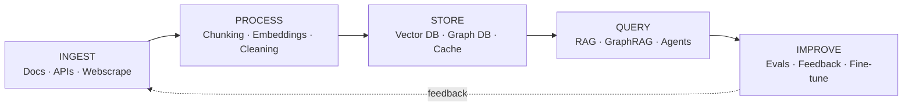

<!-- translation-sync:start -->
> 与 2026-10-31 英文版同步的机器辅助译文，已作结构与内容复核。代码和图中标签保留原文；阅读时间按英文原文估算。
> [English source](../README.md) · [Sync record](SYNC.md)
<!-- translation-sync:end -->

<a id="the-map-everyones-missing-llm-knowledge-engineering-in-2026"></a><!-- i18n-anchor -->

# 每个人都遗漏的地图：2026 年 LLM 知识工程全景

[English](../README.md) | [繁體中文](README-zh.md) | **简体中文** | [日本語](README_ja.md) | [한국어](README_ko.md) | [Español](README_es.md)

[在线阅读指南](https://kennethlaw325.github.io/awesome-llm-knowledge-systems/) · [选择阅读路径](#which-path-should-you-take) · [时间线](chapters/zh-CN/11-timeline.md) · [更新日志](../CHANGELOG.md)

> 我分析了 50+ 份 awesome 列表、综述和指南，没有一份把这些线索串联起来。RAG 论文不提系统编排工程，记忆框架忽略技能系统，MCP 文档跳过渐进式披露。这份指南绘制了完整的地图。

<a id="october-2026-update"></a><!-- i18n-anchor -->

## 2026 年十月更新

本版聚焦系统之间的边界：谁负责持久上下文，谁处理相互冲突的记忆，以及智能体监控器实际能看到什么。

- **记忆需要纠错与责任归属。** Notion 十月 13 日发布的版本将共享工作区与技能及访问控制连接起来；Cognee 十月 29 日的版本将冲突处理结果持久保存，并在支撑数据发生变化时使其失效。参见[第 06 章](chapters/zh-CN/06-agent-memory.md)与[第 08 章](chapters/zh-CN/08-tools-landscape.md)。
- **本地推理承担不止一种任务。** Liquid AI 九月 23 日的公告将设备上的上下文与使用它的智能体分离。Ollama 九月 29 日的决策端点针对有界判断返回带类型的决策及概率。参见[第 12 章](chapters/zh-CN/12-local-models.md)。
- **长期运行的智能体需要在交接后仍然有效的边界。** 十月 14 日的客户案例描述了支持多日工作的外层编排系统；十月的研究则考察评估环境的隔离，以及跨上下文压缩和多个智能体的监控。参见[第 04 章](chapters/zh-CN/04-harness-engineering.md)与[第 13 章](chapters/zh-CN/13-loop-engineering.md)。
- **互操作性不等于安全保证。** Agent Skills 十月 22 日的公告记录了更多平台的采用情况。可移植规范统一技能元数据与指令，路由和强制执行仍由宿主负责。[第 05 章](chapters/zh-CN/05-skill-systems.md)区分了这些责任；[第 14 章](chapters/zh-CN/14-graph-engineering.md)更新了一个仍有争议的术语所依据的证据。

[更新日志](../CHANGELOG.md)记录事实更正与维护工作。五个译本涵盖本英文版的 README、全部 14 章及术语表。解决翻译疑问时，英文原文仍是参考依据；各版均保留来源日期与证据局限。

<details>
<summary>用 30 秒观看各层如何连接（动画）</summary>


[观看或下载 MP4](../diagrams/knowledge-map.mp4) · [静态地图](../diagrams/evolution-stack.png)

这段无声动画介绍已经稳定的层次与阅读路径。循环工程和图工程仍是新兴或有争议的话题，尚不能视为已确立的额外世代。

</details>

<details>
<summary><b>上次更新：2026 年九月</b>（展开）</summary>

2026 年九月中旬的更新增加了十个时间线条目，其中九个来自外部，另一个是本指南自身的存续检查结果，并将内容整合进十章及术语表。贯穿其中的主线是安全层开始追赶此前落后的基础能力：首个实际发布的 AI 智能体运行时检测产品 CrowdStrike Falcon Guardian 面世，同日 AIR 结束隐身运营，公布 $50M 融资及暴露面的测量结果；OpenAI 发布首个被其列为网络安全 *Critical* 级别的模型，并在广泛开放的版本中加入拒绝执行约定；Anthropic 九月威胁报告则指控若干具名中国实验室开展工业规模的蒸馏。同一时期，第 14 章自行设定的九月存续检查关口也到期，结论分成两部分：该术语通过了关口规定的传播测试，但它作为独立工程层的地位尚未得到证明。这轮更新承接八月下旬的浪潮（一周内太平洋两岸的编排层相继开源）与八月上旬的浪潮（Metis）。以下按时间倒序排列（完整时间记录见 [CHANGELOG.md](../CHANGELOG.md)）：

- **九月 15 日，第 14 章的存续检查关口到期**：对本指南七月公布的关口进行检查后，结论分成两部分：术语通过了预定的传播测试，证据包括八月至九月的独立文章，以及教授智能体组织这一含义的付费课程；但在所检查的文档中未发现厂商采用，生产案例研究一项也只能追溯性地由 Anthropic 六月 2025 多智能体研究系统满足。它作为独立工程层的地位仍未得到证明，继续留在编号世代之外（[第 14 章 §14.7](chapters/zh-CN/14-graph-engineering.md)、[第 01 章](chapters/zh-CN/01-evolution.md)、[第 11 章](chapters/zh-CN/11-timeline.md)、术语表）
- **九月 11 日，Salesforce 为 Agentforce 发布长周期运行时**：它提供跨会话持续存在的记忆、让计划跨会话继续运行的持久执行，以及运行中的动态引导，与七个按岗位划分的智能体一同公布；Hunter 是首个试用该运行时的智能体。这补上了 AWS 在底层提供 14 天会话之后的需求侧一半，不过"pursues goals across days and weeks"是 Salesforce 自己的主张，负责展示此能力的 Hunter 到 2026 年十一月才正式发布（[第 04 章 §4.9](chapters/zh-CN/04-harness-engineering.md)、[第 11 章](chapters/zh-CN/11-timeline.md)）
- **九月 10 日，Anthropic 威胁报告指控工业规模蒸馏**：九月威胁情报报告指控 Moonshot AI 通过 5,380 个欺诈账户将 Kimi 客户请求转送至 Claude，其中一个十天集群接近 300,000 次请求，五月至七月累计超过 23 million 次交互；报告还将同一时期超过 151 million 次交互归于 Alibaba，并同时点名 DeepSeek、Z.ai、小米、MiniMax 及 SenseTime。所有数字均为 Anthropic 对竞争对手的指控，未经独立裁定，均取自报告本身的蒸馏章节（[第 09 章](chapters/zh-CN/09-china-ecosystem.md)、[第 11 章](chapters/zh-CN/11-timeline.md)）
- **九月 4 日，智能体记忆能否经受模型升级？** 一项对照研究发现，更换模型时，固定模式的图记忆几乎不变，准确率变化为 0.0004 正负 0.0020；压缩笔记则波动 +9.91 或 -13.28 个点。研究将约 80% 的笔记退化归因于*写入*时丢弃的信息，因此在压缩内容旁保存原始来源，才使修复成为可能：在两个受测迁移方向之一的 48 个案例中修复了 34 个。研究只有两位作者、48 个合成案例，提出的设计规则建立在有限证据之上（[第 06 章](chapters/zh-CN/06-agent-memory.md)、[第 02 章](chapters/zh-CN/02-knowledge-layer.md)、[第 11 章](chapters/zh-CN/11-timeline.md)）
- **九月 3 日，GPT-6 Astra 跨过 OpenAI 的 Critical 网络安全门槛**：它是 OpenAI 在自身 Preparedness Framework 下首个列为网络安全 Critical 级别的模型。已发布模型拒绝生成概念验证漏洞利用等工作，OpenAI 将 Daybreak 与 Daybreak Blue 列为向经过审核的防御者开放的计划路径；模型本身广泛推出，企业工作区在发布时默认关闭访问。同一份安全概述还报告思维链的可监控性*下降*，包括故意降低表现却未被发现的情况。ExploitBench 的 100% 对比 78.5%、ExploitGym 的 42.4%、SRE-Bench 首次尝试的 88.0%，全部是 OpenAI 自报、在未启用生产防护时测得的数字（[第 04 章 §4.2](chapters/zh-CN/04-harness-engineering.md)、[第 11 章](chapters/zh-CN/11-timeline.md)）
- **九月 1 日，技能安全走向商业化：Falcon Guardian 与 AIR 的 $50M**：CrowdStrike 推出 Falcon Guardian，先盘点 Windows 与 macOS 端点上已知及未纳管的 AI 智能体，再执行策略与运行时检测。这是首个回应 §5.10 从发布时扫描走向运行时隔离这一论点的已发布产品，但取得的两个来源均未提供有效性数字。同日 AIR 结束隐身运营，公布 $50M 融资，并报告 17,800+ 个公共 AI 插件、约 6.7M 次安装依赖不受信任的外部指令源；这些均为其自报数字，方法未公开（[第 05 章 §5.10](chapters/zh-CN/05-skill-systems.md)、[第 11 章](chapters/zh-CN/11-timeline.md)）
- **八月 20 日，StateMemBench 将新事实取代旧事实纳入记忆评估维度**：234 个跨会话场景在中途修改事实、约束或决定，再检查记忆层返回的是当前有效值还是被取代的旧值。这是继 GateMem（访问控制）、MemSyco-Bench（迎合）之后的第三个治理维度，也是三者中首个同时提出修复方法，而非只报告未达标结果的研究。StateMem 报告在 DeepSeek-V4-Flash 上当前状态准确率达到 1.8x；作为六个后端的包装层，控制新增上下文后仍提升 +15 至 +32 个点。数字均为论文自报，尚未复现（[第 06 章](chapters/zh-CN/06-agent-memory.md)、[第 11 章](chapters/zh-CN/11-timeline.md)）
- **七月 30 日，Gemini Enterprise Agent Platform 的 Memory Bank 正式发布**：Agent Memory Bank 将对话上下文提取进开发者定义的模式；Agent Runtime 让智能体持续运行最长七天；Agent Identity 将智能体设为原生 IAM 类型，另有 Agent Gateway 与 Agent Registry，五项能力一同正式发布。所有能力描述均来自 Google；这是 Vertex AI Memory Bank 在七月 2025 公开预览后更名后继产品的正式发布，而非首次公告。四天后 TencentDB 跟进，使托管记忆成为云厂商的一类产品（[第 06 章](chapters/zh-CN/06-agent-memory.md)、[第 04 章 §4.9](chapters/zh-CN/04-harness-engineering.md)、[第 11 章](chapters/zh-CN/11-timeline.md)）
- **七月 29-30 日，两天三篇记忆论文**：首篇系统研究 Markdown 目录树记忆模式的论文（arXiv 2607.26637）发现，存储变大后，保持组织有序可将检索成本大致减半，但除最强管理智能体外，组织结构都会退化，且所有受测智能体都未能将有序组织转化为更好的答案；MemTxn 为记忆*写入*设置事务边界（arXiv 2607.27834），在作者自建的小型验证集上接受 60 个有来源支持的更新、拒绝 179 个构造的负例，另一个团队三天前的 MemTX 则让事务记忆成为两项独立提案，而非一条研究线；Memory Decoder at Scale（arXiv 2607.27919）报告，一个 6.9B 记忆模块让 410M Pythia 基础模型超过 Pythia-12B 在 17 项基准上的平均成绩，总参数减少 39%，这些是作者自报数字。文件系统、受治理的存储与模型权重，在四十八小时内各有一项结果（[第 06 章](chapters/zh-CN/06-agent-memory.md)、[第 11 章](chapters/zh-CN/11-timeline.md)）
- **七月 29 日，中国模型包揽 OpenRouter 周榜前五**：小米 MiMo-V2.5 位居 #1，领先 DeepSeek、MiniMax、Qwen 和 Kimi，这是 OpenRouter 全球每周 token 使用排名首次由中国模型包揽前五，九月初仍保持领先。OpenRouter 发布的是实时滚动榜单，没有历史档案，因此包揽排名与份额数字均依赖二手分析；七月包揽前五附近的转送流量"more than 60%"与九月初的"46.4%"是分别报告的不同测量值，不能连接成趋势线（[第 09 章](chapters/zh-CN/09-china-ecosystem.md)、[第 11 章](chapters/zh-CN/11-timeline.md)）

*较早几轮更新（完整细节见 [CHANGELOG.md](../CHANGELOG.md)）：*

- **八月 22 日，新 MCP 路线图**：最终规范发布后不到四周，核心维护者正式规定治理机制，包括贡献者阶梯、工作组 SEP 分流、功能生命周期及弃用策略，并列出五个重点：智能体消息基础能力，其中 *Tasks 正走向核心*；适用于本地部署的 HTTP 原生传输；通过 DPoP 与 Workload Identity Federation 实现智能体身份；大型目录的工具结果处理及渐进式发现；SDK 一致性（[第 07 章](chapters/zh-CN/07-mcp.md)、[第 11 章](chapters/zh-CN/11-timeline.md)）
- **八月 19 日，OpenAI 将 Codex 重新定位为平台**：`codex exec`、Codex SDK 与 *app-server* 以 Apache 2.0 协议作为解耦的编排产品发布，模型访问仍属专有。需注意，`openai/codex` 从四月 2025 起就已公开并采用 Apache-2.0，因此这是重新定位，并非首次开源；ARC-AGI-3 从 13.3%→38.3%、输出 token 减少至原来的 6x 分之一，也都是 OpenAI 自报的数字（[第 04 章 §4.7](chapters/zh-CN/04-harness-engineering.md)、[第 11 章](chapters/zh-CN/11-timeline.md)）
- **八月 19 日，Anthropic Skills API 正式发布**：`/v1/skills` 结束测试阶段，发布说明日期为八月 19 日，配套博客为八月 20 日，是更大一轮生产智能体正式发布的一部分。十二天前，GitHub 托管技能已让 Managed Agents 在会话开始时自动发现已挂载仓库的 `.claude/skills`，Anthropic 自身文档指出，该仓库会直接成为智能体*信任边界*的一部分，没有审核步骤（[第 05 章 §5.2](chapters/zh-CN/05-skill-systems.md)、[第 11 章](chapters/zh-CN/11-timeline.md)）
- **八月 13 日，DeepSeek Harness（dsh）**：采用 MIT 许可证的智能体编排层，其模型适配器、工具注册表、会话日志、沙箱、存储、调度器与 UI 均为可替换插件（"Cordis"），并以仅追加日志记录每次上下文注入。11 天内取得 190,630 stars / 21,319 forks（GitHub API，八月 24 日检查），将中国开源优先的逻辑从权重延伸到编排层（[第 09 章](chapters/zh-CN/09-china-ecosystem.md)、[第 11 章](chapters/zh-CN/11-timeline.md)）
- **八月 10 日，Meta Muse Glimmer**：从 Muse Spark 蒸馏而来、面向本地智能体构建的 30B 稠密 Apache-2.0 模型，在 4-bit 下低于 20GB，可运行于单张消费级 GPU；Ollama、llama.cpp、MLX、ExecuTorch、vLLM 等均提供 day-0 支持。这是美国前沿实验室首次面向单 GPU 本地场景而非服务器级开放权重推出产品，所有加速与基准数字均为 Meta 自报（[第 12 章](chapters/zh-CN/12-local-models.md)、[第 11 章](chapters/zh-CN/11-timeline.md)）
- **八月 7 日，Claude Code 发布跨会话智能体消息**：`ListAgents` 与 `SendMessage` 让具名会话相互可寻址，并提供每个会话的入站接受／暂存／拒绝治理；历史、文件与权限批准均不会跨越边界。大型厂商发布了第 14 章的*组织图*基础能力，却从未使用"graph engineering"一词（[第 14 章 §14.2](chapters/zh-CN/14-graph-engineering.md)、[第 11 章](chapters/zh-CN/11-timeline.md)）
- **八月 6 日，Paperclip 技能攻击活动**：冒充的 `paperclipai` 与 `browser-use` 组织发布技能，七月 5 日仍然无害，七月 11 日被武器化，并升至热门 #8。载荷通过四种独立触发机制扫描 138 个凭证路径，>1.7M 安装计数是汇总值，不代表独立智能体数量。这体现了检查时到使用时的攻击模式，从单个假技能扩展到整个家族（[第 05 章 §5.10](chapters/zh-CN/05-skill-systems.md)、[第 11 章](chapters/zh-CN/11-timeline.md)）
- **八月 6 日，AWS AgentCore 的 Temporal Policies 与 Runtime Instances 正式发布**：使用新的 Apache-2.0 Dogwood 策略语言编写，按智能体*先前会话历史*评估工具调用，执行确定性、默认拒绝的授权。同日正式发布的 Runtime Instances 可让客户自行选择的 EC2 会话运行最长 14 天，相比之下，无服务器默认值为 8 小时（[第 04 章 §4.1](chapters/zh-CN/04-harness-engineering.md)、[第 11 章](chapters/zh-CN/11-timeline.md)、术语表）
- **八月 3 日，TencentDB Agent Memory v2.0 增加团队记忆**：四类带版本的记忆资产上方，设有私有／团队／受限／智能体*可见性层级*，并提供兼容 Anthropic 与 OpenAI 协议的 Memory Proxy 和 L0-L3 蒸馏。这是首个回应 GateMem 所发现的没有框架满足访问控制维度的已发布方案，但每项治理主张均为 Tencent 自报，尚无独立基准（[第 06 章](chapters/zh-CN/06-agent-memory.md)、[第 11 章](chapters/zh-CN/11-timeline.md)）
- **八月 2 日，智能体的实用在线 KV-cache 压缩**：首个系统研究*智能体轨迹*压缩的工作发现，立即压缩会降低准确率；等到智能体后续查询可充当代理查询信号时再压缩，能恢复大部分表现；token 驱逐优于注意力匹配重建，缓存减少 80%，吞吐量甚至高于完全不压缩（[第 03 章 §3.3](chapters/zh-CN/03-context-engineering.md)、[第 11 章](chapters/zh-CN/11-timeline.md)）
- **七月 29 日，MemTensor 的 Metis 提出记忆基础模型**：MemTensor（上海）也是六月智能体原生记忆综述背后的实验室，此次与中国人民大学／NUS／SJTU／同济大学的合作者提出，把智能体记忆作为 *transformer 主干内部持久的参数化状态*，而非外部存储：冻结 Qwen3.5 主干（4B/9B/27B），只训练受 Fast-Weight-Programming 启发的"hyper memory block"与"local memory block"，在推理时通过无梯度的 EMA 式过程更新。论文本身报告固定大小压缩下的长期信息丢失，以及"information confusion in some cases, possibly caused by the blending of semantics within the latent space"（[第 06 章](chapters/zh-CN/06-agent-memory.md)、[第 11 章](chapters/zh-CN/11-timeline.md)、术语表）
- **七月 29 日，LangChain 发布 Deep Agents v0.7**：移除框架默认的基础系统提示，将内置工具描述缩短 43%；在三个模型系列的评估中发现待办列表规划支架没有可测收益后，改为由用户主动启用，使默认智能体每回合的基础输入 token 减少约 65%（~6k 至 ~2k）。这是本指南压力测试原则的生产实践（[第 04 章 §4.8](chapters/zh-CN/04-harness-engineering.md)、[第 11 章](chapters/zh-CN/11-timeline.md)）
- **七月 29 日，MinIO 发布 AIStor Memory**：基于对象存储，为智能体记忆、工作区状态与凭证提供底层服务，定位是用持久、客户自有、完整保真的记录，替代手工拼装的向量存储、元数据数据库与凭证工具组合（[第 11 章](chapters/zh-CN/11-timeline.md)）
- **七月 28 日，MCP 2026-07-28 最终规范发布**：这是加入授权以来最大的修订，包含*无状态请求／响应核心*、Multi Round-Trip Requests（SEP-2322）、RFC 9207 签发者验证、以 Client ID Metadata Documents 取代 Dynamic Client Registration，以及正式的扩展框架；Roots／Sampling／Logging／HTTP+SSE 的弃用窗口为 12 个月（[第 07 章](chapters/zh-CN/07-mcp.md)、[第 11 章](chapters/zh-CN/11-timeline.md)、术语表）
- **七月 24 日，Claude Opus 5**：价格与 Opus 4.8 相同，是 Fable 5 的一半；1M 上下文／128K 输出、*五级 `effort` 调节*、付费 Fast 模式，以及对话中修改工具而不使提示缓存失效的测试功能。基准数字均为 Anthropic 自报（[第 04 章 §4.10](chapters/zh-CN/04-harness-engineering.md)、[第 11 章](chapters/zh-CN/11-timeline.md)）
- **七月 17-22 日，新增第 14 章：图工程**：六周内第二个新层名称有了完整章节：Steinberger 七月 17-18 日的催化帖子、Thakker 对组织图／工作图的区分、Perez 以*锚点*约束的循环监督循环、TrueFoundry 与 Eigent 的受治理拓扑，以及 LangChain 带双重意味的"3 Years of Graph Engineering with LangGraph"回应。本章将这个仅出现两周的概念界定为*新兴且有争议*，给予怀疑者同等分量，明确设定 2026 年九月存续检查关口，并在 September 15, 2026 检查：传播存续，独立层地位未证（[第 14 章](chapters/zh-CN/14-graph-engineering.md)、[第 01 章](chapters/zh-CN/01-evolution.md)、术语表）
- **七月 18 日，Anthropic 解决 Fable 5 订阅访问安排**：Max 与 Team Premium 从七月 20 日起永久保留 Fable 5，适用每周用量限制的 50%；Pro 与 Team Standard 则转为使用点数计价，结束六月 12 日出口管制暂停所开启的阶段（[第 11 章](chapters/zh-CN/11-timeline.md)）
- **七月 17 日，Moonshot 发布 Kimi K3**：2.8T 参数（MoE），是迄今发布过的最大开放权重模型，具备 1M 上下文与原生视觉；作为开放权重模型登顶 Arena 前端编码榜，权重在七月 27 日随后以 Moonshot 自订 Kimi K3 License 发布，按公司自身说法属于"open weight,"而非"open source"。它仅适用于服务器级部署，因此扩大了开放权重前沿，却未改变本地部署情况（[第 09 章](chapters/zh-CN/09-china-ecosystem.md)、[第 11 章](chapters/zh-CN/11-timeline.md)）
- **七月 17 日，WAIC 2026 与 WAICO 成立**：上海世界人工智能大会达成建立世界人工智能合作组织的协议，这是首个专门面向 AI 的政府间组织，总部位于上海（[第 09 章](chapters/zh-CN/09-china-ecosystem.md)、[第 11 章](chapters/zh-CN/11-timeline.md)）
- **七月 14 日，新增第 13 章：循环工程**：2026 年六月的"loop engineering"框架有了完整章节，涵盖 Peter Steinberger 的催化帖子、Addy Osmani 的命名文章与"Own the Outer Loop"后续、Boris Cherny、Rajasekaran 的生成器／评估器分离、Stripe 的 minions、LangChain 的四层阶梯与采用信号。本章将这个仅出现五周、尚无学术文献的概念界定为*新兴且有争议*（[第 13 章](chapters/zh-CN/13-loop-engineering.md)、[第 01 章](chapters/zh-CN/01-evolution.md)、术语表）

</details>

---

## TL;DR（重点摘要）

- **提示工程只是起点。** 这个领域经历了三个世代：提示工程（2022-2024）、上下文工程（2025）与系统编排工程（2026）。每一层包含前一层；2026 年中又出现有争议的第四层*循环工程*（[第 13 章](chapters/zh-CN/13-loop-engineering.md)）。六周后出现第五项主张*图工程*，其存续检查关口在 September 15, 2026 执行：它仍作为多智能体协调的争议性名称流传，但独立第五层的地位尚未得到证明（[第 14 章](chapters/zh-CN/14-graph-engineering.md)）。
- **RAG 与长上下文解决不同的约束。** 请在自己的工作负载上测试检索质量、来源新鲜度、延迟与成本，再选择和组合两者（[第 02 章](chapters/zh-CN/02-knowledge-layer.md)）。
- **上下文工程关注调用周围的信息，而非调用本身。** Andrej Karpathy 在 2025 年中的重新界定，将焦点从精心撰写提示词转为动态构建整个上下文窗口。
- **系统编排工程是操作系统层。** Birgitta Böckeler 在 Martin Fowler 的 *Exploring Generative AI* 备忘录系列（2026 年四月），以及 OpenAI Codex 团队的编排设计框架，将这一理念正式化：模型是 CPU，上下文是 RAM，编排层则是协调一切的 OS。
- **此前没有一份指南将这些全部串联起来。** RAG、知识图谱、长上下文、MCP、技能路由、记忆系统与渐进式披露都属于同一个生态系统。这就是它的地图。

---

<a id="start-here"></a><!-- i18n-anchor -->

## 从这里开始

AI 工具每年都在变得更聪明，但只有在正确的时间接收到正确的信息，才能发挥作用。本指南解释其运作方式，从告诉 AI 该做什么的基础，一直到围绕 AI 模型设计完整系统。

把 AI 想象成第一天上班的优秀新员工。提示工程是交给他一项任务；上下文工程是提供完成任务所需的全部背景；系统编排工程则设计他的整个工作环境，包括桌面、工具、归档系统和团队结构，让他能持续发挥最佳表现。本指南涵盖这三个层面，并说明它们如何连接。

如果你刚接触这个主题，先看[术语表](glossary_zh-CN.md)，了解关键概念。如果你在开发 AI 应用，直接进入下方章节。如果只想了解全貌，可查看本页后面的生态系统地图。

---

<a id="which-path-should-you-take"></a><!-- i18n-anchor -->

## 你应该走哪条路？

不知道从哪里开始？选择最符合你的描述：

- **“我只想弄懂这些 AI 热词是什么意思。”**：先看[术语表](glossary_zh-CN.md)，再读[第 1 章：三个世代](chapters/zh-CN/01-evolution.md)。
- **“我正在开发 AI 应用。”**：依次阅读[第 02 章：RAG、长上下文与知识图谱](chapters/zh-CN/02-knowledge-layer.md)、[第 03 章：上下文工程](chapters/zh-CN/03-context-engineering.md)、[第 04 章：系统编排工程](chapters/zh-CN/04-harness-engineering.md)。
- **“我想让自己的 AI 工具更好用。”**：依次阅读[第 05 章：技能系统](chapters/zh-CN/05-skill-systems.md)、[第 06 章：智能体记忆](chapters/zh-CN/06-agent-memory.md)、[第 10 章：案例研究](chapters/zh-CN/10-case-study.md)。
- **“我希望智能体自主运行，不用我一步步推动。”**：阅读[第 13 章：循环工程](chapters/zh-CN/13-loop-engineering.md)，再读[第 04 章：系统编排工程](chapters/zh-CN/04-harness-engineering.md)与[第 06 章：智能体记忆](chapters/zh-CN/06-agent-memory.md)。
- **“我正在把多个智能体连接起来协同工作。”**：阅读[第 14 章：图工程](chapters/zh-CN/14-graph-engineering.md)，再读[第 13 章：循环工程](chapters/zh-CN/13-loop-engineering.md)与[第 04 章：系统编排工程](chapters/zh-CN/04-harness-engineering.md)。
- **“我想看看实际案例。”**：直接阅读[第 10 章：案例研究](chapters/zh-CN/10-case-study.md)。
- **“我使用中国的 AI 工具工作。”**：从[第 09 章：中国 AI 生态系统](chapters/zh-CN/09-china-ecosystem.md)开始。
- **“我想全面了解。”**：从第 1 章开始，从头读到尾。

---

<a id="use-cases"></a><!-- i18n-anchor -->

## 用例

本指南帮助你为以下真实场景设计系统。每行链接到相应构建最重要的章节：

| 场景 | 你要构建的系统 | 核心章节 |
|----------|---------------------|---------------|
| **个人第二大脑** | 通过自然语言查询，搜索个人笔记、论文与网页摘录 | [第 02 章](chapters/zh-CN/02-knowledge-layer.md) · [第 05 章](chapters/zh-CN/05-skill-systems.md) · [第 08 章](chapters/zh-CN/08-tools-landscape.md) |
| **公司内部知识库** | 员工查询政策／手册／操作规程，严格限制幻觉并要求引用来源 | [第 02 章](chapters/zh-CN/02-knowledge-layer.md) · [第 04 章](chapters/zh-CN/04-harness-engineering.md) · [第 06 章](chapters/zh-CN/06-agent-memory.md) |
| **开发文档助手** | 工程师跨多个仓库查询代码库／API 文档／过去事故复盘 | [第 02 章](chapters/zh-CN/02-knowledge-layer.md) · [第 05 章](chapters/zh-CN/05-skill-systems.md) · [第 07 章](chapters/zh-CN/07-mcp.md) |
| **支持／质量保证智能体** | 客户或内部工单 → 理解上下文、引用来源并保留后续记忆的回复 | [第 03 章](chapters/zh-CN/03-context-engineering.md) · [第 06 章](chapters/zh-CN/06-agent-memory.md) · [第 04 章](chapters/zh-CN/04-harness-engineering.md) |
| **领域知识自动化** *（法律、医疗、金融、工程）* | 重用数十年的领域文档；受监管、涉及敏感知识产权，通常需要本地模型与审计轨迹 | [第 02 章](chapters/zh-CN/02-knowledge-layer.md) · [第 09 章](chapters/zh-CN/09-china-ecosystem.md) · [第 12 章](chapters/zh-CN/12-local-models.md) |

如果你的场景无法完全归入其中一类，它可能是几类的组合；从最接近的一行开始，再作调整。

---

<a id="the-evolution"></a><!-- i18n-anchor -->

## 演变


*图：每个世代包含前一代，而非取代它。最外侧两个框使用虚线，因为它们是主张，尚非已确立的层次。本指南将循环工程列为新兴概念；第 14 章在 September 15, 2026 的检查发现，图工程作为流传的术语存续下来，但其独立层地位仍未得到证明。*

<details>
<summary>演进地图的文字版</summary>

```
2022-2024               2025                    2026                    2026 (mid)?             2026 (late)??
PROMPT ENG        -->   CONTEXT ENG       -->   HARNESS ENG       -->   LOOP ENG (emerging) --> GRAPH ENG (contested)
                        (Karpathy)              (Fowler, OpenAI)        (Steinberger, Osmani)   (Steinberger, Perez)

"Craft the              "Construct the          "Orchestrate the        "Design the system      "Wire the org
 perfect prompt"        dynamic context         entire system           that prompts            of agents that
                        window"                 around the model"       the agent"              run the loops"
```

</details>

每个世代都包含前一代，而非取代它。系统编排工程包含上下文工程，后者又包含提示工程。循环工程是仍有争议的第四层，包裹前三层：系统按计时器运行编排层、生成辅助智能体，并自行提供反馈。[第 14 章](chapters/zh-CN/14-graph-engineering.md)讨论的图工程，是 2026 年七月提出的主张，还要再包裹这一层，将多个循环连成经过设计的组织。该章在 September 15, 2026 对自身存续关口的检查，有意保留了问题：术语确实在流传，但所检查文档中未发现厂商采用；两家厂商不使用该名称便发布了相应治理能力；它究竟是真正的第五层，还是 LangChain 所反驳的已有三年实践换个新名字，尚未得到证明。

---

<a id="the-lifecycle"></a><!-- i18n-anchor -->

## 生命周期

生态系统地图说明各个组成部分**是什么**；生命周期说明**数据如何在这些部分之间流动**：

<details>
<summary>生命周期的文字版</summary>

```
                    ┌───── feedback ──────────────┐
                    ▼                             │
 INGEST  ───▶ PROCESS  ───▶ STORE  ───▶ QUERY ───▶ IMPROVE
    │             │            │          │           │
 Docs          Chunking      Vector DB    RAG        Evals
 APIs          Embeddings    Graph DB     GraphRAG   Feedback
 Web clips     Cleaning      Cache        Agents     Fine-tune
 Crawlers      Multi-modal   Long doc     Tool use   Skill updates
    │             │            │          │           │
   Ch02       Ch02 · Ch03    Ch02-08    Ch02-07     Ch06
```

</details>



每个生产系统的数据都会经过全部五个阶段，即使有些阶段并未显式呈现。良好的编排设计使**每个阶段都可检查、可替换**。第 02 章涵盖摄取／处理／存储，第 03–07 章涵盖查询，第 06 章与第 10 章涵盖改进。

---

<a id="ecosystem-map"></a><!-- i18n-anchor -->

## 生态系统地图


*[查看交互式 HTML 版本](../diagrams/ecosystem-map.html)*

<details>
<summary>生态系统地图的文字版</summary>

```
+---------------------------+     +---------------------------+     +---------------------------+
|    KNOWLEDGE SOURCES      |     |   CONTEXT ENGINEERING     |     |   HARNESS ENGINEERING     |
|                           |     |                           |     |                           |
|  +---------------------+ | --> |  +---------------------+ | --> |  +---------------------+ |
|  | RAG Pipelines       | |     |  | Dynamic Context     | |     |  | Skill Systems       | |
|  | - Self-RAG          | |     |  |   Assembly          | |     |  | - Routing Logic     | |
|  | - Corrective RAG    | |     |  |                     | |     |  | - Progressive       | |
|  | - Adaptive RAG      | |     |  | KV-Cache            | |     |  |   Disclosure        | |
|  +---------------------+ |     |  |   Optimization      | |     |  +---------------------+ |
|                           |     |  |                     | |     |                           |
|  +---------------------+ |     |  | System Prompts      | |     |  +---------------------+ |
|  | Knowledge Graphs    | |     |  |   + Instructions    | |     |  | Memory Frameworks   | |
|  | - GraphRAG          | |     |  |                     | |     |  | - Short-term        | |
|  | - Entity Relations  | |     |  | Tool Definitions    | |     |  | - Long-term         | |
|  | - Multi-hop Queries | |     |  |   + Schemas         | |     |  | - Episodic          | |
|  +---------------------+ |     |  |                     | |     |  +---------------------+ |
|                           |     |  | Few-shot Examples   | |     |                           |
|  +---------------------+ |     |  |                     | |     |  +---------------------+ |
|  | Long Context        | |     |  | Conversation        | |     |  | MCP / Tool Layer    | |
|  | - 1M+ token windows | |     |  |   History           | |     |  | - Protocol Std      | |
|  | - Static doc ingest | |     |  +---------------------+ |     |  | - Tool Routing      | |
|  +---------------------+ |     +---------------------------+     |  | - Auth + Sandboxing | |
+---------------------------+                                       |  +---------------------+ |
                                                                    |                           |
                                                                    |  +---------------------+ |
                                                                    |  | Agent Runtime       | |
                                                                    |  | - Planning Loops    | |
                                                                    |  | - Error Recovery    | |
                                                                    |  | - Multi-agent       | |
                                                                    |  |   Coordination      | |
                                                                    |  +---------------------+ |
                                                                    +---------------------------+
```

</details>

---

<a id="table-of-contents"></a><!-- i18n-anchor -->

## 目录

<a id="chapters"></a><!-- i18n-anchor -->

### 章节

| # | 章节 | 说明 |
|---|---------|-------------|
| 01 | [三个世代](chapters/zh-CN/01-evolution.md) | 从提示工程到上下文工程，再到系统编排工程 |
| 02 | [RAG、长上下文与知识图谱](chapters/zh-CN/02-knowledge-layer.md) | 知识检索层：什么有效、什么无效，以及混合方案为何胜出 |
| 03 | [上下文工程](chapters/zh-CN/03-context-engineering.md) | 填充上下文窗口的艺术：KV-cache、100:1 比率、动态组装 |
| 04 | [系统编排工程](chapters/zh-CN/04-harness-engineering.md) | 围绕模型构建 OS：引导、传感器，以及 6x 性能差距 |
| 05 | [技能系统与技能图](chapters/zh-CN/05-skill-systems.md) | 从平面文件到可遍历的图：渐进式披露的实践 |
| 06 | [智能体记忆](chapters/zh-CN/06-agent-memory.md) | 缺失的一层：情景、语义与程序性记忆架构 |
| 07 | [MCP：胜出的标准](chapters/zh-CN/07-mcp.md) | Model Context Protocol：从发布到每月 97M+ 次下载（Q1 2026） |
| 08 | [AI 原生知识管理](chapters/zh-CN/08-tools-landscape.md) | 工具全景：Notion AI、Obsidian、Mem，以及 AI 原生能力的缺口 |
| 09 | [中国 AI 生态系统](chapters/zh-CN/09-china-ecosystem.md) | Dify、RAGFlow、DeepSeek、Kimi：平行的创新世界 |
| 10 | [案例研究：真实世界的知识编排系统](chapters/zh-CN/10-case-study.md) | 一位开发者如何构建完整编排系统，并减少 65% token |
| 11 | [时间线](chapters/zh-CN/11-timeline.md) | LLM 知识工程的关键时刻，2022-2026 |
| 12 | [知识工程的本地模型](chapters/zh-CN/12-local-models.md) | 在本地运行知识编排系统：嵌入、RAG、编译，以及微调的最终路线 |
| 13 | [循环工程](chapters/zh-CN/13-loop-engineering.md) | 新兴第四层：设计替你提示智能体的系统，以及它是否自成一个世代 |
| 14 | [图工程](chapters/zh-CN/14-graph-engineering.md) | 有争议的第五项主张：连接智能体组织；通过 2026 年九月的传播检查，但独立层地位仍未获证明 |

---

<a id="why-this-guide-exists"></a><!-- i18n-anchor -->

## 本指南为何存在

2026 年的 LLM 生态系统存在碎片化问题：缺的不是信息，而是互不相连的信息太多。

有大规模 RAG 综述、全面的提示工程指南、MCP 规范文档、智能体框架比较与记忆系统论文。每一份单独看都很出色，却没有一份说明这些部分如何拼合。

本指南就是缺失的连接层。它将 RAG 连到上下文工程，再连到系统编排工程与智能体运行时，并指出每个边界上真正重要的决策。

---

<a id="contributing"></a><!-- i18n-anchor -->

## 贡献

欢迎贡献。这是一份经过筛选整理的指南，新增内容应帮助完善这张地图。

- **添加资源：**[提交 Pull Request](https://github.com/kennethlaw325/awesome-llm-knowledge-systems/pulls)，规范见 [CONTRIBUTING.md](../CONTRIBUTING.md)
- **推荐资源：**[新建 Issue](https://github.com/kennethlaw325/awesome-llm-knowledge-systems/issues/new?template=suggest-resource.md)
- **报告失效链接：**[新建 Issue](https://github.com/kennethlaw325/awesome-llm-knowledge-systems/issues/new?template=report-broken-link.md)
- **讨论：**[加入讨论](https://github.com/kennethlaw325/awesome-llm-knowledge-systems/discussions)
- **翻译：**翻译 PR 放在 `/translations/`，保持相同文件结构。现有译本：[繁體中文](README-zh.md) | [简体中文](README_zh-CN.md) | [日本語](README_ja.md) | [한국어](README_ko.md) | [Español](README_es.md)

语气请保持专业、易懂，注明来源，不作炒作。

---

<a id="license"></a><!-- i18n-anchor -->

## 许可证

MIT 许可证。详情见 [LICENSE](../LICENSE)。

可按你的需要使用。欢迎注明出处，但不作要求。

---

*英文版更新于 2026 年十月 31 日。来源日期与证据局限记录于各章。*
