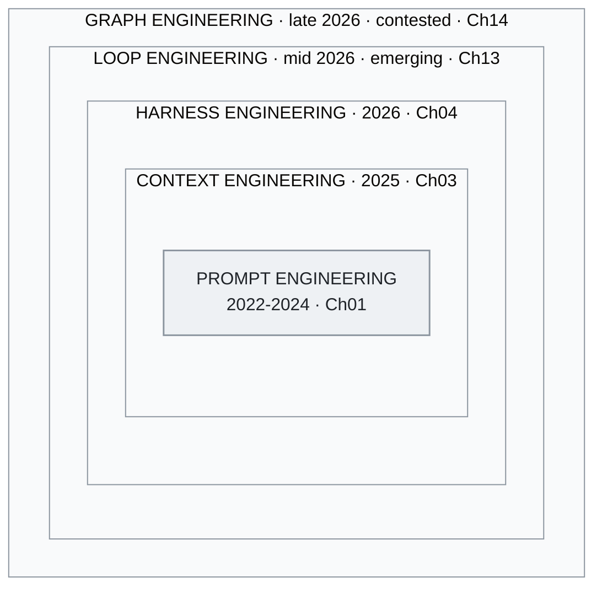

<!-- translation-sync:start -->
> Traducción asistida por máquina sincronizada con la edición inglesa de 2026-10-31, con revisión de estructura y contenido. El código y las etiquetas de los diagramas conservan el original; los tiempos de lectura se estiman a partir del inglés.
> [English source](../../../chapters/01-evolution.md) · [Sync record](../../SYNC.md)
<!-- translation-sync:end -->

<a id="chapter-01-the-three-generations"></a><!-- i18n-anchor -->

# Capítulo 01: Las tres generaciones

> **En una frase:** La ingeniería de IA ha pasado de escribir buenos prompts a diseñar sistemas operativos completos alrededor de los modelos de IA.
>
> **Por qué importa:** Entender hacia dónde avanza el campo ayuda a elegir las herramientas adecuadas y a evitar enfoques desfasados.
>
> **Tiempo de lectura:** ~14 min (estimación del original en inglés: 3,108 palabras / 230 palabras por minuto)

**De la ingeniería de prompts a la ingeniería de contexto y la ingeniería de harness: por qué los límites entre ellas importan menos de lo que parece.**

---

<a id="generation-1-prompt-engineering-2022-2024"></a><!-- i18n-anchor -->

## Generación 1: Ingeniería de prompts (2022-2024)

Cuando ChatGPT se lanzó en noviembre de 2022, toda la interfaz entre las personas y los grandes modelos de lenguaje era un cuadro de texto. La disciplina que surgió fue la ingeniería de prompts: el arte y la ciencia de elaborar el texto de entrada para obtener mejores resultados.

Las técnicas fundamentales se desarrollaron con rapidez:

**Few-shot prompting** (Brown et al., 2020) demostró que incluir ejemplos en el prompt podía mejorar considerablemente el rendimiento de una tarea sin ningún ajuste fino. En lugar de entrenar un modelo para clasificar sentimientos, se le mostraban tres ejemplos y se le pedía clasificar el cuarto.

**Chain-of-thought (CoT) prompting** (Wei et al., 2022) mostró que añadir "Let's think step by step" o incluir trazas de razonamiento en los ejemplos podía activar capacidades de razonamiento de varios pasos que parecían ausentes en el prompting convencional. Fue, posiblemente, la primera señal de que *cómo se estructuraba el contexto* importaba tanto como *qué se preguntaba*.

Las **plantillas de prompts** se convirtieron en la abstracción habitual. LangChain, LlamaIndex y decenas de frameworks ofrecieron sistemas de plantillas para insertar variables en estructuras de prompts cuidadosamente elaboradas. El modelo mental era claro: el prompt es el programa y el modelo es el entorno de ejecución.

Otras técnicas de esta época son:

- **ReAct** (Yao et al., 2022): Intercalar pasos de razonamiento y acción para que los modelos planifiquen y ejecuten llamadas a herramientas dentro de una única estructura de prompt.
- **Tree of Thought** (Yao et al., 2023): Explorar varias vías de razonamiento y seleccionar la mejor.
- **Self-consistency** (Wang et al., 2022): Muestrear varias cadenas de razonamiento y decidir por mayoría.

La limitación de esta época era su supuesto: que la calidad de una interacción con un LLM dependía principalmente de la calidad del prompt. Era cierto cuando las ventanas de contexto tenían 4K-8K tokens y la única entrada era texto del usuario. Dejó de serlo cuando los modelos pudieron ingerir 100K+ tokens y llamar a herramientas externas.

<a id="what-this-era-got-right"></a><!-- i18n-anchor -->

### Lo que esta época acertó

La ingeniería de prompts estableció que *la estructura importa*. La diferencia entre un prompt bueno y uno malo no es una cuestión de sensaciones: es arquitectura de la información. Esa idea se trasladó a todo lo que vino después.

<a id="what-this-era-missed"></a><!-- i18n-anchor -->

### Lo que esta época pasó por alto

Trataba la ventana de contexto como un artefacto estático. Se elaboraba un prompt, se enviaba y se obtenía una respuesta. La idea de que la propia ventana de contexto podía *construirse dinámicamente* a partir de varias fuentes durante la ejecución fue la aportación de la siguiente generación.

---

<a id="generation-2-context-engineering-2025"></a><!-- i18n-anchor -->

## Generación 2: Ingeniería de contexto (2025)

A mediados de 2025, Andrej Karpathy publicó una de las observaciones más compartidas en la comunidad de ingeniería de IA:

> "I've been thinking about this and I think the right term for what most people actually need to get good at is not 'prompt engineering' but 'context engineering.' The art and science of filling the context window with just the right information for the next step."

Este replanteamiento fue relevante porque desplazó la atención de la *instrucción* (el prompt) al *conjunto completo de información* (la ventana de contexto). La ventana de contexto de una llamada moderna a un LLM contiene mucho más que un prompt del usuario:

- Instrucciones de sistema que definen comportamiento y restricciones
- Documentos recuperados por pipelines de RAG
- Definiciones y esquemas de herramientas
- Historial de conversación, comprimido selectivamente
- Ejemplos few-shot seleccionados dinámicamente
- Metadatos estructurados sobre la tarea actual

El prompt es un componente. La ingeniería de contexto consiste en orquestarlos todos.

<a id="the-six-techniques"></a><!-- i18n-anchor -->

### Las seis técnicas

El [análisis de Towards AI](https://towardsai.net/) sobre ingeniería de contexto identificó seis técnicas fundamentales que definen la disciplina:

1. **Generación aumentada por recuperación (RAG)**: Recuperar documentos relevantes en el momento de la consulta
2. **Integración de herramientas y API**: Dar a los modelos acceso a capacidades externas mediante esquemas estructurados
3. **Gestión de memoria**: Mantener información relevante entre turnos de conversación y sesiones
4. **Construcción dinámica de prompts**: Ensamblar prompts a partir de plantillas, contenido recuperado y estado de ejecución
5. **Optimización de la ventana de contexto**: Gestionar qué entra y qué queda fuera de presupuestos de tokens limitados
6. **Jerarquía de instrucciones**: Organizar instrucciones de sistema, desarrollador y usuario en capas con una precedencia clara

<a id="lessons-from-manus"></a><!-- i18n-anchor -->

### Lecciones de Manus

[Manus](https://manus.im/), la plataforma de agentes de IA que se convirtió en uno de los productos más comentados de 2025, compartió lecciones fundamentales sobre ingeniería de contexto a escala:

**La idea de la caché KV**: Manus diseñó su ventana de contexto para mantener una alta tasa de aciertos en la caché KV, de modo que los pares clave-valor calculados previamente por el mecanismo de atención pudieran reutilizarse entre turnos. Esto redujo considerablemente la latencia y el coste. El principio es estructurar el contexto de forma que el *prefijo permanezca estable* y solo *cambie el sufijo* entre llamadas.

**La proporción 100:1**: Manus informó de que por cada 1 token de salida del modelo se consumían aproximadamente 100 tokens de contexto. Esto invertía el supuesto habitual de que los tokens de salida eran el principal factor de coste. El verdadero reto de ingeniería no era generar texto, sino *seleccionar qué contexto suministrar*.

**El contexto como producto**: Manus trató la construcción de la ventana de contexto como una función central del producto, no como un detalle de implementación. La calidad del agente era directamente proporcional a la calidad de su pipeline de ensamblaje de contexto.

<a id="the-taxonomy-shift"></a><!-- i18n-anchor -->

### El cambio de taxonomía

La ingeniería de contexto replanteó el desarrollo de aplicaciones con LLM: de "write good prompts" a "build good information pipelines." El modelo pasó a ser un motor de razonamiento que operaba sobre el contexto recibido. El reto de ingeniería se desplazó a etapas anteriores: recuperación, filtrado, clasificación, compresión y ensamblaje.

Pero incluso este marco tenía un límite. Describía *qué entra en el modelo*, pero no *cómo funciona el sistema que lo rodea*. Eso exigía otro cambio.

---

<a id="generation-3-harness-engineering-2026"></a><!-- i18n-anchor -->

## Generación 3: Ingeniería de harness (2026)

Entre finales de 2025 y principios de 2026, dos aportaciones influyentes formalizaron la siguiente evolución:

**Birgitta Böckeler** (ThoughtWorks), en la serie de memorandos *Exploring Generative AI* de Martin Fowler de abril de 2026, publicó un análisis que sostenía que el trabajo de ingeniería de mayor impacto en las aplicaciones con LLM no estaba en entrenar modelos ni elaborar prompts, sino en *el harness*: el sistema de herramientas, enrutamiento, memoria, planificación y recuperación de errores que rodea al modelo y orquesta sus llamadas en flujos de trabajo fiables.

El **equipo de Codex de OpenAI** ha publicado casos sobre el harness en la programación con agentes (véase openai.com/index/introducing-codex para el material público). La cifra muy citada de "three engineers / ~1M lines / ~1,500 PRs" circuló en charlas y publicaciones de OpenAI de 2025-2026; la observación subyacente es que la calidad de Codex dependía principalmente del harness, más que del modelo: el sistema que decidía *cuándo* llamar al modelo, *qué contexto* proporcionar, *qué herramientas* habilitar y *cómo* validar los resultados y recuperarse de los errores.

<a id="the-phil-schmid-analogy"></a><!-- i18n-anchor -->

### La analogía de Phil Schmid

[Phil Schmid](https://www.philschmid.de/) (Hugging Face) propuso la analogía que concretó el concepto:

- **El modelo es la CPU**: capacidad de cómputo en bruto
- **La ventana de contexto es la RAM**: memoria de trabajo para la operación actual
- **El harness es el sistema operativo**: planificación, gestión de recursos, E/S, manejo de errores e interfaz de usuario

Esta analogía aclara por qué importa la ingeniería de harness: nadie entrega una CPU sin un sistema operativo. El modelo es necesario, pero no suficiente. El harness determina lo que el modelo puede lograr realmente.

<a id="the-meta-harness-paper-and-the-6x-gap"></a><!-- i18n-anchor -->

### El artículo Meta-Harness y la diferencia de 6x

Una investigación publicada a principios de 2026 cuantificó lo que los profesionales ya sospechaban: la diferencia entre un modelo sin soporte y uno con un harness bien diseñado era de aproximadamente **6x en tareas complejas**. El mismo modelo, con los mismos pesos y los mismos datos de entrenamiento, producía resultados que variaban por un factor de seis según la calidad de su harness.

Esto significaba que, en la mayoría de las aplicaciones prácticas, la ingeniería de harness ofrecía más margen de mejora que perfeccionar el modelo. Un buen harness con un modelo competente superaba a un gran modelo con un harness mediocre.

<a id="the-impact-framework"></a><!-- i18n-anchor -->

### El marco IMPACT

En el discurso profesional de mediados de la década de 2020 surgió la mnemotecnia IMPACT como lista de comprobación para evaluar la calidad del harness:

- **I**nstructions: claridad e integridad de las instrucciones de sistema
- **M**emory: persistencia y recuperación entre sesiones
- **P**lanning: descomposición y secuenciación de tareas
- **A**ctions: disponibilidad y fiabilidad de las herramientas
- **C**ontext: ensamblaje dinámico de información relevante
- **T**esting: bucles de evaluación y garantía de calidad

IMPACT sitúa la ingeniería de contexto como un componente (la "C") de la disciplina más amplia de ingeniería de harness. Este anidamiento es la idea estructural fundamental: la ingeniería de contexto está *dentro* de la ingeniería de harness, que la incorpora en lugar de sustituirla.

<a id="meta-acquires-manus-2b"></a><!-- i18n-anchor -->

### Meta adquiere Manus (~$2B)

A principios de 2026, Meta adquirió Manus por aproximadamente $2 mil millones. La adquisición se interpretó ampliamente como la compra de *el harness, no el modelo*. Meta ya tenía Llama. Lo que le faltaba era un sistema probado en producción para ensamblar contexto, orquestar herramientas y gestionar el entorno de ejecución de agentes.

La adquisición validó la tesis: la ingeniería más valiosa del ecosistema de LLM se concentraba cada vez más en la capa de orquestación, no en la del modelo.

---

<a id="the-key-insight-coexistence-not-replacement"></a><!-- i18n-anchor -->

## La idea fundamental: coexistencia, no sustitución

Estas tres generaciones no son periodos históricos bien delimitados en los que una sustituya a la siguiente. Son *capas anidadas* que coexisten en todos los sistemas de producción:

```
+--------------------------------------------------+
|              HARNESS ENGINEERING                  |
|  +--------------------------------------------+  |
|  |          CONTEXT ENGINEERING                |  |
|  |  +--------------------------------------+  |  |
|  |  |       PROMPT ENGINEERING             |  |  |
|  |  |                                      |  |  |
|  |  |  System prompts, CoT, few-shot,      |  |  |
|  |  |  instruction formatting              |  |  |
|  |  +--------------------------------------+  |  |
|  |                                            |  |
|  |  RAG pipelines, memory, tool schemas,      |  |
|  |  context window optimization               |  |
|  +--------------------------------------------+  |
|                                                  |
|  Skill routing, planning loops, error recovery,  |
|  progressive disclosure, multi-agent coord       |
+--------------------------------------------------+
```

*Figura: El mismo anidamiento, representado gráficamente. Los recuadros de líneas continuas son las tres generaciones numeradas en este capítulo; los dos recuadros exteriores son las capas controvertidas de Ch13 y Ch14, situadas deliberadamente fuera de la numeración.*



Un ingeniero de harness sigue escribiendo prompts y haciendo ingeniería de contexto. Pero también construye el *sistema* que decide qué prompts usar y cuándo, qué contexto ensamblar para cada situación y cómo recuperarse cuando algo sale mal.

La evolución no consiste en abandonar las técnicas anteriores, sino en reconocer que son necesarias pero insuficientes, y construir encima las capas que convierten la capacidad bruta del LLM en aplicaciones fiables y aptas para producción.

Una revisión de 19 autores de Shanghai Jiao Tong y colaboradores, **"Externalization in LLM Agents: A Unified Review of Memory, Skills, Protocols and Harness Engineering"** (arXiv 2604.08224, 9 de abril de 2026), llega de forma independiente a la misma organización de tres capas que utiliza este capítulo: según su marco, el campo avanza de los *pesos* al *contexto* y al *harness*, y trata la memoria, las habilidades, los protocolos y la ingeniería de harness como cuatro componentes externalizados, unificados por el harness como capa de integración. Esta convergencia es relevante para quienes llegan desde la literatura académica: no es un marco exclusivo de los profesionales ni de esta guía, sino el eje organizador elegido también por la revisión académica de finales de abril de 2026.

---

<a id="an-emerging-fourth-generation-loop-engineering-mid-2026"></a><!-- i18n-anchor -->

## ¿Una cuarta generación emergente? Ingeniería de bucles (mediados de 2026)

El título de este capítulo conserva deliberadamente *Las tres generaciones*. Pero en junio de 2026 una cuarta capa candidata se concretó con suficiente rapidez para señalarla aquí, aunque es demasiado reciente para incorporarla a la secuencia numerada. En una sola semana —la publicación viral de Peter Steinberger del 7 de junio que decía "shouldn’t be prompting coding agents anymore ... You should be designing loops that prompt your agents,", el ensayo de Addy Osmani de ese mismo día que la llamó **ingeniería de bucles** y la descripción de Boris Cherny (Claude Code) de su trabajo como "writing loops"— los profesionales empezaron a describir una capa *por encima* del harness: el sistema que proporciona prompts al agente por usted según una programación, crea asistentes y se retroalimenta.

Sus defensores definen con precisión su relación con la generación 3. Osmani sitúa la ingeniería de bucles "one floor above the harness": en su marco, un bucle es el harness "but it runs on a timer, it spawns little helpers, and it feeds itself." Es la misma lógica de anidamiento que utiliza este capítulo: el bucle es simplemente el recuadro exterior que envuelve harness, contexto y prompt, por lo que un ingeniero de bucles sigue escribiendo prompts, haciendo ingeniería de contexto y construyendo un harness. Lo que distingue un bucle de un simple planificador es que lee el estado actual en cada pasada y vuelve a decidir, en lugar de lanzar un comando fijo según el reloj.

Dos salvedades de honestidad mantienen esta propuesta fuera de las generaciones numeradas por ahora. En el momento de escribir, el término tiene unas cinco semanas, vive exclusivamente en el discurso profesional —blogs, pódcasts y X— sin literatura académica que lo respalde, y divide a quienes lo consideran un cambio real y quienes lo ven como un cambio de nombre prematuro de la planificación. Por ello, esta guía sigue la ingeniería de bucles como *emergente*, no consolidada, la misma postura que adopta ante cualquier afirmación que todavía no haya superado el escrutinio de fuentes primarias y del tiempo. El [capítulo 13](13-loop-engineering.md) desarrolla el marco completo, vincula cada afirmación fundamental a una fuente y señala las lagunas en lugar de rellenarlas.

La máquina de poner nombres ha vuelto a funcionar. A mediados de julio de 2026, seis semanas después de la semana de los bucles, apareció otra candidata siguiendo el mismo patrón: la **ingeniería de grafos**, la propuesta de que sobre el bucle se encuentra el grafo, la conexión explícita de qué agentes existen, quién puede delegar en quién y cómo sus bucles se supervisan y corrigen mutuamente. Otra publicación de Steinberger (fechada el 18 de julio de 2026 por las fuentes que la datan; podría ser el 17 de julio en horario estadounidense) actuó como catalizador; en pocos días llegó una oleada de ensayos y las objeciones aparecieron con igual rapidez: la respuesta oficial de LangChain enumera la ingeniería de grafos después de la de prompts, contexto, harness y bucles, pero a la vez sostiene que representar sistemas de agentes como grafos es una práctica de tres años, y que un bucle es simplemente un grafo cíclico dirigido, por lo que solo el nombre es nuevo. El capítulo 14 fijó un criterio explícito de supervivencia del término y lo comprobó el 15 de septiembre de 2026. El resultado fue dividido: la ingeniería de grafos siguió circulando —tres meses de ensayos que no son respuestas al catalizador, un curso de pago que enseña el sentido de organización de agentes y un tutorial de septiembre—, mientras no se encontró adopción del término por proveedores en la documentación revisada, y dos proveedores publicaron la gobernanza que describe sin utilizarlo, uno de ellos desde un mes antes de que existiera el término. El veredicto registrado es que sobrevivió como nombre controvertido para la coordinación multiagente, pero no está demostrado que constituya una capa distinta, por lo que sigue fuera de las generaciones numeradas. La ubicación de la coordinación multiagente dentro del recuadro del harness en este capítulo continúa siendo una interpretación alternativa vigente, no un marcador provisional. El [capítulo 14](14-graph-engineering.md) contiene el cuadro de evaluación fechado y otorga el mismo peso a los escépticos.

---

<a id="three-things-to-take-away"></a><!-- i18n-anchor -->

## Tres ideas para recordar

- **Las generaciones se anidan, no se sustituyen.** Un ingeniero de harness sigue escribiendo prompts y haciendo ingeniería de contexto; por eso IMPACT incluye esta última como la "C".
- **Meta pagó unos $2 mil millones por un harness.** Meta ya tenía Llama; le faltaba un sistema probado en producción para ensamblar contexto y orquestar herramientas, por lo que la adquisición se interpretó como la compra de la capa de orquestación, más que la del modelo.
- **Los nombres se adelantan a la evidencia.** Tanto la ingeniería de bucles como la de grafos llegaron con una oleada de ensayos, no de trabajos académicos; por ello, este capítulo las mantiene fuera de las tres generaciones numeradas.

---

<a id="sources"></a><!-- i18n-anchor -->

## Fuentes

- Brown, T. et al. (2020). "Language Models are Few-Shot Learners." [arXiv:2005.14165](https://arxiv.org/abs/2005.14165)
- Wei, J. et al. (2022). "Chain-of-Thought Prompting Elicits Reasoning in Large Language Models." [arXiv:2201.11903](https://arxiv.org/abs/2201.11903)
- Yao, S. et al. (2022). "ReAct: Synergizing Reasoning and Acting in Language Models." [arXiv:2210.03629](https://arxiv.org/abs/2210.03629)
- Yao, S. et al. (2023). "Tree of Thoughts: Deliberate Problem Solving with Large Language Models." [arXiv:2305.10601](https://arxiv.org/abs/2305.10601)
- Wang, X. et al. (2022). "Self-Consistency Improves Chain of Thought Reasoning in Language Models." [arXiv:2203.11171](https://arxiv.org/abs/2203.11171)
- Karpathy, A. (mediados de 2025). Comentarios públicos que acuñan "context engineering" como el término adecuado para la disciplina; marco ampliamente compartido en X y la comunidad de ingeniería de IA.
- Manus. (2025). "Context Engineering Lessons from Building Manus." [manus.im/blog](https://manus.im/blog) --- Tasa de aciertos de la caché KV como métrica operativa, contexto de solo anexado, enmascaramiento de herramientas mediante sesgo de logits y reescritura continua de listas de tareas.
- Böckeler, Birgitta. (2 de abril de 2026). "Harness engineering for coding agent users." martinfowler.com (serie *Exploring Generative AI*). [https://martinfowler.com/articles/harness-engineering.html](https://martinfowler.com/articles/harness-engineering.html) --- Taxonomía de guías frente a sensores y de lo computacional frente a lo inferencial.
- OpenAI. Material público sobre Codex: [https://openai.com/index/introducing-codex](https://openai.com/index/introducing-codex). Referencia para el enfoque de diseño de harness de Codex; las cifras muy citadas de "three engineers / ~1M lines / ~1,500 PRs" circularon en charlas y publicaciones de OpenAI de 2025-2026 y se presentan aquí como cifras citadas por la comunidad, no como procedentes de una única publicación canónica.
- Schmid, Philipp. "The New Skill in AI is Not Prompting, It's Context Engineering" y continuación. [https://www.philschmid.de/context-engineering](https://www.philschmid.de/context-engineering); [https://www.philschmid.de/context-engineering-part-2](https://www.philschmid.de/context-engineering-part-2) --- Analogía de modelo = CPU, contexto = RAM y harness = sistema operativo.
- Mnemotecnia IMPACT. Intención / Memoria / Planificación / Autoridad / Flujo de control / Herramientas: lista de diseño de harness de seis dimensiones surgida en el discurso profesional de mediados de la década de 2020. Se utiliza aquí como marco pedagógico; no se atribuye a una fuente primaria concreta.
- Cobertura de la adquisición de Manus por Meta. (2026). Varias fuentes.
- Zhou, C. et al. (abril de 2026). "Externalization in LLM Agents: A Unified Review of Memory, Skills, Protocols and Harness Engineering." [arXiv:2604.08224](https://arxiv.org/abs/2604.08224) --- Revisión de 19 autores de Shanghai Jiao Tong y colaboradores que utiliza de forma independiente el marco histórico de tres capas: pesos → contexto → harness. Citada en la sección "Coexistence, Not Replacement" como evidencia de la convergencia entre la tesis profesional y la literatura académica.
- Steinberger, Peter (@steipete). Publicación catalizadora del marco "design loops that prompt your agents" (7 de junio de 2026). [https://x.com/steipete/status/2063697162748260627](https://x.com/steipete/status/2063697162748260627) --- Citada en la sección "Emerging Fourth Generation"; la propia publicación no utiliza la expresión "loop engineering."
- Osmani, Addy. "Loop Engineering" (7 de junio de 2026). [https://addyosmani.com/blog/loop-engineering/](https://addyosmani.com/blog/loop-engineering/) --- Ensayo que dio nombre a la práctica; fuente de la relación "one floor above the harness" utilizada en la sección sobre la cuarta generación.
- Cherny, Boris. Entrevista en Lenny's Podcast / Lenny's Newsletter (mediados de 2026). [https://www.lennysnewsletter.com/p/head-of-claude-code-what-happens](https://www.lennysnewsletter.com/p/head-of-claude-code-what-happens) --- Marco "my job is to write loops"; cita oral transcrita de forma inconsistente entre medios.
- Runkle, Sydney y Chase, Harrison (LangChain). "3 Years of Graph Engineering with LangGraph" (22 de julio de 2026). [https://www.langchain.com/blog/3-years-of-graph-engineering-with-langgraph](https://www.langchain.com/blog/3-years-of-graph-engineering-with-langgraph) --- Enumera la ingeniería de grafos después de la de prompts, contexto, harness y bucles, a la vez que sostiene que la práctica tiene tres años; fuente de su reducción a grafos cíclicos dirigidos utilizada en la sección sobre generaciones emergentes.
- Perez, Carlos E. "From Loop Engineering to Graph Engineering?" Intuition Machine (19 de julio de 2026). [https://medium.com/intuitionmachine/from-loop-engineering-to-graph-engineering-d3ebeb08511c](https://medium.com/intuitionmachine/from-loop-engineering-to-graph-engineering-d3ebeb08511c) --- Primera ampliación teórica del marco de ingeniería de grafos de julio de 2026; citada para la interpretación de bucles que supervisan bucles.

---

*Siguiente: [Capítulo 02 -- RAG, contexto largo y grafos de conocimiento](02-knowledge-layer.md)*
