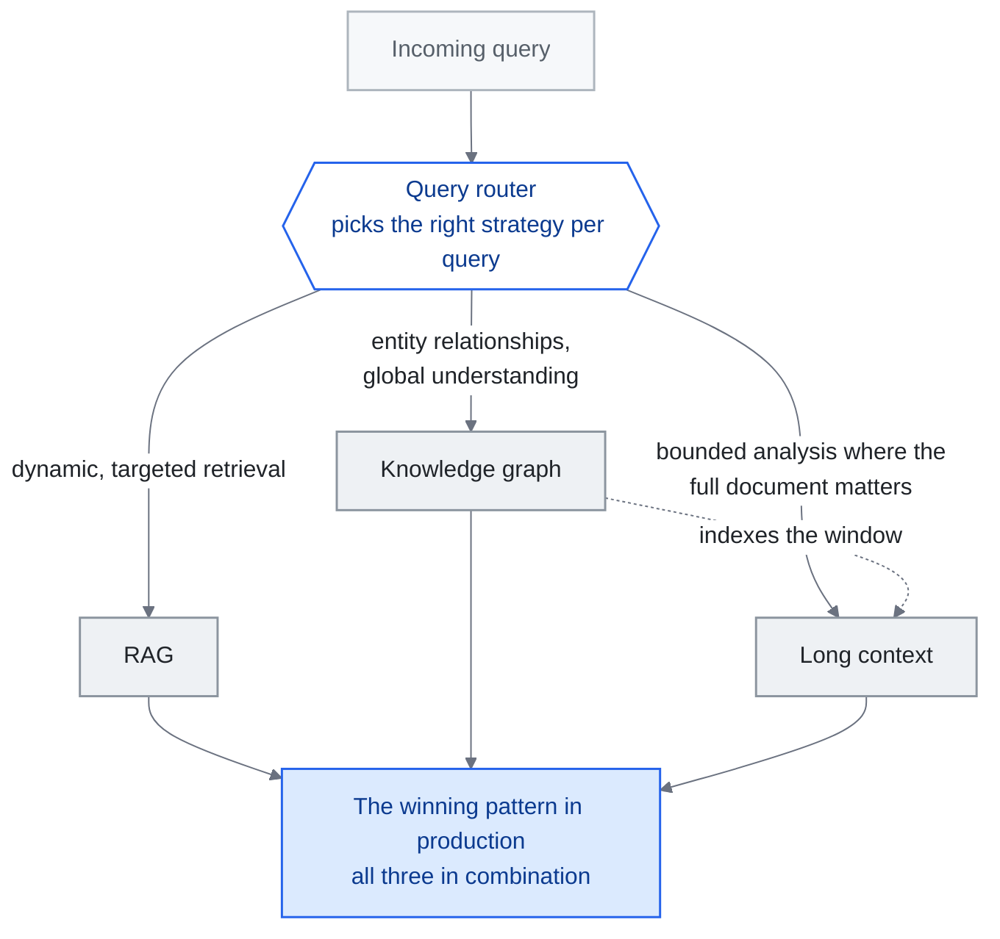

<!-- translation-sync:start -->
> Traducción asistida por máquina sincronizada con la edición inglesa de 2026-10-31, con revisión de estructura y contenido. El código y las etiquetas de los diagramas conservan el original; los tiempos de lectura se estiman a partir del inglés.
> [English source](../../../chapters/02-knowledge-layer.md) · [Sync record](../../SYNC.md)
<!-- translation-sync:end -->

<!-- i18n-anchor -->

# Capítulo 02: RAG, contexto largo y grafos de conocimiento

> **En una frase:** Hay tres formas principales de dar a la IA acceso al conocimiento: buscar en una base de datos (RAG), proporcionarle documentos largos o conectar hechos mediante un grafo.
>
> **Por qué importa:** Si utiliza IA con sus propios datos, este capítulo explica qué enfoque se adapta mejor a su situación.
>
> **Tiempo de lectura:** ~16 min (estimación del original en inglés: 3,453 palabras / 230 palabras por minuto)

*Figura: La elección entre tres vías de la sección "Hybrid Architectures: The Convergence", organizada alrededor del enrutador de consultas que esa sección sitúa al final de su patrón ganador en producción. Cada conexión que sale del enrutador indica la necesidad que dirige la consulta a esa rama. La línea de puntos representa la propuesta diferenciada de "KG as Semantic Backbone for Long Context": el grafo indexa una ventana a la que ya no necesita sustituir; las conexiones que convergen en el recuadro híbrido expresan el argumento del capítulo: el trabajo de ingeniería está en el enrutador, no en elegir una sola técnica.*

**La capa de recuperación del conocimiento: qué funciona, qué no y por qué la respuesta casi siempre es "hybrid."**

---

<!-- i18n-anchor -->

## RAG no ha muerto

Las ventanas de contexto más grandes amplían las opciones de diseño, pero su tamaño no determina por sí solo la fiabilidad con que un sistema utiliza la evidencia. [Liu et al.](https://arxiv.org/abs/2307.03172) mostraron que la calidad de la respuesta puede depender de dónde aparezca la información relevante en una entrada larga. Evalúe la recuperación y el contexto completo con sus propias preguntas, teniendo en cuenta la calidad de respuesta, el uso de tokens, la latencia y cómo llega al modelo la evidencia actualizada.

RAG no ha muerto: está evolucionando. La pregunta nunca fue "RAG or not RAG", sino "what kind of RAG, combined with what else."

---

<!-- i18n-anchor -->

## La realidad de los costes

El argumento económico a favor de RAG sigue siendo contundente.

Un pipeline típico de RAG recupera 5-20 fragmentos relevantes (aproximadamente 2,000-8,000 tokens) y los introduce en una llamada al modelo. Para la misma consulta, un enfoque que llena el contexto con las fuentes podría cargar 500K-1M tokens de documentos.

**Comparación de costes por consulta (aproximada, con precios de mediados de 2026):**

| Enfoque | Tokens de entrada | Coste aproximado | Coste relativo |
|----------|-------------|-----------------|---------------|
| RAG (recuperación selectiva) | ~5,000 | ~$0.00008 | 1x |
| Llenado del contexto (corpus completo) | ~500,000 | ~$0.10 | 1,250x |

No es una diferencia de redondeo. A escala empresarial, con millones de consultas mensuales, la diferencia entre $80 y $100,000 al mes en inferencia determina si un proyecto supera la revisión presupuestaria.

La recuperación puede reducir los tokens de entrada, pero el coste total también incluye indexación, recuperación, caché y posibles llamadas adicionales al modelo. Compare el pipeline completo con una referencia de contexto completo y el mismo objetivo de calidad de respuesta; el diseño más barato depende del tamaño del corpus, el volumen de consultas y los precios del modelo.

---

<!-- i18n-anchor -->

## Contexto largo: cuándo funciona y cuándo no

Las ventanas de contexto largo (128K, 200K, 1M+ tokens) transforman determinados casos de uso:

**Dónde destaca el contexto largo:**
- **Análisis estático y acotado de documentos**: Analizar un contrato, un archivo de código o un artículo de investigación cuando todo el corpus relevante cabe en la ventana
- **Referencias cruzadas**: Encontrar conexiones entre un conjunto fijo de documentos cargados una sola vez
- **Resumen**: Condensar entradas grandes pero finitas en resultados estructurados

**Dónde falla el contexto largo:**

**Degradación "Lost in the middle".** La investigación de [Liu et al. (2023)](https://arxiv.org/abs/2307.03172) demostró que los LLM utilizan mucho peor la información situada en medio de contextos largos que la del principio o el final. Las mejoras posteriores de los modelos han reducido este efecto, pero no lo han eliminado. A principios de 2026, los modelos todavía muestran pérdidas de precisión medibles cuando la información relevante está enterrada entre 500K+ tokens de contexto.

**Bases de conocimiento dinámicas.** Si la base se actualiza cada hora —inventario de productos, tickets de soporte o noticias—, no se puede volver a introducir todo el corpus en cada ventana de contexto. La recuperación de RAG gestiona las actualizaciones de forma natural: los documentos nuevos se indexan y pueden recuperarse inmediatamente sin modificar la estructura del prompt.

**Aislamiento entre inquilinos.** Los enfoques de contexto largo tienen dificultades con el control de acceso. Cuando un mismo corpus contiene documentos de varios usuarios o niveles de permiso, los pipelines de RAG pueden filtrar durante la recuperación. Llenar el contexto exige una segregación cuidadosa de los documentos, propensa a errores.

**Latencia a escala.** Procesar 1M tokens lleva considerablemente más tiempo que procesar 5K, incluso con inferencia optimizada. En aplicaciones de cara al usuario donde importa responder en menos de un segundo, gana la recuperación selectiva.

<!-- i18n-anchor -->

### Actualización de 2026: Titans + MIRAS replantean las compensaciones del contexto largo

Todas las limitaciones anteriores suponen una ventana de contexto de tipo Transformer: una secuencia plana de tokens leída mediante atención, con el mismo coste por token sin importar la posición y los mismos fallos de "lost in the middle". **Titans + MIRAS**, la familia de arquitecturas de Google Research de abril de 2026, rompe ese supuesto. En Titans, la memoria no es la ventana de atención, sino un **módulo neuronal entrenable** que actualiza sus propios pesos mediante descenso de gradiente durante la inferencia: el modelo comprime literalmente el historial largo en actualizaciones de pesos, en lugar de transportarlo como tokens. MIRAS aporta las recetas de entrenamiento que estabilizan ese aprendizaje durante la inferencia. Con cantidades comparables de parámetros, Google informa de que Titans supera a Mamba-2, Gated DeltaNet y Transformer++ en recuerdo a largo alcance y razonamiento de varios saltos. Esto no refuta las limitaciones originales del contexto largo, que siguen vigentes en el paradigma de ventana de atención utilizado por GPT-4 Turbo, Gemini 1.5 y Claude, pero sí establece que **el marco de "attention budget is scarce" describe ahora una familia de arquitecturas, no una restricción universal.** Para los profesionales, la compensación del contexto largo ya no sigue una sola curva, sino al menos dos: la de la ventana de atención, dominada por la pérdida de información intermedia y el coste por token, y la de la memoria entrenable, cuyo coste se desplaza a actualizar pesos durante la inferencia y cuyos fallos se centran en estabilidad y olvido. RAG sigue siendo una buena opción predeterminada en ambos casos, pero las *razones* por las que gana son distintas en cada régimen.

<!-- i18n-anchor -->

### Precaución de 2026: una afirmación controvertida sobre 12M tokens

No todos los anuncios de contexto largo resisten el escrutinio. La startup **Subquadratic** lanzó **SubQ** el 5 de mayo de 2026 y afirmó ofrecer una **ventana de 12 millones de tokens** mediante **Subquadratic Selective Attention (SSA)**; los benchmarks citados por la empresa y ejecutados por Appen son llamativos: 56x más rapidez que FlashAttention, un 98% de recuperación de aguja en un pajar con 6-12M tokens y $8 para ejecutar RULER-128 frente a $2,600 con Claude Opus 4.6. Un examen de MIT Technology Review del 19 de junio de 2026 interpretó la afirmación con más cautela. Investigadores como Will Depue señalaron que la evidencia pública todavía no respalda la afirmación más fuerte de "solved quadratic attention" y que SubQ **reutiliza pesos de Qwen en lugar de entrenarse desde cero**; por tanto, sus cifras de eficiencia corresponden a un modelo adaptado concreto, no a un resultado general demostrado. Aquí también se aplica la norma del repositorio de evitar exageraciones: SSA es una propuesta interesante y, a la vez, no verificada; quienes evalúen contexto largo deben tratar la cifra de 12M como controvertida hasta que exista replicación independiente.

---

<!-- i18n-anchor -->

## GraphRAG: cuando la recuperación plana no basta

(Nota terminológica: los grafos de conocimiento de este capítulo estructuran lo que un sistema *sabe*; el marco separado de "graph engineering" surgido en julio de 2026 y tratado en el [capítulo 14](14-graph-engineering.md) se refiere a cómo se conectan los sistemas multiagente, no a recuperar conocimiento.)

RAG convencional trata los documentos como fragmentos independientes. Esto funciona para consultar hechos ("What is the return policy?"), pero falla con preguntas que requieren *razonar sobre relaciones* ("Which suppliers are connected to both our delayed shipments and our quality complaints?").

[GraphRAG de Microsoft](https://github.com/microsoft/graphrag) (2024-2025) introdujo un enfoque híbrido: construir un grafo de conocimiento a partir de las fuentes y combinar su recorrido con recuperación vectorial para responder consultas.

<!-- i18n-anchor -->

### Cómo funciona GraphRAG

1. **Fase de indexación**: Los documentos se procesan para extraer entidades (personas, organizaciones y conceptos) y sus relaciones. Estas forman un grafo junto a los embeddings vectoriales tradicionales.
2. **Detección de comunidades**: El grafo se divide en comunidades de entidades densamente conectadas. Cada comunidad recibe una descripción resumida.
3. **Fase de consulta**: Se utilizan tanto la similitud vectorial *como* el recorrido del grafo para recuperar contexto relevante. Las relaciones entre entidades aportan vías de razonamiento de varios saltos que la recuperación plana no encuentra.

<!-- i18n-anchor -->

### Cuándo importa GraphRAG

- **Consultas de varios saltos**: "Who are the common investors between companies that went public in 2025 and companies that were acquired?" -- Exige recorrer cadenas de relaciones
- **Razonamiento centrado en entidades**: Preguntas sobre entidades concretas y sus conexiones con otras entidades
- **Resumen global**: "What are the main themes across all our customer feedback?" -- Los resúmenes de comunidades lo permiten sin procesar cada documento

<!-- i18n-anchor -->

### Cuándo GraphRAG es excesivo

- Consultas sencillas de hechos (RAG convencional las resuelve bien)
- Corpus pequeños que caben enteros en el contexto largo
- Casos con extracción de entidades de baja calidad (si entra basura, sale basura)

El coste de indexación de GraphRAG es considerablemente mayor que el de RAG convencional. Construya el grafo solo cuando razonar sobre relaciones sea un requisito fundamental, no por defecto.

<!-- i18n-anchor -->

### Evolución de 2026: el grafo de conocimiento como columna vertebral semántica del contexto largo

Durante 2024 y gran parte de 2025, GraphRAG se presentaba como una **alternativa a RAG**: otra forma de recuperar fragmentos para un modelo con una ventana limitada. En 2026, ese marco ha cambiado. A medida que los modelos de frontera amplían sus ventanas a varios millones de tokens (Gemini 1.5 con 1M, Kimi con más de 2M caracteres chinos y nuevas ampliaciones en marcha), la pregunta deja de ser "how do we retrieve a small number of relevant chunks" y pasa a ser "how do we navigate a context that is already large enough to hold most of what we need."

En ese escenario, el grafo de conocimiento deja de ser un **sustituto de la recuperación** y se convierte en una **capa de índice estructurado para el contexto largo**. No decide qué fragmentos cargar: ya están en la ventana. Ofrece al modelo un mapa semántico del contenido: qué entidades aparecen, cómo se relacionan, qué secciones corresponden a cada tema, dónde hay contradicciones y qué vías de varios saltos conectan la pregunta con la evidencia relevante. GraphRAG reaparece como **columna vertebral semántica** para que un agente recorra eficientemente una ventana de un millón de tokens, en lugar de remediar las ventanas de 8K tokens en las que nació. La llegada de módulos de memoria entrenable (Titans + MIRAS) en abril de 2026 no desplaza esta función: la evidencia inicial apunta a que grafos y memoria entrenable **coexistirán y probablemente se combinarán** en producción, aportando el grafo estructura tipada y consultable sobre lo que el módulo ya ha comprimido en sus pesos. El primer caso operativo a escala de esta función de grafo como índice llegó en junio de 2026: **Agents-K1** ("Agents-K1: Towards Agent-native Knowledge Orchestration," arXiv 2606.13669, 11 de junio de 2026) procesó **2.46 millones de artículos** en grafos nativos de agentes y publicó un **Scholar-KG de 1 millón de artículos**; informó de grandes mejoras posteriores en Frontierscience-Research (Gemini-3 de 7.9% a 24.6%, GPT-5.2 de 25.2% a 39.4%) al utilizar el grafo como base de recuperación. Un estudio controlado de septiembre de 2026 aporta un argumento antes ausente: en 48 casos sintéticos, la memoria en grafos de esquema fijo sobrevivió casi sin cambios a la sustitución del modelo subyacente, a diferencia de la memoria de notas comprimidas; esto convierte al grafo en la capa portátil de una pila cuyos modelos cambian (el [capítulo 6](06-agent-memory.md) contiene el resultado completo y las salvedades sobre la muestra pequeña).

<!-- i18n-anchor -->

### Actualización de 2026: se consolidan las herramientas de grafos y la memoria de agentes se diferencia (julio de 2026)

Una revisión de mediados de 2026 del panorama de herramientas de grafos (cifras de GitHub verificadas mediante su API en julio de 2026) muestra tres historias diferentes:

**Los frameworks tienen un nuevo líder.** [HKUDS/LightRAG](https://github.com/HKUDS/LightRAG) (artículo de EMNLP 2025; licencia MIT), el framework ligero de doble nivel grafo+vector, ha superado al original de Microsoft como framework de RAG con grafos con más estrellas: ~38k frente a ~35k (julio de 2026), gracias al crecimiento sostenido de funciones y no a un único hito. GraphRAG de Microsoft está en la línea v3.x ([v3.1.1 publicada el 18 de julio de 2026](https://github.com/microsoft/graphrag/releases)) y mantiene un desarrollo activo.

**La memoria de agentes basada en grafos se convierte en categoría propia.** Al margen de la tradición de recuperación documental de GraphRAG, varios proyectos utilizan grafos como *sustrato de memoria para agentes*: [getzep/graphiti](https://github.com/getzep/graphiti) (~29k estrellas en julio de 2026; grafos de conocimiento bitemporales en tiempo real para memoria de agentes), [Cognee](https://github.com/topoteretes/cognee) (cuya [versión del 26 de junio de 2026](https://www.cognee.ai/cognee-1-0-announcement) expone operaciones del ciclo de vida de la memoria) y [agent-memory](https://github.com/neo4j-labs/agent-memory) de Neo4j Labs (["Lenny's Memory,"](https://neo4j.com/blog/developer/meet-lennys-memory-building-context-graphs-for-ai-agents/) lanzada en enero de 2026), que señala el paso de los proveedores de bases de datos de grafos de construir conocimiento a gestionar directamente memoria de agentes. El [capítulo 6](06-agent-memory.md) aborda el ciclo de vida y la gobernanza más allá del almacenamiento en grafos.

**Madura la evidencia y se estanca un proyecto destacado.** [GraphRAG-Bench](https://github.com/GraphRAG-Bench/GraphRAG-Benchmark) ("When to use Graphs in RAG: A Comprehensive Analysis for Graph Retrieval-Augmented Generation"), aceptado en ICLR 2026, es el primer análisis neutral ampliamente citado sobre cuándo RAG basado en grafos supera realmente a RAG convencional: una respuesta empírica directa a la pregunta "when GraphRAG matters / when it is overkill" de esta sección. Mientras tanto, [OpenSPG/KAG](https://github.com/OpenSPG/KAG) de Ant Group, una referencia del ecosistema chino, ha perdido actividad: sin envíos al repositorio desde el 28 de enero de 2026 ni versiones desde junio de 2025; avanza por inercia, sin acelerar.

---

<!-- i18n-anchor -->

## Panorama de técnicas RAG de 2025-2026

RAG se ha diversificado en enfoques especializados. Sus variantes principales:

### Self-RAG (Asai et al., 2023)

[Self-RAG](https://arxiv.org/abs/2310.11511) entrena al modelo para decidir *cuándo* necesita recuperar información, *qué* recuperar y *si* el contenido recuperado es realmente pertinente. En vez de recuperar siempre, el modelo genera "reflection tokens" especiales que controlan ese proceso.

**Ventaja principal**: Reduce llamadas de recuperación innecesarias y filtra contenido irrelevante, mejorando la eficiencia y la precisión.

<!-- i18n-anchor -->

### RAG correctivo (CRAG)

[Corrective RAG](https://arxiv.org/abs/2401.15884) (Yan et al., 2024) añade una verificación después de recuperar información. Un evaluador ligero comprueba si los documentos son relevantes para la consulta. Si la confianza es baja, el sistema activa como alternativa una búsqueda web u otra estrategia de recuperación.

**Ventaja principal**: Degradación controlada cuando la base de conocimiento principal no contiene la respuesta.

<!-- i18n-anchor -->

### RAG adaptativo

[Adaptive RAG](https://arxiv.org/abs/2403.14403) (Jeong et al., 2024) utiliza un clasificador para dirigir las consultas a diferentes estrategias según su complejidad. Las sencillas reciben recuperación directa; las complejas, recuperación de varios pasos con razonamiento de cadena de pensamiento; las ambiguas, varias pasadas de recuperación y fusión de resultados.

**Ventaja principal**: Ajusta el coste de recuperación a la complejidad de la consulta, en lugar de aplicar un pipeline único a todos los casos.

### Golden-Retriever RAG

Golden-Retriever RAG se centra en la calidad de recuperación y utiliza el propio LLM para reescribir las consultas antes de recuperar. El modelo genera una descripción de "ideal document", que se utiliza como consulta en lugar de la entrada original del usuario.

**Ventaja principal**: Salva la diferencia de vocabulario entre las preguntas de los usuarios y la redacción de los documentos.

---

<!-- i18n-anchor -->

## RAG como "Context Engine"

[RAGFlow](https://github.com/infiniflow/ragflow), el motor RAG de código abierto, publicó a finales de 2025 una revisión anual que sostenía que "Retrieval-Augmented Generation" ya no describe todo lo que hacen los sistemas modernos. Su propuesta: RAG ha pasado de técnica de recuperación a **motor de contexto**, un sistema general para ensamblar información relevante de fuentes heterogéneas en la ventana de un modelo.

Este replanteamiento coincide con la evolución de la ingeniería de contexto descrita en el [capítulo 01](01-evolution.md). RAG no es simplemente "retrieve and stuff." Un sistema moderno de RAG:

- Clasifica la intención y la complejidad de la consulta
- Dirige la consulta a estrategias adecuadas (vectorial, palabras clave, grafo o híbrida)
- Reordena y filtra resultados
- Comprime el contenido recuperado para respetar los presupuestos de tokens
- Da formato a los resultados con estructura y metadatos adecuados
- Registra la procedencia para permitir citas y verificación

Esto es un pipeline de ensamblaje de contexto, no un paso de recuperación. El sistema RAG *es* el motor de contexto.

<!-- i18n-anchor -->

### 2026: RAG se convierte en una capacidad básica gestionada de nube

El replanteamiento como motor de contexto tuvo su reflejo en la infraestructura gestionada a mediados de 2026. El **17 de junio de 2026**, AWS publicó **Amazon Bedrock Managed Knowledge Base** en disponibilidad general: un servicio RAG totalmente gestionado, con seis conectores incorporados (S3, SharePoint, Confluence, Google Drive, OneDrive y Web Crawler), sincronización automática, almacenamiento vectorial gestionado y búsqueda híbrida, además de **"agentic retrieval"**, que orquesta automáticamente la planificación de consultas, la evaluación de respuestas intermedias y la reordenación para preguntas de varios saltos. La noticia no es la lista de funciones, sino el cambio: el pipeline de ensamblaje que este capítulo denomina motor de contexto pasa de componente construido a mano a **capacidad básica de nube de uso común** que los equipos aprovisionan. Como ocurre con la infraestructura de agentes gestionados (capítulo 4), la versión artesanal no desaparece, pero "stand up RAG over our documents" se convierte cada vez más en una decisión de configuración, no en un proyecto de ingeniería.

---

<!-- i18n-anchor -->

## Arquitecturas híbridas: la convergencia

La evidencia de 2025-2026 apunta claramente a enfoques híbridos. Ninguna técnica gana en todas las dimensiones:

| Dimensión | RAG | Contexto largo | Grafo de conocimiento |
|-----------|-----|-------------|----------------|
| Coste por consulta | Bajo | Alto | Medio |
| Actualizaciones dinámicas | Fuerte | Débil | Medio |
| Razonamiento sobre relaciones | Débil | Débil | Fuerte |
| Complejidad de configuración | Media | Baja | Alta |
| Precisión (selectiva) | Alta | Media | Alta |
| Precisión (global) | Media | Alta | Alta |

**El patrón ganador en producción:**

1. **Grafo de conocimiento** para relaciones entre entidades y comprensión global
2. **RAG** para recuperación dinámica y selectiva en consultas concretas
3. **Contexto largo** para análisis acotados donde importa el documento completo
4. **Enrutador de consultas** que selecciona la estrategia adecuada para cada pregunta

No es teórico. Los sistemas de producción a escala —búsqueda empresarial, asistentes de programación y agentes de soporte— combinan las tres técnicas. El reto de ingeniería no es elegir una, sino construir el enrutador que selecciona la herramienta adecuada para cada consulta.

---

<!-- i18n-anchor -->

## Proyectos y recursos principales

| Proyecto | Descripción | Enlace |
|---------|-------------|------|
| Microsoft GraphRAG | Enfoque híbrido de grafo de conocimiento + RAG | [github.com/microsoft/graphrag](https://github.com/microsoft/graphrag) |
| LightRAG | Framework ligero de RAG con grafo+vector (el de más estrellas, ~38k, julio de 2026) | [github.com/HKUDS/LightRAG](https://github.com/HKUDS/LightRAG) |
| RAGFlow | Motor RAG de código abierto con comprensión profunda de documentos | [github.com/infiniflow/ragflow](https://github.com/infiniflow/ragflow) |
| NirDiamant/RAG_Techniques | Colección completa de implementaciones de RAG | [github.com/NirDiamant/RAG_Techniques](https://github.com/NirDiamant/RAG_Techniques) |
| LangChain | Framework con amplias herramientas de RAG | [github.com/langchain-ai/langchain](https://github.com/langchain-ai/langchain) |
| LlamaIndex | Framework de datos para aplicaciones con LLM | [github.com/run-llama/llama_index](https://github.com/run-llama/llama_index) |
| Chroma | Base de datos de embeddings de código abierto | [github.com/chroma-core/chroma](https://github.com/chroma-core/chroma) |

---

<!-- i18n-anchor -->

## Tres ideas para recordar

- **Una ventana más grande no decide la estrategia de recuperación.** Compare calidad de respuesta, uso de tokens, latencia y actualización de la evidencia con las preguntas que atiende realmente su sistema.
- **Ninguna técnica gana en todas las dimensiones.** El coste, el razonamiento sobre relaciones y la complejidad de configuración tienen ganadores distintos; por eso las pilas de producción utilizan las tres a la vez.
- **Lo difícil es el enrutador, no la elección.** El patrón ganador del capítulo termina con un enrutador que escoge la estrategia adecuada para cada consulta, y ahí está el reto de ingeniería.

---

<!-- i18n-anchor -->

## Fuentes

- Liu, N. F. et al. (2023). "Lost in the Middle: How Language Models Use Long Contexts." [arXiv:2307.03172](https://arxiv.org/abs/2307.03172)
- Microsoft. (2024). "GraphRAG: Unlocking LLM discovery on narrative private datasets." [microsoft.com/research](https://www.microsoft.com/en-us/research/blog/graphrag-unlocking-llm-discovery-on-narrative-private-datasets/)
- Asai, A. et al. (2023). "Self-RAG: Learning to Retrieve, Generate, and Critique through Self-Reflection." [arXiv:2310.11511](https://arxiv.org/abs/2310.11511)
- Yan, S. et al. (2024). "Corrective Retrieval Augmented Generation." [arXiv:2401.15884](https://arxiv.org/abs/2401.15884)
- Jeong, S. et al. (2024). "Adaptive-RAG: Learning to Adapt Retrieval-Augmented Large Language Models through Question Complexity." [arXiv:2403.14403](https://arxiv.org/abs/2403.14403)
- RAGFlow. (2025). "Year-End Review: From RAG to Context Engine." [github.com/infiniflow/ragflow](https://github.com/infiniflow/ragflow)
- NirDiamant. (2025). "RAG Techniques." [github.com/NirDiamant/RAG_Techniques](https://github.com/NirDiamant/RAG_Techniques)
- Google Research. (abril de 2026). "Titans + MIRAS: Helping AI Have Long-Term Memory." [research.google/blog/titans-miras-helping-ai-have-long-term-memory/](https://research.google/blog/titans-miras-helping-ai-have-long-term-memory/) --- Módulos de memoria entrenable que superan a Mamba-2 / Gated DeltaNet / Transformer++ con tamaños comparables.
- AWS. "Amazon Bedrock Managed Knowledge Base is now generally available" (17 de junio de 2026). [https://aws.amazon.com/about-aws/whats-new/2026/06/amazon-bedrock-managed-knowledge-base/](https://aws.amazon.com/about-aws/whats-new/2026/06/amazon-bedrock-managed-knowledge-base/) --- RAG totalmente gestionado; seis conectores; almacenamiento vectorial gestionado; búsqueda híbrida; recuperación con agentes (planificación de consultas, evaluación de respuestas intermedias y reordenación).
- MIT Technology Review. "A startup claims it broke through a bottleneck that's holding back LLMs" (19 de junio de 2026). [https://www.technologyreview.com/2026/06/19/1139313/a-startup-claims-it-broke-through-a-bottleneck-thats-holding-back-llms/](https://www.technologyreview.com/2026/06/19/1139313/a-startup-claims-it-broke-through-a-bottleneck-thats-holding-back-llms/) --- Afirmación de Subquadratic sobre 12M tokens en SubQ mediante SSA; benchmarks de Appen; objeciones de Will Depue; SubQ reutiliza pesos de Qwen. Presentado como controvertido.
- "Agents-K1: Towards Agent-native Knowledge Orchestration." arXiv 2606.13669 (11 de junio de 2026). [https://arxiv.org/abs/2606.13669](https://arxiv.org/abs/2606.13669) --- 2.46M artículos procesados en grafos nativos de agentes; Scholar-KG de 1M artículos publicado; mejoras sobre la referencia en Frontierscience-Research (Gemini-3 7.9%→24.6%, GPT-5.2 25.2%→39.4%).
- HKUDS. "LightRAG: Simple and Fast Retrieval-Augmented Generation" (EMNLP 2025). [github.com/HKUDS/LightRAG](https://github.com/HKUDS/LightRAG) --- ~38k estrellas frente a ~35k de microsoft/graphrag en julio de 2026 (API de GitHub).
- Microsoft. Versiones de GraphRAG. [github.com/microsoft/graphrag/releases](https://github.com/microsoft/graphrag/releases) --- v3.1.1 (18 de julio de 2026); línea v3.x de 2026 del proyecto.
- GraphRAG-Bench. "When to use Graphs in RAG: A Comprehensive Analysis for Graph Retrieval-Augmented Generation" (ICLR 2026). [github.com/GraphRAG-Bench/GraphRAG-Benchmark](https://github.com/GraphRAG-Bench/GraphRAG-Benchmark)
- Cognee. "cognee 1.0" (26 de junio de 2026). [Anuncio](https://www.cognee.ai/cognee-1-0-announcement).
- Neo4j. "Meet Lenny's Memory: Building Context Graphs for AI Agents" (enero de 2026). [neo4j.com/blog/developer](https://neo4j.com/blog/developer/meet-lennys-memory-building-context-graphs-for-ai-agents/) --- Biblioteca de memoria de agentes nativa de grafos (neo4j-labs/agent-memory).
- Versiones de OpenSPG/KAG. [github.com/OpenSPG/KAG/releases](https://github.com/OpenSPG/KAG/releases) --- Último envío al repositorio el 28 de enero de 2026; última versión v0.8.0 (junio de 2025), verificado mediante la API de GitHub.
- Goyal, Ankit y Ray, Jaideep. "Does Your Agent's Memory Survive a Model Upgrade? A Controlled Study of Memory Portability." arXiv 2609.05339 (4 de septiembre de 2026). [https://arxiv.org/abs/2609.05339](https://arxiv.org/abs/2609.05339) --- 48 casos sintéticos con historial sin procesar, RAG, notas comprimidas y grafos estructurados; la memoria en grafos permanece casi invariable ante cambios de modelo (+0.0004 ± 0.0020), mientras las notas comprimidas oscilan +9.91 / -13.28 puntos. Muestra sintética pequeña, dos autores y sin replicación. Desarrollado íntegramente en el capítulo 6.

---

*Anterior: [Capítulo 01 -- Las tres generaciones](01-evolution.md)*

*Siguiente: Capítulo 03 -- Ingeniería de contexto en profundidad (próximamente)*
