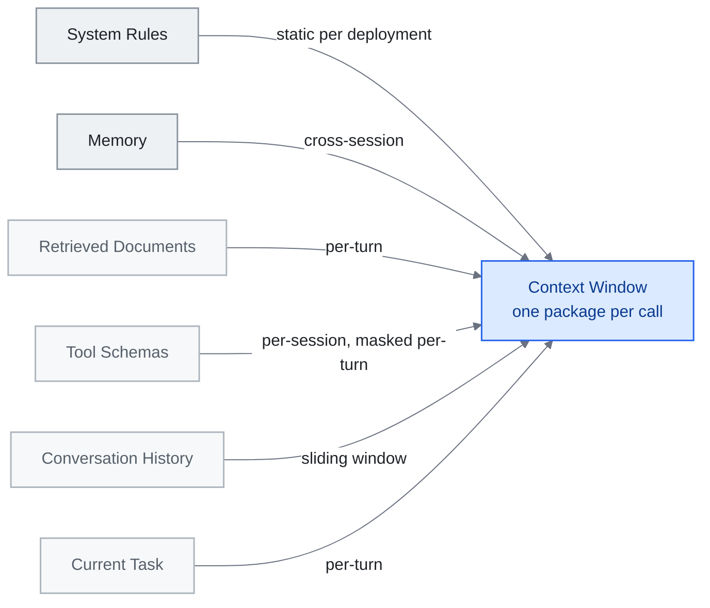

<!-- translation-sync:start -->
> Traducción asistida por máquina sincronizada con la edición inglesa de 2026-10-31, con revisión de estructura y contenido. El código y las etiquetas de los diagramas conservan el original; los tiempos de lectura se estiman a partir del inglés.
> [English source](../../../chapters/03-context-engineering.md) · [Sync record](../../SYNC.md)
<!-- translation-sync:end -->

<!-- i18n-anchor -->

# Capítulo 3: Ingeniería de contexto: el arte de llenar la ventana

> **En una frase:** La ingeniería de contexto es el arte de dar a la IA la información exacta en el momento adecuado, ni demasiada ni demasiado poca.
>
> **Por qué importa:** Un contexto mejor produce mejores respuestas de la IA. Por eso algunas personas obtienen resultados extraordinarios y otras, respuestas genéricas.
>
> **Tiempo de lectura:** ~13 min (estimación del original en inglés: 2,908 palabras / 230 palabras por minuto)

*Figura: Las seis capas de la sección 3.2, ordenadas de la más persistente arriba a la más efímera abajo, convergen en el contexto de un paquete por llamada definido en la sección 3.1. Las etiquetas de las flechas indican la frecuencia de actualización de cada capa, que explica por qué necesita su propia estrategia de compresión. Todas compiten por la misma ventana: sobrecargar Documentos recuperados ahoga la señal de la Tarea actual.*

> "Context engineering is the delicate art and science of filling the context window with just the right information for the next step."
> -- Andrej Karpathy, junio de 2025

Si la ingeniería de prompts consiste en escribir una buena pregunta, la ingeniería de contexto construye todo el dosier de información que la rodea. El paso de una a otra marca un cambio fundamental en cómo los profesionales conciben los sistemas con LLM: la unidad de diseño ya no es una instrucción aislada, sino un *entorno de información*.

Este capítulo traza el panorama, desde los marcos teóricos hasta los patrones probados en producción, y señala las fuentes primarias que definen la disciplina.

---

<!-- i18n-anchor -->

## 3.1 De prompts a contextos

El término "context engineering" se generalizó a mediados de 2025, cuando Karpathy lo distinguió claramente de la ingeniería de prompts. Un prompt es una cadena estática. Un contexto es un paquete ensamblado dinámicamente con todo lo que necesita el modelo: instrucciones, memoria, documentos recuperados, definiciones de herramientas, historial de conversación y tarea inmediata, compuesto mediante programación y actualizado en cada turno.

La distinción importa porque los agentes modernos rara vez envían dos veces el mismo contexto. Cada llamada de inferencia resulta de la lógica de enrutamiento, los pipelines de recuperación, las heurísticas de compresión y las comprobaciones de disponibilidad de herramientas que determinan conjuntamente qué llena la ventana y qué queda fuera.

<!-- i18n-anchor -->

## 3.2 Un modelo de contexto de seis capas

A partir de los patrones descritos en [Building Effective Agents](https://www.anthropic.com/engineering/building-effective-agents) de Anthropic y de textos profesionales relacionados, resulta útil descomponer la ventana de contexto en seis capas conceptuales, de la más persistente a la más efímera. Estas etiquetas son una síntesis pedagógica de la guía, no una taxonomía publicada por Anthropic:

| Capa | Contenido | Persistencia habitual |
|-------|----------|-------------------|
| **Reglas de sistema** | Restricciones de seguridad, definiciones de personalidad y límites de comportamiento | Estática por despliegue |
| **Memoria** | Preferencias del usuario, resúmenes de sesiones anteriores y hechos aprendidos | Entre sesiones |
| **Documentos recuperados** | Resultados de RAG, fragmentos de búsqueda y contenido de archivos | Por turno |
| **Esquemas de herramientas** | Definiciones de funciones, especificaciones de API y declaraciones de capacidades | Por sesión o enmascarados por turno |
| **Historial de conversación** | Mensajes anteriores, respuestas del asistente y resultados de llamadas a herramientas | Ventana deslizante |
| **Tarea actual** | Solicitud inmediata del usuario e inyecciones específicas de la tarea | Por turno |

La idea fundamental es que cada capa tiene una frecuencia de actualización, una estrategia de compresión y unos modos de fallo distintos. Sobrecargar Documentos recuperados ahoga la señal de Tarea actual. Cargar poca Memoria obliga al modelo a reconstruir contexto que ya debería tener. Una buena ingeniería de contexto equilibra simultáneamente las seis capas.

<!-- i18n-anchor -->

## 3.3 Lecciones de Manus: la tasa de aciertos de caché KV como guía

En julio de 2025, Yichao "Peak" Ji, director tecnológico de Manus, publicó lecciones de producción que replanteaban la ingeniería de contexto alrededor de una única métrica operativa: **la tasa de aciertos de la caché KV**.

Manus observó una proporción constante de 100:1 entre tokens de entrada y salida en su sistema de agentes. Con esa proporción, el coste de entrada domina todo lo demás. Los aciertos de caché KV —reutilizar pares clave-valor calculados en lugar de recalcularlos— se convierten en la principal palanca de latencia y coste.

De esta observación surgieron tres técnicas:

1. **Estructura de contexto de solo anexado.** No reescriba partes anteriores del contexto. Insertar o modificar contenido en medio invalida los prefijos almacenados en caché y obliga a recalcularlos por completo. Diseñe el contexto como un registro, no como un documento.

2. **Enmascarar herramientas mediante sesgo de logits, en lugar de eliminar esquemas.** Cuando una herramienta no estaba disponible temporalmente, Manus impedía seleccionarla mediante enmascaramiento a nivel de logits, sin quitar su definición del contexto. Eliminar definiciones modifica la secuencia de tokens e invalida la caché. El enmascaramiento conserva el prefijo e impide la selección.

3. **Reescritura continua de la lista de tareas.** En vez de confiar en que el modelo recordara objetivos del inicio de una conversación larga, Manus añadía periódicamente una lista reescrita cerca del final del contexto. Esto aprovecha el sesgo de actualidad de la atención: los objetivos en los tokens más recientes reciben más peso que los mismos objetivos enterrados miles de tokens antes.

Son decisiones de infraestructura, no de prompts. Ilustran por qué "context engineering" exige pensamiento de sistemas.

**El principio de caché obtiene herramientas de investigación (mediados de 2026).** Las reglas de Manus eran heurísticas operativas; dos artículos de junio de 2026 convierten el mismo principio en mecanismos medidos. **Still** (arXiv 2606.07878, 5 de junio de 2026) realiza compactación amortizada de caché KV en una pasada mediante un Perceiver por capa, entrenado contra un modelo base congelado; informa de **compresión de 8x-200x en contextos de 8k-128k** y **8-22 puntos sobre la mejor referencia en RULER**. **TokenPilot** (arXiv 2606.17016, 15 de junio de 2026) opera en dos granularidades: una fase de *Ingestion-Aware Compaction* estabiliza globalmente los prefijos, mientras *Lifecycle-Aware Eviction* sigue localmente la utilidad de cada segmento; comunica **reducciones de coste del 61% / 56%** en sesiones aisladas y del **61% / 87%** en sesiones continuas sobre PinchBench y Claw-Eval. TokenPilot importa aquí porque traduce en cifras la disciplina de "append-only, don't bust the cache" que esta sección enuncia cualitativamente: la fase de expulsión permite mantener un prefijo favorable a la caché en sesiones largas sin crecimiento ilimitado.

**Cuándo compactar y cómo (agosto de 2026).** Un estudio empírico posterior, "Practical Online KV Cache Compaction for LLM Agents" (arXiv 2608.00902, 2 de agosto de 2026), afina la orientación al estudiar la compactación específicamente en trayectorias de agentes: compactar inmediatamente perjudica la precisión, pero esperar a que las consultas futuras del propio agente sirvan como señal de consulta sustitutiva recupera la mayor parte de la precisión perdida. Con señales imperfectas, puntuar tokens para expulsión según la masa de atención inducida por esa consulta (token eviction, TE) resulta más robusto que la reconstrucción por coincidencia de atención (AM). En BrowseComp-Plus y WideSearch, TE reduce la caché KV un 80% y mejora el rendimiento frente a no compactar: una regla concreta —esperar y después expulsar en lugar de reconstruir— para la disciplina de solo anexado que esta sección describe cualitativamente.

<!-- i18n-anchor -->

## 3.4 Cinco patrones predominantes

Aurimas Griciūnas sintetizó la práctica emergente en cinco patrones recurrentes observados en producción (texto canónico: "State of Context Engineering in 2026," SwirlAI Newsletter, 22 de marzo de 2026, [https://www.newsletter.swirlai.com/p/state-of-context-engineering-in-2026](https://www.newsletter.swirlai.com/p/state-of-context-engineering-in-2026); véase también "Breaking Down Context Engineering"):

**Divulgación progresiva.** No cargue todo de entrada. Presente primero un índice ligero y amplíe las secciones solo cuando el modelo o la lógica de enrutamiento determinen que son relevantes. Es el equivalente de la carga diferida en la ventana de contexto. El sistema de habilidades de Anthropic utiliza este patrón: 17 habilidades consumen unos 1,700 tokens en reposo y solo se amplían al invocarse.

**Compresión del contexto.** Resuma, recorte o destile la información antes de inyectarla. El historial que queda fuera de la ventana deslizante se comprime en resúmenes. De los documentos recuperados se extraen los pasajes pertinentes. El objetivo es conservar la densidad semántica reduciendo los tokens.

**Enrutamiento del contexto.** No todas las consultas necesitan el mismo contexto. Una capa de enrutamiento examina la solicitud y selecciona qué bancos de memoria, herramientas y colecciones documentales incluir. Equivale al planificador de consultas de una base de datos aplicado al contexto.

**Evolución de la recuperación.** RAG estático —recuperar una vez, inyectar y generar— da paso a la recuperación iterativa, en la que el modelo solicita más información durante la generación. El contexto no se ensambla una sola vez: evoluciona durante el proceso.

**Gestión de herramientas y capacidades.** Al crecer las bibliotecas de herramientas, cargar todos los esquemas resulta prohibitivo. Los sistemas utilizan metaherramientas —una herramienta de descubrimiento que devuelve esquemas pertinentes bajo demanda— o grafos de habilidades para mantener ligera la capa de herramientas.

**Un laboratorio de frontera revisa sus propias reglas (julio de 2026).** Los cinco patrones anteriores sintetizan prácticas de muchos sistemas. El 24 de julio de 2026, Anthropic publicó una revisión de sus propias recomendaciones, "The new rules of context engineering for Claude 5 generation models," de Thariq Shihipar, y la noticia principal es una eliminación. El equipo de Claude Code retiró más del 80% del prompt de sistema para sus modelos de la generación Claude 5 sin pérdida medible en evaluaciones de programación. Anthropic comunica esa cifra desde sus propias evaluaciones; no existe un benchmark independiente. Lo transferible es su razonamiento. El artículo propone pasar de reglas a criterio, dando principios y confianza a un agente capaz en lugar de instrucciones exhaustivas; cargar contexto de forma progresiva y justo cuando hace falta, en vez de llenar la ventana al inicio; y orientar al agente como se orientaría a una persona, con función, restricciones y ejemplos solo cuando aportan valor. El segundo punto reitera la divulgación progresiva, ahora con evidencia de producción de un laboratorio. El primero contradice el impulso original de la disciplina: a medida que mejoran los modelos, una parte creciente del trabajo de ingeniería de contexto no es optimización, sino desconfianza acumulada; lo adecuado para esa parte es eliminar, no ajustar.

**La compactación no es una única política (agosto de 2026).** El trabajo sobre caché KV y la compresión de contexto de esta sección tratan la ventana como un presupuesto de tokens intercambiables. Un estudio de nueve autores (arXiv 2608.31057, 31 de agosto de 2026) sostiene que esa unidad de medida es errónea. Analiza 55 trayectorias archivadas de agentes de programación y clasifica la memoria de trabajo en cuatro categorías —instrucciones, artefactos, salidas de herramientas y estado generado por el agente— con perfiles distintos de tamaño, retención y representación; propone evaluar por separado cuatro niveles: estado almacenado, contexto entregado, trabajo de gestión y resultado de la tarea o del proceso. En palabras de los autores, "equal token budgets do not imply equal delivered context or management cost." Prueban dos estrategias informadas por la semántica, compresión consciente de objetos y políticas basadas en recuperación, y advierten que las mejoras calibradas sobre unas tareas "may not transfer to held-out tasks." Con 55 trayectorias, es un hallazgo empírico abierto, no un patrón consolidado. Su consecuencia práctica es acotada pero clara: aplicar uniformemente una regla de compactación a toda la ventana ya supone elegir una política para cuatro tipos distintos de objetos, y hacerlo a ciegas.

Sobre el límite de supervisión de la compactación, véase el [capítulo 4](04-harness-engineering.md#48-harness-maintenance-the-stress-testing-imperative).

<!-- i18n-anchor -->

## 3.5 El panorama académico

A mediados de 2025 llegó la primera revisión académica exhaustiva de la ingeniería de contexto como área formal de investigación: **"A Survey of Context Engineering for Large Language Models"** (Mei et al., arXiv 2507.13334, 17-21 de julio de 2025), cuyo análisis sistemático de más de 1,400 artículos estableció una hoja de ruta técnica. Organiza el diseño en dos ejes: **componentes fundamentales** (recuperación y generación de contexto, procesamiento y gestión) e **implementaciones de sistemas** (RAG, memoria, razonamiento integrado con herramientas y sistemas multiagente). Su hallazgo central es una asimetría fundamental: los modelos actuales comprenden notablemente bien contextos complejos, pero tienen limitaciones pronunciadas para generar salidas largas igualmente sofisticadas. Para los profesionales, es lo más cercano a un manual del campo: formaliza el descubrimiento empírico de que la ingeniería de contexto no es una técnica única, sino un espacio de diseño con varias dimensiones independientes.

## 3.6 Agentic Context Engineering (ACE)

El artículo de ACE, **"Agentic Context Engineering: Evolving Contexts for Self-Improving Language Models"** (Zhang et al., arXiv 2510.04618, 6 de octubre de 2025; repositorio en [github.com/ace-agent/ace](https://github.com/ace-agent/ace)), introdujo un cambio conceptual: tratar los contextos como **manuales operativos en evolución**, no como ensamblajes estáticos. En ACE, el contexto es un documento vivo que mantiene el propio agente: añade observaciones, actualiza planes, poda historial irrelevante y reorganiza instrucciones según avanza la tarea. Las mejoras principales comunicadas son +10.6% en benchmarks de agentes y +8.6% en tareas financieras, con menor latencia de adaptación y coste de trayectorias; en la clasificación de AppWorld, ACE iguala en promedio global al agente de producción mejor clasificado y lo supera en la partición más difícil test-challenge, pese a usar un modelo abierto más pequeño. ACE también identifica los fallos contra los que se diseña: **sesgo de brevedad**, que descarta conocimientos del dominio para crear resúmenes concisos, y **colapso del contexto**, en el que la reescritura iterativa erosiona detalles con el tiempo.

Esto desplaza la ingeniería de contexto de una preocupación puramente de infraestructura —lo que ensambla el harness antes de cada llamada— a una labor colaborativa: lo que prepara el harness *y* lo que el modelo transforma activamente. Se vuelve fluida la frontera entre "context the system provides" y "context the model creates".

Los sistemas ACE suelen mantener un bloc de trabajo estructurado dentro del contexto: una región designada para notas, resultados intermedios y planes revisados del modelo. El harness conserva esa región entre turnos y gestiona las capas circundantes según sus propias políticas.

<!-- i18n-anchor -->

## 3.7 Implicaciones prácticas

De este panorama se desprenden varios principios:

- **Mida los tokens de entrada, no solo los de salida.** A escala de producción, la proporción 100:1 hace que domine el coste de ensamblaje del contexto. Optimice los aciertos de caché y reduzca la redundancia.
- **Diseñe los contextos como sistemas por capas.** Cada capa tiene su propia política de actualización, estrategia de compresión y modo de fallo. Trátelas de forma independiente.
- **Utilice divulgación progresiva por defecto.** Empiece con poco y amplíe bajo demanda. Incluir información irrelevante no solo cuesta tokens: degrada la atención y aumenta el riesgo de alucinaciones.
- **Pruebe la composición del contexto, no solo los prompts.** El mismo prompt produce resultados distintos con contextos diferentes. Sus pruebas deben variar el contexto, no únicamente la instrucción final.
- **Anticipe las mejoras de los modelos.** Al mejorar el razonamiento con contextos largos, algunas estrategias de compresión y enrutamiento pasan a ser sobrecarga innecesaria. Defina límites claros entre abstracciones para poder simplificar o eliminar capas.

---

<!-- i18n-anchor -->

## Tres ideas para recordar

- **Un prompt es una cadena; un contexto es un ensamblaje.** Cada llamada de inferencia resulta del enrutamiento, la recuperación, la compresión y las comprobaciones de herramientas; la unidad de diseño es el paquete, no la instrucción.
- **Los tokens de entrada determinan la factura.** Con la proporción 100:1 medida por Manus, la tasa de aciertos de la caché KV es la palanca de latencia y coste; por eso el contexto se construye como un registro de solo anexado.
- **Parte de lo que se diseña es desconfianza acumulada.** Anthropic eliminó más del 80% del prompt de sistema para sus modelos de la generación Claude 5 sin pérdida medible en evaluaciones de programación; para esa parte del contexto, lo adecuado es eliminar, no ajustar.

---

<!-- i18n-anchor -->

## Fuentes

- **Karpathy, Andrej.** Comentarios públicos sobre "context engineering" (mediados de 2025). Marco ampliamente compartido en X y la comunidad de ingeniería de IA que acuñó la definición de trabajo adoptada en el campo.
- **Anthropic.** "Building Effective Agents." Blog de ingeniería de Anthropic, 19 de diciembre de 2024. [https://www.anthropic.com/engineering/building-effective-agents](https://www.anthropic.com/engineering/building-effective-agents) --- Describe patrones de orquestador y trabajadores, y flujos de evaluador y optimizador; esta guía denomina pedagógicamente las seis capas de §3.2.
- **Ji, Yichao "Peak"** (Manus). "Context Engineering Lessons from Building Manus." Artículo de blog, julio de 2025. [manus.im/blog](https://manus.im/blog) --- Aciertos de caché KV como métrica operativa, contexto de solo anexado, enmascaramiento mediante sesgo de logits y reescritura continua de listas de tareas.
- **Griciūnas, Aurimas.** "State of Context Engineering in 2026." SwirlAI Newsletter, 22 de marzo de 2026. [https://www.newsletter.swirlai.com/p/state-of-context-engineering-in-2026](https://www.newsletter.swirlai.com/p/state-of-context-engineering-in-2026). Véase también "Breaking Down Context Engineering": [https://www.newsletter.swirlai.com/p/breaking-down-context-engineering](https://www.newsletter.swirlai.com/p/breaking-down-context-engineering)
- **Mei, Lingrui et al.** "A Survey of Context Engineering for Large Language Models." arXiv 2507.13334, 17-21 de julio de 2025. [https://arxiv.org/abs/2507.13334](https://arxiv.org/abs/2507.13334) --- Revisión de 1,400+ artículos que establece la ingeniería de contexto como área formal de investigación.
- **Zhang, Qizheng et al.** "Agentic Context Engineering: Evolving Contexts for Self-Improving Language Models." arXiv 2510.04618, 6 de octubre de 2025. [https://arxiv.org/abs/2510.04618](https://arxiv.org/abs/2510.04618). Repositorio complementario: [github.com/ace-agent/ace](https://github.com/ace-agent/ace). Presenta el contexto como manual operativo en evolución e identifica el sesgo de brevedad y el colapso del contexto.
- **Schmid, Philipp.** "The New Skill in AI is Not Prompting, It's Context Engineering" y continuación. [https://www.philschmid.de/context-engineering](https://www.philschmid.de/context-engineering); [https://www.philschmid.de/context-engineering-part-2](https://www.philschmid.de/context-engineering-part-2)
- **Blog de LangChain.** Cobertura de ingeniería de contexto en [blog.langchain.com](https://blog.langchain.com) --- Marco de Agent Engineer como patrón profesional, sin una única publicación canónica; citado como referencia del discurso.
- **Willison, Simon.** Cobertura continua de ingeniería de IA en [simonwillison.net](https://simonwillison.net) --- Introducciones profesionales accesibles que conectan el ecosistema.
- **Still.** Compactación amortizada de caché KV en una pasada. arXiv 2606.07878, 5 de junio de 2026. [https://arxiv.org/abs/2606.07878](https://arxiv.org/abs/2606.07878) --- Perceiver por capa entrenado contra un modelo base congelado; compresión de 8x-200x en contextos de 8k-128k; 8-22 puntos sobre la mejor referencia en RULER.
- **TokenPilot.** Gestión de caché KV de doble granularidad. arXiv 2606.17016, 15 de junio de 2026. [https://arxiv.org/abs/2606.17016](https://arxiv.org/abs/2606.17016) --- Ingestion-Aware Compaction (estabilización global de prefijos) + Lifecycle-Aware Eviction (seguimiento local de utilidad de segmentos); reducciones de coste del 61% / 56% en sesiones aisladas y 61% / 87% en sesiones continuas sobre PinchBench y Claw-Eval.
- **"Practical Online KV Cache Compaction for LLM Agents."** arXiv 2608.00902, 2 de agosto de 2026. [https://arxiv.org/abs/2608.00902](https://arxiv.org/abs/2608.00902) --- Estudio sistemático de compactación en trayectorias de agentes; esperar a una señal de consulta sustitutiva recupera gran parte de la precisión perdida con compactación inmediata; TE es más robusto que AM con señales imperfectas; TE reduce la caché KV un 80% y mejora el rendimiento frente a no compactar en BrowseComp-Plus y WideSearch.
- **Shihipar, Thariq** (Anthropic). "The new rules of context engineering for Claude 5 generation models." Blog de Anthropic, 24 de julio de 2026. [https://claude.com/blog/the-new-rules-of-context-engineering-for-claude-5-generation-models](https://claude.com/blog/the-new-rules-of-context-engineering-for-claude-5-generation-models) --- Comunica una reducción del 80%+ del prompt de sistema para la generación Claude 5 sin pérdida medida en programación (evaluaciones de Anthropic, sin benchmark independiente); pasar de reglas a criterio, cargar contexto justo a tiempo y orientar a los agentes como a personas.
- **Chen, Le et al.** "Measure Before You Manage: Evaluating Agent Working Memory in Coding Agents" (nueve autores). arXiv 2608.31057, 31 de agosto de 2026. [https://arxiv.org/abs/2608.31057](https://arxiv.org/abs/2608.31057) --- 55 trayectorias archivadas de agentes de programación; cuatro categorías de objetos de memoria de trabajo (instrucciones, artefactos, salidas de herramientas y estado generado por agentes); cuatro niveles de evaluación (estado almacenado, contexto entregado, trabajo de gestión y resultado de tarea o proceso); pruebas de compresión consciente de objetos y políticas basadas en recuperación; los autores afirman que "equal token budgets do not imply equal delivered context or management cost" y que las mejoras de calibración "may not transfer to held-out tasks." Muestra pequeña y sin replicación.
