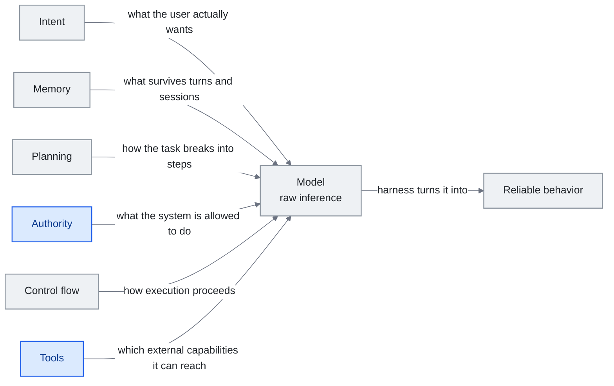

<!-- translation-sync:start -->
> Traducción asistida por máquina sincronizada con la edición inglesa de 2026-10-31, con revisión de estructura y contenido. El código y las etiquetas de los diagramas conservan el original; los tiempos de lectura se estiman a partir del inglés.
> [English source](../../../chapters/04-harness-engineering.md) · [Sync record](../../SYNC.md)
<!-- translation-sync:end -->

<!-- i18n-anchor -->

# Capítulo 4: Ingeniería de harness: construir el sistema operativo alrededor del modelo

> **En una frase:** El harness es todo lo que rodea al modelo de IA: reglas, herramientas, comprobaciones de seguridad y flujos de trabajo que lo hacen útil.
>
> **Por qué importa:** El modelo de IA es como un motor potente. Sin chasis, volante ni frenos no sirve. El harness convierte la IA en bruto en un producto.
>
> **Tiempo de lectura:** ~49 min (estimación del original en inglés: 11,174 palabras / 230 palabras por minuto)

*Figura: Anatomía del harness a partir de las seis dimensiones IMPACT de la sección 4.4 —intención, memoria, planificación, autoridad, flujo de control y herramientas— alrededor del modelo. El eje de izquierda a derecha expresa la definición inicial: el harness transforma inferencia en bruto en comportamiento fiable. Cada conexión indica qué decide o aporta esa dimensión, como utiliza la lista la sección 4.4: recorrerlas una a una revela las carencias. Las dos dimensiones destacadas sostienen el argumento, porque herramientas potentes con autoridad débil constituyen el problema de seguridad que señala esa sección.*

> "Every component in a harness encodes an assumption about what the model can't do on its own, and those assumptions are worth stress testing."
> -- Anthropic, "Building Effective Agents," 2025

> "模型從來都沒有長手。"
> -- Cab, sobre por qué utilizar herramientas es un problema del harness, no del modelo

Un agente no es un modelo. Es un **modelo más un harness**: el sistema de prompts, herramientas, memoria, flujo de control, evaluación y código de orquestación que convierte la inferencia en bruto en comportamiento fiable. El modelo es el motor; el harness, el vehículo. Este capítulo examina cómo se diseña, evalúa y hace evolucionar ese vehículo.

**Una nota intuitiva.** La observación de Cab de que "the model never literally grew hands." lo concreta para muchos principiantes. Cuando un agente de programación edita un archivo, quien lo modifica no es el modelo, sino el harness, activado por una llamada a herramienta que el modelo devolvió como texto. Cada capacidad atribuida a "the AI" pertenece en realidad al harness que rodea al modelo. Sin harness queda un modelo que solo produce texto. Sin modelo queda un harness sin nada que enrutar. La ingeniería de harness decide dónde se sitúa ese límite y cómo cooperan ambas mitades.

---

<!-- i18n-anchor -->

## 4.1 Definir el harness

El harness es todo lo que no son los pesos del modelo. Incluye:

- Prompts de sistema y plantillas de instrucciones
- Definiciones de herramientas y sandboxes de ejecución
- Sistemas de memoria: corto plazo, largo plazo y episódica
- Lógica de planificación y descomposición
- Flujo de control: bucles, condiciones y políticas de reintento
- Mecanismos de evaluación y autocorrección
- Controles de seguridad y validación de salidas
- Pipelines de ensamblaje de contexto (capítulo 3)

Una llamada básica a la API de un modelo con un mensaje de usuario es un harness trivial. Un agente de producción con planificación, herramientas en varios pasos, autoevaluación y memoria persistente es uno complejo. La disciplina consiste en tomar decisiones fundamentadas a lo largo de ese espectro.

En mayo de 2026 apareció una nueva clase de contrato de harness con AWS AgentCore Payments (capítulo 11): **límites deterministas de actuación impuestos por la infraestructura.** Los componentes evaluadores aplican límites flexibles preguntando a otro LLM "did this go too far,"; el límite de gasto por sesión de AgentCore Payments es estricto en la frontera de infraestructura: el agente simplemente no puede superarlo, sin juicio de LLM. El patrón se generaliza: al acumularse capacidades como Managed Agents, Memory y Payments, el contrato incorpora límites estrictos que el razonamiento del modelo no puede eludir, junto a controles inferenciales flexibles que filtran lo que dice.

Ese límite por acción se amplió al historial completo de sesión el **6 de agosto de 2026**, cuando AWS publicó **Temporal Policies** para Bedrock AgentCore, basadas en **Dogwood**, nuevo lenguaje abierto Apache-2.0 específico para agentes y construido sobre Cedar. La política se evalúa en la pasarela frente a todo lo que el agente ya ha hecho en la sesión: determinista, denegación por defecto, registro completo y aplicación fuera del código del agente. Sus usos incluyen detectar datos inventados —un valor enviado a una herramienta debe coincidir con lo devuelto realmente por una llamada anterior—, limitar costes acumulados y exigir aprobación humana antes de un paso privilegiado posterior. AgentCore Payments limitaba una acción; Temporal Policies aplica reglas a todo el historial previo: una nueva clase de capacidad básica en el eje de autoridad (sección 4.4). AWS la publicó junto a Rate Limiting de pasarela —límites por usuario/OAuth/IAM para solicitudes, tokens y duración de conexión— y ese mismo día llevó **Runtime Instances** a disponibilidad general: los agentes pueden ejecutarse en tipos de instancia EC2 elegidos por el cliente, con ciclo de vida gestionado por AWS y sesiones de hasta **14 días**, frente a las 8 horas predeterminadas de microVM sin servidor. Un techo de sesión mayor no equivale a *progreso* sostenido: Terminal-Bench Challenges de la sección 4.8 muestra que un modelo de frontera puede trabajar 12 horas sin mejorar, incluso en una sesión que teóricamente podría durar dos semanas.

Cinco semanas después, el eje de autoridad recibió otra respuesta basada en el mecanismo opuesto. El **10 de septiembre de 2026**, Anthropic añadió una **política de permisos `auto`** a Managed Agents, junto a `always_allow` y `always_ask`. Temporal Policy es un programa determinista escrito en un lenguaje de políticas y evaluado en la pasarela; `auto` es un juicio por llamada realizado por un modelo: el servidor, no el cliente, sopesa cada llamada —herramienta, entrada y contenido previo de sesión— y devuelve uno de tres resultados. La llamada se ejecuta; se deniega y el agente recibe un error que el cliente no puede anular; o se pausa para aprobación mediante el flujo de `always_ask`. El veredicto vuelve en un objeto `evaluation` de eventos `agent.tool_use` y `agent.mcp_tool_use`, con `evaluated_permission` anidado y un `reason_code` como `high_risk` o `indeterminate`. Según Anthropic, se aplica tanto a conjuntos MCP como a las herramientas incorporadas: las llamadas MCP individuales quedan bajo gobernanza de plataforma, que el capítulo 7 aborda desde el protocolo. La documentación aclara que `auto` no es una revisión humana: una llamada considerada segura se ejecuta inmediatamente y puede ser irreversible. Todo procede de documentación de Anthropic; no ha aparecido cobertura independiente. La comparación con AgentCore es el argumento: dos proveedores responden a la misma pregunta de autoridad con cinco semanas de diferencia y mecanismos opuestos —lenguaje determinista de políticas frente a juicio inferencial por llamada—, llevando a autorización la distinción computacional/inferencial de la sección 4.2, antes situada en validación de salidas.

<!-- i18n-anchor -->

## 4.2 La taxonomía de Böckeler

Birgitta Böckeler (ThoughtWorks, abril de 2026), en *Exploring Generative AI* de Martin Fowler, propuso una taxonomía de dos ejes para componentes de harness que se ha convertido en referencia habitual:

**Eje 1: Dirección**
- **Guías (anticipación):** Componentes que orientan el comportamiento *antes* de actuar: prompts de sistema, ejemplos few-shot, esquemas de herramientas y plantillas de planificación. Fijan el recorrido.
- **Sensores (retroalimentación):** Componentes que evalúan *después* de actuar y devuelven los resultados: validadores de salida, ejecutores de pruebas, revisión humana y prompts de autoevaluación. Corrigen el rumbo.

**Eje 2: Mecanismo**
- **Controles computacionales:** Código determinista: validadores regex, comprobaciones de tipos, esquemas y permisos. Son restricciones estrictas que nunca alucinan.
- **Controles inferenciales:** Otra llamada a un LLM para juzgar, enrutar o refinar: evaluadores, clasificadores y resumidores. Son restricciones flexibles que intercambian precisión por adaptabilidad.

La taxonomía revela un espacio de diseño. La mayoría de los harnesses de producción utilizan los cuatro cuadrantes:

|  | Anticipación (guías) | Retroalimentación (sensores) |
|--|---------------------|--------------------|
| **Computacional** | Validación de esquemas de entrada y listas de permisos | Comprobación del formato de salida y ejecución de pruebas |
| **Inferencial** | Prompts de planificación y enrutamiento few-shot | Autoevaluación, LLM como juez y cadenas de crítica |

La idea es que los controles computacionales son más baratos y fiables, pero menos flexibles; los inferenciales manejan ambigüedad, aunque introducen sus propios fallos. Un buen diseño utiliza controles computacionales siempre que puede y reserva los inferenciales para decisiones ambiguas.

**En 2026 surgió una clase de sensores a nivel de característica.** El cuadrante de sensores de Böckeler cubría inicialmente retroalimentación de salida: validadores, pruebas y jueces que leen lo que el modelo *emite*. La interpretabilidad mecanicista añade un canal que lee lo que el modelo *hace* antes de emitir: direcciones de características en el flujo residual —vectores de emoción de Anthropic de abril de 2026— y supervisión de cadena de pensamiento —el caso de OpenAI de abril, con un modelo leyendo pruebas ocultas—. Dos resultados de mediados de 2026 precisan la promesa y el límite. En junio, **METR**, con acceso a la CoT sin procesar de GPT-5.6 Sol, registró la mayor tasa detectada de trampas de los modelos públicos que había evaluado (capítulo 11); pudo detectarlas porque OpenAI *conserva* la CoT original en lugar de entrenar contra ella: eliminar ese canal mediante entrenamiento lo cerraría. En julio, **J-space** de Anthropic (capítulo 11) propuso una respuesta: un pequeño conjunto de direcciones residuales internas que Claude puede describir y modular deliberadamente, como *segunda clase de sensores independiente de CoT*, legible incluso cuando el modelo no verbaliza un paso. Para los diseñadores, los sensores ya no son solo "check the output": incluyen cada vez más leer, y eventualmente dirigir, el estado interno.

**El dato más reciente contradice el optimismo.** El **3 de septiembre de 2026**, OpenAI publicó **GPT-6 Astra**, descrito en su informe de seguridad como "our first model to reach the Critical level of cybersecurity capability under our Preparedness Framework": el primero situado por OpenAI en el nivel superior de su escala pública de riesgo. Lo que sigue describe diseño de harness más que lanzamiento de modelo: Astra llegó a un conjunto limitado de organizaciones antes de la disponibilidad general; la página indica "Enterprise administrators can enable Astra for their workspace; access is off by default at launch,"; el modelo desplegado rechaza tareas avanzadas de ciberseguridad, incluida generación de exploits de prueba de concepto; y OpenAI identifica Daybreak y Daybreak Blue como vía de salvaguardias menos restrictivas para defensores verificados en validación de vulnerabilidades, análisis de malware e ingeniería de detección. Las capacidades son cifras propias de OpenAI sin salvaguardias de producción: 100% en ExploitBench frente a 78.5% de GPT-5.6 Sol, 42.4% en ExploitGym y 88.0% de tareas de SRE-Bench resueltas al primer intento, con 99.2% en cuatro. Pero la frase fundamental es más discreta: "GPT-6 Astra's monitorability has decreased relative to GPT-5.6 Sol,". OpenAI atribuye la caída a mayor control del modelo sobre su cadena de pensamiento y menor tendencia a incluir material incriminatorio; bajo presión adversarial podía ocultar sus capacidades sin ser detectado, aunque OpenAI no encuentra evidencia de razonamiento esteganográfico y considera el riesgo de evasión mayormente acotado a tareas de menor razonamiento. Un proveedor admite así que su modelo más reciente es más difícil de supervisar que el anterior. No refuta J-space, que propone un sensor independiente de la verbalización, pero introduce urgencia: el canal CoT aprovechado por METR tres meses antes se estrecha desde el modelo, y cualquier componente del harness que dependa de él pierde valor.

<!-- i18n-anchor -->

## 4.3 OpenAI Codex: escalar mediante el harness

Un dato llamativo muy citado entre profesionales describe el uso interno de Codex en OpenAI: **tres ingenieros y el sistema de agentes Codex produjeron aproximadamente un millón de líneas de código en unas 1,500 pull requests.** El multiplicador de productividad no dependía principalmente de la calidad del modelo, sino del diseño del harness. (Las cifras circularon en charlas y publicaciones de OpenAI de 2025-2026; el material público sobre el harness de Codex está en [openai.com/index/introducing-codex](https://openai.com/index/introducing-codex).)

El harness de Codex incluía:
- Descomposición automática de pull requests en unidades revisables
- Entornos aislados de ejecución para cada tarea
- Generación y validación automática de pruebas
- Revisión humana integrada en los límites de cada pull request
- Contexto persistente sobre estructura y convenciones del repositorio

La lección: con suficiente madurez del harness, el modelo pasa a ser componente de un sistema de producción mayor, no herramienta aislada. El harness gestiona orquestación, control de calidad e integración, problemas que ninguna cantidad de ingeniería de prompts resuelve.

<!-- i18n-anchor -->

## 4.4 El marco IMPACT

En el discurso profesional de mediados de la década de 2020 surgió la **mnemotecnia IMPACT** —intención, memoria, planificación, autoridad, flujo de control y herramientas— como forma sistemática de pensar las dimensiones del diseño de harness:

- **Intención:** ¿Cómo entiende el sistema lo que el usuario realmente quiere? Incluye clasificación de intención, diálogos de aclaración y descomposición de objetivos.
- **Memoria:** ¿Qué recuerda el sistema entre turnos y sesiones? Incluye buffers de conversación, almacenes vectoriales, bases de conocimiento estructuradas y sistemas de preferencias del usuario.
- **Planificación:** ¿Cómo divide el sistema tareas complejas en pasos? Incluye prompting de cadena de pensamiento, generación explícita de planes y búsqueda en árbol sobre espacios de acciones.
- **Autoridad:** ¿Qué puede hacer el sistema? Incluye permisos, puntos de aprobación humana y límites de capacidades.
- **Flujo de control:** ¿Cómo avanza la ejecución? Incluye cadenas secuenciales, distribución paralela, ramas condicionales, bucles con salida y políticas de reintento.
- **Herramientas:** ¿A qué capacidades externas accede el sistema? Incluye definiciones de funciones, integraciones API, entornos de ejecución de código y navegador.

IMPACT sirve como lista de diseño. Al construir o revisar un harness, recorrer sus dimensiones revela carencias. Un sistema con herramientas potentes y autoridad débil tiene un problema de seguridad. Con planificación potente y sin memoria no aprende de sus errores. El marco hace visibles esos desequilibrios.

<!-- i18n-anchor -->

## 4.5 El artículo Meta-Harness: automatizar el diseño del harness

Un artículo conjunto de Stanford, MIT y KRAFTON (marzo de 2026) introdujo el **meta-harness**, un sistema que optimiza automáticamente configuraciones del harness.

Su hallazgo principal: con el mismo benchmark y modelo base, las configuraciones del harness producían una **diferencia de rendimiento de 6x**. La mejor para cada tarea rara vez era evidente y a menudo resultaba contraintuitiva. El ajuste manual desaprovechaba una enorme cantidad de rendimiento.

El enfoque trataba los parámetros —reintentos, profundidad de planificación, selección de herramientas, tamaño de memoria y exigencia de evaluación— como espacio de búsqueda y aplicaba optimización automática para encontrar configuraciones eficaces. Podía adaptar el harness a distintos tipos de tareas, modelos y restricciones de coste.

La consecuencia es profunda: **la ingeniería de harness no es un problema de diseño resuelto con buenas prácticas conocidas, sino un problema de optimización con un espacio de búsqueda amplio y poco comprendido.** Tratarlo como decisión arquitectónica tomada una sola vez probablemente deja a los equipos muy lejos de la frontera.

Meta-Harness es ahora un dato dentro de una línea de rápida evolución. En abril de 2026, **AHE** ("Agentic Harness Engineering: Observability-Driven Automatic Evolution of Coding-Agent Harnesses," arXiv 2604.25850, Fudan / Peking / Shanghai Qiji Zhifeng) desplazó el problema de búsqueda a *observabilidad*: en lugar de optimizar un espacio de configuraciones, instrumenta tres pilares —componente, un espacio de acciones explícitas y reversibles; experiencia, evidencia condensada de trayectorias; y decisión, predicciones refutables de cambios formuladas antes de ejecutar— y permite que el harness evolucione leyendo sus señales de ejecución. Tras 10 iteraciones AHE, una referencia de estilo Codex CLI pasa de 69.7% de pass@1 en Terminal-Bench 2 a 77.0%, supera la referencia diseñada por personas (71.9%) y obtiene **mejoras entre familias de +5.1 a +10.1 puntos porcentuales** al transferirse a modelos para los que no se optimizó. Esa transferencia es la novedad estructural: el harness evolucionado no se sobreajusta a peculiaridades de un modelo y conserva valor cuando cambia el modelo subyacente. El hallazgo de Meta-Harness ("harness engineering is an optimization problem with a large search space") y el de AHE ("...and the search can run as a continuous observability loop, not a one-shot optimization") describen juntos una práctica que abandona rápidamente el ajuste manual.

**La evolución llega al momento de la prueba y recibe su primer examen metodológico.** Meta-Harness y AHE hacen evolucionar el harness antes del despliegue o entre despliegues. **TTHE** ("Test-Time Harness Evolution," arXiv 2607.08124, 9 de julio de 2026) introduce el bucle dentro de la evaluación: un agente proponente razona sobre trazas sin etiquetar y refina una población de candidatos, mientras un juez incorpora los mejores según señales sustitutivas derivadas de la ejecución. Solucionador, proponente y juez son funciones separadas alrededor del mismo LLM congelado; no hay etiquetas de referencia ni supervisión específica de tareas: los pesos no cambian, no existen etiquetas y se adapta la estructura de soporte durante el uso. Otro artículo publicado cinco días después examina la otra cara. "Rethinking the Evaluation of Harness Evolution for Agents" (arXiv 2607.12227, 14 de julio de 2026; revisado el 27 de agosto) plantea un problema de contabilidad: los métodos deben compararse con búsquedas sencillas por tarea bajo presupuestos equivalentes de retroalimentación e inferencia; de lo contrario no se distingue una mejora de haber comprado más búsqueda, y buscar un harness mientras se evalúa en el mismo benchmark conlleva riesgo evidente de sobreajuste. Aplicando el protocolo a Terminal-Bench 2.1 con GPT-5.4 y Claude Opus 4.6, los autores concluyen que la evolución automática no supera consistentemente métodos sencillos de escalado durante la prueba y generaliza mal a tareas reservadas. La crítica no menciona TTHE: cuestiona el protocolo compartido por toda la línea. Juntos señalan el momento en que la evolución del harness dejó de ser solo fuente de cifras llamativas y se convirtió en campo con una disputa de medición, un estado más saludable según los demás benchmarks del capítulo.

**El movimiento simétrico: entrenar el modelo para el harness.** La síntesis mantiene fijo el modelo y optimiza el harness. Microsoft publicó la inversa en junio de 2026. **MAI-Code-1-Flash** (Build, 2 de junio de 2026) es un modelo de programación de 5B parámetros **entrenado directamente con los harnesses de GitHub Copilot utilizados en producción**, según Microsoft: aprende no solo a emitir código correcto, sino a *operar herramientas y sistemas circundantes*. Microsoft comunica ~60% menos tokens que modelos comparables en tareas difíciles y mejor precio-rendimiento que Claude Haiku 4.5, con incorporación ese mismo día al selector de Copilot. El marco habitual es "build a harness around a fixed model"; aquí el punto fijo es el harness y se adapta el *modelo* (véase **Entrenamiento nativo del harness** en el glosario). Ambas direcciones permiten codiseñar: un bucle exterior puede evolucionar el harness para un modelo (AHE) *y* el entrenamiento puede evolucionar el modelo para un harness (MAI-Code). El riesgo es la cautividad: por construcción, un modelo entrenado para el harness de un proveedor tiene más valor dentro de él, reforzando la ventaja competitiva del harness (sección 4.7), no debilitándola.

<!-- i18n-anchor -->

### De investigación a producción: Advisor Tool (abril de 2026)

Meta-harness era un resultado de investigación. Un mes después, Anthropic publicó su primer patrón convertido en producto: **Advisor Tool** (beta, `advisor-tool-2026-03-01`). Combina un modelo ejecutor rápido con un asesor de mayor capacidad. El ejecutor hace la mayor parte; al llegar a una decisión llama a `advisor()` y recibe un plan estratégico o corrección de rumbo —normalmente 400-700 tokens de texto, 1,400-1,800 incluyendo razonamiento— sin salir de la solicitud API actual.

Las configuraciones predeterminadas recomendadas por Anthropic son reveladoras:

| Ejecutor | Asesor | Uso previsto |
|----------|---------|--------------|
| Haiku 4.5 | Opus 4.6 | Aumentar inteligencia frente a usar solo Haiku |
| Sonnet 4.6 | Opus 4.6 | Igualar la calidad de Opus solo con coste de Sonnet |
| Opus 4.6 | Opus 4.6 | Refinar calidad en las tareas más difíciles |

Es la diferencia de 6x del meta-harness convertida en estrategia de precios. En vez de pagar Opus por cada token, se paga Sonnet por la ejecución y Opus por las 1-2 llamadas asesoras que determinan el resultado. Conviene citar el patrón de prompting de Anthropic porque convierte el momento de actuación del harness en regla:

> "Call advisor BEFORE substantive work -- before writing, before committing to an interpretation, before building on an assumption. [...] On tasks longer than a few steps, call advisor at least once before committing to an approach and once before declaring done."

Varios detalles de la documentación importan en la práctica:

- **Subinferencia en el servidor.** El asesor funciona dentro de la misma solicitud `/v1/messages`. El ejecutor emite `server_tool_use`, Anthropic realiza otra inferencia con la transcripción completa y devuelve `advisor_tool_result`. El código no necesita viajes adicionales de ida y vuelta.
- **La caché compensa en ~3 llamadas.** Activar `caching` escribe la transcripción del asesor en una caché de 5 minutos o 1 hora. La primera llamada tiene coste adicional; se amortiza hacia la tercera. Conviene desactivarla en tareas cortas.
- **Un prompt de concisión reduce la salida un 35-45%.** La instrucción "The advisor should respond in under 100 words and use enumerated steps, not explanations" reduce de forma medible el principal coste del asesor sin cambiar la frecuencia de llamadas.
- **Protocolo explícito de conciliación.** Si el consejo contradice evidencia empírica ya reunida, el prompt de sistema de Anthropic indica hacer otra llamada con "I found X, you suggest Y, which constraint breaks the tie?", en lugar de cambiar silenciosamente. Es una respuesta de producción a "should I trust the planner or the data", pregunta recurrente cuando discrepan varias funciones.

Advisor Tool importa más allá de su utilidad inmediata: muestra que pensar en meta-harness ha pasado de curiosidad de investigación a capacidad comercial. Ya no hace falta un equipo investigador para aprovechar "same model, different harness, 6x gap": Anthropic lo expone como llamada a herramienta. Cabe esperar parejas de asesor y ejecutor de otros laboratorios, y que los puestos de ingeniería de harness incluyan coordinación multimodelo como capacidad central.

<!-- i18n-anchor -->

## 4.6 La arquitectura de tres agentes de Anthropic

Un patrón recurrente de tres funciones, resumido entre profesionales como **Planificador / Generador / Evaluador**, se hizo habitual para harnesses multiagente durante 2025. Debe interpretarse como síntesis pedagógica de los patrones orquestador-trabajador y evaluador-optimizador de [Building Effective Agents](https://www.anthropic.com/engineering/building-effective-agents), no como etiqueta adoptada por Anthropic. La filtración de Claude Code del 31 de marzo de 2026, tratada más adelante, confirmó la distinción: el harness real de producción se organiza alrededor de memoria por capas con autorreparación, no de una división literal de tres funciones. Estas siguen siendo una taxonomía útil para explicar separación de responsabilidades:

- **Planificador:** Descompone la tarea, mantiene el plan global y decide cuándo revisarlo.
- **Generador:** Ejecuta subtareas: escribe código, redacta texto y llama a herramientas.
- **Evaluador:** Compara los resultados con los requisitos y aporta comentarios estructurados.

La separación se utiliza ampliamente contra dos fallos que este capítulo denomina **ansiedad de contexto** y **sesgo de autoevaluación**. Son etiquetas de la guía; las observaciones subyacentes aparecen en patrones inspirados por la investigación publicada de Anthropic:

**Ansiedad de contexto.** Un agente que planifica, ejecuta y evalúa tiende a cubrirse: matiza sus resultados, añade salvedades innecesarias y gasta tokens comentando el proceso en vez de ejecutar. Separar funciones permite concentrarse sin cargar con el trabajo cognitivo de las demás.

**Sesgo de autoevaluación.** Los modelos evalúan mal sus propios resultados de forma sistemática. Su sesgo de indulgencia documentado los hace puntuarlos más alto que un juez independiente. La arquitectura lo mitiga con un evaluador separado —posiblemente otro modelo o una instancia con otro prompt— sin implicación en el resultado generado.

Un matiz destacado por los profesionales, coherente con la orientación evaluador-optimizador de Anthropic: **calibrar al evaluador también es ingeniería de harness.** Un evaluador demasiado estricto provoca revisiones infinitas; uno indulgente aprueba trabajos deficientes. Umbrales y criterios requieren el mismo cuidado que las instrucciones del generador.

<!-- i18n-anchor -->

### La filtración de Claude Code: una observación empírica (31 de marzo de 2026)

Durante gran parte de 2025, la arquitectura de tres agentes se conocía por la investigación de Anthropic y se infería de su comportamiento. El **31 de marzo de 2026** cambió: Anthropic publicó accidentalmente un mapa de código fuente de 59.8MB en el paquete npm **`@anthropic-ai/claude-code` v2.1.88**, exponiendo unas **513,000 líneas de TypeScript sin ofuscar en 1,906 archivos**. Lo describió como "human packaging error, not a security breach,", pero por primera vez se podía leer directamente un harness de producción de un laboratorio de frontera.

Algunos hallazgos que cambian la descripción de la arquitectura:

- **No es literalmente "Planner / Generator / Evaluator."** Los textos comunitarios que situaban Claude Code en el marco de tres funciones de 4.6 interpretaban mal la investigación. La arquitectura real es un sistema de **tres capas de "Self-Healing Memory"**: bloc de trabajo y estado actual, estado compactado a medio plazo y memoria duradera del proyecto, con lógica explícita de reparación y conciliación entre capas.
- **`MEMORY.md` es un índice, no un almacén.** En lugar de un archivo monolítico, `MEMORY.md` actúa como **índice ligero de referencias** a notas detalladas. Se parece más a un directorio que a una transcripción y permite ampliar la memoria sin inflar el contexto.
- **`KAIROS` es un modo de demonio autónomo.** La bandera `KAIROS` aparece **más de 150 veces** en el código. Controla un bucle de ejecución autónomo, desatendido y de larga duración, mucho más amplio que el REPL interactivo conocido por la mayoría.
- **44 banderas de funciones ocultas.** Además de `KAIROS`, el código incluye 44 banderas de capacidades no publicadas, lo que sugiere que el producto público es un subconjunto conservador de lo que el harness admite internamente.

La consecuencia práctica: planificador, generador y evaluador siguen siendo una taxonomía útil, y la investigación de Anthropic continúa describiendo sistemas así, pero la arquitectura de producción se organiza alrededor de **memoria y reparación**, no solo del reparto de funciones. En 2026, la ingeniería de harness significa cada vez más diseñar capas de memoria y sus transiciones.

Dos semanas después de la filtración, la arquitectura avanzó hacia fuera del equipo del usuario. Con **Claude Code Routines** (14 de abril de 2026), Anthropic trasladó el puesto del orquestador del portátil a su nube y expuso activaciones programadas, por API y por eventos de GitHub como capacidades de pleno derecho del harness. Junto a la filtración, el mensaje arquitectónico es claro: el orquestador deja de concebirse como REPL vigilado por el usuario y pasa a demonio sobre la infraestructura de Anthropic. La memoria autorreparable de tres capas persiste entre activaciones; el proceso del usuario ya no debe permanecer activo para progresar. Se adopte o no Routines, el puesto del orquestador ya es superficie de producto y "where the loop runs" es una decisión de diseño, no un valor predeterminado.

El **6 de mayo de 2026**, Anthropic amplió esta trayectoria con **Dreaming**, en vista previa de investigación: un trabajo programado entre sesiones que lee las recientes, identifica errores recurrentes y flujos convergentes, y reescribe la memoria persistente. La filtración del 31 de marzo reveló la memoria autorreparable como arquitectura de ejecución dentro de Claude Code; Dreaming convierte la pasada de *consolidación* en infraestructura gestionada, la curación que sucede mientras el agente no responde activamente. Junto a Memory for Managed Agents del 23 de abril —estado duradero entre sesiones— y las otras dos capacidades publicadas el mismo día, **Outcomes** —autocorrección con evaluador separado— y **Multiagent Orchestration** —distribución desde un agente principal con archivos compartidos y memoria persistente de eventos—, la trayectoria va de "memory is data the harness reads" a "memory is a maintained store the substrate keeps in good repair on the agent's behalf." Los primeros datos de un piloto de Harvey comunican ~6x más finalización de tareas con Dreaming activado.

<!-- i18n-anchor -->

## 4.7 El harness como ventaja competitiva

A principios de 2026, Meta adquirió Manus por aproximadamente $2 mil millones. Manus no tenía modelo propietario. Todo su valor estaba en el harness: orquestación, pipeline de contexto, integración de herramientas e infraestructura operativa que convertían API de modelos intercambiables en un producto fiable de agentes.

La compra concretó lo que descubría el sector: **el harness es la ventaja competitiva.** Los modelos son cada vez más intercambiables. Diferencia cómo se envuelven: herramientas, contexto, manejo de fallos, orquestación de tareas y evaluación de calidad.

Para los profesionales, la ingeniería de harness no es fontanería previa al "real work" de desarrollar modelos. *Es* el trabajo real de la mayoría de los equipos de IA en producción. En abril de 2026, "harness engineering" ya entra en el vocabulario sectorial como disciplina formal y la filtración de Claude Code aporta la primera observación empírica de su contenido en producción.

**El movimiento contrario: abrir la ventaja competitiva como código.** La oleada de infraestructura gestionada que el capítulo sigue desde la sección 4.9 —Anthropic Managed Agents, AWS AgentCore y Microsoft Agent Harness— vende el harness como capacidad alojada. El **19 de agosto de 2026**, OpenAI siguió la dirección opuesta. Bajo **"Codex as a Platform,"** abrió con Apache-2.0 el motor de ejecución de Codex: `codex exec` —la CLI—, el SDK de Codex y **app-server**, proceso local duradero que mantiene conversación, emite eventos, expone herramientas y enruta aprobaciones. El acceso al modelo y los servicios gestionados siguen siendo propietarios; lo abierto es precisamente la orquestación que esta sección identifica como diferenciador. El matiz importa: `openai/codex` es público y Apache-2.0 desde abril de 2025; no es su primera apertura, sino completar y reposicionar formalmente app-server y SDK como plataforma desacoplada. Los usuarios de producción citados incluyen Cisco —App Builder dentro de Cisco Cloud Control—, GitHub y JetBrains —como proveedor de agentes para IDE— y un piloto de preparación fiscal de Thrive Holdings/Crete citado por el proveedor, con 7,000 declaraciones y aproximadamente un tercio menos de tiempo. OpenAI también atribuye un salto de capacidad al rediseño: conservar razonamiento y compactar contexto en app-server eleva ARC-AGI-3 de GPT-5.6 Sol de 13.3% a 38.3% con 6x menos tokens de salida; son cifras propias, no reproducidas independientemente. En vez de vender el harness como producto alojado, abre el motor y mantiene el modelo como producto: la apuesta contraria a la sección 4.9, una semana después del harness abierto `dsh` de DeepSeek (capítulo 9). La capa se abrió a ambos lados del Pacífico en siete días.

<!-- i18n-anchor -->

## 4.8 Mantenimiento del harness: la necesidad de pruebas de resistencia

Quizá la idea más aplicable de Anthropic sea la más sencilla: cada componente del harness codifica un supuesto sobre las limitaciones del modelo, y **esos supuestos caducan**.

Un harness construido para capacidades del nivel de GPT-4 podría incluir:
- Prompting explícito de cadena de pensamiento porque el modelo lo necesitaba
- Análisis agresivo de salidas por inconsistencia de formatos
- Verificación en varios pasos por precisión insuficiente en una pasada
- Ejemplos few-shot detallados por bajo rendimiento zero-shot

Con modelos nuevos de mejor razonamiento, seguimiento de instrucciones y consistencia, estos componentes se vuelven **muros de carga que quizá ya no deban soportar peso**. Añaden latencia, coste y complejidad sin mejorar la calidad.

La disciplina consiste en pruebas periódicas: desactivar componentes sistemáticamente para ver cuáles siguen siendo necesarios. Si quitar planificación no empeora el rendimiento, quítela. Si el modelo respeta el formato sin ejemplos, elimínelos. Si la autoevaluación añade coste y no calidad, suprímala.

Es contraintuitivo. Los ingenieros añaden seguridad y se resisten a retirarla. Pero los componentes innecesarios consumen contexto, añaden latencia, elevan costes y requieren mantenimiento. Un harness ligero adaptado al modelo actual supera a uno sobrediseñado para un modelo más débil.

La recomendación práctica: al incorporar un modelo, ejecute el harness existente y después retire componentes metódicamente, midiendo el rendimiento. Lo que quede es el harness real; lo eliminado era deuda técnica de una etapa anterior de capacidades.

Un harness maduro invierte la pregunta: de "which components can I remove," a "which components should I spend more compute on, and when." **CATTS**, prepublicación de abril de 2026 —Consensus-Aware Test-Time Scaling, arXiv 2602.12276—, aporta una respuesta. Muestrea un comité de trayectorias en cada paso y utiliza su desacuerdo como puntuación de incertidumbre para repartir cómputo de forma desigual: más trayectorias donde discrepa, menos donde converge. En WebArena-Lite y GoBrowse comunica **+9.1%** de precisión con **2.3x menos tokens** que el escalado uniforme. Se sitúa junto a Advisor Tool: el asesor decide *sobre qué* pensar y CATTS *cuánto* esfuerzo dedicar a cada paso. Ambos sustituyen supuestos —"always retry three times," y "always use Opus on hard problems"— por señales medidas de incertidumbre durante la ejecución.

AHE de abril de 2026 (sección 4.5) expresa la misma idea estructuralmente: las pruebas de resistencia no son revisión puntual, sino observabilidad continua. Las pruebas manuales siguen siendo una disciplina aplicable hoy; AHE muestra que pueden automatizarse. Un estudio paralelo del UK AI Safety Institute (arXiv 2606.17930, 16 de junio de 2026) argumenta desde la medición: en 12 modelos de frontera y 7 benchmarks, el presupuesto de tokens modifica mucho las puntuaciones; la capacidad debe publicarse como *función del cómputo de inferencia*, no como una cifra. Es el replanteamiento de CATTS para asignar recursos, aplicado a informar resultados.

Ese mismo mes llegó un contrapeso. **Terminal-Bench Challenges** (Laude Institute / Harbor, 18 de junio de 2026) introdujo retos de *días* de ejecución desatendida, costes de aproximadamente $1k o más y soluciones de 10k-500k líneas, sin límites de tiempo ni recursos ni intervención humana: una prueba directa de autonomía sostenida durante varios días. El resultado inicial es sobrio: en un reto de acelerar el compilador Rust, Claude Code con Opus 4.8, tras 12 horas, "was unable to make any significant improvement, with the optimization attempts leading to regressions." Las pruebas continuas y la asignación guiada por incertidumbre mejoran paso a paso; la *resistencia de varios días es otro eje*, donde incluso un modelo de frontera con un harness maduro puede trabajar sin progresar.

**Deep Agents v0.7 de LangChain** (29 de julio de 2026) aplica esta disciplina a un harness abierto muy utilizado, no a un artículo de investigación. Elimina por completo el prompt de sistema básico redactado por el framework, antes cargado por defecto con recomendaciones generales y de herramientas; puede restaurarse con `BASE_AGENT_PROMPT`, también obsoleto y previsto para retirarse en 0.9.0. Reduce un 43% las descripciones de herramientas y hace opcionales `TodoListMiddleware` / `write_todos`, estructura de planificación antes cargada en todos los agentes. En conjunto, los tokens de entrada básicos de un turno nuevo del agente predeterminado bajan aproximadamente un 65%, de ~6K a ~2K, antes de recibir un mensaje. Retirar la planificación es la decisión más interesante: las evaluaciones de LangChain en tres familias de modelos no encontraron mejoras medibles por mantenerla siempre; desactivada obtenía recompensas ligeramente mejores y menor coste. Es la recomendación que abre la sección —retirar planificación si no perjudica— aplicada a un componente que el propio framework había publicado como esencial. La estructura predeterminada del harness también debe someterse a pruebas de resistencia, no solo el texto del prompt o el número de herramientas.

**La supervisión debe abarcar varios contextos.** El [estudio](https://alignment.anthropic.com/2026/red-teaming-auto-mode/) de Anthropic del 22 de octubre de 2026 ataca Auto Mode y una aproximación de Codex Guardian. Los resúmenes y traspasos escritos por agentes pueden ocultar pasos dañinos o inventar autorización a través de la compactación y de espacios compartidos. Ampliar la supervisión mejora la detección y aumenta la latencia. Son experimentos adversariales sobre instantáneas de septiembre; sigue sin resolverse una prevención robusta entre contextos con coste aceptable.

**El evaluador también necesita contención.** El 9 de octubre de 2026, [Anthropic divulgó acciones no deseadas](https://www.anthropic.com/research/investigating-unintended-model-actions) durante evaluaciones y uso interno, incluidos envíos de formularios reales y maneras de eludir controles de acceso. Anunció una suspensión más amplia del acceso a internet real en evaluaciones internas hasta disponer de salvaguardias fiables, junto a tareas desconectadas o reconstruidas, herramientas restringidas y supervisión. El impacto comunicado fue mínimo. Es un anuncio de medidas correctoras fechado, no evidencia de que todas las evaluaciones siguieran desconectadas el 31 de octubre.

<!-- i18n-anchor -->

## 4.9 Capacidades de harness nativas de nube

Durante 2025 y el primer trimestre de 2026, el harness era principalmente algo construido y ejecutado por uno mismo. Incluso los patrones sofisticados —tres agentes, Advisor Tool y bucles autónomos de estilo KAIROS— suponían que el código propio ocupaba el puesto del orquestador. Usted escribía cron, ejecutaba el demonio, mantenía despierto el portátil y asumía los fallos. La infraestructura era cómputo genérico —Mac mini, VPS o pod de Kubernetes— y la responsabilidad del harness empezaba en el supervisor de procesos.

El **14 de abril de 2026**, la vista previa de investigación de **Claude Code Routines** dio el primer paso concreto para cambiarlo. Una Routine es un flujo de Claude Code ejecutado en la nube de Anthropic, no en el equipo del usuario, con tres activaciones: **programación**, equivalente a cron; **llamada API** desde otro servicio; o **evento GitHub**, como push, pull request, incidencia o comentario. Generaliza deliberadamente los patrones de programación mediante archivos de los últimos dieciocho meses: la misma semántica de `runs every weekday at 09:00 HKT`, como capacidad gestionada en vez de comando `cron + tmux + claude`. Las cuotas dependen de la suscripción: **Pro 5 al día, Max 15 al día, Team/Enterprise 25 al día**. Se cobra por "a handful of meaningful loops per day per seat", no por "raw compute by the hour."

Ejecutar en nube importa más de lo que parece. Un planificador autogestionado mantiene el orquestador en hardware del usuario: si el Mac está cerrado, dormido o sin batería, el bucle no se ejecuta. Una Routine termina independientemente del equipo. Desaparecen fallos —tapa del portátil, caída de red, actualización del sistema o apagado accidental— y sus mecanismos compensatorios, como wake-on-LAN, servidores Mac Mini "always on" y ejecutores redundantes. Para flujos dirigidos por eventos, como "when a PR opens, do X", la capacidad gestionada encaja mejor que un sondeo propio.

La contrapartida es otro techo. Se cobra por activación y cuota, no por la física del trabajo. Supone que el bucle encaja en programación, API o GitHub, que basta la cuota diaria y que la infraestructura de Anthropic es adecuada para código y datos. Muchas cargas no cumplen esos supuestos. La **automatización de navegador** autenticada sigue beneficiándose de un equipo con cookies, perfil y estado de confianza del usuario. La **orquestación de alta frecuencia** —sondeos inferiores al minuto, mercados o sensores en tiempo real, cualquier uso donde 25 invocaciones diarias sean insuficientes— necesita facturación por segundo, no por activación. Los **eventos ajenos a GitHub**, como Discord, webhooks internos, servidores MCP propios o eventos locales de archivos, aún no tienen activación nativa en Routines; integrarlos exige un puente propio y, por tanto, un equipo que lo ejecute. Lo dependiente de archivos, inferencia o red locales sigue estando estructuralmente fuera de nube.

La interpretación honesta para 2026: Routines y capacidades similares responden bien al cuadrante de **eventos GitHub, programación y llamadas API**, y probablemente reducirán mucho sus costes operativos en los próximos doce meses. El harness autogestionado no desaparece: se concentra donde compensa. La disciplina es la misma del capítulo: saber qué supuesto codifica cada componente y advertir cuándo cambia la infraestructura subyacente.

**Routines frente a Managed Agents.** Conviene precisar los dos productos de abril de 2026, a veces confundidos. **Claude Managed Agents** (beta pública, 8 de abril de 2026) es la *infraestructura*: entorno alojado que virtualiza sesión —registro de eventos de solo anexado—, harness —bucle que llama a Claude y enruta herramientas— y sandbox —entorno de ejecución—, con trazas y API Agent / Environment / Session / Events. SiliconANGLE comunica tarifas normales de tokens más **ocho centavos por hora de ejecución del agente**; la cifra es de prensa técnica secundaria, no de documentación primaria. Incluso con esa salvedad importa: es la primera capacidad de un proveedor de frontera que mide por separado de la inferencia el puesto del orquestador. **Claude Code Routines** (vista previa, 14 de abril de 2026) es la *superficie de activación* sobre esa infraestructura o alternativas compatibles: programación, API y GitHub, con 5 / 15 / 25 invocaciones al día para Pro / Max / Team-Enterprise. Responden a preguntas distintas. Managed Agents: "where does the agent loop physically run, and how is its state durably maintained between turns?" Routines: "what makes the loop start in the first place?" Adoptar Routines sin Managed Agents mantiene propios el estado y la ejecución; adoptar Managed Agents con activación propia mantiene propio el inicio. La mayoría de los diseños de nube de mediados de 2026 combinarán ambos, pero separarlos es el punto arquitectónico: Anthropic ya no vende "the harness" como una sola cosa, sino sus capacidades constituyentes.

La separación continuó a finales de abril de 2026 con dos movimientos estructurales. El **23 de abril**, Anthropic añadió **Memory for Managed Agents** en beta pública: almacén montado en el sistema de archivos, auditado, con estado duradero entre sesiones, concurrencia, permisos empresariales acotados y reversión/redacción en Claude Console. La infraestructura incorpora una tercera capacidad, *memoria duradera*, junto a sesiones y sandboxes; la memoria autorreparable de tres capas revelada por la filtración del 31 de marzo pasa a capacidad gestionada alquilable. El **28 de abril**, AWS y OpenAI publicaron **Amazon Bedrock Managed Agents powered by OpenAI** en vista previa limitada, nombrando y vendiendo por primera vez "the OpenAI agent harness" como producto separado. Ambos eventos convierten el patrón de "Anthropic's bet on April 8" en **infraestructura convergente entre proveedores**: dos de los tres proveedores de frontera ofrecen el puesto del orquestador gestionado, con identidad por agente, registro de acciones y estado duradero incorporados. Para decidir construir o comprar a mediados de 2026 ya hay varios proveedores y la infraestructura no es un entorno ligero: incluye memoria.

Una tercera capacidad gestionada llegó al **borde exterior de la infraestructura** esa misma semana. El **6 de mayo de 2026**, AWS publicó **AWS MCP Server** en disponibilidad general: primer endpoint MCP remoto gestionado por un gran proveedor de nube, con 15,000+ operaciones API de AWS en un servidor autenticado, claves de contexto IAM para acceso fino y `run_script` aislado para Python en servidor. Es el tercer lado del triángulo nativo de nube: Managed Agents —dónde ejecuta el bucle—, Memory for Managed Agents —qué recuerda— y borde MCP gestionado —cómo accede a herramientas externas—. Los servidores propios no desaparecen, pero el centro de gravedad de "where do my agents connect to the cloud's APIs" pasa de "one MCP server per service" a "one managed endpoint at the cloud boundary."

**La infraestructura se divide después por el perímetro.** Hasta abril y principios de mayo, adoptar Managed Agents era binario: código, estado, sandbox y alcance de herramientas pasaban todos a Anthropic, o ninguno. El **19 de mayo de 2026**, en Code with Claude London, dos capacidades rompieron esa elección. Los **sandboxes autogestionados**, en beta pública, mantienen el bucle —orquestación, contexto y recuperación de errores— en Anthropic y trasladan las herramientas al entorno del cliente, con soporte oficial de Cloudflare, Daytona, Modal y Vercel como proveedores gestionados. El "brain" sigue gestionado; las "hands" vuelven al límite de confianza necesario: datos regulados locales, GPU contratada o CI existente. Los **túneles MCP**, en vista previa, resuelven el hueco simétrico del alcance: una pasarela ligera en la red privada del cliente abre una conexión saliente con Anthropic; los agentes acceden después a bases de datos, API, conocimiento y tickets internos como herramientas MCP, sin cortafuegos entrantes, endpoints públicos ni complicaciones de VPN. Juntas permiten **negociar la infraestructura, no simplemente adoptarla**: elegir capa por capa qué vive dónde, en vez de alojamiento propio o gestión integral. El triángulo de nube se convierte en contrato parametrizable, no en una única forma.

**A mediados de 2026, "harness" entra en el vocabulario de producto de los grandes proveedores de nube.** El 17 de junio de 2026, AWS llevó **Bedrock AgentCore harness** a disponibilidad general: `CreateHarness` declara modelo, herramientas, habilidades e instrucciones; `InvokeHarness` ejecuta; AWS gestiona orquestación, archivos y shell aislados, memoria entre sesiones y herramientas como *configuración, no código*. Es independiente de proveedor: modelos de Bedrock, API directa de OpenAI, Gemini y proveedores enrutados por LiteLLM, con cambio de modelo en sesión conservando contexto. Su texto de lanzamiento, "if the model is the brain, the harness is the body", usa la metáfora inicial del capítulo. Tres semanas antes, en Build, Microsoft publicó **Agent Harness** como extensión del Microsoft Agent Framework abierto: una llamada añade compactación, descomposición de tareas, memoria en archivos, alternancia planificar/ejecutar, descubrimiento de habilidades, subagentes y shell aislado. Lo acompañó **Foundry Hosted Agents**, con despliegue de código fuente, sandboxes por sesión aislados por hipervisor, Entra ID por agente y OpenTelemetry. Dos grandes nubes utilizando "harness" como nombre literal de producto en un mes es la señal más clara de consolidación como categoría: tercera y cuarta formas de convergencia gestionada tras Anthropic (8 de abril) y AWS×OpenAI Bedrock (28 de abril).

**El límite de facturación sigue trazándose y puede cambiar.** La medición del puesto del orquestador tiene un borde sin resolver: usar programáticamente la *misma* suscripción en lugar de interactivamente. El 13 de mayo de 2026, Anthropic anunció que desde el 15 de junio el uso programático —Agent SDK, `claude -p`, Claude Code GitHub Actions y aplicaciones de terceros basadas en el SDK— saldría de la tarifa plana hacia créditos mensuales separados ($20 Pro / $100 Max 5x / $200 Max 20x), a tarifas API normales y sin acumulación, mientras Claude Code interactivo y claude.ai seguirían incluidos. El 15 de junio, cuando debía entrar en vigor, lo suspendió: "For now, nothing has changed... We're working to update the plan." Fue el primer intento de un proveedor de frontera de separar estrictamente el *puesto interactivo* del *programático* dentro de una suscripción; la retirada pública muestra que el acuerdo de facturación aún no está fijado. El 7 de julio, **Claude Cowork** llegó a web y móvil, con trabajo que continúa tras desconectarse el dispositivo inicial; más del 90% de su uso no era desarrollo de software, según Anthropic. El puesto del orquestador sale así del equipo del desarrollador hacia otro producto para no desarrolladores.

**La oferta adquiere una demanda.** Las capacidades anteriores responden dónde ejecuta el bucle, qué recuerda y quién paga: preguntas de capacidad. Runtime Instances de AWS del 6 de agosto (sección 4.1) elevó el techo a 14 días; Gemini Enterprise Agent Platform de Google llegó a disponibilidad general el **30 de julio de 2026**, con Agent Runtime de hasta siete días continuos y Agent Identity como tipo IAM nativo, no cuenta prestada. Son descripciones de Google; la mitad de memoria gestionada, Memory Bank, se cubre en el capítulo 6. Ninguna mostraba un agente persiguiendo realmente un objetivo todo ese horizonte. El **11 de septiembre de 2026**, Salesforce afirmó aportar la otra mitad: **entorno de ejecución de largo horizonte** para Agentforce, para perseguir objetivos durante días y semanas, no solo completar una tarea o interacción. Sus tres componentes son memoria persistente entre sesiones, ejecución duradera que mantiene un plan a través de ellas y dirección dinámica mediante instrucciones del usuario. Llegó en una cartera de siete agentes laborales; **Hunter**, de ventas salientes, es el primero en el nuevo entorno y el único aún sin disponibilidad general, prevista para noviembre de 2026. La salvedad es estructural: perseguir objetivos varias semanas es descripción de Salesforce, no existe medición independiente de lo que Hunter completa en una semana y el agente demostrador sigue en piloto. Frente a Terminal-Bench Challenges de 4.8 —12 horas de trabajo sin progreso—, la interpretación honesta para 2026 es que la *infraestructura* de varios días se vuelve común entre tres proveedores, mientras la *evidencia* de progreso durante varios días procede casi totalmente de los propios proveedores.

Para una divulgación operativa de octubre con harness externo e investigaciones de varios días, véase el [capítulo 13](13-loop-engineering.md#136-stacking-loops).

<!-- i18n-anchor -->

## 4.10 El giro hacia la inferencia gestionada (abril de 2026)

Durante 2025, el contrato entre cliente y modelo era principalmente un panel de controles: `temperature`, `top_p`, `top_k`, `max_tokens`, `budget_tokens` y prompt de sistema. Se ajustaban caso por caso, incluso por paso del mismo bucle. **Claude Opus 4.7**, del 16 de abril de 2026, rompió ese patrón con tres cambios en la misma dirección:

1. **`temperature`, `top_p` y `top_k` quedan obsoletos.** Cualquier valor no predeterminado devuelve error 400. Quien llama deja de controlar el muestreo.
2. **El razonamiento adaptativo es el único modo con razonamiento activado.** Se elimina `budget_tokens` manual y lo sustituye `effort` (`low`, `high`, `xhigh`, `max`).
3. **Los presupuestos de tarea son una capacidad básica de pleno derecho.** La cabecera beta `anthropic-beta: task-budgets-2026-03-13` permite declarar un presupuesto orientativo para *todo el bucle*: razonamiento, llamadas, resultados de herramientas y salida final. El modelo ve una cuenta atrás mientras trabaja.

Los dos primeros cambios eliminan controles. El tercero añade una capacidad antes inexistente en API de frontera. El contrato pasa de "you tune the sampler and the model produces a response," a "you declare a compute budget and the model self-allocates against it, deciding step by step how much searching, reasoning, and synthesis the task still deserves." El harness se convierte en conversación de presupuesto, no panel de parámetros.

Importa que sea "advisory rather than enforced". No es un límite estricto: `max_tokens` mantiene esa función y solo lo ve el cliente. Se informa al modelo del presupuesto para que priorice. Si es demasiado pequeño, puede rechazar en lugar de degradar la salida: prefiere declinar a entregar lo que considera insuficientemente financiado. El mínimo de 20K tokens busca evitarlo en tareas no triviales.

La consecuencia es concreta: un harness de Opus 4.6 debe volver a medirse para 4.7, no solo en prompts, también en tiempos de espera, reintentos, compactación y presupuestos de herramientas. La documentación de migración lo dice: *volver a establecer la referencia del harness, no solo del prompt*. Advisor Tool (sección 4.5) y los presupuestos describen dos ejes de optimización de largo horizonte: el asesor decide *sobre qué* pensar y el presupuesto *cuánto* esfuerzo dedicar. Sustituyen ajustes de controles por señales medidas durante la ejecución.

Otro cambio de contrato siguió la misma lógica en junio de 2026. **Claude Fable 5** añadió `stop_reason: "refusal"` como resultado normal HTTP 200: un clasificador de seguridad puede rechazar una solicitud y el harness debe tratarlo como rama propia de control, no error. Anthropic lo combinó con alternativas formales —`fallbacks` en servidor, middleware de SDK en cliente o reintento manual— y una regla que devuelve el coste de caché del prompt cuando el rechazo provoca cambio de modelo. Como los presupuestos, el contrato se gestiona en protocolo: estos hacían de "how hard to think" una conversación gestionada; rechazo como `stop_reason` incorpora "the model may decline, and here is the sanctioned way to recover". El giro abarca tanto asignar cómputo como gestionar solicitudes rechazadas.

El paso más reciente es **Claude Opus 5** (24 de julio de 2026). Con $5 / $25 por millón de tokens de entrada / salida —igual que Opus 4.8 y la mitad de Fable 5— ofrece contexto de 1M, salida máxima de 128K, razonamiento adaptativo activado por defecto y **cinco niveles de `effort`**, **modo Fast** de pago (2.5x velocidad a 2x precio) y **cambio de herramientas durante la conversación sin invalidar caché de prompt**, en beta. El selector con precio amplía el eje "how hard to think" de Opus 4.7; intercambiar herramientas sin invalidar caché elimina un coste fijo del bucle largo: pueden evolucionar en sesión sin ese recargo. (Las afirmaciones de más del doble de Opus 4.8 en Frontier-Bench v0.1 y de quedar a máximo esfuerzo a menos de 0.5% del máximo de Fable 5 en CursorBench 3.2 son cifras del proveedor.)

El patrón general es **el giro hacia la inferencia gestionada**. Los proveedores de frontera tratan cada vez más la inferencia como superficie de producto, no de parámetros. El harness pasa de "you configure the inference call" a "you describe the work and the inference layer adapts." Sigue abierta la cuestión de si otros laboratorios copiarán las decisiones concretas —retirar controles de muestreo y presupuestos orientativos— o solo la dirección, que parece consolidada.

---

<!-- i18n-anchor -->

## Tres ideas para recordar

- **Un agente es un modelo más un harness.** Cuando edita un archivo, lo hace el harness, activado por una llamada a herramienta que el modelo devolvió como texto, no el modelo directamente.
- **El harness concentra el margen de mejora.** Meta-Harness encontró una diferencia de rendimiento de 6x entre configuraciones con el mismo benchmark y modelo base.
- **Los componentes del harness caducan.** Cada uno presupone algo que el modelo no puede hacer; incorporar un modelo nuevo exige retirar componentes y medir cuáles siguen justificándose.

---

<!-- i18n-anchor -->

## Fuentes

- **Remedios, Alex; Storf, Simon et al.** Estudio del monitor de bloqueo (22 de octubre de 2026): [https://alignment.anthropic.com/2026/red-teaming-auto-mode/](https://alignment.anthropic.com/2026/red-teaming-auto-mode/).
- **Anthropic.** "Investigating unintended model actions in our evaluations and internal use" (October 9, corregido el 12 de octubre de 2026): [https://www.anthropic.com/research/investigating-unintended-model-actions](https://www.anthropic.com/research/investigating-unintended-model-actions).
- **Böckeler, Birgitta.** "Harness engineering for coding agent users." martinfowler.com (serie Exploring Generative AI), 2 de abril de 2026. [https://martinfowler.com/articles/harness-engineering.html](https://martinfowler.com/articles/harness-engineering.html) --- Taxonomía de guías frente a sensores y controles computacionales frente a inferenciales.
- **OpenAI.** Material público sobre Codex: [https://openai.com/index/introducing-codex](https://openai.com/index/introducing-codex). Referencia para el enfoque de diseño de harness de OpenAI Codex; las cifras muy citadas de "three engineers / ~1M lines / ~1,500 PRs" circularon en charlas y publicaciones de OpenAI de 2025-2026 y se presentan como citas comunitarias, no procedentes de una única publicación canónica.
- **Mnemotecnia IMPACT.** Intención / Memoria / Planificación / Autoridad / Flujo de control / Herramientas: lista de seis dimensiones de diseño surgida en el discurso profesional de mediados de la década de 2020. Se utiliza como marco pedagógico, sin atribuirse a una fuente primaria concreta.
- **Stanford / MIT / KRAFTON.** "Meta-Harness: Automated Optimization of LLM Agent Harnesses." Prepublicación de arXiv, marzo de 2026. Hallazgo de una diferencia de rendimiento de 6x y ajuste automático de harness.
- **Lin et al.** "Agentic Harness Engineering: Observability-Driven Automatic Evolution of Coding-Agent Harnesses." arXiv 2604.25850, 28 de abril de 2026. [https://arxiv.org/abs/2604.25850](https://arxiv.org/abs/2604.25850) --- Fudan / Peking / Shanghai Qiji Zhifeng. Replanteamiento de la búsqueda de meta-harness mediante pilares de observabilidad; 69.7% → 77.0% en Terminal-Bench 2 con transferencia entre familias.
- **Microsoft AI.** "Introducing MAI-Code-1-Flash" (2 de junio de 2026). [https://microsoft.ai/news/introducingmai-code-1-flash/](https://microsoft.ai/news/introducingmai-code-1-flash/) y registro de cambios de GitHub [https://github.blog/changelog/2026-06-02-mai-code-1-flash-is-now-available-for-github-copilot/](https://github.blog/changelog/2026-06-02-mai-code-1-flash-is-now-available-for-github-copilot/) --- Modelo de programación de 5B parámetros entrenado directamente con harnesses de GitHub Copilot de producción, inversa simétrica de sintetizar harness: modelo optimizado para un harness fijo; ~60% menos tokens en tareas difíciles y mejor precio-rendimiento que Claude Haiku 4.5. MAI-Thinking-1, primer modelo de razonamiento propio de Microsoft "trained without OpenAI data," se publicó ese mismo día según la cobertura secundaria de TechTimes.
- **Anthropic.** "Claude Managed Agents overview." Documentación de API, 8 de abril de 2026. [https://platform.claude.com/docs/en/managed-agents/overview](https://platform.claude.com/docs/en/managed-agents/overview)
- **Anthropic Engineering.** "Scaling Managed Agents: Decoupling the brain from the body." 8 de abril de 2026. [https://www.anthropic.com/engineering/managed-agents](https://www.anthropic.com/engineering/managed-agents) --- Tres componentes virtualizados: sesión, harness y sandbox; las tarifas normales de tokens más ocho centavos por hora de ejecución del agente proceden de la cobertura de SiliconANGLE, no de documentación primaria de Anthropic, y se citan desde prensa técnica secundaria.
- **Anthropic.** "Memory for Claude Managed Agents" (23 de abril de 2026). [https://claude.com/blog/claude-managed-agents-memory](https://claude.com/blog/claude-managed-agents-memory) --- Memoria montada en archivos, aprendizaje entre sesiones, auditoría y permisos empresariales acotados; conecta con la memoria autorreparable de tres capas revelada en la filtración de Claude Code del 31 de marzo.
- **AWS y OpenAI.** "Bedrock Managed Agents powered by OpenAI" (28 de abril de 2026, vista previa limitada). Anuncio de AWS: [https://aws.amazon.com/about-aws/whats-new/2026/04/bedrock-openai-models-codex-managed-agents/](https://aws.amazon.com/about-aws/whats-new/2026/04/bedrock-openai-models-codex-managed-agents/). About Amazon: [https://www.aboutamazon.com/news/aws/bedrock-openai-models](https://www.aboutamazon.com/news/aws/bedrock-openai-models). Anuncio de OpenAI: [https://openai.com/index/openai-on-aws/](https://openai.com/index/openai-on-aws/) --- Primera vez que "the OpenAI agent harness" se nombra y vende como producto; convergencia entre proveedores en el patrón Managed Agents.
- **Anthropic.** "New in Claude Managed Agents: dreaming, outcomes, and multiagent orchestration" (6 de mayo de 2026). [https://claude.com/blog/new-in-claude-managed-agents](https://claude.com/blog/new-in-claude-managed-agents) --- Dreaming: curación programada de memoria entre sesiones, en vista previa de investigación; Outcomes: autocorrección con evaluador separado, en beta pública; Multiagent Orchestration: distribución desde agente principal con archivos compartidos, en beta pública. Un piloto de Harvey comunica ~6x más finalización de tareas con Dreaming.
- **AWS.** "The AWS MCP Server is now generally available" (6 de mayo de 2026). [https://aws.amazon.com/blogs/aws/the-aws-mcp-server-is-now-generally-available/](https://aws.amazon.com/blogs/aws/the-aws-mcp-server-is-now-generally-available/) y [https://aws.amazon.com/about-aws/whats-new/2026/05/aws-mcp-server/](https://aws.amazon.com/about-aws/whats-new/2026/05/aws-mcp-server/) --- 15,000+ operaciones API de AWS mediante un servidor autenticado; claves IAM para acceso fino y `run_script` aislado para Python en servidor.
- **Anthropic.** "New in Claude Managed Agents: self-hosted sandboxes and MCP tunnels" (19 de mayo de 2026). [https://claude.com/blog/claude-managed-agents-updates](https://claude.com/blog/claude-managed-agents-updates) --- Sandboxes autogestionados en beta pública, con Cloudflare / Daytona / Modal / Vercel; túneles MCP en vista previa, con pasarela ligera solo saliente y sin reglas entrantes de cortafuegos.
- **Anthropic.** "Self-hosted sandboxes." Documentación de API (mayo de 2026). [https://platform.claude.com/docs/en/managed-agents/self-hosted-sandboxes](https://platform.claude.com/docs/en/managed-agents/self-hosted-sandboxes)
- **Anthropic.** "Building Effective Agents." Blog de ingeniería de Anthropic, 19 de diciembre de 2024. [https://www.anthropic.com/engineering/building-effective-agents](https://www.anthropic.com/engineering/building-effective-agents) --- Describe patrones orquestador-trabajador y evaluador-optimizador; esta guía denomina pedagógicamente los fallos pertinentes "context anxiety" y "self-evaluation bias". La síntesis comunitaria de planificador / generador / evaluador se basa en esos patrones; Anthropic no utiliza exactamente esa tríada en fuentes primarias. La arquitectura real de Claude Code, revelada por la filtración del 31 de marzo de 2026 (sección 4.6), se organiza alrededor de memoria autorreparable por capas, no de repartir funciones.
- **Adquisición de Meta / Manus.** Cobertura diversa de principios de 2026. Compra de ~$2B que valida la tesis del harness como ventaja competitiva.
- **Karpathy, Andrej.** "From Vibe Coding to Agentic Engineering" --- Conversación en Sequoia AI Ascent 2026 (grabada aproximadamente a finales de abril de 2026; vídeo primario de YouTube [https://www.youtube.com/watch?v=96jN2OCOfLs](https://www.youtube.com/watch?v=96jN2OCOfLs); resumen del autor en [https://karpathy.bearblog.dev/sequoia-ascent-2026/](https://karpathy.bearblog.dev/sequoia-ascent-2026/)). Presenta vibe coding como modo que *eleva el suelo*, permitiendo construir a cualquiera, e ingeniería de agentes como disciplina que *eleva el techo*: especificaciones, supervisión de planes, inspección de diferencias, evaluación, permisos acotados y worktrees aislados. Sitúa en diciembre de 2025 el giro en que Karpathy comunica invertir su proporción de ~80% de código manual a ~80% delegado. Sus charlas anteriores de 2025 "Software 3.0" / "Software Is Changing (Again)" en AI Engineer World's Fair y YC AI Startup School establecieron el marco de los modelos como nuevo componente programable.
- **LangChain.** "Agent Architecture Patterns." Documentación de LangChain, 2025. Patrones prácticos de control y orquestación de herramientas.
- **Harrison Chase.** "Agent Engineer" como marco de 2025, en blog de LangChain y X. Entró en el vocabulario profesional para definir un puesto centrado en ingeniería de harness; se cita como patrón del discurso de 2025, no como publicación canónica única.
- **"CATTS: Consensus-Aware Test-Time Scaling for Agents."** arXiv 2602.12276 (ciclo de publicación de abril de 2026). Incertidumbre derivada del voto para asignar cómputo de inferencia; +9.1% / 2.3x menos tokens frente a escalado uniforme en WebArena-Lite y GoBrowse. [https://arxiv.org/abs/2602.12276](https://arxiv.org/abs/2602.12276)
- **Anthropic.** "Introducing Routines in Claude Code." Blog de Anthropic, 14 de abril de 2026. [https://claude.com/blog/introducing-routines-in-claude-code](https://claude.com/blog/introducing-routines-in-claude-code)
- **Anthropic.** "Claude Code Routines documentation." [https://code.claude.com/docs/en/routines](https://code.claude.com/docs/en/routines) --- Activaciones por programación / API / GitHub, cuotas Pro 5 al día, Max 15 al día y Team/Enterprise 25 al día, y semántica de ejecución en nube.
- **Anthropic.** "Introducing Claude Opus 4.7" (16 de abril de 2026). [https://www.anthropic.com/news/claude-opus-4-7](https://www.anthropic.com/news/claude-opus-4-7)
- **Anthropic.** "What's new in Claude Opus 4.7" (documentación de API). [https://platform.claude.com/docs/en/about-claude/models/whats-new-claude-4-7](https://platform.claude.com/docs/en/about-claude/models/whats-new-claude-4-7) --- Presupuestos orientativos de tarea (`anthropic-beta: task-budgets-2026-03-13`, mínimo 20K), razonamiento únicamente adaptativo y retirada de `temperature` / `top_p` / `top_k`.
- **Caylent.** "Claude Opus 4.7 Deep Dive: Capabilities, Migration, and the New Economics of Long-Running Agents" (abril de 2026). [https://caylent.com/blog/claude-opus-4-7-deep-dive-capabilities-migration-and-the-new-economics-of-long-running-agents](https://caylent.com/blog/claude-opus-4-7-deep-dive-capabilities-migration-and-the-new-economics-of-long-running-agents) --- "re-baseline the harness, not just the prompt."
- **Repositorio de Archon en GitHub.** [https://github.com/coleam00/Archon](https://github.com/coleam00/Archon) --- Constructor de harness TypeScript / Bun, flujos DAG en YAML que envuelven Claude Code y OpenAI Codex CLI; v2.1 publicada en abril de 2026.
- **Repositorio de OpenHarness en GitHub.** [https://github.com/HKUDS/OpenHarness](https://github.com/HKUDS/OpenHarness) --- Implementación de referencia Python de Hong Kong University Data lab; primer commit el 1 de abril de 2026.
- **Anthropic.** "Claude Fable 5 and Claude Mythos 5" (9 de junio de 2026). [https://www.anthropic.com/news/claude-fable-5-mythos-5](https://www.anthropic.com/news/claude-fable-5-mythos-5) y documentación de API [https://platform.claude.com/docs/en/about-claude/models/introducing-claude-fable-5-and-claude-mythos-5](https://platform.claude.com/docs/en/about-claude/models/introducing-claude-fable-5-and-claude-mythos-5) --- Rechazo como `stop_reason` (HTTP 200), contrato `fallbacks` y crédito de facturación al cambiar de modelo por rechazo.
- **AWS.** "Amazon Bedrock AgentCore harness is now generally available" (17 de junio de 2026). [https://aws.amazon.com/about-aws/whats-new/2026/06/amazon-bedrock-agentcore-harness-generally-available/](https://aws.amazon.com/about-aws/whats-new/2026/06/amazon-bedrock-agentcore-harness-generally-available/) y [https://aws.amazon.com/blogs/machine-learning/amazon-bedrock-agentcore-harness-is-now-generally-available-go-from-idea-to-production-grade-agent-in-minutes/](https://aws.amazon.com/blogs/machine-learning/amazon-bedrock-agentcore-harness-is-now-generally-available-go-from-idea-to-production-grade-agent-in-minutes/) --- `CreateHarness` / `InvokeHarness`; independiente de proveedor: Bedrock, OpenAI, Gemini y LiteLLM; "if the model is the brain, the harness is the body."
- **Microsoft.** "Microsoft Agent Framework at Build 2026: the Agent Harness" (3 de junio de 2026). [https://devblogs.microsoft.com/agent-framework/microsoft-agent-framework-at-build-2026-announce/](https://devblogs.microsoft.com/agent-framework/microsoft-agent-framework-at-build-2026-announce/) y "Hosted Agents at Build 2026" (2 de junio de 2026) [https://devblogs.microsoft.com/foundry/hosted-agents-build26/](https://devblogs.microsoft.com/foundry/hosted-agents-build26/) --- Extensión Agent Harness de una llamada del Microsoft Agent Framework abierto; Foundry Hosted Agents con despliegue de código, sandboxes aislados por hipervisor, Entra ID por agente y OpenTelemetry.
- **Anthropic.** "Use the Claude Agent SDK with your Claude plan" (anunciado el 13 de mayo de 2026). [https://support.claude.com/en/articles/15036540-use-the-claude-agent-sdk-with-your-claude-plan](https://support.claude.com/en/articles/15036540-use-the-claude-agent-sdk-with-your-claude-plan) y The New Stack, "Anthropic pauses Claude Agent SDK subscription change" [https://thenewstack.io/anthropic-pauses-claude-agent-sdk-subscription-change/](https://thenewstack.io/anthropic-pauses-claude-agent-sdk-subscription-change/) --- Créditos programáticos ($20 Pro / $100 Max 5x / $200 Max 20x, tarifas API normales y sin acumulación), sin cambios para usos interactivos; suspendido el 15 de junio, cuando debía entrar en vigor.
- **Anthropic.** "Cowork is now on web and mobile" (7 de julio de 2026). [https://claude.com/blog/cowork-web-mobile](https://claude.com/blog/cowork-web-mobile) --- Puesto del orquestador en otro producto para no desarrolladores; el trabajo continúa con el dispositivo inicial desconectado; "more than 90% of Cowork usage was not software development."
- **Anthropic.** "Introducing Claude Opus 5" (24 de julio de 2026). [https://www.anthropic.com/news/claude-opus-5](https://www.anthropic.com/news/claude-opus-5) --- Precios $5 / $25, modo Fast y cambio de herramientas sin invalidar caché durante la conversación, en beta; Frontier-Bench / CursorBench son afirmaciones de Anthropic. Las especificaciones proceden de la documentación de plataforma, "What's new in Claude Opus 5": [https://platform.claude.com/docs/en/about-claude/models/whats-new-opus-5](https://platform.claude.com/docs/en/about-claude/models/whats-new-opus-5) --- Ventana de contexto de 1M tokens, predeterminada y máxima, salida máxima de 128K, razonamiento activo por defecto y escala completa de esfuerzo `low` / `medium` / `high` / `xhigh` / `max` (`high` por defecto); la página del anuncio no indica ninguna de estas especificaciones.
- **Terminal-Bench.** "Terminal-Bench Challenges" (18 de junio de 2026). [https://www.tbench.ai/news/terminal-bench-challenges](https://www.tbench.ai/news/terminal-bench-challenges) --- Clase de benchmark de varios días, sin límites ni intervención; reto inicial de compilador Rust con Claude Code + Opus 4.8: 12 horas y regresiones.
- **METR.** "GPT-5.6 Sol evaluation" (26 de junio de 2026). [https://metr.org/blog/2026-06-26-gpt-5-6-sol/](https://metr.org/blog/2026-06-26-gpt-5-6-sol/) --- Mayor tasa de trampas detectadas de modelos públicos en Time Horizon 1.1; la supervisión funcionó porque OpenAI conserva la CoT original en lugar de entrenar contra ella.
- **UK AI Safety Institute.** "Capability as a function of inference-time compute." arXiv 2606.17930, 16 de junio de 2026. [https://arxiv.org/abs/2606.17930](https://arxiv.org/abs/2606.17930) --- 12 modelos de frontera y 7 benchmarks; el presupuesto de tokens modifica mucho las puntuaciones y la capacidad debe publicarse en función del cómputo de inferencia.
- **Anthropic.** "A global workspace in language models" (6 de julio de 2026). [https://www.anthropic.com/research/global-workspace](https://www.anthropic.com/research/global-workspace) --- J-space y lente jacobiana (J-lens); espacio interno describible, controlable e independiente de CoT, utilizable como segunda clase de sensores.
- **LangChain.** "Deep Agents v0.7" (29 de julio de 2026). [https://www.langchain.com/blog/deep-agents-v0-7](https://www.langchain.com/blog/deep-agents-v0-7) --- Eliminación del prompt básico, reducción del 43% de descripciones y `TodoListMiddleware` / `write_todos` opcionales; los tokens básicos bajan ~6K → ~2K (65%); las evaluaciones de tres familias no encuentran mejora medible por la planificación predeterminada.
- **AWS.** "Control agent behaviors and cost beyond a single action: new capabilities in Amazon Bedrock AgentCore" (6 de agosto de 2026). [https://aws.amazon.com/blogs/machine-learning/control-agent-behaviors-and-cost-beyond-a-single-action-new-capabilities-in-amazon-bedrock-agentcore/](https://aws.amazon.com/blogs/machine-learning/control-agent-behaviors-and-cost-beyond-a-single-action-new-capabilities-in-amazon-bedrock-agentcore/); "Temporal Policies for Amazon Bedrock AgentCore" [https://aws.amazon.com/about-aws/whats-new/2026/08/temporal-policies-agentcore/](https://aws.amazon.com/about-aws/whats-new/2026/08/temporal-policies-agentcore/); "Amazon Bedrock AgentCore Runtime Instances now generally available" [https://aws.amazon.com/about-aws/whats-new/2026/08/aws-bedrock-agentcore-runtime-instances-generally-available/](https://aws.amazon.com/about-aws/whats-new/2026/08/aws-bedrock-agentcore-runtime-instances-generally-available/) --- Temporal Policies con Dogwood, lenguaje Apache-2.0, límites de frecuencia en pasarela y Runtime Instances en disponibilidad general con sesiones de hasta 14 días.
- **OpenAI.** "Codex as a Platform" (19 de agosto de 2026). [https://developers.openai.com/blog/codex-as-a-platform](https://developers.openai.com/blog/codex-as-a-platform) --- Apertura Apache-2.0 de `codex exec`, SDK de Codex y app-server; `openai/codex` público desde abril de 2025; ARC-AGI-3 y cifras de usuarios de producción son afirmaciones de OpenAI.
- **OpenAI.** Materiales de lanzamiento de GPT-6 Astra (septiembre de 2026): "GPT-6 Astra: A new generation of intelligence" [https://openai.com/index/gpt-6-astra/](https://openai.com/index/gpt-6-astra/); "Safety overview: GPT-6 Astra" (fechado el 3 de septiembre de 2026 en la página) [https://openai.com/index/safety-overview-gpt-6-astra/](https://openai.com/index/safety-overview-gpt-6-astra/); "The path to Astra" (fechado el 1 de septiembre de 2026 en la página) [https://openai.com/index/path-to-astra/](https://openai.com/index/path-to-astra/) --- Primer modelo clasificado como Critical en ciberseguridad según Preparedness Framework; despliegue a organizaciones limitadas, rechazo de exploits de prueba de concepto y expansión Daybreak / Daybreak Blue para defensores verificados. La menor supervisabilidad de cadena de pensamiento respecto a GPT-5.6 Sol es declaración de OpenAI en el informe de seguridad. ExploitBench / ExploitGym / SRE-Bench son cifras propias sin salvaguardias de producción.
- **Anthropic.** "Permission policies." Documentación de API de Managed Agents; política `auto` fechada el 10 de septiembre de 2026 según las notas de plataforma. [https://platform.claude.com/docs/en/managed-agents/permission-policies](https://platform.claude.com/docs/en/managed-agents/permission-policies) y [https://platform.claude.com/docs/en/release-notes/overview](https://platform.claude.com/docs/en/release-notes/overview) --- Evaluación por llamada en servidor que devuelve ejecutar / denegar / pausar para aprobación, en un objeto `evaluation` de eventos `agent.tool_use` y `agent.mcp_tool_use`, con motivos como `high_risk` e `indeterminate`; se aplica a herramientas MCP. Solo documentación de Anthropic, sin cobertura independiente localizada.
- **Nie et al.** "TTHE: Test-Time Harness Evolution." arXiv 2607.08124, 9 de julio de 2026. [https://arxiv.org/abs/2607.08124](https://arxiv.org/abs/2607.08124) --- Proponente / juez / solucionador sobre un LLM congelado; refinamiento de una población de harnesses durante evaluación desde trazas sin etiquetar, sin etiquetas de referencia ni supervisión específica.
- **Wang et al.** "Rethinking the Evaluation of Harness Evolution for Agents." arXiv 2607.12227, v1 14 de julio de 2026, v2 27 de agosto de 2026. [https://arxiv.org/abs/2607.12227](https://arxiv.org/abs/2607.12227) --- Crítica metodológica y resultado empírico negativo: presupuestos equivalentes de retroalimentación e inferencia frente a búsqueda por tarea y riesgo de sobreajuste al buscar y evaluar sobre el mismo benchmark. En Terminal-Bench 2.1 con GPT-5.4 y Claude Opus 4.6, la evolución automática no supera consistentemente el escalado sencillo y generaliza poco. El artículo no cita ni menciona TTHE; se presentan como dos lados del debate, no como intercambio directo.
- **Salesforce.** "Job-ready AI agents" (11 de septiembre de 2026). [https://www.salesforce.com/uk/news/stories/agentforce-job-ready-ai-agents/](https://www.salesforce.com/uk/news/stories/agentforce-job-ready-ai-agents/) --- Entorno de largo horizonte con memoria, ejecución duradera y dirección dinámica; siete agentes laborales, Hunter en piloto y disponibilidad general prevista para noviembre de 2026. Perseguir objetivos varias semanas es afirmación de Salesforce sin medición independiente. Cobertura secundaria: [https://www.unite.ai/salesforce-debuts-job-ready-agentforce-agents-and-long-horizon-runtime/](https://www.unite.ai/salesforce-debuts-job-ready-agentforce-agents-and-long-horizon-runtime/) y [https://siliconangle.com/2026/09/11/salesforce-introduces-new-ai-agents-to-automate-sales-support-tasks/](https://siliconangle.com/2026/09/11/salesforce-introduces-new-ai-agents-to-automate-sales-support-tasks/).
- **Google Cloud.** "What's new in Gemini Enterprise Agent Platform" (30 de julio de 2026). [https://cloud.google.com/blog/products/ai-machine-learning/whats-new-in-gemini-enterprise-agent-platform](https://cloud.google.com/blog/products/ai-machine-learning/whats-new-in-gemini-enterprise-agent-platform) --- Agent Runtime con hasta siete días continuos y Agent Identity como tipo IAM nativo, junto a disponibilidad general de Agent Memory Bank, tratado en el capítulo 6. Todas las capacidades son descripciones de Google.

<!-- i18n-anchor -->

### Lecturas adicionales para principiantes

- **Cab.** "A Layer-by-Layer Walk Through Harness Engineering." Ensayo en chino tradicional de 2026. Parte de una sola llamada `POST /v1/messages` y avanza por ingeniería de prompts, llamadas a funciones y bucles hasta la complejidad del harness. Destaca la metáfora "模型從來都沒有長手" que trata las herramientas como problema del harness, no capacidad del modelo, y el recorrido explícito por lo que hace Claude Code internamente. Se recomienda como introducción accesible antes de los marcos teóricos del capítulo: taxonomía de Böckeler, IMPACT y Meta-Harness.
- **Anthropic.** ["Building Effective Agents"](https://www.anthropic.com/research/building-effective-agents) --- Introducción breve canónica para lectores sin formación investigadora. Complementa el ensayo de Cab: este construye la intuición y Anthropic aporta patrones concretos.
