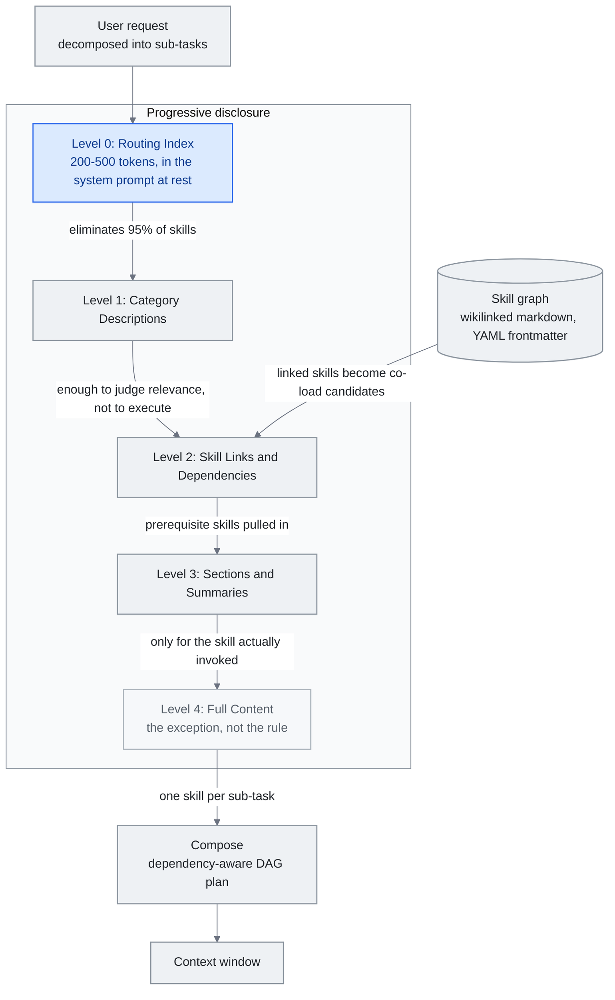

<!-- translation-sync:start -->
> Traducción asistida por máquina sincronizada con la edición inglesa de 2026-10-31, con revisión de estructura y contenido. El código y las etiquetas de los diagramas conservan el original; los tiempos de lectura se estiman a partir del inglés.
> [English source](../../../chapters/05-skill-systems.md) · [Sync record](../../SYNC.md)
<!-- translation-sync:end -->

<!-- i18n-anchor -->

# Capítulo 5: Sistemas de habilidades: habilidades, grafos y divulgación progresiva

> **En una frase:** Las habilidades son instrucciones reutilizables que enseñan a la IA tareas específicas, y los grafos de habilidades las conectan en una red navegable de conocimiento.
>
> **Por qué importa:** En lugar de explicar lo mismo a la IA cada vez, las habilidades permiten enseñarlo una vez y reutilizar ese conocimiento indefinidamente.
>
> **Tiempo de lectura:** ~22 min (estimación del original en inglés: 4,929 palabras / 230 palabras por minuto)

*Figura: Los cinco niveles de divulgación de la sección 5.4, con el grafo de habilidades de 5.5 alimentando el nivel que resuelve enlaces y dependencias, y el plan de composición de 5.5 ensamblando lo que se carga finalmente. La conexión desde el nivel 0 sostiene el argumento: el índice elimina el 95% de las habilidades antes de leer un archivo completo; por eso solo alcanzan el nivel 4 las una o dos habilidades invocadas.*

Las habilidades son conjuntos de instrucciones preparados: paquetes autónomos de prompts, configuración de herramientas y reglas de comportamiento que se introducen en la ventana de contexto cuando hace falta una capacidad específica. Permiten que un sistema pase de unos pocos comportamientos incorporados a cientos o miles de capacidades especializadas sin ahogar al modelo con instrucciones irrelevantes.

Este capítulo cubre su arquitectura, el problema combinatorio que crean y los patrones de divulgación progresiva que lo resuelven.

---

<!-- i18n-anchor -->

## 5.1 El concepto de habilidad

En su forma más sencilla, una habilidad es un archivo Markdown o bloque estructurado con instrucciones para una tarea concreta. Si una solicitud coincide con sus condiciones de activación, se carga su contenido en la ventana. Los metadatos anunciados siguen costando tokens aunque el cuerpo aún no se haya cargado.

Difiere radicalmente de un prompt de sistema monolítico que cubre todas las capacidades. Describir 90 herramientas y 50 modos de comportamiento puede consumir 50,000 tokens o más antes del primer mensaje. Un sistema de habilidades carga solo lo pertinente, mantiene ligero el contexto básico y reserva la ventana para la tarea real.

El patrón procede de ingeniería de software: las habilidades son para agentes lo que los complementos para aplicaciones. Aportan extensibilidad sin sobrecarga innecesaria.

<!-- i18n-anchor -->

## 5.2 El ecosistema de habilidades de Anthropic

Anthropic lanzó habilidades para Claude Code en octubre de 2025 como función específica del proyecto: archivos Markdown en `.claude/` que Claude invocaba cuando correspondía. El formato era deliberadamente sencillo: descripción, condiciones de activación e instrucciones en un archivo.

En diciembre de 2025, publicó las habilidades como estándar abierto en agentskills.io y definió un formato portátil adoptable por cualquier sistema de agentes.

La [especificación](https://agentskills.io/specification) actual exige `name` y `description`; los campos opcionales cubren licencias, compatibilidad, metadatos arbitrarios y permisos experimentales de herramientas. Las activaciones por regex y las dependencias son convenciones del anfitrión, no campos normalizados. Esto describe la documentación comprobada el 31 de octubre de 2026, no un cambio fechado de la especificación.

La respuesta fue rápida. A principios de 2026, el repositorio oficial superaba las 87,000 estrellas de GitHub y las habilidades de la comunidad, las 700,000. Colecciones como awesome-llm-skills, awesome-agent-skills —con 1,000+ habilidades de equipos oficiales de plataformas— y awesome-claude-code se convirtieron en canales principales de descubrimiento.

Ese crecimiento recreó el problema que las habilidades debían resolver: demasiadas capacidades compitiendo por contexto limitado.

La escala de los registros se formalizó a mediados de 2026. El **5 de junio de 2026**, Vercel llevó la **API de skills.sh** a disponibilidad general: un registro consultable que indexa **600,000+ habilidades** abiertas, con autenticación OIDC de tokens breves, rotados automáticamente y sin secreto permanente; límite de 600 solicitudes por minuto **por equipo y por proyecto**; y consulta de auditoría de seguridad por habilidad. Incorporar ese endpoint de auditoría reconoce implícitamente que un registro de esa escala también es superficie de ataque, tema de §5.10.

La capacidad de habilidades completó su llegada a infraestructura de producción en agosto de 2026, unos diez meses después del lanzamiento de Claude Code. Anthropic sacó la **Skills API de beta el 19 de agosto**, con un artículo complementario fechado el 20: una discrepancia entre superficies propias que parece retraso de publicación, no dos eventos. `/v1/skills` es estable; ya no exige la cabecera beta `skills-2025-10-02`, aunque la acepta. Llegó junto a computer use, browser use y Files API en una oleada de disponibilidad general para agentes, accesible mediante Claude Platform y Microsoft Foundry.

Doce días antes, el **7 de agosto**, llegaron habilidades alojadas en GitHub para Managed Agents. El directorio raíz `.claude/skills` de un repositorio montado se descubre automáticamente al iniciar la sesión, sin publicar ni instalar por separado. La documentación explicita que el repositorio entra en el límite de confianza del agente sin revisión intermedia: un repositorio GitHub activo se incorpora a la misma clase de problema que §5.10 sigue con AIR, Cloak-and-Detonate y Paperclip. Quien escribe en él puede añadir o modificar lo que el agente trata como instrucciones de producción.

**El formato portátil obtiene un hogar neutral.** El 22 de octubre de 2026, [Anthropic donó Agent Skills a AAIF](https://www.anthropic.com/news/donating-agent-skills-to-the-agentic-ai-foundation), incluidos nombre, logotipo, organización de GitHub y dominio. Anthropic informó de integración en más de 70 plataformas de agentes. Refuerza la convergencia entre proveedores, no demuestra ejecución segura: versiones publicadas, proceso de propuestas y recomendaciones de seguridad para autores e instaladores eran trabajo propuesto de la hoja de ruta, no funciones del estándar ya completadas.

<!-- i18n-anchor -->

## 5.3 El problema de escala

La documentación de agentes de OpenAI incluye una pauta práctica: **mantener menos de 20 herramientas por agente y esperar pérdida de precisión al superar 10.** Las pruebas con varias familias de modelos confirman ese umbral. Cada definición añade tokens y ramas de decisión a la selección. Con 90 herramientas, solo los esquemas pueden superar los 50,000 tokens antes de conversación, memoria o documentos.

No solo importa el número de tokens, sino la complejidad de decidir. Entre 90 herramientas, la masa de probabilidad se dispersa. El modelo gasta más razonamiento en seleccionarlas y menos en ejecutar; aumentan los errores de parámetros y las elecciones plausibles pero incorrectas.

Las habilidades sufren la misma presión. Un sistema con 500 habilidades no puede cargar sus 500 descripciones. Incluso las condiciones de activación de 500 pueden consumir miles de tokens y perjudicar la comprensión de la solicitud real.

La solución es la divulgación progresiva.

<!-- i18n-anchor -->

## 5.4 Arquitectura de divulgación progresiva

Es una arquitectura de información multinivel: cada nivel aporta lo justo para la siguiente decisión de enrutamiento. Los cinco siguientes son la síntesis arquitectónica de esta guía, no una secuencia obligatoria del estándar:

**Nivel 0: Índice de enrutamiento.** Tabla compacta que relaciona categorías con grupos de habilidades. Puede ocupar 200-500 tokens para toda la biblioteca. Permanece en el prompt de sistema en reposo.

**Nivel 1: Descripciones por categoría.** Al identificar una categoría relevante, se cargan descripciones de un párrafo de sus habilidades, optimizadas para examinarse: suficientes para decidir pertinencia, no para ejecutar.

**Nivel 2: Enlaces y dependencias.** Se carga el grafo de dependencias de la habilidad seleccionada: otras habilidades o herramientas necesarias y contexto esperado.

**Nivel 3: Secciones y resúmenes.** Se carga su esquema estructural —encabezados, decisiones fundamentales y parámetros—, sin las instrucciones completas.

**Nivel 4: Contenido completo.** Se cargan todas las instrucciones en la ventana. Solo ocurre con las una o dos habilidades invocadas.

La idea formalizada por Heinrich y arscontexta es que **la mayoría de las decisiones ocurre antes de leer un solo archivo completo**. El índice elimina el 95% de las habilidades y las descripciones descartan la mayoría del resto. Cargar todo es la excepción, no la regla.

Medida en sistemas de producción, la divulgación progresiva reduce la sobrecarga de tokens un **85-95%** frente a cargar todas las definiciones al inicio. La implementación de Anthropic lo muestra: 17 habilidades de producción consumen unos 1,700 tokens en reposo —niveles 0 + 1— y solo amplían el contenido al invocarse.

<!-- i18n-anchor -->

## 5.5 Grafos de habilidades

La arquitectura Skill Graph de Heinrich (arscontexta, 2025-2026) extiende la divulgación progresiva a una red. En lugar de una lista plana por categorías, es una **red de archivos Markdown interconectados mediante wikilinks**, donde cada nodo contiene:

- Metadatos YAML iniciales con una descripción concisa, examinable en el nivel 1
- Wikilinks a habilidades relacionadas, prerrequisitos y subhabilidades
- Secciones estructuradas que pueden cargarse independientemente

El grafo permite capacidades que una lista plana no ofrece:

**Navegación contextual.** Al invocar una habilidad, las enlazadas pasan a ser candidatas a cargarse conjuntamente. Una habilidad "deploy" enlaza con "test," "rollback," y "monitor", no por compartir categoría, sino por proximidad operativa.

**Resolución de dependencias.** Las habilidades declaran requisitos previos. Invocar una compleja incorpora automáticamente las básicas necesarias, como al resolver dependencias de paquetes.

**Carga parcial.** Las secciones claras permiten cargar solo una parte, por ejemplo "error handling" de una habilidad de despliegue, sin leer todo el documento.

La topología representa conocimiento: los grupos densamente conectados indican áreas de capacidades coherentes; las habilidades aisladas pueden revelar lagunas u oportunidades de integración.

A mediados de 2026, la investigación superó la selección de una habilidad. **"Compositional Skill Routing for LLM Agents: Decompose, Retrieve, and Compose"** (arXiv 2606.18051, 16 de junio de 2026, autor único Xueping Gao, Alibaba Cloud) formaliza la *composición*: descomponer la consulta en subtareas, recuperar una habilidad por cada una y ensamblar un plan DAG consciente de dependencias. **CompSkillBench**, con 300 consultas composicionales sobre 2,209 habilidades reales de servidores MCP y 24 categorías, es el primer benchmark de composición de *varias* habilidades, no de selección de una. Iterative Skill-Aware Decomposition mejora la precisión **51.0% → 67.7%** (+32.7% relativo, Wilcoxon p < 10⁻⁶), reduce el consumo de contexto **más del 99%** frente a cargar la biblioteca y todavía aporta +35.6% relativo cuando las categorías objetivo no existen en el conjunto de recuperación.

<!-- i18n-anchor -->

## 5.6 El artículo SkillReducer

Un estudio de marzo de 2026 analizó 55,315 habilidades de varias plataformas y cuestionó supuestos ingenuos sobre su calidad:

- **El 26.4% carecía de descripción de enrutamiento.** Tenía instrucciones completas, pero no metadatos que ayudaran a decidir cuándo invocarlas. Solo podían activarse por nombre exacto: eran invisibles para el enrutamiento inteligente.

- **Más del 60% del cuerpo no era ejecutable.** Contenía antecedentes, motivación, salvedades y explicaciones en lugar de instrucciones concretas. Consumía tokens sin contribuir al rendimiento de la tarea.

- **Las habilidades comprimidas mejoraron la calidad un 2.8%.** Al quitar contenido no ejecutable y ajustar el lenguaje de instrucciones, mejoró el rendimiento. Menos era más: reducir ruido permitía concentrarse en lo que debía hacerse.

Las consecuencias para su autoría son directas:

1. **Toda habilidad necesita descripción de enrutamiento.** Sin ella es prácticamente invisible para la divulgación progresiva.
2. **Las instrucciones deben ser densas y ejecutables.** Los antecedentes pertenecen a la documentación, no al cuerpo inyectado en el contexto.
3. **La medición de calidad debe incluir eficiencia de tokens**: no solo "does it work", sino "does it work per token consumed."

<!-- i18n-anchor -->

## 5.7 El patrón de metaherramienta para MCP

Model Context Protocol (MCP) normalizó el descubrimiento y la invocación de herramientas entre proveedores. Pero su diseño original cargaba todos los esquemas al conectar, creando el mismo problema de escala.

La metaherramienta lo resuelve con dos componentes:

- **Herramienta de descubrimiento:** Acepta una descripción natural y devuelve esquemas pertinentes del registro completo. Es la única cargada por defecto.
- **Herramienta de ejecución:** Envoltorio genérico que invoca por nombre cualquier herramienta cuyo esquema se haya recuperado.

Se cargan dos esquemas en lugar de cientos. Cuando necesita una capacidad, el modelo descubre el esquema y después invoca la herramienta concreta. Se intercambia una ronda adicional de inferencia por un gran ahorro de contexto.

Es divulgación progresiva para herramientas: el modelo recibe una agenda, no el contenido del expediente de cada contacto.

<!-- i18n-anchor -->

## 5.8 Pautas de autoría

De SkillReducer y la experiencia en producción surgen estas buenas prácticas:

- **Empezar por la descripción de enrutamiento.** La descripción YAML inicial es la línea más importante: determina si se invocará la habilidad. Escríbala para un clasificador, no para una persona.
- **Situar primero las instrucciones ejecutables.** Los primeros 200 tokens deben contener el comportamiento fundamental; después vienen antecedentes y contexto.
- **Usar secciones estructuradas.** Encabezados, listas y límites claros permiten cargar y recuperar secciones individuales.
- **Declarar explícitamente dependencias del anfitrión.** Documente habilidades y herramientas requeridas donde este pueda resolverlas.
- **Incluir ejemplos de activación.** Aporte 3-5 mensajes de usuario que deban activarla, como documentación y pruebas del enrutamiento.
- **Medir el coste de tokens.** Registre el tamaño y establezca un presupuesto. Si supera 2,000 tokens, considere dividirla o comprimirla.

Otra línea automatiza la *construcción* de habilidades. **Workflow-to-Skill** (arXiv 2606.06893, 5 de junio de 2026; Yuyang Zhang, Xinyuan Han, Xudong Jiang, Run Wang; Wuhan University / Nanchang University) introduce RWSA, representación intermedia estructurada que convierte trazas heterogéneas —demostraciones, trayectorias y registros de herramientas— en habilidades. Descompone cada una en estructura de flujo, semántica de ejecución y elementos de ejecución asociados —seguridad, reversión y estado—, en lugar de resumirla. En WSASkill, de 70 habilidades, comunica **+10.5% relativo** en consistencia de reproducción del comportamiento frente a referencias como Skill Creator de Anthropic: primera formalización de construcción automática frente a buenas prácticas manuales.

Otra línea hace el recorrido inverso: trata la habilidad terminada como infraestructura, no prosa. **`ant apply`** de Anthropic, publicado el 3 de septiembre de 2026 en CLI v1.30.0 y posteriores, aplica el modelo planificar/aplicar de Terraform a agentes, entornos, habilidades, almacenes de memoria y despliegues. Se declaran en archivos del repositorio, comparan con el estado API real, muestran como plan y crean o actualizan con aprobación; `claude-lock.json` registra huellas de lo enviado y devuelto. La habilidad es un directorio con `SKILL.md` raíz y puede proceder de una URL GitHub, fijada a un commit resuelto hasta ejecutar `--upgrade`; las referencias relativas resuelven orden y versiones durante la planificación. Según Anthropic, está pensado para CI: `--dry-run` produce planes en pull requests y se recomienda Workload Identity Federation en lugar de claves API estáticas. Fijar commits mitiga realmente la brecha entre comprobación y uso de 5.10: la habilidad GitHub no puede reescribirse entre revisión y ejecución. No la resuelve: el archivo de bloqueo fija el archivo, no lo que este consulta mientras funciona, precisamente el canal utilizado por `brand-landingpage` en junio de 2026.

<!-- i18n-anchor -->

## 5.9 Convergencia sectorial: Agent Skills Spec de Google (abril de 2026)

Durante gran parte de 2025, la divulgación progresiva era sobre todo convención de Anthropic, formalizada en habilidades de Claude Code en octubre de 2025 y en agentskills.io en diciembre. En **abril de 2026**, Google Developers Blog formalizó **Agent Skills Spec**, adoptando y ampliando la misma arquitectura. Describe tres niveles explícitos:

- **Nivel 1: Metadatos (~100 tokens por habilidad).** Descriptor compacto con nombre, descripción de una línea, indicios de activación y versión. Los metadatos de nivel 1 de todas las habilidades disponibles permanecen en el contexto básico: con 10, unos 1,000 tokens constantes.
- **Nivel 2: Instrucciones (<5K tokens).** Comportamiento completo de una habilidad, cargado cuando la coincidencia del nivel 1 la identifica como relevante. El nivel 2 nunca entra hasta seleccionarla realmente.
- **Nivel 3: Recursos externos.** Documentos, conjuntos de datos, esquemas y ejemplos de código completamente fuera de la ventana, recuperados solo cuando la habilidad los necesita explícitamente durante la ejecución.

La eficiencia comunicada: con 10 habilidades, el contexto básico baja de unos **10K tokens**, cargando todo, a **1K tokens**, solo metadatos de nivel 1: **reducción del 90%**. El nivel 2 carga una habilidad cada vez y el 3, recursos cuando hacen falta.

Dos detalles destacan más allá de las cifras:

1. **Utiliza la especificación universal `agentskills.io`.** Google no bifurca el formato, sino que lo alinea con el estándar publicado por Anthropic en diciembre de 2025. Las habilidades pueden consumirse en la otra plataforma con adaptación mínima.
2. **Eleva la divulgación progresiva de convención a patrón formal de diseño.** Durante aproximadamente un año se describía como "what Anthropic does with skills." La adopción de Google la convierte en patrón entre proveedores, con arquitectura nombrada y objetivos medibles, como "MVC" o "REST" pasaron de implementaciones concretas a patrones generales.

El efecto es portabilidad de bibliotecas y que "how many tokens does your baseline agent context consume" sea una métrica principal de competencia entre proveedores.

La convergencia se amplió el **6 de mayo de 2026**, cuando AWS publicó **AWS MCP Server** en disponibilidad general y adoptó **"Skills over SOPs"** como entrada canónica para agentes: primer gran proveedor de nube en publicar Skills —estándar abierto de Anthropic / OpenAI / Google de diciembre de 2025— como orientación de producción. Con cuatro proveedores alineados —Anthropic, OpenAI, Google y AWS—, pasa de "the convention three frontier labs use" a "the way agent capabilities are described across the cloud stack." Una habilidad escrita para agentskills.io es portátil entre las plataformas donde se ejecuta la mayoría de agentes de producción.

<!-- i18n-anchor -->

## 5.10 Seguridad de habilidades y cadena de suministro

Además de eficiente, una habilidad es un *conjunto de instrucciones ejecutables que seguirá el modelo*. A mediados de 2026, distribuirlas por registros produjo consecuencias concretas de seguridad. Ya existían escáneres —skill-scanner de Cisco, **SkillSpector** de NVIDIA, abierto a mediados de junio de 2026, y auditoría de skills.sh—, pero dos divulgaciones mostraron el techo estructural del análisis estático.

El **22 de junio de 2026**, AIR divulgó que había **secuestrado aproximadamente 26,000 agentes**, "including corporate accounts' agents", mediante una única habilidad falsa, `brand-landingpage`, anunciada en Instagram, que recogía discretamente el correo de la víctima. Superó *todos* los escáneres probados. La causa es la **brecha entre comprobación y uso (TOCTOU)**: el escáner evalúa la instantánea presentada, pero la habilidad apuntaba a una URL controlada por el atacante y modificable después de revisarse. La instantánea aprobada nunca fue lo ejecutado.

Diez días después, el **2 de julio de 2026**, investigadores de HKUST formalizaron la brecha. **"Cloak and Detonate: Scanner Evasion and Dynamic Detection of Agent Skill Malware"** (arXiv 2607.02357) presenta **SkillCloak**, que reescribe habilidades maliciosas para eludir escáneres manteniendo su función mediante empaquetado autoextraíble: la carga se oculta durante instalación en puntos ciegos y se restaura solo durante ejecución. Sobre 1,613 habilidades maliciosas reales y 8 escáneres, SFS evita **más del 90% de detecciones en todos** y alcanza 99.8-99.9% en seis de ocho. El equipo publica **SkillDetonate**, verificador de comportamiento que detecta **97% de ataques con 2% de falsos positivos**, y 87% en habilidades maliciosas reales.

Cinco semanas después llegó otro caso. El **6 de agosto de 2026**, Zenity Labs divulgó una campaña contra skills.sh: atacantes suplantaron las organizaciones GitHub paperclipai y browser-use —registraron `getpaperclipp.com` y crearon `getpaperclipai` el 2 de julio— y publicaron habilidades benignas el 5 de julio, convertidas en maliciosas el 11 y situadas en el #8 de tendencias. La carga de recolección de credenciales, cadena curl→base64→node, apuntaba a 138 rutas —claves SSH, credenciales AWS/GCP/Azure, configuración Kubernetes, tokens npm y bases de datos— mediante cuatro activaciones independientes: instrucciones directas, paquete PyPI malicioso, hooks postinstall npm y manejadores de rutas API. El contador superó **1.7 millones** de instalaciones, agregado y no de agentes únicos comprometidos: la misma ambigüedad que infló la cifra principal de AIR en junio. Vercel y GitHub retiraron listados y repositorios en 12 horas. (Es distinto de los CVE del producto Paperclip legítimo, como CVE-2026-41679, divulgado el día anterior; no son la suplantación de skills.sh.) En poco más de seis semanas, el mismo fallo TOCTOU de volver malicioso tras revisar pasó de Instagram y 26,000 agentes a evasión sistemática demostrada y a una familia en tendencias con cuatro activaciones a escala de registro.

La lección coincide con la aprendida por MCP un año antes —borrador IETF de seguridad del capítulo 7—: divulgación progresiva y registros masivos convierten el archivo en superficie de ataque; la confianza debe pasar del *escaneo al publicar* a la *contención durante ejecución*. No puede certificarse una habilidad que recupera o desempaqueta su conducta real examinando solo su estado al presentarse: hay que observar lo que hace al ejecutarse.

En el mes posterior a Zenity apareció un mercado comercial. El **1 de septiembre de 2026**, CrowdStrike lanzó **Falcon Guardian** en Fal.Con como parte de una nueva línea de detección y respuesta para IA: descubre e inventaría agentes conocidos y no registrados en Windows y macOS, registra quién los desplegó y aplica acceso, políticas y detección a su conducta, reconstruyendo cadenas maliciosas después. Describe el caso que la revisión estática no alcanza —prompt aparentemente legítimo con conducta anómala—, pero no publica tasas de detección ni eficacia: demuestra una categoría comercial, no que funcione. Ese día, AIR, responsable del caso del 22 de junio, salió del modo confidencial con **$50 millones** en dos rondas semilla —$10M liderados por Sequoia y $40M por Greenoaks— y cifras del ecosistema: según su propio recuento, **más de 17,800 complementos públicos, con unas 6.7 millones de instalaciones, dependen de instrucciones externas no confiables**; también informa de habilidades que suplantan a Anthropic y OpenAI para superar revisión. La suplantación de marca reaparece como técnica, no solo como caso Paperclip. AIR no publica la metodología de ninguna cifra: ambas son mediciones del proveedor sobre el mercado al que vende. Los anuncios cierran el ciclo comercial: en diez semanas se pasó de una divulgación a evasión sistemática, campaña masiva, proveedor financiado que vende medición y proveedor de endpoints que vende aplicación de controles.

---

<!-- i18n-anchor -->

## Tres ideas para recordar

- **La mayoría de las decisiones de enrutamiento precede a leer un archivo completo.** El índice elimina el 95% de las habilidades y las descripciones la mayoría del resto; el nivel 4 carga solo las una o dos invocadas.
- **Sin descripción de enrutamiento, una habilidad es invisible.** SkillReducer encontró instrucciones completas sin metadatos reconocibles en el 26.4% de 55,315 habilidades, activables solo por nombre exacto.
- **A escala de registro, la confianza debe pasar de escanear al publicar a contener en ejecución.** Una conducta descargada o desempaquetada después no puede certificarse desde la instantánea presentada: el fallo común de AIR, Cloak-and-Detonate y Paperclip.

---

<!-- i18n-anchor -->

## Fuentes

- **Agent Skills.** Especificación del formato (documentación actual comprobada el 31 de octubre de 2026): [https://agentskills.io/specification](https://agentskills.io/specification).
- **Anthropic.** Anuncio de donación de Agent Skills (22 de octubre de 2026): [https://www.anthropic.com/news/donating-agent-skills-to-the-agentic-ai-foundation](https://www.anthropic.com/news/donating-agent-skills-to-the-agentic-ai-foundation).
- **Anthropic.** "Claude Code Skills." Documentación y especificación abierta, octubre de 2025 como lanzamiento y diciembre de 2025 como estándar en agentskills.io. 87K+ estrellas de GitHub a principios de 2026.
- **OpenAI.** "Agent Design Best Practices." Documentación de OpenAI, 2025. Recomienda menos de 20 herramientas por agente y señala degradación al superar 10.
- **Heinrich (@arscontexta).** Concepto e implementación de Skill Graphs. Publicaciones en X (2026): [https://x.com/arscontexta/status/2023957499183829467](https://x.com/arscontexta/status/2023957499183829467) (Skill Graphs > SKILL.md). GitHub: [https://github.com/agenticnotetaking/arscontexta](https://github.com/agenticnotetaking/arscontexta) --- Complemento de Claude Code que genera sistemas personalizados de conocimiento en grafos Markdown, con wikilinks y exploración de metadatos YAML. Análisis secundario: Linas Substack, "Skill Graphs: The Architecture That Solves the AI Agent Context Window Problem." [https://linas.substack.com/p/skill-graphs](https://linas.substack.com/p/skill-graphs)
- **Artículo SkillReducer.** "Less Is More: Compressing Agent Skills for Improved Performance." Marzo de 2026. 55,315 habilidades analizadas, 26.4% sin descripción de enrutamiento, 60%+ de contenido no ejecutable y mejora del 2.8% al comprimir.
- **Model Context Protocol (MCP).** Especificación de Anthropic, 2024-2025. Protocolo normalizado de descubrimiento e invocación de herramientas.
- **awesome-llm-skills.** Colección comunitaria en GitHub. Bibliotecas seleccionadas de habilidades de varias plataformas.
- **awesome-agent-skills.** Colección de GitHub con 1,000+ habilidades de equipos oficiales de plataformas.
- **awesome-claude-code.** Colección de GitHub con habilidades y configuraciones específicas de Claude Code.
- **OpenAI.** "Function Calling Best Practices." 2025. Datos empíricos sobre las compensaciones entre cantidad de herramientas y precisión.
- **Griciūnas, Aurimas.** "State of Context Engineering in 2026." SwirlAI Newsletter, marzo de 2026. [https://www.newsletter.swirlai.com/p/state-of-context-engineering-in-2026](https://www.newsletter.swirlai.com/p/state-of-context-engineering-in-2026) --- Patrones de divulgación progresiva / compresión / ventana deslizante y metaherramienta. Véase también "Breaking Down Context Engineering": [https://www.newsletter.swirlai.com/p/breaking-down-context-engineering](https://www.newsletter.swirlai.com/p/breaking-down-context-engineering)
- **AWS.** "AWS MCP Server now generally available" (6 de mayo de 2026): [https://aws.amazon.com/about-aws/whats-new/2026/05/aws-mcp-server/](https://aws.amazon.com/about-aws/whats-new/2026/05/aws-mcp-server/)
- **AWS News Blog.** "The AWS MCP Server is now generally available" (6 de mayo de 2026): [https://aws.amazon.com/blogs/aws/the-aws-mcp-server-is-now-generally-available/](https://aws.amazon.com/blogs/aws/the-aws-mcp-server-is-now-generally-available/) --- "Skills over SOPs" convierte a AWS en el primer gran proveedor de nube que publica Skills como orientación de agentes en producción.
- **Vercel.** "The skills.sh API is now available" (5 de junio de 2026): [https://vercel.com/changelog/the-skills-sh-api-is-now-available](https://vercel.com/changelog/the-skills-sh-api-is-now-available) --- API de registro consultable; autenticación OIDC; 600 solicitudes por minuto por equipo y por proyecto; 600,000+ habilidades indexadas; auditoría por habilidad.
- **Gao, Xueping** (Alibaba Cloud). "Compositional Skill Routing for LLM Agents: Decompose, Retrieve, and Compose." arXiv 2606.18051, 16 de junio de 2026. [https://arxiv.org/abs/2606.18051](https://arxiv.org/abs/2606.18051) --- CompSkillBench: 300 consultas composicionales sobre 2,209 habilidades MCP y 24 categorías; Iterative Skill-Aware Decomposition 51.0%→67.7%; reducción de contexto >99% frente a cargar la biblioteca.
- **Zhang, Yuyang; Han, Xinyuan; Jiang, Xudong; Wang, Run** (Wuhan / Nanchang University). "Workflow-to-Skill." arXiv 2606.06893, 5 de junio de 2026. [https://arxiv.org/abs/2606.06893](https://arxiv.org/abs/2606.06893) --- Representación intermedia RWSA: estructura de flujo / semántica de ejecución / elementos asociados; +10.5% relativo en consistencia de reproducción frente a referencias como Skill Creator de Anthropic en WSASkill, de 70 habilidades.
- **AIR (Niv Hoffman & Or Nevo).** "The Story of Skills --- How We Hijacked 26,000 Agents With One Instagram Ad" (22 de junio de 2026): [https://www.air.security/blog-posts/the-story-of-skills](https://www.air.security/blog-posts/the-story-of-skills) --- Habilidad falsa `brand-landingpage`, evasión TOCTOU mediante URL externa ante todos los escáneres probados: Cisco skill-scanner, NVIDIA SkillSpector y skills.sh. Fuente secundaria: The Hacker News (June 23): [https://thehackernews.com/2026/06/fake-ai-agent-skill-passed-security.html](https://thehackernews.com/2026/06/fake-ai-agent-skill-passed-security.html).
- **Ji, Zimo et al.** (HKUST). "Cloak and Detonate: Scanner Evasion and Dynamic Detection of Agent Skill Malware." arXiv 2607.02357, presentado el 2 de julio de 2026. [https://arxiv.org/abs/2607.02357](https://arxiv.org/abs/2607.02357) --- SkillCloak evade >90% en 8 escáneres sobre 1,613 habilidades maliciosas; SkillDetonate detecta 97% con 2% de falsos positivos en ejecución. Fuente secundaria: The Hacker News (July 6): [https://thehackernews.com/2026/07/new-skillcloak-technique-lets-malicious.html](https://thehackernews.com/2026/07/new-skillcloak-technique-lets-malicious.html).
- **NVIDIA.** SkillSpector, escáner abierto de habilidades, publicado a mediados de junio de 2026; aparece en el repositorio de NVIDIA, pero no en los informes del incidente de AIR/THN.
- **Zenity Labs.** "Attackers Target Agents via the Skill Supply Chain" (6 de agosto de 2026): [https://labs.zenity.io/post/attackers-target-agents-via-the-skill-supply-chain](https://labs.zenity.io/post/attackers-target-agents-via-the-skill-supply-chain) --- Campaña de suplantación de Paperclip en skills.sh; 138 rutas de credenciales; cuatro activaciones; contador agregado de 1.7M+ instalaciones. Fuentes secundarias: CSO Online: [https://csoonline.com/article/4206851/](https://csoonline.com/article/4206851/); Business Wire: [https://businesswire.com/news/home/20260806707467/en/](https://businesswire.com/news/home/20260806707467/en/).
- **Anthropic.** Resumen de notas de versión: [https://platform.claude.com/docs/en/release-notes/overview](https://platform.claude.com/docs/en/release-notes/overview) --- Skills API sale de beta el 19 de agosto de 2026. Blog: "Computer use, Skills API, and Files API" (20 de agosto de 2026): [https://claude.com/blog/computer-use-skills-api-files-api](https://claude.com/blog/computer-use-skills-api-files-api). Documentación de habilidades de Managed Agents, alojadas en GitHub desde el 7 de agosto de 2026: [https://platform.claude.com/docs/en/managed-agents/skills](https://platform.claude.com/docs/en/managed-agents/skills).
- **CrowdStrike.** Anuncio de Falcon Guardian en Fal.Con 2026 (1 de septiembre de 2026): [https://www.crowdstrike.com/en-us/press-releases/crowdstrike-unveils-falcon-guardian-ai-agent-security/](https://www.crowdstrike.com/en-us/press-releases/crowdstrike-unveils-falcon-guardian-ai-agent-security/) --- Descubrimiento e inventario de agentes conocidos y no registrados en Windows y macOS, control de acceso, aplicación de políticas y detección de conducta en ejecución; sin tasas de detección ni eficacia. Fuentes secundarias: SiliconANGLE (September 1): [https://siliconangle.com/2026/09/01/crowdstrike-launches-falcon-guardian-to-police-ai-agents-at-the-endpoint/](https://siliconangle.com/2026/09/01/crowdstrike-launches-falcon-guardian-to-police-ai-agents-at-the-endpoint/); SC World: [https://www.scworld.com/brief/crowdstrike-unveils-falcon-guardian-to-secure-ai-agents](https://www.scworld.com/brief/crowdstrike-unveils-falcon-guardian-to-secure-ai-agents).
- **AIR.** Salida del modo confidencial con $50 millones e investigación de complementos a escala de ecosistema. TechCrunch (1 de septiembre de 2026): [https://techcrunch.com/2026/09/01/air-raises-50m-to-help-companies-vet-the-skills-and-add-ons-ai-agents-use/](https://techcrunch.com/2026/09/01/air-raises-50m-to-help-companies-vet-the-skills-and-add-ons-ai-agents-use/); SecurityWeek (3 de septiembre de 2026): [https://www.securityweek.com/ai-agent-firewall-startup-air-security-emerges-from-stealth-with-50-million/](https://www.securityweek.com/ai-agent-firewall-startup-air-security-emerges-from-stealth-with-50-million/) --- $10M liderados por Sequoia y $40M por Greenoaks; 17,800+ complementos públicos con unas 6.7M instalaciones dependientes de instrucciones externas no confiables, y habilidades que suplantan a Anthropic y OpenAI; todo según AIR, sin metodología publicada. Los dos días entre medios son retraso de publicación de un mismo anuncio, no dos eventos.
- **Anthropic.** `ant apply` Documentación de CLI, publicado el 3 de septiembre de 2026 en v1.30.0 y posteriores: [https://platform.claude.com/docs/en/cli-sdks-libraries/cli/apply](https://platform.claude.com/docs/en/cli-sdks-libraries/cli/apply) --- Agentes, entornos, habilidades, almacenes de memoria y despliegues declarados en archivos; planificación/aplicación frente al estado API real; bloqueo `claude-lock.json`; habilidades de GitHub fijadas a commit hasta `--upgrade`; planes CI con `--dry-run` y Workload Identity Federation como autenticación recomendada. Solo documentación de Anthropic, sin cobertura independiente localizada.
