<!-- translation-sync:start -->
> Traducción asistida por máquina sincronizada con la edición inglesa de 2026-10-31, con revisión de estructura y contenido. El código y las etiquetas de los diagramas conservan el original; los tiempos de lectura se estiman a partir del inglés.
> [English source](../../../chapters/06-agent-memory.md) · [Sync record](../../SYNC.md)
<!-- translation-sync:end -->

<!-- i18n-anchor -->

# Capítulo 6: Memoria de agentes: la capa que falta

> **En una frase:** Los sistemas de memoria permiten a los agentes de IA recordar entre conversaciones sus preferencias, decisiones anteriores y contexto del proyecto.
>
> **Por qué importa:** Sin memoria, cada conversación con IA comienza desde cero. La memoria es lo que hace que la IA se sienta como un compañero en lugar de un extraño.
>
> **Tiempo de lectura:** ~30 min (estimación del original en inglés: 6,772 palabras / 230 palabras por minuto)

*Figura: Los seis niveles de "Feature-Level Memory Research (2026)", ordenados por ubicación: arriba, lo que el modelo lee mediante una interfaz; abajo, lo que forma parte del modelo. Se relacionan con los cuatro tipos de "Memory Taxonomy": la memoria de trabajo es la ventana; los registros episódicos, semánticos y procedimentales viven en el almacén. Los mecanismos de recuperación proceden de "Major Frameworks" y la entrada al nivel de pesos de "Architectural Patterns". Las conexiones hacia la ventana expresan el argumento: cualquier nivel externo debe recuperarse dentro de ella para razonar, independientemente del índice; las capas de pesos y características ya están dentro. Las pilas de producción hasta 2026 se sitúan principalmente en los primeros tres niveles.*

```mermaid
%%{init: {'theme':'base','themeVariables':{'primaryColor':'#eef1f4','primaryTextColor':'#1f2328','primaryBorderColor':'#8c959f','lineColor':'#6b7280','tertiaryColor':'#f6f8fa','clusterBkg':'#f9fafb','clusterBorder':'#8c959f','edgeLabelBackground':'#ffffff'}}}%%
flowchart TB
    subgraph EXT["Memory as data the model reads (episodic, semantic, procedural)"]
      direction LR
      VEC["vector-level<br/>Mem0, A-MEM"]
      GRA["graph-level<br/>Mem0g triples, typed edges"]
      SPA["spatial-level<br/>MemPalace, wings to drawers"]
    end
    VEC -->|top-k similarity| WIN
    GRA -->|navigated by relation type| WIN
    SPA -->|spatial walk, read verbatim| WIN
    WIN["token-level: the context window<br/>Working Memory"] -->|all reasoning happens here| LLM
    subgraph INT["Memory that is part of the model"]
      direction LR
      LLM["Model"] -->|rewrites part of itself at inference| WGT["weight-level<br/>Titans / MIRAS"]
      LLM -->|directions fire as it reasons| FEA["feature-level<br/>emotion vectors, iteration head"]
    end
    class VEC,GRA,LLM stable
    class SPA,WGT,FEA muted
    class WIN accent
classDef stable fill:#eef1f4,stroke:#8c959f,stroke-width:1.5px,color:#1f2328
classDef accent fill:#dbeafe,stroke:#2563eb,stroke-width:1.5px,color:#0b3a8f
classDef muted fill:#f6f8fa,stroke:#adb5bd,stroke-width:1.5px,color:#57606a
classDef gate fill:#ffffff,stroke:#2563eb,stroke-width:1.5px,color:#0b3a8f
```

<!-- i18n-anchor -->

## Por qué importa la memoria

Cada conversación nueva con un LLM comienza desde cero. El modelo no recuerda interacciones anteriores, preferencias ni contexto construido laboriosamente durante horas. No es una molestia menor, sino una carencia arquitectónica fundamental que debilita la promesa de la IA como colaborador persistente.

La memoria transforma respuestas sin estado en sistemas que aprenden, se adaptan y acumulan comprensión. Sin ella, el asistente no recuerda que usted prefiere concisión, utiliza TypeScript con un ORM concreto o detectó el martes pasado un fallo crítico de autenticación. Cada sesión arranca en frío y cada interacción exige reconstruir contexto.

El coste no es solo frustración: desperdicia tokens al reexplicar, degrada la calidad por falta de personalización y rompe la continuidad de tareas entre sesiones. Al pasar los agentes de juguetes de chat a infraestructura de producción, la memoria se convierte en la capa fundamental que falta entre capacidad bruta y utilidad real.

<!-- i18n-anchor -->

## Taxonomía de la memoria

La investigación en memoria de agentes ha convergido en una taxonomía inspirada en la ciencia cognitiva humana, distinguiendo cuatro tipos fundamentales:

La **memoria episódica** registra experiencias, interacciones concretas, eventos y resultados. Recordar "last week, the user asked me to refactor the payment module and preferred extracting a service class over using mixins," es memoria episódica: base de experiencia para personalizar y aprender de éxitos y fracasos.

La **memoria semántica** guarda hechos e información estructurada: tecnología del usuario, funciones del equipo, decisiones arquitectónicas y esquemas API. Se abstrae de eventos concretos y representa comprensión destilada, no experiencia sin procesar.

La **memoria procedimental** codifica cómo hacer tareas: flujos, procedimientos y secuencias aprendidas. Saber que desplegar este proyecto exige ejecutar pruebas, construir una imagen Docker, enviarla al registro y activar el despliegue de Kubernetes es memoria procedimental. Permite tareas complejas sin reconstruir el proceso cada vez.

La **memoria de trabajo** es el contexto activo de razonamiento: información manipulada y sintetizada durante una tarea. Corresponde a la ventana de contexto y al estado activo de recuperación. Es la capa más limitada y fundamental porque determina sobre qué puede razonar el agente en cada momento.

La interacción de los cuatro tipos determina la sofisticación. Una implementación ingenua guarda solo conversaciones, memoria episódica rudimentaria. Una madura separa, indexa y conecta los cuatro y recupera la información adecuada cuando hace falta.

<!-- i18n-anchor -->

## Frameworks principales

### Mem0

[Mem0](https://mem0.ai) se ha consolidado como capa universal líder de memoria para aplicaciones de IA. Con licencia Apache 2.0, ofrece una API unificada para añadir, buscar y gestionar memoria de usuarios, sesiones y agentes.

Sus cifras son llamativas: mejora del 26% en evaluaciones con LLM como juez frente a referencias, latencia p95 un 91% menor que el contexto completo y reducción de tokens del 90%+ recuperando recuerdos pertinentes en lugar de repetir todo el historial. Mem0 lo logra con almacenamiento vectorial, relaciones en grafos y consolidación inteligente.

En 2025, Mem0 se asoció con AWS, se integró en Amazon Bedrock y se posicionó como memoria predeterminada para IA empresarial. El aislamiento entre inquilinos permite servir a miles de usuarios con espacios persistentes separados.

**Mem0ᵍ (2026): el grafo como elemento de pleno derecho.** La variante de grafo dirigido y etiquetado **Mem0ᵍ** llegó a producción a principios de 2026, sustituyendo el híbrido vector+grafo por una arquitectura centrada en grafos de conocimiento. Un **extractor de entidades** alimenta a un **generador de relaciones** que produce tripletas `(source, relation, destination)`, con conexiones tipadas como `lives_in`, `prefers` y `owns`, no solo similitud sin tipo. Un **detector de conflictos** y un **resolutor de actualizaciones basado en LLM** gestionan contradicciones: ante una tripleta discrepante, deciden sobrescribir, fusionar o conservar ambas con su procedencia. Mem0ᵍ une contexto completo ("dump everything into the window") y recuperación selectiva ("find the top-k similar chunks") mediante estructura semántica consultable, navegable por relación, no solo distancia vectorial.

### A-MEM

[A-MEM](https://github.com/agiresearch/A-mem) adopta otro enfoque, inspirado en Zettelkasten, el sistema de notas con que el sociólogo Niklas Luhmann produjo más de 70 libros de campos diversos.

A-MEM trata cada memoria como una nota atómica con indexación dinámica, enlaces y evolución. Las memorias no se almacenan y recuperan simplemente; se conectan a memorias relacionadas mediante enlaces emergentes, se indexan a lo largo de múltiples dimensiones y se les permite evolucionar a medida que llega nueva información. Cuando se agrega una nueva memoria, el sistema identifica conexiones con memorias existentes, potencialmente fusionándolas, dividiéndolas o actualizándolas.

La memoria crece orgánicamente en grupos de conocimiento relacionado, como los modelos mentales de expertos humanos. Zettelkasten encaja especialmente con la ingeniería del conocimiento: busca que el conocimiento genere valor acumulativo con el tiempo.

### ByteRover

[ByteRover CLI](https://github.com/campfirein/byterover-cli), antes Cipher, organiza conocimiento de proyectos en árboles de contexto. El repositorio se archivó el 27 de septiembre de 2026. La documentación revisada el 31 de octubre describe operación local con sincronización opcional, revisión de curación y ramas y fusiones similares a Git. El código fuente está disponible bajo Elastic License 2.0. Es un ejemplo histórico de organización en archivos; no demuestra superioridad general de recuperación ni elimina costes de modelo y mantenimiento.

El patrón recibió su primer estudio académico el 29 de julio de 2026. **"Filesystem-Based Memory for LLM Agents: Organization, Evolution, and Sustainability"** (arXiv 2607.26637; Sizhe Zhou y diez coautores de UIUC, UCSD y Adobe Research) se presenta como primer estudio sistemático del árbol de directorios Markdown, memoria que el agente lee, escribe y reorganiza con herramientas genéricas de archivos; estudia el patrón, no un producto. Formaliza tres funciones sobre un sistema compartido: agente gestor que organiza entradas, agente buscador que responde citando fuentes y agente ejecutor que destila trayectorias en habilidades reutilizables. Su resultado relevante frente al almacén vectorial: organizar reduce aproximadamente a la mitad el coste de recuperación cuando el almacén es grande. Mide la organización genérica, no ByteRover. En el estudio de crecimiento la organización se degrada con todos salvo el gestor más potente, y ninguno convierte esa organización en mejores respuestas. El árbol ordenado compra búsquedas más baratas, no respuestas mejores. Sin replicación, convierte una convención implementada en un patrón medido.

### Cognee

[Cognee 1.0](https://www.cognee.ai/cognee-1-0-announcement), del 26 de junio de 2026, expone `remember`, `recall`, `forget` e `improve`, no solo ingesta y búsqueda. El proveedor describe despliegue en un único Postgres, nube gestionada y exportación COGX. Mejorar según retroalimentación incorpora el mantenimiento a la interfaz. Son capacidades de producto; no demuestran independientemente calidad de memoria ni olvido fiable.

### Nemori

[Nemori](https://github.com/nemori-ai/nemori) se centra en un problema específico pero crucial: cómo segmentar flujos de conversación continuos en unidades de memoria significativas.

En lugar de cada mensaje o conversación como unidad, Nemori divide el diálogo en episodios semánticos coherentes que representan un pensamiento, decisión o flujo completo. Es fundamental porque la frontera entre "relevant past context" y "noise" suele caer en medio de una conversación, no en sus extremos.

Los episodios bien delimitados ofrecen mejor entrada a sistemas posteriores, ya sean vectoriales, de grafos o jerárquicos.

### MemPalace

[MemPalace](https://github.com/MemPalace/mempalace) recupera una idea anterior a vectores y grafos: el **método de loci**, mnemotecnia espacial de estudiosos antiguos y medievales que recordaban grandes catálogos recorriendo mentalmente un edificio. Publicado con MIT el 5 de abril de 2026, organiza la memoria en cuatro niveles: **alas → habitaciones → armarios → cajones**. Cada hoja, "drawer", contiene texto literal y la navegación jerárquica actúa como índice.

La recuperación no es similitud ni recorrido de grafos, sino **recorrido espacial**: el agente decide qué ala contiene el recuerdo, desciende por habitaciones y armarios y lee literalmente los cajones, sin reconstruir desde embeddings comprimidos. La filosofía "verbatim-first" lo distingue de resumir o fragmentar antes de guardar: sostiene que en tareas jurídicas, científicas y de diálogo, perder información al almacenar cuesta más que una recuperación espacial algo más lenta.

Sus cifras explican la repercusión. MemPalace comunica **96.6% Recall@5 en LongMemEval**, el benchmark publicado de mayor antigüedad para recuerdo de contexto en memoria de agentes, por encima de enfoques solo vectoriales o solo de grafos en la misma evaluación. Acumuló unas **49,000 estrellas de GitHub en tres semanas**, con diferencia el proyecto de memoria de crecimiento más rápido de 2026. Antes de terminar el mes circulaba una crítica académica (arXiv 2604.21284, *"Spatial Metaphors for LLM Memory: A Critical Analysis of the MemPalace Architecture"*), señal de su rápida incorporación al debate central.

<!-- i18n-anchor -->

## Patrones arquitectónicos

Al madurar el campo, aparecen patrones compartidos por varios frameworks:

**Jerarquías de varios tipos.** MIRIX (Wang y Chen, "MIRIX: Multi-Agent Memory System for LLM-Based Agents," arXiv 2507.07957, 10 de julio de 2025) lo ejemplifica con **seis tipos**: memoria central, episódica, semántica, procedimental, de recursos y bóveda de conocimiento, coordinados por seis gestores especializados y un metagestor que enruta tareas. Cada tipo tiene frecuencias, retención y recuperación distintas. Separarlos evita olvido catastrófico y permite adaptación rápida. La aplicación de referencia observa la pantalla en tiempo real para construir memoria personalizada; en ScreenshotVQA comunica un 35% más de precisión que RAG con 99.9% menos almacenamiento, y 85.4% en LOCOMO de conversaciones largas.

**Versionado inspirado en Git.** Varios sistemas versionan memoria como código: historial, ramas para razonamiento especulativo y reversión de actualizaciones incorrectas. Importa especialmente cuando varios agentes actualizan recuerdos compartidos simultáneamente.

*El versionado obtiene un límite transaccional (julio de 2026).* El historial Git es convención; **MemTxn** ("MemTxn: A Transaction Boundary for Source-Supported Updates and Complete-State Recovery in Agent Memory," arXiv 2607.27834, 30 de julio de 2026; Hanshuai Cui y cinco coautores) lo propone como garantía. Fuera del modelo que responde, consta de *Ordered PatchTest*, que comprueba respaldo de la fuente; *Temporal Resolver*, que decide qué versión es visible ante conflictos; y un diario duradero de instantáneas que restaura el estado visible tras un fallo sin conocer las escrituras físicas. En su validación acepta las 60 actualizaciones respaldadas y rechaza los 179 negativos difíciles construidos; con fallos persistentes multiclave inyectados en LongMemEval-S y estados derivados de LoCoMo, restaura todo el mapa activo declarado. La muestra es pequeña y no replicada: propuesta, no garantía probada en producción. Aporta un contrato que convierte detector de conflictos y resolutor de Mem0ᵍ en prueba refutable de aceptar/rechazar y añade recuperación ausente en los frameworks anteriores. Otro grupo llegó independientemente, según las listas de autores, tres días antes: **MemTX** ("MemTX: Transactional Belief Commit for Stateful Agent Memory," arXiv 2607.23929, 27 de julio de 2026) prepara escrituras en transacciones con aislamiento de instantáneas, condiciona llamadas irreversibles al estado de creencias pendiente y propaga reparaciones a registros derivados y efectos de herramientas al retractar una creencia. Dos equipos sin conexión recurriendo a transacciones de base de datos en una semana es la señal: escribir memoria ya tiene consecuencias que exigen disciplina de confirmación.

**Separación inspirada en la cognición.** Las arquitecturas avanzadas distinguen explícitamente memoria de trabajo rápida, buffers episódicos a medio plazo y conocimiento consolidado duradero. La consolidación, análoga al sueño biológico, comprime, deduplica y reorganiza periódicamente episodios en conocimiento semántico.

**Módulos de memoria entrenables.** En abril de 2026 apareció otro patrón con **Titans + MIRAS** de Google Research: memoria como *módulo neuronal entrenable*, no almacén externo. En lugar de escribir hechos en vectores, grafos o Markdown, Titans actualiza los pesos de un módulo dedicado mediante descenso de gradiente durante la inferencia: reescribe parte de sí mismo al procesar documentos. MIRAS aporta recetas y garantías de estabilidad para aprender durante la inferencia sin divergencia. Con parámetros comparables, Google informa de mejores resultados que **Mamba-2**, **Gated DeltaNet** y **Transformer++** en recuerdo a largo alcance y razonamiento de varios saltos. A diferencia de Mem0, A-MEM, ByteRover y MIRIX, que mantienen datos leídos mediante interfaces, Titans hace de la memoria parte del modelo: lee con circuitos de atención y escribe con mecanismos de entrenamiento. Abre otra decisión: ¿cuándo conviene grabar memoria en pesos y cuándo mantenerla consultable como datos?

El **6 de mayo de 2026** surgió otra dirección comercial: **Dreaming** de Anthropic, en vista previa. En lugar de entrenar pesos durante la inferencia, un trabajo programado entre sesiones lee las recientes, identifica errores recurrentes y flujos convergentes y **reescribe la memoria persistente en texto plano**. Titans incorpora memoria al modelo mediante gradientes; Dreaming conserva datos que lee el harness, actualizados por curación con LLM. Son plantillas comerciales contrapuestas: **memoria entrenable**, interna al modelo y actualizada durante inferencia, frente a **memoria curada**, texto reescrito por LLM y externo a la infraestructura del modelo. La decisión se precisa: cuándo grabar en pesos —Titans—, cuándo conservar un almacén consultable —Mem0, A-MEM, ByteRover, MemPalace— y cuándo texto editable por curación —Dreaming—.

Tres meses después, la memoria entrenable obtuvo su primera cifra importante de escala. **"Memory Decoder at Scale: A Pretrained, Parametric Long-Term Memory"** (arXiv 2607.27919, 30 de julio de 2026; Rubin Wei et al., con Qipeng Guo, Bowen Zhou y Zhouhan Lin) preentrena un módulo paramétrico de 6.9B sobre 300B tokens. Argumenta que un LLM solo decodificador mezcla memoria y razonamiento en los mismos parámetros y conviene escalar la memoria por separado. Lo hace viable infraestructura de indexación y recuperación Faiss distribuida con carga kNN dispersa por lotes, no otra función objetivo. En 17 benchmarks, unir el módulo de 6.9B a Pythia de 410M eleva su promedio de 29.86 a 37.34, por encima del 37.24 de Pythia-12B, con un 39% menos de parámetros totales. Son cifras propias y una ampliación de una línea existente —Memory Decoder original, menor, arXiv 2508.09874—, no capacidad nueva. Pero responde por primera vez en eficiencia paramétrica a Titans: grabar memoria en pesos no exige usar los *mismos* pesos; separarlos permite a una base de 410M con memoria dedicada superar un modelo monolítico de 12B.

<!-- i18n-anchor -->

## Fases de evolución

La memoria de agentes ha seguido esta trayectoria:

**Fase 1: Integración de ingeniería (2023-2024).** Se trataba como persistir y recuperar conversaciones. Predominaban bases vectoriales con RAG añadido: funcionales pero rudimentarias, sin principios sobre qué recordar, cuándo olvidar o cómo organizar.

**Fase 2: Estructura y grafos de conocimiento (2024 - H1 2025).** Aparecieron grafos explícitos, almacenes tipados y estrategias fundamentadas de recuperación. Mem0 y A-MEM mostraron que la estructura mejora mucho la calidad.

**Fase 3: Arquitectura cognitiva (H2 2025 - actualidad).** El trabajo incorpora consolidación inspirada en biología, gestión de interferencias y varios sistemas. En pruebas controladas se han demostrado sistemas próximos al 90% del rendimiento humano en tareas dependientes de memoria, aunque el desempeño real varía.

**Fase 4: Memoria de características, entrenable y de metáfora espacial (abril de 2026, emergente).** En abril de 2026, tres líneas no encajan en las fases 1-3. La **entrenable**, Titans + MIRAS, actualiza un módulo neuronal durante la inferencia, no un almacén externo. La **de características**, abierta por las divulgaciones de interpretabilidad de Anthropic de esa semana, relaciona vectores emocionales y cabeza de iteración con direcciones internas identificables: "what the model remembers about how to reason" podría leerse y dirigirse en activaciones, no tokens. La **espacial**, MemPalace, recupera ergonomía cognitiva predigital: recorrer jerarquía espacial y almacenar literalmente, no comprimido. Coexistirán con Mem0, A-MEM y árboles de contexto, no los sustituirán. Amplían la pregunta de "where do I store memory and how do I retrieve it" a "at what level of the stack does this memory live --- token, vector, graph, weight, feature, or spatial walk."

<!-- i18n-anchor -->

## Comunidad e investigación

MemAgents Workshop de ICLR 2026 es un hito: reúne IA, ciencia cognitiva e ingeniería de sistemas para problemas abiertos de memoria. Sus temas principales incluyen escala, estrategias de olvido y memoria compartida multiagente.

<!-- i18n-anchor -->

## Investigación de memoria a nivel de características (2026)

Hasta 2025, "agent memory" casi siempre significaba datos legibles por el agente: vectores, grafos, árboles Markdown o registros episódicos. Abril de 2026 amplió la definición. Dos divulgaciones de Anthropic en la semana del reconocimiento de MIT Technology Review —**vectores emocionales** y **cabeza de iteración**— mostraron que parte fundamental de la "memory" del modelo vive en características internas identificables, no en almacenes externos.

Los **vectores emocionales** son direcciones lineales del flujo residual de Claude que, amplificadas, sesgan de forma fiable hacia conductas emocionales, como chantaje en el ejemplo más citado. Para diseñar memoria importa la arquitectura además de la seguridad: hay una dirección que *recuerda cómo amenazar*, intensificable o reducible independientemente del prompt y del contexto recuperado. La **cabeza de iteración** surge durante CoT y atiende sistemáticamente a la salida del paso anterior. Es *memoria procedimental* implementada en pesos de atención, no en un almacén: el modelo aprende un circuito de "how to keep going" que permite CoT.

Ahora "where the memory lives" es más rico que en 2025. Una pila puede leer seis niveles: **tokens**, fragmentos en ventana; **vectores**, recuperación Mem0/A-MEM; **grafos**, tripletas y conexiones tipadas de Mem0ᵍ; **espacio**, recorrido alas → habitaciones → armarios → cajones de MemPalace; **pesos**, módulos Titans / MIRAS actualizados al inferir; y **características**, direcciones interpretables activas al razonar. Los árboles de archivos son otra organización externa, distinta de vectores. Hasta 2026, producción seguirá principalmente en los tres primeros por madurez de herramientas, pero los otros tres ya no son hipotéticos. Reducir memoria a recuperación desaprovechará cada vez más capacidad.

**¿Sobrevive la memoria al modelo? (septiembre de 2026).** Elegir nivel importa al sustituir el modelo subyacente. Ankit Goyal y Jaideep Ray (arXiv 2609.05339, 4 de septiembre de 2026) comparan historial sin procesar, RAG, notas comprimidas y grafos estructurados en 48 casos sintéticos. El grafo de esquema fijo permanece casi invariable: +0.0004 ± 0.0020 de precisión. Las notas dependen mucho del modelo y oscilan +9.91 o -13.28 puntos según la dirección del cambio. Recalcular parcialmente embeddings de RAG recupera 4.96 puntos frente a 11.90 al recalcularlos todos. El mecanismo propuesto atribuye aproximadamente el 80% de la degradación a información perdida al *escribir*, no al leer: reparar solo el almacén nunca alcanzó el 90% de recuperación en ninguno de los 48 casos; conservar el historial original junto a la memoria comprimida permitió reparar 34 en una de las dos direcciones probadas. La regla es preferir estructura a prosa comprimida y nunca descartar la fuente original si debe sobrevivir una migración. Con 48 casos sintéticos y dos autores, es un resultado inicial, no consolidado, pero el primero en tratar portabilidad como propiedad del *formato almacenado*, no del agente.

<!-- i18n-anchor -->

## 2026: evaluación y controles de gobernanza

Hasta H1 2026 se discutía sobre *arquitectura*: ubicación y recuperación. A mediados de 2026, el foco pasó a *gobernanza*: benchmarks que no preguntan "can the system recall the right fact", sino "does it recall safely, forget on request, resist manipulation, and stay auditable." Destacan cinco resultados.

**GateMem** ("GateMem: Benchmarking Memory Governance in Multi-Principal Shared-Memory Agents," arXiv 2606.18829, 17 de junio de 2026) evalúa por primera vez *conjuntamente* utilidad, control de acceso y olvido activo para memoria institucional compartida, en salud, oficinas, educación y hogares con varios responsables escribiendo en un almacén. El resultado es negativo: **ningún método probado satisface los tres ejes simultáneamente**; los enfoques de recuperación y memoria externa filtran información entre responsables. Ningún framework actual incorpora gobernanza garantizada por construcción.

**MemSyco-Bench** ("MemSyco-Bench: Benchmarking Sycophancy in Agent Memory," arXiv 2607.01071, 1 de julio de 2026) mide complacencia inducida por memoria, ausente en el enfoque arquitectónico. Inyectar memoria incorrecta eleva la tasa **18.67% → 32.67%** en DeepSeek-V4-Flash con diálogo completo y **27.4% → 44.7%** en Qwen3-8B; memoria externa reduce la precisión de juicios objetivos **11-23 puntos** frente a no tener memoria. Prueba **Mem0, A-MEM y LightMem**, ya tratados aquí: mejorar recuerdo puede hacer simultáneamente más crédulo al agente ante lo que se le pide recordar.

**Decision-Aware Memory Cards** ("Decision-Aware Memory Cards: Counterfactual-Inspired Context Selection and Compression for Tool-Using LLM Agents," arXiv 2606.08151, 6 de junio de 2026) aborda recuperación desde el otro extremo. Clasifica por utilidad *para decidir*, inspirada en contrafactuales —cuánto cambiaría una memoria la próxima acción—, no por similitud semántica, y almacena tarjetas tipadas y auditables. En recuperación de archivos SWE-bench —50 casos verificados, Qwen3.6-Plus reordenando top-50 de BM25—, Hit@1 sube **0.58 → 0.78** y MRR@10 **0.634 → 0.790**, con unos **45 tokens por consulta**. Como CATTS del capítulo 4, optimiza utilidad de la próxima decisión, no similitud bruta.

**"Are We Ready For An Agent-Native Memory System?"** (arXiv 2606.24775, 23 de junio de 2026, SJTU / Tsinghua / MemTensor) aporta vocabulario común de cuatro módulos: *representación y almacenamiento*, *extracción*, *recuperación y enrutamiento* y *mantenimiento*. Concluye que **ninguna arquitectura domina**: **Zep** lidera razonamiento entre sesiones —48.0 de precisión con LLM juez en LongMemEval—, **MemOS** fundamentación exacta con **8.9 EM en LoCoMo**, y una referencia de contexto largo ejecución con estado —48.20 EM en DB-Bench—. Coincide con GateMem: memoria no es un problema único con un ganador, sino varios subproblemas con líderes diferentes.

**StateMemBench / StateMem** (arXiv 2608.19652, 20 de agosto de 2026; grupo de UIUC) añade **actualidad** a control de acceso y complacencia. Sus 234 escenarios multisesión cambian hechos, restricciones y decisiones a mitad de interacción y preguntan por el valor vigente frente al sustituido; evaluar sobre un conjunto cerrado separa seguimiento de estado y recuperación normal. No se limita al resultado negativo de GateMem: publica **StateMem**, método centrado en estado que registra sustituciones y dependencias relacionales. Comunica mejoras de 1.8x en DeepSeek-V4-Flash (0.205 a 0.363) y 1.6x en Qwen-3.5-9B (0.149 a 0.233), frente a la mejor referencia de mismo modelo y al mejor sistema de memoria, respectivamente. Como envoltorio de seis backends obtiene +32 a +67 puntos; tras controlar los tokens añadidos, quedan +15 a +32, control que distingue "the method works" de "more context helps." Son cifras propias sin replicación. Importa nombrar el eje porque los benchmarks de recuerdo no ven la sustitución: devolver con confianza algo que el usuario *antes* creía puntúa como acierto.

Un resultado previo de un solo autor señala una dirección, no conclusión consolidada: arXiv 2606.15903 (14 de junio de 2026) sostiene que *dónde se sitúa el LLM en el pipeline* determina qué borrados funcionan. Un hook al modificar recupera eliminación según intención —78-85% en la clase objetivo, 91.7-93.2% global— que pierde el filtrado posterior. Es inicial, pero apunta al mismo hueco: olvidar es decidir arquitectura, no pulsar borrar.

**TencentDB Agent Memory v2.0 — Team Memory** responde desde el proveedor. El framework autogestionado con MIT —repositorio creado el 7 de abril de 2026, unas 24,000 estrellas el 24 de agosto de 2026— publicó v2.0.0 el 3 de agosto de 2026 y anunció colaboración el 13 de agosto. Team Memory añade gobernanza compartida: visibilidad privado / equipo / restringido / agente sobre cuatro activos versionados —Chat Memory, Skill, Wiki, CodeGraph—, detrás de Memory Proxy compatible con Anthropic y OpenAI, destilación L0-L3 y búsqueda BM25+vector+RRF bajo límites de presupuesto. Es el primer intento publicado en producción sobre el eje de acceso donde GateMem no encontró solución; pero todos los mecanismos son descripciones de Tencent sobre su producto. Ningún benchmark independiente ha probado esas visibilidades con varios responsables, a diferencia de GateMem, adversarial y externo. La línea "evaluation grows governance axes" tiene ahora un benchmark que mide la carencia y una capacidad publicada que afirma resolverla; la distancia de evaluación sigue abierta.

**La memoria gestionada se convierte en categoría de nube (julio-agosto de 2026).** Tencent no estaba solo; el segundo participante hace la categoría. El **30 de julio de 2026**, Google anunció varias capacidades de Gemini Enterprise Agent Platform en disponibilidad general, incluida **Agent Memory Bank**: extracción estructurada por esquema del contexto conversacional, para personalización de baja latencia y retomar tareas largas. Es disponibilidad general en la plataforma renombrada, no la vista previa pública de Vertex AI Memory Bank de julio de 2025 bajo Agent Engine. Las capacidades son descripciones de Google; no hay benchmark independiente de calidad de extracción. Cuatro días antes de TencentDB v2.0, dos grandes nubes publican memoria como capacidad de plataforma gobernada por separado, no función de framework. Este capítulo, tras Mem0, A-MEM, ByteRover, Nemori, MemPalace y Dreaming, aún no había nombrado servicio gestionado de Google. Agent Runtime de hasta siete días continuos y Agent Identity como tipo IAM nativo para mínimo privilegio y mitigación de robo de tokens avanzan igual: las preguntas de sesiones duraderas y autoridad del capítulo 4 llegan como servicios aprovisionados.

**La revisión duradera de conflictos se convierte en API (29 de octubre de 2026).** [Cognee v1.6.6](https://github.com/topoteretes/cognee/releases/tag/v1.6.6) añade resoluciones persistentes de conflictos factuales y activa revisión por defecto. Las notas describen retirar resoluciones antiguas cuando cambian fragmentos de respaldo, se eliminan conectores o se olvida un conjunto de datos, y citar solo fragmentos vigentes al resolver. Lo gobernado es la validez de una decisión anterior, no solo un hecho almacenado. Son comportamientos descritos por el proveedor, sin resultados independientes de fiabilidad ni garantía transaccional demostrada.

<!-- i18n-anchor -->

## Finales de julio de 2026: propuesta de memoria nativa paramétrica

Los benchmarks de gobernanza de mediados de 2026 todavía suponen memoria *leída mediante una interfaz*: vector, grafo o curación. El 29 de julio de 2026, **MemTensor** de Shanghái, laboratorio de la revisión del 23 de junio, impulsó otra dirección con 17 autores de Renmin University, NUS, SJTU y Tongji. **Metis** ("Metis: Memory Foundation Model," arXiv 2607.26760) propone **modelos fundacionales de memoria**: estado persistente y dinámico *dentro del núcleo del transformer*, paramétrico, no externo. Frente a módulos externos de representación/almacenamiento, extracción, recuperación/enrutamiento y mantenimiento, su prototipo, evaluado a 4B, 9B y 27B sobre Qwen3.5, congela el núcleo y entrena solo **hyper memory block** y **local memory block**, inspirados explícitamente en Fast Weight Programming (FWP).

Conviene distinguirlo de los dos patrones próximos al modelo. Titans + MIRAS, fase 4 anterior, actualiza por gradientes *durante inferencia*. Metis no utiliza gradientes al inferir: una pasada EMA comprime historial en estado fijo, sin retropropagación ni repetirlo como texto. Es un tercer punto del espectro "where does memory live" seguido desde la fase 4: ni consulta vectorial ni gradiente, sino módulo con núcleo congelado que transporta estado mediante una regla aritmética fija.

El artículo reconoce límites que deben acompañar a la arquitectura. Las tareas largas empeoran por pérdida de información bajo compresión fija. Los autores describen "information confusion in some cases, possibly caused by the blending of semantics within the latent space." Frente a benchmarks donde ninguna arquitectura domina conjuntamente utilidad, seguridad y auditabilidad, Metis es una cuarta candidata en un campo ya disputado, no su resolución: vista previa que propone otra ubicación de memoria y plantea qué se pierde al comprimir en estado latente fijo en lugar de un almacén inspeccionable.

<!-- i18n-anchor -->

## Recursos principales

- **[Awesome-AI-Memory](https://github.com/IAAR-Shanghai/Awesome-AI-Memory)** (IAAR-Shanghai): Revisión y colección exhaustiva de artículos sobre arquitecturas, benchmarks y aplicaciones de memoria.
- **[Agent-Memory-Paper-List](https://github.com/nuster1128/Agent-Memory-Paper-List)**: Selección de investigación sobre memoria de agentes, organizada por tema y enfoque.
- **[Awesome-Memory-for-Agents](https://github.com/TsinghuaC3I/Awesome-Memory-for-Agents)** (TsinghuaC3I): Revisión de Tsinghua University sobre taxonomías, arquitecturas y métodos de evaluación.

---

<!-- i18n-anchor -->

## Tres ideas para recordar

- **"Where does the memory live" son ahora seis preguntas, no una.** Tokens, vectores, grafos, espacio, pesos y características están en juego; hasta 2026, producción sigue principalmente en los tres primeros.
- **Ningún framework garantiza gobernanza por construcción.** GateMem evaluó utilidad, acceso y olvido activo conjuntamente y ningún método satisfizo todo; recuperación y memoria externa filtraban entre responsables.
- **En un estudio de 48 casos sintéticos, el formato decidió la supervivencia al cambio de modelo.** El grafo fijo fue casi invariable y las notas oscilaron hasta 13 puntos; los autores atribuyen cerca del 80% a pérdidas al escribir, no al leer.

---

<!-- i18n-anchor -->

## Fuentes

1. Documentación y benchmarks de Mem0. https://mem0.ai
2. A-MEM: Agentic Memory with Zettelkasten-Inspired Organization. https://github.com/agiresearch/A-mem
3. ByteRover CLI. [Repositorio archivado](https://github.com/campfirein/byterover-cli), archivado el 27 de septiembre de 2026; documentación revisada el 31 de octubre de 2026. Elastic License 2.0.
4. Nemori: Semantic Episode Segmentation for Agent Memory. https://github.com/nemori-ai/nemori
5. Wang, Yu y Chen, Xi. "MIRIX: Multi-Agent Memory System for LLM-Based Agents." arXiv 2507.07957, 10 de julio de 2025. https://arxiv.org/abs/2507.07957. Repositorio complementario: https://github.com/Mirix-AI/MIRIX
6. ICLR 2026 MemAgents Workshop. https://iclr.cc/virtual/2026/workshop/MemAgents
7. IAAR-Shanghai. Awesome-AI-Memory. https://github.com/IAAR-Shanghai/Awesome-AI-Memory
8. TsinghuaC3I. Awesome-Memory-for-Agents. https://github.com/TsinghuaC3I/Awesome-Memory-for-Agents
9. nuster1128. Agent-Memory-Paper-List. https://github.com/nuster1128/Agent-Memory-Paper-List
10. Google Research. "Titans + MIRAS: Helping AI Have Long-Term Memory" (abril de 2026). https://research.google/blog/titans-miras-helping-ai-have-long-term-memory/
11. Anthropic Interpretability Team. Divulgaciones de vectores emocionales y cabeza de iteración (abril de 2026). Relacionadas con el reconocimiento de la interpretabilidad mecanicista como tecnología innovadora por MIT Technology Review en enero de 2026.
12. MIT Technology Review. "10 Breakthrough Technologies of 2026: Mechanistic Interpretability" (12 de enero de 2026). https://www.technologyreview.com/2026/01/12/1130003/mechanistic-interpretability-ai-research-models-2026-breakthrough-technologies/
13. Repositorio de MemPalace en GitHub. https://github.com/MemPalace/mempalace --- Memoria de metáfora espacial con MIT; primer commit el 5 de abril de 2026.
14. "Spatial Metaphors for LLM Memory: A Critical Analysis of the MemPalace Architecture," arXiv 2604.21284 (abril de 2026). https://arxiv.org/abs/2604.21284
15. Anthropic. "New in Claude Managed Agents: dreaming, outcomes, and multiagent orchestration" (6 de mayo de 2026). https://claude.com/blog/new-in-claude-managed-agents --- Dreaming como memoria curada frente a memoria entrenable de Titans.
16. Simon Willison. Cobertura en directo de Code w/ Claude 2026 SF (6 de mayo de 2026). https://simonwillison.net/2026/May/6/code-w-claude-2026/
17. "GateMem: Benchmarking Memory Governance in Multi-Principal Shared-Memory Agents." arXiv 2606.18829 (17 de junio de 2026). https://arxiv.org/abs/2606.18829 --- Benchmark conjunto de utilidad / acceso / olvido activo; ningún método probado satisface los tres.
18. "MemSyco-Bench: Benchmarking Sycophancy in Agent Memory." arXiv 2607.01071 (1 de julio de 2026). https://arxiv.org/abs/2607.01071 --- Complacencia inducida por memoria: 18.67%→32.67% en DeepSeek-V4-Flash con diálogo completo, 27.4%→44.7% en Qwen3-8B; caída factual de 11-23 puntos; probado con Mem0, A-MEM y LightMem.
19. "Decision-Aware Memory Cards: Counterfactual-Inspired Context Selection and Compression for Tool-Using LLM Agents." arXiv 2606.08151 (6 de junio de 2026). https://arxiv.org/abs/2606.08151 --- Clasificación para decisiones y tarjetas auditables tipadas; recuperación SWE-bench Hit@1 0.58→0.78, MRR@10 0.634→0.790, ~45 tokens por consulta.
20. "Are We Ready For An Agent-Native Memory System?" arXiv 2606.24775 (23 de junio de 2026; SJTU / Tsinghua / MemTensor). https://arxiv.org/abs/2606.24775 --- Cuatro módulos y ninguna arquitectura dominante: Zep 48.0 LongMemEval; MemOS 8.9 EM LoCoMo; contexto largo 48.20 EM DB-Bench.
21. arXiv 2606.15903 (14 de junio de 2026) --- Trabajo de un autor sobre dónde situar el control para borrar según intención; el hook de modificación recupera 78-85% de la clase objetivo y 91.7-93.2% global. https://arxiv.org/abs/2606.15903
22. "Metis: Memory Foundation Model." arXiv 2607.26760 (presentado el 29 de julio de 2026; MemTensor / Renmin University / NUS / SJTU / Tongji, 17 autores). https://arxiv.org/abs/2607.26760 --- Memoria paramétrica dentro del núcleo congelado de transformer, 4B/9B/27B sobre Qwen3.5; hyper memory block + local memory block inspirados en FWP; actualizaciones EMA sin gradientes al inferir. Límites reconocidos: pérdida de información con compresión fija y mezcla semántica latente.
23. TencentCloud. TencentDB-Agent-Memory. https://github.com/TencentCloud/TencentDB-Agent-Memory --- MIT y autogestionado; repositorio creado el 7 de abril de 2026, v2.0.0 del 3 de agosto de 2026 según API de versiones GitHub, ~24K estrellas comprobadas el 24 de agosto de 2026. MarkTechPost, "Tencent Cloud Open-Sources TencentDB Agent Memory v2.0" (7 de agosto de 2026), https://www.marktechpost.com/2026/08/07/tencent-cloud-open-sources-tencentdb-agent-memory-v2-0/; anuncio colaborativo de PRNewswire (13 de agosto de 2026), https://www.prnewswire.com/apac/news-releases/tencentdb-agent-memory-tops-20-000-github-stars-in-90-days-launches-team-memory-for-multi-agent-collaboration-302850576.html --- Team Memory: visibilidad privado/equipo/restringido/agente sobre Chat Memory, Skill, Wiki y CodeGraph. Los mecanismos de gobernanza son afirmaciones de Tencent; no hay benchmark independiente.
24. "Filesystem-Based Memory for LLM Agents: Organization, Evolution, and Sustainability." arXiv 2607.26637 (29 de julio de 2026; Sizhe Zhou y diez coautores, UIUC / UCSD / Adobe Research). https://arxiv.org/abs/2607.26637 --- Primer estudio sistemático de árboles de directorios Markdown, con gestión / búsqueda / ejecución sobre memoria compartida; organizar reduce aproximadamente a la mitad el coste a escala, pero se degrada salvo con el mejor gestor y ningún agente convierte organización en mejores respuestas. Sin replicación.
25. "MemTxn: A Transaction Boundary for Source-Supported Updates and Complete-State Recovery in Agent Memory." arXiv 2607.27834 (30 de julio de 2026; Hanshuai Cui y cinco coautores). https://arxiv.org/abs/2607.27834 --- Ordered PatchTest, Temporal Resolver y diario de instantáneas; acepta 60/60 actualizaciones respaldadas y rechaza 179/179 negativos difíciles en validación propia pequeña; restaura estado con fallos multiclave en LongMemEval-S y estados derivados de LoCoMo. Propuesta paralela independiente: "MemTX: Transactional Belief Commit for Stateful Agent Memory," arXiv 2607.23929 (27 de julio de 2026), https://arxiv.org/abs/2607.23929 --- Escrituras con aislamiento de instantáneas, acciones condicionadas a creencias pendientes y reparación en cascada al retractarlas; sin autores compartidos con MemTxn.
26. "Memory Decoder at Scale: A Pretrained, Parametric Long-Term Memory." arXiv 2607.27919 (30 de julio de 2026; Rubin Wei et al.). https://arxiv.org/abs/2607.27919 --- Módulo de 6.9B preentrenado en 300B tokens; Faiss distribuido con carga kNN dispersa por lotes; 17 benchmarks, Pythia de 410M sube de 29.86 a 37.34 frente a 37.24 de Pythia-12B, con 39% menos parámetros. Cifras propias; amplía Memory Decoder anterior, arXiv 2508.09874, https://arxiv.org/abs/2508.09874
27. Goyal, Ankit y Ray, Jaideep. "Does Your Agent's Memory Survive a Model Upgrade? A Controlled Study of Memory Portability." arXiv 2609.05339 (4 de septiembre de 2026). https://arxiv.org/abs/2609.05339 --- 48 casos sintéticos y cuatro almacenamientos; grafo casi invariable (+0.0004 ± 0.0020), notas con +9.91 / -13.28 puntos; embeddings parciales recuperan 4.96 frente a 11.90 completos; ~80% de degradación atribuida a pérdida al construir. Reparar solo el almacén no alcanza 90%; conservar fuentes permite reparar 34/48 en una de dos direcciones. n sintético pequeño, dos autores y sin replicación.
28. "Can Agent Memory Systems Track Evolving State?" (StateMemBench / StateMem). arXiv 2608.19652 (20 de agosto de 2026; UIUC). https://arxiv.org/abs/2608.19652 --- 234 escenarios multisesión de actualidad / sustitución con evaluación cerrada, y StateMem, envoltorio centrado en estado. Comunica 1.8x en DeepSeek-V4-Flash (0.205 a 0.363) frente a la mejor referencia del mismo modelo y 1.6x en Qwen-3.5-9B (0.149 a 0.233) frente al mejor sistema de memoria; +32 a +67 puntos sobre seis backends, con +15 a +32 tras controlar tokens. Cifras propias sin replicación.
29. Google Cloud. Anuncio de disponibilidad general de Gemini Enterprise Agent Platform (30 de julio de 2026). https://cloud.google.com/blog/products/ai-machine-learning/whats-new-in-gemini-enterprise-agent-platform --- Agent Memory Bank con extracción conversacional estructurada por esquema; Agent Runtime con hasta 7 días; Agent Identity como IAM nativo; Agent Gateway y Agent Registry: cinco capacidades. Distinto de la vista previa de Vertex AI Memory Bank de julio de 2025. Afirmaciones de Google sin benchmark independiente localizado. Documentación: https://docs.cloud.google.com/gemini-enterprise-agent-platform/scale/memory-bank

30. Cognee. "cognee 1.0" (26 de junio de 2026). [Anuncio](https://www.cognee.ai/cognee-1-0-announcement).
31. Cognee. "v1.6.6" (29 de octubre de 2026). [Notas de versión](https://github.com/topoteretes/cognee/releases/tag/v1.6.6).

---

*Siguiente: [Capítulo 7 -- MCP: el estándar que se impuso](07-mcp.md)*
