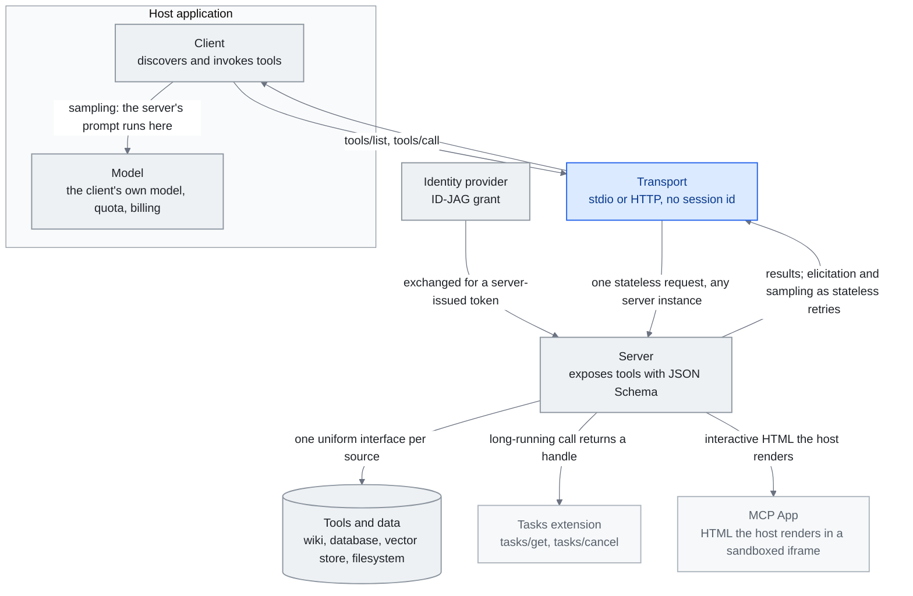

<!-- translation-sync:start -->
> Traducción asistida por máquina sincronizada con la edición inglesa de 2026-10-31, con revisión de estructura y contenido. El código y las etiquetas de los diagramas conservan el original; los tiempos de lectura se estiman a partir del inglés.
> [English source](../../../chapters/07-mcp.md) · [Sync record](../../SYNC.md)
<!-- translation-sync:end -->

<!-- i18n-anchor -->

# Capítulo 7: MCP, el estándar que se impuso

> **En una frase:** MCP es un estándar universal que conecta la IA con herramientas o fuentes externas mediante un único protocolo.
>
> **Por qué importa:** Es como USB para IA: antes cada herramienta exigía una conexión propia; ahora existe un conector común.
>
> **Tiempo de lectura:** ~24 min (estimación del original en inglés: 5,386 palabras / 230 palabras por minuto)

*Figura: Los tres conceptos de "Why It Won" —cliente, servidor y transporte—, con cliente y modelo dentro de la aplicación anfitriona, transporte y servidor fuera, y las capacidades añadidas por 2026: Tasks como extensión, MCP Apps como interfaz y autorización aprovisionada por IdP. Tasks y MCP Apps proceden de "2026-05-21: The 2026-07-28 Release Candidate", el intercambio ID-JAG de "2026-06-18: Enterprise-Managed Authorization" y el núcleo sin sesiones de "2026-07-28: The Specification Ships Final". El retorno del servidor expresa "The Stateful MCP Transition": además de responder, solicita datos estructurados y muestreo; el núcleo final sin estado lo entrega mediante reintentos ordinarios, sin conexión mantenida abierta.*

<!-- i18n-anchor -->

## ¿Qué es MCP?

Model Context Protocol (MCP) es un protocolo abierto creado por Anthropic que normaliza la conexión de modelos con herramientas, datos y servicios externos. Antes, cada integración requería funciones propias, formatos propietarios, autenticación artesanal y código de enlace frágil. MCP sustituye esa fragmentación por una interfaz universal para descubrir herramientas, autenticarse e invocarlas desde cualquier modelo.

Piense en USB: antes cada periférico necesitaba conector, controlador y protocolo propios. USB no los hizo más potentes, sino interoperables. MCP hace lo mismo con herramientas de IA. Un servidor puede servir a Claude, GPT, Gemini y otros modelos compatibles; un cliente puede conectar miles de servidores sin integraciones personalizadas.

<!-- i18n-anchor -->

## Cronología: del lanzamiento a Linux Foundation

**Noviembre de 2024.** Anthropic publica MCP como especificación abierta, con implementaciones de referencia Python y TypeScript, servidores de archivos, GitHub y Slack, y SDK para crear otros. La recepción es cautelosamente optimista: ya se habían propuesto estándares de interoperabilidad.

**Abril de 2025.** Seis meses después, supera 8 millones de descargas acumuladas de SDK y 5,800 servidores comunitarios. Crece más deprisa de lo previsto y los laboratorios competidores adoptan el protocolo en lugar de crear alternativas.

**Finales de 2025.** Se dona a Agentic AI Foundation de Linux Foundation, con Anthropic, Block y OpenAI en la gobernanza fundadora. Neutraliza "Anthropic controls the standard" y lo convierte en estándar sectorial, no protocolo de proveedor.

**2026.** En Q1 de 2026, los SDK superan 97 millones de descargas mensuales entre registros. Hay 75+ conectores oficiales mantenidos por la fundación y miles de servidores comunitarios. Es la integración predeterminada de IA, como REST para API web.

La consolidación llegó el **6 de mayo de 2026**, con **AWS MCP Server** en disponibilidad general: primer endpoint remoto gestionado por un gran proveedor de nube, con 15,000+ operaciones API de AWS, autenticación única, claves IAM para acceso fino y `run_script` aislado para Python en servidor. La donación de diciembre de 2025 y 97M descargas de Q1 2026 establecieron el estándar; AWS lo convierte en infraestructura. Como S3 con objetos, no elimina servidores propios, pero desplaza el centro hacia "one managed endpoint at the cloud boundary."

Skills siguió a MCP hacia AAIF; véase la [actualización de octubre del capítulo 5](05-skill-systems.md#52-the-anthropic-skills-ecosystem).

<!-- i18n-anchor -->

## Por qué se impuso

Varios factores explican su dominio rápido:

**Abierto desde el primer día.** Licencia permisiva y especificación completa, no solo SDK: los competidores podían implementarlo sin depender del código o de la buena voluntad de Anthropic.

**Arquitectura sencilla.** Tres conceptos: clientes del lado del modelo, servidores del lado de herramientas y datos, y transportes para comunicar. Los servidores describen herramientas con JSON Schema; los clientes descubren e invocan; los transportes gestionan stdio, HTTP con SSE o WebSocket. Esa sencillez facilita adoptar: un desarrollador competente puede crear un servidor en menos de una hora.

**Gobernanza neutral.** La donación a Linux Foundation, con OpenAI en la cogobernanza, elimina la última objeción creíble. Si el principal competidor participa en gobernarlo, el estándar es realmente neutral.

**Efectos de red.** Cada servidor añade valor a todos los clientes y viceversa. Superada la masa crítica de servidores útiles, no admitir MCP cuesta más que adoptarlo.

<!-- i18n-anchor -->

## Adoptantes principales

La amplitud de adopción explica el dominio:

- **OpenAI** integró MCP en ChatGPT y Agents SDK para que GPT utilice cualquier servidor.
- **Google DeepMind** incorporó clientes MCP a Gemini, motivado principalmente por compatibilidad con el ecosistema.
- **Microsoft** fue más allá: soporte a nivel del sistema operativo Windows e integración en Azure AI, Copilot y GitHub Copilot.
- **Amazon / AWS** publicó **Bedrock AgentCore Runtime** en abril de 2026 como primer entorno bidireccional de producción, con elicitation y sampling sobre el protocolo; véase "The Stateful MCP Transition".
- **GitHub** reconstruyó extensiones de Copilot sobre MCP y sustituyó su formato propietario.
- **Figma, Slack, Block y Notion** publican servidores oficiales, integrando plenamente sus plataformas en cualquier flujo de IA.
- **Hugging Face** aloja un registro comunitario de servidores junto a su catálogo de modelos.
- **LangChain** y otros frameworks ofrecen clientes nativos y lo convierten en integración habitual de herramientas.

**MCP como dimensión de síntesis.** En 2026, seleccionar herramientas MCP empieza a ser *variable* de síntesis automática de harness, no infraestructura fija. AgentFlow (arXiv 2604.20801, abril de 2026) busca en cinco dimensiones de un DSL de grafos tipados: funciones, prompts, *herramientas*, topología y coordinación. Es de doble filo: la normalización permite intercambiar servidores sin reescribir integración y hace buscable la dimensión de herramientas, pero convierte a los servidores en candidatos seleccionables. La pregunta pasa de "which servers do I install" a "which servers does my harness *evolve into using* under observability pressure."

**MCP para herramientas, x402 para valor.** El **7 de mayo de 2026**, AWS anunció **AgentCore Payments** en vista previa, primera capacidad gestionada de pagos para agentes autónomos, con Coinbase y Stripe sobre **x402**, protocolo abierto que recupera HTTP 402 ("Payment Required") para pagos de monedas estables entre máquinas dentro del mismo canal. Antes del respaldo de nube, Coinbase ya tenía en x402 69,000 agentes activos, 165M transacciones y ~$50M de volumen acumulado a finales de abril de 2026. MCP transporta herramientas; x402, valor: MCP normaliza acceder a una API y x402 pagarle. Los recursos de pago —datos premium, contenido con licencia y API restringidas— entran de pleno derecho en las acciones del agente, con presupuesto impuesto determinísticamente por el protocolo, no por juicio de LLM.

<!-- i18n-anchor -->

## Conexión con la ingeniería del conocimiento

MCP no es una técnica de conocimiento, sino infraestructura que permite escalarla. RAG, grafos, memoria y contexto necesitan suministrar conocimiento externo a modelos. MCP normaliza ese suministro.

Un agente que consulta wiki empresarial, base de datos, almacén vectorial y archivos necesitaría sin MCP código, autenticación y errores propios para cada integración. Con MCP, cada fuente es un servidor conectado mediante la misma interfaz.

Por eso es central: no sustituye RAG o memoria, sino que permite componerlos, trasladarlos e interoperarlos entre modelos y plataformas.

<!-- i18n-anchor -->

## El patrón de metaherramienta

Uno de los principales patrones surgidos de MCP es la metaherramienta, también llamada divulgación progresiva para herramientas.

El problema: un agente accede a decenas o cientos de herramientas, pero cargar todos sus esquemas desperdicia contexto porque la mayoría no sirve para la tarea actual. Con 29 esquemas se gastan miles de tokens en descripciones nunca usadas y aumenta el riesgo de seleccionar mal.

La solución: cargar dos metaherramientas, una de **descubrimiento** para buscar por descripción y otra de **ejecución** para invocar por referencia lo descubierto. Primero se descubre lo necesario para la tarea; después se cargan solo esos esquemas.

Reduce el contexto un 80-90% en entornos con muchas herramientas y mejora la selección al reducir las opciones. Es una buena práctica con más de 10-15 herramientas disponibles.

<!-- i18n-anchor -->

## Retos de 2026

Pese al éxito, siguen abiertos retos importantes:

**Auditoría.** Cada llamada empresarial necesita registro, atribución y seguimiento de cumplimiento. La especificación no prescribe formatos, lo que produce implementaciones inconsistentes.

**Autenticación con SSO.** Ha mejorado desde el lanzamiento, pero integrar SAML y OIDC a través de cliente, servidor y transporte sigue siendo difícil. OAuth 2.1, ratificado recientemente para MCP, resuelve parte, pero su adopción continúa.

**Pasarelas.** La escala exige límites de frecuencia, acceso, enrutamiento y supervisión. Sin una especificación de pasarela estándar proliferan soluciones propietarias.

**Portabilidad de configuración.** No se normaliza qué servidores conectar, credenciales ni orden. Mover la configuración entre equipos, grupos u organizaciones exige trabajo manual.

**Calidad de descripciones.** Determina la eficacia: las deficientes producen llamadas incorrectas. No hay estándar, comprobaciones automáticas ni certificación de calidad.

**Versionado de esquemas.** Actualizar herramientas puede romper clientes. El protocolo no incorpora negociación de versión y compatibilidad.

**Solapamiento.** Miles de servidores repiten funciones y no existe mecanismo de deduplicación ni expresión de preferencias.

<!-- i18n-anchor -->

## 2026: la transición de MCP hacia el estado

En sus primeros dieciocho meses, MCP era principalmente **RPC sin estado**: el cliente llama, el servidor responde y la conversación sigue. Adecuado para archivos, consultas API o mensajes, pero difícil para tareas largas o interactivas. En abril de 2026, dos novedades lo acercaron a la orquestación.

**SEP-1686: Tasks.** Presentado en MCP Dev Summit de abril de 2026, **SEP-1686** añade una máquina duradera de estados. Cada llamada larga es una **tarea** con ID persistente y cinco estados: `working`, `input_required`, `completed`, `failed` o `cancelled`. El cliente puede iniciar, desconectar y reconectar para consultar o recuperar: **llamar ahora / recoger después**. Las notificaciones del servidor se correlacionan con los ID para seguir progreso sin mantener conexiones abiertas. Busca flujos antes resueltos artesanalmente:

- **Pipelines de datos** de minutos u horas
- **Migraciones de código** en repositorios grandes
- **Ejecución de pruebas** de CI completo
- **Investigación profunda** con subagentes y esperas de API externas
- **Sistemas multiagente** con traspasos asíncronos

SEP-1686 aparece como experimental en la especificación de abril de 2026: primer paso serio de RPC sin estado a orquestación duradera y reanudable.

**Amazon Bedrock AgentCore: primer entorno bidireccional.** También en abril de 2026, AWS publica **Bedrock AgentCore Runtime**, primero en producción con comunicación **bidireccional**. MCP convencional parte del cliente: llama a herramientas y el servidor responde. AgentCore añade dos capacidades iniciadas por servidor:

- **Elicitation.** El servidor pausa y solicita datos estructurados al usuario según un esquema JSON. Convierte flujos que exigían interfaz propia en interacciones del protocolo. Una migración puede preguntar "which branch should I target?" y recibir respuesta tipada.
- **Sampling.** El servidor solicita al cliente completaciones de LLM sin poseer credenciales de modelo: aporta prompt y parámetros, y el cliente ejecuta su modelo y devuelve texto. Permite resumir, clasificar o extraer desde servidores de herramientas manteniendo modelo, cuota y factura del lado del cliente.

Ambas completan la interfaz bidireccional: los servidores pueden **dirigir** partes de la conversación, no solo responder.

**Consecuencias.** En 2025 era "a uniform plug for stateless tools." En 2026 se amplía a **orquestación de agentes con estado, interactiva y bidireccional**. Los servidores dejan de ser pasivos: conservan estado, piden datos y solicitan trabajo de LLM al cliente. Los pipelines largos de recuperación, enriquecimiento por etapas y aprobación humana obtienen protocolo nativo.

<!-- i18n-anchor -->

## 2026-05-21: la versión candidata 2026-07-28

El relato de abril de 2026 de "stateful MCP" era un paso, no el destino. El **21 de mayo de 2026**, el comité directivo fijó la **versión candidata 2026-07-28**, base final de 2026 prevista para el 28 de julio, con diez semanas de validación para SDK y anfitriones. Tres cambios redefinen la interfaz y un cuarto conjunto refuerza los cimientos.

**Núcleo sin estado.** Se eliminan `initialize` / `initialized` y cabeceras `Mcp-Session-Id`. Los metadatos viajan en `_meta` por solicitud, que puede llegar a cualquier instancia sin afinidad, almacén de sesiones compartido ni calentamiento. Permite **escalado horizontal con balanceadores**, principal carencia de producción revelada por Streamable HTTP en la segunda mitad de 2025. Los primeros dieciocho meses fueron el giro *con estado* —Tasks SEP-1686 y AgentCore en abril de 2026—; la candidata 2026-07-28 marca el *retorno del núcleo al funcionamiento sin estado*, reconstruyendo encima, como extensiones, las capacidades duraderas que motivaron ese giro.

**MCP Apps.** Los servidores entregan HTML interactivo representado por anfitriones en iframes aislados, con plantillas previas para seguridad y caché. Es el primer entregable MCP **que no es una llamada a herramienta**: buscador con control de repeticiones y paginación, comparación de resultados o confirmación de compras. Añade interfaz sin especificación separada.

**Tasks pasa del núcleo experimental a extensión.** La capacidad SEP-1686 de llamar ahora y recoger después migra a Extensions con ciclo sin estado: `tools/call` devuelve identificador y el cliente avanza mediante `tasks/get`, `tasks/update` y `tasks/cancel`, solicitudes normales sin estado. La capacidad no cambia; su forma encaja con el nuevo núcleo.

**Refuerzo de cimientos.** Llegan **Extensions**, con ID DNS inversos y negociación por Standards Track que permite versionar aparte del núcleo; **autorización OAuth 2.0 / OIDC reforzada**, seis SEP sobre validación obligatoria de `iss`, tipos de aplicación al registrar y mejores prácticas; y primera **política formal de retirada**, con Roots, Sampling y Logging obsoletos y al menos 12 meses antes de eliminarlos de forma incompatible. Tras dieciocho meses de funciones, un ciclo fortalece la base.

**Consecuencias para conocimiento.** Es *contracción* de núcleo y *ampliación* de capacidades de interfaz a la vez. Dos efectos inmediatos: **escalar horizontalmente pasa de diseñar un despliegue a configurarlo**, sin lucha con el balanceador; y **se difumina la frontera entre "tool" e "interface"**. Un servidor responde por herramienta, devuelve identificador de tarea y pide desambiguación con MCP App en la misma conversación. Es **infraestructura para interacciones multiinterfaz con estado**, manteniendo pequeño y sin estado su propio núcleo.

**SDK beta y ventana de finalización (29 de junio).** El 29 de junio de 2026 llegaron betas Python, TypeScript, Go y C#, con cuatro semanas de pruebas antes del 28 de julio de 2026. TypeScript v2 separa el paquete monolítico en `@modelcontextprotocol/server` y `@modelcontextprotocol/client`. Incluyen **Multi Round-Trip Requests (SEP-2322, estado Final, creado 2026-02-03)**: sampling y elicitation dejan de depender de SSE abierto y estado en servidor; usan *reintento sin estado*, donde la herramienta devuelve `InputRequiredResult` y el cliente repite. SEP-2322 no cambia sus capacidades, solo el transporte, compatible ahora con el núcleo sin conexiones largas.

<!-- i18n-anchor -->

## 2026-06-01: las consideraciones de seguridad llegan al IETF

La candidata reforzó *autorización*, con seis SEP de `iss` y OAuth 2.0 / OIDC. No define, expresamente, cómo debe comportarse el servidor tras autorizar. El **1 de junio de 2026** llegó el primer **Internet-Draft de IETF** específico, `draft-mohiuddin-mcp-security-considerations-00`, de Anas Mohiuddin Syed. La tesis es su primera frase: *"The MCP specification does not define normative security requirements."*

Enumera seis clases ya divulgadas en servidores publicados, mostrando lo que el protocolo deja al implementador:

- **SSRF**: El servidor recupera una URL del modelo sin validar su IP resuelta y el agente se convierte en puente hacia metadatos de nube o red privada.
- **Permisos excesivos**: Más archivos o API disponibles de los que necesita una herramienta.
- **Exposición a inyección de prompts**: Instrucciones en la *salida*, no entrada, de herramientas secuestran al modelo lector.
- **Elusión del ciclo de vida**: Procesar llamadas antes de terminar la inicialización evita los controles que debía aplicar.
- **Filtración de información**: Errores y respuestas revelan más estado interno del permitido.
- **Autenticación no aplicada**: Servidores localhost sin autenticación porque suponen "local" equivalente a "trusted."

Propone medidas implementables: validar IP al conectar —bloquear RFC 1918, loopback y enlace local—; restringir salida en sistema operativo; desactivar redirecciones HTTP por defecto y revalidar cada destino; limitar archivos al mínimo; terminar inicialización antes de llamadas; y registrar cada invocación de forma estructurada. Añade el detector abierto **mcp-safeguard**, pensado para CI (`scan --target ./my-mcp-server/`), con auditoría por commit, no solo durante revisión.

La novedad no son los fallos, conocidos en seguridad web y adaptados a agentes, sino *dónde vive el documento*. La seguridad pasa de blogs de proveedor a escrutinio independiente de estándares. Tener un borrador IETF indica suficiente importancia para que alguien ajeno a los mantenedores documente carencias de forma citable. Las seis clases sirven de lista previa a producción; para el protocolo, el borrador marca madurez: se escribe el RFC que deliberadamente dejó en blanco.

<!-- i18n-anchor -->

## 2026-06-18: autorización gestionada por la empresa

Ese mismo mes, los mantenedores respondieron de forma estable a la mitad empresarial de los problemas de autenticación y SSO del borrador. **Enterprise-Managed Authorization (EMA)**, anunciada por **Paul Carleton** el 18 de junio de 2026, permite aprovisionar centralmente acceso a servidores mediante el proveedor de identidad. El usuario inicia sesión una vez y encuentra conectados los servidores aprobados, sin consentimiento OAuth por aplicación y servidor.

Hay dos intercambios: durante SSO, el cliente recibe del IdP una **Identity Assertion JWT Authorization Grant (ID-JAG)**; después la intercambia por un token emitido por el servidor de autorización *propio* del servidor MCP. Ni usuario ni cliente realizan el consentimiento clásico por servidor: el IdP avala al usuario y cada servidor determina el acceso derivado de ese aval.

Destaca el alcance desde el primer día, que separa estándar real y propuesta: **Okta** como IdP con Cross App Access; **Anthropic** —Claude, Claude Code y Cowork— y **VS Code** como clientes; siete servidores —Asana, Atlassian, Canva, Figma, Granola, Linear y Supabase—, con Slack incorporándose. Resuelve la carencia de los retos de 2026 de este capítulo: *"SSO-integrated authentication remains friction-heavy"*: el SSO deja de ser integración por servidor y pasa a decisión de aprovisionamiento única en el IdP.

Autorizar al aprovisionar no es autorizar cada llamada. El **10 de septiembre de 2026**, Anthropic añadió `auto` a Managed Agents: el servidor evalúa cada llamada y ejecuta, deniega con un error no anulable por el cliente o pausa para aprobación. Según su documentación, cubre herramientas MCP además de las incorporadas, gobernándolas en plataforma junto a las Temporal Policies deterministas de AWS AgentCore del [capítulo 4](04-harness-engineering.md).

<!-- i18n-anchor -->

## 2026-07-28: se publica la especificación final

La validación de diez semanas terminó según lo previsto. El **28 de julio de 2026**, David Soria Parra y Den Delimarsky publicaron **2026-07-28**, la mayor revisión desde autorización, confirmando el diseño seguido desde el 21 de mayo. El núcleo es **solicitud/respuesta sin estado**: desaparecen `initialize` / `initialized` y `Mcp-Session-Id`; **Multi Round-Trip Requests** (SEP-2322) lleva interacciones iniciadas por servidor mediante reintentos; y **Extensions** es formal, con Tasks en `io.modelcontextprotocol/tasks`, fuera del núcleo.

La autorización añade **validación de emisor RFC 9207** y sustituye Dynamic Client Registration por **Client ID Metadata Documents (CIMD)**: un documento alojado identifica al cliente sin registrarse en cada servidor. Roots, Sampling, Logging y HTTP+SSE original quedan obsoletos con mínimo de 12 meses. Los cuatro SDK Tier 1 —Python, TypeScript, Go y C#— publican actualizaciones, respaldadas por AWS, Google Cloud, Microsoft y Cloudflare.

Se cumplen las dos promesas: servidores remotos tras balanceadores normales sin afinidad y clientes que almacenan `tools/list` en caché, como un servicio web sin estado. El arco de 2026 concluye: giro con estado en abril, núcleo de nuevo sin estado en mayo, revisión independiente de seguridad en junio y especificación final pequeña con estado, interacción y funciones empresariales en extensiones.

<!-- i18n-anchor -->

## 2026-08-22: después de la finalización

La especificación del 28 de julio cerró el arco iniciado en abril de 2026. El **22 de agosto de 2026**, los mantenedores publicaron gobernanza y prioridades posteriores, respondiendo "what's next", pregunta que la especificación evita deliberadamente.

**Gobernanza formal.** Con núcleo estable, se regularizan decisiones: **Contributor Ladder** con niveles definidos; clasificación de propuestas SEP distribuida desde un cuello de botella central a **Working Groups** especializados; y ciclo formal de funciones y retirada que generaliza la ventana del 28 de julio para Roots, Sampling y Logging a capacidades futuras.

**Cinco prioridades.** (1) **Mensajería de agentes**: eventos iniciados por servidor —webhooks y canales— y madurar Tasks para volver al núcleo; (2) extender a despliegues locales el transporte HTTP unificado del 28 de julio y cerrar la división stdio/HTTP; (3) **identidad y seguridad empresarial**, en concreto DPoP y Workload Identity Federation, ampliando el aprovisionamiento EMA del 18 de junio a identidad entre máquinas; (4) mejores resultados de herramientas y descubrimiento progresivo en catálogos grandes, respaldando la metaherramienta; (5) experiencia de desarrollo y conformidad entre SDK Tier 1. Ese día obtuvo 241 puntos y 142 comentarios en Hacker News, gran respuesta a gobernanza: instantánea del día, no métrica duradera.

Para conocimiento, la prioridad (1) importa: devolver Tasks al núcleo daría carácter estable a pipelines duraderos y reanudables de recuperación y enriquecimiento, hoy provisionales.

<!-- i18n-anchor -->

## Contexto de mercado

Los analistas proyectan un mercado de integración de herramientas de IA, dominado por MCP, de $1.8 mil millones en 2025, con fuerte crecimiento por adopción empresarial. Incluye infraestructura, desarrollo de servidores, pasarelas y herramientas relacionadas.

<!-- i18n-anchor -->

## Recursos principales

- **[modelcontextprotocol.io](https://modelcontextprotocol.io)**: Especificación, SDK y documentación oficiales.
- **Cursos MCP de Anthropic**: En [Skilljar](https://anthropic.skilljar.com) y [DeepLearning.AI](https://www.deeplearning.ai/short-courses/), sobre fundamentos y desarrollo de servidores.
- **The New Stack**: Cobertura técnica continua de arquitectura, adopción y retos, con artículos sobre metaherramientas y despliegue empresarial.
- **Estadísticas de descargas de SDK MCP**: npm (`@modelcontextprotocol/sdk`, [https://www.npmjs.com/package/@modelcontextprotocol/sdk](https://www.npmjs.com/package/@modelcontextprotocol/sdk)) y PyPI (`mcp`, [https://pypi.org/project/mcp/](https://pypi.org/project/mcp/)) como métricas de adopción de primera mano.

---

<!-- i18n-anchor -->

## Tres ideas para recordar

- **Tres conceptos y gobernanza neutral explican el triunfo.** Cliente, servidor y transporte permiten crear un servidor en menos de una hora; Linux Foundation con OpenAI cogobernando elimina la última objeción creíble.
- **La especificación de 2026 devuelve el núcleo a lo sin estado para normalizar el despliegue.** Sin inicialización ni `Mcp-Session-Id`, cualquier instancia atiende solicitudes, los servidores usan balanceadores normales y los clientes cachean `tools/list`.
- **El protocolo no define requisitos normativos de seguridad.** El borrador IETF de junio de 2026 enumera seis clases ya observadas: SSRF, permisos excesivos, inyección por salida, elusión del ciclo, filtración y falta de autenticación; el implementador debe mitigarlas.

---

<!-- i18n-anchor -->

## Fuentes

1. Anthropic. "Introducing the Model Context Protocol." noviembre de 2024. https://www.anthropic.com/news/model-context-protocol
2. Model Context Protocol Specification. https://modelcontextprotocol.io
3. Linux Foundation. "Agentic AI Foundation Established." 2025. https://www.linuxfoundation.org/press/agentic-ai-foundation
4. Estadísticas de descargas del SDK MCP, npm: [https://www.npmjs.com/package/@modelcontextprotocol/sdk](https://www.npmjs.com/package/@modelcontextprotocol/sdk) y PyPI: [https://pypi.org/project/mcp/](https://pypi.org/project/mcp/) (Q1 2026, ~97M descargas acumuladas, muy citadas en fuentes secundarias).
5. The New Stack. "The Meta-Tool Pattern: Progressive Disclosure for AI Tools." 2025.
6. Anthropic. Curso MCP. Skilljar. https://anthropic.skilljar.com
7. DeepLearning.AI. "Building MCP Servers." https://www.deeplearning.ai/short-courses/
8. Microsoft. "MCP Support in Windows and Azure." 2025. https://devblogs.microsoft.com
9. OpenAI. "Agents SDK: MCP Integration." 2025. https://openai.com/index/new-tools-for-building-agents
10. AgentFlow / "Synthesizing Multi-Agent Harnesses for Vulnerability Discovery." arXiv 2604.20801, abril de 2026. [https://arxiv.org/abs/2604.20801](https://arxiv.org/abs/2604.20801)
11. AWS. "AWS MCP Server now generally available" (6 de mayo de 2026). [https://aws.amazon.com/about-aws/whats-new/2026/05/aws-mcp-server/](https://aws.amazon.com/about-aws/whats-new/2026/05/aws-mcp-server/) y [https://aws.amazon.com/blogs/aws/the-aws-mcp-server-is-now-generally-available/](https://aws.amazon.com/blogs/aws/the-aws-mcp-server-is-now-generally-available/) --- Primer endpoint MCP remoto de gran proveedor de nube en disponibilidad general; 15,000+ operaciones mediante un servidor autenticado.
12. AWS. "Agents that transact: Amazon Bedrock AgentCore now includes Payments (preview)" (7 de mayo de 2026). [https://aws.amazon.com/about-aws/whats-new/2026/04/amazon-bedrock-agentcore-payments-preview/](https://aws.amazon.com/about-aws/whats-new/2026/04/amazon-bedrock-agentcore-payments-preview/) y [https://aws.amazon.com/blogs/machine-learning/agents-that-transact-introducing-amazon-bedrock-agentcore-payments-built-with-coinbase-and-stripe/](https://aws.amazon.com/blogs/machine-learning/agents-that-transact-introducing-amazon-bedrock-agentcore-payments-built-with-coinbase-and-stripe/) --- La ruta URL usa `/04/`, pero el lanzamiento es el 7 de mayo de 2026.
13. Especificación x402. [https://www.x402.org/](https://www.x402.org/) e implementación de referencia de Coinbase [https://github.com/coinbase/x402](https://github.com/coinbase/x402).
14. Blog de Model Context Protocol. "The 2026-07-28 MCP Specification Release Candidate" (fijada el 21 de mayo de 2026). [https://blog.modelcontextprotocol.io/posts/2026-07-28-release-candidate/](https://blog.modelcontextprotocol.io/posts/2026-07-28-release-candidate/) --- Núcleo sin estado, Extensions, MCP Apps, Tasks como extensión, OAuth 2.0 / OIDC reforzados mediante seis SEP y política formal de retirada. Versión final del 28 de julio de 2026.
15. The New Stack. "MCP's biggest growing pains for production use will soon be solved" (mayo de 2026). [https://thenewstack.io/model-context-protocol-roadmap-2026/](https://thenewstack.io/model-context-protocol-roadmap-2026/) --- Cobertura secundaria independiente de las prioridades de la candidata 2026-07-28.
16. IETF Internet-Draft. "Security Considerations for Model Context Protocol (MCP) Implementations in AI Agent Systems," `draft-mohiuddin-mcp-security-considerations-00` (junio de 2026; caduca el 3 de diciembre de 2026). [https://datatracker.ietf.org/doc/draft-mohiuddin-mcp-security-considerations/](https://datatracker.ietf.org/doc/draft-mohiuddin-mcp-security-considerations/) --- Autor Anas Mohiuddin Syed; seis clases de vulnerabilidades y detector abierto `mcp-safeguard`. Artículo complementario: [https://dev.to/syedanas01/i-built-the-first-security-scanner-for-mcp-servers-heres-what-i-found-2np2](https://dev.to/syedanas01/i-built-the-first-security-scanner-for-mcp-servers-heres-what-i-found-2np2) (Repositorio GitHub enlazado no resoluble al redactar; pendiente de verificar).
17. Blog de Model Context Protocol. "Enterprise-Managed Authorization" (18 de junio de 2026). [https://blog.modelcontextprotocol.io/posts/enterprise-managed-auth/](https://blog.modelcontextprotocol.io/posts/enterprise-managed-auth/) y especificación [https://modelcontextprotocol.io/extensions/auth/enterprise-managed-authorization](https://modelcontextprotocol.io/extensions/auth/enterprise-managed-authorization) --- Anunciado por Paul Carleton; intercambio ID-JAG; desde el primer día Okta como IdP, Anthropic + VS Code como clientes y siete servidores.
18. Blog de Model Context Protocol. "MCP SDK betas ahead of the 2026-07-28 finalization" (29 de junio de 2026). [https://blog.modelcontextprotocol.io/posts/sdk-betas-2026-07-28/](https://blog.modelcontextprotocol.io/posts/sdk-betas-2026-07-28/) y SEP-2322 [https://modelcontextprotocol.io/seps/2322-MRTR](https://modelcontextprotocol.io/seps/2322-MRTR) --- Betas Python / TypeScript / Go / C#; cuatro semanas antes de finalizar el 28 de julio; paquetes de servidor/cliente separados en TypeScript v2; Multi Round-Trip Requests, SEP-2322, Final, creado 2026-02-03.
19. Blog de Model Context Protocol. "The 2026-07-28 specification" (28 de julio de 2026). [https://blog.modelcontextprotocol.io/posts/2026-07-28/](https://blog.modelcontextprotocol.io/posts/2026-07-28/) --- Versión final: núcleo sin estado, MRTR SEP-2322, validación RFC 9207, CIMD en lugar de Dynamic Client Registration, extensiones (`io.modelcontextprotocol/tasks`) y retirada mínima de 12 meses para Roots / Sampling / Logging / HTTP+SSE.
20. TechCrunch. "AI's most important protocol is getting a little bit easier to use" (20 de julio de 2026). [https://techcrunch.com/2026/07/20/ais-most-important-protocol-is-getting-a-little-bit-easier-to-use/](https://techcrunch.com/2026/07/20/ais-most-important-protocol-is-getting-a-little-bit-easier-to-use/) --- Cobertura secundaria previa a la versión final sobre el núcleo sin estado.
21. The Register. "Model Context Protocol prepares to break with its stateful past" (23 de julio de 2026). [https://www.theregister.com/devops/2026/07/23/model-context-protocol-prepares-to-break-with-its-stateful-past/5276722](https://www.theregister.com/devops/2026/07/23/model-context-protocol-prepares-to-break-with-its-stateful-past/5276722)
22. WorkOS. "MCP 2026 spec: agent authentication" (julio de 2026). [https://workos.com/blog/mcp-2026-spec-agent-authentication](https://workos.com/blog/mcp-2026-spec-agent-authentication) --- Cobertura secundaria de CIMD y del refuerzo de autorización.
23. Blog de Model Context Protocol. "The MCP Roadmap" (22 de agosto de 2026). [https://blog.modelcontextprotocol.io/posts/mcp-roadmap/](https://blog.modelcontextprotocol.io/posts/mcp-roadmap/) --- Prioridades: mensajería con webhooks/canales y Tasks hacia el núcleo; transporte HTTP local; identidad y seguridad con DPoP y Workload Identity Federation; resultados y descubrimiento; desarrollo y conformidad SDK. Gobernanza: Contributor Ladder, clasificación SEP por grupos y ciclo formal de funciones. Hacker News ese día: 241 puntos / 142 comentarios, instantánea del momento.
24. Anthropic. Políticas de permisos de Managed Agents; `auto` fechado el 10 de septiembre de 2026 según notas de plataforma. [https://platform.claude.com/docs/en/managed-agents/permission-policies](https://platform.claude.com/docs/en/managed-agents/permission-policies) y notas de versión [https://platform.claude.com/docs/en/release-notes/overview](https://platform.claude.com/docs/en/release-notes/overview) --- Evaluación por llamada en servidor: ejecutar, denegar o pausar para aprobación, en `evaluation` de eventos `agent.tool_use` y `agent.mcp_tool_use`, con motivos `high_risk` e `indeterminate`; aplica a herramientas MCP, con `always_ask` por defecto salvo anulación explícita. Solo documentación de Anthropic; sin cobertura independiente localizada.

---

*Anterior: [Capítulo 6 -- Memoria de agentes: la capa que falta](06-agent-memory.md) | Siguiente: [Capítulo 8 -- Panorama de herramientas: gestión del conocimiento nativa de IA](08-tools-landscape.md)*
