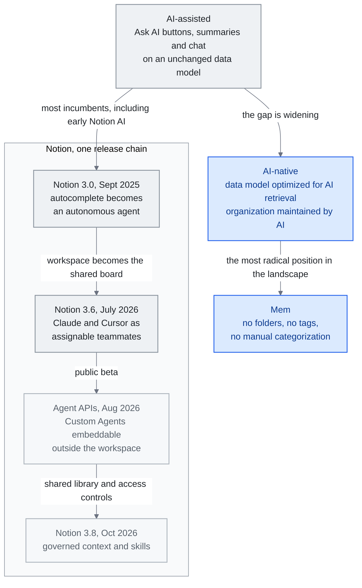

<!-- translation-sync:start -->
> Traducción asistida por máquina sincronizada con la edición inglesa de 2026-10-31, con revisión de estructura y contenido. El código y las etiquetas de los diagramas conservan el original; los tiempos de lectura se estiman a partir del inglés.
> [English source](../../../chapters/08-tools-landscape.md) · [Sync record](../../SYNC.md)
<!-- translation-sync:end -->

<!-- i18n-anchor -->

# Capítulo 8: Panorama de herramientas: gestión del conocimiento nativa de IA

> **En una frase:** Las herramientas de gestión del conocimiento con IA van desde aplicaciones de notas mejoradas con IA hasta plataformas concebidas íntegramente para ella.
>
> **Por qué importa:** Si toma notas, gestiona conocimiento u organiza información, la IA está cambiando cómo funciona cada herramienta de este ámbito.
>
> **Tiempo de lectura:** ~13 min (estimación del original en inglés: 2,912 palabras / 230 palabras por minuto)

*Figura: El espectro de "The AI-Assisted vs. AI-Native Gap", con las primeras versiones de Notion AI en el extremo asistido y el diseño de Mem sin organización manual en el extremo nativo. La secuencia de versiones de Notion sigue el capítulo: 3.0 introduce un agente, 3.6 aloja compañeros externos, las Agent APIs de agosto permiten integrarlos fuera del espacio de trabajo y 3.8 añade en octubre contexto compartido y habilidades con gobernanza. La brecha aumenta cuando las herramientas siguen ligadas a modelos de datos diseñados exclusivamente para personas; la conexión con la biblioteca compartida muestra cómo se incorpora el conocimiento procedimental al espacio de trabajo.*

<!-- i18n-anchor -->

## El panorama

Las herramientas utilizadas para organizar, recuperar y razonar sobre el conocimiento se están reconstruyendo alrededor de la IA. Este capítulo examina las principales plataformas de gestión del conocimiento con IA, como implementaciones de los principios de ingeniería del conocimiento tratados en este informe, no como reseñas de productos. Cada herramienta hace apuestas arquitectónicas distintas sobre cómo deben colaborar personas e IA en el trabajo del conocimiento.

## Notion AI

Notion controla aproximadamente el 25% del mercado de gestión colaborativa del conocimiento, por lo que su estrategia de IA tiene consecuencias para todo el sector.

**Notion 3.0** (septiembre de 2025) marcó un cambio fundamental: reconstruyó su capa de IA y pasó de una función de autocompletado a un agente autónomo. En lugar de sugerir texto o responder preguntas sobre el espacio de trabajo, el agente puede navegar por él de forma independiente, crear y modificar páginas, actualizar bases de datos y ejecutar flujos de varios pasos. Comprende su estructura, cruza información entre páginas y mantiene contexto sobre los patrones de organización.

En enero de 2026, Notion introdujo soporte multimodelo para dirigir tareas diferentes a modelos distintos: GPT-5.2 para escritura creativa, Claude Opus 4.6 para análisis y Gemini 3 para trabajo multimodal. Este enrutamiento refleja una comprensión más madura: ningún modelo destaca en todo y la capa de gestión del conocimiento debe ser independiente del modelo.

La fortaleza de Notion es combinar datos estructurados —bases de datos, relaciones y agregaciones— con contenido no estructurado —páginas y bloques—. Esa estructura híbrida ofrece a los agentes metadatos ricos: no solo texto donde buscar, sino propiedades tipadas, relaciones entre entidades y jerarquías explícitas.

**Notion 3.6** (1 de julio de 2026) convirtió el espacio de trabajo en infraestructura de coordinación para agentes *de otros proveedores*. **External Agents** incorpora a **Claude** y **Cursor** como los dos primeros agentes externos que actúan como compañeros visibles y asignables en tableros compartidos de tareas de Notion: se pueden mencionar con @, supervisar y responsabilizar en las mismas interfaces que los colaboradores humanos. (Es distinto del lanzamiento anterior de **3.5 Developer Platform**, del 13 de mayo de 2026, que identificó a Codex y Decagon como socios de la API External Agents.) La misma versión añadió **Notion Workers** —código personalizado que ya puede construirse y desplegarse, también en Windows—, cinco conectores MCP nuevos (Mercury, Mixpanel, Miro, Box y ClickHouse), lectura y escritura nativa de PPTX / XLSX / DOCX y un registro de auditoría de acciones de Custom Agents; Notion afirma que el uso de MCP "usage has 10×'d in the past month." La noticia es la inversión: antes Notion AI era el agente que actuaba *dentro* de Notion; ahora Notion es el tablero compartido al que se incorporan *otros* productos de agentes como compañeros.

El **20 de agosto de 2026**, Notion pasó sus **Agent APIs** basadas en sesiones de alfa privada a beta pública: iniciar un chat con un Custom Agent, recibir su respuesta en streaming, enviar una acción y recorrer el historial de eventos de la sesión. El objetivo es integrarlos en otros productos: un Custom Agent puede estar dentro de un bot de Slack, una herramienta interna o una aplicación móvil, no solo en el espacio de Notion. Las integraciones con rutas alfa deben migrar al modelo de sesiones y eventos antes del 30 de septiembre de 2026. Junto a 3.5 (13 de mayo, socios de External Agents API) y 3.6 (1 de julio, Claude/Cursor como compañeros asignables en tableros), es el tercer paso de la misma trayectoria: abrir el espacio a agentes de otros proveedores, hacer asignables los Custom Agents de Notion y permitir integrarlos en cualquier lugar mediante una API pública.

**Notion 3.8** ([13 de octubre de 2026](https://www.notion.com/releases/2026-10-13)) amplía esta progresión al contexto compartido con gobernanza. Su Skills API publica mediante GitHub una biblioteca gestionada por Notion. La versión añade revocación de MCP por usuario, historial de revisiones con atribución y restauración, y permisos sobre propiedades de bases de datos. Son controles descritos por el proveedor, sin evidencia independiente de que todos los agentes los respeten correctamente.

## Obsidian

Obsidian tiene aproximadamente el 8% del mercado general de gestión del conocimiento, pero esa cifra subestima mucho su influencia. Entre desarrolladores, investigadores y trabajadores técnicos del conocimiento —quienes más experimentan con sistemas mejorados mediante IA— domina el nicho de gestión personal del conocimiento (PKM).

En febrero de 2026, Obsidian supera los 1.5 millones de usuarios activos (crecimiento interanual del 22%) y dispone de 2,700+ complementos comunitarios. Sus decisiones arquitectónicas lo hacen especialmente adecuado para integrar IA:

**Markdown con prioridad local.** Cada nota es un archivo Markdown de texto plano en su sistema de archivos. No hay base de datos propietaria, dependencia de la nube ni cautividad del proveedor. Por ello, cualquier herramienta de IA que lea y escriba archivos puede trabajar con una bóveda de Obsidian. Sin claves API, flujos OAuth ni límites de peticiones: solo archivos.

**Enlaces bidireccionales.** La sintaxis `[[wikilink]]` de Obsidian crea implícitamente un grafo de conocimiento. Cada enlace es una relación. El resultado es precisamente el conocimiento estructurado que mejora la recuperación y el razonamiento con IA.

**Extensibilidad mediante complementos.** Su ecosistema ha producido varias integraciones destacadas con IA:

- **[Copilot for Obsidian](https://github.com/logancyang/obsidian-copilot)** (6,500+ estrellas de GitHub): Permite conversar con la bóveda usando cualquier LLM. Indexa las notas para recuperación basada en RAG, admite varios proveedores de embeddings y mantiene contexto de conversación entre sesiones.

- **[Smart Connections](https://github.com/brianpetro/obsidian-smart-connections)** (4,700+ estrellas de GitHub, plan Pro de $25 al mes): Descubre notas mediante IA y muestra las semánticamente relacionadas mientras escribe. Utiliza embeddings locales para crear un índice de similitud de la bóveda sin enviar datos a servicios externos.

- **[Claudian](https://github.com/claudian-ai/claudian)** (5,800+ estrellas de GitHub): Integración profunda entre Claude y Obsidian que permite a Claude leer, escribir y razonar sobre el contenido de la bóveda con plena conciencia del contexto.

La arquitectura local de Obsidian encaja con usuarios preocupados por la privacidad y flujos con conocimiento sensible, como notas de investigación, análisis propietarios o diarios personales. La contrapartida es que sus funciones colaborativas quedan por detrás de herramientas nativas de nube como Notion.

## Mem

[Mem](https://mem.ai) adopta la posición más radical del panorama: gestionar conocimiento debería requerir cero organización manual. No hay carpetas, etiquetas ni clasificación manual. Usted escribe notas y la IA de Mem se ocupa de todo lo demás: agrupar contenido relacionado, mostrar información pertinente cuando hace falta y mantener una base coherente sin trabajo organizativo del usuario.

Es una apuesta directa por que la recuperación con IA ya es lo bastante buena para sustituir la selección humana. Para quienes encuentran demasiado exigentes los sistemas PKM tradicionales, Mem es una alternativa atractiva. El riesgo es que, sin una organización comprensible para las personas, se pierde capacidad de auditar, depurar o entender la propia base de conocimiento.

<!-- i18n-anchor -->

## Plataformas emergentes

Varias plataformas recientes exploran enfoques alternativos:

**[Heptabase](https://heptabase.com)** utiliza un lienzo visual donde las notas son tarjetas sobre una superficie espacial infinita. Los usuarios las ordenan, conectan y agrupan visualmente, creando relaciones espaciales que complementan los enlaces textuales. Esta dimensión añade una organización que los sistemas de texto no pueden reproducir. Desde **v1.98.0** (2 de junio de 2026), su AI Agent tiene acceso directo para editar bases de datos de etiquetas, con deshacer mediante instantáneas.

**[Capacities](https://capacities.io)** introduce gestión del conocimiento basada en objetos: cada contenido es un objeto tipado —persona, proyecto, reunión o concepto— con propiedades y relaciones definidas. Ese tipado fuerte produce datos estructurados más limpios para la IA que las notas libres. Desde **AI Chat Connectors 2.0** (junio de 2026), las aplicaciones externas de IA, cualquier cliente MCP, tienen operaciones CRUD completas sobre el grafo tipado: crear páginas y tareas, instanciar objetos tipados y actualizar propiedades.

**[Tana Outliner](https://outliner.tana.inc)** implementa superetiquetas: cualquier nodo puede etiquetarse con un tipo que define su estructura, campos y comportamiento. Crean una capa de esquema definida por el usuario sobre un organizador jerárquico, permitiendo capturar datos estructurados sin perder la flexibilidad de las notas libres. *Nota terminológica:* en marzo de 2026, Tana Inc. reasignó la marca **"Tana"** y `tana.inc` a un nuevo producto de reuniones con agentes —IA que actúa en directo durante videollamadas y alimenta un grafo de contexto persistente—; el organizador con superetiquetas descrito aquí se encuentra ahora en **Tana Outliner** (`outliner.tana.inc`). Según la propia nota de Tana, "web content describing 'Tana' as a note-taking app, PKM, or outliner refers to this product, Tana Outliner."

<!-- i18n-anchor -->

## La brecha entre herramientas asistidas por IA y nativas de IA

Surge una distinción fundamental: añadir funciones de IA a arquitecturas existentes frente a diseñar herramientas alrededor de la IA desde su origen.

Las **herramientas asistidas por IA** añaden botones como "Ask AI", resúmenes generados por IA e interfaces de chat a bases de conocimiento existentes. El modelo de datos, el paradigma organizativo y la experiencia de usuario permanecen esencialmente iguales. La mayoría de las herramientas establecidas, incluidas las primeras versiones de Notion AI, pertenecen a esta categoría.

Las **herramientas nativas de IA** diseñan su arquitectura central suponiendo que la IA participa plenamente en el trabajo del conocimiento. Sus modelos de datos se optimizan para la recuperación con IA y sus estructuras organizativas para que las mantenga la IA, no las personas. Su experiencia de uso supone que la IA resolverá las tareas tediosas —clasificar, enlazar y mostrar información— mientras las personas se centran en crear y decidir.

La brecha aumenta. Las herramientas asistidas por IA siempre estarán limitadas por modelos de datos diseñados para flujos exclusivamente humanos. Las nativas pueden optimizar la colaboración entre personas e IA que define cada vez más el trabajo del conocimiento.

<!-- i18n-anchor -->

## Cómo conectan estas herramientas con el ecosistema

Las herramientas de este capítulo no están separadas del ecosistema de ingeniería del conocimiento de este informe: son su implementación para usuarios finales. Todos los conceptos tienen una correspondencia directa:

**RAG** es lo que ocurre al preguntar a Copilot for Obsidian y recuperar notas relevantes de la bóveda. Por debajo funcionan las estrategias de fragmentación, modelos de embeddings y algoritmos de recuperación del capítulo 3.

Los **sistemas de memoria** del capítulo 6 permiten personalizar Notion AI y Mem: aprender preferencias, recordar proyectos y adaptarse con el tiempo.

La **ingeniería de contexto** del capítulo 5 determina qué información incluyen las herramientas al generar respuestas. La gestión de ventana, priorización y compresión hacen que la IA parezca inteligente y no genérica.

**MCP**, del capítulo 7, es cada vez más el protocolo utilizado para conectar fuentes externas y obtener información de GitHub, Slack, correo y bases de datos mediante una interfaz normalizada.

En estas herramientas, los principios abstractos de ingeniería del conocimiento se convierten en práctica diaria. Son el harness con el que las personas implementan RAG, memoria e ingeniería de contexto para su conocimiento personal y profesional.

<!-- i18n-anchor -->

## La paradoja de la velocidad con IA

En paralelo a las herramientas de gestión *personal* del conocimiento, las herramientas de desarrollo viven otra historia que produjo en abril de 2026 uno de los datos más comentados del año. Harness.io e Infosys publicaron conjuntamente **"State of DevOps 2026"**, cuyo hallazgo principal pasó a conocerse como **AI Velocity Paradox**:

> **69% of teams report deployment bottlenecks despite 45% faster AI-assisted coding.**

El mecanismo es sencillo. Los asistentes de programación con IA —Copilot, Cursor, Claude Code y Codex— han acelerado enormemente la generación de código. Se abren más pull requests, llegan más diferencias y se acumulan más implementaciones candidatas en revisión y despliegue. Pero los sistemas posteriores a la generación —revisión de código, infraestructura de pruebas, escaneo de seguridad, comprobaciones de cumplimiento, pipelines de despliegue y respuesta a incidentes— no han escalado al mismo ritmo. La generación ya no es la limitación. **La evaluación y la gobernanza son la nueva limitación.**

El informe dio nombre a un patrón que los profesionales describían en privado de muchas maneras: **"Harness Fatigue."** Es la dificultad de crear controles automáticos para el código generado por IA al ritmo de la propia generación. Cada nuevo modelo agrava el problema al facilitar producir más código que necesita revisión.

El marco llega a la misma conclusión que este informe desde el capítulo 4, pero desde el extremo opuesto: cuando el sector hablaba de "the harness is the moat" durante 2025, implicaba que los equipos con buenos harnesses ganarían ventaja. En 2026, la paradoja convierte esa observación en advertencia: escalar generación sin escalar evaluación y gobernanza puede ralentizar el conjunto en lugar de acelerarlo. El cuello de botella se ha movido, pero el rendimiento total no ha mejorado necesariamente.

La consecuencia para la ingeniería del conocimiento: el "harness" ya no es solo lo que envuelve al modelo para usarlo en producción. También debe escalar al ritmo de generación; de lo contrario, la capacidad de despliegue alcanza silenciosamente un techo mientras todos insisten en que la IA los acelera.

**La propia infraestructura también es portátil.** El 27 de abril de 2026, Microsoft y OpenAI anunciaron un acuerdo revisado que puso fin a la exclusividad de nube de OpenAI con Azure —OpenAI puede ofrecer API mediante AWS, Google Cloud o cualquier proveedor—, limitó asimétricamente los pagos por reparto de ingresos y eliminó la controvertida cláusula de AGI que habría permitido a OpenAI abandonar obligaciones financieras declarando unilateralmente que la había logrado. Para los equipos de ingeniería del conocimiento importa como cambio de infraestructura, no como noticia empresarial: el mayor modelo de frontera de pesos cerrados deja de estar ligado a una nube. "Which cloud do you run on" deja de limitar "which models do you have access to", al menos para la familia GPT, en condiciones que el ecosistema de pesos abiertos ya disfrutaba. Junto con el soporte de Ascend NPU desde el primer día en DeepSeek V4 (capítulo 11, 24 de abril), la segunda mitad de 2026 comienza con la portabilidad como expectativa predeterminada, no excepción.

**La infraestructura gestionada también aprende y se corrige.** El **6 de mayo de 2026**, Anthropic añadió tres capacidades básicas a Managed Agents: **Dreaming** (curación de memoria programada entre sesiones), **Outcomes** (bucles que iteran según una rúbrica con evaluador separado) y **Multiagent Orchestration** (distribución de trabajo desde un agente principal con sistema de archivos compartido); ese mismo día AWS publicó su **MCP Server** en disponibilidad general con el primer despliegue de **Skills** respaldado por un proveedor de nube de gran escala. Leído junto a la paradoja de velocidad, el significado es directo: evaluación y gobernanza, el cuello de botella identificado por el informe, son precisamente donde compiten ahora las capacidades básicas gestionadas. Los harnesses autogestionados que escalaban generación en 2025 compiten en 2026 con servicios que escalan *aprendizaje y evaluación*. La paradoja no se resuelve generando código más deprisa, sino con infraestructura que aprende dónde se repiten sus errores. Esa es la infraestructura que acaban de publicar Anthropic y AWS.

---

<!-- i18n-anchor -->

## Tres ideas para recordar

- **La brecha está en el modelo de datos, no en las funciones.** Las herramientas asistidas por IA siguen limitadas por datos diseñados para flujos humanos; ningún número de botones Ask AI cierra esa distancia.
- **Notion también se convirtió en tablero, no solo en agente.** En 3.6 aloja agentes de otros proveedores —Claude y Cursor como compañeros asignables y supervisables— junto a sus Custom Agents, que las Agent APIs de agosto de 2026 permiten integrar fuera del espacio de trabajo.
- **La generación dejó de ser el cuello de botella.** El hallazgo de State of DevOps 2026 —69% de equipos con cuellos de botella de despliegue pese a programar un 45% más rápido con IA— implica que el harness debe escalar con la generación para que la capacidad no alcance un techo silencioso.

---

<!-- i18n-anchor -->

## Fuentes

1. Notion. "Introducing Notion 3.0." Septiembre de 2025. https://www.notion.so/blog
2. Notion. "Multi-Model AI." Enero de 2026. https://www.notion.so/blog
3. Estadísticas de uso de Obsidian. Febrero de 2026. https://obsidian.md
4. Copilot for Obsidian. https://github.com/logancyang/obsidian-copilot
5. Smart Connections. https://github.com/brianpetro/obsidian-smart-connections
6. Claudian. https://github.com/claudian-ai/claudian
7. Mem. https://mem.ai
8. Heptabase. https://heptabase.com --- Registro de cambios (v1.98.0, 2 de junio de 2026): https://wiki.heptabase.com/changelog (edición de bases de datos de etiquetas por AI Agent con deshacer mediante instantáneas).
9. Capacities. https://capacities.io --- "What's new: release 66" (junio de 2026): https://capacities.io/whats-new/release-66 (AI Chat Connectors 2.0, operaciones CRUD de clientes MCP sobre el grafo de objetos tipados).
10. Tana Outliner. https://outliner.tana.inc --- Organizador con superetiquetas; "Tana as it is now" (marzo de 2026): https://outliner.tana.inc/articles/tana-current-march-2026 y registro de cambios de Tana Inc. https://tana.inc/changelog/2026-06-26-transcription-language (la marca `tana.inc` se reasignó a un producto de reuniones con agentes en marzo de 2026).
11. Microsoft. "The next phase of the Microsoft-OpenAI partnership." 27 de abril de 2026. [https://blogs.microsoft.com/blog/2026/04/27/the-next-phase-of-the-microsoft-openai-partnership/](https://blogs.microsoft.com/blog/2026/04/27/the-next-phase-of-the-microsoft-openai-partnership/)
12. OpenAI. "The next phase of the Microsoft partnership." 27 de abril de 2026. [https://openai.com/index/next-phase-of-microsoft-partnership/](https://openai.com/index/next-phase-of-microsoft-partnership/)
13. Anthropic. "New in Claude Managed Agents: dreaming, outcomes, and multiagent orchestration." 6 de mayo de 2026. [https://claude.com/blog/new-in-claude-managed-agents](https://claude.com/blog/new-in-claude-managed-agents)
14. AWS. "The AWS MCP Server is now generally available." 6 de mayo de 2026. [https://aws.amazon.com/blogs/aws/the-aws-mcp-server-is-now-generally-available/](https://aws.amazon.com/blogs/aws/the-aws-mcp-server-is-now-generally-available/)
15. Notion. "Release notes" (1 de julio de 2026): [https://www.notion.com/releases/2026-07-01](https://www.notion.com/releases/2026-07-01) y (13 de mayo de 2026): [https://www.notion.com/releases/2026-05-13](https://www.notion.com/releases/2026-05-13) --- External Agents de 3.6 (Claude, Cursor); Developer Platform de 3.5 (Codex, Decagon como socios de API); Notion Workers; cinco conectores MCP nuevos; PPTX/XLSX/DOCX nativos; auditoría de Custom Agents; uso de MCP "usage has 10×'d in the past month."
16. Notion Developers. "Changelog" (entrada del 20 de agosto de 2026): [https://developers.notion.com/page/changelog](https://developers.notion.com/page/changelog) --- Agent APIs por sesiones (iniciar chat con un Custom Agent, recibir respuesta en streaming, enviar acción y recorrer eventos) pasan de alfa privada a beta pública; las integraciones con rutas alfa deben migrar a sesiones y eventos antes del 30 de septiembre de 2026.

17. Notion. "Notion 3.8: Context for your agents" (13 de octubre de 2026). [Notas de versión](https://www.notion.com/releases/2026-10-13).

---

*Anterior: [Capítulo 7 -- MCP: el estándar que se impuso](07-mcp.md)*
