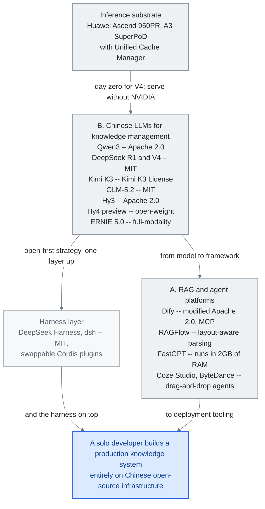

<!-- translation-sync:start -->
> Traducción asistida por máquina sincronizada con la edición inglesa de 2026-10-31, con revisión de estructura y contenido. El código y las etiquetas de los diagramas conservan el original; los tiempos de lectura se estiman a partir del inglés.
> [English source](../../../chapters/09-china-ecosystem.md) · [Sync record](../../SYNC.md)
<!-- translation-sync:end -->

<!-- i18n-anchor -->

# Capítulo 9: El panorama chino de ingeniería del conocimiento con IA

> **En una frase:** China ha construido un ecosistema paralelo de plataformas abiertas, modelos y comunidad, que a menudo innova en direcciones distintas de Occidente.
>
> **Por qué importa:** La mitad de los investigadores de IA está en China. Ignorar este ecosistema supone perder la mitad de la innovación.
>
> **Tiempo de lectura:** ~27 min (estimación del original en inglés: 6,092 palabras / 230 palabras por minuto)

*Figura: La pila de las secciones A y B, de arriba abajo: silicio nacional bajo las familias de modelos chinos, que alimentan dos ramas paralelas, el harness publicado sobre ellas y las plataformas visuales desplegadas por empresas. Las licencias aparecen en los nodos porque la sección C denomina la estrategia "Open-Source as Strategic Imperative". Dos conexiones sostienen el argumento: adaptación inicial de Ascend, que significa "serve without NVIDIA", no "train without NVIDIA", y las ramas inferiores reunidas en un sistema de producción íntegramente sobre infraestructura abierta china.*

Sin el ecosistema chino, el debate global sobre ingeniería del conocimiento con LLM está incompleto. Con más de 748 servicios de IA registrados ante reguladores en diciembre de 2025, China ha desarrollado un enfoque paralelo y, en algunos ámbitos, divergente. Este capítulo recorre plataformas, modelos y diferencias culturales que orientan a desarrolladores y empresas.

<!-- i18n-anchor -->

## A. Plataformas abiertas de RAG y agentes

Varias plataformas chinas rivalizan o superan a las occidentales en popularidad de GitHub. Destacan flujos visuales, preparación para despliegue empresarial y comprensión documental profunda, reflejo de las necesidades prácticas de sus clientes.

<!-- i18n-anchor -->

### Dify (136K+ estrellas de GitHub)

[Dify](https://github.com/langgenius/dify) es la plataforma de agentes con más estrellas del mundo. Su lienzo visual construye pipelines RAG, flujos de agentes y cadenas de razonamiento. Desde 1.0 admite MCP para integrar servidores externos. Conecta a usuarios sin código que diseñan visualmente con desarrolladores que requieren control programático. Las empresas pueden alojar toda la pila, fundamental donde la soberanía de datos impide soluciones exclusivamente de nube.

Su licencia es **Apache 2.0 modificada**, con condiciones adicionales de operación multiinquilino y cambios de logotipo/copyright del frontend. Poder alojarla no implica redistribución SaaS sin restricciones: cada equipo debe revisar la licencia para su caso. Matiza la tesis de infraestructura abierta en la capa de plataformas.

<!-- i18n-anchor -->

### RAGFlow (62-75K+ estrellas de GitHub)

[RAGFlow](https://github.com/infiniflow/ragflow) se diferencia por comprender documentos: diseño de página, OCR y extracción de tablas en 20+ formatos, incluidos PDF escaneados, hojas y presentaciones, no solo texto plano. Su "agentic RAG" elige estrategia según la consulta. Para archivos heredados de empresas estatales y manufactureras, es requisito, no complemento deseable.

<!-- i18n-anchor -->

### FastGPT (27K+ estrellas de GitHub)

[FastGPT](https://github.com/labring/FastGPT) se centra en preguntas empresariales con eficiencia de recursos. Extrae automáticamente pares de preguntas y respuestas utilizables en recuperación y ajuste fino. Funciona con solo 2GB de RAM, accesible a pymes sin GPU dedicada. Refleja el patrón de optimizar bajo restricciones.

<!-- i18n-anchor -->

### MaxKB (18K+ estrellas de GitHub)

[MaxKB](https://github.com/1Panel-dev/MaxKB) es una plataforma empresarial de despliegue con un clic. Admite MCP y plantillas de atención al cliente, conocimiento interno y resumen documental. Reduce de semanas a horas el paso de "we want an AI assistant" a "we have one running".

<!-- i18n-anchor -->

### Coze Studio (15K+ estrellas de GitHub, ByteDance)

[Coze Studio](https://github.com/coze-dev/coze-studio) es la plataforma visual abierta de ByteDance. Antes cerrada, se abrió en julio de 2025 y obtuvo 10,000 estrellas en tres días, mostrando demanda acumulada y poder de distribución. Permite arrastrar y soltar agentes con memoria, herramientas y conversación multivuelta. Integrar la familia Doubao le da ventaja nativa en chino.

Ese carácter independiente se está reagrupando. El **24 de agosto de 2026**, 36kr informó de una fusión interna: TRAE y Coze pasan a la organización de herramientas de oficina de Doubao. IDE y CLI de TRAE siguen separados, pero TRAE Work y Coze se combinan con oficina de Doubao bajo la futura marca "Doubao Work." El artículo prevé lanzar "as soon as this week"; ByteDance solo respondió sobre la reorganización, por lo que la fecha es información periodística, no confirmación empresarial. Invierte la separación occidental entre IDE, constructor de agentes y chat de consumo: aquí las herramientas se absorben en la superaplicación.

<!-- i18n-anchor -->

### DB-GPT (17K+ estrellas de GitHub)

[DB-GPT](https://github.com/eosphoros-ai/DB-GPT) se especializa en datos nativos de IA. Convierte lenguaje natural en SQL para consultas conversacionales sin conocimientos técnicos y añade visualizaciones y análisis multiagente. Es entrada accesible a analítica con IA para grandes datos estructurados de finanzas, logística y manufactura, habituales en empresas chinas.

<!-- i18n-anchor -->

## B. LLM chinos para gestionar conocimiento

Los modelos fundacionales han madurado rápidamente; varios compiten o superan a los occidentales en benchmarks concretos.

### Qwen3 (Alibaba Cloud)

Qwen3 es la familia principal de Alibaba. Su mayor variante es MoE de 235 mil millones de parámetros bajo Apache 2.0. Qwen3-Coder-480B, especializada en código, admite contexto de 256K a 1M tokens. Apache 2.0 permite uso comercial sin restricciones, impulsando adopción en startups que no pueden asumir API propietarias. Qwen destaca en chino, japonés y coreano, idiomas históricamente más débiles en modelos occidentales.

<!-- i18n-anchor -->

### Qwen-Scope (Alibaba, mayo de 2026)

Qwen extendió la apertura de pesos a herramientas de interpretabilidad. **Qwen-Scope**, prepublicación presentada el **12 de mayo de 2026**, ofrece **14 grupos de autoencoders dispersos** entrenados en **siete variantes Qwen3 y Qwen3.5**, densas y MoE, de **1.7B a 35B parámetros** —Qwen3-1.7B a Qwen3.5-35B-A3B—, con anchura y dispersión tabuladas por núcleo, no un total agregado de características. Las presenta como herramientas en cuatro direcciones: dirigir características internas durante inferencia sin prompts; analizar redundancia de benchmarks y cobertura mediante activaciones; clasificar y organizar datos; y apoyar ajuste supervisado y RL posteriores. Importa la procedencia: infraestructura de interpretabilidad abierta de una familia de frontera, publicada por el laboratorio que la entrenó. El ecosistema contribuye a un eje donde suele describirse como consumidor, de manera distinta a mHC: el artefacto es la herramienta, no el resultado.

### DeepSeek R1

DeepSeek R1 igualó a o1 de OpenAI en razonamiento matemático y científico bajo licencia MIT. La cifra asociada de menos de $6 millones corresponde a **DeepSeek-V3**, no a R1: el informe estima **$5.576 millones** de entrenamiento oficial a $2 por hora de GPU H800, sin investigación previa ni ablaciones. Es una estimación del proveedor, no el presupuesto total de desarrollo de R1. La importancia arquitectónica de R1 es abrir pesos de razonamiento de frontera.

En abril de 2026, DeepSeek propuso **hiperconexiones restringidas a una variedad (mHC)**, generalización de conexiones residuales de Transformer++. Frente a un único canal entre capas, mHC transporta **varios flujos internos** restringidos a una variedad aprendida de baja dimensión. Busca dar a capas posteriores acceso más rico a representaciones previas sin el colapso dimensional de residuales multicanal sencillos a escala. El blog comunica mejoras en razonamiento largo con parámetros comparables, mayores cuando la información cruza muchas capas. En abril de 2026 debe **señalarse pendiente de replicación independiente**: un laboratorio y un modelo, en un campo con precedentes que no se reprodujeron. Si se sostiene, mHC se une a MoE, MLA y predicción multitoken de DeepSeek como tercera o cuarta capacidad arquitectónica originada en pesos abiertos chinos antes de generalizarse.

<!-- i18n-anchor -->

### DeepSeek V4 (abril de 2026)

La **vista previa V4** del 24 de abril de 2026 amplía R1 en economía, capacidad e **infraestructura de inferencia**. Publica en Hugging Face dos MoE de pesos abiertos con MIT: **V4-Pro de 1.6 billones de parámetros / 49B activos** y **V4-Flash de 284B / 13B activos**, con contexto predeterminado de 1 millón de tokens, no un nivel aparte. Precios agresivos para frontera en 2026: **V4-Flash a $0.28 por millón de tokens de salida**, V4-Pro a $3.48, gracias a **73% menos FLOPs de inferencia por token** que V3 por arquitectura, no solo hardware. En programación, donde R1 estableció primero su credibilidad, V4-Pro lidera con **93.5% en LiveCodeBench**, frente a 91.7% de Gemini 3.1 Pro y 88.8% de Claude Opus 4.6, y **3206 en Codeforces**, superando 3168 de GPT-5.4.

Pero importa más la **infraestructura de inferencia**. V4 se entrenó en un clúster híbrido con NVIDIA A100 y H20; entrenar frontera enteramente fuera de NVIDIA sigue siendo difícil. Se **adaptó desde el primer día a Ascend 950PR de Huawei**; ambas empresas comunican paridad y aproximadamente **2.8x de rendimiento de cómputo** frente a H20 al servir el modelo. La tesis no es "we trained without NVIDIA", sino **"we serve without NVIDIA."**: soberanía de servicio, no de entrenamiento. Para empresas sujetas a controles estadounidenses, V4 es el primer modelo abierto de frontera con vía creíble de servicio nacional desde el inicio, más cercana al límite real de un ecosistema centrado en despliegue que la opción de entrenamiento. Tras el giro R1 de enero de 2025, V4 cierra el arco anual: publicar modelo de frontera de código **e** infraestructura para servirlo el mismo día.

El **29-30 de junio de 2026**, DeepSeek anunció el paso de V4 a **versión oficial a mediados de julio de 2026**, con 1M tokens en toda la familia y **precio API en horas punta** —9:00-12:00 y 14:00-18:00 de Pekín— de **2x respecto a horas valle**, sin cambiar la base: V4-Pro a $0.435 por millón de entrada sin caché y $0.87 de salida; V4-Flash a $0.14 / $0.28. El precio sensible a demanda convierte *precio en capacidad de programación*: trasladar lotes a horas valle reduce la inferencia a la mitad, como los mercados spot de nube llevan una década haciendo con cómputo.

<!-- i18n-anchor -->

### Silicio nacional a escala de operador (Huawei + China Mobile, junio de 2026)

La tesis "serve without NVIDIA" recibió validación en operadores en junio. En MWC Shanghai, el 24 de junio de 2026, **Huawei y China Mobile Hubei** probaron por primera vez en una red comercial china **AI Inference Acceleration Solution**: **Ascend A3 SuperPoD**, almacenamiento **OceanStor A800** y **Unified Cache Manager (UCM)** para caché KV a escala de petabytes. Se validó *en una red comercial real con cargas simuladas de 8K-190K tokens*, no tráfico real de telecomunicaciones: primer token **51-93%** más rápido con GLM-5.1 y hasta **+372%** de rendimiento a longitud 128K. La vía nacional mostrada al lanzar DeepSeek obtiene una demostración separada de proveedor de infraestructura y operador a escala de producción; gestionar caché KV, capítulo 3, pasa a ser el terreno de competencia económica del silicio nacional.

Podría haber un compromiso mucho mayor, sin confirmar. El **4 de septiembre de 2026**, Bloomberg citó fuentes conocedoras sobre un plan de DeepSeek para desplegar al menos **160,000 aceleradores Ascend 950DT de Huawei** en un centro de aproximadamente 1GW en Ulanqab, Mongolia Interior, parcialmente operativo a finales de 2027 o principios de 2028. Serían para inferencia; entrenar seguiría en NVIDIA existente: la división "serve without NVIDIA, train with it" de V4 llevada a instalaciones. La entrega podría superar un año: componentes de memoria limitarían toda la producción de 950DT de Huawei en 2026 a unos pocos cientos de miles. Ninguna empresa confirma el pedido; son fuentes anónimas, no declaraciones oficiales. Se registra como intención, no capacidad desplegada.

<!-- i18n-anchor -->

### DeepSeek Harness (dsh): harness abierto de agentes (agosto de 2026)

El **13 de agosto de 2026**, DeepSeek publicó **DeepSeek Harness (dsh)** en vista previa para desarrolladores con MIT (github.com/deepseek-ai/deepseek-harness). Se basa en el **paradigma de complementos "Cordis"**, explicado en "A Programming Paradigm for Spatiotemporal Composability": adaptador de modelo, registro de herramientas, diario de sesión, sandbox, almacenamiento, planificación e interfaz son intercambiables, no componentes fijos. Un diario de solo anexado registra cada inyección de contexto: prompts de sistema, razonamiento, herramientas y resultados, y decisiones de subagentes. Invocar Claude Code o Codex como subagentes de una tarea desde su planificador es función oficial, no afirmación periodística: incluye `@deepseek-ai/dsh-subagent-claude-code` y `@deepseek-ai/dsh-subagent-codex`, que llaman a Claude Agent SDK y al `app-server` de Codex, según la nota de diseño del 4 de agosto de 2026. La prensa lo tomó de ese código. Obtuvo 190,630 estrellas y 21,319 bifurcaciones en 11 días, y 224,004 y 26,637 tres semanas después: API de GitHub del 24 de agosto y 15 de septiembre de 2026, respectivamente. Deben revisarse antes de citar más adelante, porque cambian. La prensa la describe cualitativamente entre las adopciones más rápidas de herramientas de desarrollo.

### Kimi K2.5 (Moonshot AI)

Kimi K2.5 introdujo "Agent Swarm": una consulta crea hasta 100 subagentes coordinados con unas 1,500 llamadas a herramientas. Es función de producción, no demostración: paraleliza búsqueda web, análisis y síntesis entre decenas de agentes. Antes, Kimi alcanzó 2 millones de caracteres chinos de contexto, aproximadamente en marzo de 2025, el mayor contexto específicamente optimizado para chino.

<!-- i18n-anchor -->

### Kimi K3 (Moonshot AI, julio de 2026)

El **17 de julio de 2026**, Moonshot publicó **Kimi K3**, el mayor modelo de pesos abiertos hasta entonces con **2.8 billones de parámetros** MoE, contexto de 1M y visión nativa. Lideró programación frontend de Arena como modelo abierto y quedó 4.º de 189 en Artificial Analysis Intelligence Index, con 57 puntos, solo detrás de configuraciones de Fable 5 y GPT-5.6 Sol. Los pesos completos llegaron el **27 de julio** con **Kimi K3 License**: Moonshot lo llama "open weight,", no "open source,"; superar un umbral de ingresos en uso comercial requiere acuerdo aparte, término medio entre Apache 2.0 de Qwen y cierre. Fortune lo describió como "new DeepSeek shock" y coincidir con WAIC 2026 lo convirtió en eje de julio. Con 2.8T, K3 requiere servidores: amplía la escala abierta sin cambiar el despliegue local.

### ERNIE 5.0 (Baidu)

ERNIE 5.0 es el modelo de Baidu de 2.4 billones de parámetros con modalidad completa nativa: comprensión y generación de texto, imagen, audio y vídeo en uno. Lanzado en enero de 2026, apuesta por sistemas multimodales desde el origen, no añadidos a un modelo textual.

### GLM-4.5/5 (Zhipu AI)

La serie GLM de Zhipu, culminada en GLM-5 MoE de 744 mil millones de parámetros, se diseña para harnesses. Tokens nativos de herramientas y garantías de estructura reducen código de soporte. La filosofía "agent-native" requiere menos prompts y reintentos al integrar producción. El **13 de junio de 2026** publicó **GLM-5.2** con MIT en Hugging Face e **IndexShare**, que reutiliza indexador cada cuatro capas de atención dispersa y reduce FLOPs por token **2.9x con contexto completo de 1M**; mejora predicción multitoken y la longitud aceptada de decodificación especulativa **hasta un 20%**. La ficha de GLM-5.2 comunica HLE 40.5, o 54.7 con herramientas, SWE-Bench Pro 62.1 y AIME 2026 99.2.

<!-- i18n-anchor -->

### Hunyuan 3.0 / Hy3 (Tencent, julio de 2026)

El **6 de julio de 2026**, Tencent publicó **Hunyuan 3.0 ("Hy3")** completo: **295B parámetros MoE**, 21B activos, 192 expertos con selección top-8 y capa de predicción multitoken de 3.8B, a 256K de contexto. Más importante, pasó de la licencia restringida de abril de 2026 a **Apache 2.0 sin restricciones**, retirando exclusiones de UE, Reino Unido y Corea del Sur. Comunica alucinaciones de **12.5% a 5.4%** respecto a la vista previa y evaluación ciega de **2.67/4 frente a 2.51/4 de GLM-4**. Según "open-source as strategic imperative", Hy3 representa al último gran laboratorio chino cerrado que adopta *pesos plenamente abiertos*, completando la convergencia: ya es base del ecosistema, no táctica de aspirante.

El **28 de agosto de 2026** siguió **Hy4 en vista previa**, de pesos abiertos: **770B parámetros, 49B activos**, contexto de 1M+ y servicio en Tencent Cloud TokenHub y OpenRouter. Es extensión de Hy3, no capacidad nueva, salvo una afirmación: Tencent dice que Hy4 participó en su desarrollo, "participating for the first time in the automated optimization of training methods, data strategies, evaluation frameworks, and low-level operators,", ajustando cuellos de inferencia para **31.8% más rendimiento**. Optimizar entrenamiento, datos, evaluación y operadores propios es una afirmación de mejora autónoma distinta de una puntuación, próxima al capítulo 13. Tencent evaluó a ciegas con 163 expertos y 203 tareas: **2.99/4.00** para Hy4 frente a 2.92 de GLM-5.3 y 2.94 de Kimi K3. Todo, especialmente autooptimización, procede de Tencent: un laboratorio y un modelo, pendiente de replicación independiente, como mHC.

<!-- i18n-anchor -->

## C. Diferencias principales con Occidente

Entender este panorama exige más que catalogar herramientas: restricciones e incentivos diferentes moldean las decisiones desde el inicio.

<!-- i18n-anchor -->

### Herramientas: prioridad visual frente a prioridad de código

Dify, Coze Studio y FastGPT priorizan lienzos con nodos arrastrables. LangChain, LlamaIndex y Haystack priorizan código y añaden visualización después. Refleja públicos distintos: en China impulsan la adopción departamentos de TI y "citizen developers" que quizá no programan Python; los primeros usuarios occidentales suelen ser ingenieros de software.

<!-- i18n-anchor -->

### Despliegue: instalaciones propias frente a API

En China domina el despliegue propio por soberanía de datos, especialmente en finanzas, salud y gobierno, y controles estadounidenses de chips que encarecen GPU de nube a escala. Se invierte en cuantización, destilación y eficiencia para hardware disponible, no cómputo ilimitado. Occidente suele asumir API con modelo en infraestructura del proveedor.

<!-- i18n-anchor -->

### Arquitectura regulatoria

En diciembre de 2025 había 748 servicios registrados bajo Generative AI Management Measures. El cumplimiento no es opcional ni aspiracional: condiciona diseño. Filtrado, auditoría e identidad son funciones centrales, no añadidos previos al lanzamiento. La presión paradójicamente normaliza arquitecturas: triunfa quien facilita requisitos comunes.

Las **Interim Measures for Anthropomorphic AI Interaction Services**, publicadas el **10 de abril de 2026** y vigentes el **15 de julio**, delimitan más que una regulación genérica de agentes. El artículo 2 cubre interacción emocional continua que simula características humanas y excluye expresamente preguntas de conocimiento y asistentes laborales sin ella. Para servicios cubiertos, el artículo 16 exige copiar/borrar datos de interacción y el 19 una salida accesible. La memoria de acompañantes persistentes tiene otra frontera que la de un asistente empresarial ordinario, que sigue sujeto a las demás normas aplicables.

En julio de 2026 se añade una capa internacional. **World AI Conference (WAIC) 2026** y High-Level Meeting on Global AI Governance se celebraron el 17-20 de julio en Shanghái, con 100+ países y el secretario general de la ONU Guterres. Produjeron el acuerdo de **World Artificial Intelligence Cooperation Organization (WAICO)**, primera organización intergubernamental internacional dedicada a IA, con sede en Shanghái. Sea cual sea su funcionamiento futuro, extiende el patrón de registros internos a construcción institucional internacional situada en China.

<!-- i18n-anchor -->

### Comunidad e intercambio de conocimiento

La comunidad usa otras plataformas: grupos WeChat, no Slack o Discord, para diálogo en directo; Zhihu para consultas técnicas extensas, como Stack Overflow; y CSDN (China Software Developer Network) para tutoriales y blogs. GitHub aloja código, pero la conversación ocurre fuera. Buscar soporte inglés en Issues o Discord ofrece poco, aunque la comunidad china sea activa: resulta invisible para quien no habla chino.

<!-- i18n-anchor -->

### Innovar bajo restricciones

Los controles estadounidenses crearon una dinámica inesperada: al no poder ampliar simplemente cómputo, los laboratorios invierten más en eficiencia algorítmica. El coste oficial comunicado de entrenamiento de DeepSeek-V3 lo ilustra, con los límites contables indicados. Se extiende a modelos menores, inferencia optimizada, cuantización agresiva y capacidad por FLOP. Occidente, con más cómputo, innova mediante escala. Ambos logran frontera por caminos distintos.

<!-- i18n-anchor -->

### El código abierto como necesidad estratégica

Los lanzamientos chinos de pesos abiertos superan en volumen a Occidente. No es altruismo: crear dependencia del ecosistema, atraer investigadores y ganar buena voluntad global. Apache 2.0 de Qwen, MIT de DeepSeek y apertura de Coze Studio siguen ese patrón. Un desarrollador individual puede construir producción enteramente sobre infraestructura abierta china, del modelo al framework y despliegue.

La lógica sube de pesos al harness. DeepSeek Harness (dsh) aplica apertura al entorno de agentes; días después, OpenAI abre el motor de Codex (capítulo 4) con Apache 2.0 y conserva modelos propietarios. La capa se abre a ambos lados del Pacífico con pocos días de diferencia y fines estratégicos distintos.

La evidencia de uso llegó el **29 de julio de 2026**: modelos chinos ocuparon por primera vez los cinco primeros puestos semanales globales de tokens de OpenRouter: MiMo-V2.5 de Xiaomi, DeepSeek, MiniMax, Qwen de Alibaba y Kimi de Moonshot, en un enrutador de más de 20 billones de tokens semanales. Análisis de esa semana estimaron **más del 60%** de tráfico. A principios de septiembre de 2026, otras fuentes situaron laboratorios chinos en **46.4%** frente a **35.7%** de modelos estadounidenses. No forman una tendencia: son análisis secundarios con definiciones diferentes de "Chinese-origin" y del universo de tokens, ninguno revisión del otro. OpenRouter solo ofrece una vista móvil sin archivo histórico; son instantáneas periodísticas, no serie primaria citable.

<!-- i18n-anchor -->

### La disputa sobre destilación

La lectura estratégica adquirió un contrapunto adversarial en septiembre de 2026. El **10 de septiembre de 2026**, Anthropic publicó "Detecting and countering misuse of AI: September 2026,", informe sobre abusos que afirma haber interrumpido entre diciembre de 2025 y agosto de 2026 en siete ámbitos, incluida destilación ilícita. Alega que Moonshot AI envió solicitudes de clientes Kimi a Claude mediante **5,380 cuentas marcadas como fraudulentas**, con **unas 300,000 solicitudes** concentradas en diez días, devolvió respuestas de Claude como Kimi y guardó intercambios para entrenar. Atribuye **más de 23 millones de intercambios** a Moonshot entre mayo y julio de 2026. Otra cifra corresponde a **Alibaba**: "over 151 million exchanges observed" en mayo-julio, unas seis veces y media Moonshot. También identifica a **DeepSeek, Z.ai (Zhipu), Xiaomi, MiniMax y SenseTime** y describe repetición entre sesiones de DeepSeek para extraer razonamiento de Claude.

Una salvedad gobierna el peso de todo ello: son **alegaciones de Anthropic**, competidor comercial, sin resolución de terceros. Aquí se registra qué se alegó, no si sucedió. Las cifras proceden de la sección de destilación del propio informe. Independientemente de quién tenga razón, "the weights are open" y "how the model behind them was trained" son preguntas separables. La lógica de dependencia del ecosistema no demuestra procedencia del entrenamiento, eje ahora disputado públicamente entre ambos ecosistemas.

<!-- i18n-anchor -->

## D. Nota sobre contenido de Bilibili

Bilibili (B站) tiene muchos tutoriales de IA, pero numerosos vídeos son republicaciones o traducciones de YouTube en inglés. Su valor original está en herramientas específicas de China: despliegue Dify, integración Qwen y casos empresariales inexistentes en inglés. Rastree siempre el origen. Si demuestra LangChain con narración inglesa doblada, probablemente el original de YouTube esté más actualizado.

---

<!-- i18n-anchor -->

## Tres ideas para recordar

- **Los pesos abiertos son estrategia, no altruismo.** Apache 2.0 de Qwen, MIT de DeepSeek y Coze Studio abierto atraen dependencia, talento y buena voluntad y permiten producción íntegra con infraestructura china.
- **El silicio nacional es una afirmación de servicio, no de entrenamiento.** V4 entrenó con NVIDIA híbrida, pero se adaptó inicialmente a Ascend 950PR; la demostración separada de Huawei y China Mobile de junio de 2026 redujo el primer token 51-93% para GLM-5.1 con cargas largas simuladas en red comercial real.
- **La procedencia es el eje disputado.** Las alegaciones de septiembre de 2026 de Anthropic sobre destilación muestran, gane quien gane, que "the weights are open" y "how the model behind them was trained" son preguntas separables.

---

<!-- i18n-anchor -->

## Fuentes

- Repositorio de Dify en GitHub: [https://github.com/langgenius/dify](https://github.com/langgenius/dify)
- Dify. Licencia (consultada el 31 de octubre de 2026). [https://raw.githubusercontent.com/langgenius/dify/main/LICENSE](https://raw.githubusercontent.com/langgenius/dify/main/LICENSE) -- Apache 2.0 modificada, con condiciones adicionales de multiinquilino y frontend.
- DeepSeek-AI. "DeepSeek-V3 Technical Report" (27 de diciembre de 2024; revisado el 18 de febrero de 2025), introducción y tabla 1. [https://arxiv.org/html/2412.19437v2](https://arxiv.org/html/2412.19437v2) -- Estimación de entrenamiento oficial de $5.576M, sin investigación previa ni ablaciones. No es el coste total de desarrollo de R1.
- Cyberspace Administration of China y otras cuatro agencias. "Interim Measures for Anthropomorphic AI Interaction Services" (10 de abril de 2026; vigentes desde el 15 de julio de 2026), artículos 2, 16 y 19. [https://www.cac.gov.cn/2026-04/10/c_1777558395078289.htm](https://www.cac.gov.cn/2026-04/10/c_1777558395078289.htm) -- Ámbito de interacción emocional continua, con exclusión de otros servicios sin ella.
- Repositorio de RAGFlow en GitHub: [https://github.com/infiniflow/ragflow](https://github.com/infiniflow/ragflow)
- Repositorio de FastGPT en GitHub: [https://github.com/labring/FastGPT](https://github.com/labring/FastGPT)
- Repositorio de MaxKB en GitHub: [https://github.com/1Panel-dev/MaxKB](https://github.com/1Panel-dev/MaxKB)
- Repositorio de Coze Studio en GitHub: [https://github.com/coze-dev/coze-studio](https://github.com/coze-dev/coze-studio)
- Repositorio de DB-GPT en GitHub: [https://github.com/eosphoros-ai/DB-GPT](https://github.com/eosphoros-ai/DB-GPT)
- Qwen3 Technical Report y fichas de modelo, Alibaba Cloud (2025) --- referencias canónicas: [https://huggingface.co/Qwen](https://huggingface.co/Qwen) y artículos del equipo Qwen en Hugging Face. Apache 2.0 confirmado en los archivos LICENSE de los repositorios.
- Artículo de DeepSeek R1: "DeepSeek-R1: Incentivizing Reasoning Capability in LLMs via Reinforcement Learning" (enero de 2025). [https://github.com/deepseek-ai/DeepSeek-R1](https://github.com/deepseek-ai/DeepSeek-R1) aloja el modelo y enlaza el informe técnico PDF.
- Moonshot AI. La cobertura de Kimi K2.5 Agent Swarm circuló a principios de 2026 en el blog de Moonshot y prensa técnica; 100 subagentes / ~1500 llamadas proceden de resúmenes periodísticos secundarios. Acceso primario mediante [https://platform.moonshot.ai](https://platform.moonshot.ai).
- Baidu. Lanzamiento de ERNIE 5.0 (enero de 2026); Las afirmaciones de 2.4T parámetros y modalidad completa circularon en canales de Baidu y prensa china. No se fija una URL primaria; modalidad y parámetros son cifras difundidas, pero secundarias.
- Zhipu AI. Fichas GLM-4/5 en Hugging Face y blog oficial ZhipuAI; "744B MoE GLM-5" y tokens nativos de herramientas se comunican en fichas y blog. Referencia primaria: [https://www.zhipuai.cn](https://www.zhipuai.cn).
- Cyberspace Administration of China, "Generative AI Service Filing" divulgaciones (diciembre de 2025) --- Los 748 servicios se reproducen ampliamente en prensa china; CAC publica el registro subyacente por lotes en su sitio oficial.
- Nota editorial: no se fija una encuesta primaria verificable para el aumento empresarial tras R1 citado anteriormente; el capítulo no afirma una cifra de adopción.
- DeepSeek. "DeepSeek mHC: Manifold-Constrained Hyper-Connections" (abril de 2026). [https://deepseek.ai/blog/deepseek-mhc-manifold-constrained-hyper-connections](https://deepseek.ai/blog/deepseek-mhc-manifold-constrained-hyper-connections) --- Pendiente de replicación independiente.
- DeepSeek. Publicación de V4 en Hugging Face (24 de abril de 2026). Licencia MIT; V4-Pro 1.6T con 49B activos / V4-Flash 284B con 13B activos; contexto predeterminado de 1M tokens.
- Fortune. "DeepSeek unveils V4 model, with rock-bottom prices and close integration with Huawei's chips" (24 de abril de 2026). [https://fortune.com/2026/04/24/deepseek-v4-ai-model-price-performance-china-open-source/](https://fortune.com/2026/04/24/deepseek-v4-ai-model-price-performance-china-open-source/)
- South China Morning Post. "DeepSeek unveils next-gen AI model as Huawei vows 'full support' with new chips" (24 de abril de 2026). [https://www.scmp.com/tech/big-tech/article/3351239/deepseek-releases-next-gen-ai-model-world-leading-efficiency](https://www.scmp.com/tech/big-tech/article/3351239/deepseek-releases-next-gen-ai-model-world-leading-efficiency)
- Phemex News. "DeepSeek V4 Matches NVIDIA on Huawei Ascend, Dispels Rumors" (abril de 2026). [https://phemex.com/news/article/deepseek-v4-matches-nvidia-performance-on-huawei-ascend-dispels-delay-rumors-75616](https://phemex.com/news/article/deepseek-v4-matches-nvidia-performance-on-huawei-ascend-dispels-delay-rumors-75616) --- Afirmación de paridad de inferencia, con ~2.8x de rendimiento frente a NVIDIA H20 en Ascend 950PR.
- TechNode. "DeepSeek to launch V4 in mid-July with new peak-time API pricing" (30 de junio de 2026). [https://technode.com/2026/06/30/deepseek-to-launch-v4-in-mid-july-with-new-peak-time-api-pricing/](https://technode.com/2026/06/30/deepseek-to-launch-v4-in-mid-july-with-new-peak-time-api-pricing/) y ExplainX [https://explainx.ai/blog/deepseek-v4-official-release-peak-pricing-mid-july-2026](https://explainx.ai/blog/deepseek-v4-official-release-peak-pricing-mid-july-2026) --- Versión oficial a mediados de julio; horas punta a 2x de horas valle, anunciado el 29-30 de junio.
- Zhipu AI. Ficha GLM-5.2 en Hugging Face (13 de junio de 2026). [https://huggingface.co/zai-org/GLM-5.2](https://huggingface.co/zai-org/GLM-5.2) --- IndexShare reduce FLOPs por token 2.9x a 1M de contexto; longitud aceptada MTP hasta +20%; HLE 40.5 o 54.7 con herramientas, SWE-Bench Pro 62.1 y AIME 2026 99.2.
- Tencent. Hy3 (Hunyuan 3.0) ficha en Hugging Face (6 de julio de 2026). [https://huggingface.co/tencent/Hy3](https://huggingface.co/tencent/Hy3) --- MoE de 295B, 21B activos, contexto 256K y Apache 2.0; alucinaciones 12.5%→5.4%; evaluación ciega 2.67/4 frente a 2.51/4 de GLM-4. Fuente secundaria: LetsDataScience [https://letsdatascience.com/news/tencent-open-sources-hy3-295b-moe-model-c3d05258](https://letsdatascience.com/news/tencent-open-sources-hy3-295b-moe-model-c3d05258).
- Huawei. "MWC Shanghai 2026: China Mobile and Huawei on the token economy" (24 de junio de 2026). [https://www.huawei.com/en/news/2026/6/mwcs-cmcc-token-economy](https://www.huawei.com/en/news/2026/6/mwcs-cmcc-token-economy) --- Ascend A3 SuperPoD + OceanStor A800 + Unified Cache Manager en red comercial real con cargas simuladas de 8K-190K tokens; TTFT 51-93% menor con GLM-5.1 y rendimiento de hasta +372% a 128K.
- PureAI. "China's Moonshot AI Releases Kimi K3" (17 de julio de 2026). [https://pureai.com/articles/2026/07/17/china-moonshot-ai-releases-kimi-k3.aspx](https://pureai.com/articles/2026/07/17/china-moonshot-ai-releases-kimi-k3.aspx) --- MoE de 2.8T, contexto 1M y visión nativa; 4.º de 189 en Artificial Analysis Intelligence Index con 57 puntos; pesos del 27 de julio.
- The New Stack. "Kimi K3 tops Arena's coding leaderboard --- and it's open-weight" (julio de 2026). [https://thenewstack.io/kimi-k3-open-weight-coding/](https://thenewstack.io/kimi-k3-open-weight-coding/) --- Resultado de pesos abiertos en la clasificación.
- Reeve, Jonas (Unite.AI). "Moonshot Opens Kimi K3 Weights Under a Revenue-Tiered License" (27 de julio de 2026). [https://www.unite.ai/moonshot-opens-kimi-k3-weights-under-a-revenue-tiered-license/](https://www.unite.ai/moonshot-opens-kimi-k3-weights-under-a-revenue-tiered-license/) y Willison, Simon. "moonshotai/Kimi-K3" (27 de julio de 2026). [https://simonwillison.net/2026/Jul/27/kimi-k3/](https://simonwillison.net/2026/Jul/27/kimi-k3/) --- Identifica la licencia específica "Kimi K3 License"; condiciones comerciales por ingresos; marco de Moonshot "open weight" frente a "open source".
- Bloomberg. "China's Powerful New Moonshot AI Model Closes Gap With US Rivals" (17 de julio de 2026). [https://www.bloomberg.com/news/articles/2026-07-17/china-s-powerful-new-moonshot-ai-model-closes-gap-with-us-rivals](https://www.bloomberg.com/news/articles/2026-07-17/china-s-powerful-new-moonshot-ai-model-closes-gap-with-us-rivals)
- Fortune. "China's Moonshot Kimi K3 and the markets" (17 de julio de 2026). [https://fortune.com/2026/07/17/china-moonshot-kimi-k3-markets-china-ai/](https://fortune.com/2026/07/17/china-moonshot-kimi-k3-markets-china-ai/) --- "new DeepSeek shock" como marco.
- Xinhua. "World AI Conference opens in Shanghai" (17 de julio de 2026). [https://english.news.cn/20260717/7691cc6c17d249089fdcd7afd840c3ba/c.html](https://english.news.cn/20260717/7691cc6c17d249089fdcd7afd840c3ba/c.html) --- WAIC 2026 y acuerdo fundador de WAICO, con presencia de Guterres.
- PRC Ministry of Foreign Affairs. Comunicado sobre establecimiento de WAICO (17 de julio de 2026). [https://www.mfa.gov.cn/mfa_eng/xw/zyxw/202607/t20260717_11984715.html](https://www.mfa.gov.cn/mfa_eng/xw/zyxw/202607/t20260717_11984715.html)
- DeepSeek. DeepSeek Harness (dsh) Repositorio GitHub (vista previa para desarrolladores del 13 de agosto de 2026). [https://github.com/deepseek-ai/deepseek-harness](https://github.com/deepseek-ai/deepseek-harness) y [https://deepseek.com/harness/en/](https://deepseek.com/harness/en/) --- Licencia MIT; "Cordis" como paradigma de complementos y registro de solo anexado. Estrellas/bifurcaciones verificadas mediante API de GitHub: 190,630 estrellas / 21,319 bifurcaciones el 2026-08-24; 224,004 / 26,637 el 2026-09-15. Los paquetes de subagentes Claude Code / Codex (`@deepseek-ai/dsh-subagent-claude-code`, `@deepseek-ai/dsh-subagent-codex`) se publican en el propio repositorio. Cobertura secundaria de la curva de adopción: [https://cryptobriefing.com/deepseek-harness-open-source-developer-preview/](https://cryptobriefing.com/deepseek-harness-open-source-developer-preview/) ; [https://www.mindstudio.ai/blog/deepseek-harness-agentic-coding](https://www.mindstudio.ai/blog/deepseek-harness-agentic-coding) ; [https://www.digitalapplied.com/blog/deepseek-harness-open-source-agent-framework-2026](https://www.digitalapplied.com/blog/deepseek-harness-open-source-agent-framework-2026) ; [https://flowtivity.ai/blog/deepseek-harness-open-source-agent-explained/](https://flowtivity.ai/blog/deepseek-harness-open-source-agent-explained/).
- Deng, Boyi, et al. "Qwen-Scope: Turning Sparse Features into Development Tools for Large Language Models," arXiv:2605.11887 (presentado el 12 de mayo de 2026). [https://arxiv.org/abs/2605.11887](https://arxiv.org/abs/2605.11887) --- 14 grupos de SAE en siete variantes Qwen3 / Qwen3.5, de 1.7B a 35B, densas y MoE; anchura y dispersión por núcleo, no total agregado. Usos de dirección, análisis de evaluación, clasificación y postentrenamiento. No se recuperó el anuncio de Qwen en X; la entrega arXiv es la única fecha fijada.
- Tencent. "Tencent releases and open-sources Tencent Hy4 preview" (28 de agosto de 2026). [https://www.tencent.com/tencent-releases-and-open-sources-tencent-hy4-preview/](https://www.tencent.com/tencent-releases-and-open-sources-tencent-hy4-preview/) --- 770B totales / 49B activos y contexto 1M+; evaluación ciega 2.99/4.00 con 163 expertos y 203 tareas frente a 2.92 de GLM-5.3 y 2.94 de Kimi K3. El 31.8% de rendimiento y la autooptimización son afirmaciones de Tencent. Fuente secundaria: TechNode [https://technode.com/2026/08/28/tencent-open-sources-hy4-preview-with-770b-parameters-and-a-1m-token-context/](https://technode.com/2026/08/28/tencent-open-sources-hy4-preview-with-770b-parameters-and-a-1m-token-context/).
- 36kr (edición inglesa). "Exclusive ByteDance AI Productivity Integration: TRAE & Coze Merged into Doubao, Unified Office Brand 'Doubao Work' to Launch" (24 de agosto de 2026). [https://eu.36kr.com/en/p/3953230805876099](https://eu.36kr.com/en/p/3953230805876099) --- Información sobre reorganización; el artículo dice que Doubao Work saldrá "as soon as this week", plazo periodístico, no confirmado por ByteDance.
- Bloomberg. "DeepSeek Plans Big Huawei AI Chip Order to Power New Data Center" (4 de septiembre de 2026). [https://www.bloomberg.com/news/articles/2026-09-04/deepseek-plans-big-huawei-ai-chip-order-to-power-new-data-center](https://www.bloomberg.com/news/articles/2026-09-04/deepseek-plans-big-huawei-ai-chip-order-to-power-new-data-center) --- Según fuentes conocedoras; el artículo tiene muro de pago y no se recuperó independientemente para esta entrada. Las cifras se toman de cobertura secundaria: TechPowerUp [https://www.techpowerup.com/352416/huawei-prepares-160-000-ascend-950dt-accelerators-for-deepseek-data-centar](https://www.techpowerup.com/352416/huawei-prepares-160-000-ascend-950dt-accelerators-for-deepseek-data-centar) ; TFTC [https://www.tftc.io/deepseek-huawei-ascend-160000-chips-inner-mongolia-nvidia-sanctions](https://www.tftc.io/deepseek-huawei-ascend-160000-chips-inner-mongolia-nvidia-sanctions). Ni DeepSeek ni Huawei confirman el pedido.
- Anthropic. "Detecting and countering misuse of AI: September 2026" (10 de septiembre de 2026). [https://www.anthropic.com/threat-intelligence-report-september-2026](https://www.anthropic.com/threat-intelligence-report-september-2026) --- Fuente primaria: su sección de destilación contiene las 5,380 cuentas, ~300,000 solicitudes y 23M intercambios de Moonshot, y la cifra "over 151 million exchanges observed" atribuida a Alibaba, leídas directamente. Cobertura secundaria: CNBC [https://www.cnbc.com/2026/09/11/chinese-ai-labs-moonshot-deepseek-alibaba-anthropic.html](https://www.cnbc.com/2026/09/11/chinese-ai-labs-moonshot-deepseek-alibaba-anthropic.html) ; Dealroom [https://dealroom.co/news/150366-anthropic-alleges-moonshot-routed-some-kimi-user-requests-to-claude-then/](https://dealroom.co/news/150366-anthropic-alleges-moonshot-routed-some-kimi-user-requests-to-claude-then/) ; TechNode Global [https://technode.global/2026/09/11/anthropic-ai-orchestrated-cyberattacks-model-distillation/](https://technode.global/2026/09/11/anthropic-ai-orchestrated-cyberattacks-model-distillation/). Todas son alegaciones de Anthropic.
- Clasificaciones de modelos de OpenRouter: [https://openrouter.ai/rankings](https://openrouter.ai/rankings) --- Vista móvil sin archivo histórico; las cifras fechadas son instantáneas de fuentes secundarias. Cinco primeros puestos chinos del 29 de julio de 2026 y la cifra "above 60% of routed traffic" en: Dataconomy [https://dataconomy.com/2026/07/29/chinese-ai-models-openrouter-top-five/](https://dataconomy.com/2026/07/29/chinese-ai-models-openrouter-top-five/) ; TechBriefly [https://techbriefly.com/2026/07/29/chinese-ai-models-lead-openrouter-for-first-time/](https://techbriefly.com/2026/07/29/chinese-ai-models-lead-openrouter-for-first-time/). Reparto de principios de septiembre 46.4% / 35.7%: Yahoo Finance [https://finance.yahoo.com/technology/ai/articles/chinese-ai-models-now-capture-020440715.html](https://finance.yahoo.com/technology/ai/articles/chinese-ai-models-now-capture-020440715.html). Las dos cuotas proceden de análisis distintos y no son la misma medida.

---

*Siguiente: [Capítulo 10 - Construir un harness de conocimiento real](10-case-study.md)*
