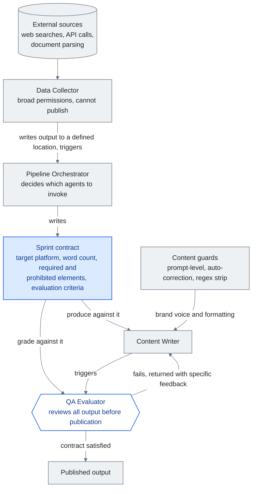

<!-- translation-sync:start -->
> Traducción asistida por máquina sincronizada con la edición inglesa de 2026-10-31, con revisión de estructura y contenido. El código y las etiquetas de los diagramas conservan el original; los tiempos de lectura se estiman a partir del inglés.
> [English source](../../../chapters/10-case-study.md) · [Sync record](../../SYNC.md)
<!-- translation-sync:end -->

<!-- i18n-anchor -->

# Capítulo 10: Construir un harness de conocimiento real

> **En una frase:** Un desarrollador construyó un sistema completo de conocimiento con IA utilizando un equipo de 4 agentes, enrutamiento mediante divulgación progresiva y un pipeline automatizado de contenido.
>
> **Por qué importa:** Esto demuestra que una persona con la arquitectura adecuada puede construir lo que antes requería un equipo. Los conceptos de esta guía no son teóricos.
>
> **Tiempo de lectura:** ~11 min (estimación del original en inglés: 2,476 palabras / 230 palabras por minuto)

*Figura: El equipo de cuatro agentes de la sección "Harness Engineering: The Agent Team", con el contrato de sprint representado como el documento que comparten tres de los agentes. El orquestador escribe el contrato, el redactor produce según él y el evaluador de calidad aplica los mismos criterios antes de que se pueda publicar nada. La conexión que sostiene el argumento es el camino de retorno del evaluador al redactor: no se trata de un único reintento, por lo que los cuatro agentes forman un bucle y no un pipeline.*

Este capítulo presenta un caso anonimizado de un desarrollador individual —denominado "the builder"— que construyó un harness completo de conocimiento durante varios meses de desarrollo iterativo. El sistema descrito es real y se utiliza a diario en producción. Demuestra cómo se combinan en la práctica los conceptos de capítulos anteriores: ingeniería de contexto, divulgación progresiva, sistemas de habilidades y orquestación de agentes.

<!-- i18n-anchor -->

## El punto de partida

El desarrollador comenzó con un problema sencillo: demasiado conocimiento y poca estructura. Una bóveda personal de conocimiento había crecido hasta superar las 300 notas sobre proyectos activos, referencias técnicas, registros de reuniones e ideas pasajeras. El enfoque habitual —buscar cuando se necesita algo— dejó de funcionar a medida que crecía la bóveda. Las notas se olvidaban, las ideas se redescubrían en lugar de recuperarse y se perdía contexto entre sesiones de trabajo.

La solución inicial era modesta: utilizar un asistente LLM con acceso a la bóveda. Pero el acceso directo a 300+ notas inundaba la ventana de contexto. El verdadero reto de ingeniería no era "can the LLM read my notes", sino "how do I give the LLM the right notes at the right time."

<!-- i18n-anchor -->

## Capa de conocimiento: la bóveda como grafo de conocimiento implícito

La base del sistema es una bóveda de Obsidian organizada mediante una jerarquía de carpetas deliberada:

- **Inbox** para capturar información (todas las notas nuevas llegan aquí)
- **Active** para notas de uso diario (limitadas a 5-10 elementos)
- **Projects** para trabajo acotado en el tiempo y con fechas límite
- **Areas** para responsabilidades continuas sin fecha límite
- **Notes** para conocimiento atómico (una idea por nota y títulos formulados como afirmaciones)
- **Daily** para diarios e informes de revisión
- **Archive** para material completado o desactualizado

Cada nota utiliza wikilinks para conectar con notas relacionadas, creando un grafo de conocimiento implícito sin necesidad de una base de datos formal de grafos. La convención de enlaces es sencilla pero estricta: si la nota A menciona un concepto que la nota B desarrolla, A debe enlazar a B. Con el tiempo, esto produce una red navegable en la que cualquier punto de entrada conduce al contexto relacionado.

La bóveda se mantiene mediante un ciclo de revisión: las revisiones diarias procesan la bandeja de entrada y clasifican las notas nuevas; las semanales analizan las tendencias de acumulación de conocimiento y recuperan notas antiguas valiosas; las mensuales comprueban contradicciones, fusionan notas solapadas y archivan proyectos terminados. Este mantenimiento no es opcional. Sin él, la capa de conocimiento se degrada en semanas porque las notas quedan obsoletas, redundantes o huérfanas.

<!-- i18n-anchor -->

## Ingeniería de contexto: el prompt de sistema como índice

El enfoque de ingeniería de contexto del desarrollador trata el prompt de sistema como un índice de recursos más profundos, en lugar de un conjunto monolítico de instrucciones. Un archivo central de configuración, análogo a un README para la IA, contiene:

- **Detalles del entorno**: sistema operativo, shell y particularidades conocidas que conviene evitar
- **Preferencias de idioma**: idioma de trabajo del desarrollador y convenciones de formato
- **Una tabla de enrutamiento**: lista priorizada de categorías de habilidades, con palabras clave de activación y referencias a archivos de enrutamiento

Este archivo de configuración se carga siempre. Es compacto —menos de 2,000 tokens— porque contiene referencias, no el contenido completo. Cuando el LLM recibe una solicitud del usuario, la compara con la tabla de enrutamiento y carga únicamente el archivo pertinente, que a su vez apunta a la habilidad concreta necesaria.

Un sistema de memoria separado gestiona la persistencia entre sesiones. Almacena:

- Ubicaciones y estructuras de proyectos activos
- Preferencias del usuario aprendidas de sus comentarios
- Patrones técnicos y convenciones específicos de cada proyecto
- Referencias a archivos secundarios detallados sobre temas complejos

El archivo de memoria crece de forma orgánica. Cuando el desarrollador corrige el comportamiento del asistente, esa corrección se registra como preferencia. Cuando se establece la estructura de un proyecto, se documenta una vez y se referencia a partir de entonces. Esto elimina el problema repetitivo de "let me re-explain my project" que afecta a las interacciones sin estado con LLM.

<!-- i18n-anchor -->

## Ingeniería de harness: el equipo de agentes

El sistema utiliza un equipo de cuatro agentes, cada uno con una función definida:

1. **Data Collector**: Reúne información de fuentes externas (búsquedas web, llamadas a API y análisis de documentos). Tiene permisos amplios, pero no puede publicar.
2. **Pipeline Orchestrator**: Coordina los flujos de trabajo, decide qué agentes invocar y gestiona el orden de ejecución. Escribe "sprint contracts", documentos que especifican los criterios esperados para el resultado de cada tarea.
3. **Content Writer**: Produce los resultados (informes, publicaciones en redes sociales y documentos técnicos). Opera bajo controles de contenido que hacen cumplir la voz de marca y los estándares de formato.
4. **QA Evaluator**: Revisa todos los resultados según el contrato de sprint antes de que puedan publicarse. Comprueba la exactitud factual, el cumplimiento del formato y la coherencia con la marca.

El mecanismo del contrato de sprint merece una explicación. Cuando el orquestador inicia una tarea de contenido, no se limita a decir "write a post about X." Produce un contrato que especifica la plataforma de destino, el intervalo de palabras, los elementos obligatorios (por ejemplo, incluir una estadística y terminar con una llamada a la acción), los elementos prohibidos (como superlativos o afirmaciones no verificadas) y los criterios de evaluación. El redactor produce según ese contrato y el evaluador de calidad lo aplica. Si el resultado no supera la evaluación, vuelve al redactor con comentarios concretos vinculados a los criterios del contrato. No es un único reintento: el bucle continúa hasta que se cumple el contrato o interviene una persona.

Los controles de contenido operan en tres capas:

- **Controles en el prompt**: Instrucciones incorporadas al prompt de sistema que definen lo que el agente debe y no debe hacer
- **Corrección automática**: Procesamiento posterior a la generación que detecta y corrige problemas frecuentes, como formatos no deseados o terminología inconsistente
- **Eliminación mediante expresiones regulares**: Una pasada final que elimina patrones que nunca deben aparecer en la salida, como caracteres que rompen sistemas posteriores o tokens de metadatos filtrados por el modelo

La comunicación entre agentes se basa en activaciones. Los agentes no se consultan periódicamente entre sí. Cuando el recolector termina de reunir información, escribe el resultado en una ubicación definida y activa al orquestador. Cuando el redactor produce contenido, activa al evaluador. Esta arquitectura dirigida por eventos mantiene la capacidad de respuesta sin cómputo innecesario.

<!-- i18n-anchor -->

## Evolución del sistema de habilidades

El sistema de habilidades atravesó cuatro etapas distintas, cada una impulsada por limitaciones prácticas descubiertas en producción.

**Etapa 1: Archivos planos de habilidades.** Cada habilidad era un archivo Markdown independiente con instrucciones. El LLM cargaba todos los archivos de habilidades al comenzar la sesión. Funcionaba con 5-10 habilidades, pero se volvió insostenible al crecer la colección. Las definiciones llenaban las ventanas de contexto y dejaban poco espacio para el trabajo real.

**Etapa 2: Metadatos YAML enriquecidos.** Las habilidades incorporaron metadatos estructurados: condiciones de activación, contexto necesario, dependencias y números de versión. Esto permitió filtrarlas por relevancia, pero la propia lógica de filtrado consumía tokens y añadía latencia.

**Etapa 3: Wikilinks entre habilidades.** Las habilidades empezaron a enlazarse entre sí, creando un grafo de habilidades. Una habilidad de "deploy" enlazaría a "run tests" como requisito previo. Esto permitió cargar cadenas de habilidades en lugar de habilidades aisladas, pero navegar por el grafo seguía exigiendo cargar su índice.

**Etapa 4: Divulgación progresiva con archivos de enrutamiento.** La arquitectura final utiliza un índice compacto —la tabla de enrutamiento del prompt de sistema— que apunta a siete archivos de enrutamiento, uno por categoría. Cada archivo enumera las habilidades de esa categoría y sus condiciones de activación. El LLM carga solo el archivo de la categoría que coincide y, después, únicamente la habilidad concreta que necesita. En cualquier momento, el sistema tiene cargados el índice del prompt de sistema (~2K tokens) + un archivo de enrutamiento (~500 tokens) + un archivo de habilidad (~1-2K tokens). La sobrecarga total permanece por debajo de 4K tokens, con independencia del número de habilidades del sistema.

El desarrollador probó esta arquitectura con 85 consultas que cubrían todas las categorías y consiguió 85/85 enrutamientos correctos: un 100% de precisión. Los casos límite —consultas ambiguas que podrían coincidir con varias categorías— se resuelven con reglas explícitas de desambiguación en la tabla de enrutamiento.

<!-- i18n-anchor -->

## Resultados

Los resultados medibles de esta arquitectura:

- **Reducción del 65% de tokens** mediante divulgación progresiva frente al enfoque de archivos planos. Las mismas tareas que antes consumían 8-12K tokens de contexto de habilidades ahora requieren menos de 4K.
- **Pipeline automatizado de contenido** que produce resultados diarios para varias plataformas con calidad uniforme, gestionado por una sola persona.
- **Mantenimiento del conocimiento** mediante comprobaciones automatizadas de la bóveda que detectan contradicciones, notas huérfanas e información obsoleta, problemas que antes exigían sesiones de revisión manual.
- **Continuidad entre sesiones** que elimina el problema de "cold start". Gracias al sistema de memoria, el asistente retoma siempre el trabajo donde lo dejó.

<!-- i18n-anchor -->

## Lecciones aprendidas

**Empezar con sencillez y añadir complejidad por capas.** El desarrollador no diseñó el sistema de cuatro agentes con contratos de sprint el primer día. Empezó con un solo agente y un archivo de texto con instrucciones. Cada capa de complejidad respondió a un fallo concreto: los agentes alucinaban (añadir un evaluador de calidad), los resultados eran inconsistentes (añadir controles de contenido) y las ventanas de contexto se desbordaban (añadir divulgación progresiva). Una arquitectura prematura habría optimizado el sistema para problemas imaginados en lugar de reales.

**La divulgación progresiva compensa su coste de preparación.** Construir y mantener la tabla de enrutamiento, los siete archivos de enrutamiento y los archivos de habilidades exige esfuerzo continuo. Pero la reducción del 65% de tokens compensa en cada interacción. Además, el sistema escala: añadir una habilidad significa añadir una entrada a un archivo de enrutamiento, no reestructurar todo el prompt.

**Menos es más.** Las definiciones de habilidades precisas y comprimidas superan a las verbosas. Un archivo que dice "search the vault for notes matching the query, return file paths and relevant excerpts, suggest connections" funciona mejor que una explicación de 500 palabras de las mismas instrucciones. El LLM no necesita que lo lleven de la mano; necesita una intención clara.

**El harness ES el producto.** La ventaja competitiva del desarrollador no es una habilidad o un agente aislado. Es el harness: la lógica de enrutamiento, los contratos de sprint, los controles de contenido, el ciclo de revisión y el sistema de memoria. Los componentes individuales son sencillos; el valor está en la integración. Esto refleja una realidad más amplia de la ingeniería del conocimiento: los modelos se convierten en productos intercambiables, pero los sistemas que los orquestan no.

<!-- i18n-anchor -->

## Recuadro: Claude Code como implementación de referencia

Durante gran parte de la evolución del sistema del desarrollador, las herramientas internas de Anthropic eran una caja negra. Los profesionales podían inferir el funcionamiento de Claude Code por su comportamiento, pero nadie fuera de Anthropic había visto su código. Esto cambió el **31 de marzo de 2026**, cuando Anthropic distribuyó accidentalmente un mapa de código fuente de 59.8MB en el paquete npm `@anthropic-ai/claude-code` v2.1.88: unas 513,000 líneas de TypeScript sin ofuscar repartidas en 1,906 archivos (el capítulo 4 relata el caso completo). La filtración ofreció a la comunidad su primera observación empírica de un harness de producción de un laboratorio de frontera, y varios de sus patrones se parecen a los que el desarrollador alcanzó de forma independiente:

- **Self-Healing Memory, no un único archivo enorme.** La arquitectura filtrada de Claude Code se organiza en torno a un sistema de tres capas de "Self-Healing Memory", con lógica explícita de reparación entre ellas. El bucle de bóveda + archivo de memoria + contrato de sprint del desarrollador es una versión más modesta de la misma idea: estado de trabajo a corto plazo (la sesión actual), estado compactado a medio plazo (el archivo de memoria) y conocimiento duradero a largo plazo (la bóveda). En ambos sistemas, "memory" no es un lugar, sino un conjunto de capas y transiciones entre ellas.
- **MEMORY.md como índice, no como almacén.** Dentro de Claude Code, `MEMORY.md` es un índice ligero de referencias a notas más detalladas, no una transcripción monolítica. El archivo de configuración del desarrollador desempeña exactamente esa función: contiene la tabla de enrutamiento y referencias, no el contenido completo, lo que mantiene el contexto básico por debajo de 2K tokens.
- **`KAIROS` y el modo de demonio autónomo.** El código de Claude Code menciona una bandera de función `KAIROS` más de 150 veces. Controla un modo de demonio autónomo: un bucle de ejecución desatendido y de larga duración que va mucho más allá del REPL interactivo. La comunicación entre agentes del desarrollador, basada en activaciones y eventos, es una versión artesanal de la misma idea: agentes que despiertan ante eventos, trabajan y traspasan el resultado, sin una persona en cada paso.

Este recuadro no implica que el sistema del desarrollador sea secretamente Claude Code. Los separan órdenes de magnitud de esfuerzo de ingeniería: la versión del desarrollador hace en cientos de archivos Markdown lo que Anthropic hace en medio millón de líneas de TypeScript. La idea es que **ambos sistemas convergieron de forma independiente en la misma estructura**: memoria por capas con un índice, enrutamiento en lugar de cargar todo el contenido y orquestación por eventos. Esto sugiere que no son elecciones estilísticas, sino la forma que adoptan los harnesses de producción cuando sobreviven al contacto con cargas de trabajo reales.

<!-- i18n-anchor -->

## Implicaciones para los profesionales

Este caso muestra que un desarrollador individual, trabajando iterativamente durante meses, puede construir un harness de conocimiento que dos años antes habría requerido un equipo de ingenieros. Los factores que lo permiten son LLM con capacidad para seguir instrucciones complejas de varios pasos, protocolos abiertos (MCP) para integrar herramientas y la disciplina emergente de ingeniería de contexto que aporta patrones de diseño para estos sistemas.

El sistema del desarrollador no es una plantilla que deba copiarse. Es una prueba de concepto de que los principios de esta guía —divulgación progresiva, ingeniería de contexto, grafos de habilidades y orquestación de agentes— producen resultados medibles en producción. Su harness será distinto. La arquitectura debería ser la misma.

---

<!-- i18n-anchor -->

## Tres ideas para recordar

- **El contrato da al redactor y al evaluador un objetivo común.** El orquestador especifica de antemano la plataforma de destino, el número de palabras y los elementos obligatorios y prohibidos; el evaluador aplica ese mismo documento hasta que se cumpla o intervenga una persona.
- **La divulgación progresiva mantiene constante la sobrecarga de contexto.** Un índice, un archivo de enrutamiento y un archivo de habilidad permanecen por debajo de 4K tokens sin importar cuántas habilidades existan: una reducción del 65% frente al enfoque de archivos planos al que sustituyeron.
- **El harness es el producto.** Los componentes individuales son sencillos; el valor reside en integrarlos: lógica de enrutamiento, contratos de sprint, controles de contenido, ciclo de revisión y sistema de memoria.

---

*Siguiente: [Capítulo 11 - Hitos de la ingeniería del conocimiento para LLM](11-timeline.md)*
