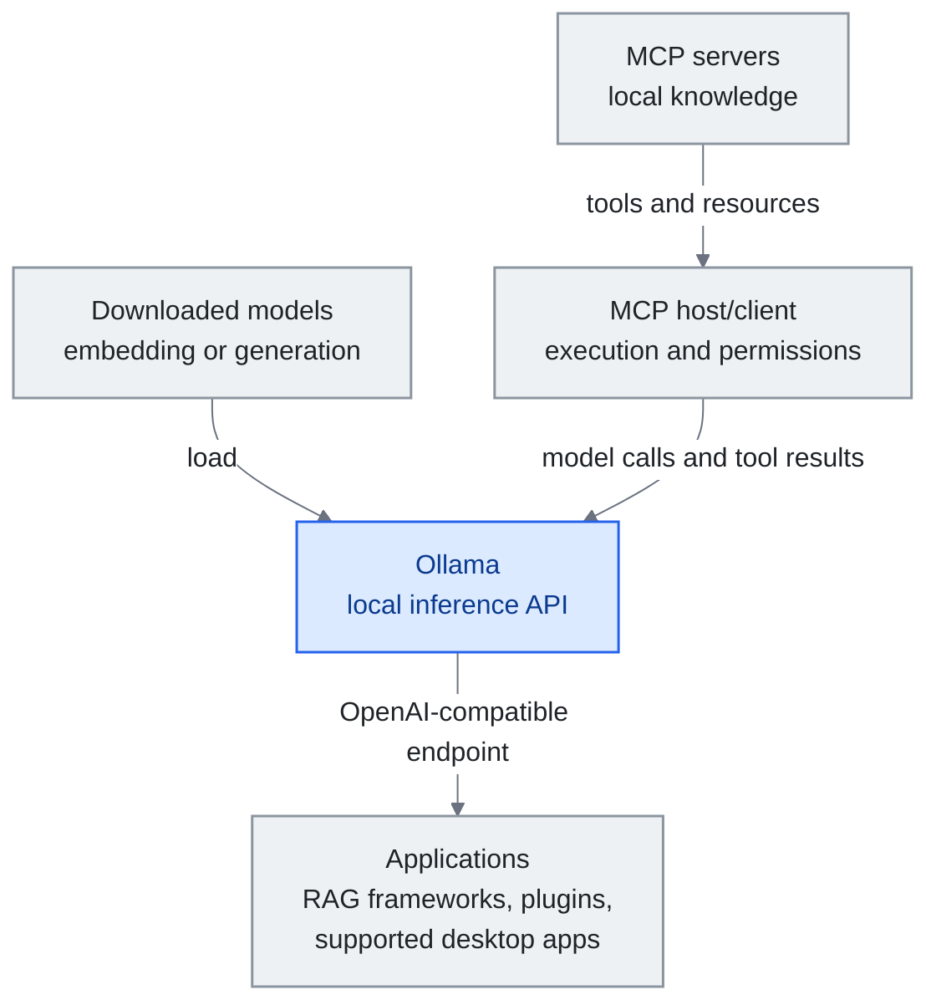

<!-- translation-sync:start -->
> Traducción asistida por máquina sincronizada con la edición inglesa de 2026-10-31, con revisión de estructura y contenido. El código y las etiquetas de los diagramas conservan el original; los tiempos de lectura se estiman a partir del inglés.
> [English source](../../../chapters/12-local-models.md) · [Sync record](../../SYNC.md)
<!-- translation-sync:end -->

<a id="chapter-12-local-models-for-knowledge-engineering"></a><!-- i18n-anchor -->

# Capítulo 12: Modelos locales para la ingeniería del conocimiento

> **En una frase:** Los modelos locales trasladan la inferencia al hardware propio, reducen la exposición al proveedor y la factura de API por token, y añaden costes operativos locales.
>
> **Por qué importa:** El conocimiento sensible y el ajuste fino personal convierten el límite de inferencia en una decisión arquitectónica; herramientas, registros y sincronización siguen necesitando controles propios.
>
> **Tiempo de lectura:** ~14 min (estimación del original en inglés: 3,052 palabras / 230 palabras por minuto)

*Figura: Ollama sirve los modelos descargados a las aplicaciones mediante una API de inferencia. Por separado, un anfitrión/cliente MCP ejecuta herramientas y hace cumplir los permisos, enviando a Ollama llamadas al modelo y resultados de herramientas. La compatibilidad del endpoint por sí sola no proporciona orquestación MCP. Los modelos y las integraciones concretos se describen más adelante.*

*En pantallas estrechas, desplace horizontalmente el diagrama para leerlo a tamaño completo.*



Los capítulos anteriores describen una pila de ingeniería del conocimiento que supone, en gran medida, acceso a API de nube: enviar la ventana de contexto a Anthropic, OpenAI o Google y recibir una respuesta. Esto funciona bien para la mayoría. Pero crece el grupo de profesionales para quienes la inferencia en nube es poco práctica o indeseable: quienes trabajan con datos corporativos sensibles, están sujetos a requisitos estrictos de residencia de datos o quieren cerrar por completo el ciclo ajustando modelos sobre su propio conocimiento compilado.

Este capítulo aborda la intersección de modelos locales e ingeniería del conocimiento. No incluye guías de compra de GPU, comparativas de benchmarks ni técnicas de cuantización, temas bien cubiertos por otros recursos. Se centra en las decisiones arquitectónicas relevantes al traer el modelo a la infraestructura propia.

---

<a id="why-local-matters-for-knowledge-engineering"></a><!-- i18n-anchor -->

## Por qué importa lo local en ingeniería del conocimiento

Tres fuerzas impulsan la adopción de modelos locales en sistemas de conocimiento:

**Privacidad como arquitectura, no como política.** RAG respaldado por nube puede enviar fragmentos recuperados al proveedor. La inferencia local elimina esa transferencia al proveedor del modelo cuando todo el recorrido permanece local. Las llamadas a herramientas, telemetría, registros y sincronización siguen necesitando revisión. Algunas cargas jurídicas, sanitarias y gubernamentales exigen este límite; el requisito depende del despliegue.

**Coste a escala.** Un sistema con procesos continuos en segundo plano —comprobaciones de la bóveda, compilación automática de notas y reindexación periódica— puede generar miles de llamadas diarias a API. La ejecución local elimina la factura del proveedor por token, pero electricidad, capacidad de hardware y mantenimiento siguen costando. Para mantenimiento permanente del conocimiento —la operación Lint de la arquitectura de Karpathy— compare esos costes con el uso de API, en lugar de asumir inferencia gratuita.

**El ajuste fino como destino final.** Quizá sea la razón más convincente. Cuando la base de conocimiento alcanza suficiente calidad —cientos de notas bien estructuradas y enlazadas, compiladas mediante Ingest—, se convierte en un conjunto sintético de datos de alta calidad. Puede ajustar un modelo local pequeño sobre esos datos, produciendo un modelo que "knows" su dominio sin recuperación durante la ejecución. El conocimiento está en los pesos, no en la ventana de contexto.

---

<a id="architecture-where-local-models-fit"></a><!-- i18n-anchor -->

## Arquitectura: dónde encajan los modelos locales

No todos los componentes de un harness de conocimiento se benefician por igual de la inferencia local. Estos son los de mayor valor:

<a id="embedding-models-high-value"></a><!-- i18n-anchor -->

### Modelos de embeddings (valor alto)

Los embeddings son la base de cualquier pipeline de RAG. Cada nota añadida a la bóveda debe convertirse en un vector para buscar por similitud. Es una operación de gran volumen y baja complejidad, ideal para inferencia local.

Opciones habituales:
- **nomic-embed-text** (137M parámetros): Embeddings generales de buena calidad, ejecutables en CPU
- **mxbai-embed-large** (335M): Mayor calidad, todavía viable en hardware modesto
- **bge-m3** (568M): Multilingüe, excelente para bóvedas con varios idiomas

Estos modelos son suficientemente pequeños para un portátil moderno sin GPU. La diferencia de calidad entre embeddings locales y de nube —text-embedding-3 de OpenAI, embed de Cohere— se ha reducido mucho; los locales bastan para la mayoría de los casos de gestión del conocimiento.

Ejecución local mediante Ollama:
```
ollama pull nomic-embed-text
```

<a id="query-and-reasoning-medium-value"></a><!-- i18n-anchor -->

### Consulta y razonamiento (valor medio)

Utilizar un modelo local para responder preguntas sobre la bóveda —la operación Query— introduce compensaciones más matizadas. Los modelos de nube (Claude Opus, GPT-4o) siguen siendo claramente mejores en razonamiento complejo, síntesis de varios pasos y seguimiento de instrucciones con matices. Pero para preguntas sencillas basadas en recuperación ("what did I write about X last month?"), los modelos de 7-14B parámetros funcionan bien.

Opciones prácticas:
- **Qwen3-14B**: Buen rendimiento multilingüe, licencia Apache 2.0
- **Llama 3.1-8B-Instruct**: Opción de 8B ajustada para instrucciones; Llama 3.3 es otro modelo distinto de 70B
- **DeepSeek-R1-Distill-Qwen-7B**: Razonamiento destilado del R1 completo, licencia MIT
- **Gemma 3-12B**: Arquitectura eficiente de Google, adecuada para salidas estructuradas

El patrón más eficaz es un **enfoque por niveles**: modelo local para consultas rutinarias y mantenimiento, y API de nube para síntesis compleja y tareas creativas. Aplica a la selección de modelos el principio de divulgación progresiva de la ingeniería de harness: utilizar el modelo de capacidad mínima suficiente para cada tarea.

<a id="knowledge-compilation-high-value"></a><!-- i18n-anchor -->

### Compilación de conocimiento (valor alto)

La operación Ingest —leer fuentes sin procesar y compilarlas en páginas wiki estructuradas— encaja sorprendentemente bien con modelos locales. La tarea está bien definida: leer un artículo, extraer ideas fundamentales y generar una nota estructurada con wikilinks. Un modelo de 14B que siga bien las instrucciones puede hacerlo de forma fiable, especialmente si el prompt de sistema especifica con precisión el formato de salida.

Aquí el argumento económico es más fuerte. Si Web Clipper captura 5-10 artículos diarios, la compilación local permite ampliar la base sin una factura de API por token, sujeta a la capacidad de cómputo y a los costes operativos.

<a id="vault-maintenance-high-value"></a><!-- i18n-anchor -->

### Mantenimiento de la bóveda (valor alto)

La operación Lint —buscar contradicciones, obsolescencia y notas huérfanas— es un proceso por lotes favorable a la inferencia local. Puede ejecutarse cada hora, cada día o continuamente dentro del presupuesto de cómputo del equipo. Un modelo local examina la bóveda y genera un informe de salud; mantener privado ese flujo también exige herramientas y almacenamiento locales.

---

<a id="the-fine-tuning-endgame"></a><!-- i18n-anchor -->

## El ajuste fino como destino final

Andrej Karpathy expuso una visión que muchos profesionales persiguen: cuando la wiki mantenida por LLM alcance suficiente calidad, utilizarla para ajustar un modelo pequeño de lenguaje personal (SLM).

El flujo de trabajo:

1. **Compilar** la base mediante meses de operaciones Ingest. La wiki crece hasta cientos de notas bien estructuradas y enlazadas.
2. **Extraer** pares de entrenamiento de la wiki: cada nota se convierte en un par (pregunta, respuesta) o (contexto, continuación).
3. **Ajustar** un modelo pequeño de 1-3B parámetros sobre esos datos mediante LoRA o QLoRA.
4. **Desplegar** localmente el modelo ajustado. Responde sobre su dominio desde sus pesos, sin necesitar recuperación.

Esto no sustituye por completo a RAG: el modelo ajustado sigue beneficiándose de la recuperación para información reciente y detalles concretos. Pero reduce mucho su carga. El modelo "knows" los conceptos, relaciones y patrones fundamentales del dominio. RAG solo tiene que complementarlos con información nueva o muy específica.

Las herramientas de este pipeline son maduras:
- **Unsloth** para ajuste fino eficiente (2x más rápido, un 60% menos de memoria)
- **Axolotl** para configuraciones de entrenamiento gestionadas
- **MLX** (Apple Silicon) o **llama.cpp** para inferencia local del modelo ajustado

---

<a id="integration-patterns"></a><!-- i18n-anchor -->

## Patrones de integración

<a id="pattern-1-ollama-as-universal-backend"></a><!-- i18n-anchor -->

### Patrón 1: Ollama como backend universal

Ollama ofrece una interfaz unificada para ejecutar modelos locales mediante una API compatible con OpenAI. Cualquier herramienta que utilice la API de OpenAI puede apuntar a un modelo local cambiando la URL base:

```
base_url: http://localhost:11434/v1
model: qwen3:14b
```

Esto funciona con LangChain, LlamaIndex, Dify y la mayoría de los frameworks de RAG. En Obsidian, complementos como Smart Connections pueden configurarse para utilizar un modelo local de Ollama en lugar de API de nube.

A finales de 2026 apareció el patrón inverso. En lugar de que herramientas externas apunten a Ollama, las aplicaciones oficiales de escritorio de proveedores de modelos cerrados empezaron a hacerlo. Ollama **v0.33.0** (21 de agosto de 2026) incorporó la configuración para usar Ollama como proveedor de pasarela externo en Claude Desktop; **v0.34.0** (5 de septiembre de 2026) añadió integración con ChatGPT Desktop, permitiendo seleccionar allí modelos de Ollama mediante la aplicación de Ollama para macOS. Esa misma v0.34.0 añadió búsqueda de herramientas de cliente compatible con OpenAI, compactación de respuestas y salidas estructuradas más rápidas en Apple Silicon. Para un harness local de conocimiento, la consecuencia es acotada pero real: el cliente de chat de consumo deja de ser una razón para enviar una consulta fuera del equipo, porque puede redirigirse a un modelo que se ejecuta dentro. Es el equivalente, desde la aplicación del proveedor, del protocolo de sistema operativo `LanguageModel` descrito después: el mismo paso a un backend local de pleno derecho, iniciado por proveedores de modelos cerrados y no por el propietario de la plataforma.

<a id="pattern-2-hybrid-cloud-local"></a><!-- i18n-anchor -->

### Patrón 2: Híbrido de nube y local

La arquitectura más práctica para la mayoría:
- **Local**: Embeddings, mantenimiento de la bóveda, consultas rutinarias y compilación de conocimiento
- **Nube**: Razonamiento complejo, síntesis creativa y flujos de agentes de varios pasos

Esto aporta las ventajas de privacidad y coste de la inferencia local en operaciones de gran volumen y conserva el acceso a capacidades de frontera para tareas que las necesitan.

<a id="pattern-3-mcp-with-local-models"></a><!-- i18n-anchor -->

### Patrón 3: MCP con modelos locales

La integración necesita un **anfitrión/cliente MCP**, como muestra el [capítulo 7](07-mcp.md). Este descubre herramientas de los servidores, envía definiciones y resultados mediante la API del modelo, ejecuta llamadas autorizadas y hace cumplir los permisos. Ollama aporta inferencia: un endpoint compatible con OpenAI no es por sí solo un anfitrión MCP. El harness puede mantenerse local cuando anfitrión, servidores, modelo y almacenamiento se ejecutan localmente.

---

<a id="2026-local-models-get-an-os-native-api-and-vendor-qat"></a><!-- i18n-anchor -->

## 2026: los modelos locales obtienen API nativas del sistema operativo y QAT del proveedor

Tres lanzamientos de 2026 cambiaron el panorama de inferencia local de este capítulo.

**Apple abre Foundation Models a cualquier proveedor (WWDC26, 8 de junio).** El framework Foundation Models de Apple —la misma API Swift de Apple Intelligence, con streaming, llamadas a herramientas y salida estructurada `@Generable`— publicó un **protocolo `LanguageModel` / `LanguageModelExecutor`** y Apple aporta un backend de referencia **`MLXLanguageModel`** que carga modelos de mlx-community desde Hugging Face durante la ejecución y los almacena en caché en disco. Para la ingeniería local del conocimiento, los modelos abiertos pasan a ser un *backend nativo del sistema operativo y de pleno derecho*, no una integración externa. Una aplicación de conocimiento de macOS o iOS puede dirigirse a una sola API Swift y alternar entre el modelo del dispositivo de Apple y un modelo descargado de pesos abiertos sin reescribir la inferencia; Anthropic y Google publican paquetes Swift compatibles. El patrón de Ollama como backend universal obtiene un equivalente nativo de Apple.

**Gemma 4 QAT (5 de junio).** Google publicó **checkpoints de entrenamiento consciente de cuantización** para los cinco tamaños de Gemma 4 (E2B, E4B, 12B, 26B-A4B y 31B), simulando precisión de 4 bits *durante* el entrenamiento para que los pesos cuantizados recuperen gran parte de la calidad BF16 en lugar de perderla con compresión posterior. Publicó **artefactos desde el primer día para llama.cpp (GGUF), Ollama, LM Studio y MLX**, con soporte inicial de vLLM para E2B, E4B, 12B y 31B; el MoE 26B-A4B quedó excluido del formato QAT w4a16-ct de vLLM porque la dimensión de expertos de 704 pierde demasiada calidad a 4 bits. En memoria, el artículo de Google no da ningún porcentaje; un análisis externo estima una **reducción de VRAM del 72% frente a BF16**, mientras Google solo afirma que E2B baja de 1GB mediante un formato móvil. Lo relevante es el *patrón del lanzamiento*: QAT nativo del proveedor y distribución simultánea en múltiples entornos desde el primer día se convierten en la forma habitual de un lanzamiento serio de pesos abiertos, reduciendo la fricción de la decisión "run it locally" que defiende este capítulo.

**Meta publica un modelo de pesos abiertos para agentes locales (Muse Glimmer, 10 de agosto).** Meta Superintelligence Labs publicó **Muse Glimmer**, un modelo denso de 30B destilado del cerrado Muse Spark y con licencia Apache 2.0, presentado explícitamente para agentes en dispositivos, no como un artefacto de investigación reducido. Cuantizado a 4 bits ocupa menos de 20GB, dimensionado para los 24-32GB de memoria de una GPU de consumo, en Mac o PC. Los benchmarks de Meta informan de aceleraciones de decodificación especulativa **DFlash** de **3.1x en RTX 5090**, **1.8x en M5-Max** y **1.5x en M4-Max**, además de superar a Gemma4-31B y Qwen3.6-27B; son cifras de Meta, no reproducidas independientemente. Lo distingue la distribución: soporte casi desde el día cero en Hugging Face, Ollama, llama.cpp, MLX, ExecuTorch, LM Studio, Unsloth, vLLM, SGLang, Together AI, Fireworks AI y OpenRouter. Todos los modelos de pesos abiertos que el libro había tratado hasta entonces en el contexto del despliegue local eran para servidores —Kimi K3 del capítulo 9 queda expresamente fuera de lo local por sus 2.8T parámetros—; Muse Glimmer es el primer modelo de un laboratorio estadounidense de frontera diseñado y evaluado desde el inicio para agentes locales con una GPU de consumo, publicado con el mismo patrón de QAT del proveedor y soporte simultáneo que mostró Gemma 4 QAT. El patrón señalado como propio de Google ya no lo es. (Meta anunció por separado una futura publicación de los pesos de Muse Spark 1.2: es otro evento, sin fecha, y no se cubre aquí.)

---

<a id="local-context-and-decision-services"></a><!-- i18n-anchor -->

## Servicios locales de contexto y decisiones

**Contexto compartido en el dispositivo (23 de septiembre de 2026).** Liquid AI anunció **Liquid Context**, optimizado para la NPU Hexagon de Qualcomm: una capa de contexto mantenida localmente y con permisos definidos que pueden consumir agentes embebidos, de nube e híbridos. El mantenimiento del contexto y el agente que lo utiliza pasan a ser componentes separados, ampliando la [arquitectura de memoria del capítulo 6](06-agent-memory.md) más allá de los almacenes por agente. El anuncio se dirige a fabricantes OEM; sus ejemplos son ilustrativos, no evidencia de dispositivos de consumo distribuidos ampliamente. Una capa local de memoria tampoco convierte en locales a los agentes de nube conectados.

**Decisiones locales tipadas (29 de septiembre de 2026).** Ollama 0.35 introdujo **`/v1/systemone`**, que acepta estado y preguntas tipadas con nombre y devuelve decisiones acotadas con probabilidades. Nimble 9B y los modelos experimentales Tev1 permiten enrutamiento, triaje y moderación mediante una interfaz local de decisiones, en lugar de generar una respuesta en prosa. El cambio arquitectónico es la interfaz, no una clasificación de benchmarks. Las probabilidades siguen necesitando validación específica para cada carga; el código determinista del anfitrión debe hacer cumplir permisos y reglas de escalado.

La convergencia entre proveedores siguió el **1 de octubre**, cuando Cloudflare anunció **Clef/Clef-flash** con licencia Apache 2.0 y salidas tipadas compatibles con Jev; Ollama anunció soporte local y en nube para Clef el **19 de octubre**. Se extiende así el mismo contrato de decisiones a distintas ubicaciones de despliegue. Son anuncios de los proveedores, no evidencia independiente de decisiones calibradas ni de ejecución autónoma segura.

---

<a id="what-this-chapter-does-not-cover"></a><!-- i18n-anchor -->

## Lo que este capítulo no cubre

Este capítulo omite deliberadamente:
- **Recomendaciones de hardware**: La selección de GPU, los requisitos de VRAM y el alquiler de GPU de nube están ampliamente tratados en la wiki de r/LocalLLaMA y la documentación de Ollama.
- **Benchmarks de modelos**: Las clasificaciones cambian mensualmente. Consulte la posición actual en [Open LLM Leaderboard](https://huggingface.co/spaces/open-llm-leaderboard/open_llm_leaderboard).
- **Detalles de cuantización**: Las comunidades de llama.cpp y Ollama documentan los formatos GGUF, INT4 frente a INT8 y las compensaciones entre calidad y velocidad.
- **Infraestructura de entrenamiento**: Las configuraciones multi-GPU, el entrenamiento distribuido y las plataformas de nube quedan fuera de la ingeniería del conocimiento.

El foco es la pregunta arquitectónica: ¿dónde encajan los modelos locales en su harness de conocimiento y cómo cambian lo que es posible?

---

<a id="key-takeaways"></a><!-- i18n-anchor -->

## Ideas fundamentales

1. **Los embeddings locales son una buena opción inicial que evaluar.** Reducen la exposición al proveedor y las facturas por token, pero el presupuesto debe seguir incluyendo hardware y costes operativos.

2. **La inferencia por niveles es la opción pragmática.** Local para operaciones rutinarias y nube para razonamiento complejo. No fuerce a un modelo de 7B a hacer lo que uno de frontera hace mejor.

3. **La compilación está infravalorada.** Ejecutar Ingest localmente traslada trabajo recurrente desde la factura de un proveedor al presupuesto de cómputo propio.

4. **El ajuste fino es el destino, no el punto de partida.** Construya primero la wiki y compile cientos de notas de calidad. Después ajuste el modelo. La calidad de los datos de entrenamiento, su wiki, determina la del modelo resultante.

5. **La privacidad es una decisión arquitectónica.** El conocimiento sensible exige límites explícitos de inferencia, herramientas, almacenamiento y sincronización; la inferencia local controla una parte del recorrido.

---

<a id="three-things-to-take-away"></a><!-- i18n-anchor -->

## Tres ideas para recordar

- **La inferencia local controla un límite de datos.** Solo reduce la exposición al proveedor si herramientas, registros y sincronización respetan también el límite previsto.
- **La economía cambia para el trabajo permanente.** Los embeddings, la compilación y Lint intercambian la factura de API por token por hardware y costes operativos locales.
- **Los servicios locales incluyen ya contexto y decisiones.** La capa compartida de memoria anunciada por Liquid Context y el endpoint de decisiones tipadas de Ollama separan el mantenimiento recurrente del contexto y los juicios acotados de la generación general de texto.

---

<a id="sources"></a><!-- i18n-anchor -->

## Fuentes

- Ollama: [https://ollama.ai](https://ollama.ai)
- Ollama. FAQ (consultadas el 31 de octubre de 2026). [https://docs.ollama.com/faq](https://docs.ollama.com/faq) -- Procesamiento local frente a nube; `OLLAMA_NO_CLOUD=1` desactiva los modelos de nube y la búsqueda web.
- Liquid AI. "Liquid AI, in Collaboration with Qualcomm Technologies, Brings Personal AI Context to Devices Powered by Snapdragon" (23 de septiembre de 2026). [https://www.liquid.ai/blog/liquid-context-qualcomm](https://www.liquid.ai/blog/liquid-context-qualcomm) -- Anuncio del proveedor sobre contexto local con permisos para OEM; experiencias ilustrativas, no censo de despliegues de consumo.
- Ollama. "Ollama now supports Jev-style decision models" (29 de septiembre de 2026). [https://ollama.com/blog/ollama-now-supports-jev-style-decision-models](https://ollama.com/blog/ollama-now-supports-jev-style-decision-models) -- Interfaz `/v1/systemone` de Ollama 0.35 y modelos locales de lanzamiento.
- Cloudflare. "Introducing Clef: our open-source decision models, and new RL fine-tuning platform" (1 de octubre de 2026). [https://blog.cloudflare.com/clef-decision-models](https://blog.cloudflare.com/clef-decision-models) -- Pesos Apache 2.0 y API de decisiones compatible con Jev; los benchmarks son afirmaciones del proveedor.
- Ollama. "Clef is available on Ollama's cloud" (19 de octubre de 2026). [https://registry.ollama.com/blog/clef](https://registry.ollama.com/blog/clef) -- El artículo alojado por el proveedor también documenta soporte de ejecución local.
- Meta. Fichas de Llama: [https://huggingface.co/meta-llama/Llama-3.1-8B-Instruct](https://huggingface.co/meta-llama/Llama-3.1-8B-Instruct) (23 de julio de 2024) y [https://huggingface.co/meta-llama/Llama-3.3-70B-Instruct](https://huggingface.co/meta-llama/Llama-3.3-70B-Instruct) (6 de diciembre de 2024) -- Distinguen el ejemplo ajustado para instrucciones de 8B de la versión Llama 3.3 de 70B.
- DeepSeek. Repositorio de DeepSeek-R1 y lista de modelos destilados (enero de 2025). [https://github.com/deepseek-ai/DeepSeek-R1](https://github.com/deepseek-ai/DeepSeek-R1) -- Identificador exacto `DeepSeek-R1-Distill-Qwen-7B`.
- Ollama. Versión v0.33.0 (21 de agosto de 2026). [https://github.com/ollama/ollama/releases/tag/v0.33.0](https://github.com/ollama/ollama/releases/tag/v0.33.0) --- Claude Desktop configurable para utilizar Ollama como pasarela externa.
- Ollama. Versión v0.34.0 (5 de septiembre de 2026). [https://github.com/ollama/ollama/releases/tag/v0.34.0](https://github.com/ollama/ollama/releases/tag/v0.34.0) --- Integración de ChatGPT Desktop mediante la aplicación macOS de Ollama; búsqueda de herramientas de cliente compatible con OpenAI, compactación y salida estructurada más rápida en Apple Silicon.
- llama.cpp: [https://github.com/ggml-org/llama.cpp](https://github.com/ggml-org/llama.cpp)
- Unsloth: [https://github.com/unslothai/unsloth](https://github.com/unslothai/unsloth)
- Karpathy, Andrej. Patrón "LLM Wiki" --- Gist que define las capas fuente → wiki → esquema y las operaciones Ingest / Compile / Lint / Query citadas en el capítulo. [https://gist.github.com/karpathy/442a6bf555914893e9891c11519de94f](https://gist.github.com/karpathy/442a6bf555914893e9891c11519de94f)
- Open LLM Leaderboard: [https://huggingface.co/spaces/open-llm-leaderboard](https://huggingface.co/spaces/open-llm-leaderboard)
- Nomic Embed: [https://huggingface.co/nomic-ai/nomic-embed-text-v1.5](https://huggingface.co/nomic-ai/nomic-embed-text-v1.5)
- r/LocalLLaMA: [https://reddit.com/r/LocalLLaMA](https://reddit.com/r/LocalLLaMA)
- Apple. "Bring an LLM provider to the Foundation Models framework," sesión 339 de WWDC26 (8 de junio de 2026). [https://developer.apple.com/videos/play/wwdc2026/339/](https://developer.apple.com/videos/play/wwdc2026/339/) y sesión 241 [https://developer.apple.com/videos/play/wwdc2026/241/](https://developer.apple.com/videos/play/wwdc2026/241/) --- Protocolo público Swift `LanguageModel` / `LanguageModelExecutor`; backend de referencia `MLXLanguageModel` para modelos mlx-community de Hugging Face.
- Google. "Quantization-Aware Training for Gemma 4" (5 de junio de 2026). [https://blog.google/innovation-and-ai/technology/developers-tools/quantization-aware-training-gemma-4/](https://blog.google/innovation-and-ai/technology/developers-tools/quantization-aware-training-gemma-4/) --- Checkpoints QAT para los cinco tamaños; llama.cpp / Ollama / LM Studio / MLX desde el primer día; vLLM inicialmente salvo MoE 26B-A4B. Análisis externo de VRAM (~72% frente a BF16; Google solo afirma que E2B baja de 1GB en formato móvil): [https://runaihome.com/blog/gemma-4-qat-local-ai-hardware-update-2026/](https://runaihome.com/blog/gemma-4-qat-local-ai-hardware-update-2026/).
- Meta Superintelligence Labs. "Introducing Muse Glimmer: an open agentic model" (10 de agosto de 2026). [https://research.meta.ai/blog/introducing-muse-glimmer-open-agentic-model](https://research.meta.ai/blog/introducing-muse-glimmer-open-agentic-model) --- Denso de 30B, Apache 2.0, destilado de Muse Spark; aceleración DFlash y benchmarks de Meta. Fuentes secundarias: Phoronix [https://phoronix.com/news/Meta-Muse-Glimmer](https://phoronix.com/news/Meta-Muse-Glimmer) ; CNBC [https://www.cnbc.com/2026/08/10/meta-muse-glimmer-open-weight-ai.html](https://www.cnbc.com/2026/08/10/meta-muse-glimmer-open-weight-ai.html) ; Ghacks (11 de agosto de 2026) [https://www.ghacks.net/2026/08/11/meta-releases-muse-glimmer-a-30-billion-parameter-open-weight-ai-model-that-runs-on-a-single-consumer-gpu/](https://www.ghacks.net/2026/08/11/meta-releases-muse-glimmer-a-30-billion-parameter-open-weight-ai-model-that-runs-on-a-single-consumer-gpu/).

---

*Anterior: [Capítulo 11 - Hitos de la ingeniería del conocimiento para LLM](11-timeline.md)*

*Siguiente: [Capítulo 13 - Ingeniería de bucles](13-loop-engineering.md)*
