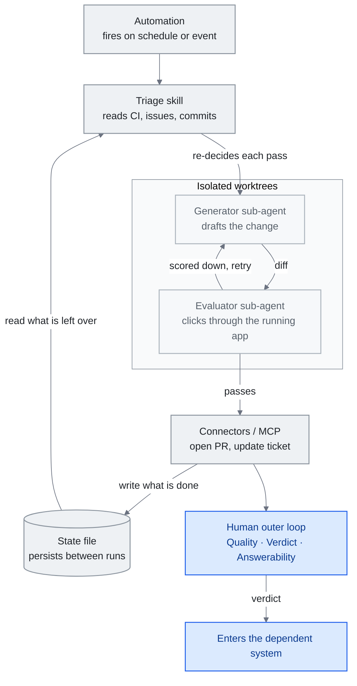

<!-- translation-sync:start -->
> Traducción asistida por máquina sincronizada con la edición inglesa de 2026-10-31, con revisión de estructura y contenido. El código y las etiquetas de los diagramas conservan el original; los tiempos de lectura se estiman a partir del inglés.
> [English source](../../../chapters/13-loop-engineering.md) · [Sync record](../../SYNC.md)
<!-- translation-sync:end -->

<!-- i18n-anchor -->

# Capítulo 13: Ingeniería de bucles: diseñar el sistema que proporciona prompts al agente

> **En una frase:** La ingeniería de bucles construye el sistema que proporciona prompts al agente por usted, para dejar de dirigir manualmente cada turno y diseñar el bucle que ejecuta, comprueba y se retroalimenta.
>
> **Por qué importa:** Es la capa más reciente y menos consolidada de la evolución descrita en esta guía, y la que más probablemente influya en cómo se programa, verifica y revisa el trabajo autónomo de agentes durante el próximo año.
>
> **Tiempo de lectura:** ~18 min (estimación del original en inglés: 4,035 palabras / 230 palabras por minuto)

*Figura: Una pasada del bucle, compuesta por las cinco piezas de la sección 13.3 y el estado externo que la sección 13.3 mantiene separado, termina en el bucle exterior humano y el veredicto de 13.7. Dos conexiones sostienen el argumento: el archivo de estado se lee antes de decidir nada en la ejecución (13.2), y el agente que redacta no es el que puntúa (13.4).*

Es la idea de vida más corta de esta guía. (Conservó ese título durante seis semanas: a finales de julio de 2026, el mismo patrón produjo la propuesta de una capa por encima del bucle, la ingeniería de grafos del [capítulo 14](14-graph-engineering.md).) El término "loop engineering" tiene unas cinco semanas en el momento de escribir: recibió su nombre a principios de junio de 2026, se extendió en días por blogs profesionales, pódcasts y X, y todavía carece de literatura académica. Lo que sigue contiene reservas deliberadas. Cuando una afirmación depende de una cita oral transcrita de tres formas distintas o de una publicación viral que no puso nombre a nada, el capítulo lo indica. El objetivo es describir con precisión un marco emergente, no certificarlo como generación consolidada.

Merece describirse porque cumple una función real en el discurso profesional: da nombre a un cambio implícito en la ingeniería de harness (capítulo 4), pero no aislado por ella: pasar de *dar prompts a un agente* a *diseñar el sistema que se los proporciona*. Si merece una capa propia o es simplemente ingeniería de harness con un planificador es precisamente la pregunta que este capítulo deja abierta.

Este capítulo trata el origen del término, su relación con el harness según sus defensores, las piezas de un bucle, la separación de generador y evaluador que permite comprobar su trabajo, un gran caso de producción, el marco de bucles apilados, el criterio que debe conservar la persona y las primeras señales de adopción, señalando continuamente lo controvertido.

---

<!-- i18n-anchor -->

## 13.1 La semana en que recibió un nombre (junio de 2026)

El catalizador fue una sola publicación. El 7 de junio de 2026, **Peter Steinberger** (@steipete), creador de **OpenClaw** —que Y Combinator describió como "from a weekend project to the most-starred software repo on GitHub in under 5 months, with 346k+ stars,", superando a React— y ahora integrante de OpenAI, escribió:

> Here’s your monthly reminder that you shouldn’t be prompting coding agents anymore.
>
> You should be designing loops that prompt your agents.

La publicación acumuló **8.4M+ impresiones a mediados de julio de 2026**. No puso nombre a nada: Steinberger no utilizó "loop engineering," ni esas palabras aparecen en su texto. El nombre llegó de otras personas que respondieron a la idea que había catalizado.

Ese mismo día, **Addy Osmani** (Google) publicó el ensayo que dio nombre a la práctica (*Loop Engineering*, addyosmani.com/blog/loop-engineering/, 7 de junio; republicado en O'Reilly Radar el 22 de junio). Su definición es la que cita el resto del discurso:

> Loop engineering is replacing yourself as the person who prompts the agent. You design the system that does it instead.

El mismo cambio aparece dentro de un laboratorio de frontera. **Boris Cherny**, creador y responsable de Claude Code en Anthropic, describió su flujo de trabajo de forma similar en un pódcast de mediados de 2026. Según la transcripción más citada de la entrevista de Lenny's Podcast:

> I don't prompt Claude anymore. I have loops running that prompt Claude and figuring out what to do. My job is to write loops.

La cita exige una salvedad, precisamente del tipo que este capítulo pretende explicitar. Es una frase *oral*, transcrita de forma inconsistente entre medios —algunos citan Acquired en lugar de Lenny's—, sin texto literal canónico ni transcripción completa disponibles. Varios medios secundarios corroboran el contenido: Cherny ya no introduce prompts manualmente, sino que escribe bucles que los proporcionan a Claude y deciden la siguiente acción; las palabras exactas no están fijadas.

En conjunto, la semana del 7 de junio produjo un catalizador (Steinberger), un nombre y definición (Osmani) y un eco interno (Cherny). No produjo consenso. El término se concretó en semanas en el discurso profesional, pero divide a quienes ven un cambio real y quienes consideran prematuro el nombre: planificación rebautizada o "the harness with a cron job." Ningún trabajo revisado por pares lo utiliza. La guía lo trata como marco emergente y controvertido (véase la sección de cuarta generación del capítulo 1); por eso cada afirmación fundamental que sigue se vincula a una fuente primaria y las lagunas se señalan, no se rellenan.

---

<!-- i18n-anchor -->

## 13.2 Un nivel por encima del harness

La definición más clara de sus defensores sitúa el bucle directamente por encima del harness del capítulo 4. Osmani declara la relación explícitamente:

> Loop engineering sits one floor above the harness.

Su modelo de lo que *es* un bucle conserva el harness como bloque básico: es el harness que "runs on a timer, it spawns little helpers, and it feeds itself." Explicita que amplía el trabajo anterior, no que lo sustituye: "wrote before about the cousin of this, agent harness engineering, which is making the environment one single agent runs inside."

El desarrollador chino **程序员鱼皮** (liyupi) ofrece la versión más estructural. En su guía del 16 de junio (codefather.cn), organiza técnicas de prompts, gestión de contexto, construcción de harness y bucles como **層層包含**, capas anidadas:

> 这四者是层层包含的关系。提示词技巧、上下文管理、Harness 搭建，这些能力在 Loop 里面全都要用上。

(Las cuatro están anidadas: técnicas de prompts, gestión de contexto y construcción de harness se utilizan *dentro* del bucle.) Es la lógica de capas del capítulo 1 —prompt → contexto → harness— ampliada con un recuadro exterior. Conviene atribuirla con precisión: 鱼皮 reorganiza y estructura términos existentes para desarrolladores chinos; no los acuña. "harness engineering" y "loop engineering" proceden del discurso sobre Claude Code y Cherny.

Su metáfora del caballo traza la frontera entre harness y bucle con especial claridad:

> 如果把 AI 比作一匹马，Harness 就是你给马装上的缰绳、马鞍和围栏，然后你骑在马上手动驾驭它。

(Si la IA es un caballo, el harness son las riendas, la silla y el cercado que se le colocan; después, una persona monta y lo dirige manualmente.)

> 而 Loop 呢，是你设定好一条巡逻路线后，不用上马，让马自己按路线一圈一圈地跑。

(El bucle consiste en fijar una ruta de patrulla y *no montar*: el caballo la recorre por sí solo, vuelta tras vuelta.)

La metáfora expresa la distinción que impide reducir la ingeniería de bucles a "cron for agents": **un bucle no es un planificador.** Un planificador se activa a su hora. Un bucle se activa a su hora *y después lee el estado actual para decidir qué hacer en esa pasada*. La decisión durante la ejecución —examinar CI, incidencias abiertas o pendientes anteriores antes de actuar— es precisamente lo que no aporta una entrada cron. Un bucle combina un planificador con un agente que lee estado y vuelve a decidir en cada pasada. (Referencia cruzada: capítulo 1, "The Key Insight: Coexistence, Not Replacement.")

---

<!-- i18n-anchor -->

## 13.3 De qué está hecho un bucle

El ensayo de Osmani ofrece el inventario más concreto. Su sección se titula **"The five pieces, and then notes"**, y el recuento importa porque es fácil inflarlo. Son *cinco piezas más estado externo*, no seis bloques equivalentes:

- **Automatizaciones**: El desencadenante que activa el bucle, una programación o un evento.
- **Worktrees**: Copias de trabajo aisladas para evitar colisiones entre agentes paralelos.
- **Habilidades**: Los paquetes de capacidades reutilizables del capítulo 5.
- **Conectores (MCP)**: El acceso a herramientas y datos del capítulo 7.
- **Subagentes**: Los pequeños asistentes que crea una ejecución.

El "then notes" es **estado externo / memoria**: un archivo Markdown o tablero de Linear que conserva el progreso entre ejecuciones. No es un sexto bloque equivalente, sino la base que las cinco piezas leen y escriben.

Su ejemplo es un bucle de triaje matutino, útil porque cada pieza corresponde a una de las cinco. Una **automatización** se activa cada mañana. Una **habilidad** lee fallos de CI, incidencias abiertas y commits recientes. Los **worktrees** aislados alojan a un **subagente** que redacta una corrección y a otro que la revisa. Los **conectores** abren pull requests y actualizan tickets. Lo no resuelto aparece en una bandeja de triaje y un **archivo de estado** conserva el progreso para que la siguiente mañana continúe en lugar de reiniciar. El archivo de estado es fundamental: sin él, el bucle no recuerda ayer y cada ejecución empieza desde cero.

---

<!-- i18n-anchor -->

## 13.4 Generador frente a evaluador

Un bucle que se proporciona sus propios prompts hereda un problema difícil: *¿quién comprueba el trabajo?* Si el agente que produce el cambio también lo califica, el bucle optimiza la autocomplacencia. La fuente primaria más citada es anterior a la semana del nombre, señal de que la práctica precedió a la etiqueta. **Prithvi Rajasekaran**, en *"Harness design for long-running application development"* (anthropic.com/engineering/harness-design-long-running-apps, 24 de marzo de 2026), documenta el fallo: al evaluar sus resultados, los agentes "tend to respond by confidently praising the work" y "reliably skew positive when grading their own work."

Su solución toma una estructura del entrenamiento adversarial:

> Taking inspiration from Generative Adversarial Networks (GANs), I designed a multi-agent structure with a generator and evaluator agent.

La asimetría es la idea central y justifica el agente adicional:

> Tuning a standalone evaluator to be skeptical turns out to be far more tractable than making a generator critical of its own work.

El evaluador comprueba *comportamiento*, no diferencias de código. En el diseño de Rajasekaran, "used the Playwright MCP to click through the running application the way a user would, testing UI features, API endpoints, and database states," y "would navigate the page on its own, screenshotting and carefully studying the implementation before scoring each criterion and writing a detailed critique." Leer el código no es verificarlo; ejecutarlo sí.

Esta separación de generador y evaluador aparece ya en capacidades básicas de control de bucles publicadas; la distinción fundamental es *cómo sabe el bucle cuándo detenerse*:

- **`/loop`** (Claude Code v2.1.71) vuelve a ejecutar un prompt o comando a intervalos; el registro de cambios dice "Added `/loop` command to run a prompt or slash command on a recurring interval (e.g. `/loop 5m check the deploy`)." Las tareas recurrentes caducan siete días después de crearse: se activan una última vez y se eliminan.
- **`/goal`** (Claude Code v2.1.139+) ejecuta *hasta que se cumple una condición*: "a small fast model checks whether the condition holds" —Haiku por defecto—, un evaluador separado que la comprueba "after every turn, so completion is decided by a fresh model rather than the one doing the work." Internamente, `/goal` es "a wrapper around a session-scoped prompt-based Stop hook."
- **Cloud Routines** funcionan "on Anthropic-managed cloud infrastructure, so they keep working when your laptop is closed"; el intervalo mínimo es una hora y cada ejecución comienza con un clon nuevo.
- **Las automatizaciones programadas de Codex** admiten frecuencias diarias, semanales o personalizadas mediante una regla de recurrencia RFC 5545 (RRULE).

El contraste entre `/loop` y `/goal` expresa la separación de generador y evaluador como diseño de producto. `/loop` es *repetición por intervalo*: vuelve a activarse según el reloj, independientemente del estado. `/goal` es *terminación juzgada por condición*: un segundo modelo independiente decide cuándo está terminado el trabajo. Uno repite; el otro dictamina. Un bucle serio suele necesitar ambos: un desencadenante para ejecutar y un evaluador para saber cuándo detenerse.

---

<!-- i18n-anchor -->

## 13.5 Caso de producción: los minions de Stripe (marzo de 2026)

El mayor bucle de producción divulgado es **"minions."** de Stripe. **Steve Kaliski**, ingeniero de Stripe, describió el sistema en el pódcast *"How I AI"*, presentado por Claire Vo, en marzo de 2026; el blog de desarrollo de Stripe explica sus mecanismos en dos artículos de *Minions*. (Las fuentes secundarias discrepan sobre el día del episodio, por lo que aquí solo se indica el mes.)

La cifra principal es el volumen de resultados desatendidos. Kaliski afirma que Stripe está "landing about 1,300 PRs that have no human assistance besides review per week." El blog expresa la misma cifra con cautela: "over a thousand pull requests merged each week at Stripe are completely minion-produced," y aunque son "human-reviewed,", "contain no human-written code."

Un minion se activa desde Slack mediante una reacción de emoji específica o mencionando la aplicación. Según Stripe, "by tagging our Slack app, engineers can kick off a minion directly from the thread discussing a change."

El detalle fundamental para esta guía es *dónde traza Stripe la frontera entre lo determinista y lo probabilístico*. El contexto se ensambla **antes** de ejecutar el modelo y de forma determinista: "We deterministically run relevant MCP tools over likely-looking links before a minion run even starts, to better hydrate the context." Solo entonces empieza la parte probabilística. El bucle central es una bifurcación de **Goose**, el agente abierto de Block: "the core agent loop runs on a fork of Block's coding agent goose ... which we forked early on." La ejecución se aísla en **devboxes** de Stripe; según el blog de desarrollo, no el pódcast, "a Stripe devbox is an AWS EC2 instance," tratada como "cattle, not pets": normalizada y desechable, no personalizada y de larga vida.

La lección del marco es que la fiabilidad no procede de un modelo más inteligente, sino de *situar las fronteras*: preparar contexto determinista antes de generar probabilísticamente y trasladar a la persona de escribir a revisar. Un ingeniero sigue revisando cada pull request de un minion. El bucle escaló la escritura; no eliminó a la persona, sino que la reubicó.

---

<!-- i18n-anchor -->

## 13.6 Apilar bucles

*"The Art of Loop Engineering"* de **LangChain** (Sydney Runkle, 16 de junio de 2026) es el intento más claro de estructurar internamente la capa. Parte del caso básico:

> The core agent algorithm is simple: give the LLM context and let it call tools in a loop until it's done.

A partir de ahí apila cuatro niveles. Los encabezados originales mezclan las etiquetas "Loop" y "Level" y se reproducen tal como están escritos: **"Loop 1: The Agent," "Level 2: Verification loop," "Level 3: Event driven loop," "Level 4: Hill climbing loop."** La progresión:

1. **Loop 1: The Agent**: Bucle básico de llamadas a herramientas; recibe contexto y llama hasta terminar.
2. **Level 2: Verification loop**: Comprobación independiente de la salida; la separación de generador y evaluador de §13.4 convertida en un nivel.
3. **Level 3: Event driven loop**: Se activa por eventos reales, no solo por un intervalo o una intervención humana.
4. **Level 4: Hill climbing loop**: Bucle de mejora del sistema a lo largo de ejecuciones sucesivas.

Una precisión, porque la cobertura secundaria exagera: la página presenta el cuarto nivel como *mejora entre ejecuciones*, no como sistema que reescribe su propio harness. La afirmación más fuerte no está en la fuente. Runkle también toma **"loopcraft"**, pero lo atribuye a Swyx y cita su texto "loopcraft: the art of stacking loops." Lo acuñó Swyx y LangChain lo cita; no es una creación de LangChain.

**Un harness externo de varios días divulgado.** El [caso de Third Moment Research](https://openai.com/index/third-moment-research/) publicado por OpenAI el 14 de octubre de 2026 informa de 10,000 agentes simultáneos e investigaciones de 36-48 horas. Codex se ejecuta dentro de otro harness que examina trayectorias sin terminar y elige entre reintentar, finalizar o escalar a una persona. Hace operativo el patrón de bucles apilados. Son divulgaciones del proveedor y del cliente, sin tasas de finalización verificadas independientemente; funcionar durante días no demuestra progreso útil sostenido.

---

<!-- i18n-anchor -->

## 13.7 El bucle exterior: lo que conserva la persona

Si §13.1--13.6 describen el bucle del agente, la continuación de Osmani describe el que debe conservar la persona. *"Own the Outer Loop"* (addyo.substack.com/p/own-the-outer-loop) se anunció en X el 8 de julio de 2026; la copia de Substack está fechada el 9 de julio. Su distinción: los agentes ejecutan el **bucle interior** —investigar, implementar, probar/verificar e informar— y el ingeniero conserva el **exterior**. Su tesis es directa:

> Engineers own the outer loop.

El bucle exterior es el criterio que no se delega, estructurado en tres pilares con sus términos exactos: **Quality**, **Verdict** y **Answerability**. Quality es la presión de las comprobaciones previas a la actuación de los agentes. **Verdict** es "the final decision we make before work enters our dependent system." **Answerability** es "the guarantee that if someone asks, I can explain why." (Utiliza *Verdict* en singular y "quality bar" no es su expresión: el pilar es simplemente *Quality*.) Su razón para mantenerlos en manos humanas:

> An agent can write it. But before it reaches users, someone must explain why it should exist, why it's safe enough to be part of production, and what they will do when it is wrong.

Identifica tres fallos de delegar demasiado el bucle exterior: **deuda cognitiva**, la "erosion of your understanding and memory of how to solve problems"; **rendición cognitiva**, "blindly accepting what AI gives you"; y el **impuesto de orquestación**, el lastre de crear más agentes de los que el propio criterio puede abarcar. Son los costes de pulsar "go" sin seguir ejerciendo de ingeniero.

El vínculo con el ensayo del 7 de junio es su instrucción final, que advierte precisamente de eso:

> Build the loop. But build it like someone who intends to stay the engineer, not just the person who presses go.

Y la frase que cuestiona que un bucle se justifique por sí mismo:

> Two people can build the exact same loop and get completely opposite results.

El bucle solo es tan bueno como el bucle exterior que lo rodea. Ese es el núcleo honesto de todo el marco.

---

<!-- i18n-anchor -->

## 13.8 Señales de adopción

Tres señales muestran la expansión más allá de sus creadores. Cada una se limita a lo verificable y excluye las exageraciones que circularon junto a ella.

**Proveedor.** La cuenta oficial de desarrolladores de Anthropic **@ClaudeDevs** publicó el artículo de X *"Getting started with loops"* el 6 de julio de 2026, con aproximadamente **6.0M impresiones y 38K+ guardados** a mediados de julio. Enseña directamente el bucle de agentes —"Every prompt you send starts a manual loop with you directing each turn. Claude gathers context, takes action, checks its work, repeats if needed, and responds"— y recorre bucles por turnos, por objetivo (`/goal`) y por tiempo (`/loop`, `/schedule`). Conviene conservar el matiz editorial: el título del artículo de X dice *"loops,"*, no *"loop engineering."* La etiqueta "loop engineering" aparece en el marco de la copia canónica del blog de Claude (claude.com/blog/getting-started-with-loops), no en el vocabulario del producto. Enseñar bucles es una señal más débil que adoptar el término, y solo la primera está verificada.

**China.** La guía 保姆级 ("nanny-level") de 鱼皮 del 16 de junio es la entrada al discurso de desarrolladores chinos. Su título, 「提示词工程已死，Loop Engineering 称王！保姆级教程 + 项目实战」 ("Prompt engineering is dead, Loop Engineering reigns! Nanny-level tutorial + project practice"), empieza con 已死 ("is dead"); ese reclamo exagerado se matiza en el propio cuerpo: el argumento 層層包含 de la guía (§13.2) sostiene que las técnicas de prompts se *utilizan dentro* del bucle, no que desaparezcan. Como aproximación al alcance, su cuenta de GitHub muestra **23.9k seguidores**. (Circulan cifras de audiencia total mayores, pero no se pudieron verificar con una fuente primaria y se omiten.)

**Memoria y evaluación.** El subproblema del que más dependen los bucles —estado entre sesiones que sobrevive de una ejecución a otra— ya tiene benchmark propio. **Continual Learning Bench** de Snorkel (arXiv 2606.05661; Snorkel AI / UC Berkeley SkyRL / UW-Madison) separa agente, sistema de memoria y tarea. Los sistemas con **Fable como base de memoria superaron a los construidos sobre Opus o Sonnet** (entrevista Benchtalks de Snorkel; hallazgo cualitativo: el artículo enumera Opus 4.7 / Sonnet 4.6 / Gemini 3.1 Pro / Gemini 3 Flash / GPT-5.4 y no atribuye una puntuación numérica a Fable). En el lanzamiento, los mejores sistemas alcanzaban aproximadamente **25% de mejora normalizada**, con aprendizaje en contexto al frente de la clasificación. La señal no es el número, sino que *qué memoria respalda al bucle* ya es un eje medido.

Cinco semanas después de recibir nombre, la ingeniería de bucles tiene definición, relación declarada con el harness, un gran caso de producción, un programa formativo de un proveedor de frameworks, una guía de amplia difusión en China y material de un proveedor sobre bucles. No tiene literatura académica, recepción consolidada ni acuerdo en que sea una verdadera cuarta generación en lugar de ingeniería de harness con planificador y archivo de estado. La guía la sigue como emergente, no consolidada; la advertencia de Osmani de que dos personas pueden construir el mismo bucle y obtener resultados opuestos resume con justicia por qué.

---

<!-- i18n-anchor -->

## Tres ideas para recordar

- **Un bucle no es un planificador.** Se activa a su hora, lee el estado actual y vuelve a decidir qué hacer en esa pasada.
- **El redactor no debe ser el evaluador.** Al puntuar su trabajo, un agente tiende a ser positivo; la solución es un evaluador separado y escéptico.
- **La fiabilidad de Stripe procede de situar las fronteras, no de un modelo más inteligente.** El bucle escaló la escritura y trasladó a la persona a la revisión.

---

<!-- i18n-anchor -->

## Fuentes

- OpenAI. Caso de Third Moment Research (14 de octubre de 2026): [https://openai.com/index/third-moment-research/](https://openai.com/index/third-moment-research/).
- Steinberger, Peter (@steipete). Publicación catalizadora del marco "loops, not prompts" (7 de junio de 2026): [https://x.com/steipete/status/2063697162748260627](https://x.com/steipete/status/2063697162748260627) --- 8.4M+ impresiones a mediados de julio de 2026; la propia publicación no utiliza "loop engineering."
- Osmani, Addy. "Loop Engineering" (7 de junio de 2026): [https://addyosmani.com/blog/loop-engineering/](https://addyosmani.com/blog/loop-engineering/); republicado en O'Reilly Radar (22 de junio de 2026): [https://www.oreilly.com/radar/loop-engineering/](https://www.oreilly.com/radar/loop-engineering/) --- Ensayo que da nombre; definición, "one floor above the harness,", cinco piezas y ejemplo de triaje matutino.
- Osmani, Addy. "Own the Outer Loop" (anunciado en X el 8 de julio de 2026; fechado en Substack el 9 de julio de 2026): [https://addyo.substack.com/p/own-the-outer-loop](https://addyo.substack.com/p/own-the-outer-loop) --- Bucle interior y exterior; Quality / Verdict / Answerability; deuda cognitiva, rendición cognitiva e impuesto de orquestación.
- Cherny, Boris. Entrevista "Head of Claude Code: what happens next", Lenny's Podcast / Lenny's Newsletter (mediados de 2026): [https://www.lennysnewsletter.com/p/head-of-claude-code-what-happens](https://www.lennysnewsletter.com/p/head-of-claude-code-what-happens) --- Frase "I don't prompt Claude anymore ... my job is to write loops"; cita oral transcrita inconsistentemente entre medios, citada con esa salvedad.
- Rajasekaran, Prithvi. "Harness design for long-running application development," Anthropic Engineering (24 de marzo de 2026): [https://www.anthropic.com/engineering/harness-design-long-running-apps](https://www.anthropic.com/engineering/harness-design-long-running-apps) --- Separación generador/evaluador inspirada en GAN; evaluador independiente escéptico; verificación de comportamiento mediante Playwright MCP.
- Runkle, Sydney. "The Art of Loop Engineering," blog de LangChain (16 de junio de 2026): [https://www.langchain.com/blog/the-art-of-loop-engineering](https://www.langchain.com/blog/the-art-of-loop-engineering) --- Cuatro niveles apilados ("Loop 1: The Agent" / "Level 2/3/4"); "loopcraft" atribuido a Swyx.
- Kaliski, Steve. "minions," de Stripe en *How I AI* con Claire Vo (marzo de 2026); blog de desarrollo de Stripe, *Minions* (partes 1 y 2): [https://stripe.dev/blog/minions-stripes-one-shot-end-to-end-coding-agents](https://stripe.dev/blog/minions-stripes-one-shot-end-to-end-coding-agents) --- ~1,300 pull requests de minions por semana, revisadas por personas y sin código humano; preparación determinista de contexto MCP; bifurcación de Goose; devbox = EC2, "cattle, not pets" según el blog.
- 程序员鱼皮 (liyupi). 「提示词工程已死，Loop Engineering 称王！保姆级教程 + 项目实战」, codefather.cn (16 de junio de 2026): [https://www.codefather.cn/post/2066793761979092994](https://www.codefather.cn/post/2066793761979092994) --- Anidamiento 層層包含; metáfora de caballo y jinete; @liyupi en GitHub con 23.9k seguidores.
- Anthropic (@ClaudeDevs). Artículo de X "Getting started with loops" (6 de julio de 2026): [https://x.com/ClaudeDevs/status/2074208949205881033](https://x.com/ClaudeDevs/status/2074208949205881033); copia canónica: [https://claude.com/blog/getting-started-with-loops](https://claude.com/blog/getting-started-with-loops) --- ~6.0M impresiones / 38K+ guardados a mediados de julio; enseña "loops," y la etiqueta "loop engineering" corresponde al marco del blog.
- Documentación de Claude Code: `/loop` y tareas programadas [https://code.claude.com/docs/en/scheduled-tasks](https://code.claude.com/docs/en/scheduled-tasks) (v2.1.71; caducidad a los 7 días); `/goal` [https://code.claude.com/docs/en/goal](https://code.claude.com/docs/en/goal) (v2.1.139+; modelo nuevo comprueba condición; envoltorio de hook Stop basado en prompt); Cloud Routines [https://code.claude.com/docs/en/routines](https://code.claude.com/docs/en/routines) (infraestructura de Anthropic; mínimo de 1 hora; clon nuevo por ejecución).
- Automatizaciones programadas de Codex (documentación de ChatGPT/Codex): [https://learn.chatgpt.com/docs/automations](https://learn.chatgpt.com/docs/automations) --- Programación diaria/semanal y frecuencia personalizada mediante RFC 5545 RRULE.
- Snorkel AI / UC Berkeley SkyRL / UW-Madison. "Continual Learning Bench," arXiv 2606.05661 (junio de 2026): [https://arxiv.org/abs/2606.05661](https://arxiv.org/abs/2606.05661) --- Separa agente / memoria / tarea; hallazgo cualitativo sobre Fable en la entrevista Benchtalks; ~25% de mejora normalizada de los mejores sistemas en el lanzamiento, con aprendizaje en contexto al frente.

---

*Anterior: [Capítulo 12: Modelos locales para la ingeniería del conocimiento](12-local-models.md)*

*Siguiente: [Capítulo 14: Ingeniería de grafos](14-graph-engineering.md)*
