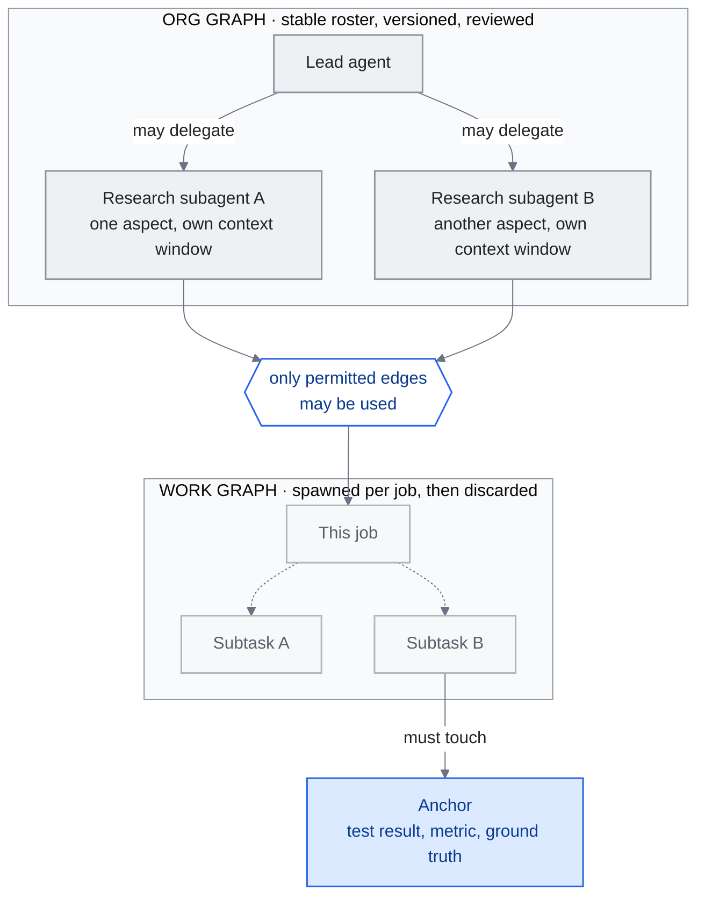

<!-- translation-sync:start -->
> Traducción asistida por máquina sincronizada con la edición inglesa de 2026-10-31, con revisión de estructura y contenido. El código y las etiquetas de los diagramas conservan el original; los tiempos de lectura se estiman a partir del inglés.
> [English source](../../../chapters/14-graph-engineering.md) · [Sync record](../../SYNC.md)
<!-- translation-sync:end -->

<!-- i18n-anchor -->

# Capítulo 14: Ingeniería de grafos: conectar la organización de agentes

> **En una frase:** La ingeniería de grafos es la propuesta de julio de 2026 de situar sobre los bucles el grafo: qué agentes existen, quién puede delegar en quién y cómo se supervisan y corrigen sus bucles.
>
> **Por qué importa:** Si perdura, nombra la capa que convierte colecciones improvisadas de bucles en organizaciones diseñadas; si no, ofrece el ejemplo más claro de cómo nacen y desaparecen estas etiquetas generacionales.
>
> **Tiempo de lectura:** ~29 min (estimación del original en inglés: 6,600 palabras / 230 palabras por minuto)

*Figura: Los objetos de 14.2: grafo organizativo estable de delegaciones permitidas y grafo de trabajo efímero de una tarea, más el ancla de Perez, comprobación externa que impide a agentes que se revisan mutuamente converger en acuerdo seguro de sí mismo. El término se discute (14.3); estas estructuras, no.*

Este capítulo se escribió a finales de julio de 2026, con un término de unas dos semanas que quitó al capítulo 13 el título de idea más reciente. "Graph engineering" cristalizó tras el 17-18 de julio de 2026 en blogs profesionales y ensayos de proveedores, sin literatura académica. Sigue siendo el término más controvertido de la guía. La respuesta más contundente de LangChain, cuyo framework lleva literalmente grafos en el nombre, fue que la práctica tiene tres años y solo la etiqueta es nueva.

El borrador cerró con una evaluación pendiente, no un veredicto: cuatro señales a comprobar en septiembre de 2026. **Se comprobó el 15 de septiembre de 2026 y el resultado es dividido: el término superó la prueba de circulación definida; su condición de capa distinta sigue sin demostrarse.** La sección 14.7 recoge el cuadro fechado, evidencia y dos correcciones del borrador de julio. Las secciones intermedias incorporan las ocho semanas de evidencia: otro proveedor con estructura sin nombre, producción anterior en más de un año, una empresa abierta de agentes, un curso de pago y ensayos sobre qué término murió.

Se mantienen reservas deliberadas. Los escépticos reciben el mismo espacio; las cifras de visitas discrepantes se presentan como discrepantes; y, salvo indicación contraria, "at the time of writing" significa finales de julio de 2026.

Se cubren la publicación catalizadora, los ensayos, las afirmaciones, las objeciones, la distinción con conocimiento, su posible ubicación en la pila, el eco chino y si los profesionales deben prestarle atención.

---

<!-- i18n-anchor -->

## 14.1 El tuit que lo inició (17-18 de julio de 2026)

El patrón resulta familiar: seis semanas después del 7 de junio que catalizó los bucles (capítulo 13.1), **Peter Steinberger**, creador de OpenClaw y ahora en OpenAI, volvió a publicar. Según las citas literales de [Carlos E. Perez](https://medium.com/intuitionmachine/from-loop-engineering-to-graph-engineering-d3ebeb08511c) y [Yash Thakker](https://explainx.ai/blog/graph-engineering-ai-agents-multi-agent-organizations-2026), escribió:

> Are we still talking loops or did we shift to graphs yet?

Dos salvedades de fuentes. No se recuperó directamente la publicación y las fuentes secundarias recuperadas no la reproducen igual. Solo Perez y Thakker citan exactamente ese inglés. [LangChain](https://www.langchain.com/blog/3-years-of-graph-engineering-with-langgraph) y Perez enlazan sin citar; [36kr](https://eu.36kr.com/en/p/3904771418867330) y Tony Bai traducen al chino, y 36kr retraduce en inglés "Are we still talking about loops, or have we moved on to graphs?"; [Eigent](https://www.eigent.ai/blog/graph-engineering-ai-agents) parafrasea. Las dos citas literales fundamentan reproducir el texto anterior.

Las cifras tampoco concuerdan. Todas las fuentes que fechan dicen 18 de julio; el 17 de julio del intervalo es posibilidad de horario estadounidense, no desacuerdo documentado. Las visitas sí discrepan, como instantáneas de momentos distintos, no mediciones rivales simultáneas: Thakker dice 575K en horas; 36kr, 2.6M en dos días frente a 8.4M del tuit de bucles seis semanas antes; Tony Bai, unas 800K en dos días. Ninguna cifra se presenta como hecho único.

Como en junio, Steinberger no puso nombre. "graph engineering" no aparece en su texto. El compuesto surgió en ensayos de respuesta siguiendo prompts, contexto, harness y bucles, rápidamente:

- **18 de julio**: La [guía explainx.ai de Yash Thakker](https://explainx.ai/blog/graph-engineering-ai-agents-multi-agent-organizations-2026), actualizada hasta el 26 de julio, identifica el catalizador y distingue grafo organizativo y de trabajo.
- **19 de julio**: **Carlos E. Perez**, Intuition Machine, publica la primera expansión teórica sustancial.
- **20 de julio**: **TrueFoundry** publica [una guía para producción](https://www.truefoundry.com/blog/graph-engineering-enterprise-guide) con lista de gobernanza.
- **21 de julio**: **eigent.ai**, **Tony Bai** y **36kr** publican ese mismo día; véase 14.6.
- **22 de julio**: Respuesta oficial de **LangChain**, de Sydney Runkle y Harrison Chase, cuatro días después; véase 14.3.

Catalizador, ensayos, contrapunto de proveedor y eco chino en una semana: se repite acelerada la secuencia de nombres de los bucles.

---

<!-- i18n-anchor -->

## 14.2 Lo que pretende ser la ingeniería de grafos

Los ensayos repiten tres afirmaciones.

**Organizaciones, no comportamiento de agentes.** Thakker ofrece la progresión más citable:

> Loops made agent behavior programmable. Graphs make agent organizations programmable.

Distingue dos objetos:

- El **grafo organizativo**: esquema estable de agentes, función de cada uno y delegaciones permitidas.
- El **grafo de trabajo**: descomposición efímera que cada trabajo crea, ejecuta y descarta.

Ambos serían artefactos diseñados, versionados y revisados, como el harness del capítulo 4 y el bucle del 13.

**Bucles que supervisan bucles sujetos a anclas.** El [ensayo de Perez](https://medium.com/intuitionmachine/from-loop-engineering-to-graph-engineering-d3ebeb08511c), primera expansión del 19 de julio, describe una red de supervisión y restricciones mutuas. Añade el **ancla**: medición indiscutible externa —prueba, métrica o comprobación de referencia— que algún nodo debe consultar. Sin ellas, sostiene, la revisión mutua degenera en cámara de eco y acuerdo seguro, no corrección: versión multiagente del sesgo de autoevaluación del capítulo 13.4.

**Topologías gobernadas.** [TrueFoundry](https://www.truefoundry.com/blog/graph-engineering-enterprise-guide), 20 de julio, y [Eigent](https://www.eigent.ai/blog/graph-engineering-ai-agents), 21 de julio, que atribuye tanto el impulso a Steinberger como la red de bucles a Perez, coinciden en gobernanza y observabilidad de topologías. Sus preguntas:

- Qué transiciones se permiten y cuáles son estructuralmente imposibles.
- Dónde se aísla un fallo antes de propagarse.
- Cómo se detecta y corta una rama descontrolada.
- Cómo sería auditar una organización de agentes.

TrueFoundry publica una lista empresarial; si necesitaba nombre de disciplina nuevo es la pregunta siguiente.

**Un proveedor publica estructura, no nombre.** El 7 de agosto de 2026, Claude Code v2.1.224, evolucionado a v2.1.241 el 23 de agosto, añadió mensajes entre sesiones. `ListAgents` descubre sesiones con nombre: subagentes, compañeros de equipo, sesiones locales, de nube y Remote Control de otros equipos; `SendMessage` envía texto por nombre con gobierno entrante de aceptar / retener / rechazar, valor predeterminado según permisos y límites de tamaño, ráfagas y bucles. El alcance es estrecho: no cruza historial, archivos ni aprobación de permisos; no está disponible en Bedrock, Claude Platform on AWS, Google Cloud Agent Platform o Microsoft Foundry. Parece una implementación del grafo organizativo: sesiones nombradas, direccionables y conexiones gobernadas. No es adopción terminológica: documentación y registro de Anthropic no utilizan "graph engineering" para describirla. Un proveedor importante materializa el patrón sin etiqueta; demuestra la capacidad básica, no el término, afirmaciones distintas.

**Otro proveedor lo publicó antes, un mes antes del nombre.** Codex llegó por otra vía. [#28792](https://github.com/openai/codex/pull/28792), "Expose thread-level multi-agent mode", fusionada el 19 de junio de 2026, y [#29324](https://github.com/openai/codex/pull/29324), "Simplify multi-agent mode controls", fusionada el 22 de junio de 2026, concentran delegación en `multiAgentMode` con tres valores descritos en la segunda: `none`, "Keep multi-agent tools available without adding mode instructions"; `explicitRequestOnly`, "Only delegate after an explicit user request"; y `proactive`, "Delegate when parallel work materially improves speed or quality." La primera versión con los tres es `rust-v0.142.0` del 22 de junio de 2026: "App-server clients can configure multi-agent delegation as disabled, explicit-request-only, or proactive at the thread and turn level." Precede un mes al tuit y siete semanas a los mensajes de Anthropic.

Lea `none` con cuidado: las herramientas siguen disponibles; cambia si se añaden instrucciones. Modificar lo dicho al modelo es *política de prompt*, no autorización impuesta como la pasarela de denegación predeterminada del capítulo 4; ninguna pull request afirma lo contrario. La conclusión es más estrecha que "a vendor shipped org-graph governance": publicó una *configuración* con forma de grafo, aplicada como prompts. Tampoco hay señal terminológica: las notas de tres versiones alrededor de esas fusiones no dicen "graph engineering" y las pull requests tampoco describen así el trabajo.

**Producción anterior en trece meses al nombre.** El relato público más detallado de una organización operativa precede al término y se omitió en el borrador inicial. ["How we built our multi-agent research system"](https://www.anthropic.com/engineering/multi-agent-research-system), del 13 de junio de 2025, describe Claude Research: un líder "analyzes it, develops a strategy, and spawns subagents to explore different aspects simultaneously,", cada subagente con ventana propia y CitationAgent separado. Expone producción: evaluación desde "a set of about 20 queries representing real usage patterns", puntuada por LLM en hechos, citas, completitud, fuentes y eficiencia; sistemas "that can resume from where the agent was when the errors occurred"; y "rainbow deployments to avoid disrupting running agents, by gradually shifting traffic from old to new versions while keeping both running simultaneously." La comparación interna de Anthropic, Opus 4 liderando Sonnet 4, "outperformed single-agent Claude Opus 4 by 90.2%,", con aproximadamente 15 veces los tokens de chat. No dice "graph engineering". Es producción de la *práctica* un año antes de la *etiqueta*: argumento de LangChain desde Anthropic.

**Y otro construido por un desarrollador independiente.** [`headcount`](https://github.com/cbrock84/headcount), de cbrock84, repositorio del 28 de agosto de 2026 con MIT, empaqueta una organización para Claude Code: "a chief executive over 16 departments, 172 skills in total,", cada departamento instalable como complemento. Security y Legal & Risk son **clase revisora**: detienen trabajo, no solo opinan, y reportan fuera de lo auditado. Divide agentes por "exclusive write surface, not by topic,", porque "a topic split has no checkable boundary." Es grafo con autoridad explícita usando subagentes y complementos existentes. La madurez es limitada: sin volumen, fiabilidad ni costes; la descripción de GitHub mantiene el obsoleto "15+ departments, 125+ skills," y el README tampoco dice "graph engineering".

Sobre límites de supervisión de toda la organización, véase el [capítulo 4](04-harness-engineering.md#48-harness-maintenance-the-stress-testing-imperative).

---

<!-- i18n-anchor -->

## 14.3 Las objeciones

Los escépticos merecen igual peso, no un párrafo de cortesía: en cuatro días apareció el argumento contrario más fuerte, de quien mejor podía formularlo.

**LangChain: tiene tres años.** [*3 Years of Graph Engineering with LangGraph*](https://www.langchain.com/blog/3-years-of-graph-engineering-with-langgraph), Sydney Runkle y Harrison Chase, 22 de julio de 2026, legitima y desinfla a la vez. Enumera grafos tras "prompt engineering, context engineering, harness engineering, and loop engineering,", exactamente el eje de la guía más un nivel, y añade:

> Representing agentic systems as graphs isn't new, we've been doing it for three years.

La reducción es clara: **un bucle es un grafo cíclico dirigido**. LangGraph modela nodos, conexiones, condiciones y ciclos desde 2023. En julio de 2026 solo cambia el vocabulario: tres años de práctica previa y nombre nuevo, no capacidad.

La señal de adopción más fuerte —respuesta de un gran framework en cuatro días— también es la fuente escéptica más fuerte. El mismo documento es ambas y debe presentarse así.

**Tony Bai: marco de hoy, término descartado mañana.** Su [publicación del 21 de julio](https://tonybai.com/2026/07/21/from-loop-engineering-to-graph-engineering/) explica favorablemente supervisión mutua y anclas, y después advierte: apenas dos meses de bucles y Silicon Valley ya tiene otro término; "graph" puede ser el siguiente descarte. Como divulgador temprano y cuidadoso, su escepticismo no es reflejo contra exageraciones y pesa más.

**Lo que decía la falta de evidencia y lo que cambiaron ocho semanas.** A finales de julio de 2026 no se encontraron charlas, cursos ni empleos: compatible tanto con dos semanas de existencia como con no perdurar; la evidencia no distinguía. En septiembre cambió una de tres señales. [Graph Engineering Mastery](https://graphengineerings.com/) vende seis módulos por $6.93 de por vida o $19.63 al mes; [Module 2](https://graphengineerings.com/course/module-2.html), "Orchestration and Multi-Agent Topology,", enseña once lecciones de enrutamiento, distribución y reunión de ramas, jerarquías, fusión y anclas, con ejercicios verificables ("Build a support-ticket router... The branch condition must be a unit-testable pure function"). Es enseñanza, no anuncio, pero casi anónima: sin instructor, solo "The Case006 for Justdoit.work" y "© 2026 GraphEngineerings.com", dirección de Newark, California y teléfono; sin acreditación y con aviso de que sus figuras sectoriales "are not presented as formal faculty or endorsers." Las otras señales no cambiaron. AgentEng London, 16 de octubre de 2026 en Everyman Cinema, Crossrail Place, enumera "disciplines such as context, harness, memory, evaluation, inference, protocols, and agentic coding": lista ilustrativa, no taxonomía completa, sin grafos; "graph" tampoco aparece en el resto. A mediados de septiembre no publicaba ponentes. Los empleos siguen siendo de bases de datos de conocimiento, categoría antigua que 14.4 distingue.

**De quién discuten el obituario los ensayos de septiembre.** La sucesión más fuerte era el título "Loop Engineering Is Dead. Enter Graph Engineering,", atribuido a Hamel Husain y fechado el 18 de julio de 2026 por SmartScope, unas cuatro horas y media después del tuit de las 00:34 UTC; Towards Data Science da autor y título, sin fecha. La guía no recuperó el ensayo y los atribuye solo según esas fuentes secundarias. Importa no invertir la objeción: [SmartScope del 1 de septiembre de 2026](https://smartscope.blog/en/blog/graph-engineering-loop-engineering-logic-review/) refuta *ese obituario*, no declara muertos los grafos. Dice "Graph Engineering is not the successor to Loop Engineering; it is a design lens for connecting multiple loops and agents through shared state, branches, permissions, and failure paths." Rechaza sucesión y defiende la herramienta, circulación del término y negación de la generación simultáneamente. Se limita expresamente: "as of July 20, the cited posts and public materials do not provide a standard definition, a canonical reference architecture, peer-reviewed evidence of effectiveness, or a comparative benchmark against Loop Engineering."

---

<!-- i18n-anchor -->

## 14.4 No son grafos de conocimiento

El nombre colisiona con el capítulo 2. "Knowledge graph engineering" es una disciplina de más de una década —web semántica, ontologías y tripletas—; GraphRAG del capítulo 2 estructura entidades y relaciones para recuperar y razonar sobre conocimiento. El sentido de julio de 2026 solo comparte la palabra. TrueFoundry formula la frontera con claridad:

> Knowledge graphs structure what a system knows; graph engineering in the 2026 sense structures who the system is --- its members, mandates, and message paths.

Solo comparten estructura de datos:

| | Grafo de conocimiento / GraphRAG (Ch02) | Ingeniería de grafos (este capítulo) |
|---|---|---|
| Nodos | Entidades | Agentes |
| Conexiones | Relaciones etiquetadas | Delegaciones permitidas |
| Construcción | Durante indexación | Al diseñar arquitectura |
| Uso | Durante recuperación | Durante ejecución: recorrido y modificación |
| Pregunta | ¿Qué sabe el sistema? | ¿Quién es el sistema? |

Quien llega desde GraphRAG del capítulo 2 debe ver coincidencia de vocabulario, no linaje común. El capítulo 2 incluye la referencia inversa.

---

<!-- i18n-anchor -->

## 14.5 ¿Quinta generación o reorganización de la cuarta?

Si perdura, ¿dónde encaja? El eje es prompts (capítulo 1), contexto (capítulos 1-3), harness (4) y bucles (13). Sus defensores añaden otro nivel. LangChain también la enumera quinta mientras cuestiona la novedad.

El tratamiento estructural más útil y reciente es [MarkTechPost del 29 de julio](https://www.marktechpost.com/2026/07/29/prompt-engineering-vs-loop-engineering-vs-graph-engineering-what-changes-at-each-layer/): unidades de control apiladas, no sucesoras:

- El **harness**, capítulo 4, rodea a un agente.
- El **bucle**, capítulo 13, es su ciclo de comportamiento.
- El **grafo** coordina agentes con organización estable y trabajo efímero.

"graphs are built from loops, and loops are built from prompts" extiende por un recuadro la coexistencia del capítulo 1 y encaja con las capas anteriores.

Los mismos hechos admiten desinflar la propuesta: si el bucle es grafo cíclico, un grafo de bucles es un sistema de bucles mayor; "graph engineering" aplica harness y bucles a N agentes, reorganiza la cuarta capa, no crea quinta. El capítulo 13 dejó abierta capa real frente a "harness engineering with a scheduler attached"; grafos hereda esa duda y añade otra. La guía no la resolvió en julio ni en septiembre.

Dos meses cambian la pregunta, no la respuesta. El alcance es real: decidir delegaciones, detener fallos y revisar sin dependencia de lo revisado. Ya hay artefactos: tres estados Codex, departamentos revisores de `headcount` y líder/subagentes de Anthropic. Falta demostrar *independencia* de capas inferiores: mensajes de Claude Code son harness; modo Codex es configuración de chat; investigación Anthropic es bucle que crea bucles; `headcount`, complementos sobre subagentes. Los defensores también divergen: [Towards Data Science del 14 de septiembre](https://towardsdatascience.com/graph-engineering-for-ai-agents-from-prompts-and-loops-to-workflows/), Nhu Hoang, define flujo precomprometido: "you define the nodes, routing logic, and checkpoints in advance" y "the graph decides what happens next,"; habla de determinismo, no organizaciones. Un alcance visto solo como configuración inferior y descrito de formas incompatibles puede orientar atención, pero no ha ganado planta propia. El capítulo 1 mantiene coordinación multiagente dentro del harness: alternativa vigente, no marcador provisional.

---

<!-- i18n-anchor -->

## 14.6 El eco del ecosistema chino

La rapidez del eco chino es una señal de expansión fuera de la burbuja original: llegó en tres días con traducción asentada, **图工程**.

Dos referencias verificadas: [Tony Bai del 21 de julio](https://tonybai.com/2026/07/21/from-loop-engineering-to-graph-engineering/), 「Loop Engineering才火两个月，硅谷已经卷出"Graph Engineering"了」, explica bucles y anclas para infraestructura china y advierte del término de moda de 14.3. [36kr en inglés](https://eu.36kr.com/en/p/3904771418867330), también del 21 de julio, lo presenta como noticia: compara visitas de 14.1 y menciona Geoffrey Huntley, Boris Cherny, Addy Osmani y Luis Catacora. Esas atribuciones proceden solo de 36kr y se citan como tales.

Más allá quedan títulos: dos piezas de CSDN 智能体开发者社区, 「从Loop Engineering到Graph Engineering」 y la exagerada 「Loop工程已死，Graph工程永生」 ("Loop engineering is dead, graph engineering lives forever", el mismo gancho 已死 de 13.8), y una explicación en chino tradicional. No se recuperaron independientemente; son títulos de resultados de búsqueda, evidencia de que la cadena de contenido china recoge el término y nada más.

Como en el capítulo 13, la cadena de explicadores de bucles procesaba en julio 图工程: seis semanas entre catalizadores, apenas días entre catalizador y eco.

**Septiembre: sin verificar no significa silencio.** La revisión no confirmó continuación en chino. En las plataformas accesibles no apareció material pertinente de septiembre de 2026, pero el acceso era insuficiente para convertir esa ausencia en evidencia y julio ya era débil más allá de dos fuentes. El estado es cobertura de julio verificada, continuidad de septiembre no comprobada. No demuestra que el eco se apagara; debe repetirlo alguien con acceso nativo antes de afirmarlo.

---

<!-- i18n-anchor -->

## 14.7 ¿Debe importarle ya? El criterio y la evaluación del 15 de septiembre

A finales de julio de 2026 hacían falta dos respuestas: etiqueta y problemas son separables. Se conservan los dos párrafos como se escribieron entonces; después viene la comprobación de septiembre que plantearon.

**Los problemas son reales con cualquier etiqueta.** Con un agente, harness y bucle, los capítulos 4 y 13 siguen siendo relevantes y aquí nada cambia su trabajo. Con varios, ya debe decidir delegaciones, aislar fallos, observar y auditar y conectar algún nodo a una referencia externa para evitar acuerdo autocomplaciente, sobreviva o no "graph engineering". Las listas de TrueFoundry y anclas de Perez son utilizables. LangChain coincide en esto: lleva tres años resolviendo esos grafos; los problemas tienen al menos esa edad.

**La etiqueta es una apuesta opcional.** El capítulo 13 llegó con bucles de cinco semanas; grafos llega con dos, mejores señales tempranas —ensayos, respuesta de framework y eco chino más rápidos— y menor madurez: sin caso comparable a Stripe, formación de proveedor ni benchmark. Cierra con una prueba, no afirmación. **La supervivencia consiste en que el término siga circulando en septiembre de 2026.** Busque:

- Documentación de frameworks o proveedores que lo adopte como vocabulario de producto, no solo de blog.
- Charlas, cursos o empleos que lo utilicen; al redactar no se encontró ninguno.
- Caso de producción identificado con el peso de los minions de Stripe para bucles.
- Otra oleada de ensayos que no responda a una sola publicación.

Si llegan, crecerá como el capítulo 13; si no, quedará como registro de un nombre de dos semanas y ganará la lectura que reduce su novedad.

<!-- i18n-anchor -->

### Cuadro comprobado el 15 de septiembre de 2026

Hubo recuento intermedio el 24 de agosto de 2026, 22 días antes; se muestran ambos para hacer visible el cambio.

| Señal escrita en julio | 24 de agosto de 2026 | 15 de septiembre de 2026 | Evidencia de septiembre |
|---|---|---|---|
| 1. Documentación de framework o proveedor con término en vocabulario de producto | NO CUMPLIDO | **NO CUMPLIDO** | Los documentos de mensajes entre sesiones de Claude Code y las pull requests y notas de delegación de Codex describen estructura sin nombre (14.2). LangChain lo usa en título, pero se pedía vocabulario de producto. No hubo auditoría sistemática fechada de todos los proveedores: ausencia en lo reunido, no ausencia universal demostrada. |
| 2. Charlas, cursos o empleos | NO CUMPLIDO | **CUMPLIDO débilmente** | Graph Engineering Mastery enseña organización de agentes (14.3). Sin sección de congreso: "graph" no aparece en AgentEng London y su lista es ilustrativa, "disciplines such as...", no exhaustiva. Sin empleos más allá del conocimiento antiguo. |
| 3. Caso de producción con peso comparable a Stripe | PARCIAL | **CUMPLIDO retrospectivamente** | Anthropic de junio de 2025: topología desplegada, evaluación con LLM, reanudación, despliegues rainbow y comparación interna del 90.2% (14.2). |
| 4. Segunda oleada de ensayos independiente de una sola publicación | CUMPLIDO | **CUMPLIDO** | Tres meses de ensayos hasta agosto, SmartScope del 1 de septiembre y tutorial práctico de Towards Data Science del 14 de septiembre (14.3, 14.5). |

**El criterio no decía cómo agregar señales; la regla se explicita, no se presupone.** Julio no fijó quórum, ponderación ni agregación: enumeró cuatro puntos y "if those arrive." Su frase definitoria era más estrecha: *seguir circulando en septiembre de 2026*. Se cumple con tres meses de ensayos independientes, curso organizativo y tutorial. Las otras tres señales describen circulación más madurez institucional; nunca se impuso unanimidad. Exigirla después cambiaría la prueba, no la aplicaría.

**Dos correcciones del borrador.** Julio afirmó "no production case study comparable to Stripe's minions." Existía desde hacía trece meses: el sistema de investigación de Anthropic. El capítulo 13 cuenta minions aunque precedan a la etiqueta; aplicar igual criterio cuenta a Anthropic. Omitirlo endureció la evaluación sin respaldo. Además, se interpretó inicialmente, también en las notas de esta guía, que septiembre debatía la muerte de grafos; el obituario discutido era el de bucles (14.3).

**Veredicto del 15 de septiembre de 2026: el término superó circulación; su condición de capa distinta sigue sin probarse.** Ambas mitades importan. Sobrevivir no valida: la señal 1 distinguiría disciplina y discurso, sigue vacía tras ocho semanas, y la mejor evidencia nueva reduce la novedad: dos proveedores construyeron la gobernanza sin palabra, uno desde un mes antes. Lo no demostrado tampoco descarta: tres meses de ensayos refutan el evento de dos semanas; hay producción y curso. El capítulo crece según lo prometido sin numerar otra generación: nombre controvertido de coordinación multiagente, propuesta en prueba, no capa consolidada. La advertencia de Tony Bai, que el marco de hoy puede descartarse mañana, resume el riesgo con justicia.

Lo que cambiaría el veredicto es concreto: un proveedor usándolo en vocabulario propio de producto o una sección de congreso identificada. Nada lo establecía en la evidencia reunida el 15 de septiembre de 2026.

<!-- i18n-anchor -->

### Actualización del 31 de octubre de 2026: más circulación, significados divergentes

El cuadro de septiembre es una comprobación histórica. Octubre añade circulación institucional, con un matiz cada vez más necesario:

| Señal | Evidencia de octubre | Qué establece |
|---|---|---|
| Vocabulario de proveedores | El [webinario del 6 de octubre](https://neo4j.com/events/on-demand/) de Neo4j usa ingeniería de grafos para memoria procedimental y grafos tipados de habilidades AIP. | Uso educativo por proveedor, no adopción verificada del sentido organizativo en documentación de producto. |
| Charlas y enseñanza | El [programa archivado de AI Engineer NYC](https://ai.engineer/nyc/2026/schedule) incluye "Graph Engineering 101: Predictability, Governance, Portability" de Zachary Blumenfeld para el 14 de octubre. El [catálogo](https://www.oreilly.com/library/view/graph-engineering/9781808812477/) de O'Reilly lista *Graph Engineering: The Loop Memory Model*, de Volodymyr Pavlyshyn, Packt, octubre de 2026. | Charla programada con nombre y libro, reforzando enseñanza. El programa no verifica celebración, significado preciso de la charla ni sección propia de congreso. |
| Producción | El relato de septiembre sigue probando coordinación de agentes. | No se afirma que una topología de producción demuestre otra capa de ingeniería. |
| Circulación continuada | Evento de proveedor, programa y libro de octubre amplían el registro posterior a septiembre. | El término circula; visibilidad institucional no fija definición. |

La [descripción del webinario](https://go.neo4j.com/WBR-EDU-261006-Procedural-knowledge_Registration.html?utm_campaign=dev&utm_medium=event-hub&utm_source=website) de Neo4j habla de procedimientos, dependencias y procedencia. Encaja con habilidades y memoria, no automáticamente con delegaciones permitidas. El catálogo del libro abarca bucles, enjambres, DAG y conocimiento; metadatos e índice no demuestran consenso técnico. Octubre conserva las dos distinciones: más circulación, pero sentido organizativo y quinta generación distinta sin demostrar.

---

<!-- i18n-anchor -->

## Tres ideas para recordar

- **Grafo organizativo y de trabajo son distintos.** La lista estable de delegaciones permitidas sobrevive al grafo efímero creado por cada tarea.
- **Sin ancla, revisarse mutuamente produce acuerdo, no corrección.** Perez exige que algún nodo consulte una medición externa indiscutible.
- **El término superó circulación, pero no prueba capa distinta.** Dos proveedores publicaron coordinación sin nombre y con mecanismos diferentes: Codex aplica instrucciones de prompt, no autorización impuesta. La guía mantiene grafos fuera de las generaciones numeradas.

---

<!-- i18n-anchor -->

## Fuentes

- AI Engineer NYC. Programa archivado, guardado el 17 de octubre de 2026; sesión anunciada para el 14 de octubre: [https://ai.engineer/nyc/2026/schedule](https://ai.engineer/nyc/2026/schedule).
- Neo4j. Evento del 6 de octubre de 2026: [https://neo4j.com/events/on-demand/](https://neo4j.com/events/on-demand/). Descripción del webinario: [Página de registro de Neo4j](https://go.neo4j.com/WBR-EDU-261006-Procedural-knowledge_Registration.html?utm_campaign=dev&utm_medium=event-hub&utm_source=website).
- O'Reilly Learning. Catálogo de libro Packt, octubre de 2026: [https://www.oreilly.com/library/view/graph-engineering/9781808812477/](https://www.oreilly.com/library/view/graph-engineering/9781808812477/).
- Steinberger, Peter. Publicación en X, "Are we still talking loops or did we shift to graphs yet?" (18 de julio de 2026, según todas las fuentes siguientes que la fechan) --- No recuperada directamente; citada solo mediante esas fuentes: Perez y Thakker reproducen literalmente, LangChain y Perez enlazan sin cita, 36kr y Tony Bai traducen al chino y Eigent parafrasea. Las visitas comunicadas discrepan.
- Runkle, Sydney y Harrison Chase (LangChain). "3 Years of Graph Engineering with LangGraph" (22 de julio de 2026): [https://www.langchain.com/blog/3-years-of-graph-engineering-with-langgraph](https://www.langchain.com/blog/3-years-of-graph-engineering-with-langgraph) --- Enumera grafos tras prompts/contexto/harness/bucles; "a loop is just a directed, cyclic graph"; objeción de que la práctica tiene tres años.
- Perez, Carlos E. (Intuition Machine). "From Loop Engineering to Graph Engineering?" (19 de julio de 2026): [https://medium.com/intuitionmachine/from-loop-engineering-to-graph-engineering-d3ebeb08511c](https://medium.com/intuitionmachine/from-loop-engineering-to-graph-engineering-d3ebeb08511c) --- Primera expansión teórica; bucles supervisando bucles y anclas de medición indiscutible contra cámaras de eco.
- Thakker, Yash (explainx.ai). "Graph Engineering: After Loops, This Is How You Wire Multi-Agent Orgs (2026)" (18 de julio, actualizado el 26 de julio de 2026): [https://explainx.ai/blog/graph-engineering-ai-agents-multi-agent-organizations-2026](https://explainx.ai/blog/graph-engineering-ai-agents-multi-agent-organizations-2026) --- Grafo organizativo frente a grafo de trabajo; "Loops made agent behavior programmable. Graphs make agent organizations programmable."
- TrueFoundry. "Graph Engineering for Multi-Agent Systems: Architecture, Governance, and Observability" (20 de julio de 2026): [https://www.truefoundry.com/blog/graph-engineering-enterprise-guide](https://www.truefoundry.com/blog/graph-engineering-enterprise-guide) --- Lista empresarial y cita que distingue grafos de conocimiento ("what a system knows" frente a "who the system is").
- Eigent. "Graph Engineering for AI Agents" (21 de julio de 2026): [https://www.eigent.ai/blog/graph-engineering-ai-agents](https://www.eigent.ai/blog/graph-engineering-ai-agents) --- Atribuye el impulso a Steinberger y la expansión a Perez; topologías gobernadas de bucles que se corrigen mutuamente.
- 36kr (edición inglesa). "Father of Lobster's One Tweet: Is the Loop Era Over?" (21 de julio de 2026): [https://eu.36kr.com/en/p/3904771418867330](https://eu.36kr.com/en/p/3904771418867330) --- Comunica 2.6M visitas del tuit frente a 8.4M del de bucles, añade participantes y presenta el término como emergente.
- Bai, Tony. 「Loop Engineering才火两个月，硅谷已经卷出"Graph Engineering"了」 (21 de julio de 2026): [https://tonybai.com/2026/07/21/from-loop-engineering-to-graph-engineering/](https://tonybai.com/2026/07/21/from-loop-engineering-to-graph-engineering/) --- Explicación de 图工程 para el ecosistema chino; advierte que "graph" también puede acabar descartado como término de moda.
- MarkTechPost. "Prompt Engineering vs Loop Engineering vs Graph Engineering: What Changes at Each Layer" (29 de julio de 2026): [https://www.marktechpost.com/2026/07/29/prompt-engineering-vs-loop-engineering-vs-graph-engineering-what-changes-at-each-layer/](https://www.marktechpost.com/2026/07/29/prompt-engineering-vs-loop-engineering-vs-graph-engineering-what-changes-at-each-layer/) --- Lectura de unidades de control apiladas; organización + trabajo; "graphs are built from loops, and loops are built from prompts."
- Claude Code (Anthropic). Documentación y registro de mensajes entre sesiones: 7 de agosto de 2026, v2.1.224, hasta v2.1.241 el 23 de agosto de 2026: [https://code.claude.com/docs/en/cross-session-messaging](https://code.claude.com/docs/en/cross-session-messaging) ; [https://code.claude.com/docs/en/changelog](https://code.claude.com/docs/en/changelog) --- ListAgents/SendMessage incorpora descubrimiento por nombre y mensajes gobernados entre sesiones; la expresión "graph engineering" no aparece en ninguna página.
- Anthropic. "How we built our multi-agent research system" (13 de junio de 2025): [https://www.anthropic.com/engineering/multi-agent-research-system](https://www.anthropic.com/engineering/multi-agent-research-system) --- Topología orquestador-trabajador de Claude Research; evaluación LLM de unas 20 consultas; reanudación y despliegues rainbow; "outperformed single-agent Claude Opus 4 by 90.2%"; unos 15x los tokens de chat; no utiliza "graph engineering". Caso retrospectivo de producción para la señal 3.
- OpenAI Codex. "Expose thread-level multi-agent mode", pull request #28792, fusionada el 19 de junio de 2026): [https://github.com/openai/codex/pull/28792](https://github.com/openai/codex/pull/28792) ; "Simplify multi-agent mode controls", pull request #29324, fusionada el 22 de junio de 2026): [https://github.com/openai/codex/pull/29324](https://github.com/openai/codex/pull/29324) --- Tres valores `multiAgentMode` y descripciones literales; `none` conserva herramientas de delegación y quita instrucciones, por lo que es política de prompt, no autorización impuesta.
- Versión de OpenAI Codex `rust-v0.142.0` (publicada el 22 de junio de 2026): [https://github.com/openai/codex/releases/tag/rust-v0.142.0](https://github.com/openai/codex/releases/tag/rust-v0.142.0) --- Primera compilación publicada con ambas pull requests; las notas también atribuyen #28685: "App-server clients can configure multi-agent delegation as disabled, explicit-request-only, or proactive at the thread and turn level."
- cbrock84. `headcount` (repositorio creado el 28 de agosto de 2026, MIT): [https://github.com/cbrock84/headcount](https://github.com/cbrock84/headcount) --- "a chief executive over 16 departments, 172 skills in total"; Departamentos revisores Security y Legal & Risk; reparto de agentes por "exclusive write surface, not by topic"; Sin métricas operativas divulgadas; la descripción del repositorio en GitHub sigue obsoleta con "15+ departments, 125+ skills".
- Graph Engineering Mastery. Sitio del curso y módulo 2, "Orchestration and Multi-Agent Topology": [https://graphengineerings.com/](https://graphengineerings.com/) ; [https://graphengineerings.com/course/module-2.html](https://graphengineerings.com/course/module-2.html) --- Once lecciones de enrutamiento, distribución/reunión, jerarquías, fusión y anclas con ejercicios verificables; $6.93 de por vida o $19.63 al mes; sin instructor, el pie solo lo identifica como "The Case006 for Justdoit.work" en Newark, California; sin acreditación, y las figuras sectoriales "are not presented as formal faculty or endorsers". Evidencia de señal 2 y motivo de su debilidad.
- SmartScope. "Graph Engineering and Loop Engineering: a logic review" (1 de septiembre de 2026): [https://smartscope.blog/en/blog/graph-engineering-loop-engineering-logic-review/](https://smartscope.blog/en/blog/graph-engineering-loop-engineering-logic-review/) --- Refuta el marco del 18 de julio "Loop Engineering Is Dead. Enter Graph Engineering" atribuido a Hamel Husain; "Graph Engineering is not the successor to Loop Engineering; it is a design lens for connecting multiple loops and agents through shared state, branches, permissions, and failure paths"; Limita su evaluación al 20 de julio: las fuentes no ofrecen definición estándar, arquitectura de referencia canónica, eficacia revisada por pares ni benchmark comparativo con bucles.
- Hoang, Nhu (Towards Data Science). "Graph Engineering for AI Agents: From Prompts and Loops to Workflows" (14 de septiembre de 2026): [https://towardsdatascience.com/graph-engineering-for-ai-agents-from-prompts-and-loops-to-workflows/](https://towardsdatascience.com/graph-engineering-for-ai-agents-from-prompts-and-loops-to-workflows/) --- Ejemplo práctico de flujo fijado de antemano: "you define the nodes, routing logic, and checkpoints in advance"; "the graph decides what happens next"; Cita a Steinberger y el título de Husain como antecedentes.
- AgentEng London 2026 (16 de octubre de 2026, Everyman Cinema, Crossrail Place): [https://agentengineering.world/london/](https://agentengineering.world/london/) --- La página enumera "disciplines such as context, harness, memory, evaluation, inference, protocols, and agentic coding", como lista ilustrativa, no exhaustiva; "graph" no aparece y no había ponentes publicados el 15 de septiembre de 2026.

---

*Anterior: [Capítulo 13: Ingeniería de bucles](13-loop-engineering.md)*
