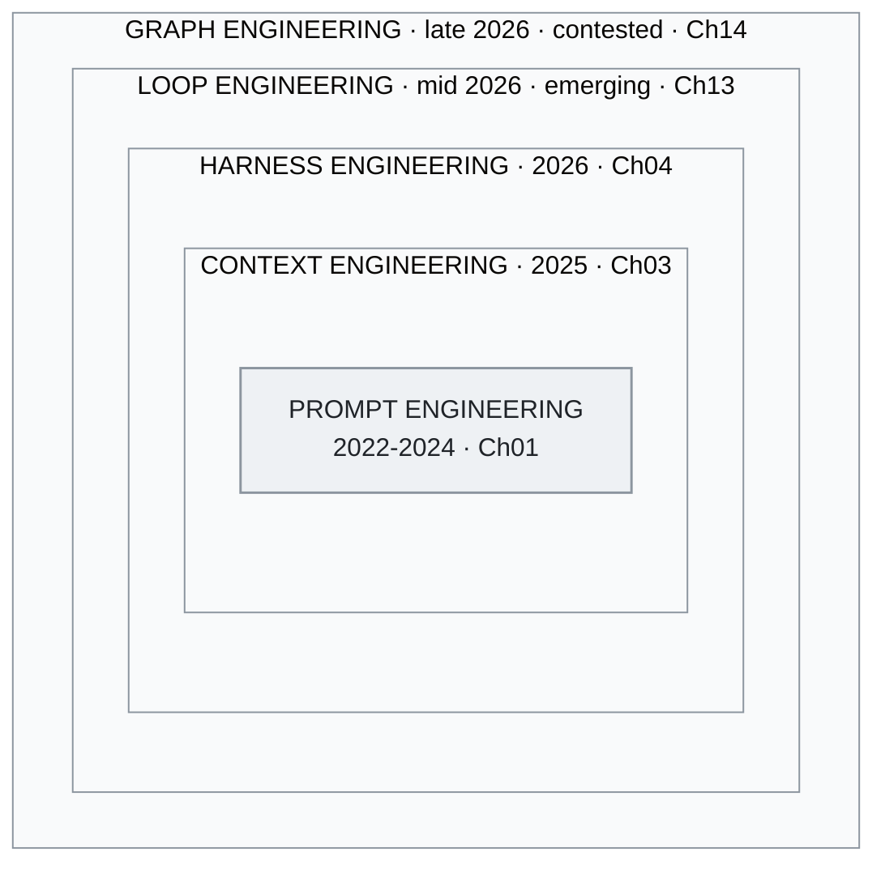

<!-- translation-sync:start -->
> 2026-10-31 の英語版に同期した機械支援翻訳です。構造と内容を確認しています。コードと図中ラベルは原文のまま、読書時間は英語原文の推定値です。
> [English source](../../../chapters/01-evolution.md) · [Sync record](../../SYNC.md)
<!-- translation-sync:end -->

<a id="chapter-01-the-three-generations"></a><!-- i18n-anchor -->

# 第 01 章： 三世代

> **一言で言えば:** AI エンジニアリングは、優れた prompts の作成から、AI モデルを中心としたオペレーティング システム全体の設計へと進化しました。
>
> **重要な理由:** この分野がどこに向かっているのかを理解することは、適切なツールを選択し、時代遅れのアプローチを回避するのに役立ちます。
>
> **読書時間:** ~14 分 (3,108 単語 / 230 wpm)

**prompt engineering から context engineering、そして harness engineering まで -- そして、それらの間の境界が思っているほど重要ではない理由。**

---

<a id="generation-1-prompt-engineering-2022-2024"></a><!-- i18n-anchor -->

## 第 1 世代： Prompt Engineering (2022-2024)

ChatGPT が 2022 年 十一月に開始されたとき、人間と大規模な言語モデルの間のインターフェイス全体はテキスト ボックスでした。出現した分野は prompt engineering で、より良い出力を得るために入力テキストを作成する技術と科学です。

中心となる技術は急速に発展しました。

**Few-shot prompting** (Brown et al., 2020) は、prompt に例を含めることで微調整を行わなくてもタスクのパフォーマンスを劇的に向上できることを実証しました。感情を分類するためにモデルをトレーニングする代わりに、モデルに 三つの例を示し、四番目を分類するように依頼しました。

**Chain-of-thought (CoT) プロンプト** (Wei et al.、2022) は、"Let's think step by step" を追加するか、例に推論トレースを含めることで、標準のプロンプトには存在しないように見える複数ステップの推論機能のロックを解除できることを示しました。これはおそらく、*何を尋ねたか*と同じくらい*どのようにコンテキストを構造化したか*が重要であるという最初のヒントでした。

**プロンプト テンプレート** が標準の抽象化になりました。 LangChain、LlamaIndex、および多数のフレームワークは、注意深く作成された prompt 構造に変数を注入できるテンプレート システムを提供しました。メンタル モデルは明確でした。prompt がプログラムであり、モデルがランタイムです。

この時代のその他のテクニックには次のようなものがあります。

- **ReAct** (Yao et al.、2022): 推論とアクションのステップをインターリーブし、モデルが単一の prompt 構造内でツール呼び出しを計画および実行できるようにします。
- **Tree of Thought** (Yao et al.、2023): 複数の推論パスを探索し、最適な推論パスを選択します。
- **Self-consistency** (Wang et al.、2022): 複数の推論チェーンをサンプリングし、多数決を取得します。

この時代の限界は、LLM インタラクションの品質は主に prompt の品質によって決まるという前提にありました。これは、context windows が 4K-8K トークンであり、唯一の入力がユーザー テキストである場合に当てはまります。モデルが 100K+ トークンを取り込んで外部ツールを呼び出すことができるようになると、これは当てはまらなくなりました。

<a id="what-this-era-got-right"></a><!-- i18n-anchor -->

### この時代が正しいこと

Prompt engineering は、*構造が重要*であることを証明しました。良い prompt と悪い prompt の違いは雰囲気ではなく、情報アーキテクチャです。その洞察は、その後のすべてに引き継がれました。

<a id="what-this-era-missed"></a><!-- i18n-anchor -->

### この時代に欠けていたもの

context window を静的アーティファクトとして扱いました。 prompt を作成して送信し、応答を受け取りました。 context window 自体は実行時に複数のソースから *動的に構築* できるという考え -- それが次世代の洞察でした。

---

<a id="generation-2-context-engineering-2025"></a><!-- i18n-anchor -->

## 第 2 世代： Context Engineering (2025)

2025 の半ばに、Andrej Karpathy は、AI エンジニアリング コミュニティで最も再共有された観察の 一つとなった内容を投稿しました。

> "I've been thinking about this and I think the right term for what most people actually need to get good at is not 'prompt engineering' but 'context engineering.' The art and science of filling the context window with just the right information for the next step."

この再構成は、*命令* (prompt) から *情報パッケージ全体* (context window) に注目を移したため、重要でした。最新の LLM 呼び出しの context window には、ユーザーの prompt よりもはるかに多くのものが含まれています。

- 動作と制約を定義するシステム命令
- RAG パイプラインから取得したドキュメント
- ツール定義とスキーマ
- 会話履歴（選択的に圧縮）
- 動的に選択された少数のショットの例
- 現在のタスクに関する構造化メタデータ

prompt は 一つのコンポーネントです。 Context engineering は、それらすべてを調整することです。

<a id="the-six-techniques"></a><!-- i18n-anchor -->

### 六つのテクニック

context engineering の [Towards AI の分析](https://towardsai.net/) により、この分野を定義する 六つの中心的なテクニックが特定されました。

1. **検索拡張生成 (RAG)**: クエリ時に関連ドキュメントを取得します
2. **ツールと API の統合**: 構造化スキーマを使用してモデルに外部機能へのアクセスを提供
3. **メモリ管理**: 会話の順番やセッション全体にわたって関連情報を維持します。
4. **動的 prompt 構築**: テンプレート、取得したコンテンツ、実行時状態から prompts を組み立てる
5. **コンテキスト ウィンドウの最適化**: 限られたトークン予算に何が入るか、何が残らないかを管理する
6. **命令階層**: システム、開発者、およびユーザーの命令を明確な優先順位で階層化する

<a id="lessons-from-manus"></a><!-- i18n-anchor -->

### Manus からの教訓

2025 の最も話題になった製品の 一つとなった AI エージェント プラットフォームである [Manus](https://manus.im/) は、大規模な context engineering に関する重要な教訓を共有しました。

**KV-cache の洞察**: Manus は、高い KV-cache ヒット率を維持するように context window を設計しました。これにより、アテンション メカニズムから以前に計算されたキーと値のペアがターン間で再利用できるようになります。これにより、遅延とコストが大幅に削減されました。原則: 呼び出し間で *サフィックスのみが変化する*一方、*プレフィックスは安定したまま*になるようにコンテキストを構造化します。

**100:1 比率**: Manus は、モデル出力の 1 トークンごとに、コンテキストの約 100 トークンが消費されたことを報告しました。これは、出力トークンが主なコスト要因であるという一般的な想定を覆しました。エンジニアリング上の本当の課題はテキストを生成することではなく、*フィードするコンテキストを選択*することでした。

**製品としてのコンテキスト**: Manus は、実装の詳細ではなく、コアの製品機能として context window 構造を扱いました。エージェントの品質は、コンテキスト アセンブリ パイプラインの品質に直接比例していました。

<a id="the-taxonomy-shift"></a><!-- i18n-anchor -->

### 分類法の変化

Context engineering は、LLM アプリケーション開発を "write good prompts" から "build good information pipelines." に再構成しました。このモデルは、受け取ったコンテキストに関係なく動作する推論エンジンになりました。エンジニアリングの課題は、検索、フィルタリング、ランキング、圧縮、アセンブリという上流に移りました。

しかし、この枠組みにも天井がありました。 *モデルに何が組み込まれているか*については説明しましたが、*モデルの周囲のシステムがどのように動作するか*については説明していません。それには別のシフトが必要でした。

---

<a id="generation-3-harness-engineering-2026"></a><!-- i18n-anchor -->

## 第 3 世代： Harness Engineering (2026)

後期の 2025 から初期の 2026 にかけて、二つの影響力のある作品が次の進化を形式化しました。

**Birgitta Böckeler** (ThoughtWorks) は、2026年四月の Martin Fowler の *Exploring Generative AI* メモ シリーズで、LLM アプリケーションで最も影響力のあるエンジニアリング作業はモデルのトレーニングや prompt の作成ではなく、*harness* (周囲のツール システム、ルーティング、メモリ、計画、およびモデル呼び出しを調整して信頼性の高いワークフローにするエラー回復。

**OpenAI の Codex チーム** は、エージェント コーディングの harness 側に関するケーススタディ資料を公開しました (公開資料については、openai.com/index/introducing-codex を参照してください)。広く引用されている "three engineers / ~1M lines / ~1,500 PRs" の図は、2025-2026 OpenAI の講演や投稿で広まりました。基礎的な観察は、Codex の品質は主にモデルによってではなく、harness によって決定されるということです。harness は、モデルを *いつ呼び出すか、*どのようなコンテキスト* を提供するか、*どのツール* を利用可能にするか、およびエラーを検証して回復するかを決定するシステムです。

<a id="the-phil-schmid-analogy"></a><!-- i18n-anchor -->

### Phil Schmid の類似点

[Phil Schmid](https://www.philschmid.de/) (Hugging Face) は、概念を具体化するアナロジーを提供しました。

- **モデルは CPU** -- 生のコンピューティング能力
- **context window は RAM** -- 現在の操作の作業メモリ
- **harness はオペレーティング システムです** -- スケジューリング、リソース管理、I/O、エラー処理、およびユーザー インターフェイス

この例えは、harness engineering が重要である理由を明確にしています。OS なしで CPU を出荷する人は誰もいません。モデルは必要ですが、十分ではありません。 harness は、モデルが実際に何を達成できるかを決定します。

<a id="the-meta-harness-paper-and-the-6x-gap"></a><!-- i18n-anchor -->

### Meta-Harness Paper と 6x ギャップ

初期の 2026 で発表された研究は、実践者がすでに疑っていたことを定量化しました。つまり、複雑なタスクでは、裸のモデルと適切に活用されたモデルとの間のギャップは約 **6x** でした。同じモデル、同じ重み、同じトレーニング データでは、harness の品質に応じて 六 倍異なる結果が生成されました。

これは、ほとんどの実用的なアプリケーションにおいて、harness engineering がモデルの改善よりも大きな活用を提供することを意味しました。優れたモデルの優れた harness は、平凡な harness を備えた優れたモデルよりも優れたパフォーマンスを発揮しました。

<a id="the-impact-framework"></a><!-- i18n-anchor -->

### IMPACT フレームワーク

2020 の実践者の議論の中で、IMPACT ニーモニックが harness の品質を評価するためのチェックリストとして登場しました。

- **I**命令 -- システム命令の明確さと完全性
- **M**emory -- セッション間の永続化と取得
- **P**lanning -- タスクの分解と順序付け
- **A**アクション -- ツールの可用性と信頼性
- **C**ontext -- 関連情報の動的なアセンブリ
- **テスト**テスト -- 評価および品質保証ループ

IMPACT は、context engineering をより広範な harness engineering 規律内の 一つのコンポーネント ("C") として位置づけます。このネストは重要な構造的洞察です。context engineering は harness engineering の *内* であり、それに置き換えられるものではありません。

<a id="meta-acquires-manus-2b"></a><!-- i18n-anchor -->

### Meta Manus を取得します (~$2B)

初期の 2026 では、Meta が Manus を約2 × 十億ドルで買収しました。この買収は、Meta が *モデルではなく、harness を購入したものであると広く解釈されました*。 Meta にはすでに Llama がありました。これには、コンテキスト アセンブリ、ツール オーケストレーション、エージェント ランタイム管理のための運用実績のあるシステムがありませんでした。

この買収により、この仮説が検証されました。LLM エコシステムで最も価値のあるエンジニアリングは、モデル層ではなくオーケストレーション層にますます多くなってきました。

---

<a id="the-key-insight-coexistence-not-replacement"></a><!-- i18n-anchor -->

## 重要な洞察: 置き換えではなく共存

この 三 世代は、世代が次の世代に取って代わる、きれいな歴史的時代ではありません。これらは、すべての実稼働システムに共存する *ネストされたレイヤー* です。

```
+--------------------------------------------------+
|              HARNESS ENGINEERING                  |
|  +--------------------------------------------+  |
|  |          CONTEXT ENGINEERING                |  |
|  |  +--------------------------------------+  |  |
|  |  |       PROMPT ENGINEERING             |  |  |
|  |  |                                      |  |  |
|  |  |  System prompts, CoT, few-shot,      |  |  |
|  |  |  instruction formatting              |  |  |
|  |  +--------------------------------------+  |  |
|  |                                            |  |
|  |  RAG pipelines, memory, tool schemas,      |  |
|  |  context window optimization               |  |
|  +--------------------------------------------+  |
|                                                  |
|  Skill routing, planning loops, error recovery,  |
|  progressive disclosure, multi-agent coord       |
+--------------------------------------------------+
```

*図: 同じネストをレンダリングしたもの。実線のボックスは、この章で番号付けされている 三つの世代です。外側の 二つのボックスは、Ch13 と Ch14 の競合するレイヤーであり、意図的に番号付けの外側に描画されています。



harness エンジニアは今でも prompts を書きます。彼らはまだ context engineering を実行します。しかし、いつどの prompts を使用するか、状況ごとにどのコンテキストを組み立てるか、問題が発生した場合に回復する方法を決定する *システム* も構築します。

進化とは、以前の技術を放棄することではありません。それは、それらが必要ではあるが不十分であることを認識し、未加工の LLM 機能を信頼性の高い運用グレードのアプリケーションに変えるそれらの上のレイヤーを構築することです。

Shanghai Jiao Tong と共同研究者である **"Externalization in LLM Agents: A Unified Review of Memory, Skills, Protocols and Harness Engineering"** (arXiv 2604.08224、2026年四月9日) からの 19 著者調査は、独立して、この章で使用されているのと同じ 三 層構成に到達します。フィールドの進行は、その枠組みにおいて *weights* から *context* を経て *harness* まで続きます。メモリ、スキル、プロトコル、および harness engineering は、統合層として harness によって統合された 四つの外部化コンポーネントとして構成されます。この収束は、学術文献からの読者にとっては注目に値するものです。これは実践者のみの枠組みではなく、このガイドに特有のものでもありません。これは、2026年四月下旬の学術調査でも選択された編成軸です。

---

<a id="an-emerging-fourth-generation-loop-engineering-mid-2026"></a><!-- i18n-anchor -->

## 第 四 世代の登場? Loop Engineering (中間2026)

この章のタイトルは意図的に *The Three Generations * のままです。しかし、2026年六月には、番号付きシーケンスに昇格するには新しすぎるにもかかわらず、ここで注目できるほどの速さで 四番目の候補層が結晶化しました。 一週間以内に --- Peter Steinberger の 六月のバイラルな 7 の投稿で、"shouldn’t be prompting coding agents anymore ... You should be designing loops that prompt your agents," Addy Osmani の **loop engineering** と Boris Cherny (Claude Code) が自分の仕事を "writing loops" として枠組み化した同日のエッセイ --- 実践者は、harness の * 上 * の層について説明し始めました。 prompts は、スケジュールに従ってエージェントを生成し、ヘルパーを生成し、それ自体にフィードを提供します。

その支持者は、世代 3 との関係を正確に定義しています。 Osmani は loop engineering "one floor above the harness" を配置します。彼の枠組みでは、ループは harness "but it runs on a timer, it spawns little helpers, and it feeds itself." です。これは、この章ですでに使用しているのと同じネストされたロジックです --- ループは、harness、コンテキスト、および prompt をラップする最も外側のボックスにすぎません。そのため、ループ エンジニアは依然として prompts を書き、引き続き context engineering を実行します。 harness を構築します。ループと単純なスケジューラの違いは、クロックに合わせて固定コマンドを起動するのではなく、パスごとに現在の状態を読み取り、再決定することです。

正直なところ、二つの注意事項があるため、今のところ、これは番号付きの世代から除外されています。この用語は執筆時点でおよそ 五週間前のもので、ブログ、ポッドキャスト、X といった実務家の言説にのみ存在し、背後に学術文献はなく、その受け止め方は、これを真の変化と呼ぶ読者と、時期尚早なスケジュールのブランド変更と呼ぶ読者に分かれています。したがって、このガイドでは loop engineering を解決済みではなく *新興* として追跡し、一次情報源と実績のある精査をまだクリアしていないあらゆる主張に対してとるのと同じ姿勢をとります。 [章 13](13-loop-engineering.md) ではフレーム全体をカバーしており、各中核的な主張はソースに関連付けられており、ギャップは埋めるのではなく名前が付けられています。

その後、ネーミングマシンは再び実行されました。ループ週から 六週間後の 2026 年 七月中旬、同じプレイブックに基づいて 二番目の候補が具体化されました。**graph engineering**、ループの上にグラフがあるという主張です。どのエージェントが存在し、誰が誰に委任できるのか、そしてループがどのように相互に監視し修正するのかについての明示的な配線です。別の Steinberger の投稿 (情報源によると 2026年七月18 日と記されています。米国時間では 七月の 17 の可能性があります) がきっかけとなり、数日以内にエッセイの波が続き、反発も同じくらい早く届きました。 LangChain の公式応答には、prompt、コンテキスト、harness、および loop engineering の後に graph engineering がリストされています。 --- そして同時に、エージェント システムをグラフとして表現するのは 三年前の慣行であり、ループは単なる有向循環グラフであるため、名前だけが新しいと主張します。 14 章では、この用語に明示的な生存ゲートを設定し、2026年九月15日に実行しました。調査結果は意見が分かれた。graph engineering は流通し続けた -- カタリストへの返信ではないエッセイが 三か月間、エージェントと組織の感覚を教える有料コース、九月のチュートリアル -- 一方で、チェックされたドキュメントではベンダーによるこの用語の採用は見つからず、二つのベンダーがそれを使用することなく用語名をガバナンスに出荷し、そのうち 一 社はその用語が存在する 一か月前に開始していた。そこに記録されている評決は、この用語はマルチエージェント調整の争われた名前として存続し、別個の層としての地位は証明されていないため、番号付けされた世代の外に留まっているというものだった。この章独自の harness ボックス内でのマルチエージェント調整の配置は、プレースホルダーではなく、実際の代替読書のままです。 [第 14](14-graph-engineering.md) には、懐疑論者にも同等の重みを与えた日付のスコアカードが掲載されています。

---

<a id="three-things-to-take-away"></a><!-- i18n-anchor -->

## 得るべき 三つのこと

- **世代はネストされ、置き換えられません。** harness エンジニアは依然として prompts を作成し、引き続き context engineering を実行します。そのため、IMPACT はその内部に context engineering を "C" として保持します。
- **Metaは、harnessに約2十億ドルを支払いました。** MetaはすでにLlamaを持っていました。欠けていたのは、実稼働環境で実証済みのコンテキスト アセンブリとツール オーケストレーション用のシステムだったため、この買収はモデル層ではなくオーケストレーション層を購入したものと解釈されました。
- **名前付けは証拠よりも優先されます。** Loop engineering と graph engineering は両方とも学術的なものではなくエッセイの波に乗って到着したため、この章ではそれらを番号付きの 三つの外に置いています。

---

<a id="sources"></a><!-- i18n-anchor -->

## 情報源

- Brown、T. et al. (2020)。 "Language Models are Few-Shot Learners." [arXiv:2005.14165](https://arxiv.org/abs/2005.14165)
- Wei、J. et al. (2022)。 "Chain-of-Thought Prompting Elicits Reasoning in Large Language Models." [arXiv:2201.11903](https://arxiv.org/abs/2201.11903)
- Yao、S. et al. (2022)。 "ReAct: Synergizing Reasoning and Acting in Language Models." [arXiv:2210.03629](https://arxiv.org/abs/2210.03629)
- Yao、S. et al. (2023)。 "Tree of Thoughts: Deliberate Problem Solving with Large Language Models." [arXiv:2305.10601](https://arxiv.org/abs/2305.10601)
- Wang、X。他。 (2022)。 "Self-Consistency Improves Chain of Thought Reasoning in Language Models." [arXiv:2203.11171](https://arxiv.org/abs/2203.11171)
- Karpathy、A. (mid-2025)。この規律を表す適切な用語として "context engineering" を造語する公開発言。 X と AI エンジニアリング コミュニティ全体で広く共有されるフレーミング。
- Manus。 (2025)。 "Context Engineering Lessons from Building Manus." [manus.im/blog](https://manus.im/blog) --- KV-cache 運用メトリックとしてのヒット率、追加専用コンテキスト、ロジット バイアスによるツール マスキング、ローリング ToDo リスト書き換え。
- Böckeler、ビルギッタ。 (2026年四月2日)。 "Harness engineering for coding agent users." martinfowler.com (*Exploring Generative AI* シリーズ)。 [https://martinfowler.com/articles/harness-engineering.html](https://martinfowler.com/articles/harness-engineering.html) --- ガイドとセンサー、計算と推論の分類。
- OpenAI。 Codex 公開資料: [https://openai.com/index/introducing-codex](https://openai.com/index/introducing-codex)。 Codex の harness デザイン フレームのアンカー。広く引用されている "three engineers / ~1M lines / ~1,500 PRs" の数字は、2025-2026 OpenAI の講演や投稿で広まっており、ここでは単一の正規投稿からではなくコミュニティから引用されたものとして報告されています。
- Schmid、フィリップ。 "The New Skill in AI is Not Prompting, It's Context Engineering" とフォローアップ。 [https://www.philschmid.de/context-engineering](https://www.philschmid.de/context-engineering); [https://www.philschmid.de/context-engineering-part-2](https://www.philschmid.de/context-engineering-part-2) --- モデル = CPU、コンテキスト = RAM、ハーネス = OS と同様です。
- IMPACT ニーモニック。意図 / メモリ / 計画 / 権限 / 制御フロー / ツール --- 2020 の実践者の議論の最中に登場した 六 次元の harness 設計チェックリスト。この章では教育的な枠組みとして使用されています。特定の一次情報源に起因するものではありません。
- Meta/Manus 取得レポート。 (2026)。さまざまなソース。
- Zhou、C. et al. (2026年四月)。 "Externalization in LLM Agents: A Unified Review of Memory, Skills, Protocols and Harness Engineering." [arXiv:2604.08224](https://arxiv.org/abs/2604.08224) --- Shanghai Jiao Tong および協力者からの 19 作成者アンケート。ウェイト → コンテキスト → ハーネスの 三 層の歴史的フレームを個別に使用します。この章の "Coexistence, Not Replacement" セクションでは、実践者の論文が学術文献と一致している証拠として引用されています。
- Steinberger、ピーター (@sreipete)。 "design loops that prompt your agents" フレーム化の触媒後 (2026年六月7日)。 [https://x.com/steipete/status/2063697162748260627](https://x.com/steipete/status/2063697162748260627) --- "Emerging Fourth Generation" セクションで引用。投稿自体では "loop engineering." というフレーズは使用されていません。
- Osmani、アディ。 "Loop Engineering" (2026年六月7日)。 [https://addyosmani.com/blog/loop-engineering/](https://addyosmani.com/blog/loop-engineering/) --- この実践に名前を付けたエッセイ。この章の第 四 世代セクションで使用される "one floor above the harness" 関係のソース。
- Cherny、ボリス。 Lenny のポッドキャスト / Lenny のニュースレターのインタビュー (2026 の半ば)。 [https://www.lennysnewsletter.com/p/head-of-claude-code-what-happens](https://www.lennysnewsletter.com/p/head-of-claude-code-what-happens) --- "my job is to write loops" フレーム化。口頭での引用が、各媒体で一貫性なく転写された。
- Runkle、シドニー、および Chase、ハリソン (LangChain)。 "3 Years of Graph Engineering with LangGraph" (2026年七月22日)。 [https://www.langchain.com/blog/3-years-of-graph-engineering-with-langgraph](https://www.langchain.com/blog/3-years-of-graph-engineering-with-langgraph) --- prompt、context、harness、および loop engineering の後に graph engineering をリストしますが、この慣行は 三年前のものであると主張しています。この章の新興世代セクションで使用される有向巡回グラフ削減のソース。
- Perez、カルロス E. "From Loop Engineering to Graph Engineering?" Intuition Machine (2026年七月19日)。 [https://medium.com/intuitionmachine/from-loop-engineering-to-graph-engineering-d3ebeb08511c](https://medium.com/intuitionmachine/from-loop-engineering-to-graph-engineering-d3ebeb08511c) --- 2026年七月グラフエンジニアリングフレームの最初の理論的拡張。ループ監視ループの読み取りに引用されています。

---

*次: [章 02 -- RAG、長いコンテキストとナレッジ グラフ](02-knowledge-layer.md)*
