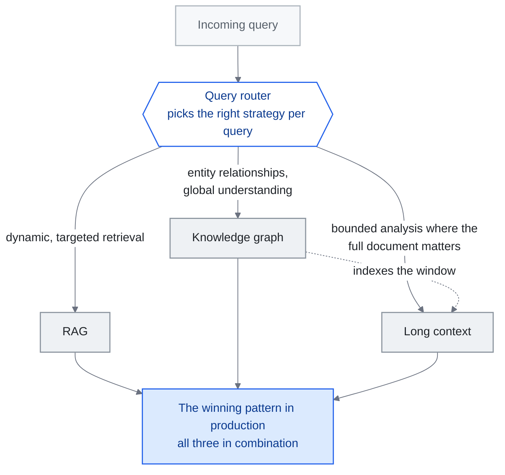

<!-- translation-sync:start -->
> 2026-10-31 の英語版に同期した機械支援翻訳です。構造と内容を確認しています。コードと図中ラベルは原文のまま、読書時間は英語原文の推定値です。
> [English source](../../../chapters/02-knowledge-layer.md) · [Sync record](../../SYNC.md)
<!-- translation-sync:end -->

<!-- i18n-anchor -->

# 第 02 章： RAG、長いコンテキストとナレッジ グラフ

> **一言で言うと:** AI に知識へのアクセスを与えるには、主に 三つの方法があります。それは、データベースを検索する (RAG)、長い文書を入力する、またはグラフ内の事実を結び付けることです。
>
> **重要な理由:** 自分のデータに関係するものに AI を使用する場合、この章では、状況に最適なアプローチを説明します。
>
> **読書時間:** ~16 分 (3,453 単語 / 230 wpm)

*図: "Hybrid Architectures: The Convergence" セクションの 三 者択一。このセクションが勝利する生成パターンの最後に置くクエリ ルーターを中心に描かれています。ルーターの各エッジは、そのブランチにクエリを送信するニーズに名前を付けます。点線のエッジは "KG as Semantic Backbone for Long Context" セクションの別個の主張です -- グラフは置き換える必要がなくなったウィンドウにインデックスを付けます -- ハイブリッド ボックスに収束するエッジは、エンジニアリング作業は選択ではなくルータであるという章の主張を伝えています。

**ナレッジ検索レイヤー -- 何が機能し、何が機能しないのか、そしてなぜほぼ常に答えが "hybrid." になるのか**

---

<!-- i18n-anchor -->

## RAG は死んでいません

context windows を大きくすると設計領域が広がりますが、ウィンドウ サイズだけではシステムが証拠を使用する信頼性が決まりません。 [Liu et al.](https://arxiv.org/abs/2307.03172) は、回答の質が長い入力の中で関連情報がどこに現れるかによって左右される可能性があることを示しました。回答の質、トークンの使用、待ち時間、現在の証拠がモデルに到達する方法など、独自の質問に対する検索およびフルコンテキストのアプローチを評価します。

RAG は死んでいません。進化しています。質問は "RAG or not RAG" ではなく、"what kind of RAG, combined with what else." でした。

---

<!-- i18n-anchor -->

## コストの現実

RAG に対する経済的な議論は依然として圧倒的です。

一般的な RAG パイプラインは、5-20 関連のチャンク (およそ 2,000-8,000 トークン) を取得し、それらをモデル呼び出しにフィードします。同じクエリに対するコンテキスト スタッフィングのアプローチでは、ソース ドキュメントの 500K-1M トークンの読み込みが必要になる場合があります。

**クエリごとのコスト比較（2026年半ばの料金に基づく概算）：**

|アプローチ |入力トークン |おおよそのコスト |相対コスト |
|----------|-------------|-----------------|---------------|
| RAG (対象を絞った取得) | ~5,000 | ~$0.00008 | 1x |
|コンテキストスタッフィング (完全なコーパス) | ~500,000 | ~$0.10 | 1,250x |

これは丸め誤差ではありません。エンタープライズ規模 (月あたり数百万件のクエリ) では、毎月の推論コストの $80 と $100,000 の差によって、プロジェクトが予算レビューに耐えられるかどうかが決まります。

取得により入力トークンの使用を削減できますが、総コストにはインデックス作成、取得、キャッシュ、および追加のモデル呼び出しも含まれます。同じ回答品質目標で完全なパイプラインをフルコンテキストのベースラインと比較します。より安価な設計は、コーパス サイズ、クエリ量、モデルの価格によって決まります。

---

<!-- i18n-anchor -->

## 長いコンテキスト: 機能する場合と機能しない場合

長い context windows (128K、200K、1M+ トークン) は、特定の使用例に対して真の変革をもたらします。

**長いコンテキストが優れている場合:**
- **静的で限定された文書分析**: 関連するコーパス全体がウィンドウ内に収まる単一の契約書、コードベース ファイル、または研究論文を分析します。
- **相互参照タスク**: 一度ロードされたドキュメントの固定セット全体にわたる接続を見つける
- **要約**: 大規模だが有限の入力を構造化された出力に凝縮する

**長い文脈が壊れる場所:**

**"Lost in the middle" 分解。** [Liu et al. (2023)](https://arxiv.org/abs/2307.03172) は、長いコンテキストの途中に配置された情報では、先頭または末尾の情報に比べて LLMs のパフォーマンスが大幅に低下することを示しました。その後のモデルの改良により、この影響は軽減されましたが、排除されたわけではありません。初期の 2026 の時点では、関連情報がコンテキストの 500K+ トークンの中に埋もれている場合、モデルは依然として測定可能な精度の低下を示しています。

**動的なナレッジ ベース。** ナレッジ ベースが 一 時間ごとに更新される場合 (製品インベントリ、サポート チケット、ニュース フィード)、コーパス全体をすべての context window に再埋め込むことはできません。 RAG の取得ステップは、当然のことながら更新を処理します。新しいドキュメントにはインデックスが付けられ、prompt 構造を変更せずにすぐに取得できるようになります。

**マルチテナントの分離。** ロングコンテキストのアプローチはアクセス制御に苦労します。複数のユーザーまたは権限レベルからの文書が同じコーパス内に存在する場合、RAG パイプラインは取得時のフィルタリングを強制できます。コンテキストスタッフィングには、慎重な (そしてエラーが発生しやすい) ドキュメントの分離が必要です。

**大規模なレイテンシ。** 1M トークンの処理は、最適化された推論を使用した場合でも、5K トークンの処理よりも大幅に時間がかかります。 一 秒未満の応答時間が重要なユーザー向けアプリケーションの場合は、ターゲットを絞った取得が最適です。

<!-- i18n-anchor -->

### 2026 更新: Titans + MIRAS が長いコンテキストのトレードオフを再構成する

上記のすべての制限は、Transformer スタイルの context window を前提としています。つまり、アテンションによって読み取られるトークンのフラット スパン、位置に関係なく同じトークンあたりのコスト、および同じ "lost in the middle" 障害モードです。 Google Research の 2026年四月アーキテクチャ ファミリである **Titans + MIRAS** は、その想定を打ち破ります。 Titans では、メモリはアテンション ウィンドウではありません。メモリは推論中に勾配降下法によって自身の重みを更新する **トレーニング可能なニューラル モジュール**であるため、モデルは長い履歴をトークンとして引き継ぐのではなく、文字通り重みの更新に圧縮します。 MIRAS は、この推論しながら学習するプロセスを安定させるトレーニング レシピを提供します。 Google は、同等のパラメータ数で、長距離リコールとマルチホップ推論において、Titans が Mamba-2、Gated DeltaNet、および Transformer++ よりも優れていると報告しています。これはいずれも、元のロング コンテキストの制限を否定するものではありません -- これらの制限は、GPT-4 Turbo、Gemini 1.5、および Claude が引き続き使用するアテンション ウィンドウ パラダイムに依然として当てはまります --- しかし、**"attention budget is scarce" フレーミングが現在では 一つのアーキテクチャ ファミリのプロパティであり、普遍的な制約ではないことは証明されています。** 実践者にとって、これはロング コンテキストを意味します。トレードオフはもはや単一曲線ではありません。現在、少なくとも 二つの曲線があります。アテンション ウィンドウ曲線 (中間損失とトークンごとのコストが支配的である場合) とトレーニング可能メモリ曲線 (コストが推論時の重み更新にシフトし、障害モードが安定性と忘却にシフトする場合) です。 RAG は両方の強力なデフォルトのままですが、RAG が勝てる *理由* は各体制で異なります。

<!-- i18n-anchor -->

### 2026 注意: 異議のある 12M-Token 要求

長いコンテキストに関する発表が、すべて精査に耐えるわけではありません。スタートアップの **Subquadratic** は2026年五月5日に **SubQ** を公開し、**Subquadratic Selective Attention (SSA)** によって **12百万トークンのウィンドウ**を実現したと主張しました。同社が引用する、Appenが実施したベンチマークの数値は目を引きます。FlashAttentionより56x高速で、6-12Mトークンでの針探索の再現率は98%、RULER-128の実行費用はSubQが$8、Claude Opus 4.6が$2,600です。2026年六月19日のMIT Technology Reviewによる検証は、この主張をより厳しく評価しました。Will Depueら研究者は、公開された証拠では、より強い表現である "solved quadratic attention" をまだ裏付けられないこと、またSubQは**ゼロから学習するのではなくQwenの重みを再利用している**ことを指摘しました。したがって、この効率の数値は特定の適応済みモデルの特性であり、一般的に成り立つと実証された結果ではありません。ここでも本リポジトリの誇張を避ける原則が当てはまります。SSAは興味深い主張であると同時に未検証の主張でもあり、長いコンテキストを必要とする利用者は、独立した追試が行われるまで12Mという数値を論争中のものとして扱うべきです。

---

<!-- i18n-anchor -->

## GraphRAG: フラット検索では不十分な場合

(命名上の注意: この章のナレッジ グラフは、システムが *知っていること* を構造化しています。2026年七月で明らかになった別の "graph engineering" フレーム --- [章 14](14-graph-engineering.md) で説明しています --- これは、ナレッジの検索に関するものではなく、マルチ エージェント システムがどのように接続されているかについてのものです。)

標準の RAG は、ドキュメントを独立したチャンクとして扱います。これは事実の検索 ("What is the return policy?") には機能しますが、*関係推論* を必要とする質問 ("Which suppliers are connected to both our delayed shipments and our quality complaints?") には失敗します。

[Microsoft の GraphRAG](https://github.com/microsoft/graphrag) (2024-2025) は、ハイブリッド アプローチを導入しました。つまり、ソース ドキュメントからナレッジ グラフを構築し、ベクトル検索と並行してグラフ トラバーサルを使用してクエリに応答します。

<!-- i18n-anchor -->

### GraphRAG の仕組み

1. **インデックス作成フェーズ**: ドキュメントが処理されて、エンティティ (人、組織、概念) とそれらの間の関係が抽出されます。これらは、従来のベクトル埋め込みとともにグラフ構造を形成します。
2. **コミュニティ検出**: グラフは、密に接続されたエンティティのコミュニティに分割されます。各コミュニティには概要の説明が表示されます。
3. **クエリ フェーズ**: 特定のクエリについて、ベクトル類似性 * と* グラフ トラバーサルの両方を使用して、関連するコンテキストを取得します。エンティティ関係は、フラット検索では見逃すマルチホップ推論パスを提供します。

<!-- i18n-anchor -->

### GraphRAG が重要な場合

- **マルチホップ クエリ**: "Who are the common investors between companies that went public in 2025 and companies that were acquired?" -- リレーションシップ チェーンのトラバースが必要
- **エンティティ中心の推論**: 特定のエンティティおよび他のエンティティとの関係に関する質問
- **グローバル要約**: "What are the main themes across all our customer feedback?" -- コミュニティ要約は、すべてのドキュメントを処理せずにこれを提供します。

<!-- i18n-anchor -->

### GraphRAG が過剰な場合

- 単純な事実検索 (標準の RAG はこれを適切に処理します)
- 長いコンテキストがすべてを保持できる小さなコーパス
- エンティティ抽出の品質が低いユースケース (ガベージイン、ガベージアウト)

GraphRAG のインデックス作成コストは、標準の RAG よりも大幅に高くなります。デフォルトとしてではなく、関係推論が中心的な要件である場合にのみグラフを作成します。

<!-- i18n-anchor -->

### 2026 進化: 長いコンテキストのセマンティック バックボーンとしての KG

2024 とほとんどの 2025 を通じて、GraphRAG は **RAG** の代替手段として構成されました。これは、制限された context window を持つモデルのチャンクを取得する別の方法です。 2026 によって、そのフレーミングが変更されました。フロンティアモデルが context windows を数百万トークンの範囲に押し込むにつれて (1M での Gemini 1.5、2M を超えた Kimi の漢字、さらなる拡張が進行中)、問題はもはや "how do we retrieve a small number of relevant chunks" ではなく "how do we navigate a context that is already large enough to hold most of what we need." です。

その世界では、ナレッジグラフは**検索の代替手段**ではなく、**長いコンテキストのための構造化インデックス層**になります。どのチャンクを読み込むかを決めるためのグラフではありません。チャンクはすでにウィンドウ内にあります。グラフの役割は、そこにある情報の意味的な地図をモデルに与えることです。どのエンティティがあり、どう関係し、どの節がどの話題に対応し、どこに矛盾があり、どのマルチホップ経路が質問と関連する証拠を結ぶのかを示します。GraphRAGは、誕生当時の8Kトークンウィンドウの制約を回避する手段から、エージェントが百万トークンのウィンドウを効率よくたどるための**意味的な基盤**として再登場します。2026年四月に学習可能なメモリモジュール（Titans + MIRAS）が登場しても、この役割は失われません。初期の証拠によれば、ナレッジグラフと学習可能なメモリは、本番スタックで**共存し、おそらく組み合わせて使われる**ことになります。グラフは、学習可能なモジュールがすでに重みに圧縮した情報に対して、型付きでクエリ可能な構造を与えます。このようにグラフをインデックス層として使う初の大規模な運用事例は、2026年六月に現れました。**Agents-K1**（"Agents-K1: Towards Agent-native Knowledge Orchestration," arXiv 2606.13669、2026年六月11日）は、**2.46百万件の論文**を処理してエージェント向けのナレッジグラフを構築し、**1百万件の論文を含むScholar-KG**を一般公開しました。グラフを検索基盤として使うと、Frontierscience-Researchで大きな性能向上が得られたと報告しています（Gemini-3は7.9%から24.6%、GPT-5.2は25.2%から39.4%）。2026年九月の統制研究は、インデックス層という位置付けに新たな根拠を加えました。48件の合成テストケースで、固定スキーマのグラフメモリは基盤モデルを交換してもほぼ変化しませんでしたが、圧縮メモはそうではありませんでした。つまり、モデルが入れ替わるスタックにおいて、グラフが移植可能な層になります（[第6章](06-agent-memory.md)に結果の全容と少数サンプルという留意点を記載しています）。

<!-- i18n-anchor -->

### 2026 更新: グラフ ツールの統合、エージェントのメモリ分割の解除 (2026年七月)

グラフツールのランドスケープの途中の 2026 チェック (GitHub API、2026 年七月によって検証された GitHub の数値) には、三つの異なるストーリーが示されています。

**フレームワークに新しいリーダーが誕生しました。** [HKUDS/LightRAG](https://github.com/HKUDS/LightRAG) (EMNLP 2025 ペーパー; MIT ライセンス) は、軽量のグラフ + ベクターのデュアルレベル フレームワークで、オリジナルの Microsoft を上回り、~38k 個のスターで最もスターの多いグラフ-RAG フレームワークになりました。 ~35k (2026年七月) --- 単一のランドマークではなく、着実な機能の成長について。 Microsoft の GraphRAG 自体は v3.x ライン上にあり ([v3.1.1 release 2026年七月18日](https://github.com/microsoft/graphrag/releases))、現在も積極的に開発されています。

**グラフベースのエージェント メモリは、独自のカテゴリとして分割されます。** GraphRAG のドキュメント検索系統とは異なり、プロジェクトのクラスターは現在、*エージェントのメモリ基盤*としてグラフを使用しています: [getzep/graphiti](https://github.com/getzep/graphiti) (~29k スター、2026年七月; エージェント メモリのリアルタイム バイテンポラル ナレッジ グラフ)、 [Cognee](https://github.com/topoteretes/cognee) ([2026年六月26日 release](https://www.cognee.ai/cognee-1-0-announcement) はメモリ ライフサイクル操作を公開します)、および Neo4j Labs の [agent-memory](https://github.com/neo4j-labs/agent-memory) (["Lenny's Memory,"](https://neo4j.com/blog/developer/meet-lennys-memory-building-context-graphs-for-ai-agents/) が起動されました2026年一月)、グラフ データベース ベンダーが KG 構築からエージェント メモリに直接移行することを示します。 [第 6](06-agent-memory.md) では、グラフ ストレージ以外のライフサイクルとガバナンスの問題について説明します。

**証拠ベースは成熟 --- そして 一つの主力製品は失速します。** ICLR 2026 で受け入れられた [GraphRAG-Bench](https://github.com/GraphRAG-Bench/GraphRAG-Benchmark) ("When to use Graphs in RAG: A Comprehensive Analysis for Graph Retrieval-Augmented Generation") は、グラフベースの RAG が実際にバニラの RAG を上回るパフォーマンスを示す最初の広く引用された中立的な分析です -- このセクションの "when GraphRAG matters / when it is overkill" の質問に対する直接の経験的回答です。一方、中国のエコシステムの代表的エントリーである Ant Group の [OpenSPG/KAG](https://github.com/OpenSPG/KAG) は沈黙を保っています。2026年一月28日以来リポジトリのプッシュがなく、2025年六月以来リリースされていません --- 加速というより惰性で推移しています。

---

<!-- i18n-anchor -->

## 2025-2026 RAG テクニックの概要

RAG 自体は、複数の特殊なアプローチに分岐しています。主なバリエーション:

<!-- i18n-anchor -->

### 自己RAG (浅井ら、2023)

[Self-RAG](https://arxiv.org/abs/2310.11511) は、「いつ」取得が必要か、「何を」取得するか、取得したコンテンツが実際に関連しているかどうかを決定するようにモデルをトレーニングします。モデルは常に取得するのではなく、取得プロセスを制御する特別な "reflection tokens" を生成します。

**主な利点**: 不必要な取得呼び出しを削減し、無関係な取得コンテンツをフィルタリングして除外することで、効率と精度の両方が向上します。

<!-- i18n-anchor -->

### 修正 RAG (CRAG)

[修正 RAG](https://arxiv.org/abs/2401.15884) (Yan et al.、2024) は、取得後の検証ステップを追加します。軽量のエバリュエーターは、取得されたドキュメントがクエリに関連しているかどうかを評価します。信頼性が低い場合、システムはフォールバックとして Web 検索または代替の取得戦略をトリガーします。

**主な利点**: 主要なナレッジ ベースに答えが含まれていない場合でも、正常に機能が低下します。

<!-- i18n-anchor -->

### アダプティブ RAG

[Adaptive RAG](https://arxiv.org/abs/2403.14403) (Jeong et al.、2024) は、分類子を使用して、複雑さに基づいてクエリをさまざまな取得戦略にルーティングします。単純なクエリは直接取得されます。複雑なクエリは、chain-of-thought 推論を使用して複数ステップの取得を取得します。あいまいなクエリは、結果の融合を使用して複数の取得パスを取得します。

**主な利点**: 画一的なパイプラインを使用するのではなく、取得コストをクエリの複雑さに合わせます。

<!-- i18n-anchor -->

### ゴールデンレトリバー RAG

Golden-Retriever RAG は、LLM 自体を使用して取得前にクエリを書き換えることにより、取得の品質に重点を置いています。モデルは "ideal document" 記述を生成し、これは生のユーザー入力の代わりに取得クエリとして使用されます。

**主な利点**: ユーザーの質問方法とドキュメントの作成方法の間の語彙のギャップを埋めます。

---

<!-- i18n-anchor -->

## RAG を "Context Engine" として

オープンソースの RAG エンジンである [RAGFlow](https://github.com/infiniflow/ragflow) は、2025 後半に年末レビューを発表し、"Retrieval-Augmented Generation" という用語はもはや最新の RAG システムの機能を表すものではないと主張しました。彼らが提案した再構成: RAG は、検索技術から **コンテキスト エンジン** (異種ソースから関連情報をモデルの context window に組み立てるための汎用システム) に進化しました。

この再構成は、[第 01](01-evolution.md) で説明されている context engineering の進化と一致しています。 RAG は単なる "retrieve and stuff." ではなく、最新の RAG システムです。

- クエリの意図と複雑さを分類します
- 適切な検索戦略へのルート (ベクトル、キーワード、グラフ、ハイブリッド)
- 結果の再ランク付けとフィルタリング
- トークンの予算に合わせて取得したコンテンツを圧縮します
- 適切な構造とメタデータを使用して結果をフォーマットします
- 引用と検証のための出所を追跡します

これはコンテキスト アセンブリ パイプラインであり、取得ステップではありません。 RAG システムはコンテキスト エンジンです。

<!-- i18n-anchor -->

### 2026: RAG がマネージド クラウド プリミティブになります

コンテキスト エンジンの再フレームには、mid-2026 にマネージド インフラストラクチャ エコーがありました。 **2026年六月17日**、AWS は **Amazon Bedrock マネージド ナレッジ ベース** を GA で出荷しました。これは、六つの組み込みコネクタ (S3、SharePoint、Confluence、Google Drive、OneDrive、Web Crawler)、自動同期、マネージド ベクトル ストレージ、およびハイブリッド検索を備えたフルマネージド RAG サービスです。 **"agentic retrieval"** は、クエリ計画、中間応答評価、およびマルチホップ質問の再ランキングを自動調整します。重要なのは機能リストではなく、それが示す変化です。この章でコンテキスト エンジンと呼ぶアセンブリ パイプラインは、コンポーネント チームが手作業で構築するものから、**コモディティ クラウド プリミティブ** チームのプロビジョニングへと移行しています。マネージド エージェント サブストレート (4 章) と同様に、DIY バージョンは消えません --- しかし、"stand up RAG over our documents" のデフォルトはエンジニアリング プロジェクトではなく、構成の選択となることが多くなっています。

---

<!-- i18n-anchor -->

## ハイブリッド アーキテクチャ: 融合

2025-2026 からの証拠は、明らかにハイブリッド アプローチを示しています。すべての次元で単一のテクニックが勝てるということはありません。

|寸法 | RAG |長いコンテキスト |ナレッジグラフ |
|-----------|-----|-------------|----------------|
|クエリごとのコスト |低い |高 |中 |
|動的更新 |強い |弱い |中 |
|関係の推論 |弱い |弱い |強い |
|セットアップの複雑さ |中 |低い |高 |
|精度 (目標) |高 |中 |高 |
|精度 (グローバル) |中 |高 |高 |

**本番環境での勝ちパターン:**

1. **ナレッジ グラフ** エンティティの関係とグローバルな理解のための
2. **RAG** 特定のクエリに対する動的で対象を絞った取得の場合
3. **ドキュメント全体が重要な限定分析タスク用の長いコンテキスト**
4. クエリごとに適切な戦略を選択する **クエリ ルーター**

これは理論的なものではありません。大規模な運用システム (エンタープライズ検索、コーディング アシスタント、カスタマー サポート エージェント) では、三つすべてを組み合わせて使用​​します。エンジニアリング上の課題は、一つを選択することではなく、クエリごとに適切なツールを選択するルーターを構築することです。

---

<!-- i18n-anchor -->

## 主要なプロジェクトとリソース

|プロジェクト |説明 |リンク |
|---------|-------------|------|
| Microsoft GraphRAG |ナレッジ グラフ + RAG ハイブリッド | [github.com/microsoft/graphrag](https://github.com/microsoft/graphrag) |
| LightRAG |軽量のグラフ + ベクター RAG フレームワーク (最も星が多い、~38k、2026年七月) | [github.com/HKUDS/LightRAG](https://github.com/HKUDS/LightRAG) |
|ラグフロー |ドキュメントを深く理解するオープンソースの RAG エンジン | [github.com/infiniflow/ragflow](https://github.com/infiniflow/ragflow) |
| NirDiamant/RAG_Techniques | RAG 実装の包括的なコレクション | [github.com/NirDiamant/RAG_Techniques](https://github.com/NirDiamant/RAG_Techniques) |
| LangChain |広範な RAG ツールを備えたフレームワーク | [github.com/langchain-ai/langchain](https://github.com/langchain-ai/langchain) |
| LlamaIndex | LLM アプリケーションのデータ フレームワーク | [github.com/run-llama/llama_index](https://github.com/run-llama/llama_index) |
| Chroma |オープンソースの埋め込みデータベース | [github.com/chroma-core/chroma](https://github.com/chroma-core/chroma) |

---

<!-- i18n-anchor -->

## 得るべき 三つのこと

- **ウィンドウが大きくても検索の選択が決まるわけではありません。** システムが実際に提供する質問について、回答の質、トークンの使用、待ち時間、証拠の鮮度を比較してください。
- **すべての側面で単一の手法が勝つということはありません。** コスト、関係の推論、セットアップの複雑さのそれぞれが異なる勝者を選ぶため、本番スタックは 三つすべてを同時に実行します。
- **難しいのは、選択ではなくルーターです。** この章の勝利パターンは、クエリごとに適切な戦略を選択するクエリ ルーターで終わります。そのルーターがエンジニアリングの課題です。

---

<!-- i18n-anchor -->

## 情報源

- Liu、N.F. 他(2023)。 "Lost in the Middle: How Language Models Use Long Contexts." [arXiv:2307.03172](https://arxiv.org/abs/2307.03172)
- Microsoft。 (2024)。 "GraphRAG: Unlocking LLM discovery on narrative private datasets." [microsoft.com/research](https://www.microsoft.com/en-us/research/blog/graphrag-unlocking-llm-discovery-on-narrative-private-datasets/)
- 浅井 明 他(2023)。 "Self-RAG: Learning to Retrieve, Generate, and Critique through Self-Reflection." [arXiv:2310.11511](https://arxiv.org/abs/2310.11511)
- ヤン、S. 他(2024)。 "Corrective Retrieval Augmented Generation." [arXiv:2401.15884](https://arxiv.org/abs/2401.15884)
- Jeong, S. 他(2024)。 "Adaptive-RAG: Learning to Adapt Retrieval-Augmented Large Language Models through Question Complexity." [arXiv:2403.14403](https://arxiv.org/abs/2403.14403)
- ラグフロー。 (2025)。 "Year-End Review: From RAG to Context Engine." [github.com/infiniflow/ragflow](https://github.com/infiniflow/ragflow)
- ニルディアマント。 (2025)。 "RAG Techniques." [github.com/NirDiamant/RAG_Techniques](https://github.com/NirDiamant/RAG_Techniques)
- Google 研究。 (2026年四月)。 "Titans + MIRAS: Helping AI Have Long-Term Memory." [research.google/blog/titans-miras-helping-ai-have-long-term-memory/](https://research.google/blog/titans-miras-helping-ai-have-long-term-memory/) --- 同等のサイズで Mamba-2 / Gated DeltaNet / Transformer++ を上回るトレーニング可能なメモリ モジュール。
- AWS。 "Amazon Bedrock Managed Knowledge Base is now generally available" (2026年六月17日)。 [https://aws.amazon.com/about-aws/whats-new/2026/06/amazon-bedrock-managed-knowledge-base/](https://aws.amazon.com/about-aws/whats-new/2026/06/amazon-bedrock-managed-knowledge-base/) --- フルマネージド RAG; 六つのコネクタ。管理されたベクトルストレージ。ハイブリッド検索。エージェントによる検索 (クエリ計画、中間応答評価、再ランキング)。
- MIT テクノロジーのレビュー。 "A startup claims it broke through a bottleneck that's holding back LLMs" (2026年六月19日)。 [https://www.technologyreview.com/2026/06/19/1139313/a-startup-claims-it-broke-through-a-bottleneck-thats-holding-back-llms/](https://www.technologyreview.com/2026/06/19/1139313/a-startup-claims-it-broke-through-a-bottleneck-thats-holding-back-llms/) --- Subquadratic の SubQ 12M トークン要求 (SSA) を介して。 Appen ベンチマーク。ウィル・デピューの反発。 SubQ は Qwen 重みを再利用します。争われたとおりのフレーム。
- "Agents-K1: Towards Agent-native Knowledge Orchestration." arXiv 2606.13669 (2026年六月11日)。 [https://arxiv.org/abs/2606.13669](https://arxiv.org/abs/2606.13669) --- 2.46M 個のペーパーがエージェントネイティブ KG に処理されます。 1M-paper Scholar-KG が公開されました。 Frontierscience-Research のベースライン増加 (Gemini-3 7.9%→24.6%、GPT-5.2 25.2%→39.4%)。
- HKUDS。 "LightRAG: Simple and Fast Retrieval-Augmented Generation" (EMNLP 2025)。 [github.com/HKUDS/LightRAG](https://github.com/HKUDS/LightRAG) --- ~38k 個のスターと Microsoft/graphrag の ~35k 個 (2026年七月時点) (GitHub API)。
- Microsoft。 GraphRAG がリリースされます。 [github.com/microsoft/graphrag/releases](https://github.com/microsoft/graphrag/releases) --- v3.1.1 (2026年七月18日);プロジェクトの 2026 v3.x 行。
- GraphRAG-ベンチ。 "When to use Graphs in RAG: A Comprehensive Analysis for Graph Retrieval-Augmented Generation" (ICLR 2026)。 [github.com/GraphRAG-Bench/GraphRAG-Benchmark](https://github.com/GraphRAG-Bench/GraphRAG-Benchmark)
- Cognee。 "cognee 1.0" (2026年六月26日)。 [お知らせ](https://www.cognee.ai/cognee-1-0-announcement)。
- Neo4j。 "Meet Lenny's Memory: Building Context Graphs for AI Agents" (2026年一月)。 [neo4j.com/blog/developer](https://neo4j.com/blog/developer/meet-lennys-memory-building-context-graphs-for-ai-agents/) --- グラフネイティブ エージェント メモリ ライブラリ (neo4j-labs/agent-memory)。
- OpenSPG/KAG リリース。 [github.com/OpenSPG/KAG/releases](https://github.com/OpenSPG/KAG/releases) --- 最後のリポジトリプッシュ 2026年一月28日;最終リリース v0.8.0 (2025年六月)、GitHub API で検証。
- ゴヤル、アンキット、そしてRay、ジェイディープ。 "Does Your Agent's Memory Survive a Model Upgrade? A Controlled Study of Memory Portability." arXiv 2609.05339 (2026年九月4日)。 [https://arxiv.org/abs/2609.05339](https://arxiv.org/abs/2609.05339) --- 48 生の履歴、RAG、圧縮メモ、構造化ナレッジ グラフにわたる合成ケース。グラフメモリはモデルのスワップ (+0.0004 ± 0.0020) に対してほぼ不変ですが、圧縮されたノートは +9.91 / -13.28 ポイントでスイングします。小規模な合成サンプル、著者 二人、複製されていない。 6 章で完全に説明されています。

---

*前: [第 01 -- 三 世代](01-evolution.md)*

*次: 章 03 -- Context Engineering の詳細 (近日公開予定)*
