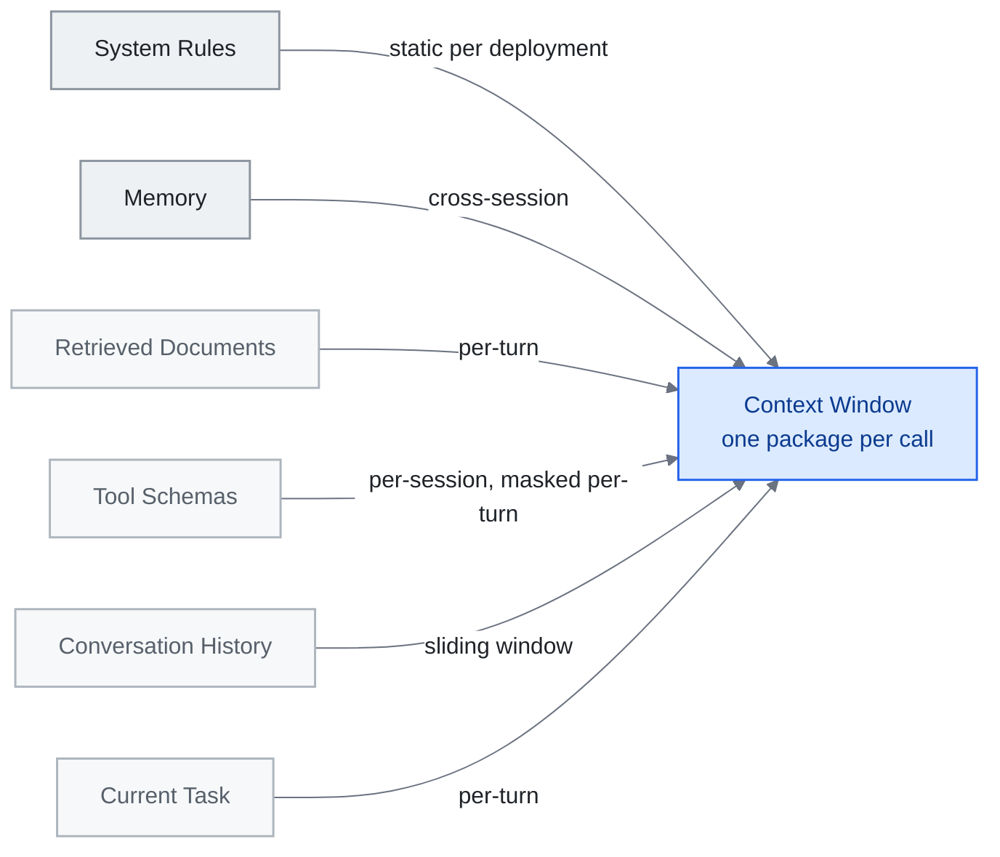

<!-- translation-sync:start -->
> 2026-10-31 の英語版に同期した機械支援翻訳です。構造と内容を確認しています。コードと図中ラベルは原文のまま、読書時間は英語原文の推定値です。
> [English source](../../../chapters/03-context-engineering.md) · [Sync record](../../SYNC.md)
<!-- translation-sync:end -->

<!-- i18n-anchor -->

# 第 3 章： Context Engineering -- ウィンドウを埋める技術

> **一言で言えば:** Context engineering は、AI に適切な情報を適切なタイミングで、多すぎず、少なすぎずに提供する技術です。
>
> **重要な理由:** より良いコンテキストは、より良い AI 回答を意味します。 AI から素晴らしい結果が得られる人もいれば、一般的な応答が得られる人もいるのはこのためです。
>
> **読書時間:** ~13 分 (2,908 単語 / 230 wpm)

*図: セクション 3.2 の 六つの層。最も永続的なものは一番上、最も一時的なものは一番下の順に配置され、セクション 3.1 が定義する呼び出しごとに 一つのパッケージというコンテキストに収束します。矢印のラベルは各レイヤーの更新頻度を表しており、これが各レイヤーに独自の圧縮戦略が必要な理由です。また、同じウィンドウをめぐって競合します。取得したドキュメントを詰め込みすぎると、現在のタスクの信号が消えてしまいます。*

> "Context engineering is the delicate art and science of filling the context window with just the right information for the next step."
> -- Andrej Karpathy, June 2025

prompt engineering が適切な質問を作成している場合、context engineering はそれを囲むブリーフィング パケット全体を作成します。一方からもう一方への移行は、実践者が LLM システムについてどのように考えるかに根本的な変化を示しています。設計の単位はもはや単一の命令ではなく、*情報環境* です。

この章では、理論的なフレームワークから実稼働環境でテストされたパターンに至るまでの状況をマッピングし、この分野を定義する主要な情報源を示します。

---

<!-- i18n-anchor -->

## 3.1 プロンプトからコンテキストまで

"context engineering" という用語は、Karpathy が prompt engineering との間に明確な線を引いた 2025 中期に主流の使用法になりました。 prompt は静的な文字列です。コンテキストは、モデルに必要なものすべて (命令、メモリ、取得したドキュメント、ツール定義、会話履歴、当面のタスク) を動的に組み立てたパッケージであり、プログラム的に構成され、毎回更新されます。

最新のエージェントが同じコンテキストを 二 回送信することはほとんどないため、この区別は重要です。各推論呼び出しは、ルーティング ロジック、取得パイプライン、圧縮ヒューリスティック、およびツールの可用性チェックの成果物であり、これらが連携してウィンドウを満たすものと除外されるものを決定します。

<!-- i18n-anchor -->

## 3.2 六 層コンテキスト モデル

Anthropic の [効果的なエージェントの構築](https://www.anthropic.com/engineering/building-effective-agents) とそれに隣接する実践者の記述で説明されているパターンを利用すると、context window は、最も永続的なものから最も一時的なものまで順序付けされた 六つの概念層に効果的に分解できます。ここでのラベルは、このガイドの教育学的総合であり、 Anthropic 自体が発行する分類法ではありません。

|レイヤー |目次 |典型的な永続性 |
|-------|----------|-------------------|
| **システムルール** |安全上の制約、ペルソナの定義、行動のガードレール |展開ごとに静的 |
| **メモリ** |ユーザーの好み、以前のセッションの概要、学んだ事実 |クロスセッション |
| **取得した文書** | RAG の結果、検索スニペット、ファイルの内容 |ターンごと |
| **ツール スキーマ** |関数定義、API 仕様、機能宣言 |セッションごとまたはマスクされたターンごと |
| **会話履歴** |以前のメッセージ、アシスタントの応答、ツール呼び出し結果 |引き違い窓|
| **現在のタスク** |即時のユーザーリクエストとタスク固有のインジェクション |ターンごと |

重要な洞察は、各層には異なる更新頻度、異なる圧縮戦略、および異なる障害モードがあるということです。 「取得したドキュメント」レイヤーを詰め込みすぎると、「現在のタスク」信号がかき消されます。メモリが不足していると、モデルはすでに持っているはずのコンテキストを再導出する必要があります。優れた context engineering は、六つのレイヤーすべてを同時にバランスさせることです。

<!-- i18n-anchor -->

## 3.3 Manus からの教訓: 北極星としての KV キャッシュ

2025 年 七月に、Yichao "Peak" Ji (Manus の CTO) は、単一の運用指標 **KV-cache ヒット率 ** を中心に context engineering を再構築した一連の運用レッスンを公開しました。

Manus は、エージェント システムの入力トークンと出力トークンの間で一貫した 100:1 比率を観察しました。その比率では、投入コストがすべてを支配します。 KV-cache ヒット (以前に計算されたキーと値のペアが再計算されるのではなく再利用される) が、レイテンシーとコストの両方の主な手段になります。

この洞察から 三つのテクニックが生まれました。

1. **追加専用のコンテキスト構造。** コンテキストの以前の部分を決して書き換えないでください。途中で挿入または編集すると、キャッシュされたプレフィックスが無効になり、完全な再計算が強制されます。コンテキストをドキュメントではなくログとして設計します。

2. **スキーマの削除ではなく、ロジット バイアスによるツール マスキング。** ツールが一時的に利用できない場合、Manus はコンテキストからツール定義を削除するのではなく、ロジット レベルのマスキングによってその選択を抑制しました。定義を削除すると、トークンのシーケンスが変更され、キャッシュが破壊されます。マスキングでは、選択を防止しながらプレフィックスを保持します。

3. **ローリング todo リストの書き換え。** モデルに依存して長い会話の初めから目標を思い出すのではなく、Manus はコンテキストの終わり近くに書き換えられた todo リストを定期的に追加しました。これは、注目度の最新性バイアスを利用します。つまり、最新のトークン内の目標は、何千ものトークンが以前に埋め込まれた同一の目標よりも強い注目度の重みを受け取ります。

これらはインフラストラクチャ レベルの決定であり、prompt レベルの決定ではありません。これらは、"context engineering" にシステム思考が必要な理由を示しています。

**キャッシュの原則を検証する研究ツールが登場（2026年半ば）。** Manusのルールは運用上の経験則でしたが、2026年六月の二つの論文は、同じ原則を測定可能な仕組みにしています。**Still**（arXiv 2606.07878、2026年六月5日）は、固定した基盤モデルに対して学習した各層のPerceiverを用い、コストを償却できる単一パスのKVキャッシュ圧縮を行います。**8k-128kのコンテキストで8x-200xの圧縮**と、**RULERで最強のベースラインを8-22ポイント上回る性能**を報告しています。**TokenPilot**（arXiv 2606.17016、2026年六月15日）は二つの粒度で動作します。*Ingestion-Aware Compaction*段階でプレフィックスを全体的に安定させ、*Lifecycle-Aware Eviction*段階で各セグメントの有用性を局所的に追跡します。PinchBenchとClaw-Evalでのコスト削減率は、それぞれ単独セッションでは**61% / 56%**、継続セッションでは**61% / 87%**と報告しています。ここでTokenPilotが重要なのは、本節が定性的に述べる "append-only, don't bust the cache" という規律を、具体的な数値を伴う運用の仕組みにしているからです。長く続くセッションでも、キャッシュを際限なく増大させずに、キャッシュに適したプレフィックスを維持できるのは、この削除段階があるためです。

**いつ、どのように圧縮するか（2026年八月）。** 後続の実証研究 "Practical Online KV Cache Compaction for LLM Agents"（arXiv 2608.00902、2026年八月2日）は、特にエージェントの実行軌跡を対象に圧縮を調べ、指針をさらに具体化しました。直ちに圧縮すると精度が下がるものの、エージェント自身の将来のクエリを代理クエリ信号として使えるまで圧縮を遅らせると、失われた精度の大半が回復します。代理信号が不完全な場合、代理クエリが誘発するアテンション量に基づいて削除対象のトークンを採点する方法（token eviction、TE）は、アテンションを一致させる再構築（AM）より頑健でした。BrowseComp-PlusとWideSearchでは、TEはKVキャッシュを80%削減し、圧縮しない場合よりもスループットを向上させます。これは、本節が定性的に述べる追記のみの規律に対する具体的なルールです。圧縮を遅らせ、その後は再構築ではなく削除を行います。

<!-- i18n-anchor -->

## 3.4 五つの主要なパターン

Aurimas Griciunas は、この新たな実践を、運用システム全体で観察される 五つの繰り返しパターンに統合しました (正規の記事: "State of Context Engineering in 2026," SwirlAI Newsletter、2026 年三月22 日、[https://www.newsletter.swirlai.com/p/state-of-context-engineering-in-2026](https://www.newsletter.swirlai.com/p/state-of-context-engineering-in-2026)。 "Breaking Down Context Engineering" も参照):

**段階的な開示。** 事前にすべてをロードしないでください。最初に軽量インデックスを提示します。モデル (またはルーティング ロジック) が関連性があると判断した場合にのみセクションを展開します。これは、コンテキスト ウィンドウでの遅延読み込みに相当します。 Anthropic 独自のエージェント スキル システムはこのパターンを使用します -- 17 スキルは保存時におよそ 1,700 トークンを消費し、呼び出し時にのみ拡張されます。

**コンテキスト圧縮。** 注入前に情報を要約、切り詰め、または抽出します。スライディング ウィンドウを超えた会話履歴は、要約に圧縮されます。取得した文書の関連箇所を抜粋します。目標は、トークン数を減らしながらセマンティック密度を維持することです。

**コンテキスト ルーティング。** すべてのクエリが同じコンテキストを必要とするわけではありません。ルーティング層は受信リクエストを検査し、どのメモリ バンク、ツール セット、ドキュメント コレクションを含めるかを選択します。これは、データベース クエリ プランナーのコンテキスト ウィンドウに相当します。

**取得の進化** 静的 RAG (一度取得、挿入、生成) は、モデルが生成中に追加情報を要求できる反復取得に取って代わられます。コンテキストは一度組み立てられるのではなく、生成プロセスを通じて進化します。

**ツールと機能の管理** ツール ライブラリが増大するにつれて、すべてのスキーマをロードするのは法外なものになります。システムは、メタツール パターン (オンデマンドで関連するツール スキーマを返す検出ツール) またはスキル グラフ アーキテクチャを使用して、ツール層を無駄のない状態に保ちます。

**フロンティア研究所が自らのルールを見直す（2026年七月）。** 上の五つのパターンは、多くのシステムで観察された実践からまとめたものです。2026年七月24日、AnthropicはThariq Shihiparによる "The new rules of context engineering for Claude 5 generation models," を公開し、自社の指針を改訂しました。その要点は、指示を減らすことです。Claude Codeチームは、Claude 5世代のモデル向けシステムプロンプトを80%超削除しても、コーディング評価で測定可能な性能低下はなかったとしています。この数値はAnthropic自身のコーディング評価に基づく報告であり、独立したベンチマークではありません。他にも応用できるのは、その背景にある考え方です。記事は、ルールから判断へ移行し、有能なエージェントには網羅的な指示よりも原則と信頼を与えること、最初からウィンドウに情報を詰め込まず、必要な時点で段階的にコンテキストを読み込むこと、そして人に説明するようにエージェントに役割と制約を伝え、例は必要性が認められる場合にだけ加えることを提案しています。二番目は上で述べた段階的開示の再提示ですが、今回は研究所の本番運用での証拠を伴います。一番目は、この分野の出発点となった直感に反します。モデルが向上するにつれて、コンテキストエンジニアリングの作業には、最適化ではなく蓄積された不信に由来するものが増えており、その部分に必要なのは調整ではなく削除だ、という主張です。

**圧縮は 一つのポリシーではありません (2026年八月)。** 上記の KV-cache の作業とこのセクションのコンテキスト圧縮は両方とも、ウィンドウを交換可能なトークンのバジェットとして扱います。 九人の著者による研究 (arXiv 2608.31057、2026年八月31日) は、これは間違った計算単位であると主張しています。 55 は、アーカイブされたコーディング エージェントの軌跡を分析し、作業メモリの内容を、サイズ、保持、表現プロファイルが異なる 四つのカテゴリ (命令、アーティファクト、ツール出力、エージェント生成状態) に分類し、保存された状態、提供されたコンテキスト、管理作業、およびタスクまたはプロセスの結果を分離する 四 レベルの評価フレームワークを提案します。著者らの言葉では、 "equal token budgets do not imply equal delivered context or management cost." 彼らは、オブジェクト認識圧縮と取得ベースのポリシーという 二つの意味情報に基づいた戦略をテストし、キャリブレーション ゲインが 一つのタスク セットに合わせて調整されることを警告しています。 "may not transfer to held-out tasks." 55 の軌跡では、これは確立されたパターンではなく、未解決の経験的発見です。実際の結果は狭いですが鋭いものです。ウィンドウ全体に均一に適用される単一の圧縮ルールにより、すでに 四つの異なる種類のオブジェクトに関するポリシーの選択が行われており、その選択が盲目的になります。

コンパクションの監視境界については、[第 4](04-harness-engineering.md#48-harness-maintenance-the-stress-testing-imperative) を参照してください。

<!-- i18n-anchor -->

## 3.5 学術界の展望

中旬 2025 は、正式な研究領域として context engineering に関する最初の包括的な学術調査をもたらしました: **"A Survey of Context Engineering for Large Language Models"** (Mei et al.、arXiv 2507.13334、七月 17-21、2025)。これは、1,400 を超える研究論文の体系的な分析を通じて、この分野の技術ロードマップを確立しました。この調査では、**基本コンポーネント** (コンテキストの取得と生成、コンテキスト処理、コンテキスト管理) と **システム実装** (RAG、メモリ システム、ツール統合推論、マルチエージェント システム) の 二つの軸に沿って設計空間を整理します。その中核的な発見は、基本的な機能の非対称性です。現在のモデルは、複雑なコンテキストを理解することに非常に熟練していますが、同様に洗練された長い形式の出力を生成するには顕著な制限を示しています。実践者にとって、この調査はこの分野で教科書に最も近いものです。この調査は、context engineering が単一の手法ではなく、複数の独立した次元を持つ設計空間であるという経験的に発見されたことを形式化したものです。

<!-- i18n-anchor -->

## 3.6 エージェント Context Engineering (ACE)

ACE の論文 **"Agentic Context Engineering: Evolving Contexts for Self-Improving Language Models"** (Zhang et al., arXiv 2510.04618, 2025年十月6日; コンパニオン リポジトリ [github.com/ace-agent/ace](https://github.com/ace-agent/ace)) では、コンテキストを静的アセンブリとしてではなく、**進化するプレイブック**として扱うという概念の転換が導入されました。 ACE システムでは、コンテキストはエージェント自体が維持する生きた文書です。つまり、観察の追加、計画の更新、無関係な履歴の削除、タスクの進行状況に基づいた自身の指示の再構築などを行います。報告されたヘッドラインの利益: エージェント ベンチマークで +10.6%、財務タスクで +8.6%、適応レイテンシーとロールアウト コストが削減されました。 AppWorld リーダーボードでは、ACE は、小規模なオープンソース モデルを使用しているにもかかわらず、全体平均でトップにランクされた運用レベルのエージェントに匹敵し、より難しいテスト課題の分割でそれを上回っています。 ACE はまた、設計上の障害モードとして、**簡潔性バイアス** (簡潔な要約のためにドメインの洞察が失われる) と **コンテキストの崩壊** (反復的な書き換えにより時間の経過とともに詳細が失われる) を挙げています。

これにより、context engineering は純粋なインフラストラクチャの問題 (harness が各呼び出しの前に何を組み立てるか) から、協調的な問題 (harness が準備するもの * および* モデルが積極的に再形成するもの) に移行します。 "context the system provides" と "context the model creates" の間の境界は流動的になります。

ACE システムは通常、コンテキスト内に構造化されたスクラッチパッド、つまりモデルが作業メモ、中間結果、修正された計画を書き込む指定された領域を維持します。 harness は、独自のポリシーに従って周囲のレイヤーを管理しながら、ターン全体にわたってこの領域を保存します。

<!-- i18n-anchor -->

## 3.7 実用的な意味

この状況からいくつかの原則が浮かび上がってきます。

- **出力だけでなく入力トークンを測定します。** 運用規模では、100:1 の入出力比は、コンテキスト アセンブリのコストが支配的であることを意味します。キャッシュ ヒットと最小限の冗長性を最適化します。
- **階層化されたシステムとしてコンテキストを設計します。** 各層には独自の更新ポリシー、圧縮戦略、および障害モードがあります。それらを独立して扱います。
- **デフォルトで段階的な開示を使用します。** リーンから始めます。オンデマンドで拡張します。無関係な情報を含めることによるコストは単なるトークンではなく、注意力の低下と幻覚のリスクの増加です。
- **prompts だけでなく、コンテキストの構成をテストします。** 異なるコンテキストで同じ prompt を使用すると、異なる結果が生成されます。テスト スイートでは、最終的な指示だけでなく、コンテキストも変化させる必要があります。
- **モデルの改善を期待します。** モデルがロングコンテキスト推論でより良くなるにつれて、一部の圧縮およびルーティング戦略は不必要なオーバーヘッドになります。レイヤーを簡素化または削除できるように、明確な抽象化境界を使用して構築します。

---

<!-- i18n-anchor -->

## 得るべき 三つのこと

- **prompt は文字列であり、コンテキストはアセンブリです。** 各推論呼び出しは、ルーティング ロジック、取得、圧縮、およびツールの可用性チェックの結果であるため、設計の単位は命令ではなくパッケージです。
- **入力トークンが重要です。** 100:1 の入出力比 Manus で測定された場合、KV-cache のヒット率がレイテンシとコストの両方の基準となります。そのため、コンテキストは追加専用のログとして構築されます。
- **あなたが設計したことの一部には、蓄積された不信感があります。** Anthropic は、測定可能なコーディング評価の損失なしで、Claude 5 生成モデルのためにシステム 80% を超える prompt を削除しました。そのため、コンテキストのその部分に対する正しい行動は、チューニングではなく削除です。

---

<!-- i18n-anchor -->

## 情報源

- **Karpathy、Andrej.** "context engineering" に関する公開発言 (2025 の半ば)。 X と AI エンジニアリング コミュニティ全体で広く共有されたフレームワーク。これにより、分野全体で採用される実用的な定義が作成されました。
- **Anthropic.** "Building Effective Agents." Anthropic エンジニアリング ブログ、2024年 十二月19 日。 [https://www.anthropic.com/engineering/building-effective-agents](https://www.anthropic.com/engineering/building-effective-agents) --- オーケストレーターとワーカーのパターンと評価者とオプティマイザーのワークフローについて説明します。このガイドでは、§3.2 の 六つの概念層を教育的にラベル付けしています。
- **ジー、イーチャオ "Peak"** (Manus)。 "Context Engineering Lessons from Building Manus." ブログ投稿、2025年七月。 [manus.im/blog](https://manus.im/blog) --- 運用メトリクスとしての KV-cache ヒット率、追加専用コンテキスト構造、ロジット バイアスによるツール マスキング、ローリング ToDo リスト書き換え。
- **グリシューナス、オーリマス** "State of Context Engineering in 2026." SwirlAI ニュースレター、2026年三月22日。 [https://www.newsletter.swirlai.com/p/state-of-context-engineering-in-2026](https://www.newsletter.swirlai.com/p/state-of-context-engineering-in-2026)。 "Breaking Down Context Engineering": [https://www.newsletter.swirlai.com/p/breaking-down-context-engineering](https://www.newsletter.swirlai.com/p/breaking-down-context-engineering) も参照してください。
- **Mei、Lingrui 他** "A Survey of Context Engineering for Large Language Models." arXiv 2507.13334、七月 17-21、2025。 [https://arxiv.org/abs/2507.13334](https://arxiv.org/abs/2507.13334) --- 1,400+ 論文レビューにより、context engineering を正式な研究領域として確立します。
- **Zhang、Qizheng 他** "Agentic Context Engineering: Evolving Contexts for Self-Improving Language Models." arXiv 2510.04618、2025年十月6日。 [https://arxiv.org/abs/2510.04618](https://arxiv.org/abs/2510.04618)。コンパニオン リポジトリ: [github.com/ace-agent/ace](https://github.com/ace-agent/ace)。コンテキストを進化するプレイブックとしてフレーム化します。名前は簡潔さの偏りと文脈の崩壊です。
- **Schmid、フィリップ** "The New Skill in AI is Not Prompting, It's Context Engineering"、フォローアップ。 [https://www.philschmid.de/context-engineering](https://www.philschmid.de/context-engineering); [https://www.philschmid.de/context-engineering-part-2](https://www.philschmid.de/context-engineering-part-2)
- **LangChain ブログ。** [blog.langchain.com](https://blog.langchain.com) でのコンテキスト エンジニアリングのカバレッジ -- 実践者パターンとして構成されたエージェント エンジニア (単一の正規の投稿はなく、談話アンカーとして引用)。
- **Willison、Simon.** [simonwillison.net](https://simonwillison.net) で継続的な AI エンジニアリング カバレッジ --- エコシステムを接続するアクセス可能な実践者の紹介。
- **まだ** 償却されたシングルパス KV-cache 圧縮。 arXiv 2606.07878、2026年六月5日。 [https://arxiv.org/abs/2606.07878](https://arxiv.org/abs/2606.07878) --- 凍結された基本モデルに対してトレーニングされた層ごとの Perceiver。 8k-128k コンテキストでの 8x-200x 圧縮。 8-22 は、RULER の最も強いベースラインを上回ります。
- **TokenPilot.** 二重粒度の KV-cache 管理。 arXiv 2606.17016、2026年六月15日。 [https://arxiv.org/abs/2606.17016](https://arxiv.org/abs/2606.17016) --- インジェスト対応コンパクション (グローバル プレフィックス安定化) + ライフサイクル対応エビクション (ローカル セグメント ユーティリティ トラッキング)。 PinchBench および Claw-Eval での 61% / 56% の分離セッションのコスト削減、61% / 87% の連続セッション。
- **"Practical Online KV Cache Compaction for LLM Agents."** arXiv 2608.00902、2026年八月2日。 [https://arxiv.org/abs/2608.00902](https://arxiv.org/abs/2608.00902) --- エージェントの軌道上の圧縮の体系的な研究。プロキシ クエリ信号が利用可能になるまで圧縮を遅らせると、即時の圧縮で失われた精度のほとんどが回復します。不完全なプロキシの下でのトークンエビクション (TE) は、アテンションマッチング再構築 (AM) よりも堅牢です。 TE は、KV キャッシュ 80% を削減し、BrowseComp-Plus および WideSearch で圧縮を行わない場合よりもスループットを向上させます。
- **シヒパル、タリク** (Anthropic)。 "The new rules of context engineering for Claude 5 generation models." Anthropic ブログ、2026年七月24日。 [https://claude.com/blog/the-new-rules-of-context-engineering-for-claude-5-generation-models](https://claude.com/blog/the-new-rules-of-context-engineering-for-claude-5-generation-models) --- 測定されたコーディング評価損失なしで、Claude 5 生成モデルの 80%+ system-prompt 削減を報告します (Anthropic 独自のコーディング評価。独立してベンチマークされていません)。ルールから判断、ジャストインタイムのコンテキストの読み込み、人間と同じようにエージェントにブリーフィングを行うことができます。
- **Chen, Le 他** "Measure Before You Manage: Evaluating Agent Working Memory in Coding Agents" (著者 九 名)。 arXiv 2608.31057、2026年八月31日。 [https://arxiv.org/abs/2608.31057](https://arxiv.org/abs/2608.31057) --- 55 アーカイブされたコーディング エージェントの軌跡。ワーキングメモリ オブジェクトの 四つのカテゴリ分類 (命令、アーティファクト、ツール出力、エージェント生成状態)。 四 レベルの評価フレームワーク (保存された状態、提供されたコンテキスト、管理作業、タスクまたはプロセスの結果)。オブジェクト認識圧縮および取得ベースのポリシーがテスト済み。著者らは、"equal token budgets do not imply equal delivered context or management cost" およびキャリブレーションゲイン "may not transfer to held-out tasks." と述べています。サンプルが小さく、複製されていません。
