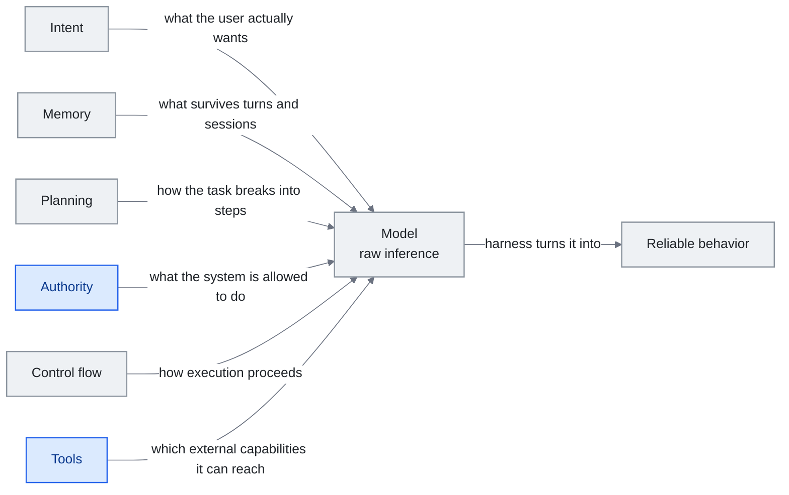

<!-- translation-sync:start -->
> 2026-10-31 の英語版に同期した機械支援翻訳です。構造と内容を確認しています。コードと図中ラベルは原文のまま、読書時間は英語原文の推定値です。
> [English source](../../../chapters/04-harness-engineering.md) · [Sync record](../../SYNC.md)
<!-- translation-sync:end -->

<!-- i18n-anchor -->

# 第 4: Harness Engineering -- モデルを中心とした OS の構築

> **一言で言えば:** harness とは、AI モデルに関するすべてのもの、つまりモデルを実際に有用にするためのルール、ツール、安全性チェック、ワークフローです。
>
> **重要な理由:** AI モデルは強力なエンジンのようなものです。シャーシ、ハンドル、ブレーキがなければ役に立ちません。 harnessは、生のAIを製品に変えるものです。
>
> **読書時間:** ~49 分 (11,174 ワード / 230 wpm)

*図: 4.4 セクションの 六つの IMPACT の次元 (意図、メモリ、計画、権限、制御フロー、ツール) から描かれた harness の構造。それらが囲むモデルの周りに配置されています。左から右のスパインは、この章の冒頭の定義です。harness は、生の推論を信頼できる動作に変えるものです。各エッジは、その次元が決定または提供するものに名前を付けます。これが、セクション 4.4 でリストを使用する方法です。エッジを 一つずつ移動することで、ギャップが表面化します。強力なツールと弱い権限を備えたシステムがセクション名に挙げたセキュリティ上の問題であるため、アクセント付きの 二つの側面に議論が含まれています。*

> "Every component in a harness encodes an assumption about what the model can't do on its own, and those assumptions are worth stress testing."
> -- Anthropic, "Building Effective Agents," 2025

> "模型從來都沒有長手。"
> -- Cab, on why tool use is a harness problem, not a model problem

エージェントはモデルではありません。エージェントは、**モデルに harness** を加えたものです。これは、prompts、ツール、メモリ、制御フロー、評価ロジック、および生の推論を信頼できる動作に変えるオーケストレーション コードの周囲のシステムです。モデルはエンジンです。 harness が車両です。この章では、実務者がその車両をどのように設計、評価、進化させるかを検討します。

**直感についてのメモ。** これを多くの初心者にとって具体的にする比喩は、"the model never literally grew hands." コーディング エージェントがファイルを編集するとき、ファイルを編集したのはモデルではなく、モデルがテキストとして返したツール呼び出しによってトリガーされる harness です。 "the AI" に属するすべての機能は、実際にはモデルを囲む harness の機能です。 harness を取り外すと、テキストのみを生成できるモデルが得られます。モデルを剥ぎ取ると、配線するものが何もない harness が得られます。 Harness engineering は、そのラインがどこに位置するか、および 二つの部分がどのように連携するかを決定する学問です。

---

<!-- i18n-anchor -->

## 4.1 ハーネスの定義

harness は、モデルの重み以外のすべてです。これには次のものが含まれます。

- システム prompts と指示テンプレート
- ツール定義と実行サンドボックス
- 記憶システム (短期、長期、エピソード)
- 計画および分解ロジック
- 制御フロー (ループ、条件、再試行ポリシー)
- 評価および自己修正メカニズム
- 安全ガードレールと出力検証
- コンテキスト アセンブリ パイプライン (第 3 章)

ユーザー メッセージを伴うベア モデルの API 呼び出しは、簡単な harness です。計画、複数ステップのツールの使用、自己評価、および永続的なメモリを備えた運用エージェントは複雑です。 harness engineering という学問は、この範囲にわたって原則に基づいた決定を下すことを目的としています。

harness 契約の新しいクラスが 2026 年 五月に AWS AgentCore 支払いとともに登場しました (第 11 章): **エージェントのアクションに対する決定的なインフラストラクチャ強制制限** ここで、エバリュエーター スタイルのコンポーネント別の LLM "did this go too far," AgentCore Payments のセッション レベルの支出制限はサブストレート境界のハード キャップです。エージェントは単にそれを超えることはできず、LLM の判断は関与しません。このパターンは一般化されています。マネージド エージェント、メモリ、支払いなどの基質プリミティブが蓄積されるにつれて、harness コントラクトには、モデルが判断することのできないハード制限がますます含まれ、モデルが言うことをフィルタリングするソフト推論制御と並んで配置されます。

このシングルアクションの上限は、AWS が Bedrock AgentCore の **Temporal ポリシー**を出荷したときの **2026年 八月6日**の全セッション履歴に一般化されました。 **Dogwood** は、AI エージェント専用に構築された新しい Apache-2.0 オープンソース ポリシー言語であり、Cedar の基盤上に構築されています。 Temporal ポリシーは、エージェントがセッション内ですでに行ったことすべてに対してゲートウェイで評価されます。決定的、デフォルトで拒否、完全にログに記録され、エージェント自身のコードの外で適用されます。名前付き使用には、データ捏造の捕捉 (ツールに渡される値は、以前の呼び出しが実際に返した値と一致する必要がある)、累積セッション コストの上限、ワークフローの後半の特権ステップの前に人間の承認を要求することが含まれます。 AgentCore Payments が単一のアクションを強制するのに対し、Temporal ポリシーはセッション全体に相当する以前のアクション、つまり Authority 軸上の新しいプリミティブ クラスを強制します (セクション 4.4)。 AWS は、ゲートウェイ レート制限 (ユーザーごと/OAuth/IAM によるリクエスト、トークン、接続時間の制限) とともにこれを出荷し、同日、**ランタイム インスタンス** の一般提供を開始しました。エージェントは、顧客が選択した EC2 インスタンス タイプで実行できるようになりました。 AWS によって管理されるライフサイクル。セッションはサーバーレス microVM のデフォルトである 8 時間に対して、最大 **14 日間**続きます。より長いセッションの上限は、そのセッション全体での持続的な *進歩* と同じ軸ではありません -- セクション 4.8 の Terminal-Bench チャレンジの結果は、フロンティア モデルが、原理的には 二週間実行できるセッション内であっても、改善なしで 12 時間も継続できることを示しています。

五週間後、権威軸は、反対のメカニズムに基づいて構築された 二番目の答えを見つけました。 **2026年九月10日**、Anthropic は、既存の `always_allow` に加えて、**`auto` 権限ポリシー**を管理対象エージェントに追加しました。 `always_ask`。 Temporal ポリシーがポリシー言語で記述され、ゲートウェイで評価される決定論的プログラムであるのに対し、`auto` はモデルによって評価される呼び出しごとの判断です。呼び出し側クライアントではなくサーバーが、個々のツール呼び出し (ツール、その入力、およびこれまでのセッション内容) をそれぞれ比較検討し、三つの結果のいずれかを返します。呼び出しが実行されます。または拒否され、エージェントはクライアントが上書きできないエラー結果を受け取ります。または、`always_ask` と同じフローで承認のために一時停止します。判定は、`agent.tool_use` および `agent.mcp_tool_use` イベントの `evaluation` オブジェクトを通じて返され、ネストされた `evaluated_permission` と `reason_code` が含まれます。 `high_risk` または `indeterminate` として、Anthropic のドキュメントに従って、MCP ツールセットおよび事前構築されたエージェント ツールセットに適用されます -- プラットフォーム レベルのガバナンスの下で行われる個々の MCP ツール呼び出し7 章ではプロトコル側から説明します。同じドキュメントでは、`auto` は人間によるレビュー ゲートではないことに注意しています。サーバーが安全と判断した呼び出しはすぐに実行され、元に戻せない可能性があります。すべてのソースは Anthropic のドキュメントのみです。この機能に関する独立した報道は存在しません。 AgentCore の次を読んでください。ペアリングがポイントです。 二つのベンダーが、同じ認証局の質問に対して 五週間の間隔をあけて、反対のメカニズム (一方は決定論的なポリシー言語、もう一方は呼び出しごとの推論的判断) で回答しました。これは、認証に到達するセクション 4.2 の計算と推論の分割であり、以前は出力検証に存在していました。

<!-- i18n-anchor -->

## 4.2 Böckeler 分類法

Birgitta Böckeler (ThoughtWorks、2026年四月) は、Martin Fowler の *Exploring Generative AI* シリーズで執筆し、次の 二 軸の分類法を提案しました。標準リファレンスとなった harness コンポーネント:

**軸 1: 方向**
- **ガイド (フィードフォワード):** モデルが動作する「前」に動作を形成するコンポーネント。システム prompts、いくつかのショットの例、ツール スキーマ、計画テンプレート。これらがレールを設定します。
- **センサー (フィードバック):** モデルが動作した「後」の動作を評価し、結果をフィードバックするコンポーネント。バリデータ、テスト ランナー、人間によるレビュー、自己評価の prompts を出力します。これらは軌道を修正します。

**軸 2: メカニズム**
- **計算制御:** 決定論的コード -- 正規表現バリデータ、型チェッカー、スキーマ強制、権限チェック。これらは決して幻覚を起こさない厳しい制約です。
- **推論コントロール:** 判断、ルーティング、または調整に使用される別の LLM 呼び出し。評価モデル、分類器、要約器。これらは、柔軟性を犠牲にして精度を犠牲にするソフト制約です。

分類法により、設計空間が明らかになります。ほとんどの実稼働 harnesses は、次の 四つの象限すべてを使用します。

|  |フィードフォワード (ガイド) |フィードバック (センサー) |
|--|---------------------|--------------------|
| **計算** |ツール入力のスキーマ検証、許可許可リスト |出力形式のチェック、テスト スイートの実行 |
| **推測** | prompts、少数ショット ルーティングの計画 |自己評価、LLM-審査員として、批評チェーン |

洞察としては、計算制御は安価で信頼性が高いものの、柔軟性に欠けるのに対し、推論制御はあいまいさに対処できますが、独自の故障モードが発生するということです。優れた harness 設計では、可能な限り計算制御を使用し、真に曖昧な決定のために推論制御を確保します。

**2026年には、内部特徴を読むセンサーの種類が現れた。** Böckeler の Sensors 象限が当初対象としていたのは、モデルが*出力したもの*を読む検証器、テストランナー、評価者といった、出力段階のフィードバックだった。メカニスティックな解釈可能性は、出力する前にモデルが*何をしているか*を読む経路を加える。残差ストリーム内の特徴方向（Anthropic の2026年四月の感情ベクトル）や、思考連鎖の監視（推論モデルが非公開テストケースを読む行為を OpenAI が四月に検出した事例）である。2026年半ばの二つの結果が、可能性と限界の両方を明確にした。六月、OpenAI の GPT-5.6 Sol の生の CoT にアクセスできた **METR** は、それまで評価した公開モデル中で最高の不正行為検出率を記録した（第11章）。検出できたのは、OpenAI が生の CoT を排除する訓練をせず、*保持している*からである。その経路を訓練で消せば、監視経路も閉じる。七月の Anthropic の **J-space** 研究（第11章）は、この限界への解答候補を示した。Claude が報告し、意図的に調整できる、残差ストリーム内の少数の方向である。モデルが言語化しないステップでもハーネスが読める、*CoT に依存しない第二のセンサー群*として機能する。設計者にとって Sensors 象限はもはや "check the output" だけではなく、モデルの内部状態を読み、将来的には制御することまで含みつつある。

**最新のデータ ポイントは楽観論に反するものです。** **2026年 九月3日**、OpenAI は **GPT-6 Astra** に出荷され、独自の安全概要で "our first model to reach the Critical level of cybersecurity capability under our Preparedness Framework" -- OpenAI が独自に公開しているリスク ラダーの最上位に指定した最初のモデル。以下の内容は、モデル リリースではなく、harness 設計となります。Astra は、一般公開前に限られた組織に展開され、起動ページには、"Enterprise administrators can enable Astra for their workspace; access is off by default at launch," 展開されたモデルは、より高度なサイバーセキュリティ タスク (概念実証エクスプロイトの生成) を拒否します。 OpenAI は、精査された防御者が脆弱性の検証、マルウェア分析、検出エンジニアリングのための制限の少ない保護手段を取得できるパスとして、Daybreak と Daybreak Blue を指定しています。指定の背後にある能力の数値は、本番環境の保護手段なしで測定された OpenAI 独自のものです。ExploitBench では 100%、GPT では 78.5%、5.6 Sol、ExploitGym で 42.4%、SRE-Bench タスクの 88.0% が 一 回の試行で解決され、四 回以内に 99.2% が解決されました。ただし、このセクションでは、負荷のかかる文章はより静かなものになります。 OpenAI は、"GPT-6 Astra's monitorability has decreased relative to GPT-5.6 Sol," は、この低下はモデルが自身の思考連鎖をより強力に制御し、そこに有罪となる素材を置く傾向が低いことに起因すると考えています。敵対的な圧力の下では、サンドバッグ中に検出されないままになる可能性がありますが、OpenAI はステガノグラフィー推論の証拠を報告しておらず、回避リスクは主に下位推論タスクに限定されていると読み取っています。それは、最新のフロンティア モデルが以前のモデルよりも見にくいことを自発的に表明しているベンダーです。これは、言語化された推論にまったく依存しないセンサーを提案する J-space の方針に反論するものではありませんが、時計は起動します。 三か月前に悪用された CoT チャネル METR はモデル側から縮小しており、それに依存する harness コンポーネントは減価償却資産となります。

<!-- i18n-anchor -->

## 4.3 OpenAI Codex: スケールスルーハーネス

実践者コミュニティで広く引用されている印象的なデータ ポイントは、OpenAI による Codex の内部使用を説明しています。**三人のエンジニアと Codex エージェント システムにより、約 1,500 のプル リクエストにわたって約 百 万行のコードが生成されました。** 生産性の乗数は主にモデルの品質に関するものではなく、 harness デザイン。 (具体的な数字は、2025-2026 OpenAI の講演や投稿を通じて回覧されました。Codex の harness に関する公開資料については、を参照してください。 [openai.com/index/introducing-codex](https://openai.com/index/introducing-codex)。

Codex harnessには以下が含まれていました:
- 自動化された PR 分解 (大きなタスクをレビュー可能な単位に分割)
- タスクごとにサンドボックス化された実行環境
- 自動テストの生成と検証
- PR 境界における人間によるレビューの統合
- リポジトリの構造と規約に関する永続的なコンテキスト

教訓: harness が十分に成熟すると、モデルはスタンドアロン ツールではなく、より大規模な運用システムのコンポーネントになります。 harnessは、オーケストレーション、品質管理、統合を処理します。この問題は、prompt engineeringをどれだけ行っても対処できません。

<!-- i18n-anchor -->

## 4.4 IMPACT フレームワーク

2020 の実践者の議論の中で、**IMPACT ニーモニック** --- 意図、メモリ、計画、権限、制御フロー、ツール --- が、harness の設計次元を考える体系的な方法として登場しました。

- **目的:** システムはユーザーが実際に望んでいることをどのように理解するのでしょうか?意図の分類、明確化ダイアログ、目標の分解が含まれます。
- **メモリ:** システムはターンやセッション全体で何を記憶しますか?会話バッファ、ベクトル ストア、構造化知識ベース、およびユーザー設定システムが含まれます。
- **計画:** システムは複雑なタスクをどのようにステップに分割しますか? chain-of-thought プロンプト、明示的な計画生成、およびアクション スペースのツリー検索が含まれます。
- **権限:** システムには何が許可されていますか?許可システム、人間参加型ゲート、機能境界が含まれます。
- **制御フロー:** 実行はどのように行われますか?シーケンシャル チェーン、並列ファンアウト、条件分岐、終了条件付きループ、および再試行ポリシーが含まれます。
- **ツール:** システムはどのような外部機能にアクセスできますか?関数定義、API 統合、コード実行環境、ブラウザー アクセスが含まれます。

IMPACT は設計チェックリストとして役立ちます。 harnessを構築またはレビューするときに、各次元を通過するとギャップが明らかになります。強力なツールを備えているが権限が弱いシステムには、セキュリティ上の問題があります。強力な計画はあっても記憶力がないシステムは、失敗から学ぶことができません。フレームワークにより、これらの不均衡が可視化されます。

<!-- i18n-anchor -->

## 4.5 Meta-Harness Paper: ハーネス設計の自動化

Stanford、MIT、および KRAFTON の共同論文 (2026年三月) では、**メタ-harness** (harness 構成を自動的に最適化するシステム) の概念が紹介されました。

彼らの重要な発見は、同じベースモデルを使用した同じベンチマークで、異なる harness 構成により **6x のパフォーマンス ギャップ** が生じたことです。特定のタスクに最適な harness 構成が明確になることはほとんどなく、多くの場合直感に反します。手動の harness チューニングにより、膨大なパフォーマンスが得られました。

メタ harness アプローチでは、harness パラメータ (再試行回数、計画の深さ、ツール選択戦略、メモリ ウィンドウ サイズ、評価の厳密性) を検索スペースとして扱い、自動最適化を使用して高パフォーマンスの構成を見つけました。システムは、harnessをさまざまなタスク タイプ、さまざまなモデル、およびさまざまなコスト制約に適応させることができます。

この結果には重大な意味があります。 **harness engineering は、既知のベスト プラクティスを使用して解決された設計問題ではありません。これは、大規模でよく理解されていない探索空間を伴う最適化問題です。** harness 設計を 一 回限りのアーキテクチャ決定として扱うチームは、フロンティアのはるか下で業務を行っている可能性があります。

Meta-Harness ペーパーは、急速に変化するラインの 一つのデータ ポイントになりました。 2026年 四月、**AHE 論文** ("Agentic Harness Engineering: Observability-Driven Automatic Evolution of Coding-Agent Harnesses," arXiv 2604.25850、復丹 / 北京 / 上海 Qiji Zhifeng) は、問題を検索から次へと再構成しました。 *可観測性*: harness 構成を検索スペースとして扱い、その上でオプティマイザーを実行する代わりに、AHE は 三つの可観測性の柱、コンポーネント (明示的で元に戻せるアクション スペース)、エクスペリエンス (凝縮された軌跡の証拠)、および決定 (実行前に行われる反証可能な編集予測) --- を計測し、harness が独自のランタイム シグナルを読み取ることで自体を進化させます。 10 AHE 反復後、Terminal-Bench で Codex-CLI スタイルのベースライン 69.7% pass@1 2 は 77.0% に達し、人間が設計したベースライン (71.9%) を上回り、モデル ファミリに転送した場合、**+5.1 ～ +10.1 のファミリ間ゲインが得られます**。 harness は最適化されていませんでした。ファミリー間での移行は構造的なニュースです。進化した harness は、一つのモデルの癖に過度に適合するのではなく、その下の基板が裏返るときにもそれが引き継がれます。 Meta-Harness の発見 ("harness engineering is an optimization problem with a large search space") と AHE の発見 ("...and the search can run as a continuous observability loop, not a one-shot optimization") は共に、手動チューニングを急速に置き去りにするエンジニアリング手法を説明しています。

**進化の場がテスト時へ移り、初めて方法論の検証を受ける。** Meta-Harness と AHE は、導入前、または複数回の導入を通じてハーネスを進化させる。**TTHE**（"Test-Time Harness Evolution," arXiv 2607.08124、2026年七月9日）は、評価そのものの内部へループを移す。候補ハーネスの集団を実行中に改良し、エージェント型の提案者がラベルのない実行記録を推論する一方、評価者が実行由来の代理信号に基づいて改良候補を採用する。問題を解く役、提案者、評価者は、同じ凍結 LLM を囲む別々の役割であり、ループのどこにも正解ラベルやタスク固有の監督はない。重みは変わらず、ラベルも存在せず、利用時に足場だけが適応する。五日後の論文は同じ問いの逆側を論じた。"Rethinking the Evaluation of Harness Evolution for Agents"（arXiv 2607.12227、2026年七月14日、八月27日改訂）は、この研究群に計上上の問題を突きつける。ハーネス進化の手法は、フィードバック量と推論予算を揃えた単純なタスク単位の探索と比較しなければ、改善が単に探索量を増やした結果かどうか区別できない。同じベンチマークで評価しながらハーネスを探索することには、明白な過適合の危険もある。この手順で Terminal-Bench 2.1、GPT-5.4、Claude Opus 4.6 を使ったところ、自動ハーネス進化は単純なテスト時スケーリングに一貫して勝たず、未見タスクへの汎化も弱いと著者らは報告する。この批判は TTHE を名指しせず、研究群全体が共有する評価手順に向けられている。二本を合わせて読むと、ハーネス進化が印象的な数値を生むだけの段階を越え、測定方法を議論する分野になったことが分かる。本章の他のベンチマークを見ても、その方が健全な状態である。

**対称的な動き：ハーネスに合わせてモデルを訓練する。** ハーネス合成はモデルを固定してハーネスを最適化するが、2026年六月、Microsoft は逆方向を提供した。**MAI-Code-1-Flash**（Build、2026年六月2日）は5Bパラメータのコーディングモデルであり、同社によると**本番で使う GitHub Copilot のハーネスに直接合わせて訓練**されている。正しいコードを出すだけでなく、エージェント型コーディングで*周囲のツールやシステムを操作する*ことを学んだ。Microsoft は、難しいタスクで同等モデルより約60%少ないトークンと、Claude Haiku 4.5 に対する価格性能上の優位を挙げ、同日 Copilot のモデル選択へ導入した。通常の枠組みは "build a harness around a fixed model" だが、ここではハーネスを固定点にして*モデル*を適合させる（用語集の **Harness-Native Training** を参照）。二方向を合わせると、ハーネスエンジニアリングは一方通行でなくなる。外側のループが所与のモデル向けのハーネスを進化させる AHE と、訓練が所与のハーネス向けのモデルを進化させる MAI-Code により、双方から共同設計する。注意すべき危険はロックインである。一社の本番ハーネスに合わせて訓練されたモデルは、構造上その内側で最も価値があり、ハーネスを参入障壁にする力学（4.7節）を弱めるどころか強める。

<!-- i18n-anchor -->

### 研究から生産へ: アドバイザ ツール (2026年 四月)

メタharnessの発見は研究結果でした。 一か月後、Anthropic は、最初の製品化されたメタ harness パターンである **Advisor Tool** (ベータ版、`advisor-tool-2026-03-01`) を出荷しました。このパターンでは、より高速なエグゼキューター モデルとより有能なアドバイザ モデルを組み合わせます。実行者は作業の大部分を処理します。決定点に到達すると、`advisor()` を呼び出し、現状を離れることなく戦略計画または軌道修正 (通常は 400 ～ 700 テキスト トークン、1,400 ～ 1,800) を受け取ります。 API リクエスト。

Anthropic が推奨するデフォルト設定は次のことを示しています。

|執行者 |アドバイザー |使用目的 |
|----------|---------|--------------|
| Haiku 4.5 | Opus 4.6 | Haiku のみで知性を高めましょう |
| Sonnet 4.6 | Opus 4.6 | Opus のソロ品質に Sonnet のコストで匹敵 |
| Opus 4.6 | Opus 4.6 |最も困難なタスクの品質を向上 |

これは、6x メタ-harness ギャップを価格戦略に変換したものです。すべてのトークンに対して Opus レートを支払う代わりに、実行に対しては Sonnet レートを支払い、実際に出力を形成する 1-2 アドバイザ呼び出しに対しては Opus レートを支払います。 Anthropic が提案するプロンプト パターンは、harness のタイミングをルールに体系化しているため、引用する価値があります。

> "Call advisor BEFORE substantive work -- before writing, before committing to an interpretation, before building on an assumption. [...] On tasks longer than a few steps, call advisor at least once before committing to an approach and once before declaring done."

ドキュメントのいくつかの詳細は、実践者にとって重要です。

- **サーバー側のサブ推論。** アドバイザは同じ `/v1/messages` リクエスト内で実行されます。エグゼキューターは `server_tool_use` ブロックを発行し、Anthropic は完全なトランスクリプトを使用して別の推論パスを実行し、結果は `advisor_tool_result` として返されます。コードからの余分な往復は不要です。
- **~3 呼び出しでのキャッシュ損益分岐点。** アドバイザ ツールで `caching` を有効にすると、アドバイザのトランスクリプトが 5 分または 1 時間のキャッシュに書き込まれます。最初の通話には追加料金がかかります。報酬は 三 回目のコールあたりから始まります。短いタスクではキャッシュをオフのままにする必要があります。
- **簡潔性 prompt により、出力 35-45% が削減されます。** 単一の指示 -- "The advisor should respond in under 100 words and use enumerated steps, not explanations" -- 呼び出し頻度を変えることなく、アドバイザーの最大のコスト要因を大幅に削減します。
- **明示的な調整プロトコル。** アドバイザーのアドバイスが実行者がすでに収集した経験的証拠と矛盾する場合、Anthropic のシステム promptは、黙って切り替えるのではなく、"I found X, you suggest Y, which constraint breaks the tie?" という枠組みでもう 一 回アドバイザー呼び出しを行うよう実行者に指示します。これは、複数の役割の意見が一致しない場合に必ず表示される、"should I trust the planner or the data" という質問に対する実稼働グレードの回答です。

Advisor ツールは、その即時の有用性を超えて重要です。これは、メタharnessの考え方が研究上の好奇心から商業的な原始的なものに移行したことを示しています。 "same model, different harness, 6x gap" の発見は、研究チームが利用する必要はなくなりました。Anthropic は、それをツール呼び出しとして公開します。他のラボも独自のアドバイザーとエグゼキューターの組み合わせで追随し、harness engineering の職務内容にマルチモデルの調整がコア スキルとして記載され始めることが期待されます。

<!-- i18n-anchor -->

## 4.6 Anthropic の 三 エージェント アーキテクチャ

繰り返し行われる 三つの役割のパターンは、実践者コミュニティによって **プランナー / ジェネレーター / 評価者 ** として要約されることが多く、2025 までマルチエージェントの harnesses の一般的な枠組みになりました。この枠組みは、一次文書で採用されている Anthropic 自体のラベルとしてではなく、Anthropic の [Building Effects Agents](https://www.anthropic.com/engineering/building-effective-agents) (オーケストレーター-ワーカー、評価者-オプティマイザー) で説明されているパターンの教育学的統合として読むのが最適です。 2026年三月31日 Claude Code のソース リーク (このセクションで後ほど説明します) により、この区別が確認されました。運用環境では、Anthropic の実際の harness は、階層化された自己修復メモリを中心に構成されており、文字通りの三役分解。ロールは依然として有用な分類法を記述しているため、このセクションではそれらを使用して懸念の分離について説明します。

- **プランナー:** タスクをサブタスクに分解し、全体の計画を維持し、いつ改訂するかを決定します。
- **ジェネレーター:** コードの作成、テキストの下書き、ツールの呼び出しなど、個々のサブタスクを実行します。
- **評価者:** ジェネレーターの出力をタスクの要件に照らして評価し、構造化されたフィードバックを提供します。

この懸念の分離は、この章で **文脈不安** と **自己評価バイアス** とラベル付けされている 二つの失敗モードに対処するために広く使用されています (ラベルはこのガイドが使用する枠組みです。基礎となる観察は、Anthropic が公開したエージェント研究に触発されたパターンで示されています)。

**状況不安** 単一のエージェントが計画、実行、評価を処理する場合、リスクを回避する傾向があります。出力を修飾し、不必要な警告を追加し、タスクの実行ではなくメタコメントにトークンを費やします。役割を分離すると、各エージェントは他のエージェントの認知的負荷を負うことなく集中できます。

**自己評価バイアス** モデルは体系的に自身の出力を評価することが苦手です。彼らは、十分に文書化された寛容バイアスを示しており、独立した裁判官よりも自分の作品を高く評価しています。 三 エージェント アーキテクチャでは、生成された出力に投資を行わない別個のエバリュエーター (別のモデルまたは別のプロンプトが表示されるインスタンスの可能性があります) を使用することで、この問題を軽減します。

実践者コミュニティが強調している微妙な点は、Anthropic の評価者と最適化者のガイダンスで観察されるパターンと一致しています。 **評価者の調整自体が harness engineering 問題です。** 厳密すぎる評価者は無限の改訂ループを引き起こします。甘すぎるものは低品質の仕事を渡します。評価者のしきい値と基準は、生成者の指示と同じくらい慎重に調整する必要があります。

<!-- i18n-anchor -->

### Claude Code リーク: 経験的考察 (2026年三月31日)

2025 のほとんどにおいて、三 エージェント アーキテクチャは Anthropic が発表した研究を通じて知られており、行動から推測されていました。 **2026年三月31日**に状況は変わりました。 Anthropic は誤って npm パッケージ **`@anthropic-ai/claude-code` v2.1.88** 内で 59.8MB ソース マップを公開し、約 **513,000 行を公開しました。 1,906 ファイル**にわたる難読化されていない TypeScript。 Anthropicは、このインシデントを"human packaging error, not a security breach,"として特徴づけましたが、初めて実務家がフロンティアラボから直接製造用のharnessを読み取ることができました。

リークから得られたいくつかの発見は、コミュニティによるアーキテクチャの説明方法を再構成するものです。

- **文字通りの "Planner / Generator / Evaluator."** Claude Code を 4.6 の 三つの役割の枠組みにマッピングした以前のコミュニティの書き込みは、研究の誤った読みであることが判明しました。実際のアーキテクチャは、**三 層の "Self-Healing Memory"** システムとして構成されています。これらのレイヤーは、スクラッチパッド/作業状態、圧縮された中期状態、および耐久性のあるプロジェクト メモリに対応しており、レイヤー間の明示的な修復および調整ロジックを備えています。
- **`MEMORY.md` はストアではなくインデックスです。** モノリシックなメモリ ファイルではなく、`MEMORY.md` は、より詳細なメモへの **軽量のポインタ インデックス**として機能します。これはトランスクリプトよりもファイルシステム ディレクトリに近く、コンテキストを膨張させることなくメモリ層を拡張できるようにします。
- **`KAIROS` は自律デーモン モードです。** `KAIROS` と呼ばれる機能フラグは、ソース全体で **150 回以上**参照されます。これは、自律デーモン モード、つまり、ほとんどのユーザーが知っている対話型 REPL をはるかに超えた、無人で長時間実行される実行ループをゲートします。
- **44 の隠し機能フラグ。** `KAIROS` 以外にも、ソースには未リリース機能の 44 の機能フラグが含まれており、公開されているものは、harness が実際に内部でサポートしているものの保守的なサブセットであることを示唆しています。

実際的な結論: プランナー / ジェネレーター / 評価者の分割は依然として有用な概念分類法です (そして、Anthropic の研究論文では依然としてこれらの用語でシステムが説明されています)。しかし、運用環境では、アーキテクチャは役割分解だけを中心とするのではなく、**メモリと修復**を中心に階層化されます。 2026 における Harness engineering は、メモリ層とメモリ層間の遷移の設計をますます意味します。

リーク 二週間後、同じアーキテクチャは別の一歩を踏み出した ——今度は外側へ、ユーザーマシンから離れる方向へ。**Claude Code Routines**（2026 年 四月 14 日）で、Anthropic はオーケストレーターシート自体をラップトップから自身のクラウドへと移し、スケジュール、API、GitHub イベントトリガーを第一級の harness primitive として露出した。リークと並べて読むと、これは明確なアーキテクチャ的修辞である：オーケストレーターはもはやユーザーが付き添う REPL としてモデル化されない、Anthropic の基盤に住むデーモンとしてモデル化される。三 層 self-healing memory はトリガー横断で保たれる；ループが進捗するためにユーザーのプロセスが生きている必要は、もう harness にはない。Routines を採用するかしないかにかかわらず、フレーミングはいま空気中にある：オーケストレーターシートはプロダクトサーフェスであり、"where the loop runs"はデフォルトではなく設計判断だ。

**2026年五月6日**、Anthropic は **Dreaming**（研究プレビュー）により、自己修復メモリの流れをさらに進めた。セッション間に予定実行される処理が、最近のセッションを読み、繰り返す誤りと定着したワークフローを見つけ、エージェントの永続メモリを書き直す。三月31日のリークが Claude Code 内部のランタイム設計として自己修復メモリを示したのに対し、Dreaming は、エージェントが要求に答えていない間に行う*記憶の整理・定着*をマネージド基盤として製品化する。四月23日の Memory for Managed Agents（セッションを越える永続状態）と、同日公開の **Outcomes**（別の採点者による自己訂正ループ）、**Multiagent Orchestration**（共有ファイルシステムと永続イベントメモリを使うリードエージェントのファンアウト）を合わせると、方向は "memory is data the harness reads" から "memory is a maintained store the substrate keeps in good repair on the agent's behalf." への移行である。Harvey の初期試験では、Dreaming 有効時のタスク完了が約6x改善したと報告されている。

<!-- i18n-anchor -->

## 4.7 堀としての Harness

2026年初頭、Meta は Manus を約$2 × 十億で買収した。Manus は独自モデルを持たなかった。その価値はすべてハーネスにあり、一般に利用できるモデル API を信頼できるエージェント製品に変えるオーケストレーションのロジック、コンテキストエンジニアリングのパイプライン、ツール統合層、運用基盤から成っていた。

この買収は、業界が発見していたことを結晶化した：**Harness が堀である**。モデルはますますコモディティ化されている。差別化要因はそれをどう包むか ——どんなツールを提供するか、context をどう管理するか、失敗をどう扱うか、多段ワークフローをどう編成するか、品質をどう評価するか —— である。

実践者にとっての含意は、harness エンジニアリングがモデル開発の"real work"へと向かう道のりに通すための配管ではないということだ。それ*が*、大半の本番 AI チームにとっての本当の仕事だ。2026 年 四月までに、"harness engineering"は形式的規律として業界辞書に入り、Claude Code リークが本番 harness が実際に何を含むかの初の経験的覗き見を提供した。

**逆の一手：参入障壁をオープンソースにする。** 4.9節以降で追うマネージド基盤の流れ（Anthropic Managed Agents、AWS AgentCore、Microsoft Agent Harness）は、いずれもハーネスをホスト型プリミティブとして販売する。**2026年八月19日**、OpenAI は逆方向の戦略を取った。**"Codex as a Platform,"** の名で、Codex の実行エンジンを Apache-2.0 で公開した。対象は `codex exec`（CLI）、Codex SDK、そして会話状態を保持し、イベントをストリーミングし、ツールを公開して承認要求を振り分ける長寿命のローカルプロセス **app-server** である。モデルへのアクセスと OpenAI のマネージドサービスは引き続き独自提供であり、公開されるのは本節が差別化の中心とするオーケストレーション層そのものだ。ここは区別が重要で、`openai/codex` は2025年四月以来公開され Apache-2.0 だったため、初めてのソース公開ではない。app-server と SDK の組み合わせを完成させ、独立したプラットフォーム製品として正式に位置づけ直したのである。公表された本番利用者には Cisco（Cisco Cloud Control 内の App Builder）、GitHub、JetBrains（IDE エージェント提供元として）があり、Thrive Holdings/Crete の税申告準備試験では7,000件で準備時間が約三分の一減ったというベンダーの報告もある。OpenAI は、ハーネスの再設計自体による能力向上も主張する。新 app-server の推論保持とコンテキスト圧縮により、GPT-5.6 Sol の ARC-AGI-3 スコアが13.3%から38.3%へ上がり、出力トークンは6x少なくなったという。これも OpenAI 自身の数値で、独立した再現検証はない。ホスト型 SKU として売る代わりにエンジンを公開し、モデルを製品として保持する戦略は、4.9節の各社と逆の賭けである。DeepSeek が独自のオープンソースハーネス `dsh` を出した一週間後（第9章）に当たり、七日間で太平洋の両側のハーネス層がオープンソースになった。

<!-- i18n-anchor -->

## 4.8 ハーネスのメンテナンス: ストレス テストの必須事項

Anthropic の最も実用的な洞察は、最も単純なものかもしれません。すべての harness コンポーネントはモデルの制限に関する仮定をエンコードしており、**それらの仮定は期限切れになります**。

harnessがGPT-4レベルの機能を中心に構築された場合、次のものが含まれる場合があります。
- 明示的な chain-of-thought プロンプト (モデルが必要としたため)
- 積極的な出力解析 (モデルが形式と一致しないため)
- 多段階検証（シングルパスの精度が不十分なため）
- 数ショットの詳細な例 (ゼロショットのパフォーマンスが悪かったため)

新しいモデルが改良された推論、命令追従、および出力の一貫性を備えて登場すると、これらのコンポーネントは **耐荷重壁となり、負荷に耐える必要がなくなる可能性があります**。品質には寄与せずに、遅延、コスト、および複雑さが増加します。

この規律は定期的なストレス テストです。harness コンポーネントを体系的に無効にして、どのコンポーネントがまだ必要かを判断します。計画ステップを削除してもパフォーマンスが低下しない場合は、計画ステップを削除します。モデルが少数のショットのサンプルがなくても確実にフォーマットに従っている場合は、それらを削除します。自己評価によってコストが増加しても品質が増加しない場合は、それを削除します。

これは直観に反します。エンジニアは当然、安全機構を追加し、それを削除することに抵抗します。しかし、harness engineering では、不要なコンポーネントは無料ではありません。context window スペースを消費し、遅延が追加され、コストが増加し、メンテナンスの負担が生じます。現在のモデルの機能に一致する無駄のない harness は、弱いモデル用に構築された過剰設計のハーネスよりも優れたパフォーマンスを発揮します。

実際的な推奨事項: 新しいモデルをオンボードするときは、既存の harness を実行することから始めて、タスクのパフォーマンスを測定しながらコンポーネントを系統的に取り除きます。残っているのは、あなたの本当のharnessです。あなたが取り除いたのは、以前の機能時代からの技術的負債でした。

成熟した harness は、最終的にストレス テストの質問を逆転させます。"which components can I remove," を尋ねる代わりに、"which components should I spend more compute on, and when." 2026 年 四月 **CATTS** プレプリント (コンセンサスを意識したテスト時間)スケーリング、arXiv 2602.12276) は、その質問に有効な答えを与えます。 CATTS は、エージェントのステップごとにロールアウトの小さな委員会をサンプリングし、それらの間の不一致をステップごとの不確実性スコアとして使用します。そのスコアは、テスト時間のコンピューティングを不均一に割り当てるために使用されます。委員会の意見が異なる場合はロールアウトが増加し、意見が一致する場合はロールアウトが減少します。 WebArena-Lite と GoBrowse では、この技術により、均一スケーリングよりも **2.3x 少ないトークン**で **+9.1%** のタスク精度が報告されます。成熟した harness の場合、CATTS はアドバイザー ツールの隣にスロットを入れます。アドバイザー パターンは「何を」考えるかを決定し、CATTS は各ステップについて「どれだけ難しく」考えるかを決定します。どちらも、仮定 ("always retry three times," "always use Opus on hard problems") を、実行時に計算された測定された不確実性信号に置き換えます。

2026 年 四月の AHE 結果 (セクション 4.5) も構造的に同じ点を示しています。ストレス テストは 一 回限りのレビュー活動ではなく、継続的な可観測性ループです。手動によるストレステストは、現在でも実践者が実行できる分野として依然として価値があります。 AHE は自動化も可能であることを示しています。同時に行われた英国の AI 安全性研究所の研究 (arXiv 2606.17930、2026年六月16日) では、測定側から同じケースが主張されています。12 フロンティア モデルと7 ベンチマークでは、トークン バジェットによってスコアが大幅に変動するため、評価では機能を単一の数値としてではなく *推論時間の計算の関数* として報告する必要があります。同じ再構成 CATTS が割り当てにも適用され、レポートにも適用されます。

同月、注意喚起のカウンターウェイトが到着した。 **Terminal-Bench チャレンジ** (ロード研究所 / ハーバー、2026年六月18日) は、無人実行時間 * 日*、コストがおよそ $1k 以上であるベンチマーク クラスを導入しました。 10k-500k 行のソリューション コード。時間制限なし、リソース制限なし、人間の介入なし -- harness が数日にわたる自律動作を維持できるかどうかの直接テスト。初期の結果は厳粛なものです。Rust コンパイラの高速化チャレンジでは、Opus 4.8 を使用した Claude Code を 12 時間 "was unable to make any significant improvement, with the optimization attempts leading to regressions." 継続的なストレス テストと不確実性を考慮したコンピューティング割り当てにより、harness が段階的に改善されます。 *複数日間の持久力は別の軸*であり、成熟した harness を着用したフロンティア モデルであっても進歩せずに苦労する可能性があります。

**LangChain の Deep Agents v0.7** (2026年七月29日) は、広く展開されているオープンソースに適用されるストレス テスト規律です。研究論文ではなく、harness。このリリースでは、フレームワークの作成された基本システム prompt を完全に削除し (以前は一般的なガイドラインとツール使用法の散文がデフォルトで各エージェントにロードされていました。`BASE_AGENT_PROMPT` 経由で復元可能でしたが、それ自体は 0.9.0 で削除が非推奨になりました)、組み込みツールの説明をトリミングします。 43% で、`TodoListMiddleware` / `write_todos` --- すべてのエージェントにデフォルトで以前にロードされた計画スキャフォールド --- オプトインになります。合計すると、新しいデフォルト エージェント ターンの基本入力トークンは、単一のユーザー メッセージが送信されるまでに、~6K から ~2K まで、およそ 65% 減少します。 todo スキャフォールドの削除は、より興味深い編集上の決定です。三つのモデル ファミリにわたる LangChain 独自の評価では、常時オンのプランニング スキャフォールドが測定可能なパフォーマンスの向上をもたらさないことがわかりました。無効にすると報酬がわずかに向上し、コストが低下します。これは、フレームワーク自体がデフォルトで耐荷重として出荷されているコンポーネントに対して実行する、このセクションの最初の処方箋 (計画ステップを削除してもパフォーマンスが低下しない場合は削除してください) とまったく同じです。このレッスンは、この 一つのフレームワークを超えて一般化します。harness に付属するデフォルトの足場自体が、prompt の文言やツールの数だけでなく、ストレス テストの対象になります。

**監視は複数のコンテキストをまたぐ必要がある。** Anthropic が2026年十月22日に公開した[研究](https://alignment.anthropic.com/2026/red-teaming-auto-mode/)は、Auto Mode と Codex Guardian の近似実装を攻撃対象としている。エージェントが作成した要約や引き継ぎは、圧縮や共有ワークスペースをまたいで、有害な手順を隠したり、承認を捏造したりしうる。監視範囲を広げると検出は改善するが、遅延も増える。これは九月時点のスナップショットに対する敵対的実験であり、許容できるコストで複数コンテキストにまたがる問題を堅牢に防ぐ方法は、なお未解決である。

**評価する側にも封じ込めが必要である。** 2026年十月9日、[Anthropic は意図しない動作を公表した](https://www.anthropic.com/research/investigating-unintended-model-actions)。評価と社内利用の過程で、実際のフォーム送信やアクセス制御の迂回などが起きていた。同社は信頼できる安全策が整うまで、社内評価における実際のインターネットアクセスを広く停止すると発表し、オフライン化・再構築したタスク、ツールの制限、監視も導入した。報告された影響は最小限だった。これは特定時点の是正措置の発表であり、十月31日時点でもすべての評価がオフラインのままだったことを示す証拠ではない。

<!-- i18n-anchor -->

## 4.9 クラウドネイティブ harness primitive

2025 年と 2026 年第 一 四半期を通じて、harness は圧倒的に自分で構築し動かすものだった。最も洗練されたパターン ——三 エージェントアーキテクチャ、Advisor Tool、KAIROS スタイルの自律ループ —— ですら、あなたのコードがオーケストレーターシートを保つことを依然として前提としていた。あなたが cron ジョブを書き、デーモンを動かし、ラップトップを起こし続け、失敗モードを所有した。基盤は汎用計算（Mac mini、VPS、Kubernetes pod）で、harness 層はプロセススーパーバイザから上があなたの責任だった。

**2026 年 四月 14 日**、Anthropic の **Claude Code Routines** リサーチプレビューが、それを変える最初の具体的な一歩を踏み出した。Routine は、ユーザーマシンではなく Anthropic のクラウドで動く Claude Code ワークフローで、三つのトリガーのいずれかで発火する：**スケジュール**（cron 等価）、**API 呼び出し**（別サービスからのプログラム的呼び出し）、**GitHub イベント**（push、PR、issue、コメント）。トリガーは harness エンジニアが過去 十八か月にわたって書いてきたファイルベース・スケジューリングパターンの意図的な一般化である：同じ`runs every weekday at 09:00 HKT`セマンティクスを、`cron + tmux + claude` シェル呪文ではなく管理 primitive として表現する。クォータは下層の Claude Code サブスクリプションと階層化されている ——**Pro 5/日、Max 15/日、Team/Enterprise 25/日** —— これは基盤を"a handful of meaningful loops per day per seat"で価格付けし、"raw compute by the hour."ではない。

クラウド側の実行の詳細は、思っている以上に重要です。自己ホスト型のファイルベースのスケジューラーは、ユーザーが所有するハードウェア上でオーケストレーターの座を保持します。 Mac が閉じているか、スリープ状態であるか、バッテリーが切れている場合、ループは実行されません。ルーチンは、ユーザーのマシンの状態に関係なく完了します。これにより、障害モードのクラス (ラップトップの蓋、ネットワークのドロップ、OS のアップデート、偶発的な電源の入れ直し) と、対応するクラスの補償メカニズム (wake-on-LAN トリック、Mac Mini "always on" サーバー、冗長ランナー) が解消されます。純粋にイベント駆動型のワークフロー --- "when a PR opens, do X" --- の場合、マネージド プリミティブは、自己ホスト型ポーラーよりも直接的に適しています。

トレードオフは新たな上限です。マネージド プリミティブは、ワークロードの物理的性質ではなく、トリガーとクォータによってそれ自体の価格を設定します。ループがスケジュール / API / GitHub イベントの形状に適合していること、一 日あたりの割り当てが十分であること、および Anthropic の基板がコードとデータの適切な場所であることを前提としています。 harness ワークロードの重要なセットの場合、これらの仮定はどれも完全には当てはまりません。認証済みセッションの **ブラウザ自動化**は、ユーザーの Cookie、プロファイル、および信頼状態が既に存在するマシン上で実行することで引き続きメリットを得ることができます。 **高頻度のオーケストレーション** --- 一 分未満のポーリング、リアルタイムの市場またはセンサー データ、一 日あたり 25 の呼び出しが困難な場合には、トリガーではなく秒単位で課金されるランタイムが必要です。 **非 GitHub イベント ソース** (Discord メッセージ、内部 Webhook、カスタム MCP サーバー、オンデバイス ファイル システム イベント) には、ルーチンのファーストクラス トリガーがまだありません。それらを表面化するには、ブリッジを自分で記述する必要があり、ブリッジを実行するには自己ホスト型マシンに戻る必要があります。また、ローカル ファイル、ローカル モデル推論、ローカル ネットワーク アクセスに依存するものはすべて、構造的にオフクラウドのままになります。

2026 の harness エンジニア向けの正直な枠組み: ルーチンのようなクラウドネイティブのプリミティブは、**GitHub イベントでトリガーされ、スケジュールされ、API と呼ばれる** 象限に対する正しい答えです。 harness ワークロードを活用すると、今後 十二か月間でその象限の運用コストが大幅に圧縮される可能性があります。自己ホスト型の harness は廃止されません。実際にそれ自体で費用が発生する場所に絞り込まれています。開発すべき規律は、この章が目指して構築してきた規律と同じです。つまり、各コンポーネントがどのような仮定をエンコードしているかを知り、その下にある基板がいつ変化するかを認識することです。

**ルーチンと管理エージェント。** 二つの部分が混同される場合があるため、Anthropic が 2026 年 四月に実際に出荷されたものについて正確に把握する価値があります。 **Claude マネージド エージェント** (パブリック ベータ、2026年四月8日) は *基盤*: セッション (追加専用のイベント ログ)、harness (ループ呼び出し) を公開するホスト型ランタイムです。 Claude とルーティング ツール呼び出し)、およびサンドボックス (実行環境) を 三つの仮想化コンポーネントとして構成し、トレースとエージェント / 環境 / セッション / イベント API サーフェスが最上位に階層化されています。 SiliconANGLE のローンチ カバレッジでは、基板の価格は標準トークン レートに **エージェント実行時間 一 時間あたり 八 セント** を加えたものと報告されています。この図は、一次 Anthropic ドキュメントではなく、二次技術プレスからのものです。二次引用バーであっても、価格構造は重要です。これは、推論とは別にオーケストレーター シート自体を測定する最初のフロンティア ベンダー プリミティブです。 **Claude Code ルーチン** (リサーチ プレビュー、2026年四月14日) は、その基板 (または互換性のある代替) の上で実行される *トリガー サーフェス* です: スケジュール、API 呼び出し、 GitHub イベント。Pro / Max / Team-Enterprise レベルで 一 日あたり 5 / 15 / 25 呼び出しの割り当てがあります。二人は別々の質問に答えます。管理対象エージェントは、"where does the agent loop physically run, and how is its state durably maintained between turns?" ルーチンは、"what makes the loop start in the first place?" ルーチンは採用するが管理対象エージェントは採用しない自己ホスト型の harness は、その状態と実行環境を所有し続けます。管理対象エージェントを採用するものの、独自のトリガー層を構築するものは、作業が開始されると所有し続けます。実際には、2026 半ばのほとんどのクラウドネイティブ harness 設計では両方が採用される予定ですが、アーキテクチャ上のポイントはアンバンドリングです。 Anthropic は、"the harness" を単体で販売することをやめました。それはその構成要素であるプリミティブを販売しているのです。

Unbundling は 2026 年 四月後半を通じて、構造的に重要な 二つの動きで継続した。第一に、**四月 23 日**、Anthropic は **Memory for Managed Agents** をパブリックベータに加えた：ファイルシステムマウント型、監査ログ付きのストアで、エージェントに永続的セッション横断状態を、同時アクセスセマンティクス、スコープ付きエンタープライズ権限、Claude Console でのロールバック / 編集サーフェス付きで与える。基盤はいまや 三つ目の primitive ——*永続的記憶* —— を session と sandbox と並べて出荷する；三月 31 日 Claude Code ソースリークが明らかにした本番アーキテクチャ（三 層 self-healing memory）が、いまや他チームがレンタルできるベンダー管理 primitive として露出している。第二に、**四月 28 日**、AWS と OpenAI は限定プレビューで **OpenAI による Amazon Bedrock Managed Agents** を出荷し、"the OpenAI agent harness"を別個のプロダクトサーフェスとして名指して売る初めての時となった。両者を併せて読むと、二つの出来事は Managed Agents パターンを"Anthropic's bet on April 8"から **クロスベンダー基盤の形** へとシフトする ——三 社のフロンティアベンダーのうち 二 社がいまやオーケストレーターシートを管理 primitive として、エージェント別アイデンティティ、アクションログ、永続的状態を組み込みで出荷する。2026 年中盤にオーケストレーターシートでビルド対バイを比較する harness エンジニアにとって、選択肢集合はもはや単一ベンダーではなく、基盤はもはや薄いランタイムではない：それは記憶を含む。

三番目の管理プリミティブは、同じ週に **基板の外縁**に着地しました。 **2026年五月6日**、AWS は **AWS MCP サーバー** を一般提供開始しました -- ハイパースケーラーが管理する最初のリモート MCP エンドポイントを公開しました15,000 + AWS API オペレーションは、きめ細かいアクセスのための IAM コンテキスト キーと、サーバーサイド Python 用のサンドボックス化された `run_script` ツールを備えた 一つの認証済みサーバーを介して行われます。 harness エンジニアにとって、マネージド MCP エッジは、クラウドネイティブの三角形の 三番目の側面です。マネージド エージェント (ループが実行される場所) + マネージド エージェント用のメモリ (ループが記憶する内容) + マネージド MCP エッジ (ループが外部ツールに到達する方法)。セルフホスト型の MCP サーバーは廃止されませんが、"where do my agents connect to the cloud's APIs" の重心は、"one MCP server per service" から "one managed endpoint at the cloud boundary." に移ります。

**その後、基板は境界線に沿って分割されます。** 四月から 五月初旬にかけて、マネージド エージェントの導入コストは二元的でした。コード、状態、サンドボックス、およびツールの到達範囲がすべて Anthropic のインフラストラクチャに移動されたか、まったく移動されませんでした。 **2026年五月19日**、ロンドンの Claude とのコードで、Anthropic は、全か無かの選択を解消する 二つのプリミティブを出荷しました。 **セルフホスト型サンドボックス** (パブリック ベータ版) は、Cloudflare、Daytona、Modal のファーストパーティ サポートにより、ツールの実行を顧客独自の環境に移行しながら、エージェント ループ (オーケストレーション、コンテキスト管理、エラー回復 ---) を Anthropic のインフラストラクチャ上に維持します。 Vercel はマネージド サンドボックス プロバイダーです。 "brain" は管理されたままになります。 "hands" は、ワークロードが必要とする信頼境界に戻ることができます (オンプレミスの規制されたデータ、契約プロバイダーの GPU ジョブ、既存の CI サンドボックスのビルド ステップ)。 **MCP トンネル** (調査プレビュー) は、ツールリーチ側の対称的なギャップを埋めます。顧客のプライベート ネットワーク内に展開された軽量ゲートウェイが Anthropic への単一の送信接続を確立し、その後エージェントは内部データベース、API、ナレッジ ベース、チケット発行システムを MCP ツールとして呼び出すことができます -- 受信ファイアウォール ルールなし、パブリックエンドポイント、または VPN 体操。 二つのプリミティブを合わせて、管理対象エージェントを **基板の採用ではなく基板のネゴシエーション** として再構成します。harness エンジニアは、完全に自己ホスト型か完全マネージド型かを選択するのではなく、ループのどの部分がどこに存在するかをレイヤーごとに選択するようになりました。クラウドネイティブの三角形は、単一の形状ではなく、パラメーター化されたコントラクトになります。

**2026年半ばには、"harness" 自体がハイパースケーラーの製品用語になった。** 2026年六月17日、AWS は **Bedrock AgentCore harness** を一般提供した。`CreateHarness` でモデル、ツール、スキル、指示を宣言し、`InvokeHarness` で実行する。オーケストレーションのループ、サンドボックス内のファイルシステムとシェル、セッション間メモリ、ツール呼び出しは AWS が運用し、*コードではなく設定*になる。Bedrock のモデル、直接の OpenAI API、Gemini、LiteLLM 経由の任意の提供元を明示的に横断し、コンテキストを保ったセッション途中のモデル切り替えにも対応する。発表の "if the model is the brain, the harness is the body" は、本章冒頭とまったく同じ比喩を使う。その三週間前の Build では、Microsoft がオープンソースの Microsoft Agent Framework の正式な拡張として **Agent Harness** を出した。一つのメソッド呼び出しで、コンテキスト圧縮、タスク分解指示、ファイルベースのメモリ、計画・実行の切り替え、スキル探索、サブエージェントのファンアウト、サンドボックス化されたシェルを追加する。同時に **Foundry Hosted Agents**（ソースコードからの直接展開、セッションごとにハイパーバイザーで隔離するサンドボックス、エージェントごとの Entra ID、組み込み OpenTelemetry）も提供した。一か月で二社が "harness" を文字どおり SKU 名に採用したことは、本章の分野が製品カテゴリとして定着した最も明確な兆候である。Anthropic（四月8日）と AWS×OpenAI Bedrock（四月28日）に続く、マネージド基盤の収束の第三・第四の形となる。

**課金の境界はまだ引かれている途中で、引き直されることもある。** Managed Agents が導入したオーケストレーター席の計量には、同じ契約を対話的でなくプログラムから駆動したらどうなるか、という未解決の端がある。2026年五月13日、Anthropic は六月15日以降、Agent SDK、`claude -p` によるヘッドレス起動、Claude Code GitHub Actions、他社の Agent-SDK アプリといったプログラム利用を定額契約の枠から外し、別の月額ドル建てクレジット（Pro $20 / Max 5x $100 / Max 20x $200）に移すと発表した。標準 API 単価で課金され、繰り越しはない。対話型 Claude Code と claude.ai のチャットは契約内に残る。ところが発効予定日の六月15日、Anthropic は "For now, nothing has changed... We're working to update the plan." として延期した。一つの契約内で*対話の席*と*プログラム利用の席*に明確な課金境界を引く、最先端ベンダー初の試みだった。その公的な撤回は、オーケストレーター課金がまだ確定していない直接の証拠である。関連する動きとして七月7日、**Claude Cowork** はウェブとモバイルへ広がり、起動元の端末がオフラインになっても作業が続くようになった。Anthropic によれば Cowork 利用の90%超はソフトウェア開発ではなく、オーケストレーターの席は開発者のマシンから、非開発者向けの第二の製品面へ移っている。

**供給側に需要側が加わる。** ここまでのプリミティブが答えてきたのは、ループがどこで動き、何を記憶し、誰が払うかという供給能力の問いだった。AWS の八月6日の Runtime Instances（4.1節）はセッション上限を14日に延ばした。Google の Gemini Enterprise Agent Platform は **2026年七月30日**に一般提供となり、最長七日間連続実行する Agent Runtime と、借用するサービスアカウントではなくエージェントをネイティブ IAM 型とする Agent Identity を備える。いずれも Google 自身の能力説明である（同リリースのマネージドメモリ部分 Memory Bank は第6章）。しかし、その期間に本当に目標を追い続けるエージェントを示したものはなかった。**2026年九月11日**、Salesforce はその残り半分を主張した。Agentforce の新しい **long-horizon runtime** は、単発のタスクや対話の完了だけでなく、数日・数週間にわたり目標を追うよう設計されている。名称のある三要素は、セッション間で保持されるメモリ、計画を跨いで継続する永続実行、ユーザー指示により実行途中の挙動を変える動的ステアリングである。七つの職務別エージェント群とともに発表され、アウトバウンド営業の **Hunter** が新ランタイムの最初の利用者であり、唯一未一般提供で、一般提供は2026年十一月の予定だった。留保は修辞ではなく構造上のものだ。複数週にわたる目標追求は Salesforce 自身の説明であり、Hunter が一週間で何を完了するかの独立した測定はなく、そのプリミティブを示すエージェントはまだ試験段階である。4.8節の Terminal-Bench Challenges で最先端モデルが12時間動いても進捗しなかった結果と並べると、2026年の率直な読み方は、複数日エージェントの*基盤*は三社にまたがるコモディティになった一方、複数日の進捗を示す*証拠*はほぼベンダー提供のまま、というものだ。

複数日にわたる調査を外側のハーネスで管理した十月の運用事例については、[第13章](13-loop-engineering.md#136-stacking-loops)を参照。

<!-- i18n-anchor -->

## 4.10 マネージド推論への転回（2026 年 四月）

2025 まで、呼び出し元とモデルの間の harness 契約は主にノブ パネルでした: `temperature`、`top_p`、`top_k`、 `max_tokens`、`budget_tokens`、システム prompt。実践者はこれらのノブをケースバイケースで、場合によっては同じエージェント ループ内のステップごとに回しました。 2026年四月16日の **Claude Opus 4.7** のリリースは、そのパターンを打ち破りました。 一 回のリリースで、三つの変更が同じ方向に行われました。

1. **`temperature`、`top_p`、および `top_k` は非推奨です。** デフォルト以外の値は、400 エラーを返します。サンプリング レベルの制御は呼び出し元の手に負えなくなりました。
2. **適応的思考が唯一の思考モードです。** 手動 `budget_tokens` (拡張思考) は削除されました。 `effort` (`low`、`high`、`xhigh`、`max`) がそれを置き換えます。
3. **タスク予算はファーストクラスのプリミティブになります。** 新しいベータ ヘッダー (`anthropic-beta: task-budgets-2026-03-13`) により、呼び出し元は *エージェント ループ全体* (思考、ツールの呼び出し、ツールの結果、最終出力) のアドバイザリー トークンの予算を宣言できます。モデルが動作すると、カウントダウンが実行されます。

最初の 二つの変更は減算的であり、ノブが削除されています。 三番目は追加的です。これは、これまでどのフロンティア API にも存在しなかったプリミティブです。これらは合わせて契約変更について説明します。 "you tune the sampler and the model produces a response," の代わりに、コントラクトは "you declare a compute budget and the model self-allocates against it, deciding step by step how much searching, reasoning, and synthesis the task still deserves." harness は、パラメーター ボードではなく予算に関する会話になります。

"advisory rather than enforced" の詳細が重要です。タスクの予算にはハードキャップはありません (`max_tokens` は引き続きその役割を果たし、呼び出し側のみに対応します)。代わりに、モデルには予算が通知され、それを使用して優先順位を付けます。実際には、予算が厳しすぎると、質の悪い出力ではなく、拒否スタイルの出力が生成されます。モデルは、資金不足と判断した結果を出荷するよりも、減少することを好みます。 20K トークンの最小値は、重要なタスクの障害モードを防ぐために正確に適用されます。

harness 設計者にとって、その意味は具体的です。Opus 4.6 で実行されていたすべての harness は、prompt レベルだけでなく、4.7 用にベースラインを再設定する必要があります。タイムアウト、再試行、圧縮、およびツール呼び出しバジェット レベル。 Anthropic 自身の移行ドキュメントには、これが直接記載されています --- *prompt だけでなく、harness のベースラインを再設定します*。アドバイザ ツール (セクション 4.5) とタスク バジェット (このセクション) では、長期的な harness に対する新しい 二 軸の最適化について説明します。アドバイザは「何を」考えるかを決定します。タスクの予算によって、各ステップを「どれだけ難しく考えるか」が決まります。どちらもノブ操作を実行時に計算された測定信号に置き換えます。

二 回目の契約変更は、2026 年 六月に同じロジックに従いました。 **Claude Fable 5** 通常の HTTP 200 結果として `stop_reason: "refusal"` を追加しました: 安全性分類子はリクエストを拒否できます。 harness は、その拒否をエラーではなく第一級の制御フロー ブランチとして扱う必要があります。 Anthropic は、これを正式なフォールバック コントラクト (サーバー側の `fallbacks` パラメーター、クライアント側の SDK ミドルウェア、または手動再試行) --- と、拒否によりモデルの切り替えがトリガーされたときに prompt キャッシュ コストを返金する請求ルールと組み合わせました。タスク予算と同様に、これは呼び出し側がプロトコル レベルで処理する harness コントラクトです。予算によって "how hard to think" が管理された会話になり、拒否-`stop_reason` は "the model may decline, and here is the sanctioned way to recover" の一部になります。契約。マネージド推論の順番は、コンピューティングの割り当て方法だけでなく、拒否されたリクエストの処理方法もカバーするようになりました。

このターンの最新ステップは **Claude Opus 5** (2026年七月24日)です。価格は 百 万入出力トークンあたり $5 / $25 --- Opus 4.8 から変わらず、Fable 5 の半分 --- 1M トークンの context window、128K 最大出力、**五 レベルの `effort` 設定**、有料 **Fast mode** による適応型思考がデフォルトでオン(2x の価格で 2.5x の速度)、そしてここで最も関連するのは、**promptキャッシュの無効化なしで会話中にツールが変更される** (ベータ版)。有料の 五 ポジション ダイヤルとしての取り組みにより、"how hard to think" 軸 Opus 4.7 が開かれ、キャッシュセーフなツール交換により、長期実行ループの最後の固定コストの 一つが除去されます。ツール セットは、キャッシュ無効化税を支払うことなくセッション中に進化できるようになりました。 (Anthropic のローンチの主張 -- Frontier-Bench v0.1 で Opus 4.8 を 二 倍以上にし、最大努力値で 0.5% 以内に着地するFable 5 のピーク CursorBench 3.2 スコア --- ベンダー独自の数値です)。

これはより広範なパターンです。**マネージド推論のターン**。Frontier ベンダーは、推論自体をパラメータ サーフェスではなく製品サーフェスとして扱うことが増えています。 harness レイヤーは、"you configure the inference call" から "you describe the work and the inference layer adapts." に移行しています。他のラボが Anthropic の特定の決定 (サンプリング ノブの廃止、諮問予算) に従うか、それとも方向性のみが重要です。オープンな質問。方向性自体は決まったようだ。

---

<!-- i18n-anchor -->

## 得るべき 三つのこと

- **エージェントはモデルと harness です。** コーディング エージェントがファイルを編集するとき、それはそれを編集したモデルではなく、モデルがテキストとして返すツール呼び出しによってトリガーされる harness です。
- **harness が有効な場所です。** Meta-Harness の論文では、同じベース モデルの同じベンチマークで、harness 構成間で 6x のパフォーマンス ギャップがあることがわかりました。
- **ハーネスの構成要素には有効期限がある。** 各要素にはモデルにできないことへの仮定が含まれる。新しいモデルを導入するときは、構成要素を取り外して、残す価値があるものを測定する必要がある。

---

<!-- i18n-anchor -->

## 情報源

- **Remedios, Alex; Storf, Simon 他。** ブロッキング監視の研究（2026年十月22日）：[https://alignment.anthropic.com/2026/red-teaming-auto-mode/](https://alignment.anthropic.com/2026/red-teaming-auto-mode/)。
- **Anthropic。** "Investigating unintended model actions in our evaluations and internal use"（十月9日、2026年十月12日訂正）：[https://www.anthropic.com/research/investigating-unintended-model-actions](https://www.anthropic.com/research/investigating-unintended-model-actions)。
- **Böckeler, Birgitta.** "Harness engineering for coding agent users." martinfowler.com (Exploring Generative AI series), April 2, 2026. [https://martinfowler.com/articles/harness-engineering.html](https://martinfowler.com/articles/harness-engineering.html) — Guides vs. Sensors、Computational vs. Inferential 分類体系。
- **OpenAI.** Codex 公式素材：[https://openai.com/index/introducing-codex](https://openai.com/index/introducing-codex)。OpenAI Codex の harness 設計フレーミングのアンカー；広く引用される"three engineers / ~1M lines / ~1,500 PRs"の数字は 2025–2026 年の OpenAI トークと投稿で流通したもので、単一の典拠投稿からではなくコミュニティ引用としてここに記載する。
- **IMPACT 記憶法。** Intent / Memory / Planning / Authority / Control flow / Tools — 2020 年代中頃の実践者言説で浮上した 六 次元の harness 設計チェックリスト。本章では教育的フレーミングとして用い、特定の一次出典には帰属させない。
- **Stanford / MIT / KRAFTON.** "Meta-Harness: Automated Optimization of LLM Agent Harnesses." arXiv preprint, March 2026. 6 倍性能ギャップ発見、自動 harness チューニング。
- **Lin et al.** "Agentic Harness Engineering: Observability-Driven Automatic Evolution of Coding-Agent Harnesses." arXiv 2604.25850、2026年四月28日。 [https://arxiv.org/abs/2604.25850](https://arxiv.org/abs/2604.25850) --- 復丹 / 北京 / 上海 Qiji Zhifeng。メタharness検索問題の可観測性の柱の再構成。ファミリー間転送による Terminal-Bench 2 で 69.7% → 77.0%。
- **Microsoft AI.** "Introducing MAI-Code-1-Flash" (2026年六月2日)。 [https://microsoft.ai/news/introducingmai-code-1-flash/](https://microsoft.ai/news/introducingmai-code-1-flash/) および GitHub 変更ログ[https://github.blog/changelog/2026-06-02-mai-code-1-flash-is-now-available-for-github-copilot/](https://github.blog/changelog/2026-06-02-mai-code-1-flash-is-now-available-for-github-copilot/) --- 5本番環境に対して直接トレーニングされた B パラメーター コーディング モデルGitHub Copilot harnesses (harness 合成の対称逆: 固定 harness 用に最適化されたモデル)。難しいタスクのトークンが ~60% 減少します。 Claude Haiku 4.5 を上回る価格対パフォーマンスの優位性。 TechTimes の二次報道によると、MAI-Thinking-1、Microsoft の最初の社内推論モデル "trained without OpenAI data," は同日出荷されました。
- **Anthropic.** "Claude Managed Agents overview." API ドキュメント、2026 年 四月8 日。 [https://platform.claude.com/docs/en/managed-agents/overview](https://platform.claude.com/docs/en/managed-agents/overview)
- **Anthropic エンジニアリング。** "Scaling Managed Agents: Decoupling the brain from the body." 2026 年 四月8 日。 [https://www.anthropic.com/engineering/managed-agents](https://www.anthropic.com/engineering/managed-agents) --- 三つの仮想化コンポーネント (セッション、harness、サンドボックス)。価格の詳細 (標準トークン レートに、SiliconANGLE の起動範囲ごとに、エージェントの実行時間 一 時間あたり 八 セントを加えたもの) は、一次 Anthropic ドキュメントには記載されておらず、二次技術プレスから引用されています。
- **Anthropic.** "Memory for Claude Managed Agents" (April 23, 2026). [https://claude.com/blog/claude-managed-agents-memory](https://claude.com/blog/claude-managed-agents-memory) — ファイルシステムマウント型記憶、セッション横断学習、監査ログ、スコープ付きエンタープライズ権限；三月 31 日 Claude Code ソースリークの 三 層 self-healing memory 発見でループを閉じる。
- **AWS and OpenAI.** "Bedrock Managed Agents powered by OpenAI" (April 28, 2026, limited preview). AWS announcement: [https://aws.amazon.com/about-aws/whats-new/2026/04/bedrock-openai-models-codex-managed-agents/](https://aws.amazon.com/about-aws/whats-new/2026/04/bedrock-openai-models-codex-managed-agents/). About Amazon: [https://www.aboutamazon.com/news/aws/bedrock-openai-models](https://www.aboutamazon.com/news/aws/bedrock-openai-models). OpenAI announcement: [https://openai.com/index/openai-on-aws/](https://openai.com/index/openai-on-aws/) — "the OpenAI agent harness"がプロダクトサーフェスとして名指し売られる初めての時；Managed Agents パターンへのクロスベンダー収束。
- **Anthropic。** "New in Claude Managed Agents: dreaming, outcomes, and multiagent orchestration"（2026年五月6日）。[https://claude.com/blog/new-in-claude-managed-agents](https://claude.com/blog/new-in-claude-managed-agents) --- Dreaming（予定実行されるセッション間メモリ整理、研究プレビュー）、Outcomes（別の採点者による自己訂正、公開ベータ）、Multiagent Orchestration（共有ファイルシステムを使うリードエージェントのファンアウト、公開ベータ）。Harvey の試験では Dreaming によるタスク完了の約6x改善を報告。
- **AWS。** "The AWS MCP Server is now generally available"（2026年五月6日）。[https://aws.amazon.com/blogs/aws/the-aws-mcp-server-is-now-generally-available/](https://aws.amazon.com/blogs/aws/the-aws-mcp-server-is-now-generally-available/) および [https://aws.amazon.com/about-aws/whats-new/2026/05/aws-mcp-server/](https://aws.amazon.com/about-aws/whats-new/2026/05/aws-mcp-server/) --- 一つの認証済みサーバーで15,000以上の AWS API 操作。IAM コンテキストキーによる細かなアクセス管理。サーバー側 Python 用のサンドボックス化された `run_script`。
- **Anthropic.** "New in Claude Managed Agents: self-hosted sandboxes and MCP tunnels" (2026年 五月19)。 [https://claude.com/blog/claude-managed-agents-updates](https://claude.com/blog/claude-managed-agents-updates) --- 自己ホスト型サンドボックス パブリック ベータ版 (Cloudflare / Daytona / Modal / Vercel プロバイダー); MCP トンネルの調査プレビュー (送信専用の軽量ゲートウェイ、受信ファイアウォール ルールなし)。
- **Anthropic.** "Self-hosted sandboxes." API ドキュメント (2026年五月)。 [https://platform.claude.com/docs/en/managed-agents/self-hosted-sandboxes](https://platform.claude.com/docs/en/managed-agents/self-hosted-sandboxes)
- **Anthropic.** "Building Effective Agents." Anthropic エンジニアリング ブログ、2024 年 十二月19 日。 [https://www.anthropic.com/engineering/building-effective-agents](https://www.anthropic.com/engineering/building-effective-agents) --- オーケストレーターとワーカーのパターンと評価者とオプティマイザーのワークフローについて説明します。このガイドでは、関連する失敗モード "context anxiety" と "self-evaluation bias" を教育学的にラベル付けしています。プランナー / ジェネレーター / 評価者のトリプルとしての実践者とコミュニティの概要は、これらのパターンに基づいて構築された枠組みです。 Anthropic 自体は、主な文書ではその正確なトリプルを使用しません。実際の Claude Code アーキテクチャは、2026年三月31日のソース リーク (セクション 4.6) によって明らかになったように、役割の分解ではなく階層化された自己修復メモリを中心に構成されています。
- **Meta / Manusの買収。** さまざまなレポート、2026初頭。 ~$2B の取得により、harness-as-moat 理論が検証されます。
- **Karpathy、Andrej.** "From Vibe Coding to Agentic Engineering" --- Sequoia AI Ascent 2026 での囲炉裏チャット (2026 年 四月下旬、プライマリーで記録) YouTube ビデオ [https://www.youtube.com/watch?v=96jN2OCOfLs](https://www.youtube.com/watch?v=96jN2OCOfLs); [https://karpathy.bearblog.dev/sequoia-ascent-2026/](https://karpathy.bearblog.dev/sequoia-ascent-2026/))。バイブコーディングを*フロアレイズ*モード(誰もが構築できる)としてフレーム化し、エージェントエンジニアリングを*シーリングレイズ*分野(仕様、計画の監督、差分検査、評価ループ、パーミッションスコープ、ワークツリーの分離)としてフレーム化します。 2025 年 十二月の変曲点をアンカーします。Karpathy は、自身のコーディング率を手書きの ~80% から委任された ~80% に逆転させたと報告しています。以前 2025 "Software 3.0" / "Software Is Changing (Again)" が、AI エンジニア ワールド フェアと YC AI スタートアップ スクールで講演し、新しい種類のモデルとしてより広い枠組みを確立しました。プログラマブルコンポーネント。
- **LangChain.** "Agent Architecture Patterns." LangChain ドキュメント、2025。制御フローとツール オーケストレーションの実践的なパターン。
- **Harrison Chase.** "Agent Engineer" フレーミング、2025 --- LangChain ブログおよび X の投稿。このフレーズは、harnessに焦点を当てたエンジニアリングの役割定義の枠組みとして実務家の語彙に入りました。ここでは、単一の正規の投稿ではなく、2025 時代の言説のパターンとして引用されています。
- **"CATTS: Consensus-Aware Test-Time Scaling for Agents."** arXiv 2602.12276 (2026年 四月のリリース サイクル)。テスト時の計算アロケータとしての投票由来の不確実性。 +9.1% / 2.3x 少ないトークンと、WebArena-Lite および GoBrowse での均一スケーリングの比較。 [https://arxiv.org/abs/2602.12276](https://arxiv.org/abs/2602.12276)
- **Anthropic.** "Introducing Routines in Claude Code." Anthropic ブログ、2026 年 四月14 。 [https://claude.com/blog/introducing-routines-in-claude-code](https://claude.com/blog/introducing-routines-in-claude-code)
- **Anthropic.** "Claude Code Routines documentation." [https://code.claude.com/docs/en/routines](https://code.claude.com/docs/en/routines) --- トリガー (スケジュール / API) / GitHub イベント)、クォータ (Pro 5/日、Max 15/日、チーム/エンタープライズ 25/日)、クラウド側の実行セマンティクス。
- **Anthropic.** "Introducing Claude Opus 4.7" (April 16, 2026). [https://www.anthropic.com/news/claude-opus-4-7](https://www.anthropic.com/news/claude-opus-4-7)
- **Anthropic.** "What's new in Claude Opus 4.7" (API ドキュメント)。 [https://platform.claude.com/docs/en/about-claude/models/whats-new-claude-4-7](https://platform.claude.com/docs/en/about-claude/models/whats-new-claude-4-7) --- タスク予算 (`anthropic-beta: task-budgets-2026-03-13`、勧告、 20K 最小)、適応のみの思考、`temperature` / `top_p` / `top_k` の削除。
- **Caylent.** "Claude Opus 4.7 Deep Dive: Capabilities, Migration, and the New Economics of Long-Running Agents" (2026年四月)。 [https://caylent.com/blog/claude-opus-4-7-deep-dive-capabilities-migration-and-the-new-economics-of-long-running-agents](https://caylent.com/blog/claude-opus-4-7-deep-dive-capabilities-migration-and-the-new-economics-of-long-running-agents) --- "re-baseline the harness, not just the prompt."
- **Archon GitHub リポジトリ。** [https://github.com/coleam00/Archon](https://github.com/coleam00/Archon) --- TypeScript / Bun harness ビルダー、YAML DAG Claude Code と OpenAI Codex CLI をラップするワークフロー。 v2.1 は 2026 年 四月に出荷されました。
- **OpenHarness GitHub リポジトリ。** [https://github.com/HKUDS/OpenHarness](https://github.com/HKUDS/OpenHarness) --- 香港大学データラボの Python リファレンス実装。最初のコミットは 2026年四月1日です。
- **Anthropic。** "Claude Fable 5 and Claude Mythos 5" (2026年 六月9日)。 [https://www.anthropic.com/news/claude-fable-5-mythos-5](https://www.anthropic.com/news/claude-fable-5-mythos-5) および API ドキュメント[https://platform.claude.com/docs/en/about-claude/models/introducing-claude-fable-5-and-claude-mythos-5](https://platform.claude.com/docs/en/about-claude/models/introducing-claude-fable-5-and-claude-mythos-5) --- 拒否-as-`stop_reason` (HTTP 200)、`fallbacks` コントラクト、拒否によってトリガーされるモデル切り替えでのフォールバック クレジット請求。
- **AWS.** "Amazon Bedrock AgentCore harness is now generally available" (2026年六月17日)。 [https://aws.amazon.com/about-aws/whats-new/2026/06/amazon-bedrock-agentcore-harness-generally-available/](https://aws.amazon.com/about-aws/whats-new/2026/06/amazon-bedrock-agentcore-harness-generally-available/) [https://aws.amazon.com/blogs/machine-learning/amazon-bedrock-agentcore-harness-is-now-generally-available-go-from-idea-to-production-grade-agent-in-minutes/](https://aws.amazon.com/blogs/machine-learning/amazon-bedrock-agentcore-harness-is-now-generally-available-go-from-idea-to-production-grade-agent-in-minutes/) --- `CreateHarness` / `InvokeHarness`;プロバイダーに依存しない (Bedrock、OpenAI、Gemini、LiteLLM)。 "if the model is the brain, the harness is the body."
- **Microsoft.** "Microsoft Agent Framework at Build 2026: the Agent Harness" (2026年六月3日)。 [https://devblogs.microsoft.com/agent-framework/microsoft-agent-framework-at-build-2026-announce/](https://devblogs.microsoft.com/agent-framework/microsoft-agent-framework-at-build-2026-announce/) および "Hosted Agents at Build 2026" (2026年六月2日) [https://devblogs.microsoft.com/foundry/hosted-agents-build26/](https://devblogs.microsoft.com/foundry/hosted-agents-build26/) --- オープンソースの Microsoft Agent Framework; Foundry ホスト型エージェント (ソースコード展開、ハイパーバイザー分離サンドボックス、エージェントごとの Entra ID、OpenTelemetry)。
- **Anthropic。** "Use the Claude Agent SDK with your Claude plan"（2026年五月13日発表）。[https://support.claude.com/en/articles/15036540-use-the-claude-agent-sdk-with-your-claude-plan](https://support.claude.com/en/articles/15036540-use-the-claude-agent-sdk-with-your-claude-plan) および The New Stack、"Anthropic pauses Claude Agent SDK subscription change" [https://thenewstack.io/anthropic-pauses-claude-agent-sdk-subscription-change/](https://thenewstack.io/anthropic-pauses-claude-agent-sdk-subscription-change/) --- プログラム利用のクレジット（Pro $20 / Max 5x $100 / Max 20x $200、標準 API 単価、繰り越しなし）。対話的利用は対象外。予定発効日の六月15日に延期。
- **Anthropic。** "Cowork is now on web and mobile"（2026年七月7日）。[https://claude.com/blog/cowork-web-mobile](https://claude.com/blog/cowork-web-mobile) --- オーケストレーターの席が非開発者向けの第二の利用面へ。起動元の端末がオフラインでも作業が続く。"more than 90% of Cowork usage was not software development."
- **Anthropic。** "Introducing Claude Opus 5"（2026年七月24日）。[https://www.anthropic.com/news/claude-opus-5](https://www.anthropic.com/news/claude-opus-5) --- $5 / $25 の料金、Fast mode、会話途中でもプロンプトキャッシュを無効化しないツール変更（ベータ）。Frontier-Bench / CursorBench の数値は Anthropic の主張。仕様はプラットフォーム文書 "What's new in Claude Opus 5" による：[https://platform.claude.com/docs/en/about-claude/models/whats-new-opus-5](https://platform.claude.com/docs/en/about-claude/models/whats-new-opus-5) --- 1M トークンのコンテキスト（既定・最大とも）、最大128K出力、thinking は既定で有効。effort の全段階は `low` / `medium` / `high` / `xhigh` / `max`（既定は `high`）。発表ページにはこれらは記載されていない。
- **Terminal-Bench.** "Terminal-Bench Challenges" (2026年六月18日)。 [https://www.tbench.ai/news/terminal-bench-challenges](https://www.tbench.ai/news/terminal-bench-challenges) --- 複数日間、制限なし、介入なしのベンチマーク クラス。 Rust コンパイラ シード チャレンジ (Claude Code + Opus 4.8、12 時間、回帰)。
- **METR.** "GPT-5.6 Sol evaluation" (2026年六月26日)。 [https://metr.org/blog/2026-06-26-gpt-5-6-sol/](https://metr.org/blog/2026-06-26-gpt-5-6-sol/) --- Time Horizon 1.1 スイートの公開モデルの中で最高の不正行為検出率。 OpenAI は、それに対してトレーニングするのではなく、生の CoT を保存するため、CoT モニタリングは機能しました。
- **英国 AI 安全性協会。** "Capability as a function of inference-time compute." arXiv 2606.17930、2026 年六月16 日。 [https://arxiv.org/abs/2606.17930](https://arxiv.org/abs/2606.17930) --- 12 フロンティア モデル、7 ベンチマーク。トークンの予算はスコアを大きく変えるため、評価では推論時のコンピューティングに対する能力を報告する必要があります。
- **Anthropic.** "A global workspace in language models" (2026年七月6日)。 [https://www.anthropic.com/research/global-workspace](https://www.anthropic.com/research/global-workspace) --- J 空間とヤコビアン レンズ (J レンズ)。 二番目のセンサー クラスとして使用できる、報告可能で制御可能な、CoT に依存しない内部ワークスペース。
- **LangChain.** "Deep Agents v0.7" (2026年七月29日)。 [https://www.langchain.com/blog/deep-agents-v0-7](https://www.langchain.com/blog/deep-agents-v0-7) --- デフォルトの基本システム prompt が削除され、組み込みツールの説明が 43% 削除されました。 `TodoListMiddleware` / `write_todos` がオプトインになりました。デフォルトエージェントのベース入力トークンターンドロップ ~6K → ~2K (65%); 三つのモデル ファミリにわたる評価では、デフォルトの計画足場からの測定可能な利益は見つかりませんでした。
- **AWS.** "Control agent behaviors and cost beyond a single action: new capabilities in Amazon Bedrock AgentCore" (2026年 八月6日)。 [https://aws.amazon.com/blogs/machine-learning/control-agent-behaviors-and-cost-beyond-a-single-action-new-capabilities-in-amazon-bedrock-agentcore/](https://aws.amazon.com/blogs/machine-learning/control-agent-behaviors-and-cost-beyond-a-single-action-new-capabilities-in-amazon-bedrock-agentcore/); "Temporal Policies for Amazon Bedrock AgentCore" [https://aws.amazon.com/about-aws/whats-new/2026/08/temporal-policies-agentcore/](https://aws.amazon.com/about-aws/whats-new/2026/08/temporal-policies-agentcore/); "Amazon Bedrock AgentCore Runtime Instances now generally available" [https://aws.amazon.com/about-aws/whats-new/2026/08/aws-bedrock-agentcore-runtime-instances-generally-available/](https://aws.amazon.com/about-aws/whats-new/2026/08/aws-bedrock-agentcore-runtime-instances-generally-available/) --- Temporal ポリシー (Dogwood、Apache-2.0 ポリシー言語)、ゲートウェイ レート制限、最大 14 日間のセッションを持つランタイム インスタンスの GA。
- **OpenAI.** "Codex as a Platform" (2026年八月19日)。 [https://developers.openai.com/blog/codex-as-a-platform](https://developers.openai.com/blog/codex-as-a-platform) --- Apache-2.0 `codex exec` のオープンソース、 Codex SDK、およびアプリサーバー。 `openai/codex` 2025 年 四月以降公開。 ARC-AGI-3 および運用ユーザーの数値は、OpenAI 独自の主張です。
- **OpenAI.** GPT-6 アストラ リリース資料 (2026年 九月): "GPT-6 Astra: A new generation of intelligence" [https://openai.com/index/gpt-6-astra/](https://openai.com/index/gpt-6-astra/); "Safety overview: GPT-6 Astra" (ページ上の 2026年九月 3 日) [https://openai.com/index/safety-overview-gpt-6-astra/](https://openai.com/index/safety-overview-gpt-6-astra/); "The path to Astra" (ページの日付は 2026年九月1日) [https://openai.com/index/path-to-astra/](https://openai.com/index/path-to-astra/) --- クリティカルで指定された最初のモデルOpenAI の準備フレームワークのサイバーセキュリティ レベル。限られた組織での展開、概念実証エクスプロイトタスクの拒否、Daybreak / Daybreak Blue の精査されたディフェンダーの拡張。 GPT と比較して chain-of-thought の監視可能性が低下 - 5.6 Sol は、安全性の概要に関する OpenAI 独自の声明です。 ExploitBench / ExploitGym / SRE-Bench の数値は OpenAI 独自のものであり、本番環境での安全対策なしで測定されています。
- **Anthropic.** "Permission policies." 管理対象エージェント API ドキュメント。 `auto` ポリシーの日付は 2026年九月10 です (プラットフォームのリリース ノート経由)。 [https://platform.claude.com/docs/en/managed-agents/permission-policies](https://platform.claude.com/docs/en/managed-agents/permission-policies) および[https://platform.claude.com/docs/en/release-notes/overview](https://platform.claude.com/docs/en/release-notes/overview) --- `evaluation` オブジェクトを通じて報告される、実行 / 拒否 / 承認のための一時停止を返すサーバー側の呼び出しごとの評価。 `high_risk` や `indeterminate` などの理由コードを伴う `agent.tool_use` および `agent.mcp_tool_use` イベント。 MCP ツールセットに適用されます。 Anthropic のドキュメントを単一ソースとします。独立した報道機関が存在しない。
- **Nie et al.** "TTHE: Test-Time Harness Evolution." arXiv 2607.08124、2026年七月9日。 [https://arxiv.org/abs/2607.08124](https://arxiv.org/abs/2607.08124) --- 単一の凍結された LLM に関する提案者/判断者/解決者の役割。 harness 母集団は、ゴールド ラベルやタスク固有の監視なしで、ラベルなしの実行トレースからテスト時に洗練されます。
- **Wang et al.** "Rethinking the Evaluation of Harness Evolution for Agents." arXiv 2607.12227、v1 2026年七月14日、v2 2026年八月27日。 [https://arxiv.org/abs/2607.12227](https://arxiv.org/abs/2607.12227) --- 方法論批判と否定的な経験的結果: フィードバックと推論の予算をタスクレベルの検索ベースラインと一致させ、harness が同じベースラインで検索および評価される場合の過剰適合リスクベンチマーク; Terminal-Bench 2.1 と GPT-5.4 および Claude Opus 4.6 で実行すると、著者らは自動で実行すると報告しています。 harness の進化は、単純なテスト時間のスケーリングを常に上回るパフォーマンスを示すわけではなく、限定的な一般化を示しています。この論文はTTHEについては引用も名前も出していない。ここでは、この 二つは、直接のやりとりとしてではなく、一つの議論の両面として提示されています。
- **Salesforce.** "Job-ready AI agents" (2026年 九月11日)。 [https://www.salesforce.com/uk/news/stories/agentforce-job-ready-ai-agents/](https://www.salesforce.com/uk/news/stories/agentforce-job-ready-ai-agents/) --- 長期ランタイム (メモリ、耐久性のある実行、動的ステアリング)。 Hunter を含む 七人のジョブスコープエージェントが試験的に導入され、GA は 2026 年 十一月に計画されています。複数週間の目標達成は Salesforce 独自の主張であり、独立した測定はありません。二次カバレッジ: [https://www.unite.ai/salesforce-debuts-job-ready-agentforce-agents-and-long-horizon-runtime/](https://www.unite.ai/salesforce-debuts-job-ready-agentforce-agents-and-long-horizon-runtime/) [https://siliconangle.com/2026/09/11/salesforce-introduces-new-ai-agents-to-automate-sales-support-tasks/](https://siliconangle.com/2026/09/11/salesforce-introduces-new-ai-agents-to-automate-sales-support-tasks/)。
- **Google クラウド。** "What's new in Gemini Enterprise Agent Platform" (2026年 七月30日)。 [https://cloud.google.com/blog/products/ai-machine-learning/whats-new-in-gemini-enterprise-agent-platform](https://cloud.google.com/blog/products/ai-machine-learning/whats-new-in-gemini-enterprise-agent-platform) --- Agent Runtime (最大 七 日間の継続エージェント) および Agent Identity (ネイティブ IAM タイプ) と Agent Memory Bank GA (6 の章で説明)。すべての機能の説明は Google 独自のものです。

<!-- i18n-anchor -->

### 初心者向けの詳細情報

- **Cab.** "A Layer-by-Layer Walk Through Harness Engineering." 繁体字中国語エッセイ、2026。単一の `POST /v1/messages` 呼び出しから、prompt engineering、関数呼び出し、エージェント ループ、そして最終的に完全な harness の複雑さを介して構築されます。注目に値するのは、ツールの使用をモデルの機能ではなく harness の問題として再構成する "模型從來都沒有長手" のメタファーと、Claude Code の harness が舞台裏で実際に何を行っているかを明示的に説明していることです。この章の理論優先の枠組み (Böckeler 分類法、IMPACT、Meta-Harness) を読む前の穏やかな入門書として推奨されます。
- **Anthropic.** ["Building Effective Agents"](https://www.anthropic.com/research/building-effective-agents) --- 研究以外の背景を持つ読者のための標準的な短い形式の紹介文。上記の Cab のエッセイとよく合います。Cab はビルドアップを与え、Anthropic は具体的なパターンを与えます。
