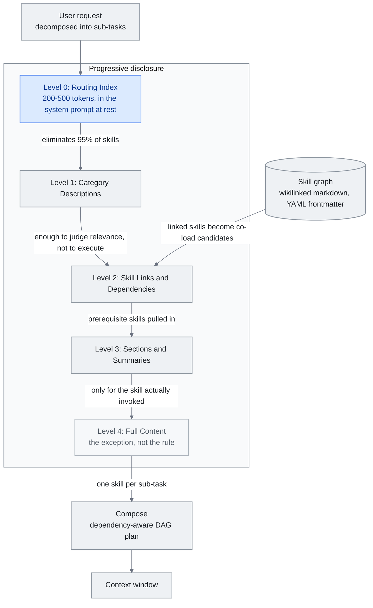

<!-- translation-sync:start -->
> 2026-10-31 の英語版に同期した機械支援翻訳です。構造と内容を確認しています。コードと図中ラベルは原文のまま、読書時間は英語原文の推定値です。
> [English source](../../../chapters/05-skill-systems.md) · [Sync record](../../SYNC.md)
<!-- translation-sync:end -->

<!-- i18n-anchor -->

# 第 5: スキル システム -- スキル、スキル グラフ、および漸進的開示

> **一言で言えば:** スキルは、AI に特定のタスクの実行方法を指示する再利用可能な命令セットであり、スキル グラフはそれらをナビゲート可能なナレッジ ネットワークに接続します。
>
> **重要な理由:** スキルを使用すると、AI に毎回同じことを説明するのではなく、一度教えれば、その知識を永久に再利用できます。
>
> **読書時間:** ~22 分 (4,929 ワード / 230 wpm)

*図: セクション 5.4 の 五つの開示レベル。リンクと依存関係を解決するレベルにフィードされるセクション 5.5 のスキル グラフと、最終的に読み込まれるものを組み立てるセクション 5.5 の構成計画。レベル 0 のエッジには、単一の完全なファイルが読み取られる前に、ルーティング インデックスによってスキルの 95% が削除されるという引数があります。そのため、実際に呼び出される 一つまたは 二つのスキルのみについてレベル 4 に到達します。*

スキルは、事前にパッケージ化された命令セット、つまりprompts、ツール構成、動作ルールの自己完結型バンドルであり、特定の機能が必要なときにエージェントのcontext windowに挿入されます。これらは、モデルを無関係な命令で溺れさせることなく、エージェント システムを少数の組み込み動作から数百または数千の特殊な機能に拡張するためのメカニズムです。

この章では、スキル システムのアーキテクチャ、スキル システムが生み出す組み合わせの問題、およびそれを解決する進歩的な開示パターンについて説明します。

---

<!-- i18n-anchor -->

## 5.1 スキルの概念

最も単純な形式のスキルは、特定のタスクの指示を含むマークダウン ファイル (または構造化テキスト ブロック) です。ユーザーリクエストがスキルのトリガー条件と一致すると、スキルのコンテンツがcontext windowにロードされます。ボディがアンロードされたままである間、そのアドバタイズされたメタデータには依然としてトークンがかかります。

これは、あらゆる機能をカバーしようとするモノリシック システム prompt とは根本的に異なります。 90 ツールと 50 動作モードを記述するシステム prompt は、ユーザーがメッセージを入力する前に 50,000 以上のトークンを消費する可能性があります。スキルベースのシステムは、関連するものだけを読み込み、ベースラインのコンテキストを無駄のない状態に保ち、実際のタスクのためのウィンドウ容量を確保します。

設計パターンはソフトウェア エンジニアリングから借用したものです。エージェントにとってのスキルは、アプリケーションにとってのプラグインと同様です。肥大化することなく拡張性を提供します。

<!-- i18n-anchor -->

## 5.2 Anthropic スキル エコシステム

Anthropic は、2025年十月に Claude Code のスキルを開始しました。当初はプロジェクト固有の機能として、`.claude/` ディレクトリ内のマークダウン ファイルで、Claude は必要に応じて呼び出すことができました。形式は意図的に単純で、説明、トリガー条件、および指示を含むマークダウン ファイルでした。

2025 年 十二月までに、Anthropic は、agentskills.io を通じてスキルをオープン スタンダードとして公開し、あらゆるエージェント システムが採用できる移植可能な形式を定義しました。

現在の[仕様](https://agentskills.io/specification)では `name` と `description` が必須であり、ライセンス、互換性、任意のメタデータ、実験的なツール権限は任意項目である。正規表現によるトリガーや依存関係の宣言はホスト側の慣行であり、標準化されたフィールドではない。これは2026年十月31日に確認した文書の説明であり、同日付の仕様変更を示すものではない。

生態系の反応は迅速でした。 2026 の初めまでに、公式リポジトリには 87,000 GitHub スターが蓄積され、コミュニティによって提供されたスキルは 700,000 を超えました。 awesome-llm-skills、awesome-agent-skills (公式プラットフォーム チームからの 1,000+ スキルをフィーチャー)、awesome-claude-code などのコレクションが主要な発見チャネルになりました。

この成長により、スキルが解決するために設計されたまさに問題が生じました。つまり、限られたコンテキスト領域をめぐって競合する機能が多すぎるということです。

レジストリ スケールは、2026 半ばに正式な基礎を築きました。 **2026年六月5日**、Vercel は **skills.sh API** を一般公開しました --- クエリ可能なレジストリ API インデックスオープンソース エコシステムの **600,000+ スキル**。OIDC トークン認証 (有効期限が短く、自動回転され、長期有効なシークレットなし)、毎分 600 リクエストのレート制限**チームおよびプロジェクトごと**、スキルごとのセキュリティ監査ルックアップを備えています。レジストリに監査エンドポイントが付属しているということは、この規模のレジストリが攻撃対象領域でもあることを暗黙に認めていることになります -- スレッド §5.10 が取り上げています。

スキル プリミティブは、このセクションが始まる Claude Code のリリースから約 十か月後、2026年 八月に実稼働インフラストラクチャへの移行を完了しました。 Anthropic は、**スキル API を 八月 19** にベータ版から削除し、その翌日の 八月 20 日付の関連ブログ投稿を行いました -- Anthropic 自身のサーフェス全体で公開と書かれている矛盾二つの別々のイベントではなく、遅延が生じます。 `/v1/skills` は安定したエンドポイントになりました。 `skills-2025-10-02` ベータ ヘッダーは不要になりましたが、引き続き受け入れられます。この移行は、コンピュータの使用、ブラウザの使用、ファイル API と並んで、より広範な実稼働エージェント GA ウェーブの一部として出荷され、API は、Claude プラットフォームと Microsoft Foundry を通じて利用できます。

二番目の変更は、十二 日前の **八月 7** に適用されました。GitHub でホストされる管理対象エージェント用のスキルです。マウントされたリポジトリのルート `.claude/skills` ディレクトリはセッション開始時に自動的に検出されます。個別の公開やインストール手順は必要ありません。 Anthropic 自身のドキュメントでは、マウントされたリポジトリがエージェントの信頼境界の一部となり、間にレビュー手順が存在しないことが明示されています。これにより、ライブ GitHub リポジトリが同じクラスの問題に折り畳まれます。5.10 は、AIR、Cloak-and-Detonate、および Paperclip インシデント: そのリポジトリに書き込むことができる人は誰でも、エージェントが制作指示として扱う内容を追加または編集できます。

**移植可能な形式に中立的な管理主体ができた。** 2026年十月22日、[Anthropic は Agent Skills を AAIF に寄贈した](https://www.anthropic.com/news/donating-agent-skills-to-the-agentic-ai-foundation)。対象には名称、ロゴ、GitHub organization、ドメインが含まれる。Anthropic は70を超えるエージェントプラットフォームでの統合を報告した。これはベンダー間の収束を裏づけるが、安全な実行を示す主張ではない。バージョン付きリリース、提案プロセス、作成者・導入者向けのセキュリティ指針はロードマップ上の提案であり、完成済みの標準機能ではなかった。

<!-- i18n-anchor -->

## 5.3 スケーリングの問題

OpenAI のエージェントのドキュメントには、実用的なガイドラインが含まれています。**エージェントを 20 ツール以下に保ち、10 を超えると精度が低下することが予想されます。** 複数のモデル ファミリにわたる実証テストにより、このしきい値が確認されています。ツール定義を追加するたびに、コンテキストにトークンが追加され、モデルの選択空間に意思決定分岐が追加されます。 90 ツールでは、会話、メモリ、または取得したドキュメントがウィンドウに入る前に、スキーマのオーバーヘッドだけで 50,000 トークンを超える可能性があります。

劣化はトークン数だけの問題ではありません。それは意思決定の複雑さに関するものです。モデルが 90 ツールの中から選択する必要がある場合、確率の質量は薄く広がります。このモデルは、ツールの選択により多くの推論能力を費やし、タスクの実行にはあまり費やしません。ツールパラメータ構築時のエラー率が増加します。モデルは、もっともらしいが間違っているツールをより頻繁に選択し始めます。

スキルも同様のスケーリングプレッシャーに直面しています。 500 の利用可能なスキルを持つシステムは、すべての 500 の説明をコンテキストにロードできません。 500 スキルのトリガーの説明だけを読み込むだけでも、数千のトークンが消費され、実際のリクエストを処理するモデルの能力が低下する可能性があります。

解決策は段階的な情報開示です。

<!-- i18n-anchor -->

## 5.4 漸進的開示アーキテクチャ

プログレッシブ開示はマルチレベルの情報アーキテクチャであり、各レベルが次のルーティング決定に必要な詳細を提供します。以下の 五つのレベルは、このガイドのアーキテクチャ上の統合であり、標準で必要なロード シーケンスではありません。

**レベル 0: ルーティング インデックス。** カテゴリをスキル グループにマッピングするコンパクトなテーブル。スキル ライブラリ全体で合計 200～500 トークンを消費する可能性があります。これは、システムの prompt に保存されているものです。

**レベル 1: カテゴリの説明。** ルーティング インデックスで関連するカテゴリが識別されると、そのカテゴリ内のスキルの 一 段落の説明がロードされます。各説明はスキャン用に最適化されています。関連性を判断するには十分ですが、実行するには十分ではありません。

**レベル 2: スキル リンクと依存関係。** 選択したスキルについて、その依存関係グラフ (必要な他のスキルやツール、期待されるコンテキスト) をロードします。

**レベル 3: セクションと概要。** 完全な指導内容を含まずに、スキルの構造概要 (セクション ヘッダー、重要な決定点、パラメータ リスト) をロードします。

**レベル 4: フルコンテンツ。** 完全なスキル手順を context window にロードします。これは、実際に呼び出される 一つまたは 二つのスキルに対してのみ発生します。

Heinrich と arscontexta チームによって公式化された重要な洞察は、**ほとんどの意思決定は単一の完全なファイルを読み取る前に行われる**ということです。ルーティング インデックスにより、スキルの 95% が排除されます。カテゴリの説明では、残りのほとんどが削除されます。コンテンツ全体の読み込みは例外であり、規則ではありません。

運用システム全体で測定すると、段階的開示により、すべてのスキル定義を事前に読み込む場合と比較して、トークンのオーバーヘッドが **85-95%** 削減されます。 Anthropic 独自のエージェント スキル実装はこれを示しています。17 本番スキルは保存時に約 1,700 トークンを消費し (レベル 0 + レベル 1)、呼び出し時にのみ完全なコンテンツに拡張されます。

<!-- i18n-anchor -->

## 5.5 スキルグラフ

Heinrich のスキル グラフ アーキテクチャ (arscontexta、2025-2026) は、段階的開示をネットワーク構造に拡張します。スキル グラフは、カテゴリ別に整理されたスキルのフラットなリストではなく、**ウィキリンクによってリンクされた相互接続されたマークダウン ファイルのネットワーク**であり、各ノードには以下が含まれます。

- 簡潔な説明を含む YAML フロントマター ブロック (レベル 1 でのスキャン用)
- 関連スキル、前提スキル、サブスキルへのウィキリンク
- 独立してロードできる構造化されたセクション

グラフ構造により、フラット スキル リストではサポートできないいくつかの機能が可能になります。

**コンテキスト ナビゲーション。** 一つのスキルが呼び出されると、そのリンクされたスキルが同時ロードの候補になります。 "deploy" スキルは、"test," "rollback,"、および "monitor" スキルにリンクします。これは、これらが同じカテゴリに属しているためではなく、操作上隣接しているためです。

**依存関係の解決。** スキルは前提条件を宣言できます。複雑なスキルを呼び出すと、パッケージの依存関係の解決と同様に、そのスキルが依存する基本的なスキルが自動的に取り込まれます。

**部分的な読み込み。** スキルは明確なセクションで構成されているため、システムはドキュメント全体を読み込まなくても、特定のセクション (たとえば、デプロイメント スキルの "error handling" セクションのみ) を読み込むことができます。

グラフ トポロジ自体が知識表現の形式になります。密に接続されたスキル クラスターは、内部一貫性が高い能力領域を示します。孤立したスキルは、システムの適用範囲のギャップや統合の機会を示している可能性があります。

ルーティング研究は、2026年半ばに単一スキルの選択を超える段階に進みました。**"Compositional Skill Routing for LLM Agents: Decompose, Retrieve, and Compose"**（arXiv 2606.18051、2026年六月16日、Alibaba CloudのXueping Gaoによる単著）は、一つのスキルへの振り分けではなく、*複数スキルの合成*を定式化しています。クエリをサブタスクに分解し、各サブタスクに一つのスキルを検索し、依存関係を考慮したDAG形式の計画を組み立てます。**CompSkillBench**は、24カテゴリの実際のMCPサーバースキル2,209件を対象に、複数スキルの組み合わせを求める300件のクエリからなり、一つの選択ではなく*複数*のスキルの合成を試す初のベンチマークです。Iterative Skill-Aware Decompositionは、分解精度を**51.0% → 67.7%**（相対+32.7%、Wilcoxon p < 10⁻⁶）に高め、ライブラリ全体を読み込む場合に比べてコンテキストウィンドウの消費量を**99%超**削減します。対象カテゴリが検索プールに含まれない場合でも、相対+35.6%の改善が得られています。

<!-- i18n-anchor -->

## 5.6 SkillReducer ペーパー

2026年三月に発表された調査では、複数のエージェント プラットフォームにわたる 55,315 のスキルを調査し、スキルの品質に関する素朴な仮定に疑問を投げかける結果が得られました。

- **26.4% のスキルにはルーティングの説明がまったくありませんでした。** スキルには完全な説明コンテンツがありましたが、ルーティング システムがいつ呼び出すかを識別するのに役立つメタデータがありませんでした。これらのスキルは、正確な名前によってのみトリガーでき、インテリジェント ルーティング層には認識されません。

- **スキル本体コンテンツの 60% 以上が実行不可能でした。** これは、モデルが実行できる具体的な命令ではなく、背景コンテキスト、動機、注意事項、説明テキストで構成されていました。このコンテンツは、タスクのパフォーマンスに寄与せずにトークンを消費しました。

- **圧縮されたスキルにより、オリジナルと比較して出力品質が 2.8% 向上しました。** 研究者が実用的ではないコンテンツを削除し、指導言語を強化したところ、モデルのパフォーマンスが実際に向上しました。少ない方が良い -- コンテキスト内のノイズが減少したことで、モデルは実行可能な命令に集中できるようになりました。

スキルオーサリングへの直接的な影響は次のとおりです。

1. **すべてのスキルにはルーティングの説明が必要です。** これがないと、スキルはプログレッシブ開示システムから事実上見えなくなります。
2. **説明コンテンツは緻密で実用的なものである必要があります。** バックグラウンド コンテキストは、context window に挿入されるスキル本体ではなく、ドキュメントに属します。
3. **スキルの品質の測定にはトークンの効率を含める必要があります** -- "does it work"だけでなく、"does it work per token consumed."。

<!-- i18n-anchor -->

## 5.7 MCP の Meta ツール パターン

Model Context Protocol (MCP) は、エージェントがプロバイダー全体でツールを検出して呼び出すための標準化された方法を導入しました。しかし、MCP の元の設計では、接続時に利用可能なすべてのツール スキーマが読み込まれるため、スキルが直面する同じスケーリングの問題が生じていました。

メタツール パターンは、次の 二つのコンポーネントでこれを解決します。

- **検出ツール:** 自然言語記述を受け入れ、完全なレジストリから関連するツール スキーマを返す単一のツール。これはベースラインでロードされる唯一のツールです。
- **実行ツール:** ディスカバリーによってスキーマが取得されると、任意のツールを名前で呼び出すことができる汎用ツール呼び出しラッパー。

システムは、数百ではなく 二つのツール スキーマを読み込みます。モデルは、機能が必要であると判断すると、検出ツールを呼び出し、関連するスキーマを受信して、特定のツールを呼び出します。このパターンでは、推論のラウンドトリップが 一 回余分に行われるため、コンテキストが大幅に節約されます。

これは、ツール管理に適用される進歩的な開示です。モデルは、すべての連絡先のファイルの内容ではなく、電話帳を取得します。

<!-- i18n-anchor -->

## 5.8 オーサリング ガイドライン

SkillReducer の調査結果と運用経験に基づいて、スキル作成のベスト プラクティスのセットが明らかになりました。

- **ルーティングの説明を記述します。** YAML フロントマターの説明は、ファイル内で最も重要な行です。スキルが呼び出されるかどうかを決定します。人間の読者ではなく、分類子のために書きます。
- **フロントロードの実行可能な命令。** スキル本体の最初の 200 トークンには、コアとなる動作命令が含まれている必要があります。背景とコンテキストが続きます。
- **構造化されたセクションを使用します。** ヘッダー、リスト、および明確な境界線により、部分的なロードとセクションレベルの取得が可能になります。
- **ホスト固有の依存関係を明示的に宣言します。** 使用するホストが解決できる必要なスキルまたはツールを文書化します。
- **トリガーの例を含めます。** スキルをアクティブにする必要があるユーザー メッセージの例として 3-5 を提供します。これらは、ルーティング層のドキュメントとテスト ケースの両方として機能します。
- **トークンコストを測定します。** 各スキルのトークン数を追跡し、予算を設定します。スキルが 2,000 トークンを超える場合は、分割または圧縮できるかどうかを検討してください。

平行線はスキル*構築*自体を自動化します。 **ワークフローからスキルへ** (arXiv 2606.06893, 2026年六月5日; Yuyang Zhang、Xinyuan Han、Xudong Jiang、Run Wang --- 武漢大学 / 南昌大学) の紹介RWSA は、トレースからスキルまでを要約として扱うのではなく、各トレースをワークフロー構造、実行セマンティクス、ランタイム添付ファイル (安全性、ロールバック、状態) に分解することで、異種対話トレース (デモ、トラジェクトリ、ツール ログ) をスキルに変換する構造化中間表現です。 70 スキルの WSASkill データセットでは、手動のベスト プラクティスに対する自動スキル構築の最初の形式化である、Anthropic のスキル クリエイターを含むベースラインと比較して、行動再生の一貫性が **+10.5% 相対**向上したと報告しています。

二 行目は逆に実行され、完成したスキルを散文ではなくインフラストラクチャとして扱います。 Anthropic の **`ant apply`** (2026年九月3日、CLI v1.30.0 以降で出荷) は、Terraform を適用します。エージェント リソースへの計画と適用モデル: エージェント、環境、スキル、メモリ ストア、およびデプロイメントはリポジトリ内のファイルとして宣言され、ライブ API 状態と比較され、計画として表示され、承認時に作成または更新されます。`claude-lock.json` ロックファイルは、API が返したものに対して送信されたものをフィンガープリントします。このモデルのスキルは、ルートに `SKILL.md` を持つディレクトリであり、GitHub URL から直接取得でき、`--upgrade` が実行されるまで解決されたコミットに固定されます。リソースは相対パスによって相互に参照するため、依存関係の順序とバージョンは計画時に解決されます。 Anthropic のドキュメントによれば、ワークフローは CI 用に構築されています --- `--dry-run` はプルリクエスト時にプランを生成し、静的 API キーの代わりに Workload Identity Federation が推奨される資格情報パターンです。コミット ピンは、これをパッケージ化の利便性以上のものにします。GitHub ソースのスキルは、検証と使用の間に書き換えることができなくなるため、セクション 5.10 で説明されているように、チェック時から使用時までのギャップを実際に軽減することができます。これは解決策ではありません --- ロックファイルはファイルを固定するものであり、実行中にファイルが到達するものではありません。これは、2026年六月 `brand-landingpage` スキルが最初に使用したチャネルです。

<!-- i18n-anchor -->

## 5.9 業界の統合: Google Agent Skills 仕様 (2026 年 四月)

2025 のほとんどの期間、段階的開示は主に Anthropic の慣例でした。2025 年 一月には Claude Code スキル、十二月には Agentskills.io オープン スタンダードによって正式化されました。 **2026年 四月**、Google 開発者ブログは独自の **Agent Skills 仕様**を正式化し、同じアーキテクチャを採用および拡張しました。この仕様では、段階的な開示の 三つの明示的なレベルについて説明しています。

- **レベル 1 --- メタデータ (スキルごとに ~100 トークン)。** スキルの名前、一 行の説明、トリガーのヒント、およびバージョンを含むコンパクトな記述子。利用可能なすべてのスキルのレベル 1 メタデータは、エージェントのベースライン コンテキストに存在します。 10 スキルがロードされている場合、これはおよそ 1,000 トークンの一定のオーバーヘッドに相当します。
- **レベル 2 --- 命令 (<5K トークン)。** スキルの完全な動作命令。レベル 1 の一致によりスキルが関連していると識別されたときにオンデマンドでロードされます。レベル 2 のコンテンツは、スキルが実際に選択されるまでコンテキストに入りません。
- **レベル 3 --- 外部リソース。** context window の外側に完全に存在するアセット --- 参照ドキュメント、データセット、ツール スキーマ、コード サンプル --- 実行中にスキルが明示的に必要とする場合にのみフェッチされます。

見出しの効率性に関する主張: 10 スキルを持つエージェントの場合、ベースライン コンテキストの使用量は、約 **10K トークン** (完全なスキル コンテンツを事前に読み込む) から約 **1K トークン** (レベル 1 メタデータのみ) に減少します。 **90% 削減**。レベル 2 のコンテンツは一度に 一つのスキルをロードし、レベル 3 のリソースは実行中に必要な場合にのみロードされます。

Google の仕様は、数字以上に注目すべき点が 二つあります。

1. **ユニバーサルな `agentskills.io` 仕様を使用します。** Google は、フォークするのではなく、その形式を 2025 年 十二月に公開されたオープン スタンダード Anthropic に合わせました。ある仕様に基づいて作成されたスキルは、最小限の適応で他のプラットフォーム上のエージェントによって使用できます。
2. **これは、慣例から正式なシステム設計パターンへの漸進的開示を促進します。** およそ 一年間、漸進的開示は "what Anthropic does with skills." として説明されてきました。Google の採用と正式化により、それは、名前付きのアーキテクチャと測定可能なターゲットを備えたクロスベンダーの業界パターンになります。"MVC" や"REST" は、特定の実装から汎用パターンに進化しました。

実際の効果としては、スキル ライブラリがプロバイダ間で移植可能になり、"how many tokens does your baseline agent context consume" がベンダーが競争する第一級の指標になったことです。

**2026年五月6日**、AWS が一般提供版の **AWS MCP Server** を公開し、**"Skills over SOPs"** をエージェントの標準的な入口として採用したことで、収束はさらに広がった。AWS は、Skills（2025年十二月に成立した Anthropic / OpenAI / Google のオープン標準）を本番エージェント向けの指針として提供する初のハイパースケーラーとなった。Anthropic、OpenAI、Google、AWS の四社が揃ったことで、Skills は "the convention three frontier labs use" から "the way agent capabilities are described across the cloud stack." へと閾値を越えた。実務上は、agentskills.io 仕様に従って作成したスキルを、本番エージェントの大半が稼働するプラットフォーム間で移植できるようになったということだ。

<!-- i18n-anchor -->

## 5.10 スキルのセキュリティとサプライチェーンの問題

スキル ファイルはその効率性を考慮して、*モデルが従う実行可能な命令セット*でもあります。そして2026 半ばまでに、これらのファイルをレジストリ経由で配布することによるセキュリティへの影響が具体的になりました。スキャン エコシステムが出現していましたが (Cisco のスキル スキャナ、NVIDIA の **SkillSpector**、2026年 六月半ばにオープンソース化、skills.sh の組み込みセキュリティ監査)、静的スキャンには構造的な上限があることが 二つの開示で示されました。

**2026年六月22日**、セキュリティ会社AIRは、**およそ26,000のエージェント** --- "including corporate accounts' agents" --- という名前の単一の偽のスキルを使用したことを明らかにしました。 `brand-landingpage`。Instagram 広告を通じて配信され、被害者の電子メールを密かに収集しました。 *すべての*スキャナーのテストに合格しました。理由は**チェック時と使用時（TOCTOU）のギャップ**です。静的スキャナーは送信されたパッケージのスナップショットを評価しますが、スキルは攻撃者が制御する外部の URL を指しており、その内容は精査後に書き換えられる可能性があります。精査されたスナップショットが実行されることはありませんでした。

十日後の**2026年七月2日**、HKUSTの研究者はこの隔たりを正式に示しました。**"Cloak and Detonate: Scanner Evasion and Dynamic Detection of Agent Skill Malware"**（arXiv 2607.02357）は、自己解凍形式のパッキングで機能を維持しながら、静的スキャナーを回避するように悪意あるスキルを書き換える**SkillCloak**を発表しました。ペイロードはインストール時にはスキャナーの死角となる場所に隠され、エージェントの実行時にだけ復元されます。実際に発見された悪意あるスキル1,613件を用いて8つのスキャナーに対して評価したところ、SFSパッキングは**どのスキャナーでも90%超の割合で検出を回避**しました（八つのうち六つでは99.8-99.9%）。同じチームは、実行時の振る舞いを検査する**SkillDetonate**も公開しており、**誤検知率2%で攻撃の97%を検出**します（実際に発見された悪意あるスキルでは87%）。

三回目の鼓動はその五週間後に到着した。 **2026年八月6日**、セキュリティ企業 Zenity Labs は、skills.sh 自体に対するサプライ チェーン キャンペーンを明らかにしました。攻撃者は、paperclipai になりすまし、 browser-use GitHub 組織 (`getpaperclipp.com` を登録し、模倣者 `getpaperclipai` 組織を 七月 2 に設立) は、最初は無害だったスキルを公開しました。 七月 5、七月 11 に武器化され、レジストリのトレンド #8 に上昇しました。認証情報収集ペイロード --curl-to-base64-to-node チェーン -- ターゲット 138 四つの個別のトリガー パス経由の認証情報パス (SSH キー、AWS/GCP/Azure 認証情報、Kubernetes 構成、npm トークン、データベース認証情報): 直接のスキル指示、悪意のある PyPI パッケージ、 npm postinstall フック、および API ルート ハンドラー。リストに表示されたインストール カウンタは **1.7 百万** を超えました。感染した固有のエージェントの数ではなく、集計された数であり、この曖昧さが問題を膨らませたものと同じです。 AIR 自身の 六月の開示の見出しの数字。 Vercel と GitHub は、公開から 12 時間以内にリストとリポジトリを削除しました。 （これは別の事件とは別の事件です） Paperclip 製品 CVE (例: CVE-2026-41679、前日に公開 -- これらは正規の Paperclip 製品の脆弱性であり、skills.sh 偽装キャンペーンではありません。) わずか 六週間強の間に 三 件の開示があり、26,000 エージェントをハイジャックする 一つの Instagram 広告キャンペーンから、スキャナーが回避可能であることを証明する研究論文に至るまで、同じ TOCTOU/審査後の武器化失敗モードが一般化しました。 体系的に、レジストリ スケールで 四つの個別のトリガー メカニズムを利用するトレンドのスキル ファミリに移行します。

このフレームワークの教訓は、一年前に学んだ MCP セキュリティ (第 7 の IETF セキュリティ考慮事項草案) です。つまり、漸進的な開示とレジストリ規模のエコシステムにより、スキル ファイル自体が攻撃対象領域になるため、信頼は *公開時のスキャン* から *実行時の封じ込め * に移行する必要があります。実行時に実際の動作をフェッチまたはアンパックするスキルは、送信時にどのように見えるかを検査することによって認定することはできません。防御可能な立場は、実行時にその動作を監視することです。

Zenityの開示から翌月にかけて、この立場に対応する商用市場が生まれました。**2026年九月1日**、CrowdStrikeはFal.Conカンファレンスで、新しいAI検知・対応製品群の一部として**Falcon Guardian**を発表しました。WindowsおよびmacOSのエンドポイント上で動く既知および未把握のAIエージェントを発見して一覧化し、誰が各エージェントを導入したかを記録します。さらに、エージェントの実際の動作に対してアクセス制御、ポリシー適用、実行時検知を行い、事後に悪意ある実行の連鎖を再構成します。CrowdStrikeの説明が挙げるのは、静的レビューでは捉えられない、正当に見えたプロンプトが異常な動作を生むケースそのものです。ただし、発表には検出率や有効性の数値がありません。これは実行時の封じ込めが製品カテゴリになったという市場の兆候であり、その有効性の証拠ではありません。同日、本節冒頭の六月22日の開示を行ったAIRがステルス状態を脱し、二回のシードラウンドで計**$50百万**を調達したと発表しました（Sequoia主導の$10MとGreenoaks主導の$40M）。同社は、それまで単一のスキルで示していたパターンについて、エコシステム規模の数値も公表しました。AIR自身の集計では、**17,800件超の公開AIアドオンが、約6.7百万件のインストールに相当し、信頼できない外部の指示ソースに依存しています**。また、AnthropicやOpenAIを装ってプラットフォームの審査を通過しようとするスキルを発見したと報告しています。ブランドのなりすましは、Paperclipキャンペーンだけの事象ではなく、繰り返し使われる手法になっています。AIRはどちらの数値についても算出方法を公開しておらず、いずれも販売先の市場をベンダー自身が測定した結果です。二つの発表を合わせると、この展開の商用化までの流れがつながります。十週間で、問題は一件の開示から、スキャナーを体系的に回避できるという実証、レジストリ規模のキャンペーンへと進み、資金調達したベンダーが測定を、エンドポイントベンダーが制御の実施を販売する段階に達しました。

---

<!-- i18n-anchor -->

## 得るべき 三つのこと

- **ほとんどのルーティングの決定は、単一の完全なファイルが読み取られる前に行われます。** ルーティング インデックスによりスキルの 95% が削除され、カテゴリの説明によって残りのほとんどが削除されるため、レベル 4 の完全なコンテンツは、実際に呼び出された 一つまたは 二つのスキルに対してのみロードされます。
- **ルーティングの説明のないスキルは表示されません。** SkillReducer は、55,315 スキルのうち 26.4% に完全な指導コンテンツが含まれていることを発見しましたが、ルーティング レイヤーが一致するメタデータがなく、正確な名前でのみトリガー可能となっています。
- **レジストリ規模では、信頼は公開時のスキャンから実行時の封じ込めに移行する必要があります。** 実行時に実際の動作をフェッチまたはアンパックするスキルは、送信されたスナップショットからは証明できません。これは、AIR、Cloak-and-Detonate、および Paperclip の開示が共有する障害モードです。

---

<!-- i18n-anchor -->

## 情報源

- **Agent Skills.** 形式仕様 (現在のドキュメントでは 2026年十月31日を確認): [https://agentskills.io/specification](https://agentskills.io/specification)。
- **Anthropic.** Agent Skills 寄付のお知らせ (2026年十月22日): [https://www.anthropic.com/news/donating-agent-skills-to-the-agentic-ai-foundation](https://www.anthropic.com/news/donating-agent-skills-to-the-agentic-ai-foundation)。
- **Anthropic.** "Claude Code Skills." ドキュメントとオープン標準仕様、2025年十月 (発売)、2025年十二月 (agentskills.io 経由のオープン標準)。 87K+ GitHub は 2026 初めまでに開始されます。
- **OpenAI.** "Agent Design Best Practices." OpenAI ドキュメント、2025。エージェントごとに推奨されるツールは 20 未満で、10 を超えると精度が低下します。
- **Heinrich (@arscontexta).** スキル グラフの概念と実装。 X 投稿 (2026): [https://x.com/arscontexta/status/2023957499183829467](https://x.com/arscontexta/status/2023957499183829467) (スキル グラフ > SKILL.md)。 GitHub: [https://github.com/agenticnotetaking/arscontexta](https://github.com/agenticnotetaking/arscontexta) --- Claude Code プラグインは、ウィキリンクと YAML フロントマター スキャンを使用して個別のマークダウン グラフ知識システムを生成します。二次分析: Linas Substack、"Skill Graphs: The Architecture That Solves the AI Agent Context Window Problem." [https://linas.substack.com/p/skill-graphs](https://linas.substack.com/p/skill-graphs)
- **SkillReducer Paper.** "Less Is More: Compressing Agent Skills for Improved Performance." 2026 年 三月。 55,315 のスキルが分析され、26.4% にルーティングの説明が不足し、60% 以上の実用的ではないコンテンツ、2.8% の圧縮による品質向上が見られました。
- **Model Context Protocol (MCP)。** Anthropic 仕様、2024-2025。標準化されたツールの検出および呼び出しプロトコル。
- **awesome-llm-skills.** GitHub のコミュニティ コレクション。プラットフォーム全体で厳選されたスキル ライブラリ。
- **awesome-agent-skills.** GitHub コレクション、公式プラットフォーム チームからの 1,000+ スキル。
- **awesome-claude-code.** GitHub コレクション。 Claude Code 固有のスキルと構成。
- **OpenAI.** "Function Calling Best Practices." 2025。工具数と精度のトレードオフに関する経験的データ。
- **グリシウナス、オーリマス。** "State of Context Engineering in 2026." SwirlAI ニュースレター、2026 年 三月。 [https://www.newsletter.swirlai.com/p/state-of-context-engineering-in-2026](https://www.newsletter.swirlai.com/p/state-of-context-engineering-in-2026) --- 段階的な開示 / 圧縮 / スライディング ウィンドウ パターン。メタツールパターン。 "Breaking Down Context Engineering" も参照してください: [https://www.newsletter.swirlai.com/p/breaking-down-context-engineering](https://www.newsletter.swirlai.com/p/breaking-down-context-engineering)
- **AWS.** "AWS MCP Server now generally available" (May 6, 2026): [https://aws.amazon.com/about-aws/whats-new/2026/05/aws-mcp-server/](https://aws.amazon.com/about-aws/whats-new/2026/05/aws-mcp-server/)
- **AWS ニュース ブログ。** "The AWS MCP Server is now generally available" (2026年五月6日): [https://aws.amazon.com/blogs/aws/the-aws-mcp-server-is-now-generally-available/](https://aws.amazon.com/blogs/aws/the-aws-mcp-server-is-now-generally-available/) --- "Skills over SOPs" の採用により、AWS はスキルを提供する最初のハイパースケーラーになります制作代理店のご案内。
- **Vercel.** "The skills.sh API is now available" (2026年六月5日): [https://vercel.com/changelog/the-skills-sh-api-is-now-available](https://vercel.com/changelog/the-skills-sh-api-is-now-available) --- クエリ可能なレジストリ API; OIDC トークン認証。チームおよびプロジェクトごとに 600 リクエスト/分。 600,000+ インデックス付きスキル。スキルごとのセキュリティ監査。
- **Gao、Xueping** (Alibabaクラウド)。 "Compositional Skill Routing for LLM Agents: Decompose, Retrieve, and Compose." arXiv 2606.18051、2026年六月16日。 [https://arxiv.org/abs/2606.18051](https://arxiv.org/abs/2606.18051) --- CompSkillBench (2,209 MCP スキルに対する 300 構成クエリ、 24 カテゴリ);反復スキル認識分解 51.0%→67.7%; >99% コンテキスト削減とライブラリのロード。
- **張、裕陽;ハン・シンユアン。江、徐東。 Wang、Run** (武漢/南昌大学)。 "Workflow-to-Skill." arXiv 2606.06893、2026年六月5日。 [https://arxiv.org/abs/2606.06893](https://arxiv.org/abs/2606.06893) --- RWSA 構造化中間表現 (ワークフロー構造 / 実行セマンティクス / ランタイム添付ファイル); 70 スキル WSASkill データセットで、Anthropic スキル クリエイターを含むベースラインと比較して、+10.5% の相対的な行動リプレイ一貫性。
- **AIR (Niv Hoffman & Or Nevo).** "The Story of Skills --- How We Hijacked 26,000 Agents With One Instagram Ad" (2026年六月22日): [https://www.air.security/blog-posts/the-story-of-skills](https://www.air.security/blog-posts/the-story-of-skills) --- 偽の `brand-landingpage` スキル、テストされたすべてのスキャナーを通過する外部 URL TOCTOU バイパス (Cisco スキルスキャナー、NVIDIA) SkillSpector、skills.sh)。二次: ハッカー ニュース (六月 23): [https://thehackernews.com/2026/06/fake-ai-agent-skill-passed-security.html](https://thehackernews.com/2026/06/fake-ai-agent-skill-passed-security.html)。
- **Ji、Zimo 他** (HKUST)。 "Cloak and Detonate: Scanner Evasion and Dynamic Detection of Agent Skill Malware." arXiv 2607.02357、2026年七月2 に提出されました。 [https://arxiv.org/abs/2607.02357](https://arxiv.org/abs/2607.02357) --- SkillCloak は、1,613 個の悪意のあるスキルを超える 8 スキャナで >90% を回避します。 SkillDetonate ランタイム検出 97% (2% FP)。二次: ハッカー ニュース (七月 6): [https://thehackernews.com/2026/07/new-skillcloak-technique-lets-malicious.html](https://thehackernews.com/2026/07/new-skillcloak-technique-lets-malicious.html)。
- **NVIDIA.** SkillSpector オープンソース スキル スキャナー (2026年 六月中旬にオープンソース化) --- NVIDIA 独自のリポジトリで名前が付けられた静的スキャナー。 AIR/THN インシデント レポートには名前が記載されていません。
- **Zenity Labs.** "Attackers Target Agents via the Skill Supply Chain" (2026年 八月6日): [https://labs.zenity.io/post/attackers-target-agents-via-the-skill-supply-chain](https://labs.zenity.io/post/attackers-target-agents-via-the-skill-supply-chain) --- skills.sh での Paperclip なりすましキャンペーン; 138 認証情報パス。 四つのトリガーメカニズム。 1.7M+ 集約インストール カウンタ。セカンダリ: CSO オンライン: [https://csoonline.com/article/4206851/](https://csoonline.com/article/4206851/);ビジネスワイヤ: [https://businesswire.com/news/home/20260806707467/en/](https://businesswire.com/news/home/20260806707467/en/)。
- **Anthropic.** リリースノートの概要: [https://platform.claude.com/docs/en/release-notes/overview](https://platform.claude.com/docs/en/release-notes/overview) --- スキル API はベータ版ではありません2026年八月19日。ブログ: "Computer use, Skills API, and Files API" (2026年 八月20日): [https://claude.com/blog/computer-use-skills-api-files-api](https://claude.com/blog/computer-use-skills-api-files-api)。管理対象エージェントのスキル ドキュメント (GitHub でホストされるスキル、2026年 八月7): [https://platform.claude.com/docs/en/managed-agents/skills](https://platform.claude.com/docs/en/managed-agents/skills)。
- **CrowdStrike.** Falcon Guardian ローンチのお知らせ、Fal.Con 2026 (2026年九月1日): [https://www.crowdstrike.com/en-us/press-releases/crowdstrike-unveils-falcon-guardian-ai-agent-security/](https://www.crowdstrike.com/en-us/press-releases/crowdstrike-unveils-falcon-guardian-ai-agent-security/) --- Windows 上の既知およびシャドウ AI エージェントの検出とインベントリmacOS エンドポイント、アクセス制御、ポリシーの適用、エージェントの動作のランタイム検出。検出率や有効性の数値は示されていない。セカンダリ: SiliconANGLE (九月 1): [https://siliconangle.com/2026/09/01/crowdstrike-launches-falcon-guardian-to-police-ai-agents-at-the-endpoint/](https://siliconangle.com/2026/09/01/crowdstrike-launches-falcon-guardian-to-police-ai-agents-at-the-endpoint/); SC ワールド: [https://www.scworld.com/brief/crowdstrike-unveils-falcon-guardian-to-secure-ai-agents](https://www.scworld.com/brief/crowdstrike-unveils-falcon-guardian-to-secure-ai-agents)。
- **AIR.** $50 × 百万とエコシステム規模のアドオン研究を加えてステルスから出現。 TechCrunch (2026年九月1日): [https://techcrunch.com/2026/09/01/air-raises-50m-to-help-companies-vet-the-skills-and-add-ons-ai-agents-use/](https://techcrunch.com/2026/09/01/air-raises-50m-to-help-companies-vet-the-skills-and-add-ons-ai-agents-use/); SecurityWeek (2026年九月3日): [https://www.securityweek.com/ai-agent-firewall-startup-air-security-emerges-from-stealth-with-50-million/](https://www.securityweek.com/ai-agent-firewall-startup-air-security-emerges-from-stealth-with-50-million/) --- Sequoia が主導する $10M と、Greenoaks が主導する $40M。信頼できない外部命令ソースに依存する約 6.7M インストールにわたる 17,800+ パブリック アドオン、および Anthropic および OpenAI を偽装するスキル。すべて AIR 独自のカウントで、方法論は未公開です。販売店間の 二 日間の広がりは、二つのイベントではなく、一つの発表に対する掲載の遅れです。
- **Anthropic.** `ant apply` CLI ドキュメント (2026年 九月3 日に出荷、CLI v1.30.0 以降): [https://platform.claude.com/docs/en/cli-sdks-libraries/cli/apply](https://platform.claude.com/docs/en/cli-sdks-libraries/cli/apply) --- リポジトリ ファイルとして宣言されたエージェント、環境、スキル、メモリ ストア、およびデプロイメント。ライブ API 状態に対する差分を計画/適用します。 `claude-lock.json` ロックファイル; GitHub ソースのスキルは、`--upgrade` まで解決されたコミットに固定されます。 `--dry-run` は、推奨される CI 資格情報として CI および Workload Identity Federation を計画します。 Anthropic のドキュメントを単一ソースとします。独立した報道機関が存在しない。
