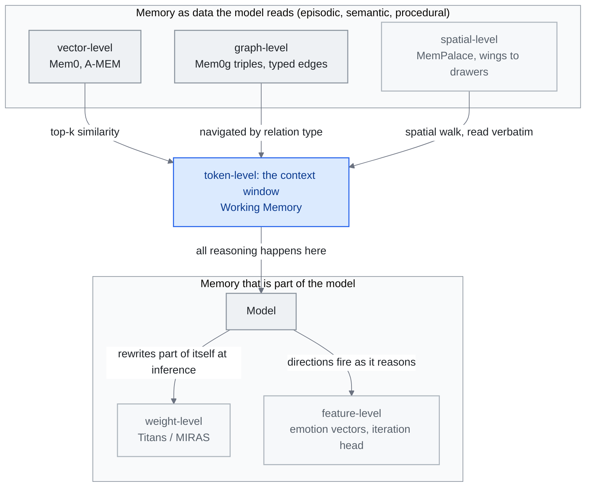

<!-- translation-sync:start -->
> 2026-10-31 の英語版に同期した機械支援翻訳です。構造と内容を確認しています。コードと図中ラベルは原文のまま、読書時間は英語原文の推定値です。
> [English source](../../../chapters/06-agent-memory.md) · [Sync record](../../SYNC.md)
<!-- translation-sync:end -->

<!-- i18n-anchor -->

# 第 6: エージェントのメモリ -- 欠落しているレイヤー

> **一言で言えば:** 記憶システムにより、AI エージェントは会話全体で物事 (好み、過去の決定、プロジェクトのコンテキストなど) を記憶できます。
>
> **重要な理由:** メモリがなければ、すべての AI 会話はゼロから始まります。 AI を見知らぬ人ではなく同僚のように感じさせるのは、記憶のおかげです。
>
> **読書時間:** ~30 分 (6,772 ワード / 230 wpm)

*図: "Feature-Level Memory Research (2026)" で名前が付けられた 六つのレベル。軌跡ごとに配置されています。上部はインターフェイスを通じてモデルが読み取るもの、下部はモデルの一部です。"Memory Taxonomy" セクションの 四 種類がマッピングされています。ワーキング メモリはウィンドウであり、一方、エピソード的、セマンティック、および手続き的です。レコードは店内に保管されています。レベルごとの取得メカニズムは "Major Frameworks" から提供され、重みレベルのエントリは "Architectural Patterns" から提供されます。 context window へのエッジは引数を運びます。ただし、外部レベルにはインデックスが付けられていますが、モデルがそれを推論する前にウィンドウに取得する必要がありますが、重みレベル レイヤーとフィーチャ レベル レイヤーはすでに内部にあります。 2026 までの生産スタックは、ほとんどが最初の 三 レベルにあります。*

<!-- i18n-anchor -->

## メモリが重要な理由

LLM と新しい会話を開始するたびに、ゼロから始まります。モデルには、これまでのやり取り、好み、何時間もの対話で苦労して構築したコンテキストなどの記憶はありません。これは小さな不都合ではありません。これは、永続的なコラボレーターとしての AI の約束を損なう根本的なアーキテクチャのギャップです。

メモリは、AI エージェントをステートレスなレスポンダーから、時間をかけて学習、適応、理解を蓄積するシステムに変換します。メモリがなければ、AI アシスタントは、あなたが簡潔な回答を好むこと、あなたのプロジェクトが特定の ORM で TypeScript を使用していること、または先週の火曜日に認証フローで重大なバグを特定したことを思い出すことができません。すべてのセッションはコールド スタートになります。すべての対話では、コンテキストを最初から再構築する必要があります。

このギャップの代償はユーザーのフラストレーションだけではありません。これは、トークンの無駄 (コンテキストの再説明)、出力品質の低下 (パーソナライゼーションの欠如)、ワークフローの中断 (マルチセッション タスクでの連続性の喪失) として現れます。 AI エージェントがチャット トイから本番インフラストラクチャに移行するにつれて、生のモデルの機能と真の有用性の間にメモリが欠けている重要な層になりました。

<!-- i18n-anchor -->

## メモリ分類法

エージェントの記憶に関する研究は、人間の認知科学に触発された分類法に収束し、四つの基本的なタイプを区別しています。

**エピソード記憶** は、経験に基づいた記録、つまり特定のインタラクション、イベント、およびそれらの結果を保存します。エージェントが "last week, the user asked me to refactor the payment module and preferred extracting a service class over using mixins," を覚えている場合、これはエピソード記憶です。これは、個人化と過去の成功と失敗からの学習のための経験的基盤を提供します。

**セマンティック メモリ** は、ユーザーの技術スタック、チーム メンバーの役割、プロジェクト アーキテクチャの決定、API スキーマなど、事実の知識と構造化された情報を保持します。エピソード記憶とは異なり、意味記憶は特定の出来事から抽象化されます。それは生の経験ではなく、蒸留された理解を表します。

**手続き記憶** は、ワークフロー、標準的な操作手順、学習した一連のアクションなどのハウツー知識をエンコードします。この特定のプロジェクトをデプロイするには、テストの実行、Docker イメージの構築、レジストリへのプッシュ、および Kubernetes ロールアウトのトリガーが必要であることをエージェントが認識している場合、これがプロシージャル メモリです。これにより、エージェントはプロセスを毎回再導出することなく、複雑な複数ステップのタスクを実行できます。

**ワーキングメモリ** は、アクティブな推論コンテキスト、つまりタスク中に現在操作および合成されている情報を表します。これは、モデルの context window およびアクティブな取得状態にマップされます。これは、エージェントがその瞬間に実際に何を推論できるかを決定するため、最も制約があり、最も重要な層です。

これら 四つのタイプ間の相互作用によって、エージェントの記憶システムの洗練度が決まります。単純な実装では、会話ログ (粗末なエピソード記憶) のみが保存される可能性があります。成熟したシステムは、四つのタイプすべてを分離、インデックス付け、相互参照して、適切な情報を適切なタイミングで取得します。

<!-- i18n-anchor -->

## 主要なフレームワーク

### Mem0

[Mem0](https://mem0.ai) は、AI アプリケーションの主要なユニバーサル メモリ層として浮上しました。 Apache 2.0 でライセンスされており、ユーザー、セッション、エージェント全体でメモリを追加、検索、管理するための統合された API を提供します。

パフォーマンスの数値は驚くべきものです。ベースライン システムと比較して LLM 判定評価が 26% 向上し、フルコンテキスト アプローチと比較して p95 レイテンシが 91% 低下し、トークン コストが 90% 以上削減されました。会話履歴全体を再生するのではなく、関連する記憶のみを取得します。 Mem0 は、ベクトル ストレージ、グラフベースの関係、インテリジェントなメモリ統合を組み合わせたハイブリッド アーキテクチャを通じてこれを実現しました。

2025 に、Mem0 は AWS とのパートナーシップを確保し、Amazon Bedrock エコシステムに統合し、エンタープライズ AI デプロイメントのデフォルトのメモリ層としての地位を確立しました。このプラットフォームはマルチテナント メモリ分離をサポートしているため、それぞれが独自の永続メモリ領域を持つ数千のユーザーにサービスを提供するアプリケーションに適しています。

**Mem0ᵍ (2026): 第一級市民としてのグラフ。** 有向ラベル付きグラフのバリアントである **Mem0ᵍ** は、2026 の初めに運用開始され、以前のハイブリッド ベクトル + グラフ設計がナレッジ グラフ ファースト アーキテクチャに置き換えられました。パイプラインは **Entity Extractor** から **Relations Generator** を介して流れ、`(source, relation, destination)` 形式のラベル付きトリプレットを生成します --- `lives_in`、`prefers`、型なしの類似リンクではなく、`owns`。 **LLM を利用した Update Resolver** と組み合わせた **Conflict Detector** は、新しい事実が到着すると矛盾を処理します。新しいトリプレットが既存のトリプレットと一致しない場合、リゾルバーは両方を上書きするか、マージするか、または両方の出自を保持するかを決定します。 Mem0ᵍ は、ベクトル距離だけでなく関係タイプによってナビゲートできるクエリ可能なセマンティック構造をメモリに与えることで、フルコンテキスト アプローチ ("dump everything into the window") と選択的取得 ("find the top-k similar chunks") の間にある長年のギャップを埋めます。

### A-MEM

[A-MEM](https://github.com/agiresearch/A-mem) は根本的に異なるアプローチを採用しており、ゼッテルカステン法からインスピレーションを得ています。ゼッテルカステン法とは、社会学者のニクラス・ルーマンがさまざまな分野にわたる 70 の本を作成するために使用したことで有名なメモ取りシステムです。

A-MEM は、各メモリを動的なインデックス付け、リンク、展開を備えたアトミックなメモとして扱います。記憶は単に保存され、取り出されるわけではありません。それらは創発的なリンクを通じて関連する記憶に接続され、複数の次元に沿ってインデックス付けされ、新しい情報が到着するにつれて進化することができます。新しいメモリが追加されると、システムは既存のメモリへの接続を識別し、それらを結合、分割、または更新する可能性があります。

このアプローチにより、有機的に成長する記憶構造が生成され、人間の専門家がメンタル モデルを構築する方法を反映する関連知識のクラスターが形成されます。ゼッテルカステンのインスピレーションは、知識工学に特に適しています。知識工学は、本質的には、時間の経過とともに知識を複合化するためのシステムです。

### ByteRover

[ByteRover CLI](https://github.com/campfirein/byterover-cli)（旧称 Cipher）は、プロジェクトの知識をコンテキストツリーに整理する。リポジトリは2026年九月27日にアーカイブされた。十月31日に確認した文書では、ローカル動作、任意のクラウド同期、整理内容のレビュー、Git のような分岐とマージが説明されている。コードは Elastic License 2.0 に基づくソース公開である。この歴史的な事例は、ファイルシステム指向のメモリ整理を示すものであり、検索全般での優位性を証明したり、モデルと保守の費用をなくしたりするものではない。

このパターンは、2026年七月29日に初めて学術的な扱いを受けました。 **"Filesystem-Based Memory for LLM Agents: Organization, Evolution, and Sustainability"** (arXiv 2607.26637; Sizhe Zhou と UIUC、UCSD、および Adobe Research の 十人の共著者) は、それ自体を、マークダウン ファイルのディレクトリ ツリー アプローチでは、エージェントが汎用ファイル ツールを通じて読み取り、書き込み、再編成するメモリが、特定のベンダーの製品としてではなく汎用パターンとして研究されています。この論文では、単一の共有メモリ ファイル システムに関する 三つの役割を形式化しています。受信したコンテンツを整理する管理エージェント、引用されたソースでクエリに答える検索エージェント、およびタスクの軌跡を再利用可能なスキルに抽出する実行エージェントです。そのヘッドラインの発見は、ベクター ストアではなくこのパターンを選択する人にとって重要なものです。ストアを整理しておくことで、ストアが大きくなると検索コストがおよそ半分になります。これは、ByteRover の実装ではなく、一般的な組織パターンを測定します。組織は、成長調査で最も強力な管理エージェントを除いてすべて侵食されており、組織をより良い答えに変えるエージェントを測定することはできません。整頓された木が買うものは、より良い答えではなく、より安価な検索です。この研究は再現されていませんが、ファイルシステムのメモリを出荷時の規格から測定された規格に移行します。

### Cognee

[Cognee 1.0](https://www.cognee.ai/cognee-1-0-announcement)、2026年六月26日リリース、`remember` を公開、取り込みと検索の段階だけではなく、`recall`、`forget`、および `improve` を実行します。ベンダーは、単一 Postgres 導入、マネージド クラウド、および COGX エクスポートについて説明します。フィードバック主導の改善操作により、メモリのメンテナンスがインターフェイスの一部になります。これらは製品の機能です。それらの存在は、記憶の質や確実な忘却を独立して確立するものではありません。

<!-- i18n-anchor -->

### ネモリ

[Nemori](https://github.com/nemori-ai/nemori) は、連続する会話ストリームを意味のある記憶単位に分割する方法という、具体的だが重要な問題に焦点を当てています。

各メッセージや各会話を記憶単位として扱うのではなく、ネモリは対話を意味的に整合したエピソード、つまり完全な思考、決定、またはワークフローを表す一貫した対話の塊に分割します。 "relevant past context" と "noise" の間の境界は、多くの場合、会話のエンドポイントではなく会話の途中にあるため、このセグメント化は重要です。

Nemori はクリーンなエピソード セグメントを生成することで、ベクトル検索、グラフ構造、階層構造のいずれを使用するかに関係なく、下流のメモリ システムに高品質の入力を提供します。

<!-- i18n-anchor -->

### メムパレス

[MemPalace](https://github.com/MemPalace/mempalace) は、ベクトル検索やナレッジ グラフよりもはるかに古いアイデア、つまり、おなじみの建物の中を頭の中で歩き回ることによって膨大なカタログを記憶するために古代および中世の学者によって使用された空間記憶技術である **位置の方法** に戻ります。 2026年四月5日にMIT ライセンスの下でリリースされた MemPalace は、メモリ ストアを 四 レベルの空間階層 --- **翼 → 部屋 → クローゼット → 引き出し ** --- 各リーフ "drawer" に逐語的なテキストの断片を格納します。また、階層内のナビゲーション自体がインデックスとして機能します。

したがって、検索プリミティブは、埋め込み類似性でもグラフ走査でもなく、**空間探索**です。エージェントは、宮殿のどの棟に関連する記憶が含まれている可能性が高いかを推論し、部屋やクローゼットを通って降り、圧縮された埋め込みから引き出しを復元するのではなく、引き出しを逐語的に読み取ります。 "verbatim-first" ストレージ哲学は、MemPalace を、保存前に要約またはチャンク化するシステムと区別する設計上の選択です。多くのタスク (法律、科学、対話) では、保存時の非可逆圧縮のコストが、取得時のわずかに遅い空間ウォークのコストを上回ると主張しています。

このアプローチが画期的な理由となったのは、ベンチマークの数値です。 MemPalace は、LongMemEval** で **96.6% Recall@5 を報告しています。これは、エージェントの記憶に関して最も長く公開されているコンテキスト想起ベンチマークであり、同じ評価においてベクトルのみおよびグラフのみのアプローチを上回っています。コミュニティでの反響も同様に印象的でした。このプロジェクトは、最初の 三週間で約 **49,000 GitHub スターを獲得**し、2026 で最も急速に成長したメモリ プロジェクトと比べて若干の差がありました。立ち上げ月の終わりまでに、学術的な批評 (arXiv 2604.21284、*"Spatial Metaphors for LLM Memory: A Critical Analysis of the MemPalace Architecture"*) がすでに流通していました。それ自体が、プロジェクトがいかに急速にこの分野の中心的な議論に移行したかを示しています。

<!-- i18n-anchor -->

## アーキテクチャ パターン

この分野が成熟するにつれて、複数のフレームワークにまたがるいくつかのアーキテクチャ パターンが出現しました。

**マルチタイプ階層。** MIRIX フレームワーク (Wang および Chen、"MIRIX: Multi-Agent Memory System for LLM-Based Agents," arXiv 2507.07957、 2025年七月10日) は、**六つの異なるメモリ タイプ** (コア メモリ、エピソード記憶、セマンティック メモリ、手続き型メモリ、リソース メモリ、ナレッジ ボールト) を使用してこのパターンを例示しています。タイプごとに 六つのメモリ マネージャーと Meta を備えたマルチエージェント フレームワークによって調整されています。タスクのルーティングを処理するメモリ マネージャー。各タイプには、更新頻度、保持ポリシー、取得メカニズムが異なります。この分離により、壊滅的な忘却が防止され、同時に迅速な適応が可能になります。リファレンス アプリケーションは、画面アクティビティをリアルタイムで監視して、パーソナライズされたメモリ ベースを構築します。 ScreenshotVQA マルチモーダル ベンチマークでは、MIRIX は 99.9% 少ないストレージで RAG ベースラインよりも 35% 高い精度を報告し、LOCOMO 長い形式の会話ベンチマークでは 85.4% 高い精度を報告しています。

**Git にインスピレーションを受けたバージョニング。** いくつかのシステムでは、コードなどのメモリをバージョン管理し、履歴を維持し、(推論のため) 分岐をサポートし、メモリの更新が正しくないことが判明した場合のロールバックを有効にしています。これは、異なるエージェントが共有メモリを同時に更新する可能性があるマルチエージェント システムでは特に重要です。

* バージョン管理パターンにはトランザクション境界 (2026年七月) が設定されます。* Git スタイルの履歴は慣例です。 **MemTxn** ("MemTxn: A Transaction Boundary for Source-Supported Updates and Complete-State Recovery in Agent Memory," arXiv 2607.27834, 2026年七月30日; Hanshuai Cui と 五人の共著者) がそれを保証として提案しています。この層は応答モデルの外側にあり、次の 三つの部分で構成されます。 *Ordered PatchTest* は、提案された更新が引用元のソースによって実際にサポートされているかどうかを確認します。 *Temporal リゾルバー * は、事実が矛盾する場合にどのバージョンが表示されるかを決定します。永続的なスナップショット ジャーナルは、物理的な書き込みセットを知る必要がなく、障害後にアプリケーションに表示される状態を復元します。作成者独自の検証セットでは、ソースでサポートされているすべての 60 更新を受け入れ、すべての 179 で構築されたハード ネガを拒否します。また、LongMemEval-S および LoCoMo 派生状態で挿入された永続的なマルチキー フォールトの下では、宣言されたアクティブ メモリを完全に復元します。地図。その検証セットは小さく、結果は再現されていないため、これは運用環境で実証された保証ではなく提案です。この章に貢献するのは契約です。Mem0ᵍ が非公式に指定した競合検出機能と更新リゾルバーを、失敗する可能性のある受け入れ/拒否テストに変え、上記のフレームワークのどれも提供しない回復ストーリーを追加します。 二番目のグループは 三 日前に同じフレーミングに集まり、著者リストによれば、独立して --- **MemTX** ("MemTX: Transactional Belief Commit for Stateful Agent Memory," arXiv 2607.23929, 2026年七月27日) は、スナップショット分離トランザクションへの書き込みをステージングし、実行中の信念状態で不可逆的なツール呼び出しをゲートし、信念が撤回されたときに派生レコードとツールの副作用によるカスケード修復を行います。つながりのない 二つのチームが同じ週にデータベース トランザクション セマンティクスに到達すること自体が、コミット規律を必要とするほど重大なメモリ書き込みになっているというシグナルです。

**認知に基づく分離。** 主要なアーキテクチャでは、単一のメモリ ストアではなく、高速アクセスの作業記憶、中期のエピソード バッファ、および長期の統合された知識の間の明示的な分離が維持されます。記憶固定プロセスは、生物学的システムにおける睡眠に似ており、定期的にエピソード記憶を圧縮、重複除去し、意味論的な知識に再編成します。

**トレーニング可能なメモリ モジュール。** 四番目のパターンは、2026 年 四月に、Google Research の **Titans + MIRAS** によって出現しました。これは、メモリを外部ストアではなく *トレーニング可能なニューラル モジュール* として再構成します。 Titans は、ファクトをベクトル データベース、グラフ、またはマークダウン ファイルに書き込む代わりに、推論時に勾配降下法によって専用メモリ モジュールの重みを更新します。モデルは文字通り、ドキュメントを処理する際にそれ自体の一部を書き換えます。 MIRAS は、発散のない推論時の学習率のレシピと安定性の保証を提供するコンパニオン トレーニング フレームワークです。 Google Research ブログでは、同等のパラメータ数で、長距離リコールとマルチホップ推論において Titans が **Mamba-2**、**Gated DeltaNet**、**Transformer++** よりも優れたパフォーマンスを示していると報告しています。このパターンは、最初の 三つとは概念的に異なります。Mem0、A-MEM、ByteRover、MIRIX はすべて、モデルがインターフェイスを通じて読み取るデータとしてメモリを保持します。 Titans は記憶をモデル自体の一部にし、注意と同じ回路を介して読み取られますが、トレーニングと同じ機械を介して書き込まれます。ナレッジ エンジニアにとって、これは新たな設計上の疑問を引き起こします。メモリを重みに書き込む価値があるのはどのような場合でしょうか、またメモリをデータとしてクエリ可能なままにしておくのはどのような場合でしょうか?

二つ目の商業的方向性は、**2026年五月6日**に、Anthropic の **Dreaming** (リサーチ プレビュー) によって明らかになりました。Dreaming は、推論時にメモリを重みにトレーニングする代わりに、最近のセッションを読み取り、繰り返し発生するエラーと統合されたワークフローを識別する、スケジュールされたセッション間のジョブを実行します。 **エージェントの永続メモリを平文で書き換えます**。 Titans がメモリをモデル自体の一部にする (勾配降下法によって更新される) のに対し、Dreaming はメモリを harness が読み取るデータとして保持します (LLM キュレーション パスによって更新されます)。この 二つは現在、長期エージェント メモリの対照的な商用テンプレートです。**トレーニング可能なメモリ** (推論時の勾配更新、モデル内部) と **キュレーションされたメモリ** (LLM で書き換えられた平文、基板外部) です。ナレッジ エンジニアにとって、設計上の疑問はさらに鮮明になります。メモリをウェイトに焼き付ける価値があるのはいつか (Titans)、モデルが読み取れるストア (Mem0、A-MEM、ByteRover、MemPalace) としてクエリ可能にしておく価値があるのはいつか、キュレーター パスで修正できるプレーンテキストとして編集可能にしておく価値があるのはいつか（夢を見ている）？

三か月後、この質問のトレーニング可能なメモリに関する分野で、初めて本格的なスケーリング数値が得られました。 **"Memory Decoder at Scale: A Pretrained, Parametric Long-Term Memory"** (arXiv 2607.27919, 2026年七月30日; Rubin Wei ら、Qipeng Guo、Bowen Zhou、Zhouhan Lin) は、デコーダのみであるという主張に基づいて、パラメトリック メモリ モジュールを 300B トークン上の 6.9B パラメータに事前トレーニングします。 LLM はメモリと推論を 一つのパラメータ セットに組み込むため、メモリを個別にスケーリングする方が得策です。これを扱いやすくするのは、目的関数の問題ではなく、インフラストラクチャの問題でした。分散型 Faiss インデックス作成および取得パイプラインと、まばらなバッチ単位の kNN 読み込みです。 17 ベンチマーク全体で、6.9B メモリ モジュールと 410M パラメータ Pythia ベースを組み合わせると、そのベースの平均が 29.86 から37.34 --- Pythia-12B の 37.24 を超え、使用するパラメータの合計は 39% 少なくなります。数値は自己報告であり、これは新しいプリミティブではなく、既存のライン (元のより小さいメモリ デコーダは arXiv 2508.09874) でのスケーリング結果です。しかし、これは、Titans パターンが開いたまま放置されていた設計上の疑問に対する最初のパラメータ効率の答えです。ウェイトに焼き付けられたメモリは *同じ* ウェイトに焼き付けられる必要はなく、二つを分割することで、専用メモリ モジュールと組み合わせた 410M ベースが 12B モノリシック メモリを上回ることができます。

<!-- i18n-anchor -->

## 進化フェーズ

エージェントの記憶の発達は明確な軌跡をたどっています。

**フェーズ 1: エンジニアリングの統合 (2023-2024)。** メモリはエンジニアリングの問題、つまり会話状態を保持して取得する方法として扱われました。ソリューションの大部分は、RAG パイプラインがその上に固定されたベクトル データベースでした。機能的ではあるが粗雑で、何を覚えるべきか、いつ忘れるべきか、どのように整理するかについて原則的なアプローチがありません。

**フェーズ 2: 構造化およびナレッジグラフのアプローチ (2024 - H1 2025)。** この分野は、明示的な知識グラフ、型付きメモリ ストア、および原則に基づいた検索戦略を備えた構造化記憶へと移行しました。 Mem0 や A-MEM などのフレームワークがこの時期に登場し、その構造がメモリの品質を劇的に向上させることを実証しました。

**フェーズ 3: 認知アーキテクチャ (H2 2025 - 現在)。** 現在の研究は認知科学に大きく依存しており、生物学的にヒントを得た記憶の統合、干渉管理、およびマルチシステム アーキテクチャを実装しています。メモリに依存するタスクにおいて、システムのパフォーマンスが人間レベルの 90% に近いことが、制御されたベンチマークで実証されていますが、実際のパフォーマンスは依然として変動します。

**フェーズ 4: 機能レベル、トレーニング可能、空間メタファー メモリ (2026年 四月 - 新興中)。** 2026 年 四月には、フェーズにきれいに収まらない 三つのスレッドが追加されました。 1-3。 一つ目は **トレーニング可能なメモリ** (Titans + MIRAS) です。メモリは、モデルの外部でクエリ可能なストアではなく、推論時に更新されるニューラル モジュールになります。 二つ目は **機能レベルのメモリ** で、同じ週の Anthropic 解釈可能性の開示によって開かれました。感情ベクトルと反復ヘッドにより、特定の動作と推論パターンがモデル内の識別可能な特徴の方向に対応することが確立されます。これは、"what the model remembers about how to reason" を原理的にトークンではなくアクティベーション レベルで読み取って操作できることを意味します。レベル。 三つ目は **空間メタファー記憶** (MemPalace) です。デジタル化以前の認知人間工学への回帰です。ここでは、検索プリミティブは階層的空間構造をウォークスルーし、保存哲学は圧縮されるのではなく逐語的に行われます。運用スタックでは、これらは Mem0、A-MEM、または階層コンテキスト ツリーを置き換えません。彼らは彼らと共存しています。しかし、設計空間は "where do I store memory and how do I retrieve it" から "at what level of the stack does this memory live --- token, vector, graph, weight, feature, or spatial walk." まで広がります。

<!-- i18n-anchor -->

## コミュニティと研究

ICLR 2026 MemAgents ワークショップは、この分野の画期的な出来事であり、AI、認知科学、システム工学の研究者が集まり、エージェントの記憶における未解決の問題に対処します。主要なテーマには、メモリのスケーラビリティ、忘却戦略、マルチエージェントの共有メモリなどが含まれます。

<!-- i18n-anchor -->

## 機能レベルのメモリ研究 (2026)

2025 まで、"agent memory" は、ほとんどの場合、エージェントが読み取ることができるデータ (ベクトル インデックス、ナレッジ グラフ、階層マークダウン ツリー、エピソード ログ) を意味していました。 2026年四月により、より広い定義が強制されました。 MIT テクノロジー レビューの画期的な認識と同じ週に行われた 二つの Anthropic 解釈可能性の開示 --- **感情ベクトル** と **反復ヘッド** --- --- は、フロンティア モデルにおける最も重要な "memory" の一部が外部ストアではなく、識別可能な内部機能に存在することを示しました。

**感情ベクトル**は、Claude の残差ストリーム内の線形特徴の方向であり、増幅されると、最もよく引用される例では、脅迫スタイルの出力を含む、感情的に負荷がかかる行動に向けてモデルを確実にバイアスします。メモリ システムの設計に関連する点は、安全性への影響ではなく (実際にはそうですが)、アーキテクチャ上の影響です。モデルには *どのように脅威になるかを記憶する* 機能の方向性があり、prompt や取得されたコンテキストとは関係なく、それを上げたり下げたりすることができます。 **反復ヘッド**は、chain-of-thought推論中に出現するアテンションヘッドであり、前の推論ステップの出力に一貫して注目します。これは事実上、手続き型メモリ ストアではなくアテンション ウェイトに実装された *手続き型メモリ* です。モデルは "how to keep going" の回路を学習しており、その回路が CoT を機能させるものです。

メモリ システム設計にとっての意味は、"where the memory lives" は、2025 よりも豊かな質問になっているということです。最新のスタックでは、**トークン レベル** (ウィンドウ内のトランスクリプト スニペット)、**ベクトル レベル** (Mem0、A-MEM 取得)、**グラフ レベル** (Mem0ᵍ トリプルとその型付きエッジ) の 六つの異なるレベルでメモリを読み取る必要がある場合があります。 **空間レベル** (メムパレスの翼 → 部屋 → クローゼット → 引き出しのウォーク)、**重量レベル** (推論時に更新されるタイタン/MIRAS モジュール)、および **機能レベル** (モデルの理由として解釈可能な方向が起動される)。ファイルシステム コンテキスト ツリーは、ベクトル検索とは別の外部編成戦略です。 2026 までの実稼働システムは、主に最初の 三つのレイヤーで存続し続けます。これらのレイヤーは、最も成熟したツールを備えたレイヤーです。しかし、残りの 三つの層はもはや仮説ではなく、メモリを純粋に検索の問題として扱う harness 設計者は、ますます機能を保留することになります。

**モデルを交換してもメモリは保たれるか（2026年九月）。** 保存レベルの選択には、これまでこの分野で測定されていなかった影響があります。メモリストアの基盤モデルが置き換わる際、どのレベルでも内容を維持できるとは限りません。Ankit GoyalとJaideep Ray（arXiv 2609.05339、2026年九月4日）は、生の履歴、RAG、圧縮メモ、構造化ナレッジグラフという四つの保存方式を、48件の合成テストケースで比較する統制研究を行いました。固定スキーマのグラフメモリはほぼ不変で、精度の変化は+0.0004 ± 0.0020でした。圧縮メモはモデル依存性が強く、交換の方向によって+9.91または-13.28パーセントポイント変動しました。RAGの埋め込みを一部だけ作り直した場合の回復は4.96ポイントで、すべて作り直した場合は11.90ポイントでした。他にも当てはまり得るのは、提案された原因の説明です。メモ方式の性能低下の約80%は、メモリを読む時ではなく、*書く*時に失われた情報に起因するとされています。そのため、ストアだけを修復しても、48件のどのケースでも回復率は90%に届きませんでした。一方、生の元履歴を圧縮メモリと併せて残すと、試した二つの移行方向の片方で、そのうち34件の修復に成功しました。ここから設計上の原則が導けます。モデル移行後もメモリストアを使い続ける必要があるなら、圧縮した文章よりも構造化ストレージを優先し、圧縮形式の元となった生データを決して捨てないことです。48件の合成ケースを二人の著者が調べた初期段階の結果であり、確立した結論ではありません。それでも、モデル交換時の移植性を、上に構築したエージェントではなく*保存形式*の特性として扱った初の研究です。

<!-- i18n-anchor -->

## 2026: 評価とガバナンスの管理

H1 2026 を通じて、記憶に関する会話は主に *アーキテクチャ*、つまり記憶がどこに存在し、どのように取得されるかについてでした。 2026 は最前線を *ガバナンス* に移行しました。このベンチマークは、"can the system recall the right fact" ではなく、"does it recall safely, forget on request, resist manipulation, and stay auditable." 五つの結果が際立っています。

**GateMem**（"GateMem: Benchmarking Memory Governance in Multi-Principal Shared-Memory Agents," arXiv 2606.18829、2026年六月17日）は、複数の権限主体が同じストアに書き込む医療、オフィス、教育、家庭の各領域で、共有される組織メモリの有用性、アクセス制御、能動的忘却を*同時に*評価する初のベンチマークです。主要な結果は、条件を満たす手法が見つからないというものでした。**試したどの手法も三つの軸を同時には満たせず**、特に検索や外部メモリを使う手法では、権限主体の境界を越えて情報が漏洩します。現在のメモリフレームワークに、構造上ガバナンスが保証されているものはありません。

**MemSyco-Bench**（"MemSyco-Bench: Benchmarking Sycophancy in Agent Memory," arXiv 2607.01071、2026年七月1日）は、アーキテクチャを中心とする議論では測定されていなかった失敗の形、すなわちメモリによって生じる迎合性を切り分けて調べます。誤ったメモリを注入すると、迎合率は**18.67%から32.67%**（DeepSeek-V4-Flash、全対話条件）、**27.4%から44.7%**（Qwen3-8B）へ上昇します。また、外部メモリを使うと、客観的事実の判断における事実精度が、メモリなしのベースラインより**11-23ポイント**低下します。このベンチマークは、本章ですでに取り上げた**Mem0、A-MEM、LightMem**を対象としているため、結果は直接的な警告となります。想起を改善するメモリ層が、同時に、記憶するよう指示された内容をエージェントにいっそう鵜呑みにさせる可能性があるのです。

**Decision-Aware Memory Cards**（"Decision-Aware Memory Cards: Counterfactual-Inspired Context Selection and Compression for Tool-Using LLM Agents," arXiv 2606.08151、2026年六月6日）は、検索に別の方向から取り組みます。クエリとの意味的類似性ではなく、*意思決定を重視した*反実仮想に基づく有用性、つまり、ある記憶が次の行動をどれほど変えるかで記憶を順位付けし、結果を型付きで監査可能なメモリカードとして保存します。SWE-benchのファイル検索（検証済みの50事例で、BM25の上位50件をQwen3.6-Plusが再順位付け）では、クエリ当たり約**45トークン**で、Hit@1が**0.58 → 0.78**、MRR@10が**0.634 → 0.790**へ向上しました。この捉え直しはCATTS（第4章）に通じます。最適化する価値のある信号は、単なる類似性ではなく、次の意思決定にとっての有用性です。

**"Are We Ready For An Agent-Native Memory System?"** (arXiv 2606.24775, 2026年六月23日, SJTU / Tsinghua / MemTensor) はフィールドに共有ボキャブラリーを与えます --- *表現とストレージ*、*抽出*、*取得とルーティング*、*メンテナンス*への 四つのモジュールの分解 --- そして、**単一のアーキテクチャが支配的ではない**ことがわかります: **Zep** がセッション間の推論を導きます(48.0 LLM-LongMemEval の判定精度)、**MemOS** は、LoCoMo** の **8.9 EM で正確な接地をリードします。ロングコンテキストのベースラインはステートフルな実行を導きます (DB-Bench の 48.20 EM)。重要な点は、アーキテクチャ側からの GateMem と一致します。メモリは、一人の勝者が存在する 一つの問題ではなく、さまざまな最有力候補が存在する下位問題のポートフォリオです。

**StateMemBench / StateMem**（arXiv 2608.19652、2026年八月20日、UIUCの研究グループ）は、アクセス制御と迎合性に続く第三のガバナンス軸として、**最新性**を加えます。234件の複数セッションのシナリオで、長い対話の途中に事実、制約、決定を変更し、メモリ層が現在有効な値を返すのか、更新前の値を返すのかを調べます。閉じた候補集合内で採点することで、状態追跡の失敗を通常の検索誤りから切り分けています。GateMemと異なり、条件を満たす手法がないという結果で終わらず、情報の更新による置き換えと関係上の依存を明示的に追跡する、状態優先の手法**StateMem**も公開しています。論文によれば、現在状態の正解率はDeepSeek-V4-Flashで1.8x（0.205から0.363）、Qwen-3.5-9Bで1.6x（0.149から0.233）に向上しました。比較対象は、それぞれ同じ基盤モデルを使う最強のベースラインと、最強のメモリシステムです。六つの既存バックエンドにラッパーとして適用した場合の改善は+32から+67ポイントで、ラッパー自体が追加するコンテキストトークンの影響を統制しても、+15から+32ポイントが残ります。この統制によって、"the method works" と "more context helps." を区別しています。いずれも論文自身が報告した数値であり、独立した追試はありません。この軸を明示する価値があるのは、この分野で標準となった想起重視のベンチマークでは、古い情報が新しい情報に置き換わったことを構造上捉えられないためです。以前は正しいと*信じていた*古い事実を自信を持って返すストアも、検索成功として採点されてしまいます。

一つ前の単一著者による結果は、確定した結果ではなく、方向性としてフラグを立てる価値があります。arXiv 2606.15903 (2026年六月14日) は、*LLM がメモリ パイプラインに存在する場所* が実際にどの削除が機能するかを決定すると主張しています。 --- 突然変異時フックは、ポストホック フィルタリングが見逃した意図に応じた削除 (ターゲット クラスでの 78-85%、全体のカバレッジ 91.7-93.2%) を回復します。初期の作業ですが、上記のベンチマークが測定したのと同じガバナンス ギャップを示しています。忘れるのはアーキテクチャ上の配置の決定であり、削除ボタンではありません。

**TencentDB Agent Memory v2.0 --- Team Memory** は、ベンチマーク側ではなくベンダー側からガバナンスのギャップに答えます。 Tencent の MIT ライセンスのセルフホスト メモリ フレームワーク (リポジトリは 2026年四月7 日に作成されました。現在、およそ 24,000 GitHub スター) 2026年八月24日）v2.0.0は2026年八月3日に出荷され、八月13に続いて別のチームコラボレーションの発表がありました。見出しに追加されたチーム メモリは、エージェント間共有のためのガバナンス レイヤーです。四つのバージョン管理されたメモリ アセット タイプ (チャット メモリ、スキル、Wiki、コードグラフ) に適用されるプライベート / チーム / 制限付き / エージェントの可視性層で、Anthropic と OpenAI の両方のプロトコルを話すメモリ プロキシが前面にあります。 L0-L3 層蒸留と BM25+vector+RRF 取得は予算上限の下で実行されます。上記の GateMem の null 結果と照らし合わせて読むと、Team Memory は、アクセス制御軸 GateMem で最初に出荷された実稼働試行で、満足するフレームワークが見つかりませんでした --- しかし、ここでのすべてのガバナンス メカニズムの主張は、Tencent が自社製品について独自に説明したものです。 GateMem の敵対的なサードパーティ評価とは異なり、Team Memory の可視性層が複数のプリンシパルの負荷の下で実際に維持されるかどうかをテストした独立したベンチマークはありません。この章の "evaluation grows governance axes" スレッドには、ギャップを測定するベンチマークと、そのギャップを埋めると主張する出荷済みのプリミティブの両方が含まれるようになりました。この 二つの間の評価ギャップは依然として大きく開いています。

**マネージド メモリがクラウド カテゴリになります (七月-2026年 八月)。** Tencent だけではありません。二番目のエントリにより、それが製品ではなくカテゴリになっています。 **2026年七月30日**、Google は、Gemini Enterprise Agent Platform 機能のクラスターの一般提供を発表しました。その中には **Agent Memory Bank** が含まれます。これは、スキーマ定義の会話コンテキストの構造化抽出を目的としています。低遅延のパーソナライゼーションにより、エージェントは長時間実行されているタスクを中断したところから再開できます。これは、名前が変更されたプラットフォームの GA マイルストーンであり、古いエージェント エンジン ブランドの 2025 年 七月 Vertex AI Memory Bank パブリック プレビューと混同しないでください。発表ブログによると、ここでのすべての機能の説明は Google 独自のものであり、Memory Bank のスキーマ抽出品質に関する独立したベンチマークは存在しません。上記の TencentDB の v2.0 リリースの 四 日前に設定されており、このペアがポイントです。二つの主要なクラウドは、マネージド エージェント メモリをエージェント フレームワーク内の機能としてではなく、個別に管理されるプラットフォーム プリミティブとして出荷しました --- そして、Mem0、A-MEM を追跡したこの章、 ByteRover、Nemori、MemPalace、Dreaming はこれまで、Google のマネージド メモリ サービスに名前を付けていませんでした。 Memory Bank に関する発表は、インフラストラクチャ側からも同じように推進されています。Agent Runtime はエージェントを最大 七 日間継続的に実行し、Agent Identity は最小権限のエージェント アクセスとトークン盗難の軽減のためのネイティブ IAM タイプとして -- 永続セッションと権限に関する質問の章4 は harness レベルで動作し、ここではプロビジョニングされたサービスとして到着します。

**永続的な競合レビューが API になる（2026年十月29日）。** [Cognee v1.6.6](https://github.com/topoteretes/cognee/releases/tag/v1.6.6) は、事実の競合に対する解決判断を永続化し、レビューを既定で有効にする。リリースノートでは、根拠となるチャンクの変更、コネクタ経由の削除、データセットの忘却に伴って古い解決判断を失効させ、競合の解決時には有効なチャンクだけを引用すると説明している。管理対象は、保存された事実だけでなく、過去の判断が現在も有効かどうかになった。これらはベンダーが説明するソフトウェアの挙動であり、独立した信頼性の検証結果や、実証されたトランザクション保証はない。

<!-- i18n-anchor -->

## 後半 -2026年 七月: パラメトリック ネイティブ メモリの主張

2026 半ばのガバナンス ベンチマーク (上記) はすべて、メモリが *インターフェイス* を通じて読み取られる* (ベクトル インデックス、グラフ、キュレーター パス) ことを依然として前提としています。 2026 年 七月29 日、**MemTensor** (上海) --- 上記の 六月の 23 エージェント ネイティブ メモリ調査と同じラボで、ここでは 17 と著者の共同作業が行われます。 Renmin University、NUS、SJTU、Tongji --- 分類法を別の方向に推し進めました。 **Metis** ("Metis: Memory Foundation Model," arXiv 2607.26760) は、**メモリ基盤モデル** を提案しています。つまり、エージェント メモリは、外部ではなく *トランスフォーマー バックボーン自体の内部*に存在し、動的に進化する永続的な状態として存在します。上記の 四つのモジュールの調査では、エージェントがモデルの外側にある表現およびストレージ / 抽出 / 取得およびルーティング / メンテナンス モジュールを通じてメモリを読み取ると仮定していますが、Metis のプロトタイプ --- 4B、9B、および 27B スケールで評価されました。 Qwen3.5 バックボーン --- バックボーンを凍結し、**ハイパー メモリ ブロック** と **ローカル メモリ ブロック** のみをトレーニングします。これは、明示的に Fast Weight Programming (FWP) からインスピレーションを得たものです。

このメカニズムは、この章ですでに説明した 二つのモデル隣接メモリ パターンと区別する価値があります。 Titans + MIRAS (上記のフェーズ 4) は、勾配降下法によって *推論時* にトレーニング可能なニューラル モジュールを更新します --- モデルは読み取り時に自身の重みを書き換えます。 Metis は推論時に勾配フリーです。メモリ更新は、逆伝播や圧縮された履歴をテキストとして再生することなく、履歴コンテキストを固定サイズの状態に圧縮する EMA スタイルの前方計算です。これは、この章がフェーズ 4 以来追跡してきた "where does memory live" スペクトルの 三番目の点に位置します。ベクトル ストア検索や勾配降下による重み更新ではなく、固定された算術規則によって状態を転送する凍結されたバックボーン モジュールです。

この論文は、このアプローチが現在どこで破綻しているかについて、いつになく率直に述べており、その警告はアーキテクチャと並行して記載する価値があります。固定サイズの圧縮では情報が失われるため、長期タスクのパフォーマンスが低下します。そして著者らは、彼ら自身の言葉で、"information confusion in some cases, possibly caused by the blending of semantics within the latent space." 上記のガバナンス ベンチマークと照らし合わせて読むと、実用性、安全性、監査可能性を同時に支配する単一のアーキテクチャがないことがすでに示されています。Metis は、その解決策ではなく、すでに争われている分野に参入する第 四 の候補として読むのが最適です。メモリが存在する新しい場所。独自の障害モードにより、メモリが検査可能なストアではなく固定サイズの潜在状態に押し込まれたときに何が失われるかという新たな疑問が生じます。

<!-- i18n-anchor -->

## 主要なリソース

- **[Awesome-AI-Memory](https://github.com/IAAR-Shanghai/Awesome-AI-Memory)** (IAAR-Shanghai) -- メモリ アーキテクチャ、ベンチマーク、アプリケーションをカバーする包括的な調査と論文のコレクション。
- **[Agent-Memory-Paper-List](https://github.com/nuster1128/Agent-Memory-Paper-List)** -- トピックとアプローチ別に編成された、エージェント メモリ システムに関する研究論文の厳選されたリスト。
- **[Awesome-Memory-for-Agents](https://github.com/TsinghuaC3I/Awesome-Memory-for-Agents)** (TsinghuaC3I) -- Tsinghua大学からの調査。メモリの分類、アーキテクチャ、および評価方法を対象としています。

---

<!-- i18n-anchor -->

## 得るべき 三つのこと

- **"Where does the memory live" は、一つではなく 六つの質問になりました。** トークン、ベクトル、グラフ、空間、重み、および特徴レベルがすべて機能し、2026 までのプロダクション スタックのほとんどはまだ最初の 三つに収まっています。
- **構造上ガバナンスが保証されたメモリフレームワークはありません。** GateMemは有用性、アクセス制御、能動的忘却を併せて採点し、試したどの手法も三つすべてを満たさず、検索や外部メモリを使う手法では権限主体の境界を越えて情報が漏洩することを示しました。
- **48件の合成ケースを用いたある研究では、保存形式によって、モデル交換後もメモリが保たれるかが決まりました。** 固定スキーマのグラフメモリはほぼ不変でしたが、圧縮メモは最大13ポイント変動しました。著者らは、その性能低下の約80%が、メモを読む時ではなく書く時に失われた情報に起因するとしています。

---

<!-- i18n-anchor -->

## 情報源

1. Mem0 のドキュメントとベンチマーク。 https://mem0.ai
2. A-MEM: ゼッテルカステンにインスピレーションを得た組織によるエージェント記憶。 https://github.com/agiresearch/A-mem
3. ByteRover CLI。 [アーカイブされたリポジトリ](https://github.com/campfirein/byterover-cli)、2026年九月27日をアーカイブしました。文書は 2026年十月31日に検査されました。 Elastic License 2.0。
4. Nemori: エージェントの記憶のためのセマンティック エピソード セグメンテーション。 https://github.com/nemori-ai/nemori
5. Wang、Yu、Chen、Xi。 "MIRIX: Multi-Agent Memory System for LLM-Based Agents." arXiv 2507.07957、2025年七月10。 https://arxiv.org/abs/2507.07957. コンパニオン リポジトリ: https://github.com/Mirix-AI/MIRIX
6. ICLR 2026 MemAgents ワークショップ。 https://iclr.cc/virtual/2026/workshop/MemAgents
7. IAAR-上海。素晴らしい-AI-メモリ。 https://github.com/IAAR-Shanghai/Awesome-AI-Memory
8. 清華C3I。エージェントの素晴らしい記憶力。 https://github.com/TsinghuaC3I/Awesome-Memory-for-Agents
9. nuster1128。エージェント メモリ ペーパー リスト。 https://github.com/nuster1128/Agent-Memory-Paper-List
10. Google リサーチ。 "Titans + MIRAS: Helping AI Have Long-Term Memory" (2026 年 四月)。 https://research.google/blog/titans-miras-helping-ai-have-long-term-memory/
11. Anthropic解釈チーム。感情ベクトルとイテレーション ヘッドの開示 (2026年 四月)。 MIT Technology Review による 2026 年 一月の画期的なテクノロジとしての機構の解釈可能性の認定に関連します。
12. MIT テクノロジーのレビュー。 "10 Breakthrough Technologies of 2026: Mechanistic Interpretability" (2026年一月12日)。 https://www.technologyreview.com/2026/01/12/1130003/mechanistic-interpretability-ai-research-models-2026-breakthrough-technologies/
13. MemPalace GitHub リポジトリ。 https://github.com/MemPalace/mempalace --- MIT ライセンスの空間メタファー メモリ システム、最初に 2026 年 四月5 日をコミットします。
14. "Spatial Metaphors for LLM Memory: A Critical Analysis of the MemPalace Architecture," arXiv 2604.21284 (2026 年 四月)。 https://arxiv.org/abs/2604.21284
15. Anthropic。 "New in Claude Managed Agents: dreaming, outcomes, and multiagent orchestration" (2026年五月6日)。 https://claude.com/blog/new-in-claude-managed-agents --- トレーニング可能なメモリ (Titans) に相当するキュレートされたメモリとしての夢を抱いています。
16. Simon Willison。 Claude 2026 SF によるコードのライブ ブログ (2026年 五月6日)。 https://simonwillison.net/2026/May/6/code-w-claude-2026/
17. "GateMem: Benchmarking Memory Governance in Multi-Principal Shared-Memory Agents." arXiv 2606.18829 (2026年六月17日)。 https://arxiv.org/abs/2606.18829 --- 共同ユーティリティ/アクセス制御/アクティブ忘れベンチマーク;テストされた方法で 三つすべてを満たすものはありません。
18. "MemSyco-Bench: Benchmarking Sycophancy in Agent Memory." arXiv 2607.01071（2026年七月1日）。https://arxiv.org/abs/2607.01071 --- メモリによって生じる迎合性（DeepSeek-V4-Flashの全対話条件で18.67%→32.67%、Qwen3-8Bで27.4%→44.7%）；事実精度が11-23ポイント低下；Mem0、A-MEM、LightMemを対象に検証。
19. "Decision-Aware Memory Cards: Counterfactual-Inspired Context Selection and Compression for Tool-Using LLM Agents." arXiv 2606.08151（2026年六月6日）。https://arxiv.org/abs/2606.08151 --- 意思決定を重視した順位付け、型付きで監査可能なカード；SWE-benchのファイル検索でHit@1は0.58→0.78、MRR@10は0.634→0.790、クエリ当たり約45トークン。
20. "Are We Ready For An Agent-Native Memory System?" arXiv 2606.24775 (2026年六月23日; SJTU / Tsinghua / MemTensor)。 https://arxiv.org/abs/2606.24775 --- 四つのモジュールの分解。優先するアーキテクチャはありません (Zep 48.0 LongMemEval; MemOS 8.9 EM LoCoMo; ロングコンテキスト48.20 EM DB ベンチ)。
21. arXiv 2606.15903 (2026年六月14日) --- インテントアウェアな削除のためのコントロール プレーンの配置に関する単一著者の作業。 mutation-time フックは、ターゲット クラスで 78-85%、全体のカバー率 91.7-93.2% を回復します。 https://arxiv.org/abs/2606.15903
22. "Metis: Memory Foundation Model." arXiv 2607.26760 (提出済み 2026年七月29日; MemTensor / Renmin University / NUS / SJTU / Tongji、17 著者）。 https://arxiv.org/abs/2607.26760 --- 凍結されたトランスバックボーン内のパラメトリック ネイティブ メモリ (Qwen3.5 の 4B/9B/27B);ハイパー メモリ ブロック + ローカル メモリ ブロック、FWP からインスピレーションを得たもの。勾配のない EMA スタイルの推論時間の更新。自己報告による制限: 固定サイズ圧縮下での長期情報損失、潜在空間セマンティック ブレンディング。
23. テンセントクラウド。 TencentDB-エージェント-メモリ。 https://github.com/TencentCloud/TencentDB-Agent-Memory --- MIT ライセンス、自己ホスト型。リポジトリは 2026年四月7日に作成されました。 v2.0.0 公開 2026年 八月3日 (GitHub が API をリリース)。 ~24K 星 (2026年八月24日に確認)。 MarkTechPost、"Tencent Cloud Open-Sources TencentDB Agent Memory v2.0" (2026年 八月7日)、 https://www.marktechpost.com/2026/08/07/tencent-cloud-open-sources-tencentdb-agent-memory-v2-0/; PRNewswire チームコラボレーションの発表 (2026年 八月13日)、 https://www.prnewswire.com/apac/news-releases/tencentdb-agent-memory-tops-20-000-github-stars-in-90-days-launches-team-memory-for-multi-agent-collaboration-302850576.html --- チーム メモリ ガバナンス レイヤー(チャット メモリ、スキル、Wiki、コードグラフに対するプライベート/チーム/制限付き/エージェントの可視性層)。ガバナンス メカニズムに関する主張は Tencent 独自のものであり、独立したベンチマークは存在しません。
24. "Filesystem-Based Memory for LLM Agents: Organization, Evolution, and Sustainability." arXiv 2607.26637 (2026年七月29日; Sizhe Zhouおよび 十人の共著者 (UIUC / UCSD / Adobe Research)。 https://arxiv.org/abs/2607.26637 --- マークダウン ディレクトリ ツリーのメモリ パターンに関する最初の体系的な研究。 一つの共有メモリ ファイル システム上の 三つの役割の分解 (管理/検索/実行エージェント)。組織化されたストアは大規模な検索コストを約半分にしますが、最も強力な管理エージェントを除くすべての管理エージェントにとって組織は侵食され、組織をより良い答えに変える測定されたエージェントは存在しません。複製されていません。
25. "MemTxn: A Transaction Boundary for Source-Supported Updates and Complete-State Recovery in Agent Memory." arXiv 2607.27834 (2026年七月30日; Hanshuai Cui と 五共著者）。 https://arxiv.org/abs/2607.27834 --- オーダー済み PatchTest、Temporal リゾルバー、耐久性のあるスナップショット ジャーナル。 60/60 ソースでサポートされる更新を受け入れ、作成者自身の小さな検証セットに対する 179/179 のハード ネガを拒否します。 LongMemEval-S および LoCoMo 派生状態で挿入されたマルチキー フォールトの下で状態が復元されました。独立した並行提案: "MemTX: Transactional Belief Commit for Stateful Agent Memory," arXiv 2607.23929 (2026年七月27日)、 https://arxiv.org/abs/2607.23929 --- スナップショット分離書き込み、実行中の信念状態のアクション ゲート、撤回時のカスケード修復。 MemTxn と重複する著者はありません。
26. "Memory Decoder at Scale: A Pretrained, Parametric Long-Term Memory." arXiv 2607.27919 (2026年七月30日; Rubin Weiなど）。 https://arxiv.org/abs/2607.27919 --- 6.9B メモリ モジュールは 300B トークンで事前トレーニングされています。スパースなバッチ単位の kNN ロードを備えた分散型 Faiss パイプライン。 17 ベンチマーク、410M Pythia ベース平均 29.86 ～ 37.34 と比較Pythia-12B 37.24 で 39% 少ない合計パラメータ。自己申告。以前のメモリ デコーダ、arXiv 2508.09874、https://arxiv.org/abs/2508.09874 をスケールします。
27. ゴヤル、アンキット、そしてRay、ジェイディープ。 "Does Your Agent's Memory Survive a Model Upgrade? A Controlled Study of Memory Portability." arXiv 2609.05339 (2026年九月4日)。 https://arxiv.org/abs/2609.05339 --- 48 の合成ケース、四つのストレージ アプローチ。グラフメモリはほぼ不変 (+0.0004 ± 0.0020)、圧縮ノートスイング +9.91 / -13.28 ポイント。部分的な再埋め込みでは 4.96 ポイントが回復しますが、完全な再埋め込みでは 11.90 ポイントが回復します。ノート劣化の ~80% は建設時の損失に起因します。ストアのみの修復では 90% の回復率に達することはありませんが、生のソースが保持されると、テストされた 二つの移行方向のいずれかで 34/48 での修復が可能になります。小規模な合成 n、著者 二 名、複製なし。
28. "Can Agent Memory Systems Track Evolving State?" (StateMemBench / StateMem)。 arXiv 2608.19652 (2026年八月20日; UIUC)。 https://arxiv.org/abs/2608.19652 --- 234 - クローズドプールグレーディングを使用した最新性/スーパーセッションのシナリオマルチセッションベンチマーク、および状態優先ラッパーメソッドである StateMem。 DeepSeek-V4-Flash (0.205 ～ 0.363) で最も強い同一バックボーン ベースラインに対して 1.8x の現在の状態の精度を報告しました。最強のメモリ システムで Qwen-3.5-9B (0.149 ～ 0.233) で 1.6x。 六つのバックエンドのラッパーとして +32 ～ +67 ポイント、コンテキスト トークン コントロールでも存続する +15 ～ +32 ポイント。複製されていないペーパー独自の数値。
29. Google クラウド。 Gemini Enterprise Agent Platform の一般提供のお知らせ (2026年七月30日)。 https://cloud.google.com/blog/products/ai-machine-learning/whats-new-in-gemini-enterprise-agent-platform --- Agent Memory Bank GA (会話コンテキストのスキーマ定義構造化抽出)、Agent Runtime (継続的なエージェント7 日)、Agent Identity (ネイティブ IAM タイプ)、Agent Gateway、および Agent Registry --- 合計 五つの機能。 2025年七月の Vertex AI Memory Bank パブリック プレビューとは異なります。すべての機能に関する主張は Google 独自のものです。独立したベンチマークが見つかりません。製品ドキュメント: https://docs.cloud.google.com/gemini-enterprise-agent-platform/scale/memory-bank

30. Cognee。 "cognee 1.0" (2026年六月26日)。 [お知らせ](https://www.cognee.ai/cognee-1-0-announcement)。
31. Cognee。 "v1.6.6" (2026年十月29日)。 [リリースノート](https://github.com/topoteretes/cognee/releases/tag/v1.6.6)。

---

*次: [第 七 章 7 -- MCP: 勝ったスタンダード](07-mcp.md)*
