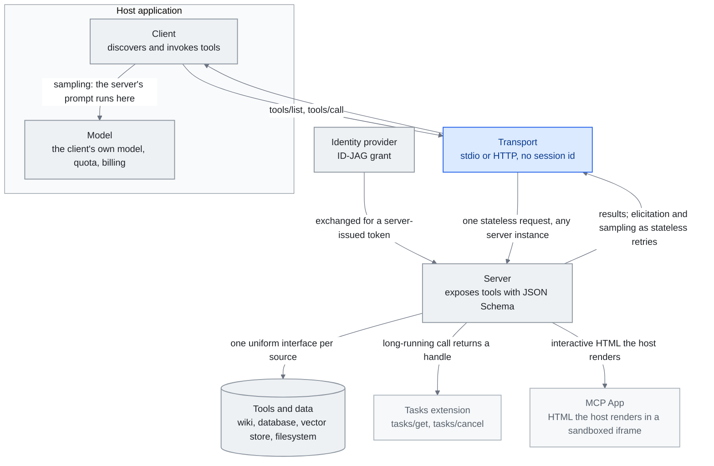

<!-- translation-sync:start -->
> 2026-10-31 の英語版に同期した機械支援翻訳です。構造と内容を確認しています。コードと図中ラベルは原文のまま、読書時間は英語原文の推定値です。
> [English source](../../../chapters/07-mcp.md) · [Sync record](../../SYNC.md)
<!-- translation-sync:end -->

<!-- i18n-anchor -->

# 第 7 章： MCP -- 勝った標準

> **一言で言えば:** MCP は、AI が 一つのプロトコルを通じて任意の外部ツールまたはデータ ソースに接続できるようにする汎用標準です。
>
> **重要な理由:** MCP を AI の USB のようなものと考えてください -- それ以前は、すべてのツールが独自のカスタム接続を必要としていました。どこでも使えるプラグが 一つあります。
>
> **読書時間:** ~24 分 (5,386 単語 / 230 wpm)

*図: "Why It Won" セクションの 三つの中心的な概念 (クライアント、サーバー、トランスポート)。クライアントはホスト アプリケーション内で、それが所有するモデルと並んで描画され、トランスポートとサーバーはその外側にあり、さらにそれらの周りに追加された 2026 仕様が表面化しています。拡張機能としてのタスク、レンダリングされた UI としての MCP アプリ、および IdP によってプロビジョニングされた承認です。タスクと MCP アプリは "2026-05-21: The 2026-07-28 Release Candidate" セクションから、ID-JAG トークン交換は "2026-06-18: Enterprise-Managed Authorization" から、セッションフリー コアは "2026-07-28: The Specification Ships Final" から来ます。サーバーからのエッジは "The Stateful MCP Transition" の引数を運びます。サーバーは応答するだけでなく、構造化された入力とリクエストのサンプリングを引き出すこともでき、最終的なステートレス コアはそれらを、オープン状態の接続を介してではなく通常の再試行として配信します。

<!-- i18n-anchor -->

## MCP とは何ですか?

Model Context Protocol (MCP) は、Anthropic によって作成されたオープン プロトコルで、AI モデルが外部ツール、データ ソース、サービスに接続する方法を標準化します。 MCP が登場する前は、すべての AI 統合は、カスタム関数定義、独自のツール形式、手作業による認証、および脆弱なグルー コードなど、特注の作業でした。 MCP は、この断片化をユニバーサル インターフェイス、つまり、あらゆるモデルがツールの検出、認証、呼び出しに使用できる単一のプロトコルに置き換えました。

MCP は AI の USB と考えてください。 USB が登場する前は、すべての周辺機器に独自のコネクタ、ドライバー、プロトコルが必要でした。 USB は周辺機器をより強力にしたのではなく、相互運用可能にしたのです。 MCP は、AI ツール エコシステムに対して同じことを行います。単一の MCP サーバー実装は、Claude、GPT、Gemini、またはプロトコルを話すその他のモデルにサービスを提供できます。単一の MCP クライアントは、カスタム統合コードなしで数千のサーバーに接続できます。

<!-- i18n-anchor -->

## タイムライン: 立ち上げから Linux 創設まで

**2024年十一月.** Anthropic は、Python および TypeScript のリファレンス実装とともに、オープンソース仕様として MCP をリリースします。初期リリースには、カスタム サーバーを構築するための少数のリファレンス サーバー (ファイル システム、GitHub、Slack) と SDK サポートが含まれています。受け入れは慎重ながらも楽観的です。AI コミュニティでは、以前に提案された相互運用性標準を見てきました。

**2025年四月** リリースから 六か月後、MCP は 8 × 百万件の累計 SDK ダウンロード数を超え、コミュニティは 5,800 サーバーを構築しました。エコシステムは誰もが予想していたよりも早く成長します。重要なことに、競合する AI 研究室は、代替案を作成するのではなく、このプロトコルを採用し始めています。

**後期 2025.** MCP は、Linux 財団の下にある新しい組織である Agentic AI Foundation に寄付され、Anthropic、Block、および OpenAI が創設ガバナンスを担当します。この動きにより、"Anthropic controls the standard" の懸念が解消され、MCP がベンダー固有のプロトコルではなく真の業界標準として確立されます。

**2026.** MCP SDKのダウンロード数は、2026年第1四半期の時点で、全パッケージレジストリの合計で月間97百万件を超えました。エコシステムには、財団が保守する75以上の公式コネクタに加え、コミュニティが構築した数千のサーバーがあります。RESTがWeb APIの標準となったように、このプロトコルはAIアプリケーションの標準的な統合層になっています。

プロトコルの統合の瞬間は、AWS が **AWS MCP サーバー** を一般提供開始した **2026年五月6日** に到来しました。これは、ハイパースケーラーが管理する最初のリモート MCP エンドポイントであり、IAM を使用して 一つの認証されたサーバーを介して 15,000 + AWS API 操作を公開しました。きめ細かいアクセスのためのコンテキスト キーと、サーバー側の Python のためのサンドボックス化された `run_script` ツール。 Linux 財団の寄付 (十二月 2025) と 97M ダウンロード (Q1 2026) により、MCP が標準として確立されました。 AWS GA は、標準がインフラストラクチャになる瞬間を示します。このパターンは、S3 によるオブジェクト ストレージの統合を反映しています。多くのセルフホスト サーバーは消滅しませんが、重心は "one managed endpoint at the cloud boundary." に移動します。

Skills も MCP に続いて AAIF に移管された。[第5章の十月更新](05-skill-systems.md#52-the-anthropic-skills-ecosystem)を参照。

<!-- i18n-anchor -->

## 勝った理由

MCP の急速な優位性を説明するいくつかの要因があります。

**初日からオープンスタンダード。** MCP は、単なる SDK ではなく、完全な仕様を備えた寛容なライセンスの下でリリースされました。これは、競合他社が Anthropic のコードや善意に依存せずに実装できることを意味しました。

**シンプルなアーキテクチャ。** このプロトコルには、クライアント (AI モデル側)、サーバー (ツール/データ側)、トランスポート (通信方法) という 三つの中心的な概念があります。サーバーは、JSON スキーマ記述を含むツールを公開します。クライアントはそれらを発見して呼び出します。トランスポートは通信層 (stdio、HTTP と SSE、WebSocket) を処理します。このシンプルさにより、導入は簡単になりました。有能な開発者は 一 時間以内に MCP サーバーを構築できます。

**ベンダー中立のガバナンス。** OpenAI を共同統治メンバーとする Linux 財団への寄付により、最後の確実な反対意見が排除されました。主要な競合他社が標準を共同管理する場合、その標準は真に中立的です。

**ネットワーク効果** 新しい MCP サーバーが存在するたびに、すべてのクライアントにとってプロトコルの価値が高まり、その逆も同様です。エコシステムが有用なサーバーのクリティカルマスを超えると、MCP をサポートしないコストが、それを採用するコストよりも高くなりました。

<!-- i18n-anchor -->

## 主要な採用者

MCP の採用範囲の広さは、その優位性を物語っています。

- **OpenAI** は、MCP サポートを ChatGPT プラットフォームとエージェント SDK に統合し、GPT モデルが任意の MCP サーバーを使用できるようにしました。
- **Google DeepMind** は、エコシステムの互換性を主な動機として挙げて、MCP クライアント サポートを Gemini に追加しました。
- **Microsoft** は最も進んで、MCP サポートを OS レベルで Windows に構築し、それを Azure AI サービス、Copilot、および GitHub Copilot 全体に統合しました。
- **Amazon / AWS** は、最初の本番双方向 MCP ランタイムとして、2026年 四月に **Bedrock AgentCore ランタイム** として出荷され、標準プロトコルに引き出しとサンプリングが追加されました (下記の "The Stateful MCP Transition" を参照)。
- **GitHub** は、独自のツール形式を置き換えて、MCP 上に Copilot 拡張システムを再構築しました。
- **Figma、Slack、Block、Notion** はすべて、公式の MCP サーバーを出荷しており、そのプラットフォームはあらゆる AI ワークフローにおいて第一級の市民となっています。
- **Hugging Face** は、モデル ハブと並んでコミュニティ MCP サーバーのレジストリをホストします。
- **LangChain** およびその他のオーケストレーション フレームワークは、ネイティブ MCP クライアント サポートを提供し、これをデフォルトのツール統合方法とします。

**合成ディメンションとしての MCP。** より微妙な 2026 の開発: MCP ツールの選択は、固定された基質としてではなく、自動化された harness 合成システムの *変数* の 一つとして現れ始めています。 AgentFlow の論文 (arXiv 2604.20801、2026 年四月) では、エージェントの役割、prompts、*ツール*、通信トポロジ、および調整プロトコルを、その合成ループが検索する型付きグラフ DSL の 五つの次元として扱います。 MCP を意識する harness 設計者にとって、これは両刃です。 MCP の標準化により、ツールのディメンションが真に検索可能になります。合成ループは、統合層を書き換えることなく、ある MCP サーバーを別の MCP サーバーに交換できます。しかし、同じ標準化によって MCP サーバー自体が選択候補になります。問題はもはや "which servers do I install" ではなく "which servers does my harness *evolve into using* under observability pressure." です。

**MCP はツール、x402 は価値です。** **2026年五月7日**、AWS は **AgentCore 支払い** をプレビューで発表しました -- 自律型エージェント向けの最初の管理された支払いプリミティブ -- Coinbase と Stripe で構築され、復活した **x402** オープン プロトコルを中心に構築されましたHTTP マシン間のインバンド ステーブルコイン支払いのステータス コード 402 ("Payment Required")。 Coinbase の以前の x402 トラクション --- 69,000 アクティブ エージェント、165M トランザクション、2026年 四月後半までの ~$50M 累積ボリューム --- は、ハイパースケーラーの承認前にプロトコルが規模に達していたことを意味していました。ツール呼び出し層を運ぶ MCP と値転送層を運ぶ x402 により、エージェントはクロスプロトコル スタックを持つようになりました。MCP はエージェントが API に到達する方法を標準化し、x402 は API の支払い方法を標準化します。この組み合わせはナレッジ エンジニアリングにとって重要です。なぜなら、有料リソース (プレミアム データ、ライセンス付きコンテンツ、ゲート API) がエージェントのアクション空間の第一級市民となり、予算執行が LLM で判断されたルールではなくプロトコル層で決定論的に処理されるからです。

<!-- i18n-anchor -->

## ナレッジ エンジニアリングへの接続

MCP 自体は知識エンジニアリング手法ではありません。知識エンジニアリングを拡張可能にするインフラストラクチャ層です。このレポートで説明するすべてのアプローチ (RAG パイプライン、ナレッジ グラフ、メモリ システム、context engineering パターン) では、外部の知識をモデルにフィードする必要があります。 MCP は、そのフィードがどのように行われるかを標準化します。

実用的な例を考えてみましょう。会社の Wiki にアクセスし、データベースにクエリを実行し、ベクトル ストアを検索し、ファイル システムから読み取る必要がある、知識が強化された AI エージェントです。 MCP を使用しない場合、これらの各統合にはカスタム コード、カスタム認証、およびカスタム エラー処理が必要になります。 MCP では、それぞれが MCP サーバーとなり、エージェントは統一インターフェイスを介してすべてのサーバーに接続します。

これが、MCP がナレッジ エンジニアリング エコシステムの中心となる理由です。これは RAG やメモリに代わるものではありません。これらを構成可能、移植可能、およびモデルやプラットフォーム間で相互運用できるようにする仕組みを提供します。

<!-- i18n-anchor -->

## Meta ツール パターン

MCP の採用によって生まれる最も重要なアーキテクチャ パターンの 一つは、Meta ツール パターンであり、ツールの漸進的開示とも呼ばれます。

問題: MCP エコシステムが成長するにつれて、エージェントは数十、数百のツールにアクセスできるようになる可能性があります。すべてのスキーマを context window にロードするのは無駄です。ほとんどのツールは特定のタスクとは無関係です。 29 ツール スキーマがロードされていると、モデルが決して使用しないツール記述に何千ものトークンを書き込むことになり、モデルが間違ったツールを選択する可能性が高くなります。

解決策: すべてのツール スキーマを事前にロードする代わりに、エージェントが説明によって関連ツールを検索できるようにする **検出ツール** と、参照によって検出されたツールを呼び出す **実行ツール** の 二つのメタツールをロードします。エージェントはまず、現在のタスクに使用できるツールを検出し、必要なスキーマのみをロードします。

このパターンは、ツールが大量に使用される環境で context window の消費を 80-90% 削減し、決定スペースを削減することでツール選択の精度を向上させます。これは、10 ～ 15 を超えるツールを使用するデプロイメントのベスト プラクティスとなっています。

<!-- i18n-anchor -->

## 2026 の課題

成功にもかかわらず、MCP は次のような重大な未解決の課題に直面しています。

**監査証跡** エンタープライズ環境では、すべてのツールの呼び出しにログ記録、帰属、およびコンプライアンスの追跡が必要です。現在の MCP 仕様では監査証跡の形式が規定されていないため、実装に一貫性がありません。

**SSO 統合認証** MCP の認証ストーリーは発売以来大幅に改善されましたが、クライアント、サーバー、トランスポート チェーン全体にわたるエンタープライズ SSO システム (SAML、OIDC) との統合には依然として大きな問題が伴います。最近承認された MCP の OAuth 2.1 フローはこの問題の一部に対処していますが、採用はまだ展開中です。

**ゲートウェイの動作** 組織が MCP を大規模に展開する場合、レート制限、アクセス制御、リクエスト ルーティング、監視のためのゲートウェイ層が必要になります。エコシステムには標準の MCP ゲートウェイ仕様がないため、独自のソリューションが必要になります。

**構成の移植性。** MCP サーバー構成 (どのサーバーに、どの資格情報を使用して、どのような順序で接続するか) は標準化されていません。 MCP セットアップをマシン、チーム、または組織間で移動するには、手動で再構成する必要があります。

**ツールの説明の品質** MCP の有効性は、ツールの説明の品質に完全に依存します。ツールの説明が不十分だと、不正な呼び出しが発生します。ツールの説明の品質、リンティングの有無、認定に関する基準はありません。

**スキーマのバージョン管理。** MCP サーバーがツール スキーマを更新すると、既存のクライアントが壊れる可能性があります。このプロトコルには、組み込みのバージョン管理および互換性ネゴシエーション メカニズムがありません。

**ツールの重複。** 数千のコミュニティ サーバーでは、複数のサーバーが重複した機能を提供することがよくあります。このプロトコルは、重複排除や優先順位の表現のためのメカニズムを提供しません。

<!-- i18n-anchor -->

## 2026: ステートフルな MCP 移行

最初の 十八か月間、MCP は基本的に **ステートレス RPC プロトコル**でした。クライアントがサーバーを呼び出し、サーバーが結果を返し、会話が進みます。このモデルは、単純なツール呼び出し (ファイルの読み取り、API のクエリ、メッセージの投稿) にはうまく機能しましたが、長時間実行されるものや対話的なものには問題がありました。 2026年四月に、二つの開発が MCP を真のオーケストレーション層に向けて推進し始めました。

**SEP-1686: タスク プリミティブ。** 2026年四月 MCP Dev Summit で導入された **SEP-1686** は、プロトコルに耐久性のあるタスク ステート マシンを追加します。長時間実行される各ツールの呼び出しは、永続 ID と 五つの状態 (`working`、`input_required`、`completed`、`failed`、または `cancelled`) のいずれかを持つ **タスク** になります。クライアントはタスクを開始し、切断し、後で再接続してステータスを確認したり、結果を取得したりできます (**今すぐ呼び出し / 後で取得** パターン)。タスク ID はサーバーから送信された通知と関連付けられているため、クライアントは接続を開いたままにせずに進行状況イベントをサブスクライブできます。このプリミティブは、以前に MCP によって特注の回避策が強制されていたワークフローを直接ターゲットとしています。

- 完了までに数分から数時間かかる **データ パイプライン**
- 大規模なリポジトリ間での **コードの移行**
- 完全な CI スイートの **テスト実行**
- サブエージェントを生成し、外部 API を待機する **詳細な調査**
- **マルチエージェント システム**。一つのエージェントが非同期で別のエージェントに作業を引き継ぎます。

SEP-1686 は、2026年四月 MCP 仕様で実験版として出荷されます。これは、ステートレス RPC から耐久性のある再開可能なオーケストレーションへの最初の本格的なステップです。

**Amazon Bedrock AgentCore: 最初の双方向ランタイム。** また、2026年四月には、AWS が **Bedrock AgentCore ランタイム** を出荷します。これは、**双方向** 通信を実装する最初の運用 MCP ランタイムです。標準の MCP はクライアントによって開始されます。クライアントがツールを呼び出し、サーバーが応答します。 AgentCore は、サーバーによって開始される 二つの機能を追加します。

- **誘発。** 実行中、サーバーは一時停止し、JSON スキーマに対するユーザーからの構造化入力を要求できます。これにより、以前はカスタム UI レイヤーが必要だった複数ステップのワークフローがプロトコル レベルの対話に変わります。移行ツールは停止して、"which branch should I target?" と入力された応答を尋ねることができます。
- **サンプリング** サーバーは、独自のモデル認証情報を保持せずに、LLM によって生成された補完をクライアントに要求できます。サーバーは prompt とサンプリング パラメーターを提供します。クライアントは独自のモデルを実行し、完了を返します。これにより、ユーザーのモデル、割り当て、請求はクライアント側に留まりながら、ツール サーバーは LLM を利用した作業 (要約、分類、抽出) を行うことができます。

引き出しとサンプリングを組み合わせることで、MCP の双方向プロトコル面が完成します。サーバーは通話に応答するだけでなく、会話の一部を**推進**できるようになりました。

**影響。** MCP の 2025 フレーミングは "a uniform plug for stateless tools." でした。 2026 フレーミングはより広範です。MCP は、**ステートフルで対話型の双方向エージェント オーケストレーション**のためのプロトコル層になりつつあります。ツールサーバーはもはやパッシブではありません。永続的な状態を保持し、ユーザー入力のために一時停止し、クライアントから LLM 作業を要求できます。ナレッジ エンジニアリングの場合、これは、長時間実行される検索パイプライン、段階的なデータ エンリッチメント、人間参加型ワークフローがついにネイティブ プロトコルで実行できることを意味します。

<!-- i18n-anchor -->

## 2026-05-21: 2026-07-28 リリース候補

四月の 2026 "stateful MCP" の物語は、目的地ではなく、より長い弧の 一 ステップであることが判明しました。 **2026年五月21日**、MCP運営委員会は**2026-07-28リリース候補**をロックしました。この仕様は七月28に最終の2026ベースラインとして出荷され、SDKメンテナとホスト実装者に十週間の検証期間が開かれます。 三つの変更により、プロトコルの表面が再形成されます。 四番目のセットは基礎を固めます。

**ステートレス プロトコル コア。** `initialize` / `initialized` ハンドシェイクおよび `Mcp-Session-Id` ヘッダーが削除されます。クライアントのメタデータはすべてのリクエストで `_meta` 内を移動するため、すべての MCP リクエストは任意のサーバー インスタンスに到達できます。スティッキー ルーティング、共有セッション ストア、ウォームアップはありません。これにより、2025 の後半での Streamable HTTP の採用によって表面化した単一最大の生産ギャップである **ロード バランサーの背後での水平スケーリング**のブロックが直接解除されます。プロトコルの最初の 十八か月は *ステートフル* ターン (2026年 四月 SEP-1686 タスク、AgentCore 双方向ランタイム) でした。 2026-07-28 RC は、コア自体の *再ステートレス化* です。ステートフル ターンを動機付けた永続状態プリミティブが、すべてのリクエストに組み込まれるのではなく、拡張機能として最上位に再実装されます。

**MCP アプリ。** サーバーは、セキュリティ レビューとキャッシュのために事前に宣言された UI テンプレートを使用して、ホストがサンドボックス化された iframe でレンダリングするインタラクティブな HTML インターフェイスを出荷できるようになりました。これは、**ツール呼び出しではない**最初の MCP ネイティブの成果物です。ナレッジベース サーバーは、独自のデバウンスとページネーションを処理する検索ボックスを出荷できます。研究サーバーは結果比較ビューを送信できます。調達サーバーは購入確認モーダルを送信できます。このプロトコルは、別の仕様を追加することなく、UI の表面を獲得します。

**タスクは実験的なコアから拡張機能に移動します。** SEP-1686 のタスク プリミティブ --- 長時間実行呼び出しを再開可能なステート マシンに変える call-now / fetch-later パターン --- 再設計されたステートレス ライフサイクルにより、プロトコル コアから拡張機能フレームワークに移行します。 `tools/call` はタスク ハンドルを返します。クライアントは、`tasks/get`、`tasks/update`、および `tasks/cancel` を介して進行を推進します。これらはそれぞれ通常のステートレス リクエストです。能力は変わりません。形状はステートレス コアと一致するようになりました。

**基盤の強化。** 同じ更新では、**拡張フレームワーク**（逆順DNS形式のIDで機能を識別し、正式なStandards Trackで交渉することで、仕様のコアとは独立したバージョン管理を可能にする）、**OAuth 2.0 / OIDCの認可強化**（必須の `iss` パラメータ検証、クライアント登録時のアプリケーション種別宣言、現在のOAuthベストプラクティスとの整合性強化を扱う六つのSEP）、そして仕様初の**正式な非推奨化ポリシー**も導入されます。Roots、Sampling、Loggingを非推奨とし、互換性を壊す変更をリリースするまでに最低12か月の廃止猶予期間を設けます。十八か月にわたる機能拡張の後、この仕様は一回のリリースサイクルを基盤の強化に充てています。

**知識エンジニアリングへの影響** RC は構造的に *縮小* (より小さなコア、より多くの拡張) であり、同時に *機能拡張* (UI サーフェスの追加) です。ナレッジ harness 設計者にとって、二つの効果が即座に現れます。まず、**水平スケーリングは展開パターンの問題ではなくなり、展開構成の問題になります** --- プロトコルはロード バランサーと競合しなくなりました。次に、**"tool" と "interface" の間の境界線がぼやけ始めます**。ナレッジ サーバーは、ツール呼び出しとしてクエリに応答し、タスクとして結果ハンドルを返し、MCP アプリとしてフォローアップの曖昧さ回避の質問をすべて同じ会話内で提示できます。このプロトコルはもはやステートレス RPC のための単なる配管ではありません。これは、**ステートフルなマルチサーフェス エージェント インタラクションの基盤**になりつつあります。その上にステートフルな作業を実行しながらも、自身のコアをステートレスに保つ規律が備わっています。

**ベータ SDK と完成期間 (六月 29)。** 2026年六月29日に、MCP プロジェクトは Python、TypeScript、Go、C# にベータ版 SDK を出荷し、2026年七月28 日の仕様完成までの 四週間のテスト期間を開始しました。 TypeScript v2 SDK は、以前のモノリシック パッケージを個別の `@modelcontextprotocol/server` パッケージと `@modelcontextprotocol/client` パッケージに分割します。ベータ版には **Multi Round-Trip Requests (SEP-2322、ステータス: 最終、作成済み 2026-02-03)** も含まれています。これは、サーバーが開始したリクエスト -- サンプリングと抽出を含む -- がどのように配信されるかを再調査します。オープン状態の SSE ストリームとサーバー側の状態を *ステートレス再試行* に置き換え、ツールが`InputRequiredResult` とクライアントは呼び出しを再発行します。サンプリングと抽出でできることは変わりません。 SEP-2322 は転送方法のみを変更するため、双方向機能は長期間の接続を必要とするのではなく、ステートレス コアに適合するようになりました。

<!-- i18n-anchor -->

## 2026-06-01: セキュリティに関する考慮事項は IETF に移行

RC は強化された *認可* --- 必須の `iss` 検証と OAuth 2.0 / OIDC アライメントをカバーする 六つの SEP です。これが実行しなかったこと、および明示的に実行しなかったのは、リクエストが承認された後にサーバーがどのように動作するかを定義することです。 **2026年六月1日**に、このギャップには独自の文書が作成されました。最初の **IETF インターネット ドラフト**は、MCP セキュリティ、`draft-mohiuddin-mcp-security-considerations-00` を対象としたものです (Anas Mohiuddin Syed)。その冒頭の文が論文 --- *"The MCP specification does not define normative security requirements."*

この草案には、出荷中の MCP サーバーですでに公的に報告されている 六つの脆弱性クラスがカタログ化されており、そのリストは、プロトコル層が実装者に委ねるすべての内容を網羅したツアーのように読めます。

- **SSRF** --- サーバーは、解決された IP を検証せずにモデルが提供した URL をフェッチし、エージェントはクラウド メタデータ エンドポイントまたはプライベート ネットワークへのプロキシになります。
- **過剰なツール権限** --- サーバーは、単一のツールが必要とするよりも多くのファイルシステムまたは API サーフェスをマウントします。
- **プロンプト射出表面の露出** --- ツール *出力* (入力ではなく) 内に密かに持ち込まれた命令は、それを読み取るモデルをハイジャックします。
- **MCP ライフサイクル バイパス** --- 初期化ハンドシェイクが完了する前にツール呼び出しが処理され、ハンドシェイクがゲートするはずだったものはすべて回避されます。
- **情報漏洩** --- 呼び出し元が認識すべき以上の内部状態を返すエラー メッセージとツールの応答。
- **認証と強制のギャップ** --- "local" が "trusted." を意味するという前提で、認証をまったく行わずにローカルホスト上でサーバーが実行されます。

それぞれについて、ドラフトでは具体的で実装可能な緩和策が提案されています。接続時に解決された IP を検証し (RFC 1918、ループバック、リンクローカルをブロック)、OS レベルの出力制限を強制し、HTTP リダイレクトをデフォルトで無効にしてすべてのリダイレクト ターゲットを再検証し、ファイルシステム アクセスの範囲を最小限に抑え、ツール呼び出しを処理する前にハンドシェイクを完了し、すべてのツール呼び出しの構造化ログを出力します。この分析は、CI パイプライン チェック (`scan --target ./my-mcp-server/`) として提案されたオープンソース検出ツール **mcp-safeguard** と組み合わせて行われるため、レビュー時に 一 回ではなくコミットごとに監査が実行されます。

構造的なニュースは、特定の調査結果ではありません。ほとんどは、エージェントのコンテキストに合わせて再スキンされた、よく知られた Web セキュリティの障害モードです。それは *ドキュメントが存在する場所*です。 MCP セキュリティはベンダーのブログ投稿から独立した標準トラックの精査へと移行しています。プロトコルが十分な負荷に耐えられるため、維持組織の外部の誰かがギャップに対処可能で引用可能な仕様が必要であると判断した場合、そのプロトコルは IETF セキュリティ考慮事項ドラフトを取得します。 MCP サーバーを運用環境に接続する知識のある harness 設計者にとって、六つのクラスは展開前のチェックリストとしても機能します。プロトコルにとって、ドラフトは成熟度の指標です。仕様を意図的に空白のままにした RFC が現在作成されています。

<!-- i18n-anchor -->

## 2026-06-18: エンタープライズ管理の認証

IETF 草案では、認証と施行のギャップとエンタープライズ SSO の摩擦を未解決の問題として挙げています。同月、MCP メンテナーは安定したアンサーを企業側に出荷しました。 **エンタープライズ管理の承認 (EMA)** --- 2026年六月18日にコアメンテナ **Paul Carleton** によって発表 --- 組織は ID プロバイダーを通じて MCP サーバーへのアクセスを一元的にプロビジョニングできます。ユーザーが一度サインインすると、認可されたサーバーがすでに接続されており、アプリごとの OAuth 同意画面がありません。

このメカニズムは 二 段階のトークン交換です。 SSO 中に、クライアントは IdP から **Identity Assertion JWT Authorization Grant (ID-JAG)** を取得します。次に、その許可を、MCP サーバーの *独自の* 認可サーバーによって発行されたアクセス トークンと交換します。ユーザーもクライアントも、従来のサーバーごとの OAuth 同意ダンスを実行することはありません。IdP がユーザーを保証し、各 MCP サーバーの認可サーバーがその保証で何を購入するかを決定します。

注目に値する部分は、実際の標準と提案を分ける初日の幅です。IdP として **Okta** (Cross App Access 拡張機能経由)、クライアントとして **Anthropic** (Claude、Claude Code、Cowork) および **VS Code**、七つのサーバー --- Asana、Atlassian、Canva、Figma、Granola、Linear、 Supabase --- Slack によるサポートを積極的に追加します。 harness については、EMA が *"SSO-integrated authentication remains friction-heavy"* ギャップを埋める、この章独自の 2026 課題セクション名: エンタープライズ SSO はサーバーごとの接着剤であることをやめ、IdP で一度行われるプロビジョニングの決定になります。

ただし、プロビジョニング時の認可は、呼び出しごとの認可とは異なります。**2026年九月10日**、AnthropicはManaged Agents向けの `auto` 権限ポリシーで、この後半の課題に対応しました。クライアントではなくサーバーが個々のツール呼び出しを評価し、実行するか、クライアントが覆せないエラーを返して拒否するか、承認を待って一時停止します。Anthropicの文書によれば、このポリシーは組み込みのエージェントツールセットだけでなくMCPツールセットにも適用されます。これにより、個々のMCPツール呼び出しがプラットフォームレベルのガバナンス下に置かれ、[第4章](04-harness-engineering.md)のAWS AgentCoreの決定論的なTemporal Policiesと並ぶ仕組みになっています。

<!-- i18n-anchor -->

## 2026-07-28: 仕様は最終版として出荷されます

十週間の検証期間は予定通り終了しました。 **2026年七月28日**、MCP メンテナー (David Soria Parra と Den Delimarsky) は、最終的な **2026-07-28 仕様** を出荷しました。これは認可が追加されて以来最大の改訂であり、五月以来この章が追跡してきたリリース候補のアークが 21 として上陸したことを確認します。設計された。コアは **ステートレスなリクエスト / レスポンス**になりました。`initialize` / `initialized` ハンドシェイクと `Mcp-Session-Id` ヘッダーは完全になくなり、**Multi Round-Trip Requests** (SEP-2322) はステートレスな再試行を介してサーバー開始の対話を実行し、**拡張フレームワーク** は正式なものになりました --- タスクはプロトコル コアではなく `io.modelcontextprotocol/tasks` に存在します。

認可はRCからさらに強化されました。最終仕様では**RFC 9207の発行者検証**が必須となり、Dynamic Client Registrationは**Client ID Metadata Documents (CIMD)**に置き換わります。クライアントはサーバーごとに登録手順を踏む代わりに、ホストされたメタデータ文書によって識別されます。Roots、Sampling、Logging、従来のHTTP+SSEトランスポートは、最低12か月の廃止猶予期間を設けて非推奨となります。四つのTier 1 SDK（Python、TypeScript、Go、C#）はすべて対応する更新をリリースし、AWS、Google Cloud、Microsoft、Cloudflareが支持を表明しました。

ナレッジ エンジニアリングにとって、実際的な結果は、RC が約束した 二つであり、現在出荷されています。リモートの MCP サーバーは、スティッキー ルーティングなしでプレーンなロード バランサーの背後に配置でき、クライアントは `tools/list` をキャッシュできます。これは、通常のステートレス Web サービスのデプロイメント状態です。プロトコルの 2026 アークは完了しました。ステートフル ターン (四月)、再ステートレス RC (五月)、独立したセキュリティ調査 (六月)、そしてステートフル、インタラクティブ、またはエンタープライズ固有のすべてを拡張機能に押し込みながらコアを意図的に小さく保つ最終仕様です。

<!-- i18n-anchor -->

## 2026-08-22: ファイナライズ後の処理

七月の 28 最終仕様は、2026 年 四月のステートフル ターン以来この章が追跡してきた弧を閉じました。 **2026年八月22日**、MCPのコアメンテナは、最終化後の期間のロードマップを公開しました。これは、仕様自体が意図的に行っていない"what's next"の質問に答える明確なガバナンスと優先順位の文書です。

**ガバナンスが正式化。** コア仕様が移動目標ではなく固定点となったため、ロードマップはプロジェクトの意思決定方法を規則化します。定義されたレベルを持つ **コントリビューター ラダー**、中央のボトルネックからドメイン固有の **ワーキング グループ**に移行する SEP (仕様拡張提案) トリアージ、および 七月の 28 仕様で使用されるアドホックな削除ウィンドウを一般化する正式な機能ライフサイクルと非推奨ポリシーです。将来のあらゆる機能のための常設プロセスへのルート、サンプリング、およびロギング。

**五つの優先事項。** メンテナーは、次のプリミティブの波について 五つの方向性を挙げています: (1) **エージェント メッセージング** -- サーバーによって開始されるイベント (Webhook、チャネル)、およびコア仕様への完全な組み込みに向けたタスク拡張機能の成熟。 (2) 七月の 28 仕様の HTTP ネイティブ トランスポートの統合をローカル デプロイメントに拡張し、最終化まで残っていた stdio/HTTP の分割を終了します。 (3) **エージェント ID とエンタープライズ セキュリティ** 標準化 -- 特に DPoP と Workload Identity Federation は、EMA (六月の 18) の IdP プロビジョニング モデルをマシンツーマシン ID に向けて推進します。 (4) 改善されたツール結果の処理と大規模なツール カタログにわたる段階的な検出。これは、この章の前半で説明した Meta ツール パターンのメンテナ レベルの承認です。 (5) SDK 層の 1 SDK にわたる開発者エクスペリエンスと適合性テスト。この投稿は同日、Hacker News で 241 ポイントと 142 のコメントを集めました。ガバナンス文書としては大きな反響であり、ここでは永続的な指標ではなく同日のスナップショットとして引用されています。

ナレッジ エンジニアリングの場合、優先順位 (1) が注目すべきものです。拡張からコア仕様に戻るタスクは、現在プロトコルが暫定的にのみ許可している、耐久性のある再開可能な取得パイプラインとエンリッチメント パイプラインを提供します。

<!-- i18n-anchor -->

## 市場の状況

業界アナリストは、MCP が支配的なプロトコルである AI ツール統合市場を、2025 に対して 1.8 十億ドルと予測しており、企業の導入が加速するにつれて大幅な成長が見込まれると予測しています。この数字には、MCP インフラストラクチャ、サーバー開発、ゲートウェイ サービス、および関連ツールが含まれています。

<!-- i18n-anchor -->

## 主要なリソース

- **[modelcontextprotocol.io](https://modelcontextprotocol.io)** -- 公式仕様、SDK、およびドキュメント。
- **Anthropic MCP コース** -- [Skilljar](https://anthropic.skilljar.com) および [DeepLearning.AI](https://www.deeplearning.ai/short-courses/) で利用可能で、プロトコルの基礎とサーバー開発をカバーします。
- **新しいスタック** -- MCP アーキテクチャ、採用、および課題に関する継続的な技術カバレッジ。メタツール パターンと企業導入パターンに関する注目すべき記事。
- **MCP SDK ダウンロード統計** -- ファーストパーティ採用メトリクスの npm (`@modelcontextprotocol/sdk`、[https://www.npmjs.com/package/@modelcontextprotocol/sdk](https://www.npmjs.com/package/@modelcontextprotocol/sdk)) および PyPI (`mcp`、[https://pypi.org/project/mcp/](https://pypi.org/project/mcp/))。

---

<!-- i18n-anchor -->

## 得るべき 三つのこと

- **三つの概念と中立的なガバナンスが MCP の勝因です。** クライアント、サーバー、およびトランスポートは非常にシンプルなので、有能な開発者は 一 時間以内にサーバーを出荷できます。また、OpenAI が共同管理する Linux 財団に仕様を寄贈することで、仕様の採用に対する最後の信頼できる反対意見が取り除かれました。
- ** 2026 仕様により、コアがステートレスに戻されるため、デプロイメントは通常どおりになる可能性があります。** ハンドシェイクと `Mcp-Session-Id` ヘッダーがなくなると、あらゆるリクエストがあらゆるサーバー インスタンスに到達できるため、リモート サーバーはプレーンなロード バランサの背後に配置され、クライアントは `tools/list` をキャッシュできます。
- **プロトコル自体は、規範的なセキュリティ要件を定義していません。** 2026年六月 IETF ドラフトでは、出荷サーバーですでに報告されている 六つの脆弱性クラス (SSRF、過剰なツール権限、ツール出力による prompt インジェクション、ライフサイクル バイパス、情報漏洩、認証の欠落) がカタログ化されており、それぞれの軽減は実装者に委ねられています。

---

<!-- i18n-anchor -->

## 情報源

1. Anthropic. "Introducing the Model Context Protocol." November 2024. https://www.anthropic.com/news/model-context-protocol
2. Model Context Protocol 仕様。 https://modelcontextprotocol.io
3. Linux 財団。 "Agentic AI Foundation Established." 2025。 https://www.linuxfoundation.org/press/agentic-ai-foundation
4. MCP SDK ダウンロード統計、npm: [https://www.npmjs.com/package/@modelcontextprotocol/sdk](https://www.npmjs.com/package/@modelcontextprotocol/sdk) および PyPI: [https://pypi.org/project/mcp/](https://pypi.org/project/mcp/) (Q1 2026 累積 ~97M ダウンロード、二次報道で広く引用されています)。
5. 新しいスタック。 "The Meta-Tool Pattern: Progressive Disclosure for AI Tools." 2025。
6. Anthropic。 MCP コース。スキルジャー。 https://anthropic.skilljar.com
7. ディープラーニング。AI。 "Building MCP Servers." https://www.deeplearning.ai/short-courses/
8. Microsoft. "MCP Support in Windows and Azure." 2025. https://devblogs.microsoft.com
9. OpenAI. "Agents SDK: MCP Integration." 2025. https://openai.com/index/new-tools-for-building-agents
10. AgentFlow / "Synthesizing Multi-Agent Harnesses for Vulnerability Discovery." arXiv 2604.20801、2026年 四月。 [https://arxiv.org/abs/2604.20801](https://arxiv.org/abs/2604.20801)
11. AWS。 "AWS MCP Server now generally available" (2026年五月6日)。 [https://aws.amazon.com/about-aws/whats-new/2026/05/aws-mcp-server/](https://aws.amazon.com/about-aws/whats-new/2026/05/aws-mcp-server/) および [https://aws.amazon.com/blogs/aws/the-aws-mcp-server-is-now-generally-available/](https://aws.amazon.com/blogs/aws/the-aws-mcp-server-is-now-generally-available/) --- GA での最初のハイパースケーラー管理のリモート MCP エンドポイント。 一つの認証されたサーバーを介した 15,000+ API 操作。
12. AWS。 "Agents that transact: Amazon Bedrock AgentCore now includes Payments (preview)" (2026年五月7日)。 [https://aws.amazon.com/about-aws/whats-new/2026/04/amazon-bedrock-agentcore-payments-preview/](https://aws.amazon.com/about-aws/whats-new/2026/04/amazon-bedrock-agentcore-payments-preview/) および [https://aws.amazon.com/blogs/machine-learning/agents-that-transact-introducing-amazon-bedrock-agentcore-payments-built-with-coinbase-and-stripe/](https://aws.amazon.com/blogs/machine-learning/agents-that-transact-introducing-amazon-bedrock-agentcore-payments-built-with-coinbase-and-stripe/) --- URL スラッグは `/04/` を使用しますが、起動は 2026年五月7 日です。
13. x402 の指定。 [https://www.x402.org/](https://www.x402.org/) および Coinbase リファレンス実装 [https://github.com/coinbase/x402](https://github.com/coinbase/x402)。
14. Model Context Protocol ブログ。 "The 2026-07-28 MCP Specification Release Candidate" (ロックされた 2026年五月21日)。 [https://blog.modelcontextprotocol.io/posts/2026-07-28-release-candidate/](https://blog.modelcontextprotocol.io/posts/2026-07-28-release-candidate/) --- ステートレス プロトコル コア、拡張フレームワーク、MCP アプリ、拡張ステータスに移行したタスク、OAuth 2.0 / OIDC 承認強化 (六つの SEP)、正式な非推奨ポリシー。最終仕様は 2026年七月28日を出荷します。
15. 新しいスタック。 "MCP's biggest growing pains for production use will soon be solved" (2026年五月)。 [https://thenewstack.io/model-context-protocol-roadmap-2026/](https://thenewstack.io/model-context-protocol-roadmap-2026/) --- 2026-07-28 RC 優先度の独立した二次カバレッジ。
16. IETF インターネット ドラフト。 "Security Considerations for Model Context Protocol (MCP) Implementations in AI Agent Systems," `draft-mohiuddin-mcp-security-considerations-00` (2026年六月; 有効期限は 2026年十二月3日)。 [https://datatracker.ietf.org/doc/draft-mohiuddin-mcp-security-considerations/](https://datatracker.ietf.org/doc/draft-mohiuddin-mcp-security-considerations/) --- 著者 Anas Mohiuddin Syed。 六つの脆弱性クラスとオープンソースの `mcp-safeguard` 検出ツール。コンパニオンの書き込み: [https://dev.to/syedanas01/i-built-the-first-security-scanner-for-mcp-servers-heres-what-i-found-2np2](https://dev.to/syedanas01/i-built-the-first-security-scanner-for-mcp-servers-heres-what-i-found-2np2) (リンクされた GitHub リポジトリはドラフト時点では解決できません --- 検証用のフラグが立てられています)。
17. Model Context Protocol ブログ。 "Enterprise-Managed Authorization" (2026年六月18日)。 [https://blog.modelcontextprotocol.io/posts/enterprise-managed-auth/](https://blog.modelcontextprotocol.io/posts/enterprise-managed-auth/) および仕様 [https://modelcontextprotocol.io/extensions/auth/enterprise-managed-authorization](https://modelcontextprotocol.io/extensions/auth/enterprise-managed-authorization) --- コアメンテナ Paul Carleton によって発表されました。 ID-JAGトークン交換。初日 Okta (IdP) / Anthropic + VS Code (クライアント) / 七 台のサーバー。
18. Model Context Protocol ブログ。 "MCP SDK betas ahead of the 2026-07-28 finalization" (2026年六月29日)。 [https://blog.modelcontextprotocol.io/posts/sdk-betas-2026-07-28/](https://blog.modelcontextprotocol.io/posts/sdk-betas-2026-07-28/) および SEP-2322 [https://modelcontextprotocol.io/seps/2322-MRTR](https://modelcontextprotocol.io/seps/2322-MRTR) --- Python / TypeScript / Go / C# ベータ版。 七月の 28 完成までの 四週間のテスト期間。 TypeScript v2 サーバー/クライアント パッケージ分割。 Multi Round-Trip Requests (SEP-2322、最終、作成された 2026-02-03)。
19. Model Context Protocolブログ。"The 2026-07-28 specification"（2026年七月28日）。[https://blog.modelcontextprotocol.io/posts/2026-07-28/](https://blog.modelcontextprotocol.io/posts/2026-07-28/) --- 最終仕様：ステートレスなコア、MRTR（SEP-2322）、RFC 9207の発行者検証、Dynamic Client Registrationを置き換えるCIMD、拡張フレームワーク（`io.modelcontextprotocol/tasks`）、Roots / Sampling / Logging / HTTP+SSEの12か月の廃止猶予期間。
20. テッククランチ。 "AI's most important protocol is getting a little bit easier to use" (2026年七月20日)。 [https://techcrunch.com/2026/07/20/ais-most-important-protocol-is-getting-a-little-bit-easier-to-use/](https://techcrunch.com/2026/07/20/ais-most-important-protocol-is-getting-a-little-bit-easier-to-use/) --- ステートレスコア変更のファイナライズ前の二次カバレッジ。
21. レジスター。 "Model Context Protocol prepares to break with its stateful past" (2026年七月23日)。 [https://www.theregister.com/devops/2026/07/23/model-context-protocol-prepares-to-break-with-its-stateful-past/5276722](https://www.theregister.com/devops/2026/07/23/model-context-protocol-prepares-to-break-with-its-stateful-past/5276722)
22. ワークOS。 "MCP 2026 spec: agent authentication" (2026年七月)。 [https://workos.com/blog/mcp-2026-spec-agent-authentication](https://workos.com/blog/mcp-2026-spec-agent-authentication) --- CIMD と認証強化の二次的なカバレッジ。
23. Model Context Protocol ブログ。 "The MCP Roadmap" (2026年八月22日)。 [https://blog.modelcontextprotocol.io/posts/mcp-roadmap/](https://blog.modelcontextprotocol.io/posts/mcp-roadmap/) --- ファイナライゼーション後の優先順位: エージェント メッセージング (Webhook/チャネル、コアへのタスク)、ローカル デプロイメント用の HTTP ネイティブ トランスポート、エージェント ID/エンタープライズ セキュリティ (DPoP、Workload Identity Federation)、ツール結果処理/プログレッシブ ディスカバリ、SDK DX/準拠。ガバナンス: 貢献者ラダー、ワーキング グループ SEP トリアージ、正式な機能ライフサイクル ポリシー。同日の Hacker News ディスカッション: 241 ポイント / 142 コメント (同日のスナップショット)。
24. Anthropic。権限ポリシー、管理対象エージェントのドキュメント (`auto` ポリシーの日付は 2026年九月10 日、プラットフォームのリリース ノートに記載)。 [https://platform.claude.com/docs/en/managed-agents/permission-policies](https://platform.claude.com/docs/en/managed-agents/permission-policies) およびリリース ノート [https://platform.claude.com/docs/en/release-notes/overview](https://platform.claude.com/docs/en/release-notes/overview) --- 実行、拒否、または承認のための一時停止を返すサーバー側の呼び出しごとの評価。`high_risk` や `indeterminate` などの理由コードを持つ `agent.tool_use` および `agent.mcp_tool_use` イベントで `evaluation` オブジェクトを通じて報告されます。 MCP ツールセットに適用されます。明示的にオーバーライドされない限り、そのポリシーのデフォルトは `always_ask` です。 Anthropic のドキュメントへの単一ソース。独立した報道機関が存在しない。

---

*前: [章 6 -- エージェントのメモリ: 欠落している層](06-agent-memory.md) |次へ: [章 8 -- ツールランドスケープ: AI-ネイティブナレッジ管理](08-tools-landscape.md)*
