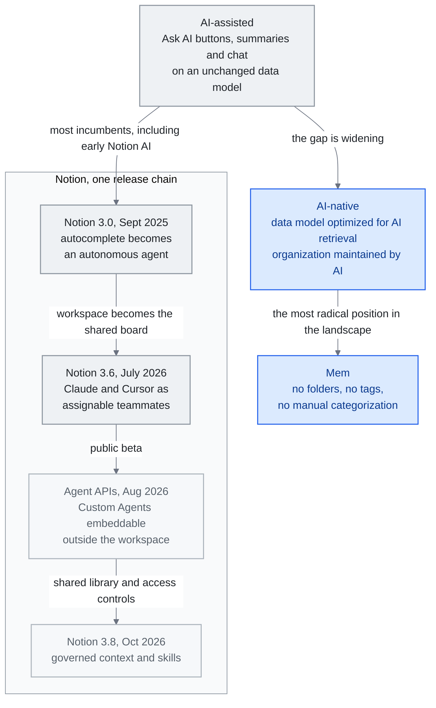

<!-- translation-sync:start -->
> 2026-10-31 の英語版に同期した機械支援翻訳です。構造と内容を確認しています。コードと図中ラベルは原文のまま、読書時間は英語原文の推定値です。
> [English source](../../../chapters/08-tools-landscape.md) · [Sync record](../../SYNC.md)
<!-- translation-sync:end -->

<!-- i18n-anchor -->

# 第 8: ツールのランドスケープ -- AI - ネイティブ ナレッジ マネジメント

> **一言で言うと:** AI を活用したナレッジ マネジメントのツール環境は、AI で強化されたメモ アプリから、完全に AI ネイティブのプラットフォームまで多岐にわたります。
>
> **重要な理由:** メモを取ったり、知識を管理したり、情報を整理したりする場合、AI は、この領域のすべてのツールの動作方法を変えています。
>
> **読書時間:** ~13 分 (2,912 ワード / 230 wpm)

*図："The AI-Assisted vs. AI-Native Gap" の節で示す連続体。初期の Notion AI を支援型の端に、手動整理を一切求めない Mem の設計をネイティブ型の端に置いている。Notion のリリースの流れも本章に対応する。3.0 はエージェントを導入し、3.6 は外部の協働エージェントを受け入れ、八月の Agent APIs は埋め込みを可能にし、十月の3.8 は管理された共有コンテキストとスキルを追加する。人間だけが使うワークフロー向けのデータモデルにツールが縛られたままだと、この隔たりは広がる。共有ライブラリへの辺は、手続き的な知識がワークスペースに加わる仕組みを示す。*

<!-- i18n-anchor -->

## 風景

人々が知識を整理し、検索し、推論するために使用するツールは、AI を中心に再構築されています。この章では、AI を活用したナレッジ マネジメントの主要なプラットフォームを製品レビューとしてではなく、このレポート全体で説明するナレッジ エンジニアリング原則の実装として概説します。各ツールは、人間と AI がナレッジワークにおいてどのように連携すべきかについて、アーキテクチャ上のさまざまな賭けを行っています。

## Notion AI

Notion は、コラボレーション型ナレッジ マネジメント市場のおよそ 25% を占めており、その AI 戦略が分野全体にとって重要となっています。

**Notion 3.0** (2025年九月) は根本的な変化を示しました。Notion は、AI レイヤーをオートコンプリート機能から自律エージェントに再構築しました。 Notion の AI エージェントは、完了を提案したり、ワークスペースに関するクエリに答えたりするのではなく、独立してワークスペースを移動し、ページの作成と変更、データベースの更新、複数ステップのワークフローの実行を行うことができるようになりました。ワークスペースの構造を理解し、ページ間で情報を相互参照し、組織パターンに関するコンテキストを維持します。

2026 年 一月、Notion はマルチモデル サポートを導入し、ユーザーが異なるタスクを異なるモデルにルーティングできるようにしました。クリエイティブ ライティング用の GPT-5.2、Claude Opus分析タスクの場合は 4.6、マルチモーダルな作業の場合は Gemini 3 です。このモデル ルーティングのアプローチは、単一のモデルがすべてに優れているということはなく、ナレッジ マネジメント層はモデルに依存しないべきであるという理解の成熟を反映しています。

Notion の強みは、構造化データ (データベース、リレーション、ロールアップ) と非構造化コンテンツ (ページ、ブロック) の組み合わせです。このハイブリッド構造により、AI エージェントは、検索対象のテキストだけでなく、型指定されたプロパティ、エンティティ間の関係、明示的な階層など、操作するための豊富なメタデータを得ることができます。

**Notion 3.6** (2026年七月1日) は、ワークスペースを *他のベンダー* エージェントの調整基盤に変えました。 **外部エージェント** 機能により、**Claude** と **Cursor** が、共有 Notion タスク ボード上で表示され、割り当て可能なチームメイトとして動作する最初の 二つの外部エージェントになります。人間の共同作業者が使用するのと同じ画面で、@ メンション可能、監視可能、説明責任があります。 (これは、2026年五月13日の以前の **3.5 開発者プラットフォーム** のリリースとは異なります。このリリースでは、Codex と Decagon を外部エージェント API パートナーとして指定しました。) 同じリリースが追加されました。 **Notion ワーカー** (Windows を含む、カスタム コードのビルドとデプロイが可能になりました)、五つの新しい MCP コネクタ (Mercury、Mixpanel、Miro、Box、ClickHouse)、ネイティブ PPTX / XLSX / DOCX 読み取り/書き込み、およびカスタム エージェント アクションの監査ログ。 Notion は、その MCP "usage has 10×'d in the past month." ビートは逆転です。以前の Notion AI は Notion の *内部* で動作するエージェントでした。 Notion は、*他の* エージェント製品がチームメイトとして接続される共有ボードになりました。

**2026年 八月20日**、Notion はセッション ベースの **エージェント API** に移行しました -- カスタム エージェントとのチャットの開始、応答のストリーミング、アクションの送信、セッション イベント履歴のページ移動 -- プライベート アルファからパブリック ベータまで。目的は埋め込みです。カスタム エージェントは、Notion ワークスペース自体だけでなく、Slack ボット、内部ツール、またはモバイル アプリ内に配置できるようになりました。アルファルート統合は、2026年九月30日までに新しいセッション/イベント モデルに移行する必要があります。 3.5 (五月 13、外部エージェント API パートナー) および 3.6 (七月 1、Claude/Cursor) に対して読み取ります。割り当て可能なボードのチームメイトとして)、これは同じアークの 三番目のステップです。ワークスペースを他のベンダーのエージェントに開き、Notion 独自のカスタム エージェントを割り当て可能なチームメイトにし、次にそれらのエージェントをパブリック API サーフェスを通じてどこにでも埋め込み可能にします。

**Notion 3.8**（[2026年十月13日](https://www.notion.com/releases/2026-10-13)）は、この進化を管理された共有コンテキストへと広げる。Skills API は、Notion が管理するライブラリを GitHub 経由で公開する。このリリースでは、ユーザー単位の MCP アクセス取り消し、変更者を記録して復元できる改訂履歴、データベースのプロパティ単位の権限が追加された。これらはベンダーが説明する制御であり、すべてのエージェントが正しく維持するという独立した証拠はない。

## Obsidian

Obsidian はナレッジ マネジメント市場全体の約 8% を占めていますが、この数字はその影響力を大幅に過小評価しています。開発者、研究者、技術知識労働者、AI で強化された知識システムを最も積極的に実験している層の中で、Obsidian が個人知識管理 (PKM) ニッチ市場を支配しています。

2026 年 二月の時点で、Obsidian には 1.5 × 百万を超えるアクティブ ユーザー (22% 前年比成長率) があり、2,700+ コミュニティ プラグインのエコシステムがあります。そのアーキテクチャ上の選択により、AI 統合に非常に適しています。

**ローカルファーストマークダウン** すべてのノートは、ファイルシステム上のプレーンなマークダウンファイルです。独自のデータベース、クラウドへの依存、ベンダー ロックインはありません。これは、ファイルの読み取りと書き込みが可能な AI ツールは、Obsidian ボールトで動作できることを意味します。 API キー、OAuth フロー、レート制限はなく、ファイルのみです。

**双方向リンク。** Obsidian の `[[wikilink]]` 構文は暗黙的にナレッジ グラフを作成します。すべてのリンクは関係です。結果として得られるグラフ構造は、まさに AI の検索と推論を強化する一種の構造化された知識です。

**プラグインの拡張性。** プラグイン エコシステムは、いくつかの優れた AI 統合を生み出しました。

- **[Obsidian のCopilot](https://github.com/logancyang/obsidian-copilot)** (6,500+ GitHub スター) -- 任意の方法を使用してボールトとチャットします。 LLM。 RAG ベースの取得のためにメモにインデックスを付け、複数の埋め込みプロバイダーをサポートし、セッション全体で会話コンテキストを維持します。

- **[スマート接続](https://github.com/brianpetro/obsidian-smart-connections)** (4,700+ GitHub スター、$25/月 Pro レベル) -- AI を利用したメモ書いているときに意味的に関連するメモが浮かび上がってくる発見。ローカルの埋め込みを使用して、データを外部サービスに送信せずに、ボールト全体の類似性インデックスを構築します。

- **[Claudian](https://github.com/claudian-ai/claudian)** (5,800+ GitHub スター) -- Claude と Obsidian 間の緊密な統合により、 Claude は、コンテキストを完全に認識して Vault の内容を読み書きし、推論します。

Obsidian のローカル ファースト アーキテクチャは、プライバシーを重視するユーザーや、ナレッジ ベース自体が機密性の高いワークフロー (研究ノート、独自の分析、個人日誌) に自然に適合します。その代償として、コラボレーション機能は Notion などのクラウドネイティブ ツールに比べて遅れます。

<!-- i18n-anchor -->

## メム

[Mem](https://mem.ai) は、この分野で最も急進的な立場にあります。ナレッジ管理には手動による組織化は必要ありません。フォルダーやタグ、手動による分類はありません。ユーザーがメモを書くと、Mem の AI が他のすべてを処理します。関連コンテンツのクラスタリング、必要なときに関連情報の表示、ユーザーによる組織的な労力を必要とせずに一貫した知識ベースの維持などを行います。

このアプローチは、AI による検索が人間のキュレーションに取って代わるほど優れたものになったことに直接賭けています。従来の PKM システムでは要求が多すぎると感じるユーザーのために、Mem は魅力的な代替手段を提供します。人間が判読できる組織がなければ、ユーザーは自分のナレッジ ベースを監査、デバッグ、または理解する能力を失うというリスクがあります。

<!-- i18n-anchor -->

## 新興プラットフォーム

いくつかの新しいプラットフォームでは、代替アプローチが検討されています。

**[Heptabase](https://heptabase.com)** は、メモが無限の空間面上にカードとして存在するビジュアル キャンバス モデルを使用します。ユーザーはノートを視覚的に配置、接続、クラスター化して、テキストのリンクを補完する空間的な関係を作成します。この空間的次元により、テキストベースのシステムでは再現できない組織の層が追加されます。 **v1.98.0** (2026年六月2日) 以降、その AI エージェントは、タグ データベースへのスナップショットで取り消し可能な直接編集アクセスを取得します。

**[Capacities](https://capacities.io)** では、すべてのコンテンツが、定義されたプロパティと関係を持つ型指定されたオブジェクト (人、プロジェクト、会議、コンセプト) であるオブジェクトベースのナレッジ管理が導入されています。この強く型付けされたアプローチにより、自由形式のメモを取る場合よりも、AI で使用するためのより明確な構造化データが生成されます。 **AI チャット コネクタ 2.0** (2026年六月) 以降、外部 AI アプリ --- 任意の MCP クライアント --- 型付きオブジェクト グラフの完全な CRUD を取得します (ページとタスクの作成、型付きオブジェクトのインスタンス化、更新)プロパティ）。

**[Tana Outliner](https://outliner.tana.inc)** は、スーパータグ、つまり構造、フィールド、動作を定義するタイプでノードをタグ付けできるシステムを実装します。スーパータグは、アウトライナーの上にユーザー定義のスキーマ レイヤーを作成し、フリーフォーム ノートの柔軟性を犠牲にすることなく構造化データのキャプチャを可能にします。 *命名注:* 2026 年 三月、Tana Inc. は **"Tana"** ブランドと `tana.inc` を新しいエージェント会議製品 (ビデオ通話中にライブで動作し、永続的なコンテキスト グラフにデータを入力する AI エージェント) に再割り当てしました。ここで説明されているスーパータグ アウトライナーは現在 **Tana アウトライナー** (`outliner.tana.inc`) にあります。 Tana 自身のメモによると、"web content describing 'Tana' as a note-taking app, PKM, or outliner refers to this product, Tana Outliner."

<!-- i18n-anchor -->

## AI-Assisted と AI-Native のギャップ

この状況では、重要な違いが明らかになってきています。それは、AI 機能を既存のアーキテクチャにボルトで固定するツールと、最初から AI を中心に設計されたツールとの違いです。

**AI 支援ツール** は、"Ask AI" ボタン、AI によって生成された概要、チャット インターフェースなどの機能を既存のナレッジ ベースに追加します。基礎となるデータ モデル、組織パラダイム、ユーザー エクスペリエンスは基本的に変わりません。 Notion AI の初期バージョンを含む、ほとんどの既存製品はこのカテゴリに分類されます。

**AI ネイティブ ツール**は、AI がナレッジ ワークの第一級の参加者であることを前提として、コア アーキテクチャを設計しています。データ モデルは、AI 取得用に最適化されています。彼らの組織構造は、人間ではなく AI によって維持されるように設計されています。彼らのユーザー エクスペリエンスは、人間が作成と意思決定に集中する一方で、AI がナレッジ管理の退屈な部分 (分類、リンク、表示) を処理することを前提としています。

これらのアプローチ間のギャップは拡大しつつあります。 AI 支援ツールは、人間のみのワークフロー向けに設計されたデータ モデルによって常に制約されます。 AI ネイティブ ツールは、ナレッジ ワークをますます定義する人間と AI のコラボレーションを最適化できます。

<!-- i18n-anchor -->

## これらのツールがエコシステムにどのように接続されるか

この章のツールは、このレポートで説明されているナレッジ エンジニアリング エコシステムから切り離されたものではなく、消費者向けの実装です。すべての概念は次のように直接対応します。

**RAG** は、Obsidian に対して Copilot に質問すると、関連するメモが保管庫から取得されるときに起こります。 3 章のチャンキング戦略、埋め込みモデル、取得アルゴリズムは内部で実行されています。

6 章の **メモリ システム** は、Notion AI と Mem のパーソナライゼーションを強化します。つまり、好みを学習し、プロジェクトを記憶し、時間の経過とともに適応する機能です。

5 章の **Context engineering** は、応答を生成するときにこれらのツールがどのような情報を含めるかを決定する方法を決定します。ウィンドウ管理、優先順位付け、および圧縮技術により、AI 機能が汎用的ではなくインテリジェントに感じられます。

7 章の **MCP** は、これらのツールが外部データ ソースに接続するために使用するプロトコルとして使用されることが増えており、標準化されたインターフェイスを介して GitHub、Slack、電子メール、データベースからナレッジ ベースを取得できるようになります。

これらのツールは、知識エンジニアリングの抽象的な原則が具体的な日常の実践となる場所です。これらは、個人が個人的および専門的な知識のために RAG、メモリ、および context engineering を実装するための harness です。

<!-- i18n-anchor -->

## AI 速度のパラドックス

*個人* ナレッジ マネジメントのツール環境と並行して、開発者ツールでも同様のストーリーが展開されています。2026年 四月には、その年で最も議論されたデータ ポイントの 一つが生成されました。 Harness.io と Infosys は共同で **"State of DevOps 2026"** レポートを発行し、その見出しの調査結果は **AI ベロシティ パラドックス** として知られるようになりました。

> **69% のチームが、45% 高速な AI 支援コーディングにもかかわらず、展開のボトルネックを報告しています。**

仕組みは簡単です。 AI コーディング アシスタント (Copilot、Cursor、Claude Code、Codex) により、コード生成が劇的に高速化されました。より多くの PR が開かれ、より多くの差分が到着し、より多くの実装候補がレビューおよびデプロイの段階で積み重なっていきます。しかし、生成の下流にあるシステム (コード レビュー、テスト インフラストラクチャ、セキュリティ スキャン、コンプライアンス チェック、展開パイプライン、インシデント対応など) は、同じペースで拡張されていません。世代はもはや制約ではありません。 **評価とガバナンスが新たな制約です。**

このレポートは、実践者たちが内密に十数種類の呼び方をしていたパターンに名前を付けました: **"Harness Fatigue."** これは、AI によって生成されたコードの自動ガードレールを、生成自体が発生する速度で構築しようとしてチームが直面している苦闘について説明しています。新しいモデルがリリースされるたびに、レビューが必要なコードがさらに生成されやすくなり、問題がさらに悪化します。

この枠組みは、このレポートが 4 章以降で主張してきたことと同じ論点を示していますが、逆の方向からです。業界が 2025 まで "the harness is the moat" について話していたとき、そのサブテキストは、優れた harnesses を構築したエンジニアリング チームが前進するだろうということでした。 2026 では、ベロシティ パラドックスにより、同じ観察が警告に変わります。評価レイヤーとガバナンス レイヤーを拡張せずに生成を拡張するチームは、全体的に速度が上がるのではなく、速度が低下していることに気づきます。ボトルネックは移動しましたが、合計のスループットは必ずしも向上していません。

ナレッジ エンジニアリングの実践的なポイント: "harness" は、もはや実稼働用のモデルをラップするだけのものではありません。これは、生成速度に合わせてスケールアップする必要があるものでもあります。そうでないと、誰もが AI によって高速化されていると主張する一方で、デプロイメント スループットが静かに上限に達してしまいます。

**そして、基板自体はポータブルになりました。** 2026 年 四月27 日、Microsoft と OpenAI は、OpenAI のクラウド独占権を終了する修正パートナーシップ契約を発表しました。 Azure (OpenAI は、AWS、Google Cloud、または任意のプロバイダーを介して API アクセスを提供できるようになりました)、レベニューシェアの支払いに非対称に上限を設け、長らく議論されていた AGI 条項を削除しました。 OpenAI は、AGI の一方的な宣言に基づいて財務上の義務を終了します。ナレッジ エンジニアリング チームにとって、これはビジネス ニュースとしてではなく、基盤の変化として重要です。最大のクローズドウェイト フロンティア モデルは、もはや 一つのクラウドの背後に固定されていません。 "Which cloud do you run on" は、"which models do you have access to" に対する制約ではなくなります --- GPT ファミリーに関しては、少なくともオープンウェイト エコシステムがすでに享受しているのと同じ条件で。 DeepSeek V4 の初日の Ascend-NPU サポート (11 章、四月 24) と組み合わせることで、2026 の後半はポータブルから始まります。例外ではなくデフォルトの期待としての基板。

**そして、マネージド サブストレートは学習して自己修正するようになりました。** **2026年 五月6日**、Anthropic はマネージド エージェント サブストレートに 三つのプリミティブを追加しました --- **Dreaming** (スケジュールされたセッション間のメモリ キュレーション)、**Outcomes** (個別の採点者) iterate-against-a-rubric ループ)、**マルチエージェント オーケストレーション** (共有ファイル システムを使用したリード エージェント ファンアウト) --- そして同日、AWS は、最初のハイパースケーラーに恵まれた **スキル** デプロイメントを備えた **MCP サーバー** を一般提供開始しました。 Velocity Paradox のフレームワークと合わせて読むと、その意味は直接的です。レポートで名付けられたボトルネック -- 生成ではなく評価とガバナンス -- は、まさに新しいマネージド プリミティブが競合する表面です。 2025 に生成をスケールしたセルフホスト型 harnesses は、2026 に *学習と採点* をスケールするマネージド型の競合他社に直面しています。速度のパラドックスは、より高速なコード生成によって解決されるわけではありません。それは、独自のエラーがどこで再発するかを学習するインフラストラクチャによって解決されます。それが、出荷されたばかりの基板 Anthropic と AWS です。

---

<!-- i18n-anchor -->

## 得るべき 三つのこと

- **このギャップはデータ モデルのギャップであり、機能のギャップではありません。** AI 支援ツールは、人間のみのワークフロー用に設計されたデータ モデルによって制約されたままであるため、[AI に質問する] ボタンをいくら増やしても距離は縮まりません。
- **Notion も、エージェントだけでなくボードになりました。** 3.6 では、割り当て可能で監視可能なチームメイトとして、他のベンダーのエージェント -- Claude と Cursor を、独自のカスタム エージェントと並んでホストします。 2026年 八月 エージェント API がワークスペースの外に埋め込み可能になりました。
- **世代がボトルネックではなくなりました。** DevOps の状況 2026 によると、45% 高速な AI 支援コーディングにもかかわらず、69% のチームがデプロイメントのボトルネックを報告しています。これは、harness が世代や世代に応じて拡張する必要があることを意味します。スループットは静かに上限に達します。

---

<!-- i18n-anchor -->

## 情報源

1. Notion. "Introducing Notion 3.0." September 2025. https://www.notion.so/blog
2. Notion. "Multi-Model AI." January 2026. https://www.notion.so/blog
3. Obsidianの使用統計。 2026年 二月。 https://obsidian.md
4. ObsidianのCopilot。 https://github.com/logancyang/obsidian-copilot
5. スマートな接続。 https://github.com/brianpetro/obsidian-smart-connections
6. クローディアン。 https://github.com/claudian-ai/claudian
7. メム。 https://mem.ai
8. ヘプタベース。 https://heptabase.com --- 変更ログ (v1.98.0、2026年六月2日): https://wiki.heptabase.com/changelog (AI エージェント)スナップショットで取り消し可能なタグ データベースへの編集アクセス)。
9. 容量。 https://capacities.io --- "What's new: release 66" (2026年六月): https://capacities.io/whats-new/release-66 (AI チャット コネクタ) 2.0、MCP - 型付きオブジェクト グラフに対するクライアント CRUD)。
10. タナ アウトライナー。 https://outliner.tana.inc --- スーパータグ アウトライナー。 "Tana as it is now" (2026年三月): https://outliner.tana.inc/articles/tana-current-march-2026 および Tana Inc. 変更ログhttps://tana.inc/changelog/2026-06-26-transcription-language (`tana.inc` ブランドは、2026 年 三月に新しいエージェント会議製品に再割り当てされました)。
11. Microsoft. "The next phase of the Microsoft-OpenAI partnership." April 27, 2026. [https://blogs.microsoft.com/blog/2026/04/27/the-next-phase-of-the-microsoft-openai-partnership/](https://blogs.microsoft.com/blog/2026/04/27/the-next-phase-of-the-microsoft-openai-partnership/)
12. OpenAI. "The next phase of the Microsoft partnership." April 27, 2026. [https://openai.com/index/next-phase-of-microsoft-partnership/](https://openai.com/index/next-phase-of-microsoft-partnership/)
13. Anthropic. "New in Claude Managed Agents: dreaming, outcomes, and multiagent orchestration." May 6, 2026. [https://claude.com/blog/new-in-claude-managed-agents](https://claude.com/blog/new-in-claude-managed-agents)
14. AWS. "The AWS MCP Server is now generally available." May 6, 2026. [https://aws.amazon.com/blogs/aws/the-aws-mcp-server-is-now-generally-available/](https://aws.amazon.com/blogs/aws/the-aws-mcp-server-is-now-generally-available/)
15. Notion。 "Release notes" (2026年七月1日): [https://www.notion.com/releases/2026-07-01](https://www.notion.com/releases/2026-07-01) (2026年五月13日): [https://www.notion.com/releases/2026-05-13](https://www.notion.com/releases/2026-05-13) --- 3.6 外部エージェント(Claude、Cursor); 3.5 開発者プラットフォーム (Codex、API パートナーとしての Decagon); Notion ワーカー。 五つの新しい MCP コネクタ。ネイティブ PPTX/XLSX/DOCX。カスタム エージェントの監査ログ。 MCP "usage has 10×'d in the past month."
16. Notion 開発者。 "Changelog" (2026年八月20日エントリ): [https://developers.notion.com/page/changelog](https://developers.notion.com/page/changelog) --- セッションベースのエージェント API (カスタムエージェントとのチャットを開始)エージェント、ストリーム応答、送信アクション、ページ セッション イベント履歴) プライベート アルファをパブリック ベータに移動します。アルファルート統合は、2026年九月30日までにセッション/イベント モデルに移行する必要があります。

17. Notion。 "Notion 3.8: Context for your agents" (2026年十月13日)。 [リリースノート](https://www.notion.com/releases/2026-10-13)。

---

*前: [第 七 章 7 -- MCP: 勝ったスタンダード](07-mcp.md)*
