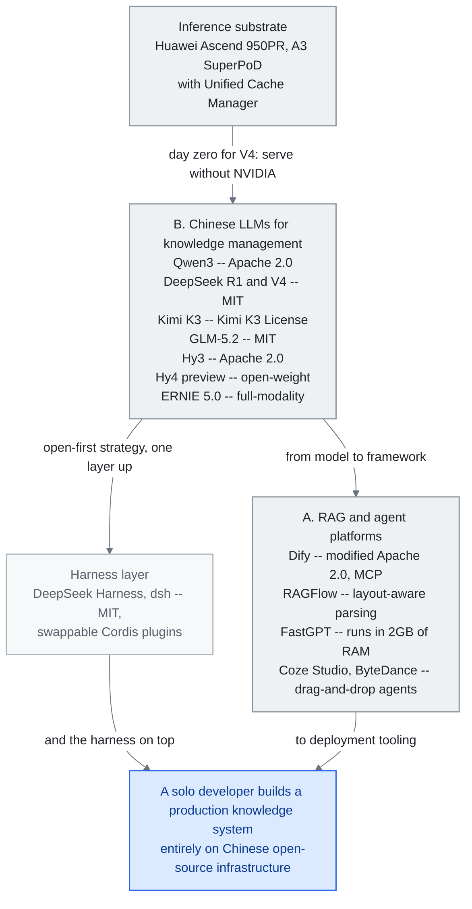

<!-- translation-sync:start -->
> 2026-10-31 の英語版に同期した機械支援翻訳です。構造と内容を確認しています。コードと図中ラベルは原文のまま、読書時間は英語原文の推定値です。
> [English source](../../../chapters/09-china-ecosystem.md) · [Sync record](../../SYNC.md)
<!-- translation-sync:end -->

<!-- i18n-anchor -->

# 第 9: 中国の AI ナレッジ エンジニアリングの状況

> **一言で言えば:** 中国は、独自のオープンソース プラットフォーム、モデル、コミュニティを使用して、並行する AI エコシステムを構築しており、多くの場合、西側諸国とは異なる方向で革新しています。
>
> **重要な理由:** 世界の AI 研究者の半分は中国にいます。このエコシステムを無視することは、イノベーションの半分を逃すことを意味します。
>
> **読書時間:** ~27 分 (6,092 ワード / 230 wpm)

*図: スタック セクション A と B は、上から下に説明します。中国のモデル ファミリの下にある国内の推論シリコンで、二つの並列ブランチ (その上にリリースされる harness) と、企業が実際に展開するビジュアル ファースト プラットフォームにフィードします。ライセンスは、C が "Open-Source as Strategic Imperative" と呼ぶ戦略セクションであるため、ライセンスはノード ラベル内にあります。この主張は 二つのエッジにあります。つまり、"train without NVIDIA" ではなく、"serve without NVIDIA" という主張を実現する、デイゼロの Ascend の適応と、下のペアで、二つのブランチが中国のオープンソース インフラストラクチャ上でエンドツーエンドで構築された運用ナレッジ システムに再結合します。*

LLM ナレッジ エンジニアリングに関する世界的な議論は、中国のエコシステムを調査することなしには不完全です。 2025年十二月までに規制当局に提出された748AIサービスにより、中国は大規模な言語モデルを使用した知識システムを構築するための、並行した、そして一部の分野では異なるアプローチを開発しました。この章では、中国の開発者や企業がナレッジ エンジニアリングにどのようにアプローチするかを形作る主要なプラットフォーム、モデル、文化の違いをマッピングします。

<!-- i18n-anchor -->

## A. オープンソースの RAG とエージェント プラットフォーム

中国のオープンソースの AI エコシステムは、GitHub の人気において西側のプラットフォームに匹敵する、またはそれを上回るいくつかのプラットフォームを生み出しました。これらのプロジェクトの特徴は、視覚的なワークフロー、企業導入の準備、および文書の深い理解に重点を置いていることであり、これは中国企業顧客の実際的な要求を反映しています。

<!-- i18n-anchor -->

### Dify (136K+ GitHub スター)

[Dify](https://github.com/langgenius/dify) は、世界で最も人気のあるエージェント AI プラットフォームです。 RAG パイプライン、エージェント ワークフロー、および複数ステップの推論チェーンを構築するための視覚的なキャンバスを提供します。バージョン 1.0 以降、Dify は Model Context Protocol (MCP) をサポートし、外部ツール サーバーとのシームレスな統合を可能にします。その強みは、ワークフローを視覚的に設計するノーコード ユーザーと、プログラムによる制御を必要とする開発者との間のギャップを埋めることにあります。企業ユーザーはスタック全体をセルフホストできます。これは、データ主権要件によりクラウドのみのソリューションが不可能なことが多い中国市場では非常に重要です。

Dify のライセンスは **修正された Apache 2.0** であり、マルチテナント操作とフロントエンドのロゴ/著作権の変更に関する追加条件が付いています。セルフホスティングの可用性は、無制限の SaaS 再配布を意味するものではありません。展開チームは、ユースケースに応じて実際のライセンスを確認する必要があります。これにより、この章のオープン インフラストラクチャの論文がプラットフォーム層で修飾されることになります。

<!-- i18n-anchor -->

### RAGFlow (62-75K+ GitHub スター)

[RAGFlow](https://github.com/infiniflow/ragflow) は、ドキュメントを深く理解することで差別化を図っています。 RAGFlow はドキュメントをフラット テキストとして扱うのではなく、スキャンされた PDF、スプレッドシート、スライド デッキを含む 20 以上のファイル形式にレイアウトを意識した解析、OCR、表抽出を適用します。その "agentic RAG" アプローチは、システムがクエリ タイプに基づいて適用する取得戦略を自律的に決定できることを意味します。レガシー ドキュメント アーカイブを扱う企業 (中国の国有企業や製造会社でよく見られるシナリオ) にとって、この機能はあれば便利なものではなく、必須の機能です。

<!-- i18n-anchor -->

### FastGPT (27K+ GitHub スター)

[FastGPT](https://github.com/labring/FastGPT) は、リソース効率に重点を置いたエンタープライズ ナレッジ ベース Q&A をターゲットとしています。その QA ペア抽出パイプラインは、ドキュメントを質問と回答のペアに自動的に変換し、取得と微調整の両方に使用できます。このプラットフォームは、2GB の RAM を搭載したマシンで実行できるように設計されており、専用の GPU インフラストラクチャを購入できない中小企業でも利用できます。この倹約は、中国のエコシステムにおけるより広範なパターン、つまり制約の下での最適化を反映しています。

<!-- i18n-anchor -->

### MaxKB (18K+ GitHub スター)

[MaxKB](https://github.com/1Panel-dev/MaxKB) は、ワンクリック展開のエンタープライズ エージェント プラットフォームとしての地位を確立しています。ツール統合用の MCP をサポートし、顧客サービス、社内ナレッジの取得、ドキュメントの要約などの一般的な企業シナリオ用の事前構築されたテンプレートを提供します。その魅力は、"we want an AI assistant" から "we have one running" までの時間を数週間から数時間に短縮できることです。

<!-- i18n-anchor -->

### Coze スタジオ (15K+ GitHub スター、ByteDance)

[Coze Studio](https://github.com/coze-dev/coze-studio) は、ByteDance のオープンソース ビジュアル エージェント開発プラットフォームです。元々はクローズドな製品でしたが、ByteDance が 2025 年 七月にオープンソース化し、三 日以内に 10,000 GitHub スターを獲得しました。 ByteDance の配布力。 Coze Studio は、内蔵メモリ、ツールの使用、マルチターン会話管理を備えたエージェントを構築するためのドラッグ アンド ドロップ インターフェイスを提供します。 ByteDance の Doubao モデル ファミリーとの統合により、中国語タスクにおけるネイティブな利点が得られます。

その独立したフレームが折りたたまれています。 36kr は **2026年 八月24日**に、ByteDance が内部合併を完了し、TRAE コーディング プラットフォームと Coze を Doubao 内に配置したと報告しました。チャットボットのオフィス ツール構成: TRAE IDE と CLI はスタンドアロン製品のままですが、TRAE Work と Coze は Doubao のオフィス機能と統合され、単一の今後のブランド "Doubao Work." の下で統合されます。同じ記事では、統合されたアプリがリリースされる予定であると述べています。 "as soon as this week"; ByteDance 自身の回答は組織再編のみに言及しているため、日付は企業が確認したものではなく報告されています。この方向性は、IDE とエージェント ビルダー ツールをコンシューマー チャット製品から切り離すという西洋の習慣とは逆です。ここでは、開発者ツールがスーパー アプリを周回するのではなく、スーパー アプリに吸収されます。

<!-- i18n-anchor -->

### DB-GPT (17K+ GitHub スター)

[DB-GPT](https://github.com/eosphoros-ai/DB-GPT) は、AI ネイティブのデータ インタラクションに特化しています。その中心となる機能は自然言語から SQL への変換であり、技術者以外のユーザーでも会話形式でデータベースにクエリを実行できるようになります。これを視覚化の生成とマルチエージェント データ分析パイプラインで拡張します。 DB-GPT は、金融、物流、製造業のほとんどの中国企業を表す大規模な構造化データセットを利用する企業にとって、AI 拡張分析へのアクセス可能なエントリ ポイントを提供します。

<!-- i18n-anchor -->

## B. ナレッジ管理のための中国語の LLMs

中国の基盤モデルの状況は急速に成熟しており、いくつかのモデルは特定のベンチマークで西側のモデルと競合するか、それよりも優れています。

<!-- i18n-anchor -->

### クウェン3 (Alibaba クラウド)

Qwen3 は、Alibaba の主力モデル ファミリです。最大の亜種は、Apache 2.0 でリリースされた 235 十 億パラメータの専門家混合 (MoE) モデルです。コーディングに特化したバリアントである Qwen3-Coder-480B は、256K から 1M トークンまでの context windows をサポートします。 Apache 2.0 ライセンスは戦略的に重要です。これにより無制限の商用利用が可能になり、独自の API コストを支払う余裕のない中国の新興企業全体での採用が促進されました。 Qwen の多言語機能は、中国語、日本語、韓国語で特に優れています。これらの言語は、歴史的に西欧モデルのパフォーマンスが劣っていました。

<!-- i18n-anchor -->

### Qwen-スコープ (Alibaba、2026年五月)

Alibaba の Qwen チームは、同じオープンリリースの姿勢をウェイトから解釈可能ツールまで拡張しました。 **Qwen-Scope** (提出された arXiv プレプリント **2026年五月12日**) は、**七 にわたってトレーニングされたスパース オートエンコーダーの **14 グループ**のオープン スイートです。 Qwen3 および Qwen3.5 バリアント**、高密度および MoE、範囲 **1.7B ～ 35B パラメータ** (Qwen3-1.7B ～ Qwen3.5-35B-A3B)、SAE 幅とスパース性は、総特徴数として報告されるのではなく、バックボーンごとに表化されます。これを研究成果物と区別するのはパッケージ化です。この論文では、SAE 機能を 四つの方向にわたる開発ツールとして紹介しています。prompt engineering なしで内部機能を操作する推論時ステアリング、アクティブ化された機能がベンチマークの冗長性と機能カバレッジをプロキシする評価分析、データの分類と編成、教師付き微調整と RL のためのトレーニング後のサポートです。この章の重要な点は来歴です。ファミリーを訓練した研究室によって公開された、フロンティアのオープンウェイトファミリーのための解釈可能なインフラストラクチャは、消費するものとして説明されることが多い研究軸に貢献する中国のエコシステムです。そして、成果物は結果ではなくツールであるため、これは以下のmHCのようなアーキテクチャの主張とは異なる種類の貢献です。

### DeepSeek R1

DeepSeek R1 は、MIT ライセンスの下でリリースされている間、数学的および科学的推論ベンチマークで OpenAI の o1 と一致しました。よく関連付けられる $6 百万未満という数字は、R1 ではなく、**DeepSeek-V3** に属します。その技術レポートは、想定された想定での公式訓練の費用として **$5.576 × 百万** と見積もっています。 H800 GPU 時間あたり $2 (事前の研究とアブレーション実験を除く)。これはベンダーの見積もりであり、R1 の総開発予算ではありません。 R1 のアーキテクチャ上の重要性は、フロンティア推論をオープン ウェイトとして利用できるようにすることです。

2026 年 四月、DeepSeek は、Transformer++ スタイルのモデルで使用される残差接続の一般化である **多様体制約ハイパー接続 (mHC)** でアーキテクチャ上の貢献を拡張しました。標準の残差ストリームが層間で単一チャネルの情報を伝送するのに対し、mHC は学習された低次元多様体上に存在するようにそれぞれ制約された **複数の内部ストリーム**を伝送します。この構造は、単純なマルチストリーム残差が大規模に発生する次元の崩壊を招くことなく、後の層が以前の表現に豊富にアクセスできるように設計されています。 DeepSeek のブログでは、同等のパラメーター数での長期推論ベンチマークでの向上が報告されており、多くの介在するレイヤー間で情報を伝達する必要があるタスクで最大の改善が見られます。 2026 年 四月の時点では、結果には **独立した複製を待機中であるというフラグが立てられているはずです**。これは単一ラボ モデルに関する単一ラボの開示であり、サードパーティによる複製を生き残れなかったアーキテクチャ上の主張によってこの分野は焼け落ちています。この結果が当てはまる場合、mHC は、主流の使用に移行する前に、中国のオープンウェイト エコシステムに由来する 三番目または 四番目のアーキテクチャ プリミティブとして、MoE、MLA、および DeepSeek の初期のマルチトークン予測作業に加わります。

### DeepSeek V4 (April 2026)

DeepSeek の **V4 preview**（2026年四月24日）は、経済性、能力、**推論基盤**の三軸で R1 の流れを同時に広げる。MIT ライセンスで Hugging Face に公開された二つのオープンウェイト MoE モデルは、**V4-Pro が1.6兆パラメータ / 49B active**、**V4-Flash が284B / 13B active**であり、1 × 百万トークンのコンテキストを上位ティアではなく既定として備える。API 料金は2026年の最先端クラスでも特に低く、**V4-Flash は出力百万トークンあたり$0.28**、V4-Pro は$3.48である。これはハードウェア最適化だけではなく設計変更による、V3 比 **トークンごとの推論 FLOPs の73%削減**を反映する。R1 が最初に評価を得たコーディングでも V4-Pro は首位となり、**LiveCodeBench 93.5%**（Gemini 3.1 Pro の91.7%、Claude Opus 4.6 の88.8%を上回る）、**Codeforces レーティング3206**（GPT-5.4 の3168を上回る）を記録した。

ただし、この章で最も重要な構造の詳細は、価格設定やベンチマークではなく、**推論の基盤**です。トレーニング V4 では、NVIDIA A100 および H20 ハードウェアを含むハイブリッド クラスターを使用しました。フロンティア *トレーニング* を NVIDIA スタックの完全な外部で実行できるかどうかという問題は依然として困難です。ただし、このモデルは **Day-Zero で Huawei の Ascend に適合しました。 950PR**、DeepSeek と Huawei が共同で推論同等性を報告 -- このアーキテクチャでは、NVIDIA と比較して約 **2.8x の計算スループット** H20 --- 運用環境でモデルを提供する Ascend NPU と NVIDIA GPU の間。これはソブリンシリコン理論のより微妙な形式です。"we trained without NVIDIA" ではなく、** "we serve without NVIDIA."** 米国の輸出規制に直面している中国企業の顧客にとって、V4 は、フロンティアクラスのオープンウェイト モデルが初日から信頼できる国産シリコン サービング パスを備えて出荷された初めてのことです。この章で説明している展開の多い中国のエコシステムにとって、これはトレーニングのオプションというよりも耐荷重の制約に近いものです。 R1 の 2025 年 一月の語形変化、V4 と合わせて読んでください。 一年間にわたる物語が幕を閉じます。中国のオープンウェイト エコシステムは、フロンティア コーディング モデル ** と、それを提供する基板 ** を同日にリリースできるようになりました。

**六月 29 ～ 30、2026** に、DeepSeek は、この V4 プレビューが **2026 年 七月中旬に正式リリースされることを発表しました。ラインナップ全体の 1M トークン context window と構造的な価格変更: **ピーク時の API 価格** (9:00-12:00 および14:00-18:00 北京時間）**2×オフピークレート**、オフピークベースラインは変更なし(V4-Pro は、百 万入力トークンあたり $0.435 でキャッシュミス、出力は $0.87、V4-Flash は $0.14 / $0.28)。フロンティアオープンウェイト推論 API の需要に応じた時間帯の価格設定により、*価格がスケジューリングのプリミティブ* に変わります -- バッチ エージェントのワークロードを実行している中国企業は、推論コストを半減するためにワークロードをオフピーク ウィンドウにシフトできます。これは、クラウド スポット市場が 十年間コンピューティングに提供してきたのと同じ手段です。

<!-- i18n-anchor -->

### キャリア規模のソブリン シリコン (Huawei + China Mobile、2026 年 六月)

"serve without NVIDIA" という論文は、六月に初めて通信事業者業界で検証されました。 MWC 上海 (2026年六月24日) で、**Huawei と China Mobile Hubei** は、Huawei の **AI 推論高速化ソリューション** の中国初のライブネットワーク検証を実行しました。 **Ascend A3 SuperPoD** は、**OceanStor A800** ストレージとペタバイト規模の KV キャッシュを管理する **ユニファイド キャッシュ マネージャー (UCM)** と組み合わせられています。結果は、シミュレートされた 8K-190K トークンのロングコンテキスト ワークロードを使用してライブ キャリア商用ネットワークで検証されました* (実際の通信トラフィックではありません): 最初のトークンまでの時間の短縮 **51-93%** GLM-5.1、128K シーケンス長で最大 **+372%** のスループット。ナレッジ エンジニアリングの重要性は、モデルの立ち上げ時に実証された国産シリコン サービング パス DeepSeek が、現在は実稼働規模での独立したインフラストラクチャ ベンダーとキャリアの実証を行っていることです。そして、KV-cache 管理層 (第 3 章) がソブリン シリコン エコノミクスの勝敗を決める戦場になることです。

それについては何も確認されていませんが、同じ理論の背後にはるかに大きな関与が形成されている可能性があります。ブルームバーグは**2026年九月4日**に、この問題に詳しい関係者の話として、DeepSeekが少なくとも**160,000Huaweiを導入する計画であると報じた。 Ascend 950DT アクセラレータ** を内モンゴル自治区ウランチャブの約 1GW データセンターに設置し、2027 または 2028までの部分運用を目標としています。このチップは、DeepSeek の既存の NVIDIA ハードウェア上に留まるトレーニングで推論を提供します。同じ "serve without NVIDIA, train with it" 分割 V4 がモデル スケールで実証されており、ここではサイト スケールで提案されています。納品には 一年以上かかる可能性があります。Huawei の 950DT 生産量は、メモリ コンポーネントの供給により、2026 全体で数十万ユニット前半に制限されると報告されています。 DeepSeek も Huawei もこの命令を確認しておらず、報道は両社の声明ではなく匿名の情報源に基づいているため、これは配備された容量としてではなく、表明された意図としての章に属します。

<!-- i18n-anchor -->

### DeepSeek ハーネス (dsh) --- オープンソースのエージェント ハーネス (2026年 八月)

**2026年 八月13日**、DeepSeek は、MIT ライセンスに基づいて開発者プレビューとして **DeepSeek ハーネス (dsh)** をリリースしました。 (github.com/deepseek-ai/deepseek-harness)。この設計は、DeepSeek が **"Cordis" プラグイン パラダイム** と呼ぶものを中心に構築されています --- 付属のホワイトペーパー "A Programming Paradigm for Spatiotemporal Composability" に記載されています --- その下に、モデル アダプター、ツール レジストリ、セッション ログ、サンドボックス、ストレージ、およびスケジューリングが含まれますループと UI レイヤーは、ランタイムに組み込まれた固定コンポーネントではなく、それぞれ交換可能なプラグインです。追加専用セッション ログには、エージェントが行うすべてのコンテキスト インジェクション (システム prompts、推論トレース、ツール呼び出しとその結果、サブエージェントのスケジュール決定など) が記録されます。 Claude Code または Codex を独自のスケジューリング ループ内からワンショット サブエージェントとして呼び出すことは、報道機関の主張ではなくファーストパーティの機能です。リポジトリには専用の `@deepseek-ai/dsh-subagent-claude-code` が付属しており、公式の Claude エージェント SDK と Codex `app-server` を呼び出す `@deepseek-ai/dsh-subagent-codex` パッケージ (日付付きのリポジトリ独自の設計ノートに従って実装) 2026年八月4日 --- 報道陣はそのコードから機能を取り上げました。リポジトリの成長はどう見ても急速で、リリースから 11 日以内に 190,630 スターと 21,319 フォークが発生し、224,004 スターと 26,637 フォークが 三 回発生しました。それから数週間後 (それぞれ、八月 24 と 2026 年 九月15 日に、GitHub API で確認 --- カウントが移動しているため、さらに引用する前に再確認してください)。これについてマスコミは定性的に次のように説明しています。これは、開発者ツールとして記録された中で最も速い導入曲線の 一つです。

### Kimi K2.5 (Moonshot AI)

Kimi K2.5 では、"Agent Swarm" を導入しました。これは、単一のクエリで最大 100 のサブエージェントを生成し、約 1,500 のツール呼び出しを通じて調整します。これは研究デモではありません。これは、システムが数十の同時エージェント間で Web 検索、文書分析、合成を並列化する複雑な調査タスクに使用される運用機能です。以前、Kimi は 2 × 百万の中国語文字 context window (約 2025年三月) を達成し、中国語テキストに特化して最適化された最長のコンテキスト モデルとなりました。

### Kimi K3 (Moonshot AI, July 2026)

**2026年七月17日**、ムーンショットは **Kimi K3** --- **2.8 兆パラメータ** (MoE) で、これまでにリリースされた最大のオープンウェイト モデルをリリースしました。 1M-トークン context window とネイティブ ビジョン。オープンウェイト モデルとして Arena のフロントエンド コーディング リーダーボードのトップとなり、人工分析インテリジェンス インデックス (スコア 57) では Fable 5 に次いで 189 の 4 位に位置します。 GPT-5.6 Sol 構成。特注の条件セットに基づき、**七月 27** にフル ウェイトが続きました。Moonshot は **Kimi K3 ライセンス** と呼んでいます --- Moonshot 独自のフレーミングは "open source," ではなく "open weight," であり、収益基準を超える商用利用には会社との別の契約が必要です。 Qwen の Apache 2.0 とクローズド リリースの間。フォーチュンはこの立ち上げを市場にとって"new DeepSeek shock"と位置づけ、そのタイミング（上海でWAIC 2026が開幕したのと同じ週）により、それがエコシステムの七月の波のアンカーとなった。実践者にとって重要な点が 一つあります。2.8T パラメータでは、K3 はサーバークラスのみであるため、ローカル展開の状況を変えることなく、オープンウェイトのフロンティアをスケールの上方に拡張します。

### ERNIE 5.0 (Baidu)

ERNIE 5.0 は、ネイティブのフルモダリティ サポートを備えた Baidu の 2.4 兆パラメータ モデルです -- 単一モデルでのテキスト、画像、オーディオ、ビデオの理解と生成。 2026 年 一月に発表されたこの計画は、知識システムの将来はテキスト モデルに付け加えられた後付けのマルチモーダルではなく、根本からマルチモーダルであるという Baidu の賭けを表しています。

### GLM-4.5/5 (Zhipu AI)

Zhipu AI の GLM シリーズは、744 × 十億パラメータ MoE GLM-5 で頂点に達します。エージェント harnesses 専用に設計されています。モデル アーキテクチャには、ネイティブ ツール使用トークンと、信頼性の高いエージェントを構築するために必要なスキャフォールディング コードを削減する構造化された出力保証が含まれています。この "agent-native" 設計哲学により、GLM を運用パイプラインに統合する際の prompt engineering が減り、再試行が少なくなります。 **2026年六月13日**、Zhipu は **GLM-5.2** (Hugging Face) に直面します。**IndexShare** は、四つのスパース アテンション レイヤーごとに同じインデクサーを再利用して、完全な 1M トークン コンテキスト**でトークンごとの FLOP を **2.9x 削減します。さらに、投機的デコードの受け入れ長を **最大まで引き上げる改良されたマルチトークン予測レイヤーを備えています。 20%**。 Hugging Face カードごとに、GLM-5.2 は HLE 40.5 (ツールを使用した場合は 54.7)、SWE-Bench Pro をポストします。 62.1、および AIME 2026 99.2。

<!-- i18n-anchor -->

### Hunyuan 3.0 / Hy3 (Tencent、2026年七月)

**2026年七月6日**、Tencent は完全な **Hunyuan 3.0 ("Hy3")** --- a **295B パラメータ MoE** (21B アクティブ、上位 8 ルーティングを備えた 192 エキスパート、および 3.8B マルチトークン予測レイヤー) 256K コンテキスト --- そして、この章ではより結果的に、制限付きの 2026年 四月のプレビュー ライセンスから **無制限の Apache 2.0** に切り替えられ、以前の EU、英国、および韓国の地理的カーブアウトが削除されました。 Tencent のモデル カードでは、プレビューと比較して幻覚率が **12.5% から 5.4%** に低下し、ブラインド専門家による評価スコアが **2.67/4 であると報告しています。 GLM-4 の 2.51/4**。この戦略的解釈は、以下の "open-source as strategic imperative" の議論が示すものです。Hy3 は、*完全に制限のないオープン ウェイト* をデフォルトとする最後の主要な閉鎖された中国フロンティア ラボをマークし、ベンダー間のコンバージェンスを完了し、オープン ウェイトのデフォルトを挑戦者の戦術ではなくエコシステムのベースラインにしています。

Tencent は、**2026年 八月28日**にそのリズムを維持し、無差別級 **Hy4 プレビュー** --- **770B パラメーター、49B active**、1M+ トークン コンテキスト。Tencent Cloud TokenHub および OpenRouter を通じて提供されます。バージョンバンプテストでは、これは新しいプリミティブではなく Hy3 の拡張ですが、記録に値する例外が 一つあります。Tencent は、Hy4 が独自の開発プロセスに貢献したと述べています。"participating for the first time in the automated optimization of training methods, data strategies, evaluation frameworks, and low-level operators," は推論ボトルネックを自律的に調整し、**31.8% のスループット向上** が報告されています。独自のトレーニング、データ、評価、オペレーター パイプラインを調整するモデルは、ベンチマーク スコアとは異なるクラスの自己改善の主張であり、13 章のループ エンジニアリングの内容と同じ領域に属します。 Tencent 独自のブラインド評価 (163 の専門家、203 のエンジニアリング タスク) のスコアは、Hy4 で **2.99/4.00** です。 GLM-5.3 の 2.92 と Kimi K3 の 2.94。これらの数値すべて、および特に自己最適化に関する主張は Tencent のものであり、この章で DeepSeek の mHC に付随する警告を含んでいます。つまり、単一ラボ モデルに関する単一ラボの開示であり、独立した複製を待っています。

<!-- i18n-anchor -->

## C. 西洋のエコシステムとの主な違い

中国のナレッジ エンジニアリングの状況を理解するには、ツールやモデルをカタログ化するだけでは不十分です。エコシステムは、根本的に異なる制約とインセンティブの下で動作し、初日からアーキテクチャ上の決定を形成します。

<!-- i18n-anchor -->

### ツールの設定: ビジュアル優先とコード優先

最も人気のある中国のプラットフォーム --- Dify、Coze Studio、FastGPT --- はビジュアルファーストです。ユーザーはキャンバス上でノードをドラッグすることでナレッジ パイプラインを構築します。対照的に、西洋のエコシステムの主要なフレームワーク (LangChain、LlamaIndex、Haystack) はコードファーストであり、ビジュアル ツールは二次的なアドオンです。この相違は、さまざまなユーザー層を反映しています。中国の AI の導入は、企業の IT 部門と、Python を書かない可能性のある "citizen developers" によって大きく推進されていますが、西欧の早期導入者はコードに慣れているソフトウェア エンジニアである傾向があります。

<!-- i18n-anchor -->

### 導入: オンプレミス vs. API-First

中国ではオンプレミス展開が主流です。これは 二つの強化要因によって推進されています。データ主権 (特に金融、医療、政府) に関する規制要件と、大規模なクラウド GPU アクセスをより高価にする米国のチップ輸出規制による実際的な制約です。その結果、中国のプラットフォームは量子化、蒸留、効率化に多額の投資を行っており、無制限のクラウド コンピューティングを前提とするのではなく、利用可能なハードウェアでモデルを適切に実行できるようにしています。対照的に、欧米のプラットフォームはデフォルトで API ファーストのアーキテクチャを採用しており、モデルはプロバイダーのインフラストラクチャ上で実行されます。

<!-- i18n-anchor -->

### 規制アーキテクチャ

2025年 十二月までに、748 AI サービスが生成的 AI 管理措置に基づいて中国の規制当局に提出されました。コンプライアンスは任意または希望的なものではありません。コンプライアンスは設計段階から技術アーキテクチャを形成します。コンテンツ フィルタリング、監査ログ、およびユーザー ID 検証は、コア機能としてプラットフォームに組み込まれており、発売前に追加されているわけではありません。この規制の圧力により、逆説的に、より標準化されたアーキテクチャが生み出されました。全員が同じコンプライアンス要件を実装する必要がある場合、コンプライアンスを容易にするプラットフォームが勝ちます。

**擬人化 AI インタラクション サービスに関する暫定措置**は、**2026年 四月10日**で発効し、**七月 15** で発効し、一般的なエージェント規制よりも狭い境界線を引いています。条項 2 は、人間の特性を模倣した継続的な感情的インタラクションを対象とし、そのインタラクションを伴わない知識 Q&A、作業アシスタント、および同様のサービスを明示的に除外します。対象サービスの場合、条項 16 ではインタラクション データのコピー/削除オプションが必要であり、条項 19 ではアクセス可能な出口が必要です。したがって、永続的なコンパニオン メモリには、通常のエンタープライズ ナレッジ アシスタントとは異なるコンプライアンス境界があります。後者には、引き続き他の適用される規則が適用されます。

この規制の話は、2026年七月に国際的な関心を集めました。 **世界 AI 会議 (WAIC) 2026** およびグローバル AI ガバナンスに関するハイレベル会議が 七月 17 ～20 で上海で開催されました -- 100+ か国グテレス国連事務総長も出席し、**世界人工知能協力機関 (WAICO)** の設立協定への署名を行いました。この組織は、上海に本部を置く、AI に特化した初の政府間国際機関です。 WAICO が運営上どのようなものになるにせよ、その創設はこのセクションで説明するパターンを国内の出願制度から国際機関の構築へと拡張し、新しい機関は中国に設置されます。

<!-- i18n-anchor -->

### コミュニティと知識の共有

中国の開発者コミュニティは、根本的に異なるプラットフォームで運営されています。 WeChat グループ (Slack や Discord ではありません) が、リアルタイム ディスカッションの主要なチャネルです。 Zhihu は、より長い技術的な Q&A に対してスタック オーバーフローの役割を果たします。 CSDN (中国ソフトウェア開発者ネットワーク) はチュートリアルとブログ投稿をホストしています。 GitHub はコードに使用されますが、議論は別の場所で行われます。この断片化は、中国語ツールに関するサポートを求めて GitHub Issues や Discord を検索する西欧の開発者が英語サポートを見つけることが少ないことを意味しますが、一方、中国語コミュニティは活気に満ち、活発であり、中国語を話さない人には見えないだけです。

<!-- i18n-anchor -->

### 制約によるイノベーション

米国のチップ輸出規制は、予想外のイノベーションの原動力を生み出しました。中国の AI 研究所は、単純にコンピューティングを拡張することができないため、アルゴリズムの効率化に不釣り合いな投資を行ってきました。 DeepSeek-V3 が報告した公式トレーニング費用は、上記の会計制限内でこのパターンを示しています。このパターンは、より優れた推論最適化を備えた小規模なモデル、より積極的な量子化技術、および FLOP あたりの能力を最大化するように設計されたアーキテクチャなど、エコシステム全体に広がります。西洋のエコシステムは、より多くのコンピューティングを利用できるため、スケールを通じて革新する傾向があります。どちらのアプローチも、異なる経路を通じて最先端の結果を生み出します。

<!-- i18n-anchor -->

### 戦略的必須としてのオープンソース

現在、中国の無差別級モデルのリリース量は欧米を上回っています。これは利他主義ではなく、戦略です。オープンソースはエコシステムのロックインを構築し（開発者はあなたのモデルに基づいて構築します）、才能を引き付け（研究者は人々が使用するモデルに取り組みたいと考えます）、そして世界の開発者コミュニティに外交上の友好関係を生み出します。 Alibaba の Apache Qwen の 2.0 ライセンス、DeepSeek の MIT ライセンス、およびByteDance による Coze Studio のオープンソース化はすべてこのパターンに従っています。その結果、世界中のどこにいても個人の開発者が、モデルからフレームワーク、展開ツールに至るまで、完全に中国のオープンソース インフラストラクチャ上に実稼働ナレッジ システムを構築できるようになりました。

このロジックは、重みからその上で実行される harness まで、スタックの 一つ上の層に拡張されます。 DeepSeek ハーネス (上記の dsh) は、同じオープンファースト戦略をモデルではなくエージェント ランタイム自体に適用します。このタイミングが重要な点を明確に示しています。数日後、太平洋の反対側で、OpenAI が、モデルの独自仕様を維持しながら、Apache 2.0 の下で Codex の背後にある実行エンジン (第 三 章 4) をオープンソース化しました。 harness レイヤーは、二つの動きは異なる戦略的目的を果たしているにもかかわらず、数日以内に太平洋の両側でオープンソースになりました。

この戦略が機能していることを示す最も明確な使用面の証拠は、**2026年七月29日**に到着し、OpenRouter の世界週間トークン使用量ランキングで上位 五 位すべてを中国開発モデルが初めて獲得しました -- Xiaomi MiMo-V2.5 がトップで、続いて DeepSeek、MiniMax、Alibaba の Qwen ファミリ、Moonshot の Kimi のモデルが続きます。 20 兆トークン。その週に発表された分析によると、中国起源のモデルはルーティングされたトラフィックの **60%** を超えています。このリードは 九月まで続きました。2026年 九月初めの別のレポートでは、OpenRouter の週次ルーティング トークンの **46.4%** が米国原産モデルの **35.7%** であったことがわかりました。これら 二つのパーセンテージは傾向線としてではなく、別々に読み取る必要があります。これらは、"Chinese-origin" とトークン ユニバースを異なる方法で定義する異なる二次分析から得られたものであり、どちらももう一方の改訂版として公開されたものではありません。 OpenRouter のランキング ページはライブ ローリング ビューであり、公開された履歴アーカイブはありません。そのため、両方の数値は、引用可能な一次シリーズではなく、その時点で撮影されたスナップショットの二次レポートに基づいています。

<!-- i18n-anchor -->

### 蒸留紛争

その戦略的な読みは、2026年 九月に敵対的な対応を獲得しました。 **2026年九月10日**、Anthropicは、"Detecting and countering misuse of AI: September 2026,"という、AIの悪用を対象とした脅威インテリジェンスレポートを公開しました。 2025年 十二月と 2026年 八月は 七つの被害領域にわたっており、そのうちの 一つは違法蒸留です。 Anthropic は、Moonshot AI が Kimi の顧客リクエストの一部を、Anthropic としてフラグが付けられた **5,380 アカウントのネットワークを通じて Claude にルーティングしたと主張しています。詐欺行為**。単一の 十 日間のクラスタで **約 300,000 リクエスト**を中継し、Claude の回答を Kimi 出力としてユーザーに返し、交換をトレーニング データとして保持します。それは、五月から 2026年七月の間に、**23 百万以上の Claude 交換**が Moonshot によるものであると考えています。このセクションの最大の数字は別の研究室のものです。レポートでは、同じ 五月から 七月にかけて **Alibaba** に起因する "over 151 million exchanges observed" と記録しており、これはムーンショットの合計の約 六.五 倍です。同じセクションでは、**DeepSeek、Z.ai (Zhipu)、Xiaomi、MiniMax、および SenseTime** にも名前を付けて説明しています。 DeepSeek は、クロスセッション再生手法を使用して、Claude 推論トレースを抽出します。

これがどの程度の重要性を持つかについては、一つの注意点があります。上記のすべての図は **Anthropic の主張** であり、第三者によって判断されたものではなく、指定された研究機関の商業的競合会社によって公表されたものです。この章では、それが起こったかどうかではなく、何が申し立てられたかを記録します。数値自体は、レポート自体の蒸留セクションから読み取られます。誰のアカウントが保持されているかに関係なく、論争が確立しているのは、"the weights are open" と "how the model behind them was trained" が分離可能な問題になっているということです。上記のエコシステムロックインのロジックは、トレーニングの来歴については何も述べていません。そして、来歴は現在、二つのフロンティア エコシステムが公の場で議論している軸となっています。

<!-- i18n-anchor -->

## D. Bilibili コンテンツに関する注意事項

Bilibili (B站) は大量の AI チュートリアルをホストしていますが、実践者は、その多くが英語の YouTube コンテンツの再アップロードまたは翻訳であることに注意する必要があります。 Bilibili の AI コンテンツの本来の価値は、中国語固有のツール チュートリアルにあります。ステップバイステップの Dify 導入ガイド、Qwen 統合のウォークスルー、および英語には存在しないエンタープライズ導入ケース スタディです。 Bilibili について調査するときは、必ずコンテンツを元のソースまで追跡してください。チュートリアルが英語のナレーションを中国語に吹き替えた LangChain をデモしている場合、オリジナルの YouTube バージョンの方が最新である可能性があります。

---

<!-- i18n-anchor -->

## 得るべき 三つのこと

- **オープンウェイトは利他主義ではなく戦略です。** Apache Qwen の 2.0、DeepSeek の MIT、および ByteDance のオープンソースCoze Studio のメンバーは全員、エコシステムのロックイン、人材、善意を購入し、誰もが中国のインフラストラクチャ上にエンドツーエンドで生産システムを構築できるようにしています。
- **ソブリン シリコンはサービスに関する主張であり、トレーニングに関する主張ではありません。** V4 はハイブリッド NVIDIA クラスタでトレーニングされましたが、Huawei の Ascend 950PR に最初から適応されました。 2026 年 六月 Huawei とチャイナ モバイルのデモにより、シミュレーションされたロングコンテキスト ワークロードでの最初のトークンまでの時間が 51-93% (GLM-5.1) 削減されました。ライブキャリアネットワーク。
- **来歴が現在争われている軸です。** Anthropic の 2026年 九月の違法蒸留疑惑は、誰が正しいと判明しても、"the weights are open" と "how the model behind them was trained" が分離可能であることを証明しています。質問。

---

<!-- i18n-anchor -->

## 情報源

- Dify GitHub リポジトリ: [https://github.com/langgenius/dify](https://github.com/langgenius/dify)
- Dify。ライセンス (2026年十月31日と読みます)。 [https://raw.githubusercontent.com/langgenius/dify/main/LICENSE](https://raw.githubusercontent.com/langgenius/dify/main/LICENSE) -- マルチテナントとフロントエンドの条件を追加して Apache 2.0 を修正しました。
- DeepSeek-AI。 "DeepSeek-V3 Technical Report" (2024年十二月27日; 改訂2025年二月18日)、概要と表 1。 [https://arxiv.org/html/2412.19437v2](https://arxiv.org/html/2412.19437v2) -- $5.576M 公式トレーニングの見積もり。事前の研究とアブレーションは除外されます。これは R1 の総開発コストではありません。
- 中国サイバースペース局と他の 四つの機関。 "Interim Measures for Anthropomorphic AI Interaction Services" (2026年四月10日; 有効 2026年七月15日)、記事 2、 16 と 19。 [https://www.cac.gov.cn/2026-04/10/c_1777558395078289.htm](https://www.cac.gov.cn/2026-04/10/c_1777558395078289.htm) -- 継続的な感情的相互作用の範囲。そのようなやり取りがなければ、他のサービスは除外されます。
- RAGFlow GitHub リポジトリ: [https://github.com/infiniflow/ragflow](https://github.com/infiniflow/ragflow)
- FastGPT GitHub リポジトリ: [https://github.com/labring/FastGPT](https://github.com/labring/FastGPT)
- MaxKB GitHub リポジトリ: [https://github.com/1Panel-dev/MaxKB](https://github.com/1Panel-dev/MaxKB)
- Coze スタジオ GitHub リポジトリ: [https://github.com/coze-dev/coze-studio](https://github.com/coze-dev/coze-studio)
- DB-GPT GitHub リポジトリ: [https://github.com/eosphoros-ai/DB-GPT](https://github.com/eosphoros-ai/DB-GPT)
- Qwen3 テクニカル レポートとモデル カード、Alibaba Cloud (2025) --- 正規のエントリ ポイント: [https://huggingface.co/Qwen](https://huggingface.co/Qwen) Qwen チームの Hugging Face の記事。 Apache 2.0 ライセンスの詳細はリポジトリ LICENSE ファイルで確認されました。
- DeepSeek R1 論文: "DeepSeek-R1: Incentivizing Reasoning Capability in LLMs via Reinforcement Learning" (2025 年 一月)。 [https://github.com/deepseek-ai/DeepSeek-R1](https://github.com/deepseek-ai/DeepSeek-R1) はモデルをホストし、テクニカル レポート PDF にリンクします。
- Moonshot AI。 Kimi K2.5 Agent Swarm の報道は、2026 の初めに Moonshot のブログと技術プレス全体に広まりました。ここで引用されている 100-sub-agent / ~1500 ツールコールの数値は、技術プレスの二次要約から報告されたものです。 [https://platform.moonshot.ai](https://platform.moonshot.ai) 経由のプライマリ アクセス。
- Baidu。 ERNIE 5.0 リリース (2026年 一月); 2.4T パラメータ / ネイティブのフルモダリティの主張は、Baidu 公式チャンネルおよび中国の技術系報道機関を通じて流通しました。ここでは単一のプライマリ URL が引用されていません。モダリティとパラメータの数値は広く報告されているものの二次的なものとして扱います。
- Zhipu AI。 GLM-4/5 モデル カード (Hugging Face および ZhipuAI 公式ブログ)。 "744B MoE GLM-5" + エージェント ネイティブ ツール トークンは、モデル カードとブログの範囲にわたってレポートされます。プライマリ エントリ ポイント: [https://www.zhipuai.cn](https://www.zhipuai.cn)。
- 中国サイバースペース局、"Generative AI Service Filing" の開示 (2025年 十二月) --- 748 サービスの数字は中国のテクノロジー関連報道で広く再現されています。基礎となるレジストリは、CAC 公式サイト経由でバッチで公開されます。
- 編集者注: 前述の R1 以降の企業導入の増加に関して検証可能な一次調査は行われていないため、この章では数値的な導入に関する主張は使用しません。
- DeepSeek。 "DeepSeek mHC: Manifold-Constrained Hyper-Connections" (2026年四月)。 [https://deepseek.ai/blog/deepseek-mhc-manifold-constrained-hyper-connections](https://deepseek.ai/blog/deepseek-mhc-manifold-constrained-hyper-connections) --- 独立したレプリケーションを待機しているとしてフラグが立てられます。
- DeepSeek。 V4 モデルは Hugging Face (2026年四月24日) にリリースされました。 MIT ライセンス。 V4-Pro 1.6T (49B アクティブ) / V4-Flash 284B (13B アクティブ); 1M トークンのデフォルト コンテキスト。
- 幸運。 "DeepSeek unveils V4 model, with rock-bottom prices and close integration with Huawei's chips" (2026年四月24日)。 [https://fortune.com/2026/04/24/deepseek-v4-ai-model-price-performance-china-open-source/](https://fortune.com/2026/04/24/deepseek-v4-ai-model-price-performance-china-open-source/)
- サウスチャイナ・モーニング・ポスト紙。 "DeepSeek unveils next-gen AI model as Huawei vows 'full support' with new chips" (2026年四月24日)。 [https://www.scmp.com/tech/big-tech/article/3351239/deepseek-releases-next-gen-ai-model-world-leading-efficiency](https://www.scmp.com/tech/big-tech/article/3351239/deepseek-releases-next-gen-ai-model-world-leading-efficiency)
- フェメックスニュース。 "DeepSeek V4 Matches NVIDIA on Huawei Ascend, Dispels Rumors" (2026年 四月)。 [https://phemex.com/news/article/deepseek-v4-matches-nvidia-performance-on-huawei-ascend-dispels-delay-rumors-75616](https://phemex.com/news/article/deepseek-v4-matches-nvidia-performance-on-huawei-ascend-dispels-delay-rumors-75616) --- 推論パリティ主張、~2.8x コンピューティング スループットvs NVIDIA H20、Ascend 950PR。
- テックノード。 "DeepSeek to launch V4 in mid-July with new peak-time API pricing" (2026年六月30日)。 [https://technode.com/2026/06/30/deepseek-to-launch-v4-in-mid-july-with-new-peak-time-api-pricing/](https://technode.com/2026/06/30/deepseek-to-launch-v4-in-mid-july-with-new-peak-time-api-pricing/) および ExplainX [https://explainx.ai/blog/deepseek-v4-official-release-peak-pricing-mid-july-2026](https://explainx.ai/blog/deepseek-v4-official-release-peak-pricing-mid-july-2026) --- 七月中旬正式リリース。ピーク時の料金は、2x オフピークです (発表日は 六月 29～30)。
- Zhipu AI。 GLM-Hugging Faceの5.2 モデル カード (2026年六月13日)。 [https://huggingface.co/zai-org/GLM-5.2](https://huggingface.co/zai-org/GLM-5.2) --- IndexShare (2.9x トークンごとの FLOP カット、1M コンテキスト); MTP 受け入れ長は最大 +20%。 HLE 40.5 (54.7 ツール付き)、SWE-Bench Pro 62.1、AIME 2026 99.2。
- Tencent。 Hugging Face (2026年七月6日) の Hy3 (Hunyuan 3.0) モデル カード。 [https://huggingface.co/tencent/Hy3](https://huggingface.co/tencent/Hy3) --- 295B MoE (21B アクティブ)、256K コンテキスト、 Apache 2.0;幻覚 12.5%→5.4%;ブラインドエキスパート評価 2.67/4 対 GLM-4 の 2.51/4。セカンダリ: LetsDataScience [https://letsdatascience.com/news/tencent-open-sources-hy3-295b-moe-model-c3d05258](https://letsdatascience.com/news/tencent-open-sources-hy3-295b-moe-model-c3d05258)。
- Huawei。 "MWC Shanghai 2026: China Mobile and Huawei on the token economy" (2026年六月24日)。 [https://www.huawei.com/en/news/2026/6/mwcs-cmcc-token-economy](https://www.huawei.com/en/news/2026/6/mwcs-cmcc-token-economy) --- Ascend A3 SuperPoD + OceanStor A800 + 統合キャッシュ マネージャー。シミュレートされた 8K-190K トークン ワークロードを備えたライブ キャリア ネットワーク。 TTFT は、GLM-5.1 で 51-93% を削減し、128K でスループットは最大 +372% になりました。
- PureAI。 "China's Moonshot AI Releases Kimi K3" (2026年七月17日)。 [https://pureai.com/articles/2026/07/17/china-moonshot-ai-releases-kimi-k3.aspx](https://pureai.com/articles/2026/07/17/china-moonshot-ai-releases-kimi-k3.aspx) --- 2.8T MoE, 1M コンテキスト、ネイティブ ビジョン。人工分析インテリジェンス インデックスで 189 の 4 位 (スコア 57); 七月の 27 ウェイト。
- 新しいスタック。 "Kimi K3 tops Arena's coding leaderboard --- and it's open-weight" (2026年七月)。 [https://thenewstack.io/kimi-k3-open-weight-coding/](https://thenewstack.io/kimi-k3-open-weight-coding/) --- 無差別級のリーダーボードの結果。
- リーブ、ジョナス (Unite.AI)。 "Moonshot Opens Kimi K3 Weights Under a Revenue-Tiered License" (2026年七月27日)。 [https://www.unite.ai/moonshot-opens-kimi-k3-weights-under-a-revenue-tiered-license/](https://www.unite.ai/moonshot-opens-kimi-k3-weights-under-a-revenue-tiered-license/) および Willison、Simon。 "moonshotai/Kimi-K3" (2026年七月27日)。 [https://simonwillison.net/2026/Jul/27/kimi-k3/](https://simonwillison.net/2026/Jul/27/kimi-k3/) --- 特注の "Kimi K3 License" に名前を付けます。収益に応じた商業条件。 Moonshot 独自の "open weight" フレーム化ではなく、"open source" フレーム化です。
- ブルームバーグ。 "China's Powerful New Moonshot AI Model Closes Gap With US Rivals" (2026年七月17日)。 [https://www.bloomberg.com/news/articles/2026-07-17/china-s-powerful-new-moonshot-ai-model-closes-gap-with-us-rivals](https://www.bloomberg.com/news/articles/2026-07-17/china-s-powerful-new-moonshot-ai-model-closes-gap-with-us-rivals)
- 幸運。 "China's Moonshot Kimi K3 and the markets" (2026年七月17日)。 [https://fortune.com/2026/07/17/china-moonshot-kimi-k3-markets-china-ai/](https://fortune.com/2026/07/17/china-moonshot-kimi-k3-markets-china-ai/) --- "new DeepSeek shock" フレーミング。
- 新華社。 "World AI Conference opens in Shanghai" (2026年七月17日)。 [https://english.news.cn/20260717/7691cc6c17d249089fdcd7afd840c3ba/c.html](https://english.news.cn/20260717/7691cc6c17d249089fdcd7afd840c3ba/c.html) --- WAIC 2026 / WAICO 設立協定;グテーレス氏出席。
- 中国外務省。 WAICO 設立のお知らせ (2026年七月17日)。 [https://www.mfa.gov.cn/mfa_eng/xw/zyxw/202607/t20260717_11984715.html](https://www.mfa.gov.cn/mfa_eng/xw/zyxw/202607/t20260717_11984715.html)
- DeepSeek。 DeepSeek ハーネス (dsh) GitHub リポジトリ (開発者プレビュー、2026年 八月13 日)。 [https://github.com/deepseek-ai/deepseek-harness](https://github.com/deepseek-ai/deepseek-harness) および [https://deepseek.com/harness/en/](https://deepseek.com/harness/en/) --- MIT ライセンス。 "Cordis" プラグイン パラダイム;追加専用のセッション ログ。 GitHub API 経由で検証されたスター/フォーク数: 190,630 スター / 21,319 フォーク2026-08-24; 224,004 スター / 26,637 フォーク (2026-09-15)。 Claude Code / Codex サブエージェント パッケージ (`@deepseek-ai/dsh-subagent-claude-code`、`@deepseek-ai/dsh-subagent-codex`) はリポジトリ自体に同梱されています。二次カバレッジ (adoption-curve framing): [https://cryptobriefing.com/deepseek-harness-open-source-developer-preview/](https://cryptobriefing.com/deepseek-harness-open-source-developer-preview/) ; [https://www.mindstudio.ai/blog/deepseek-harness-agentic-coding](https://www.mindstudio.ai/blog/deepseek-harness-agentic-coding) ; [https://www.digitalapplied.com/blog/deepseek-harness-open-source-agent-framework-2026](https://www.digitalapplied.com/blog/deepseek-harness-open-source-agent-framework-2026) ; [https://flowtivity.ai/blog/deepseek-harness-open-source-agent-explained/](https://flowtivity.ai/blog/deepseek-harness-open-source-agent-explained/)。
- デン、ボーイイ、他"Qwen-Scope: Turning Sparse Features into Development Tools for Large Language Models," arXiv:2605.11887 (2026年五月12日に提出)。 [https://arxiv.org/abs/2605.11887](https://arxiv.org/abs/2605.11887) --- 七つの Qwen3 / Qwen3.5 バリアントにわたる 14 SAE グループ(1.7B ～ 35B、高密度および MoE);集合的な機能数ではなく、バックボーンごとの SAE 幅とスパース性。ステアリング、評価分析、データ分類、トレーニング後の使用。 Qwen チームの X 発表を取得できなかったため、arXiv の提出が唯一の固定された日付になります。
- Tencent。 "Tencent releases and open-sources Tencent Hy4 preview" (2026年 八月28日)。 [https://www.tencent.com/tencent-releases-and-open-sources-tencent-hy4-preview/](https://www.tencent.com/tencent-releases-and-open-sources-tencent-hy4-preview/) --- 770B / 49B アクティブ、1M+コンテキスト; 163 の専門家と 203 のエンジニアリング タスクにわたるブラインド評価 2.99/4.00 と、GLM-5.3 2.92 と Kimi K3 は 2.94 です。 31.8% のスループット向上と自己最適化の主張は Tencent 独自のものです。セカンダリ: TechNode [https://technode.com/2026/08/28/tencent-open-sources-hy4-preview-with-770b-parameters-and-a-1m-token-context/](https://technode.com/2026/08/28/tencent-open-sources-hy4-preview-with-770b-parameters-and-a-1m-token-context/)。
- 36クローナ（英語版）。 "Exclusive ByteDance AI Productivity Integration: TRAE & Coze Merged into Doubao, Unified Office Brand 'Doubao Work' to Launch" (2026年 八月24)。 [https://eu.36kr.com/en/p/3953230805876099](https://eu.36kr.com/en/p/3953230805876099) --- 再組織レポート。この記事には、Doubao Work が "as soon as this week" を開始すると書かれています。これは、ByteDance が確認した日付ではなく、報告された期間です。
- ブルームバーグ。 "DeepSeek Plans Big Huawei AI Chip Order to Power New Data Center" (2026年 九月4日)。 [https://www.bloomberg.com/news/articles/2026-09-04/deepseek-plans-big-huawei-ai-chip-order-to-power-new-data-center](https://www.bloomberg.com/news/articles/2026-09-04/deepseek-plans-big-huawei-ai-chip-order-to-power-new-data-center) --- 情報源はこの問題に詳しい人々。この記事はペイウォールで保護されており、このエントリ用に独自に取得されたものではないため、上の図はその記事の二次報道から取得したものです: TechPowerUp [https://www.techpowerup.com/352416/huawei-prepares-160-000-ascend-950dt-accelerators-for-deepseek-data-centar](https://www.techpowerup.com/352416/huawei-prepares-160-000-ascend-950dt-accelerators-for-deepseek-data-centar) ; TFTC [https://www.tftc.io/deepseek-huawei-ascend-160000-chips-inner-mongolia-nvidia-sanctions](https://www.tftc.io/deepseek-huawei-ascend-160000-chips-inner-mongolia-nvidia-sanctions)。 DeepSeek も Huawei も注文を確認していません。
- Anthropic。 "Detecting and countering misuse of AI: September 2026" (2026年 九月10日)。 [https://www.anthropic.com/threat-intelligence-report-september-2026](https://www.anthropic.com/threat-intelligence-report-september-2026) --- プライマリ。その蒸留セクションには、5,380 アカウント、~300,000 リクエスト、および 23M 交換ムーンショットの数値と、Alibaba による "over 151 million exchanges observed" が含まれており、すべて直接読み取られます。それから。二次報道: CNBC [https://www.cnbc.com/2026/09/11/chinese-ai-labs-moonshot-deepseek-alibaba-anthropic.html](https://www.cnbc.com/2026/09/11/chinese-ai-labs-moonshot-deepseek-alibaba-anthropic.html) ;ディールルーム [https://dealroom.co/news/150366-anthropic-alleges-moonshot-routed-some-kimi-user-requests-to-claude-then/](https://dealroom.co/news/150366-anthropic-alleges-moonshot-routed-some-kimi-user-requests-to-claude-then/) ; TechNode Global [https://technode.global/2026/09/11/anthropic-ai-orchestrated-cyberattacks-model-distillation/](https://technode.global/2026/09/11/anthropic-ai-orchestrated-cyberattacks-model-distillation/)。すべての数字は Anthropic 自身の主張です。
- OpenRouter モデル ランキング: [https://openrouter.ai/rankings](https://openrouter.ai/rankings) --- 公開された履歴アーカイブのないライブ ローリング ビューであるため、上記の日付付きの数値はスナップショットの二次レポートに基づいています。 2026年七月29日の中国全体のトップ 五 と "above 60% of routed traffic" の数字: Dataconomy [https://dataconomy.com/2026/07/29/chinese-ai-models-openrouter-top-five/](https://dataconomy.com/2026/07/29/chinese-ai-models-openrouter-top-five/) ; TechBriefly [https://techbriefly.com/2026/07/29/chinese-ai-models-lead-openrouter-for-first-time/](https://techbriefly.com/2026/07/29/chinese-ai-models-lead-openrouter-for-first-time/)。 九月初旬 46.4% / 35.7% 分割: Yahoo Finance [https://finance.yahoo.com/technology/ai/articles/chinese-ai-models-now-capture-020440715.html](https://finance.yahoo.com/technology/ai/articles/chinese-ai-models-now-capture-020440715.html)。 二つの株価の数値は異なる分析から得られたものであり、同じ尺度ではありません。

---

*次: [第 十 章 10 - 現実世界の知識ハーネスの構築](10-case-study.md)*
