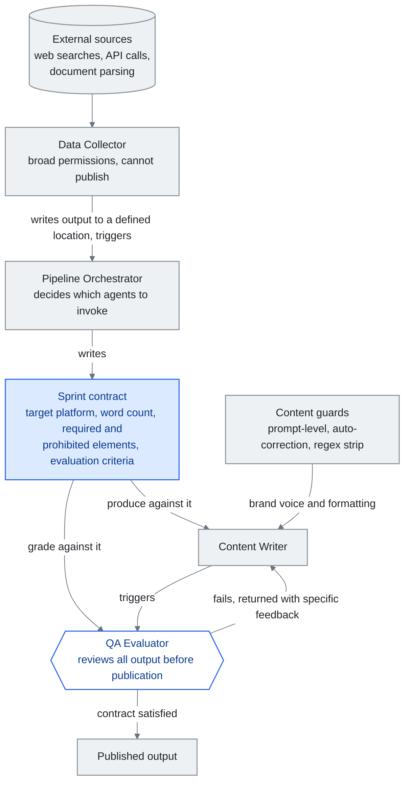

<!-- translation-sync:start -->
> 2026-10-31 の英語版に同期した機械支援翻訳です。構造と内容を確認しています。コードと図中ラベルは原文のまま、読書時間は英語原文の推定値です。
> [English source](../../../chapters/10-case-study.md) · [Sync record](../../SYNC.md)
<!-- translation-sync:end -->

<!-- i18n-anchor -->

# 第 10: 現実世界の知識ハーネスの構築

> **一言で言えば:** ある開発者は、4 エージェント チーム、段階的な開示ルーティング、自動化されたコンテンツ パイプラインを備えた完全な AI ナレッジ システムを構築しました。
>
> **重要な理由:** これは、適切なアーキテクチャを持つ 一人で、これまでチームが必要だったものを構築できることを証明しています。このガイドの概念は理論的なものではありません。
>
> **読書時間:** ~11 分 (2,476 ワード / 230 wpm)

*図: セクション "Harness Engineering: The Agent Team" の 四人のエージェント チーム。スプリント契約は 三人のエージェントが共有する 一つの文書として描かれています。オーケストレーターが契約を作成し、ライターがそれに基づいて作成し、QA 評価者が同じ基準に基づいて採点してから、何かが公開されます。引数を運ぶエッジは、エバリュエーターからライターへのリターン パスです。これは 一 回の再試行ではないため、四つのエージェントはパイプラインではなくループです。*

この章では、数か月にわたる反復開発を通じて完全な知識 harness を構築した個人開発者 -- "the builder" と呼ばれる -- の匿名化されたケース スタディを紹介します。ここで説明するシステムは実際のものであり、日常の運用で使用されています。これまでの章で説明した概念、context engineering、プログレッシブ開示、スキル システム、エージェント オーケストレーションが実際にどのように組み合わされるかを示します。

<!-- i18n-anchor -->

## 出発点

建築者は単純な問題から始めました。知識が多すぎて、構造が十分ではありませんでした。個人のナレッジ ボールトは、進行中のプロジェクト、技術リファレンス、会議ログ、一時的なアイデアに及ぶ 300 を超えるメモに成長しました。標準的なアプローチ -- 何かが必要になったときに検索 -- は、保管庫が大きくなるにつれて機能しなくなりました。メモは忘れられ、洞察は取得されるのではなく再発見され、作業セッション間でコンテキストは失われます。

最初の解決策は控えめなもので、ボールトにアクセスできる LLM アシスタントを使用しました。しかし、300+ ノートにそのままアクセスすると、context window があふれてしまいます。エンジニアリング上の本当の課題は、"can the LLM read my notes" ではなく、"how do I give the LLM the right notes at the right time." ということでした。

<!-- i18n-anchor -->

## ナレッジ レイヤー: 暗黙的なナレッジ グラフとしての Vault

システムの基盤は、意図的にフォルダー階層に編成された Obsidian ボールトです。

- **受信箱** キャプチャ用 (新しいメモはすべてここに表示されます)
- **アクティブ** 日常使用メモ (5-10 項目に保持)
- **プロジェクト** 期限のある時間制限のある作業用
- **期限のない継続的な責任を負う分野**
- アトミックな知識に関する **メモ** (メモごとに 一つのアイデア、タイトルは主張)
- **毎日** ジャーナルとレビュー レポート
- 完了した資料または古い資料の **アーカイブ**

すべてのメモはウィキリンクを使用して関連するメモに接続し、正式なグラフ データベースを必要とせずに暗黙的な知識グラフを作成します。リンクの規則は単純ですが厳密です。メモ A がメモ B が詳述する概念を参照している場合、A は B にリンクする必要があります。これにより、時間の経過とともに、エントリ ポイントが関連するコンテキストにつながる、ナビゲート可能な知識のウェブが生成されます。

ボールトはレビュー サイクルを通じて維持されます。毎日のレビューで受信トレイが処理され、新しいメモが分類されます。毎週のレビューで知識の蓄積傾向を分析し、貴重な古いメモを再浮上させます。毎月のレビューで矛盾がないかチェックし、重複するメモをマージし、完了したプロジェクトをアーカイブします。このメンテナンスはオプションではありません。これがないと、メモが古くなったり、冗長になったり、孤立したりするため、知識層は数週間以内に劣化します。

<!-- i18n-anchor -->

## Context Engineering: インデックスとしてのシステム プロンプト

ビルダーの context engineering アプローチは、システム prompt をモノリシック命令セットとしてではなく、より深いリソースへのインデックスとして扱います。中央設定ファイル (AI の README に似ています) には次の内容が含まれています。

- **環境の詳細**: OS、シェル、回避すべき既知の癖
- **言語設定**: ビルダーの作業言語と書式設定規則
- **ルーティング テーブル**: トリガー キーワードとルーティング ファイルへのポインタを含むスキル カテゴリの優先リスト

この設定ファイルは常にロードされます。ペイロードではなくポインターが含まれているため、コンパクトです --- 2,000 トークン未満 ---。 LLM はユーザー リクエストを検出すると、ルーティング テーブルと照合し、関連するルーティング ファイルのみをロードします。これにより、必要な特定のスキルが示されます。

別のメモリ システムがセッション間の永続性を処理します。以下を保存します。

- アクティブなプロジェクトの場所と構造
- フィードバックから学習したユーザーの好み
- 各プロジェクトに特有の技術的なパターンと慣例
- 複雑なトピックの詳細なサブファイルへの参照

メモリ ファイルは有機的に増加します。ビルダーがアシスタントの動作を修正すると、その修正は設定として記録されます。プロジェクトの構造が確立されると、それは一度文書化され、その後参照されます。これにより、ステートレスな LLM インタラクションを悩ませる、繰り返し発生する "let me re-explain my project" 問題が解消されます。

<!-- i18n-anchor -->

## Harness Engineering: エージェント チーム

このシステムでは 四人のエージェント チームが採用されており、それぞれに定義された役割があります。

1. **データ コレクター**: 外部ソース (Web 検索、API 呼び出し、ドキュメント解析) から情報を収集します。広範な権限で動作しますが、公開する機能はありません。
2. **パイプライン オーケストレーター**: ワークフローを調整し、どのエージェントを呼び出すかを決定し、シーケンスを管理します。 "sprint contracts" --- 各タスクに期待される出力基準を指定する文書を作成します。
3. **コンテンツ ライター**: 出力 (レポート、ソーシャル メディア投稿、技術文書) を作成します。ブランドの声とフォーマット標準を強制するコンテンツガードの下で動作します。
4. **QA 評価者**: 公開する前に、スプリント契約に対してすべての出力をレビューします。事実の正確さ、フォーマットの準拠性、ブランドの整合性をチェックします。

スプリント契約のメカニズムについては詳しく説明する必要があります。オーケストレーターがコンテンツ タスクを開始するとき、単に "write a post about X." これは、ターゲット プラットフォーム、単語数の範囲、必須の要素 (統計を含める必要がある、行動喚起で終わる必要があるなど)、禁止されている要素 (最上級の禁止、未検証の主張禁止など)、および評価基準を指定する契約を生成します。コンテンツライターはこの契約に基づいて制作します。 QA 評価者はそれに基づいて採点します。出力が評価に失敗した場合は、契約基準を参照する特定のフィードバックとともに作成者に返されます。これは 一 回の再試行ではありません。コントラクトが満たされるか人間が介入するまでループが続きます。

コンテンツ ガードは 三つの層で動作します。

- **プロンプトレベルのガード**: システム prompt に埋め込まれた命令で、エージェントが実行しなければならないことと実行してはいけないことを定義します。
- **自動修正**: 一般的な問題を見つけて修正する生成後の処理 (例: 不要な書式設定パターンの削除、用語の一貫性の強制)
- **正規表現ストリップ**: 出力に決して表示されるべきではない特定のパターンを削除する最終パス (例: ダウンストリーム システムを破壊する特定の文字、モデルから漏洩するメタデータ トークン)

エージェント間の通信はトリガーベースです。エージェントは相互にポーリングしません。データ コレクターは情報の収集を完了すると、定義された場所に出力を書き込み、オーケストレーターをトリガーします。ライターがコンテンツを作成すると、評価者がトリガーされます。このイベント駆動型のアーキテクチャにより、不必要な計算を行わずにシステムの応答性が維持されます。

<!-- i18n-anchor -->

## スキルシステムの進化

スキル システムは 四つの異なる進化段階を経て、それぞれが本番環境で発見された実際的な制限によって推進されました。

**ステージ 1: フラット スキル ファイル。** 各スキルは、手順を含むスタンドアロンのマークダウン ファイルでした。 LLM はセッション開始時にすべてのスキル ファイルをロードしました。これは 5 ～ 10 スキルで機能しましたが、コレクションが大きくなるにつれて維持できなくなりました。コンテキスト ウィンドウはスキル定義でいっぱいで、実際の作業のための余地はほとんどありません。

**ステージ 2: 豊富な YAML フロントマター。** スキルは、トリガー条件、必要なコンテキスト、依存関係、バージョン番号などの構造化メタデータを取得しました。これにより、システムは関連性によってスキルをフィルタリングできるようになりましたが、フィルタリング ロジック自体がトークンを消費し、待ち時間が追加されました。

**ステージ 3: スキル間のウィキリンク。** スキルが相互にリンクし始め、スキル グラフが作成されました。 "deploy" のスキルは、前提条件として "run tests" にリンクします。これにより、システムは個々のスキルではなくスキル チェーンをロードできるようになりましたが、グラフのナビゲーションには依然としてグラフ インデックスのロードが必要でした。

**ステージ 4: ルーティング ファイルによる段階的な開示。** 最終的なアーキテクチャでは、七つのカテゴリ固有のルーティング ファイルを指すコンパクトなインデックス (システム prompt 内のルーティング テーブル) を使用します。各ルーティング ファイルには、そのカテゴリのスキルとそのトリガー条件がリストされています。 LLM は、一致したカテゴリのルーティング ファイルのみをロードし、次に必要な特定のスキルのみをロードします。常にシステムは、システム prompt インデックス (~2K トークン) + 一つのルーティング ファイル (~500 トークン) + 一つのスキル ファイル (~1-2K トークン) をロードしています。総オーバーヘッド: システム内に存在するスキルの数に関係なく、4K トークン未満。

ビルダーは、すべてのカテゴリにわたる 85 テスト クエリを使用してこのルーティング アーキテクチャをテストし、85/85 の正しいルーティング --- 100% の精度を達成しました。エッジ ケース (複数のカテゴリに一致する可能性のあるあいまいなクエリ) は、ルーティング テーブル内の明示的な曖昧さ回避ルールによって処理されます。

<!-- i18n-anchor -->

## 結果

このアーキテクチャの測定可能な成果:

- フラット ファイル アプローチと比較して、段階的な開示による **65% のトークン削減**。以前はスキル コンテキストの 8～12K トークンを消費していた同じタスクで必要となるのは 4K 未満です。
- **自動化されたコンテンツ パイプライン** は、複数のプラットフォームにわたって一貫した品質で毎日の出力を生成し、一人によって管理されます。
- **知識の維持** 自動 Vault lint による矛盾、孤立したメモ、古い情報を検出します -- 以前は手動のレビュー セッションが必要だった問題。
- **セッション間の継続性**により、"cold start" 問題が解消されます。記憶システムとは、アシスタントが毎回中断したところから再開することを意味します。

<!-- i18n-anchor -->

## 学んだ教訓

**最初はシンプルで、次に複雑さを重ねます。** ビルダーは、初日から 四 エージェントのスプリント契約システムを設計したわけではありません。これは、指示のテキスト ファイルを備えた単一のエージェントとして開始されました。複雑さの各層は、特定の障害モードに応じて追加されました。エージェントの幻覚 (QA 評価者の追加)、出力の一貫性のなさ (コンテンツ ガードの追加)、context windows のオーバーフロー (段階的な開示の追加)。時期尚早なアーキテクチャでは、実際の問題ではなく、想像上の問題に対して最適化されたシステムが作成されていたでしょう。

**段階的な開示には、設定コストを払う価値があります。** ルーティング テーブル、七つのルーティング ファイル、および個別のスキル ファイルの構築と維持には、継続的な努力が必要です。ただし、65% のトークン削減は、すべてのインタラクションで元が取れます。さらに重要なのは、システムが拡張できることです。新しいスキルを追加するということは、prompt 全体を再構築するのではなく、一つのルーティング ファイルに 一つのエントリを追加することを意味します。

**少ないほど良い。** 圧縮された正確なスキル定義は、冗長なスキル定義よりも優れています。 "search the vault for notes matching the query, return file paths and relevant excerpts, suggest connections" というスキル ファイルは、同じ手順を 500 単語で詳しく説明するよりも効果的です。 LLM は手持ちの必要がありません。明確な意図が必要です。

**harness は製品です。** ビルダーの競争上の優位性は、単一のスキルやエージェントではありません。これは、harness、つまりルーティング ロジック、スプリント コントラクト、コンテンツ ガード、レビュー サイクル、メモリ システムです。個々のコンポーネントは単純です。統合には価値が生きます。これは、ナレッジ エンジニアリングに関する広範な真実を反映しています。モデルはコモディティ化していますが、モデルを調整するシステムはコモディティ化していません。

<!-- i18n-anchor -->

## サイドバー: 参照実装としての Claude Code

ビルダーのシステムが進化していた期間のほとんどの間、Anthropic 自体の内部ツールはブラック ボックスでした。実務家は、Claude Code がその動作からどのように機能するかを推測できましたが、Anthropic の外部の誰もそのソースを見たことがありませんでした。 **2026年三月31日**、Anthropic が誤って npm パッケージ `@anthropic-ai/claude-code` 内に 59.8MB ソース マップを出荷したとき、状況は変わりました。 v2.1.88 --- 1,906 ファイルにわたる、難読化されていない TypeScript のおよそ 513,000 行 (詳細については、第 4 を参照)。このリークにより、コミュニティは辺境の研究所から製造された生産 harness を初めて実証的に観察することができました。そのパターンのいくつかは、製作者が独自に到達したものと密接に韻を踏んでいます。

- **自己修復メモリ、一つの大きなファイルではありません。** Claude Code のリークされたアーキテクチャは、層間に明示的な修復ロジックを備えた 三 層の "Self-Healing Memory" システムを中心に構成されています。ビルダーのボールト + メモリ ファイル + スプリント コントラクト ループは、同じアイデアの劣ったいとこです。つまり、短期的な作業状態 (現在のセッション)、中期的な圧縮された状態 (メモリ ファイル)、および永続的な長期知識 (ボールト) です。どちらのシステムでも、"memory" は場所ではありません。これは、レイヤー間にトランジションがある一連のレイヤーです。
- **保存ではなくインデックスとしての MEMORY.md。** Claude Code 内の `MEMORY.md` は、より詳細なメモへの軽量のポインタ スタイルのインデックスです -- モノリシックなトランスクリプトではありません。ビルダーの構成ファイルもまったく同じ役割を果たします。ペイロードではなく、ルーティング テーブルとポインターを保持します。これが、ベースライン コンテキストが 2K トークン以下に留まる理由です。
- **`KAIROS` および自律デーモン モード。** Claude Code ソースは、`KAIROS` 機能フラグを 150 回以上参照しています。これは、自律デーモン モード、つまり対話型 REPL をはるかに超えた、無人で長時間実行される実行ループをゲートします。このビルダーのトリガーベースのイベント駆動型エージェント間通信は、同じアイデアを手動で展開したものです。つまり、エージェントはイベントで起動し、作業を行い、すべてのステップで人間が関与することなく引き継ぎます。

このサイドバーのポイントは、ビルダーのシステムが密かに Claude Code であるということではありません。 二つのシステムはエンジニアリングの労力において桁違いに分離されており、ビルダーのバージョンでは、Anthropic が 五十 万行の TypeScript で行うことを、数百のマークダウン ファイルで実行します。重要なのは、**両方のシステムが独立して同じ形状** (インデックス付きの階層化メモリ、ペイロード上のルーティング、およびイベント駆動型のオーケストレーション) に収束したということです。これは、これらのパターンがスタイル上の選択ではないことを示唆しています。これらは、本番環境の harnesses が実際のワークロードとの接触を乗り越えたときに最終的にどのようになるかです。

<!-- i18n-anchor -->

## 開業医への影響

このケーススタディは、一人の開発者が何か月もかけて反復作業を行うことで、二年前にはエンジニアのチームが必要だった知識harnessを構築できることを示しています。主な実現要因は、複雑な複数ステップの命令に従うのに十分な機能を備えた LLMs、ツール統合のためのオープン プロトコル (MCP)、およびこれらのシステムの設計パターンを提供する新しい分野 context engineering です。

ビルダーのシステムはコピーするテンプレートではありません。このガイドの原則 -- 漸進的開示、context engineering、スキル グラフ、エージェント オーケストレーション -- が運用環境で測定可能な結果を生み出すという概念の実証です。 harness の外観が異なります。アーキテクチャは同じである必要があります。

---

<!-- i18n-anchor -->

## 得るべき 三つのこと

- **契約により、作成者と評価者に共通の目標が与えられます。** オーケストレーターはターゲット プラットフォーム、単語数、必須要素と禁止要素を事前に指定し、評価者は満足するか人間が介入するまで、同じ文書に対して採点します。
- **プログレッシブ開示により、コンテキストのオーバーヘッドは一定に制限されます。** インデックス、一つのルーティング ファイル、一つのスキル ファイルは、存在するスキルの数に関係なく 4K トークン未満に留まり、置き換えられたフラット ファイル アプローチでは 65% 削減されます。
- **harness が製品です。** 個々のコンポーネントは簡単です。統合 (ルーティング ロジック、スプリント コントラクト、コンテンツ ガード、レビュー サイクル、メモリ システム) に価値が生きます。

---

*次: [章 11 - LLM ナレッジ エンジニアリングの重要な瞬間](11-timeline.md)*
