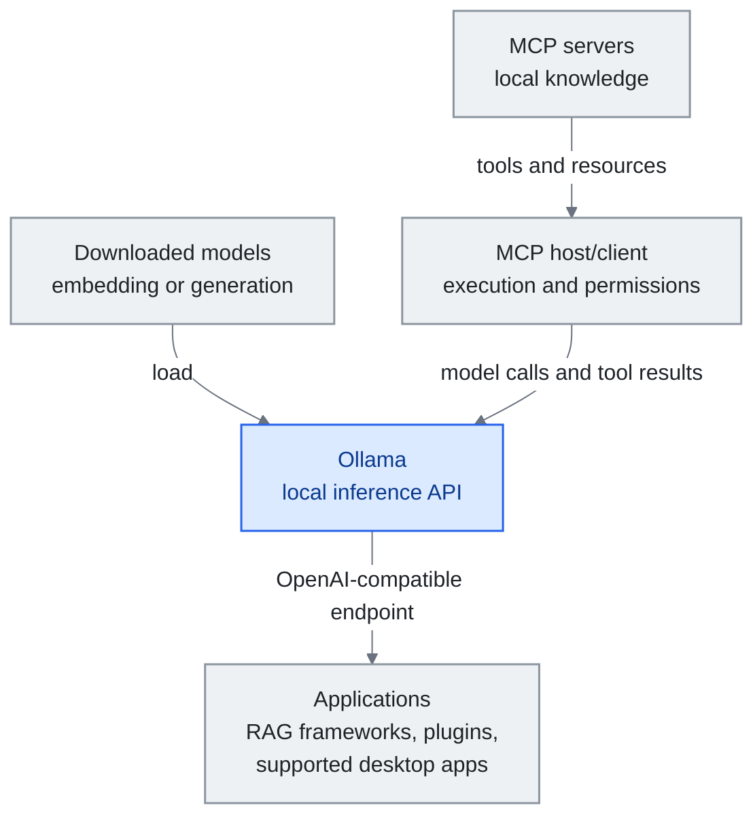

<!-- translation-sync:start -->
> 2026-10-31 の英語版に同期した機械支援翻訳です。構造と内容を確認しています。コードと図中ラベルは原文のまま、読書時間は英語原文の推定値です。
> [English source](../../../chapters/12-local-models.md) · [Sync record](../../SYNC.md)
<!-- translation-sync:end -->

<a id="chapter-12-local-models-for-knowledge-engineering"></a><!-- i18n-anchor -->

# 第 12 章：ナレッジエンジニアリングのためのローカルモデル

> **一文で：** ローカルモデルは推論を自分のハードウェアへ移し、提供元へのデータ露出とトークン単位の API 料金を減らす一方、ローカルの運用費を伴う。
>
> **重要な理由：** 機密知識や個人用のファインチューニングを扱うとき、推論の境界は設計上の選択になる。ツール、ログ、同期には、それぞれ別の制御が必要である。
>
> **読了時間：** 約14分（英語原文3,052語 / 230 wpm）

*図：Ollama はダウンロードしたモデルを、推論 API を通じてアプリケーションに提供する。MCP のホスト／クライアントは別にツールを実行し権限を強制して、モデル呼び出しとツール結果を Ollama に渡す。エンドポイントの互換性だけでは MCP のオーケストレーションは得られない。具体的なモデルとアプリケーションの統合は後述する。*

*幅の狭い画面では、図を横方向にスクロールすると実寸で読める。*



これまでの章は、クラウド API アクセスを概ね前提とするナレッジエンジニアリングスタックを記述している ——context window を Anthropic、OpenAI、Google に送って応答を返してもらう。これは大半のユーザーにとってよく機能する。だが、クラウド推論が実用的でないか望ましくない実践者の層が増えている：機微な企業データを扱う者、データレジデンシー要件が厳しい管轄区にいる者、そして自分でコンパイルした知識上でモデルをファインチューンしてループを完全に閉じたい者。

本章はローカルモデルとナレッジエンジニアリングの交差を扱う。GPU 購入ガイド、ベンチマーク比較、量子化技法は扱わない ——それらのトピックは他のリソースで十分にカバーされている。代わりに、モデルを自分のインフラの内側に持ち込むときに重要となるアーキテクチャ判断に焦点を当てる。

---

<a id="why-local-matters-for-knowledge-engineering"></a><!-- i18n-anchor -->

## ナレッジエンジニアリングにとってローカルがなぜ重要か

ナレッジシステムにおけるローカルモデルの採用を駆動する 三つの力：

**プライバシーは方針ではなく設計で決まる。** クラウドを使う RAG は、取得した文書のチャンクを提供元へ送ることがある。経路全体をローカルに保てば、ローカル推論はモデル提供元へのその転送をなくす。ただしツール呼び出し、テレメトリ、ログ、同期は、引き続き確認が必要である。法務、医療、行政の一部の処理はこの境界を必要とするが、要件は導入環境によって異なる。

**大規模利用時の費用。** ボールトの lint、自動ノート編纂、定期的な再インデックスなど、バックグラウンドで継続処理する知識システムは、一日に数千回の API 呼び出しを生むことがある。ローカル実行はトークン単位の提供元料金をなくすが、電力、ハードウェア容量、保守にはなお費用がかかる。常時動く知識保守（Karpathy の設計における Lint 操作）では、推論は無料だと決めつけず、これらの費用と API 利用額を比較すべきである。

**ファインチューニングのエンドゲーム。** これが恐らく最も説得力のある理由だ。ナレッジベースが十分な品質に到達したら ——Ingest 操作を通してコンパイルされた、よく構造化され相互リンクされた数百のノート —— それは原始的な合成データセットになる。このデータセットで小さなローカルモデルをファインチューンでき、ランタイムに検索を必要とせず本来的にあなたのドメインを"knows"モデルが生まれる。知識は context window ではなく重みの中にある。

---

<a id="architecture-where-local-models-fit"></a><!-- i18n-anchor -->

## アーキテクチャ：ローカルモデルが収まる場所

ナレッジ harness のすべてのコンポーネントが等しくローカル推論から恩恵を受けるわけではない。ローカルモデルが最大の価値を提供する場所はここだ：

<a id="embedding-models-high-value"></a><!-- i18n-anchor -->

### Embedding モデル（高価値）

Embedding はあらゆる RAG パイプラインの土台だ。Vault にノートを追加するたびに、類似度検索のためにベクトルへ変換する必要がある。これは高ボリューム・低複雑度の操作 ——ローカル推論にうってつけ。

人気の選択肢：
- **nomic-embed-text**（137M パラメータ）：強い汎用 embedding、CPU で動く
- **mxbai-embed-large**（335M）：より高品質、控えめなハードウェアでも管理可能
- **bge-m3**（568M）：多言語、混合言語コンテンツの vault に優秀

これらのモデルは、GPU なしの現代のラップトップで動かせるほど小さい。ローカルとクラウド embedding（OpenAI の text-embedding-3、Cohere の embed）の品質差は著しく狭まった ——大半のナレッジ管理ユースケースで、ローカル embedding は十分だ。

Ollama 経由でローカル実行：
```
ollama pull nomic-embed-text
```

<a id="query-and-reasoning-medium-value"></a><!-- i18n-anchor -->

### Query と推論（中価値）

Vault について質問に答えるためにローカルモデルを使うこと ——Query 操作 —— はトレードオフがより微妙になる場所だ。クラウドモデル（Claude Opus、GPT-4o）は依然として、複雑な推論、多段合成、繊細な指示追従において意味のある優位を持つ。だが、素直な検索ベース Q&A（"what did I write about X last month?"）には、7–14B パラメータ域のローカルモデルが良好に機能する。

実用的な選択肢：
- **Qwen3-14B**：強い多言語性能、Apache 2.0 ライセンス
- **Llama 3.1-8B-Instruct**：8B の指示調整モデル。Llama 3.3 は別の70Bモデルである。
- **DeepSeek-R1-Distill-Qwen-7B**：完全版 R1 から蒸留した推論能力。MIT ライセンス。
- **Gemma 3-12B**：Google の効率的アーキテクチャ、構造化出力が得意

最も機能するパターンは **段階的アプローチ** である：日常クエリと vault 保守にはローカルモデル、複雑な合成と創造的タスクにはクラウド API へエスカレートする。これは harness エンジニアリングの progressive disclosure 原則がモデル選択にどう適用されるかを反映する ——各タスクに最低限の能力モデルを使え。

<a id="knowledge-compilation-high-value"></a><!-- i18n-anchor -->

### ナレッジコンパイル（高価値）

Ingest 操作 ——生のソースを読んで構造化された wiki ページにコンパイル —— は意外にもローカルモデルに適している。タスクは明確に定義されている：記事を読み、要点を抽出し、wikilink 付きの構造化ノートを生成する。指示追従が良い 14B モデルは、特に出力形式がシステム prompt で精密に指定されているとき、これを信頼性高く扱える。

費用面の議論が最も強くなるのは、この用途である。Web Clipper が一日に5-10件の記事を保存するなら、ローカルでの編纂により、利用可能な計算能力と運用費の範囲で、トークン単位の API 料金なしに知識ベースを成長させられる。

<a id="vault-maintenance-high-value"></a><!-- i18n-anchor -->

### Vault 保守（高価値）

Lint 操作、つまり矛盾、古い情報、孤立ノートの走査は、ローカル推論が有利になるバッチ処理である。マシンの計算予算内で、毎時、毎日、または継続的に実行できる。ローカルモデルがボールトを走査し、健全性レポートを生成する。ただし、そのワークフローを非公開に保つには、ツールとストレージもローカルである必要がある。

---

<a id="the-fine-tuning-endgame"></a><!-- i18n-anchor -->

## ファインチューニングのエンドゲーム

Andrej Karpathy が概説したビジョンを、いま多くの実践者が追求している：LLM 保守の wiki が十分な品質に到達したら、それを使って個人 Small Language Model (SLM) をファインチューンせよ。

ワークフロー：

1. 数か月の Ingest 操作を通じてナレッジベースを **コンパイル** する。Wiki はよく構造化され相互リンクされた数百のノートへと成長する。
2. Wiki から訓練ペアを **抽出** する：各ノートは（質問、回答）ペア、または（context、completion）ペアとなる。
3. このデータセット上で小さなモデル（1–3B パラメータ）を、LoRA か QLoRA を使って **ファインチューン** する。
4. ファインチューンしたモデルを **デプロイ** ローカルに。検索を必要とせず、自分の重みからあなたのドメインに関する質問に答える。

これは RAG を完全に置き換えるわけではない ——ファインチューンしたモデルも最近の情報や特定の詳細では検索から恩恵を受ける。だが検索の負担は劇的に下がる。モデルはあなたのドメインの基盤概念、関係、パターンを"knows"。RAG は新しいまたは非常に特定の情報を補足するだけでよくなる。

このパイプラインのツールは成熟している：
- **Unsloth** ：効率的なファインチューニング向け（2 倍速く、60% メモリ少なく）
- **Axolotl** ：管理された訓練設定向け
- **MLX**（Apple Silicon）または **llama.cpp** ：ファインチューンしたモデルのローカル推論向け

---

<a id="integration-patterns"></a><!-- i18n-anchor -->

## 統合パターン

<a id="pattern-1-ollama-as-universal-backend"></a><!-- i18n-anchor -->

### パターン 1：万能バックエンドとしての Ollama

Ollama は、OpenAI 互換 API でローカルモデルを動かす統一インターフェースを提供する。これは、OpenAI API で動くツールが base URL を変えるだけでローカルモデルに向けられることを意味する：

```
base_url: http://localhost:11434/v1
model: qwen3:14b
```

これは LangChain、LlamaIndex、Dify、大半の RAG フレームワークで動く。Obsidian ユーザーには、Smart Connections のようなプラグインがクラウド API の代わりにローカル Ollama モデルを使うよう設定できる。

2026年後半には、逆のパターンも現れた。他社ツールが Ollama に接続するだけでなく、クローズドモデル提供元の純正デスクトップアプリ自身が接続するようになった。Ollama **v0.33.0**（2026年八月21日）は、Claude Desktop が Ollama を第三者ゲートウェイ提供元として使う設定を追加し、**v0.34.0**（2026年九月5日）は ChatGPT Desktop 統合を追加した。Ollama の macOS アプリで設定し、ChatGPT Desktop 内で Ollama モデルを選択できる。同じ v0.34.0 では、OpenAI 互換クライアントのツール検索、応答圧縮、Apple Silicon での構造化出力の高速化も加わった。ローカル知識ハーネスへの影響は限定的だが実在する。利用者向けチャットクライアントを使うこと自体は、マシン外へ問い合わせを送る理由ではなくなる。接続先をマシン上のモデルに変更できるからだ。これは後述の OS レベルの `LanguageModel` プロトコルに対応するベンダーアプリ側の動きであり、ローカルバックエンドを正式な選択肢とする同じ流れが、プラットフォーム所有者ではなくクローズドモデル提供元から現れたことになる。

<a id="pattern-2-hybrid-cloud-local"></a><!-- i18n-anchor -->

### パターン 2：ハイブリッドクラウド・ローカル

大半のユーザーにとって最も実用的なアーキテクチャ：
- **ローカル** ：Embedding、vault 保守、日常クエリ、ナレッジコンパイル
- **クラウド** ：複雑な推論、創造的合成、多段エージェントワークフロー

これは高ボリューム操作のためのプライバシーとコストの恩恵を、本当に必要とするタスクのためのフロンティアモデル能力へのアクセスとともに与える。

<a id="pattern-3-mcp-with-local-models"></a><!-- i18n-anchor -->

### パターン 3：ローカルモデルでの MCP

この統合には、[第7章](07-mcp.md)で示す **MCP ホスト／クライアント**が必要である。ホストはサーバーのツールを発見し、ツール定義と結果をモデル API に渡し、許可された呼び出しを実行し、権限を強制する。Ollama が提供するのは推論であり、OpenAI 互換エンドポイントだけでは MCP ホストにならない。ホスト、サーバー、モデル、ストレージがすべてローカルなら、ハーネスもローカルに保てる。

---

<a id="2026-local-models-get-an-os-native-api-and-vendor-qat"></a><!-- i18n-anchor -->

## 2026年：ローカルモデルに OS ネイティブ API とベンダーの QAT が加わる

2026年の三つのリリースが、本章で述べるローカル推論の状況を変えた。

**Apple が Foundation Models を任意の提供元に開く（WWDC26、六月8日）。** Apple Intelligence を支え、ストリーミング、ツール呼び出し、`@Generable` による構造化出力を備える同じ Swift API、Foundation Models フレームワークに、公開の **`LanguageModel` / `LanguageModelExecutor` プロトコル**が加わった。Apple は参照実装 **`MLXLanguageModel`** も提供し、Hugging Face の任意の mlx-community モデルを実行時に読み込み、ディスクにキャッシュする。ローカル知識エンジニアリングでは、オープンソースモデルが他社連携ではなく、*正式な OS ネイティブのバックエンド*になることが重要だ。macOS / iOS の知識アプリは、一つの Swift API に対応するだけで、推論層を書き直さず、Apple のデバイス上モデルとダウンロードしたオープンウェイトモデルを切り替えられる（Anthropic と Google も準拠する Swift パッケージを提供している）。前述の汎用バックエンドとしての Ollama に、Apple ネイティブの同種の選択肢が加わった。

**Gemma 4 QAT（六月5日）。** Google は、Gemma 4 の全五サイズ（E2B、E4B、12B、26B-A4B、31B）について、**量子化を考慮した訓練のチェックポイント**を公開した。訓練*中*に4-bit精度をシミュレートし、事後圧縮で品質を失うのではなく、量子化した重みで BF16 の品質の大半を回復する。**llama.cpp（GGUF）、Ollama、LM Studio、MLX 向けの成果物を初日から同時公開**し、vLLM も E2B、E4B、12B、31B に初日対応した。26B-A4B MoE は、幅704の expert 次元を4-bitにすると品質が落ちすぎるため、vLLM の w4a16-ct QAT 形式から外された。メモリについて Google のブログに割合の数字はない。第三者分析は **BF16 比で約72%の VRAM 削減**と推定するが、Google 自身の数字はモバイル形式で E2B が1GB未満になるというものだけだ。注目すべきは*公開のパターン自体*である。ベンダー自身による QAT と、複数ランタイムへの初日同時配布が本格的なオープンウェイト公開の標準形になりつつあり、本章が論じる "run it locally" の判断に伴う摩擦を下げている。

**Meta がローカルエージェント向けのオープンウェイトモデルを公開（Muse Glimmer、八月10日）。** Meta Superintelligence Labs は、非公開の Muse Spark から蒸留した30Bの dense モデル **Muse Glimmer** を Apache 2.0 で公開した。縮小した研究成果物ではなく、デバイス上で使うオープンなエージェントモデルとして明確に位置づける。4-bit量子化で20GB未満となり、単一の一般向け GPU、Mac、PC の24-32GBのメモリ予算を意図した設計である。Meta のベンチマークでは **DFlash** の投機的デコーディングにより **RTX 5090 で3.1x**、**M5-Max で1.8x**、**M4-Max で1.5x**の高速化と、Gemma4-31B、Qwen3.6-27B に対する優位を報告する。すべて Meta 自身の数字で、独立した再現検証はない。通常の重み公開と異なるのは配布であり、Hugging Face、Ollama、llama.cpp、MLX、ExecuTorch、LM Studio、Unsloth、vLLM、SGLang、Together AI、Fireworks AI、OpenRouter がほぼ公開初日から対応する。本書でローカル展開との関係を扱ってきたオープンウェイトモデルは、それまでサーバークラス専用だった（第9章の Kimi K3 は2.8Tパラメータのためローカルの議論から明示的に除外する）。Muse Glimmer は、米国の最先端研究所が最初から単一の一般向け GPU 上のローカルエージェント向けに設計・測定した初のモデルであり、上記 Gemma 4 QAT と同じ、ベンダーの QAT と複数ランタイムへの初日配布の形を取る。Google のものとして指摘したパターンは、もはや Google 固有ではない。（Meta は別途、Muse Spark 1.2 の重みを後日公開すると述べたが、日付未定の別の出来事であり、ここでは扱わない。）

---

<a id="local-context-and-decision-services"></a><!-- i18n-anchor -->

## ローカルのコンテキストサービスと判断サービス

**デバイス上の共有コンテキスト（2026年九月23日）。** Liquid AI は Qualcomm の Hexagon NPU 向けに最適化した **Liquid Context** を発表した。ローカルで維持され、権限管理されたコンテキスト層を、組み込み型、クラウド型、ハイブリッド型のエージェントが利用できる。コンテキストの維持と、それを利用するエージェントが別々の構成要素となり、[第6章のメモリアーキテクチャ](06-agent-memory.md)はエージェントごとのストアを超えて広がる。この発表は OEM 向けであり、例示は説明用で、広く出荷された消費者向けデバイスの証拠ではない。ローカルのメモリ層があっても、接続先のクラウドエージェントまでローカルになるわけではない。

**型付きのローカル判断（2026年九月29日）。** Ollama 0.35 は **`/v1/systemone`** を導入した。状態と名前付き・型付きの質問を受け取り、範囲の限られた判断と確率を返す。Nimble 9B と実験段階の Tev1 モデルにより、文章として生成した回答の代わりに、ローカルの判断インターフェースでルーティング、トリアージ、モデレーションを行えるようになった。アーキテクチャ上の変化はインターフェースであって、ベンチマーク順位ではない。確率はワークロードごとの検証がなお必要であり、権限とエスカレーションの規則は決定論的なホストコードで強制すべきである。

**十月1日**には Cloudflare が、Jev 互換の型付き出力を備えた Apache 2.0 の **Clef/Clef-flash** を発表し、ベンダー間の収束が続いた。Ollama も **十月19日**に、ローカルとクラウド双方での Clef 対応を発表した。同じ判断契約が異なる配置先にも広がったことになる。これらはベンダーのリリース発表であり、判断が較正されていることや、安全な自律実行を独立に証明するものではない。

---

<a id="what-this-chapter-does-not-cover"></a><!-- i18n-anchor -->

## 本章が扱わないこと

本章は意図的に省く：
- **ハードウェア推奨** ：GPU 選択、VRAM 要件、クラウド GPU レンタルは r/LocalLLaMA wiki や Ollama ドキュメントなどのリソースで広範に扱われている。
- **モデルベンチマーク** ：ランキングは月次で変わる。現在の順位は [Open LLM Leaderboard](https://huggingface.co/spaces/open-llm-leaderboard/open_llm_leaderboard) を参照。
- **量子化詳細** ：GGUF 形式、INT4 vs INT8、品質/速度トレードオフは llama.cpp と Ollama コミュニティでよく文書化されている。
- **訓練インフラ** ：マルチ GPU セットアップ、分散訓練、クラウド訓練プラットフォームはナレッジエンジニアリングの範囲外。

ここでの焦点はアーキテクチャ的問いだ：ローカルモデルはあなたのナレッジ harness のどこに収まるか、そして何を可能にするか？

---

<a id="key-takeaways"></a><!-- i18n-anchor -->

## 鍵となる持ち帰り

1. **ローカル埋め込みは、有力な既定候補として評価すべきだ。** モデル提供元へのデータ露出とトークン単位の料金を減らすが、ハードウェアと運用の予算は引き続き必要である。

2. **段階的推論が実用的選択。** 日常操作にはローカル、複雑な推論にはクラウド。フロンティアモデルがより上手にすることを 7B モデルに強いるな。

3. **編纂の用途は過小評価されている。** Ingest をローカルで動かすことで、繰り返す作業の費用を、提供元の請求から自分の計算予算へ移せる。

4. **ファインチューニングは出発点ではなくエンドゲーム。** まず wiki を構築せよ。数百の質の高いノートをコンパイルせよ。それからファインチューン。訓練データの質 ——あなたの wiki —— が結果モデルの質を決める。

5. **プライバシーは設計上の判断である。** 機密知識には、推論、ツール、ストレージ、同期の明確な境界が必要だ。ローカル推論が制御するのは、その経路の一部分である。

---

<a id="three-things-to-take-away"></a><!-- i18n-anchor -->

## 持ち帰りたい三つのこと

- **ローカル推論はデータの境界を制御する。** ツール、ログ、同期も意図した境界を守る場合にのみ、提供元への露出を減らせる。
- **常時処理では費用の構造が変わる。** 埋め込み、知識の編纂、Lint 処理では、トークン単位の API 料金が、ローカルのハードウェアと運用費に置き換わる。
- **ローカルのサービスにはコンテキストと判断も含まれるようになった。** Liquid Context が発表した共有メモリ層と、Ollama の型付き判断エンドポイントは、繰り返すコンテキストの維持と範囲を限定した判断を、一般的な文章生成から分離する。

---

<a id="sources"></a><!-- i18n-anchor -->

## 情報源

- Ollama: [https://ollama.ai](https://ollama.ai)
- Ollama。FAQ（2026年十月31日確認）。[https://docs.ollama.com/faq](https://docs.ollama.com/faq) -- ローカル処理とクラウド処理。`OLLAMA_NO_CLOUD=1` はクラウドモデルとウェブ検索を無効化する。
- Liquid AI。"Liquid AI, in Collaboration with Qualcomm Technologies, Brings Personal AI Context to Devices Powered by Snapdragon"（2026年九月23日）。[https://www.liquid.ai/blog/liquid-context-qualcomm](https://www.liquid.ai/blog/liquid-context-qualcomm) -- OEM 向けの権限管理されたローカルコンテキスト層に関するベンダー発表。利用例は説明用であり、消費者向け展開の調査ではない。
- Ollama。"Ollama now supports Jev-style decision models"（2026年九月29日）。[https://ollama.com/blog/ollama-now-supports-jev-style-decision-models](https://ollama.com/blog/ollama-now-supports-jev-style-decision-models) -- Ollama 0.35 の `/v1/systemone` インターフェースと、公開時のローカルモデル。
- Cloudflare。"Introducing Clef: our open-source decision models, and new RL fine-tuning platform"（2026年十月1日）。[https://blog.cloudflare.com/clef-decision-models](https://blog.cloudflare.com/clef-decision-models) -- Apache 2.0 の重みと Jev 互換の判断 API。ベンチマーク上の主張はベンダーによる。
- Ollama。"Clef is available on Ollama's cloud"（2026年十月19日）。[https://registry.ollama.com/blog/clef](https://registry.ollama.com/blog/clef) -- ベンダーの記事はローカル実行への対応も説明する。
- Meta。Llama のモデルカード：[https://huggingface.co/meta-llama/Llama-3.1-8B-Instruct](https://huggingface.co/meta-llama/Llama-3.1-8B-Instruct)（2024年七月23日）、[https://huggingface.co/meta-llama/Llama-3.3-70B-Instruct](https://huggingface.co/meta-llama/Llama-3.3-70B-Instruct)（2024年十二月6日）-- 8Bの指示調整モデルの例と、Llama 3.3 の70B公開を区別する。
- DeepSeek。DeepSeek-R1 リポジトリと蒸留モデル一覧（2025年一月）。[https://github.com/deepseek-ai/DeepSeek-R1](https://github.com/deepseek-ai/DeepSeek-R1) -- 正確なモデル識別子 `DeepSeek-R1-Distill-Qwen-7B`。
- Ollama。Release v0.33.0（2026年八月21日）。[https://github.com/ollama/ollama/releases/tag/v0.33.0](https://github.com/ollama/ollama/releases/tag/v0.33.0) --- Claude Desktop で Ollama を第三者ゲートウェイ提供元として設定可能。
- Ollama。Release v0.34.0（2026年九月5日）。[https://github.com/ollama/ollama/releases/tag/v0.34.0](https://github.com/ollama/ollama/releases/tag/v0.34.0) --- Ollama macOS アプリ経由の ChatGPT Desktop 統合、OpenAI 互換クライアントのツール検索、応答圧縮、Apple Silicon での構造化出力の高速化。
- llama.cpp: [https://github.com/ggml-org/llama.cpp](https://github.com/ggml-org/llama.cpp)
- Unsloth: [https://github.com/unslothai/unsloth](https://github.com/unslothai/unsloth)
- Karpathy, Andrej. "LLM Wiki" pattern — Gist defining the raw → wiki → schema layered architecture and the Ingest / Compile / Lint / Query operations referenced throughout this chapter. [https://gist.github.com/karpathy/442a6bf555914893e9891c11519de94f](https://gist.github.com/karpathy/442a6bf555914893e9891c11519de94f)
- Open LLM Leaderboard: [https://huggingface.co/spaces/open-llm-leaderboard](https://huggingface.co/spaces/open-llm-leaderboard)
- Nomic Embed: [https://huggingface.co/nomic-ai/nomic-embed-text-v1.5](https://huggingface.co/nomic-ai/nomic-embed-text-v1.5)
- r/LocalLLaMA: [https://reddit.com/r/LocalLLaMA](https://reddit.com/r/LocalLLaMA)
- Apple。"Bring an LLM provider to the Foundation Models framework," WWDC26 Session 339（2026年六月8日）。[https://developer.apple.com/videos/play/wwdc2026/339/](https://developer.apple.com/videos/play/wwdc2026/339/) および Session 241 [https://developer.apple.com/videos/play/wwdc2026/241/](https://developer.apple.com/videos/play/wwdc2026/241/) --- 公開の `LanguageModel` / `LanguageModelExecutor` Swift プロトコル。Hugging Face の mlx-community モデル向け参照バックエンド `MLXLanguageModel`。
- Google。"Quantization-Aware Training for Gemma 4"（2026年六月5日）。[https://blog.google/innovation-and-ai/technology/developers-tools/quantization-aware-training-gemma-4/](https://blog.google/innovation-and-ai/technology/developers-tools/quantization-aware-training-gemma-4/) --- 全五サイズの QAT チェックポイント。llama.cpp / Ollama / LM Studio / MLX に初日配布。vLLM は26B-A4B MoE 以外に初日対応。第三者の VRAM 分析は BF16 比約72%削減（Google 自身の数字はモバイル形式で E2B が1GB未満になるというものだけ）：[https://runaihome.com/blog/gemma-4-qat-local-ai-hardware-update-2026/](https://runaihome.com/blog/gemma-4-qat-local-ai-hardware-update-2026/)。
- Meta Superintelligence Labs。"Introducing Muse Glimmer: an open agentic model"（2026年八月10日）。[https://research.meta.ai/blog/introducing-muse-glimmer-open-agentic-model](https://research.meta.ai/blog/introducing-muse-glimmer-open-agentic-model) --- 30B dense、Apache 2.0、Muse Spark から蒸留。DFlash の高速化とベンチマーク数値は Meta による。二次情報：Phoronix [https://phoronix.com/news/Meta-Muse-Glimmer](https://phoronix.com/news/Meta-Muse-Glimmer) ; CNBC [https://www.cnbc.com/2026/08/10/meta-muse-glimmer-open-weight-ai.html](https://www.cnbc.com/2026/08/10/meta-muse-glimmer-open-weight-ai.html) ; Ghacks（2026年八月11日）[https://www.ghacks.net/2026/08/11/meta-releases-muse-glimmer-a-30-billion-parameter-open-weight-ai-model-that-runs-on-a-single-consumer-gpu/](https://www.ghacks.net/2026/08/11/meta-releases-muse-glimmer-a-30-billion-parameter-open-weight-ai-model-that-runs-on-a-single-consumer-gpu/)。

---

*前の章: [第 11 章 — LLM ナレッジエンジニアリングの鍵となる瞬間](11-timeline.md)*

*次：[第13章 - ループエンジニアリング](13-loop-engineering.md)*
