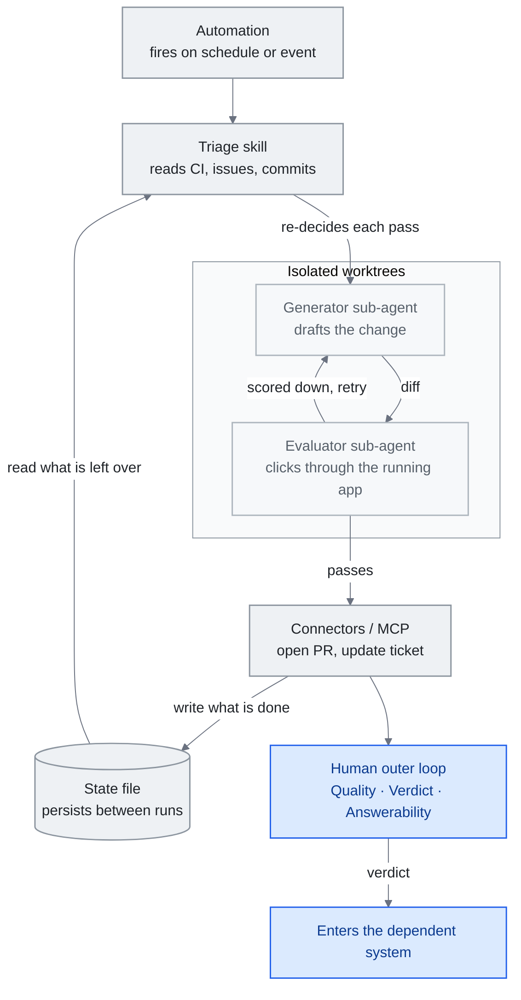

<!-- translation-sync:start -->
> 2026-10-31 の英語版に同期した機械支援翻訳です。構造と内容を確認しています。コードと図中ラベルは原文のまま、読書時間は英語原文の推定値です。
> [English source](../../../chapters/13-loop-engineering.md) · [Sync record](../../SYNC.md)
<!-- translation-sync:end -->

<!-- i18n-anchor -->

# 第 13 章：Loop Engineering —— エージェントにプロンプトを送るシステムを設計する

> **一文で：** Loop engineering とは、自分でエージェントにプロンプトを送る代わりに、あなたに代わってエージェントにプロンプトを送るシステムを構築する実践である —— 毎ターン手動で操縦するのをやめ、みずから走り、チェックし、自分を養うループを設計し始める。
>
> **なぜ重要か：** これは本ガイドの進化の物語における最も新しく、最も定まっていない層であり、自律的エージェント作業が今後 一年でどうスケジュールされ、検証され、レビューされるかを形作る可能性が最も高いものだ。
>
> **読了時間：** 約18分（英語原文4,035語 / 230 wpm）

*図：13.3節の五つの構成要素に、13.3節で別扱いとする外部状態を加えた、ループの一回の実行。最後には人間の外側のループと13.7の判断がある。二つの辺が本章の主張を担う。状態ファイルは、その回の判断より先に読み込まれる（13.2）。また、下書きを作るエージェントと採点するエージェントは別である（13.4）。*

本書の中で最も短命なアイデアがこれだ。（この称号を保持したのはわずか 六週間だった：2026 年 七月下旬、同じ経緯がループの上にもう一つ層があるという主張——graph engineering——を生み、[第 14 章](14-graph-engineering.md)で扱う。）"loop engineering"という用語は、執筆時点でおよそ 五週間前のものだ：2026 年 六月初旬に名付けられ、数日のうちに実践者のブログ、ポッドキャスト、X を通じて広まったが、まだその背後に学術文献はない。以下は意図的にヘッジされている。ある主張が、三 通りに異なって書き起こされたポッドキャストの発言に依拠している場合、あるいは何も名付けなかったバイラル投稿に依拠している場合、本章はそう明記する。目標は、新興のフレームを正確に記述することであって、それを定まった世代として認定することではない。

このフレームを記述する価値があるのは、それが実践者の言説の中で実際に機能しているからだ：harness engineering（第 4 章）が示唆はしたが切り出さなかったシフト——*エージェントにプロンプトを送る*ことから*エージェントにプロンプトを送るシステムを設計する*ことへの移行——に名前を与える。それが独自の層に値するのか、それとも単にスケジューラを取り付けた harness engineering に過ぎないのかは、本章がまさに未解決のまま残す問いである。

本章は、この用語がどこから来たか、その提唱者たちがそれを harness とどう関連づけているか、ループが何でできているか、ループを誠実に保つ generator-evaluator split、一つの大規模な本番事例、積み重なるループというフレーミング、人間が保持すべきとされる判断、そして採用の初期シグナルを扱う——係争中の部分は随所でフラグを立てる。

---

<!-- i18n-anchor -->

## 13.1 名前がついた週（2026年六月）

きっかけは 一つの投稿だった。2026 年 六月 7 日、**Peter Steinberger**（@steipete）——**OpenClaw** の作者で、Y Combinator は"from a weekend project to the most-starred software repo on GitHub in under 5 months, with 346k+ stars,"成長し React を追い抜いたと評した人物であり、現在は OpenAI に在籍している——が次のように書いた：

> Here’s your monthly reminder that you shouldn’t be prompting coding agents anymore.
>
> You should be designing loops that prompt your agents.

この投稿は **2026 年 七月中旬時点で 8.4M+ インプレッション** を集めた。それは何も名付けなかった：Steinberger は"loop engineering,"というフレーズを使っておらず、その言葉は彼の文章のどこにも現れない。命名は、彼が触発したアイデアに応答した他の人々から生まれた。

同じ日、**Addy Osmani**（Google）がこの実践に名前を与えたエッセイを公開した（*Loop Engineering*、addyosmani.com/blog/loop-engineering/、六月 7 日；O'Reilly Radar に 六月 22 日にシンジケート）。彼の定義が、以後の言説全体で引用されるものだ：

> Loop engineering is replacing yourself as the person who prompts the agent. You design the system that does it instead.

同じシフトはフロンティアラボの内側からも現れている。Anthropic で Claude Code の作者かつ責任者である **Boris Cherny** は、2026 年半ばのポッドキャストで自身のワークフローを同じように枠付けした。Lenny's Podcast インタビューの最も引用されている書き起こしによれば：

> I don't prompt Claude anymore. I have loops running that prompt Claude and figuring out what to do. My job is to write loops.

この引用には注記が必要であり、それこそが本章の存在理由であるような種類の注記だ。これは*口頭で*語られた一節であり、媒体によって書き起こしが一致していない（Lenny's ではなく Acquired ポッドキャストを引く媒体もある）、そして正典となる逐語テキストや完全な書き起こしは入手できない。実質——Cherny はもう手動でプロンプトを送らず、Claude にプロンプトを送り次の行動を決めるループを書いている——は複数の二次ソースにわたって裏付けられている；正確な言葉遣いは固定されていない。

まとめると、六月 7 日の週は触媒（Steinberger）、名前と定義（Osmani）、そして内部者からの反響（Cherny）を生んだ。生まなかったのはコンセンサスだ。この用語は数週間のうちに実践者の言説の中で結晶化したが、受け止め方は、これを本物のシフトだと呼ぶ読者と、時期尚早——スケジューリングのリブランディング、あるいは"the harness with a cron job."——だと呼ぶ読者とに割れている。査読済みの研究でこの用語を使ったものはない。本ガイドは loop engineering を新興の、係争中のフレーム（第 1 章の第四世代セクションを参照）として扱う。だからこそ以下の荷重を支えるあらゆる主張は一次ソースに紐づけられ、ギャップは埋められるのではなく名指しされる。

---

<!-- i18n-anchor -->

## 13.2 Harness の一階層上

提唱者たちが行う最もクリーンな定義上の動きは、ループを第 4 章の harness の直上に置くことだ。Osmani はその関係をずばり述べる：

> Loop engineering sits one floor above the harness.

ループとは*何であるか*についての彼のメンタルモデルは、harness を構成要素として保持し続ける：ループとは、"runs on a timer, it spawns little helpers, and it feeds itself."harness だ。彼は、これが以前の研究を置き換えるのではなく拡張するものであることを明言している——彼は"wrote before about the cousin of this, agent harness engineering, which is making the environment one single agent runs inside."と述べている。

中国の開発者 **程序员鱼皮**（liyupi）は、この関係の最も構造的なバージョンを提示する。六月 16 日のガイド（codefather.cn）で、彼は prompt technique、context management、harness building、そして loop を **層層包含**——層ごとに入れ子になった関係——として整理する：

> 这四者是层层包含的关系。提示词技巧、上下文管理、Harness 搭建，这些能力在 Loop 里面全都要用上。

（この 四つは層ごとに入れ子になった関係にある。prompt technique、context management、harness building は、いずれも loop の*内側で*すべて使われる。） これは第 1 章が prompt → context → harness に適用しているのと同じ入れ子構造のロジックを、外側にもう 一つの箱を加えて拡張したものだ。帰属については正確を期す価値がある：鱼皮 は、中国の開発者向けに既存の用語を再パッケージ化し構造化しているのであって、それらを作り出しているのではない——"harness engineering"と"loop engineering"の出所は Claude Code と Cherny の言説にさかのぼる。

彼の馬のメタファーは、harness と loop の境界線を誰よりも鋭く描いている：

> 如果把 AI 比作一匹马，Harness 就是你给马装上的缰绳、马鞍和围栏，然后你骑在马上手动驾驭它。

（AI を馬にたとえるなら、harness とはその馬につける手綱、鞍、そして柵であり——それからあなたはその馬に乗り、手動で操縦する。）

> 而 Loop 呢，是你设定好一条巡逻路线后，不用上马，让马自己按路线一圈一圈地跑。

（一方 loop とは、巡回ルートを設定したら*馬には乗らず*——馬がそのルートを自分で何周も走る、というものだ。）

このメタファーは、loop engineering が"cron for agents"へと崩壊するのを防ぐ唯一の区別を符号化している：**ループはスケジューラではない。** スケジューラは時刻通りに発火する。ループは時刻通りに発火し、*さらにその回に何をすべきかを判断するために現在の状態を読む。* 行動を選ぶ前に CI ステータス、未解決の issue、あるいは前回の実行の残り物を検査するランタイムの意思決定者——それこそまさに cron のエントリが持たないものだ。ループとはスケジューラに、毎回再判断する状態読み取り型のエージェントを足したものである。（相互参照：第 1 章"The Key Insight: Coexistence, Not Replacement."。）

---

<!-- i18n-anchor -->

## 13.3 ループは何でできているか

Osmani のエッセイは最も具体的な内訳を提示する。彼のセクションの見出しは **"The five pieces, and then notes"** だ——そしてこの数え方は重要である、なぜなら水増ししやすいからだ。存在するのは *五つのピースに外部 state を加えたもの* であって、六つの対等な構成要素ではない：

- **自動化（Automations）** —— ループを発火させるトリガー（スケジュール、イベント）。
- **worktree** —— 並行するエージェントが衝突しないようにする、隔離された作業コピー。
- **skill** —— 第 5 章の再利用可能な能力バンドル。
- **コネクタ（MCP）** —— 第 7 章のツールとデータへのリーチ。
- **サブエージェント** —— 一 回の実行が生み出す小さなヘルパー。

"then notes"にあたるのが **外部 state／記憶** ——実行と実行の間で進捗を永続化する markdown ファイルや Linear のボードだ。これは 六つ目の対等なブロックではない；五つのピースが書き込み、読み取る基盤である。

彼の実例は毎朝のトリアージループであり、まさにすべてのピースが 五つのうちのどれか 一つに対応するがゆえに有用だ。**自動化** が毎朝発火する。トリアージ **skill** が CI の失敗、未解決の issue、直近のコミットを読む。隔離された **worktree** が、一つは修正案を起草する **サブエージェント**、もう 一つはそれをレビューするサブエージェントをホストする。**コネクタ** が PR を開き、チケットを更新する。未解決の項目はトリアージの受信箱に浮上し、**state ファイル** が進捗を永続化することで、翌朝の実行は再スタートではなく続きから始まる。この state ファイルこそが荷重を支える部分だ：これがなければ、ループは昨日の記憶を持たず、すべての実行はコールドスタートになる。

---

## 13.4 Generator vs Evaluator

自分自身にプロンプトを送るループは、一つの難問を受け継ぐ：*誰が作業をチェックするのか？* 変更を生み出すエージェントがそれを採点もするなら、ループは自画自賛へと最適化されてしまう。最も引用される一次資料は、命名の週より前のものであり、それ自体が示唆的だ——実践がラベルより先行して走っていたのだ。**Prithvi Rajasekaran** の *"Harness design for long-running application development"*（anthropic.com/engineering/harness-design-long-running-apps、2026 年 三月 24 日）は、この失敗モードを直接文書化している：自分自身の出力を評価するよう求められると、エージェントは"tend to respond by confidently praising the work"し、"reliably skew positive when grading their own work."。

彼の修正策は adversarial training から構造を借用している：

> Taking inspiration from Generative Adversarial Networks (GANs), I designed a multi-agent structure with a generator and evaluator agent.

この非対称性こそが洞察のすべてであり、それゆえこの分割は余分なエージェントを持つ価値があるのだ：

> Tuning a standalone evaluator to be skeptical turns out to be far more tractable than making a generator critical of its own work.

決定的に重要なのは、evaluator が diff ではなく*振る舞い*を検証することだ。Rajasekaran の設計では、evaluator は"used the Playwright MCP to click through the running application the way a user would, testing UI features, API endpoints, and database states,"、そして"would navigate the page on its own, screenshotting and carefully studying the implementation before scoring each criterion and writing a detailed critique."。コードを読むことは検証ではない；実行することが検証なのだ。

この generator-evaluator split は、いま出荷されているループ制御プリミティブの中に見て取れる。それらの間の重要な違いは、*ループがいつ止まるべきかをどう知るか* だ：

- **`/loop`**（Claude Code v2.1.71）は、prompt やスラッシュコマンドを一定間隔で繰り返し実行する——changelog の該当行は"Added `/loop` command to run a prompt or slash command on a recurring interval (e.g. `/loop 5m check the deploy`)."。繰り返しタスクは作成から 七 日後に期限切れになる；タスクは最後にもう一度発火してから、自分自身を削除する。
- **`/goal`**（Claude Code v2.1.139+）は*条件が成立するまで*走る："a small fast model checks whether the condition holds"（デフォルトは Haiku）——毎ターンの後に条件をチェックする独立した evaluator であり、"after every turn, so completion is decided by a fresh model rather than the one doing the work."。内部では、`/goal` は"a wrapper around a session-scoped prompt-based Stop hook."だ。
- **Cloud Routines** は"on Anthropic-managed cloud infrastructure, so they keep working when your laptop is closed"；最小間隔は 一 時間で、各実行はフレッシュな clone から始まる。
- **Codex scheduled automations** は日次・週次のスケジュール、または RFC 5545 の recurrence rule（RRULE）で設定するカスタムのケイデンスをサポートする。

`/loop` 対 `/goal` の対比は、プロダクト設計として表面化した generator-evaluator split だ。`/loop` は*間隔による再実行*——state に関係なく、時計通りにまた発火する。`/goal` は*条件で判定される終了*——第二の、独立したモデルが作業が終わったかを決める。一方は繰り返し、もう一方は裁定する。真剣なループには通常両方が必要だ：走らせるトリガーと、いつ止まるべきかを知る evaluator。

---

<!-- i18n-anchor -->

## 13.5 本番事例：Stripe の「Minions」（2026年三月）

本番で稼働している、公開されている中で最大のループは Stripe の **"minions."** だ。Stripe のエンジニアである **Steve Kaliski** は、2026 年 三月に *"How I AI"* ポッドキャスト（Claire Vo が司会）でこのシステムについて語った；Stripe 自身の開発者ブログは、二 部構成の *Minions* 記事で内部の詳細を文書化している。（エピソードの正確な日は二次ソース間で食い違うため、ここでは月のみを記す。）

見出しとなる数字は、無人での出力量だ。Kaliski は、Stripe は"landing about 1,300 PRs that have no human assistance besides review per week."と言う。Stripe のブログは同じ数字をより控えめに述べる："over a thousand pull requests merged each week at Stripe are completely minion-produced,"、そして"human-reviewed,"一方で"contain no human-written code."。

minion は Slack からトリガーされる——特定の絵文字リアクションを付けるか、Slack アプリをタグ付けすることによって。Stripe の言葉を借りれば、"by tagging our Slack app, engineers can kick off a minion directly from the thread discussing a change."。

本ガイドにとって荷重を支える詳細は、*Stripe が決定論的／確率的の境界線をどこに引いているか* だ。context の組み立てはモデルが動く**前**に行われ、それは決定論的だ："We deterministically run relevant MCP tools over likely-looking links before a minion run even starts, to better hydrate the context."。確率的な部分が始まるのはその後だけだ。コアのエージェントループは Block のオープンソース **Goose** のフォークだ——"the core agent loop runs on a fork of Block's coding agent goose ... which we forked early on."。実行は Stripe の **devbox** の中でサンドボックス化されている；（ポッドキャストではなく）Stripe の開発者ブログによれば、"a Stripe devbox is an AWS EC2 instance,"、あつらえて長寿命というより"cattle, not pets"——標準化され使い捨て可能なものとして扱われている。

フレームワークの要点：信頼性はより賢いモデルから来るのではない。それは*境界線の置き方*——確率的生成の前に行う決定論的な context ハイドレーション——から、そして人間が書くパスから外れてレビューのパスに移動することから来る。すべての minion の PR は依然としてエンジニアによってレビューされる。ループは執筆をスケールさせたのであって、人間を取り除いたのではない、人間を再配置したのだ。

---

<!-- i18n-anchor -->

## 13.6 ループを積み重ねる

**LangChain** の *"The Art of Loop Engineering"*（Sydney Runkle、2026 年 六月 16 日）は、この層に内部構造を与える最も明快な試みだ。それは基本ケースから始まる：

> The core agent algorithm is simple: give the LLM context and let it call tools in a loop until it's done.

そこから 四 段の梯子を積み重ねる。ページ自体の見出しは"Loop"と"Level"というラベル付けを混在させており、ここではそのまま再現する——**"Loop 1: The Agent,""Level 2: Verification loop,""Level 3: Event driven loop,""Level 4: Hill climbing loop."**。その進行は：

1. **Loop 1: The Agent** —— 基本のツール呼び出しループ、context が入り、終わるまでツールを呼び出す。
2. **Level 2: Verification loop** —— エージェントの出力への独立したチェック、§13.4 の generator-evaluator split を 一 段として適用したもの。
3. **Level 3: Event driven loop** —— ループは、間隔や人間のプッシュだけでなく、現実世界のイベントで発火する。
4. **Level 4: Hill climbing loop** —— 自己改善ループ、システムが連続する実行を重ねるごとに良くなっていく。

一つ精度に関する注記を挟む、なぜなら二次的な報道はこれを誇張しているからだ：このページは第 四 段を*実行を重ねるごとの自己改善*として枠付けており、自分自身の harness を書き換えるシステムとしてではない。より強い主張は原典にはない。Runkle はまた **"loopcraft"** という用語も借用している——ただし彼はそれを Swyx に帰属させており、"loopcraft: the art of stacking loops."についての彼の記事を引用している。この造語は Swyx のものであり、LangChain が引用しているだけで、LangChain 自身のものではない。

**複数日にわたる外側のハーネスの開示。** OpenAI が2026年十月14日に公開した [Third Moment Research の事例](https://openai.com/index/third-moment-research/)は、10,000の同時エージェントと36-48時間の調査を報告する。Codex は別のハーネスの内側で動き、そのハーネスが未完了の実行経路を調べて、再試行、終了、人間へのエスカレーションを選ぶ。これは上記の積層ループのパターンを運用として具体化する。ベンダーと顧客による開示であり、完了率の独立した検証はない。数日間稼働すること自体は、有用な進捗が続いた証拠ではない。

---

<!-- i18n-anchor -->

## 13.7 Outer Loop：人間が保持するもの

§13.1〜13.6 がエージェントが走らせるループを記述しているとすれば、Osmani の続編は人間が保持すべきとされるループを記述する。*"Own the Outer Loop"*（addyo.substack.com/p/own-the-outer-loop）は 2026 年 七月 8 日に X で発表された（Substack 版のバイラインは 七月 9 日）。その分割はこうだ：いまやエージェントが **inner execution loop**——調査、実装、テスト／検証、報告——を走らせる一方で、エンジニアが **outer loop** を保持する。彼のテーゼの一文は率直だ：

> Engineers own the outer loop.

outer loop とは、委任されない判断のことであり、彼自身の言葉では 三つの柱——**Quality**、**Verdict**、**Answerability**——として構造化されている。Quality は、エージェントが行動する前に走るチェックが生む背圧だ。**Verdict** とは"the final decision we make before work enters our dependent system."である。**Answerability** とは"the guarantee that if someone asks, I can explain why."だ。（彼の用語は単数形の *Verdict* であり、"quality bar"は彼のフレーズではない——その柱は単に *Quality* だ。）これらを人間の手に残しておく理由は：

> An agent can write it. But before it reaches users, someone must explain why it should exist, why it's safe enough to be part of production, and what they will do when it is wrong.

彼は outer loop を過剰に委任することの 三つの失敗モードを名指す：**cognitive debt**（"erosion of your understanding and memory of how to solve problems"）、**cognitive surrender**（"blindly accepting what AI gives you"）、そして **orchestration tax**（あなたの判断が実際にカバーできる以上のエージェントを立ち上げることの足かせ）。これらは、エンジニアであり続けることなく"go"を押すことのコストだ。

六月 7 日のエッセイへと立ち戻る通底線は、その締めくくりの指示であり、まさにそれに対する警告として読める：

> Build the loop. But build it like someone who intends to stay the engineer, not just the person who presses go.

そして、ループが自己正当化するものだというあらゆる想定を切り崩す一文：

> Two people can build the exact same loop and get completely opposite results.

ループは、それを取り巻く outer loop の良さの分だけしか良くならない。それが、このフレーム全体の正直な中心である。

---

<!-- i18n-anchor -->

## 13.8 採用シグナル

三つの指標が、このフレームが発案者たちを超えて広がっていることを示している。それぞれは検証可能なものに絞り込まれており、それらとともに流通した誇張は除外している。

**ベンダー。** Anthropic の公式開発者アカウント **@ClaudeDevs** は 2026 年 七月 6 日、X Article *"Getting started with loops"* を公開した（七月中旬時点でおよそ **6.0M インプレッション、38K+ ブックマーク**）。この資料は agentic loop を直接教えている——"Every prompt you send starts a manual loop with you directing each turn. Claude gathers context, takes action, checks its work, repeats if needed, and responds"——そしてターンベース、goal ベース（`/goal`）、時間ベース（`/loop`、`/schedule`）のループを解説していく。編集上のニュアンスは留めておく価値がある：この X article 自体のタイトルは *"loops,"* ではなく *"loop engineering."* と言っている。"loop engineering"というラベルが現れるのは、公式の Claude ブログのミラー版のフレーミング（claude.com/blog/getting-started-with-loops）であって、プロダクトの語彙そのものではない。ベンダーがループを教えることは、ベンダーがその用語を採用することよりも弱いシグナルだ——そして検証されているのは弱い方だけである。

**中国。** 鱼皮 の 六月 16 日の 保姆级（"nanny-level"＝手取り足取り）ガイドは、中国の開発者言説への入口だ。そのタイトル——提示词工程已死，Loop Engineering 称王！保姆级教程 + 项目实战（"Prompt engineering is dead, Loop Engineering reigns! Nanny-level tutorial + project practice"）——は 已死（"is dead"）で始まるが、そのフックは本文自体が後退させている誇張だ：ガイド自身の 層層包含 の論証（§13.2）は、prompt technique が loop によって殺されるのではなく、loop の*内側で使われる*というものだ。おおまかなリーチの代理指標として、彼の GitHub アカウントは **23.9k フォロワー** を示している。（より大きなフォロー総数も出回っているが、一次ソースに対して検証できなかったため省略する。）

**記憶と評価。** ループが最も依存しているサブ問題——実行と実行の間を生き延びる、session を横断する state——は、いまや個別にベンチマーク化されている。Snorkel の **Continual Learning Bench**（arXiv 2606.05661；Snorkel AI／UC Berkeley SkyRL／UW-Madison）は、結果を agent、記憶システム、タスクへと因数分解する。それによれば、**Fable を記憶のバックボーンとして使うエージェントシステムは、Opus や Sonnet の上に構築されたものを上回った**（Snorkel の Benchtalks インタビュー；定性的な発見であり——arXiv 論文のモデル一覧は Opus 4.7／Sonnet 4.6／Gemini 3.1 Pro／Gemini 3 Flash／GPT-5.4 であり、Fable に付随する数値スコアはない）。ローンチ時点で、最上位クラスのシステムはおよそ **25% の正規化ゲイン** に到達し、in-context learning がリーダーボードを牽引した。シグナルは数字そのものではない；*どの記憶がループを支えているか*が、いまや測定される軸になったということだ。

名前がついてから 五週間で、loop engineering は定義を持ち、harness との関係が明言され、大規模な本番事例を持ち、フレームワークベンダーのカリキュラムを持ち、中国の主流ガイドを持ち、ベンダー自身のループ資料を持つに至った。それが持っていないのは、学術文献、定まった受け止め方、そしてそれが単なる scheduler と state ファイル付きの harness engineering ではなく本物の第四世代であるという合意だ。本ガイドはこれを、定まったものとしてではなく新興のものとして追跡する——そして、二人が同じループを作っても正反対の結果を得ることがあるという Osmani 自身の警句こそが、その理由の最も公正な要約である。

---

<!-- i18n-anchor -->

## 持ち帰りたい三つのこと

- **ループはスケジューラではない。** 時刻に応じて起動した後、現在の状態を読み、その回に何をすべきかを再判断する。
- **書き手を採点者にしてはいけない。** 自分の成果物を採点するエージェントは肯定的に偏るため、別の懐疑的な評価者を置くことが対策になる。
- **Stripe の信頼性は、賢いモデルではなく境界の配置から生まれた。** ループは執筆を拡大し、人間をレビューの役割へ移した。

---

<!-- i18n-anchor -->

## 情報源

- OpenAI。Third Moment Research の事例（2026年十月14日）：[https://openai.com/index/third-moment-research/](https://openai.com/index/third-moment-research/)。
- Steinberger, Peter (@steipete). "loops, not prompts"というフレーミングを触発した投稿（2026 年 六月 7 日）：[https://x.com/steipete/status/2063697162748260627](https://x.com/steipete/status/2063697162748260627) —— 2026 年 七月中旬時点で 8.4M+ インプレッション；投稿自体は"loop engineering."というフレーズを使っていない。
- Osmani, Addy. "Loop Engineering"（2026 年 六月 7 日）：[https://addyosmani.com/blog/loop-engineering/](https://addyosmani.com/blog/loop-engineering/)；O'Reilly Radar にシンジケート（2026 年 六月 22 日）：[https://www.oreilly.com/radar/loop-engineering/](https://www.oreilly.com/radar/loop-engineering/) —— 命名エッセイ；定義、"one floor above the harness,"、五つのピース、毎朝のトリアージの実例。
- Osmani, Addy。"Own the Outer Loop"（X での告知は2026年七月8日、Substack の署名日付は2026年七月9日）：[https://addyo.substack.com/p/own-the-outer-loop](https://addyo.substack.com/p/own-the-outer-loop) --- 内側と外側のループ、Quality / Verdict / Answerability、認知的負債、認知的な明け渡し、オーケストレーションの負担。
- Cherny, Boris. "Head of Claude Code: what happens next" インタビュー、Lenny's Podcast／Lenny's Newsletter（2026 年半ば）：[https://www.lennysnewsletter.com/p/head-of-claude-code-what-happens](https://www.lennysnewsletter.com/p/head-of-claude-code-what-happens) —— "I don't prompt Claude anymore ... my job is to write loops"の一節；媒体間で一貫せず書き起こされた口頭での引用であり、その注記付きでここに引用する。
- Rajasekaran, Prithvi. "Harness design for long-running application development," Anthropic Engineering（2026 年 三月 24 日）：[https://www.anthropic.com/engineering/harness-design-long-running-apps](https://www.anthropic.com/engineering/harness-design-long-running-apps) —— generator／evaluator（GAN 発想）split；懐疑的な独立 evaluator；Playwright-MCP による行動検証。
- Runkle, Sydney. "The Art of Loop Engineering," LangChain blog（2026 年 六月 16 日）：[https://www.langchain.com/blog/the-art-of-loop-engineering](https://www.langchain.com/blog/the-art-of-loop-engineering) —— 四 段に積み重なるはしご（"Loop 1: The Agent"／"Level 2/3/4"）；"loopcraft"は Swyx に帰属。
- Kaliski, Steve. Stripe の"minions,"、Claire Vo との *How I AI*（2026 年 三月）；Stripe 開発者ブログ、*Minions*（第 1 部・第 2 部）：[https://stripe.dev/blog/minions-stripes-one-shot-end-to-end-coding-agents](https://stripe.dev/blog/minions-stripes-one-shot-end-to-end-coding-agents) —— 週あたり ~1,300 件の minion PR（人間がレビュー、人間が書いたコードなし）；決定論的な MCP 事前ハイドレーション；Goose のフォーク；devbox = EC2、"cattle, not pets"（開発者ブログ）。
- 程序员鱼皮（liyupi）. 「提示词工程已死，Loop Engineering 称王！保姆级教程 + 项目实战」, codefather.cn（2026 年 六月 16 日）：[https://www.codefather.cn/post/2066793761979092994](https://www.codefather.cn/post/2066793761979092994) —— 層層包含 の入れ子構造；馬と乗り手のメタファー；GitHub @liyupi 23.9k フォロワー。
- Anthropic (@ClaudeDevs). X Article "Getting started with loops"（2026 年 七月 6 日）：[https://x.com/ClaudeDevs/status/2074208949205881033](https://x.com/ClaudeDevs/status/2074208949205881033)；正典ミラー：[https://claude.com/blog/getting-started-with-loops](https://claude.com/blog/getting-started-with-loops) —— ~6.0M インプレッション／38K+ ブックマーク（七月中旬）；"loops,"を教えており、"loop engineering"というラベルはブログミラー版のフレーミングによるもの。
- Claude Code プロダクトドキュメント：`/loop` と scheduled tasks [https://code.claude.com/docs/en/scheduled-tasks](https://code.claude.com/docs/en/scheduled-tasks)（v2.1.71；7 日での繰り返しタスク期限切れ）；`/goal` [https://code.claude.com/docs/en/goal](https://code.claude.com/docs/en/goal)（v2.1.139+；フレッシュなモデルによる条件チェック；prompt ベースの Stop フックのラッパー）；Cloud Routines [https://code.claude.com/docs/en/routines](https://code.claude.com/docs/en/routines)（Anthropic 管理インフラ；最小 1 時間；実行ごとにフレッシュな clone）。
- Codex scheduled automations（ChatGPT／Codex ドキュメント）：[https://learn.chatgpt.com/docs/automations](https://learn.chatgpt.com/docs/automations) —— 日次／週次スケジュールに加え、カスタムの RFC 5545 RRULE ケイデンス。
- Snorkel AI／UC Berkeley SkyRL／UW-Madison. "Continual Learning Bench," arXiv 2606.05661（2026 年 六月）：[https://arxiv.org/abs/2606.05661](https://arxiv.org/abs/2606.05661) —— agent／記憶システム／タスクへの因数分解；Snorkel の Benchtalks インタビューからの定性的な Fable-backbone の発見；ローンチ時点で最上位クラスの正規化ゲインは ~25%、in-context learning が首位。

---

*前の章: [第 12 章 — ナレッジエンジニアリングのためのローカルモデル](12-local-models.md)*

*次の章: [第 14 章 — Graph Engineering：エージェントの組織を配線する](14-graph-engineering.md)*
