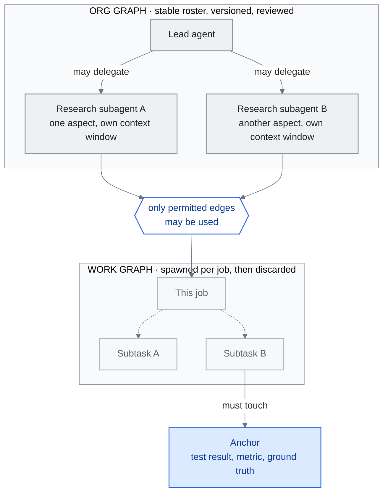

<!-- translation-sync:start -->
> 2026-10-31 の英語版に同期した機械支援翻訳です。構造と内容を確認しています。コードと図中ラベルは原文のまま、読書時間は英語原文の推定値です。
> [English source](../../../chapters/14-graph-engineering.md) · [Sync record](../../SYNC.md)
<!-- translation-sync:end -->

<!-- i18n-anchor -->

# 第 14 章：Graph Engineering —— エージェントの組織を配線する

> **一文で：** Graph engineering とは、loop engineering の上のもう一つの層は graph である——どのエージェントが存在し、誰が誰に委任してよく、それぞれのループが互いをどう監督し訂正し合うかを明示的に配線すること——という 2026 年 七月の主張である。
>
> **なぜ重要か：** この主張が生き残るなら、それはマルチエージェントシステムが場当たり的なループの寄せ集めであることをやめ、設計された組織になる層に名前を与えることになる；生き残らないなら、それはこうした世代のラベルがどう作られ——そして解体されるかについての、最も明快な生きたケーススタディとなる。
>
> **Reading time:** ~29 min (6,600 words / 230 wpm)

*図：14.2節が区別する二つの対象。許可された委任の辺から成る安定した org graph と、その内側に一つの仕事が生む一時的な work graph。さらに、相互レビューするエージェントが自信ある同意へ収束するのを防ぐ、外部根拠に基づく確認として Perez のアンカーを示す。graph engineering という用語には議論がある（14.3）が、これらの構造自体に議論があるわけではない。*

本章の初稿は2026年七月下旬、用語の誕生から約二週間の時点で書かれ、第13章に代わって本ガイドで最も歴史の短いアイデアとなった。"Graph engineering" は2026年七月17-18日以降の数日で具体化し、実務家のブログとベンダーの論考だけに存在し、学術文献の裏づけはなかった。現在も本ガイドが扱う中で最も議論のある用語である。最も強い反応は、フレームワークの名前に文字どおり graph を持つ LangChain からで、実践自体は三年前からあり、新しいのは呼び名だけだというものだった。

初稿は結論ではなく、2026年九月に確認する四つの指標をゲートとして示して終えた。**確認は2026年九月15日に実施し、判断は二つに分かれた。用語はゲートが実際に定めた継続使用のテストを通過したが、独立したエンジニアリング層としての地位は未証明である。** 14.7節に日付付きのスコアカード、各指標の証拠、七月の初稿を修正することになった二点を載せる。そこまでの各節には、その八週間に現れた証拠を追加した。名称を使わず構造を提供する第二のベンダー、名称より一年以上古い本番事例、オープンソースのエージェント組織、有料講座、そして何という用語が死んだのかを論じる第二波の論考である。

以下では意図的に断定を避ける。懐疑派にも提唱者と同じだけの紙幅を与え、情報源ごとに異なる閲覧数は食い違いとして示す。特記しない限り、"at the time of writing" は2026年七月下旬を指す。

本章は、触媒となった投稿とそれが引き起こしたエッセイの波、この新しいフレームが実際に主張していること、それへの反論、この名前が必要にしているナレッジグラフとの区別、もしこれが層であるならどこに位置するか、中国エコシステムの反響、そして実践者がいま気にすべきかどうかを扱う。

---

<!-- i18n-anchor -->

## 14.1 それを始めたツイート（2026年七月17〜18日）

このプレイブックは見覚えがある、なぜなら本ガイドはまさにそれが実行されるのを見たばかりだからだ。六月 7 日の投稿が loop engineering を触媒してから（第 13.1 節）六週間後、**Peter Steinberger**——OpenClaw の作者、現在は OpenAI に在籍——が再び投稿した。[Carlos E. Perez](https://medium.com/intuitionmachine/from-loop-engineering-to-graph-engineering-d3ebeb08511c) と [Yash Thakker](https://explainx.ai/blog/graph-engineering-ai-agents-multi-agent-organizations-2026) が逐語的に引用したところによれば、その投稿はこう書かれていた：

> Are we still talking loops or did we shift to graphs yet?

何よりもまず 二つのソース上の注記が必要だ、なぜならそれを行うことこそが本章の存在理由だからだ。第一に、この投稿自体は本ガイドのために直接取得されたものではなく、独立に取得された二次ソースはそれを同一の形で伝えていない。この正確な英語の文言を引用しているのは Perez と Thakker だけだ。[LangChain](https://www.langchain.com/blog/3-years-of-graph-engineering-with-langgraph) と Perez は文章を引用せずに投稿にリンクしている；[36kr](https://eu.36kr.com/en/p/3904771418867330) と Tony Bai はそれを中国語訳で表現しており、36kr の英語版はそれを"Are we still talking about loops, or have we moved on to graphs?"と逆翻訳している；そして [Eigent](https://www.eigent.ai/blog/graph-engineering-ai-agents) はそれを言い換えている。この 二つの逐語的な引用こそが、上記の文言をそもそも印刷する根拠だ。

第二に、それを取り巻く数字は一致しない。この投稿に日付を付けているすべてのソースは 七月 18 日としている；本章の見出しで使っている範囲の 七月 17 日側の端は、米国時間での可能性であって、ソース間の記録された不一致ではない。閲覧数は本当に食い違っている——ただしそれらは同一時点の対立する測定というより、異なる瞬間に取られたスナップショットだ：Thakker は数時間で 575K 閲覧と報告し、36kr は 二 日以内で 2.6M（同記事によれば、六週間前のループ時代の投稿の 8.4M 閲覧と対比して）、Tony Bai は 二 日間でおよそ 800K としている。ここではどの数字も単独で事実として述べない。

六月の投稿と同様、Steinberger は何も名付けなかった。"graph engineering"というフレーズは彼の文章のどこにも現れない。この複合語は、prompt、context、harness、loop engineering を意識的にパターンとして踏襲する応答エッセイの中で数日のうちに結晶化した——そしてその波は速かった：

- **七月 18 日** —— [Yash Thakker の explainx.ai ガイド](https://explainx.ai/blog/graph-engineering-ai-agents-multi-agent-organizations-2026)（七月 26 日まで更新）が、このツイートを触媒として名指し、org graph／work graph の分割を提示する。
- **七月 19 日** —— **Carlos E. Perez**（Intuition Machine）が、最初の実質的な理論的拡張を公開する。
- **七月 20 日** —— エンタープライズベンダー **TrueFoundry** が、ガバナンスチェックリスト付きの[本番指向のガイド](https://www.truefoundry.com/blog/graph-engineering-enterprise-guide)を出荷する。
- **七月 21 日** —— **eigent.ai** がそのベンダーエッセイを公開する；中国の **Tony Bai** と **36kr** がともに同日にこの言説を取り上げる（14.6）。
- **七月 22 日** —— Sydney Runkle と Harrison Chase による **LangChain** の公式回答が、触媒から 四 日後に着地する（14.3）。

触媒、エッセイの波、ベンダーによる対抗フレーム、そして中国エコシステムの反響——すべてが 一週間のうちに：loop engineering の命名シーケンスが、より高速で再生されたのだ。

---

<!-- i18n-anchor -->

## 14.2 Graph Engineering は何を主張しているか

これらのエッセイを削ぎ落とすと、三つの主張が繰り返し現れる。

**エージェントの振る舞いではなく、エージェントの組織。** Thakker のフレーミングは、この進行の中で最も引用しやすいバージョンだ：

> Loops made agent behavior programmable. Graphs make agent organizations programmable.

彼のガイドは、グラフを 二つの明確に異なるオブジェクトに分割する：

- **org graph** —— どのエージェントが存在し、それぞれが何のためにあり、どの委任のエッジが許可されているかについての安定したチャート；
- **work graph** —— 特定のジョブが生み出し、実行し、破棄する、儚いタスク分解。

その主張は、この両方がいまや、第 4 章が harness を、第 13 章が loop を扱うのと同じように、設計され、バージョン管理され、レビューされるべきエンジニアリング成果物だというものだ。

**互いを監督し合うループを、アンカーがつなぎ止める。** [Perez のエッセイ](https://medium.com/intuitionmachine/from-loop-engineering-to-graph-engineering-d3ebeb08511c)——最初の理論的拡張、七月 19 日——は、グラフを互いを監督し制約し合うループのネットワークとして記述する。彼の独自の追加が **anchor（アンカー）** だ：グラフのいずれかのノードが必ず触れなければならない、議論の余地のない、外部に接地された測定（テスト結果、メトリクス、グラウンドトゥルースのチェック）。アンカーがなければ、互いをレビューし合うエージェントのグラフは、正しさではなく自信に満ちた合意へと収束するエコーチェンバーへと退化する、と彼は論じる——これは、第 13.4 節が単一のループについて文書化した自己採点の失敗の、マルチエージェント版である。

**統治されたトポロジー。** ベンダーのエッセイ——[TrueFoundry](https://www.truefoundry.com/blog/graph-engineering-enterprise-guide)（七月 20 日）と [Eigent](https://www.eigent.ai/blog/graph-engineering-ai-agents)（七月 21 日、Steinberger の投稿と Perez のネットワーク・オブ・ループの拡張の両方をクレジットしている）——は同じ運用上の読み方に収束する：graph engineering とは、エージェントのトポロジーのガバナンスと可観測性である。この読み方において、それが所有する問いは：

- エージェント間のどの遷移が許可され、どれが構造的に不可能か；
- 障害が組織全体にカスケードする前に、どこで隔離されるか；
- work graph の暴走したブランチがどう検知され、切断されるか；
- エージェント組織の監査とは、そもそもどのようなものか。

TrueFoundry はこれらのためのエンタープライズチェックリストを出荷している；そのチェックリストが存在するために新しい規律の名前を必要としたかどうかは、まさに次のセクションが取り上げる問いである。

**ベンダーは名前ではなく構造を出荷する。** 2026 年 八月 7 日（Claude Code v2.1.224、八月 23 日までに v2.1.241 へと反復）、Anthropic は session を横断するエージェントのメッセージングを出荷した：`ListAgents` は名前のついた session ——サブエージェント、agent-team のチームメイト、他のローカル session、クラウド session、他のマシン上の Remote Control session——を発見し、`SendMessage` はそれらの間で名前によってプレーンテキストを配送する。これは session ごとの受信ガバナンス（accept／hold／refuse）、permission-mode に基づくデフォルト、そしてサイズ／バースト／ループのスロットリングによってゲートされている。スコープは意図的に狭い：会話履歴やファイルは session を横断せず、session を横断した権限承認もなく、この機能は Bedrock、AWS 上の Claude Platform、Google Cloud Agent Platform、Microsoft Foundry では利用できない。上で定義したばかりの org graph——名前のついたエージェントの安定した名簿に許可された委任のエッジを加えたもの——に照らして読むと、これはその出荷済みインスタンスのように見える：名前がつけられ、アドレス指定可能な session に、それらの間の統治されたメッセージのエッジを加えたものだ。そうではないのは、語彙の採用だ：Anthropic 自身のドキュメントと changelog は、この機能を記述するのに"graph engineering"というフレーズをどこにも使っていない。このギャップ——大手 harness ベンダーが、本章が追跡しているパターンを運用化しながら、そのために作られたラベルについては沈黙を保っている——は、この用語ではなく、このプリミティブについての証拠であり、両者は同じ主張ではない。

**名称の登場より一か月早く、第二のベンダーが先に提供していた。** OpenAI の Codex は、別の経路で先に同じ場所へ到達した。二つのプルリクエスト、[#28792](https://github.com/openai/codex/pull/28792)、"Expose thread-level multi-agent mode"（2026年六月19日マージ）と、[#29324](https://github.com/openai/codex/pull/29324)、"Simplify multi-agent mode controls"（2026年六月22日マージ）は、委任の挙動を一つの `multiAgentMode` 設定に統合する。第二の PR が記す三状態は、`none`、"Keep multi-agent tools available without adding mode instructions"、`explicitRequestOnly`、"Only delegate after an explicit user request"、`proactive`、"Delegate when parallel work materially improves speed or quality." である。三状態をすべて含む初の公開ビルドは、2026年六月22日の Codex `rust-v0.142.0` で、リリースノートは "App-server clients can configure multi-agent delegation as disabled, explicit-request-only, or proactive at the thread and turn level." と述べる。Steinberger の投稿より一か月、Anthropic のセッション間メッセージングより七週間早い。

どの種類の制御かを決めるため、`none` を注意して読む必要がある。ツールは利用可能なままで、変わるのはモード指示を追加するかどうかだ。モデルに伝える内容を変えて適用する委任方針は、*プロンプトレベルの方針*であり、強制される認可ではない。第4章が指示と区別するゲートウェイ型の deny-by-default チェックではなく、二つの PR もそう主張していない。したがって "a vendor shipped org-graph governance" という読み方より、ベンダーが org-graph の形を持つ*設定*を提供し、プロンプトと同じ方法で適用した、という読み方が正確である。Claude Code と同じく用語の指標は空のままだ。このマージ前後の三版のリリースノートに "graph engineering" はなく、どちらの PR もこの言葉で作業を説明していない。

**名称より十三か月古い本番事例。** 稼働するエージェント組織の最も詳しい公開説明は、用語の登場前に公表され、初稿では見落としていた。Anthropic の ["How we built our multi-agent research system"](https://www.anthropic.com/engineering/multi-agent-research-system)（2025年六月13日）は、Claude の Research を支える orchestrator-worker 型のトポロジーを示す。リードエージェントは "analyzes it, develops a strategy, and spawns subagents to explore different aspects simultaneously," と動き、各サブエージェントは独自のコンテキストを持ち、別の CitationAgent が出典を付す。開示は設計を越え、本番で初めて重要になる部分にも踏み込む。評価は "a set of about 20 queries representing real usage patterns" から始め、LLM 評価者が事実の正確さ、引用の正確さ、網羅性、情報源の品質、ツール効率を採点する。障害には "that can resume from where the agent was when the errors occurred" という復旧機構を使い、リリースには "rainbow deployments to avoid disrupting running agents, by gradually shifting traffic from old to new versions while keeping both running simultaneously." を使う。主要比較は Anthropic 自身の内部測定で、Opus 4 が Sonnet 4 のサブエージェントを率いるシステムは "outperformed single-agent Claude Opus 4 by 90.2%," とされ、チャット対話の約15倍のトークンを使う。"graph engineering" は一度も出てこない。これは正確には、*実践*が*名称*より一年前に本番事例として開示されていた証拠であり、LangChain の主張を Anthropic 側から示すものだ。

**特定の大手によらない実装もある。** このパターンはベンダーに限らない。[`headcount`](https://github.com/cbrock84/headcount)（GitHub ユーザー cbrock84、2026年八月28日作成、MIT）は、Claude Code 向けにエージェント組織全体をパッケージ化する。README は "a chief executive over 16 departments, 172 skills in total," と説明し、各部門を個別に導入可能なプラグインとする。興味深いのは二つのガバナンスの考え方だ。Security と Legal & Risk は **reviewer-class** に分類され、意見を加えるだけでなく作業を止め、監査対象の部門の外に報告する。また、"a topic split has no checkable boundary." という理由から、エージェントを "exclusive write surface, not by topic," で分割する。独立開発者が既存のサブエージェントとプラグインだけで作った、権限モデルの明確な org graph である。ただし成熟度の証拠は薄い。処理量、信頼性、費用は公開されず、GitHub の説明欄も古い "15+ departments, 125+ skills," のままで、README に "graph engineering" という語もない。

組織全体にまたがる監視の境界については、[第4章](04-harness-engineering.md#48-harness-maintenance-the-stress-testing-imperative)を参照。

---

<!-- i18n-anchor -->

## 14.3 反論

懐疑派には、儀礼的な一段落ではなく、ここで対等な重みを与える価値がある、なぜなら 四 日以内に、この言説はそれを行う最も強い立場にある当事者から、自分自身への最も強い反論を生み出したからだ。

**LangChain：これは 3 年前からある。** [*三 Years of Graph Engineering with LangGraph*](https://www.langchain.com/blog/3-years-of-graph-engineering-with-langgraph)（Sydney Runkle と Harrison Chase、2026 年 七月 22 日）は、同時に 二つのことを行っている。それはこの用語を正当化する——この投稿は明示的に、graph engineering を"prompt engineering, context engineering, harness engineering, and loop engineering,"の後に位置づけており、これはまさに本ガイドが追跡している世代の背骨を、もう 一 段拡張したものだ。そして同じ息で、この用語の勢いを削ぐ：

> Representing agentic systems as graphs isn't new, we've been doing it for three years.

彼らの還元はクリーンだ：**ループとは単に有向で巡回するグラフに過ぎない。** LangGraph は 2023 年以来、エージェントをグラフのトポロジー——ノード、エッジ、条件付き遷移、サイクル——としてモデル化してきた。この読み方では、2026 年 七月に語彙以外何もシフトしていない：この実践はラベルより 三年先行しており、ラベルが加えるのは能力ではなく名前だ。

これが証拠基盤に対して何をするか、注意しておく価値がある。graph engineering が持つ最も強い採用シグナル——大手フレームワークベンダーが 四 日以内に反応したこと——は、同時にその最も強い懐疑的ソースでもある。同じ文書が両方であり、正直な記述はそれを両方として運ばなければならない。

**Tony Bai：今日のフレームは、明日の廃棄の山。** 中国の開発者インフラ系ライターによる[七月 21 日の投稿](https://tonybai.com/2026/07/21/from-loop-engineering-to-graph-engineering/)は、loops-supervising-loops と anchor というフレーミングを共感的に説明した後、こう転じる：loop engineering がホットだったのはわずか 二か月に過ぎず、そこでシリコンバレーが次の用語を生み出した、そして"graph"自体も明日には廃棄されたバズワードになっているかもしれない、と。ループのフレームの早期からの、慎重な解説者から出てくるものだからこそ——彼の懐疑は反射的なアンチ・ハイプではない——その警告はより重く響く。

**証拠がないという事実と、八週間で変わったこと。** 二週間後の2026年七月下旬には、この用語を使う会議講演、講座、求人はなく、本ガイドの検索でも見つからなかった。それは生まれて二週間未満の用語にも、今後定着しない用語にも当てはまるため、当時の証拠では両者を区別できないというのが正確だった。九月の確認で変化したのは三つのうち一つだけだ。有料講座は存在し、org-graph の意味を実際に教えている。[Graph Engineering Mastery](https://graphengineerings.com/) は六モジュールを買い切り$6.93、月額$19.63で提供し、[Module 2](https://graphengineerings.com/course/module-2.html)、"Orchestration and Multi-Agent Topology," は、ルーティング、ファンアウト／ファンイン、監督役と専門役の階層、マージのロジック、アンカーを十一レッスンと単体テスト可能な演習で扱う（"Build a support-ticket router... The branch condition must be a unit-testable pure function"）。広告だけでなく教材である。しかし匿名に近い。講師名はなく、カリフォルニア州 Newark の住所と電話番号を添えた "© 2026 GraphEngineerings.com" のフッターに "The Case006 for Justdoit.work" と記すだけで、認定も主張せず、列挙する業界人物は "are not presented as formal faculty or endorsers." と明記する。他の二指標は動かなかった。AgentEng London（2026年十月16日、Everyman Cinema、Crossrail Place）は "disciplines such as context, harness, memory, evaluation, inference, protocols, and agentic coding" を載せるが、これは例示で、完全な分類ではない。その中に graph はなく、ページの他の箇所にも "graph" は現れず、九月半ば時点で登壇者一覧も公開されていない。求人検索に出るのは、14.4が区別する古くからのナレッジグラフ・データベース職だけである。

**九月の論考が反論するのは、どの用語の死亡宣告か。** 世代交代の最も強い主張は Steinberger の問いではなく、"Loop Engineering Is Dead. Enter Graph Engineering," という論考の題名だった。SmartScope は著者を Hamel Husain、日付を2026年七月18日とし、Steinberger の00:34 UTC の投稿から約四時間半後とする。Towards Data Science も題名と著者を挙げるが日付は示さない。本ガイドは原文を直接取得しておらず、題名・日付・著者はこの二次情報に基づいて報告する。証拠を読むうえで重要なのは、取り違えやすい九月の反論の向きである。[SmartScope の2026年九月1日の記事](https://smartscope.blog/en/blog/graph-engineering-loop-engineering-logic-review/)は、graph engineering の死亡宣告ではなく、*その死亡宣告への反論*だ。主張は "Graph Engineering is not the successor to Loop Engineering; it is a design lens for connecting multiple loops and agents through shared state, branches, permissions, and failure paths." である。つまり道具としての有用性を擁護しながら、世代交代の物語を格下げする。用語が使われ続けている証拠であると同時に、世代の主張への拒否でもある。ただし記事自身も "as of July 20, the cited posts and public materials do not provide a standard definition, a canonical reference architecture, peer-reviewed evidence of effectiveness, or a comparative benchmark against Loop Engineering." と範囲を限定している。

---

<!-- i18n-anchor -->

## 14.4 ナレッジグラフではない

この名前は、本ガイドが構造的に解消する義務を負う衝突を運んでくる、なぜなら第 2 章は本ガイドが始まって以来グラフを扱ってきたからだ。"Knowledge graph engineering"は確立された、十年以上前からの規律である——semantic web、オントロジー、トリプルストア——そして GraphRAG（第 2 章）は、システムが自分の知っていることを検索し推論できるように、エンティティと関係のグラフを構築する。2026 年 七月の意味での graph engineering は、この言葉以外、これと何も共有しない。TrueFoundry の区別が入手可能な中で最も明快であり、境界線として引用する価値がある：

> Knowledge graphs structure what a system knows; graph engineering in the 2026 sense structures who the system is --- its members, mandates, and message paths.

並べてみると、この 二つのグラフはデータ構造以外に共通点がない：

| | ナレッジグラフ / GraphRAG（Ch02） | Graph engineering（本章） |
|---|---|---|
| ノード | エンティティ | エージェント |
| エッジ | ラベル付きの関係 | 許可された委任 |
| 構築される時点 | インデックス作成時 | アーキテクチャ設計時 |
| 使われる時点 | 検索時 | 実行時（走査され、変更される） |
| 答える問い | システムは何を知っているか？ | システムとは誰か？ |

第 2 章の GraphRAG セクションから本章にたどり着いた読者は、この共有された単語を、共有された系譜としてではなく、語彙上の偶然として扱うべきだ。（第 2 章は逆方向のポインタを持っている。）

---

<!-- i18n-anchor -->

## 14.5 どこに位置するか——第五世代か、第四世代のリファクタか？

もしこのフレームが生き残るなら、本ガイドの進化の物語の中でどこに位置づけられるのか？ 本ガイドの背骨は、prompt（第 1 章）から context（第 1〜3 章）、harness（第 4 章）、loop（第 13 章）へと走っている。提唱者たちの答えは：もう 一 階層、というものだ。LangChain 自身のリスト——prompt、context、harness、loop の後に graph engineering を置く——は、その新規性に異議を唱えつつも、それを第五段として位置づけている。

この期間で最も有用な構造的扱いは、同時に最も新しいものでもある。[MarkTechPost の 七月 29 日の記事](https://www.marktechpost.com/2026/07/29/prompt-engineering-vs-loop-engineering-vs-graph-engineering-what-changes-at-each-layer/)は、これらの層は継承者ではなく、積み重なった制御の単位だと論じる：

- **harness**（第 4 章）は 一つのエージェントを取り巻く環境である；
- **loop**（第 13 章）は 一つのエージェントの振る舞いのサイクルである；
- **graph** は、安定した組織のグラフと儚い work graph を通じて、複数のエージェントを協調させる。

その通底線——"graphs are built from loops, and loops are built from prompts"——は、第 1 章の共存テーゼをもう 一つの箱で拡張したものであり、本ガイドがすでに以前の層をどう扱っているかと最も整合的な読み方である。

しかし、控えめな読み方も同じ事実に合う。LangChain の言うとおりループが単なる有向循環グラフなら、ループのグラフは、より大きなループシステムである。"graph engineering" は、ハーネスとループのエンジニアリングを一つではなく N 個のエージェントに適用したもので、第五層ではなく第四層の組み替えとなる。第13章は、loop engineering が本当の層か "harness engineering with a scheduler attached" かを未解決にした。graph engineering はその問いを引き継ぎ、自身の問いも加える。本ガイドは七月にも九月にも結論を出していない。

二か月で変わったのは答えではなく、問いの形だ。設計対象は実在し、名前を付ける価値がある。複数エージェントが一つの仕事に取り組むとき、誰が誰へ仕事を渡せるか、どこで失敗を止めるか、評価対象に従属しない第三者が何をレビューするかを決める必要がある。Codex の三つの委任状態、`headcount` の reviewer-class 部門、Anthropic のリードエージェントとサブエージェントのトポロジーなど、その判断を示す成果物も読める。しかし、その対象が下の層から*独立している*とは示されていない。本章が挙げられる提供済み実装はすべて、ハーネスの機能かループ上の方針である。Claude Code のセッション間通信はハーネスの能力、Codex の委任モードはスレッドの設定、Anthropic の研究システムはサブエージェントのループを生成するオーケストレーターループ、`headcount` は既存サブエージェント上のプラグイン配置だ。九月の論考も方向が分かれる。[Towards Data Science の九月14日の記事](https://towardsdatascience.com/graph-engineering-for-ai-agents-from-prompts-and-loops-to-workflows/)（Nhu Hoang）は、"you define the nodes, routing logic, and checkpoints in advance"、"the graph decides what happens next," と、あらかじめ定める制御フローとして定義する。これはエージェント組織ではなく、ワークフローの決定性の主張である。下層の設定としてしか観察されず、擁護者自身も両立しない二つの意味で説明する対象でも、注意を向ける場所として有用ではありうる。ただし独自の階層を得たわけではない。第1章はマルチエージェント調整をハーネス内に置いており、それは暫定の穴埋めでなく、今も有効な別の解釈である。

---

<!-- i18n-anchor -->

## 14.6 中国エコシステムの反響

あるフレームがその発祥のバブルを脱したことを示すより強いシグナルの 一つは、中国の開発者エコシステムがそれをどれだけ速く取り上げるかであり、ここでの反響は 三 日以内に、すでに定まった訳語——**图工程**——を伴ってやってきた。

検証されたアンカーは 二つある。[Tony Bai の 七月 21 日の投稿](https://tonybai.com/2026/07/21/from-loop-engineering-to-graph-engineering/)——タイトル：「Loop Engineering才火两个月，硅谷已经卷出"Graph Engineering"了」——は実質的な解説記事であり、中国のインフラ系読者向けに Perez の loops-supervising-loops と anchor を扱い、14.3 節のバズワード警告を付している。そして [36kr の英語版の報道](https://eu.36kr.com/en/p/3904771418867330)（同じく 七月 21 日）は、この言説をニュースとして扱う：14.1 節の閲覧数比較を報じ、Geoffrey Huntley、Boris Cherny、Addy Osmani、Luis Catacora をこの言説の参加者として名指す。（これらの帰属は 36kr のみに依拠しており、ここでもそのようなものとしてのみ引用する。）

この二つを超えると反響は題名だけになる。中国語検索では CSDN 智能体开发者社区 の二本、穏当な題名の「从Loop Engineering到Graph Engineering」と、誇張的な型をそのまま使う「Loop工程已死，Graph工程永生」（"Loop engineering is dead, graph engineering lives forever"。第13.8がループの波で記録したのと同じ 已死 のフック）、さらに繁体字の解説が見つかった。三本とも本ガイドでは独立して取得していない。中国語のコンテンツ制作パイプラインが用語を取り上げた証拠として、検索結果の題名を挙げるだけであり、それ以上の意味は持たせない。

このパターンは第13章で見たものだ。ループエンジニアリングの解説を工業化したパイプラインは、七月には図工程を処理していた。きっかけの投稿同士では約六週間遅れだが、各きっかけから反響までは数日しかない。

**九月時点：未確認であり、静まったという意味ではない。** 九月の確認では、中国語の反響が続いたかを検証できなかった。本ガイドから検索可能な中国語プラットフォームでは、2026年九月付の主題に合う図工程の資料は見つからなかった。しかし、検索のアクセスが弱すぎて、不在を証拠とみなせず、上記七月の記録も、直接取得した二本以外は薄い。したがって、この指標の状態はそのまま、七月の掲載は確認済み、九月の継続は未確認、とする。中国語の反響が静まったと読んではいけない。そのように書く前に、中国語プラットフォームへ直接アクセスできる担当が再調査すべきである。

---

<!-- i18n-anchor -->

## 14.7 もう気にするべきか：ゲートと九月15日のスコアカード

2026年七月下旬の実務家には、名称と問題を分けて二つの答えが必要だった。以下の二段落は当時のまま残す。その後のスコアカードが、そこで予告した九月の確認である。

**問題は、ラベルとは関係なく本物だ。** もしあなたが 一つの harness の中で、一つのループを使って 一つのエージェントを走らせているなら、本章の何もあなたの仕事を変えない；第 4 章と第 13 章がいまも実務上の層だ。もしあなたがすでに複数のエージェントを配線してつなげているなら、これらのエッセイが名指す懸念——どの委任のエッジが許可されているか、障害がカスケードする前にどこで隔離されるか、何が観測され監査されるか、システムが自己合意へと漂流しないようにどのノードが anchor に触れるか——は、"graph engineering"がその名前として生き残ろうと生き残るまいと、あなたが抱えているエンジニアリング上の問いである。TrueFoundry のチェックリストと Perez の anchor は、どんな語彙のもとであっても、いま使えるものだ。LangChain の反論は、この一点に関しては合意でもある：彼らは 三年間これらのグラフをエンジニアリングしてきており、それはこれらの問題が少なくとも 三年前からあることを意味する。

**このラベルは、あなたが張る必要のない賭けだ。** 本ガイドが第 13 章を追加したのは、loop engineering が 五週間前のものだったときだ；graph engineering は 二週間で 一 章を得ており、それは厳密により強い初期の証拠（より速いエッセイの波、同じ週のフレームワークベンダーの反応、より速い中国語の反響）と、厳密により弱い成熟度（Stripe の minions に匹敵する本番ケーススタディなし、ベンダーのカリキュラムなし、ベンチマークなし）の上に成り立っている。だから本章は主張ではなくゲートで締めくくる。**生存テストは、この用語が 2026 年 九月にもまだ流通しているかどうかだ。** 具体的には、以下を注視せよ：

- フレームワークやベンダーのドキュメントが、単なるブログのフレーミングとしてではなく、プロダクトの語彙としてこの用語を採用すること；
- カンファレンストーク、コース、求人票がそれを使うこと（執筆時点：見つからず）；
- Stripe の minions が loop engineering に与えたのと同じ重みを持つ、名前のついた本番ケーススタディ；
- 一つの投稿への返答として書かれたものではない、第二のエッセイの波。

それらが到来すれば、本章は第 13 章がそうしたように成長する。到来しなければ、本章は 二週間の命名イベントの記録として立ち、勢いを削ぐ読み方が勝つ。

<!-- i18n-anchor -->

### 2026年九月15日確認のスコアカード

ゲートの22日前、2026年八月24日に中間確認を行った。変化を単に主張せず見える形にするため、両方を示す。

| 七月に記した指標 | 2026年八月24日 | 2026年九月15日 | 九月の判断の根拠 |
|---|---|---|---|
| 1. フレームワークまたはベンダー文書が製品用語として採用 | 未達 | **未達** | 本節で直接確認した Claude Code のセッション間メッセージング文書・変更履歴、Codex の委任 PR・リリースノートは、名称なしに構造を説明する（14.2）。LangChain の題名はこの語を使うが、指標が求めるのはブログの枠づけではなく製品用語である。全ベンダー文書の日付付きの体系的監査は行っていないため、これは収集した証拠上の未達であり、普遍的な不在の証明ではない。 |
| 2. 用語を使う会議講演、講座、求人 | 未達 | **限定的に達成** | Graph Engineering Mastery は org-graph の実際の教材を売る（14.3）。会議の専用トラックはない。AgentEng London のページに "graph" は現れず、分野一覧も "disciplines such as..." という例示で網羅ではない。求人は古くからのナレッジグラフ職以外にない。 |
| 3. Stripe の minions が loop engineering に与えたのと同じ重みを持つ、名称のある本番事例 | 一部 | **遡及的に達成** | Anthropic の2025年六月のマルチエージェント研究システム。展開済みのトポロジー、LLM 評価者、障害後の再開、rainbow deployments、90.2%の内部比較を示す（14.2）。 |
| 4. 一つの投稿への返答ではない第二波の論考 | 達成 | **達成** | 八月までの三か月にわたる独立した論考、続く九月1日の SmartScope と九月14日の Towards Data Science の具体的チュートリアル（14.3、14.5）。 |

**ゲートは集計方法を定めていなかったため、暗黙にせずここで規則を明示する。** 七月の本文は、必要数、重み付け、集計規則を決めず、四つの箇条書きと "if those arrive." を書いただけだった。厳密に読むと、その文章が定めるテストは箇条書きより狭く、*2026年九月にも用語が使われ続けているか*である。これは満たす。返信ではない三か月の論考、org-graph の意味を教える有料講座、九月のチュートリアルがある。残る三指標は継続使用に組織的成熟が加わった姿を説明するが、全項目必須とは書いていなかった。証拠が揃った後で全項目必須と読むなら、ゲートを適用するのでなく、動かすことになる。

**確認により七月の初稿に必要となった二つの訂正。** 第一に、初稿は "no production case study comparable to Stripe's minions." と断定したが、当時すでに十三か月前の Anthropic の研究システム事例があった。第13章は、名称の誕生より古い Stripe の minions を loop engineering の本番事例として数えている。同じ基準なら Anthropic も数えるべきである。見落としのため七月の成熟度評価は証拠以上に厳しかった。第二に、九月の論考は、本ガイドのゲートメモも含めて当初、graph engineering の死亡宣告を論じるものと読まれていた。しかし争点となる死亡宣告は loop engineering のものである（14.3）。

**2026年九月15日の判断：用語は継続使用のテストを通過したが、独立したエンジニアリング層としての地位は未証明。** 両方が重要である。存続は正しさの証明ではない。分野と言説を区別する指標1は、八週間後も空欄だ。しかも期間中の最も強い新証拠は名称を支えるより反証する。二社が graph engineering の指すガバナンスを作り、一社は用語の誕生より一か月早く始めたが、どちらもその語を必要としなかった。一方、未証明は却下でもない。三か月の独立した論考は、二週間だけの命名イベントだったという解釈を否定し、その名の下の実践には公表された本番事例と講座がある。したがって、予告どおり本章は拡充するが、番号付き世代へは昇格させない。graph engineering はマルチエージェント調整を表す議論のある名称として、確立した層でなく検証中の主張として追う。今日の枠組みは明日には捨てられた流行語かもしれない、という Tony Bai の警告が、今もこの問題を最も公正に一行で表す。

この判断を変える次の材料は限定的で、明確に言える。ベンダー自身の製品用語としての採用、または名称のある会議トラックである。2026年九月15日までの収集証拠では、どちらも確認されなかった。

<!-- i18n-anchor -->

### 2026年十月31日更新：用語の使用は広がるが、意味は分かれる

九月のスコアカードは、その時点の歴史的な確認として残る。十月には組織的な場での使用が増えたが、この名称にはむしろ、これまで以上に留保が必要となった。

| 指標 | 十月の証拠 | そこから確認できること |
|---|---|---|
| ベンダーの用語 | Neo4j の[十月6日のウェビナー](https://neo4j.com/events/on-demand/)は、手続き的メモリと型付き AIP スキルグラフの意味で graph engineering を使う。 | ベンダーによる教育上の使用であり、製品文書で org-graph の意味が採用されたことを確認したものではない。 |
| 会議の講演と教育 | [保存された AI Engineer NYC の日程表](https://ai.engineer/nyc/2026/schedule)には、Zachary Blumenfeld の "Graph Engineering 101: Predictability, Governance, Portability" が十月14日の予定として掲載されている。O'Reilly の[カタログ](https://www.oreilly.com/library/view/graph-engineering/9781808812477/)には、Volodymyr Pavlyshyn 著、Packt 刊の *Graph Engineering: The Loop Memory Model* が2026年十月出版として載る。 | 名称のある講演予定と書籍は、教育面の指標を強める。ただし日程表だけでは、実際の講演実施、その正確な意味、専用の会議トラックの存在は確認できない。 |
| 本番運用の証拠 | 九月の本番運用事例は、連携するエージェントの証拠として残る。 | 本番のトポロジーが独立したエンジニアリング層の成立を証明するという新たな主張は、ここでは行わない。 |
| 継続的な使用 | 十月のベンダーイベント、会議への掲載、書籍によって、記録は九月より先まで延びる。 | この用語は引き続き使われているが、組織的な場で目にする機会が増えても、その定義は確定しない。 |

Neo4j の[ウェビナー説明](https://go.neo4j.com/WBR-EDU-261006-Procedural-knowledge_Registration.html?utm_campaign=dev&utm_medium=event-hub&utm_source=website)が扱うのは、手順、依存関係、由来である。これはスキルグラフやメモリと並べて考える内容であり、許可された委任の辺と自動的に同一視すべきものではない。書籍のカタログは、ループ、スウォーム、DAG、ナレッジグラフにまたがるが、メタデータと目次だけでは技術的な合意の成立は示せない。したがって十月の判断も、使用の広がりは強まった一方、org-graph の意味と、独立した第五世代としての地位は未証明、という二つを区別する。

---

<!-- i18n-anchor -->

## 持ち帰りたい三つのこと

- **org graph と work graph は別の対象である。** 許可された委任の辺の安定した構成は、一つの仕事が内部に生む一時的なグラフより長く存続する。
- **アンカーがなければ、相互レビューするエージェントは正しさではなく同意へ収束する。** Perez の対策は、あるノードが、議論の余地のない外部の実測に触れる必要があるというものだ。
- **用語は継続使用のテストを通過したが、独立した層としての地位は未証明のままである。** 二社は名称を使わず関連する調整機能を提供し、適用の仕組みも異なる。Codex の委任設定はプロンプトレベルの方針であり、強制される認可ではない。そのため本ガイドは、graph engineering を番号付き世代の外に置く。

---

<!-- i18n-anchor -->

## 情報源

- AI Engineer NYC。2026年十月17日保存の日程表。十月14日のセッション掲載：[https://ai.engineer/nyc/2026/schedule](https://ai.engineer/nyc/2026/schedule)。
- Neo4j。2026年十月6日のイベント掲載：[https://neo4j.com/events/on-demand/](https://neo4j.com/events/on-demand/)。ウェビナー説明：[Neo4j の登録ページ](https://go.neo4j.com/WBR-EDU-261006-Procedural-knowledge_Registration.html?utm_campaign=dev&utm_medium=event-hub&utm_source=website)。
- O'Reilly Learning。Packt 書籍カタログ、2026年十月：[https://www.oreilly.com/library/view/graph-engineering/9781808812477/](https://www.oreilly.com/library/view/graph-engineering/9781808812477/)。
- Steinberger, Peter. X の投稿、"Are we still talking loops or did we shift to graphs yet?"（2026 年 七月 18 日、それに日付を付けている以下のすべてのソースによれば）—— 本ガイドのために直接取得されたものではなく、以下のソースを通じてのみ引用：Perez と Thakker（explainx）が逐語的に引用、LangChain と Perez は引用せずリンク、36kr と Tony Bai は中国語訳で表現、Eigent は言い換え。報告されている閲覧数はソース間で食い違う。
- Runkle, Sydney と Harrison Chase（LangChain）. "3 Years of Graph Engineering with LangGraph"（2026 年 七月 22 日）：[https://www.langchain.com/blog/3-years-of-graph-engineering-with-langgraph](https://www.langchain.com/blog/3-years-of-graph-engineering-with-langgraph) —— graph engineering を prompt／context／harness／loop の後に位置づける；"a loop is just a directed, cyclic graph"；三年前からの実践だという反論。
- Perez, Carlos E.（Intuition Machine）. "From Loop Engineering to Graph Engineering?"（2026 年 七月 19 日）：[https://medium.com/intuitionmachine/from-loop-engineering-to-graph-engineering-d3ebeb08511c](https://medium.com/intuitionmachine/from-loop-engineering-to-graph-engineering-d3ebeb08511c) —— 最初の理論的拡張；loops supervising loops；エコーチェンバーに対する議論の余地のない測定としての anchor。
- Thakker, Yash（explainx.ai）. "Graph Engineering: After Loops, This Is How You Wire Multi-Agent Orgs (2026)"（2026 年 七月 18 日、七月 26 日更新）：[https://explainx.ai/blog/graph-engineering-ai-agents-multi-agent-organizations-2026](https://explainx.ai/blog/graph-engineering-ai-agents-multi-agent-organizations-2026) —— org graph 対 work graph；"Loops made agent behavior programmable. Graphs make agent organizations programmable."。
- TrueFoundry. "Graph Engineering for Multi-Agent Systems: Architecture, Governance, and Observability"（2026 年 七月 20 日）：[https://www.truefoundry.com/blog/graph-engineering-enterprise-guide](https://www.truefoundry.com/blog/graph-engineering-enterprise-guide) —— エンタープライズチェックリスト；ナレッジグラフとの区別の引用（"what a system knows"対"who the system is"）。
- Eigent. "Graph Engineering for AI Agents"（2026 年 七月 21 日）：[https://www.eigent.ai/blog/graph-engineering-ai-agents](https://www.eigent.ai/blog/graph-engineering-ai-agents) —— Steinberger の投稿と Perez の拡張をクレジット；互いを訂正し合うループの統治されたトポロジー。
- 36kr（英語版）. "Father of Lobster's One Tweet: Is the Loop Era Over?"（2026 年 七月 21 日）：[https://eu.36kr.com/en/p/3904771418867330](https://eu.36kr.com/en/p/3904771418867330) —— このツイートを 2.6M 閲覧、ループ時代の投稿を 8.4M 閲覧として報告；言説の追加の参加者を名指す；この用語を新興のものとして扱う。
- Bai, Tony. "Graph Engineering"（2026 年 七月 21 日）：[https://tonybai.com/2026/07/21/from-loop-engineering-to-graph-engineering/](https://tonybai.com/2026/07/21/from-loop-engineering-to-graph-engineering/) —— 中国エコシステム向けの 图工程 解説記事；"graph"自体も廃棄されたバズワードになるかもしれないと警告。
- MarkTechPost. "Prompt Engineering vs Loop Engineering vs Graph Engineering: What Changes at Each Layer"（2026 年 七月 29 日）：[https://www.marktechpost.com/2026/07/29/prompt-engineering-vs-loop-engineering-vs-graph-engineering-what-changes-at-each-layer/](https://www.marktechpost.com/2026/07/29/prompt-engineering-vs-loop-engineering-vs-graph-engineering-what-changes-at-each-layer/) —— 積み重なった制御の単位としての読み方；org graph ＋ work graph；"graphs are built from loops, and loops are built from prompts."。
- Claude Code（Anthropic）. Session を横断するメッセージングのドキュメントと changelog（2026 年 八月 7 日、v2.1.224；2026 年 八月 23 日までに v2.1.241 へと反復）：[https://code.claude.com/docs/en/cross-session-messaging](https://code.claude.com/docs/en/cross-session-messaging) ；[https://code.claude.com/docs/en/changelog](https://code.claude.com/docs/en/changelog) —— ListAgents／SendMessage が、名前のついたエージェントの発見と、session を横断する統治されたメッセージのエッジを出荷する；"graph engineering"というフレーズはどちらのページにもどこにも現れない。
- Anthropic。"How we built our multi-agent research system"（2025年六月13日）：[https://www.anthropic.com/engineering/multi-agent-research-system](https://www.anthropic.com/engineering/multi-agent-research-system) --- Claude Research の orchestrator-worker トポロジー。約20の代表質問からの LLM 評価、エラー後の再開、rainbow deployments。"outperformed single-agent Claude Opus 4 by 90.2%"。チャットの約15xのトークン。"graph engineering" は使わない。指標3の遡及的な本番事例。
- OpenAI Codex。"Expose thread-level multi-agent mode", PR #28792（2026年六月19日マージ）：[https://github.com/openai/codex/pull/28792](https://github.com/openai/codex/pull/28792) ; "Simplify multi-agent mode controls", PR #29324（2026年六月22日マージ）：[https://github.com/openai/codex/pull/29324](https://github.com/openai/codex/pull/29324) --- `multiAgentMode` の三状態と逐語説明。`none` は委任ツールを利用可能なまま指示を取り除くため、強制される認可ではなくプロンプトレベルの方針となる。
- OpenAI Codex `rust-v0.142.0` リリース（2026年六月22日公開）：[https://github.com/openai/codex/releases/tag/rust-v0.142.0](https://github.com/openai/codex/releases/tag/rust-v0.142.0) --- 両 PR を含む初の公開ビルド（リリースノートは併せて #28685 も挙げる）。"App-server clients can configure multi-agent delegation as disabled, explicit-request-only, or proactive at the thread and turn level."
- cbrock84。`headcount`（2026年八月28日作成、MIT）：[https://github.com/cbrock84/headcount](https://github.com/cbrock84/headcount) --- "a chief executive over 16 departments, 172 skills in total"。reviewer-class の Security、Legal & Risk 部門。エージェントの分割は "exclusive write surface, not by topic"。運用指標は非公開。GitHub の説明欄は古い "15+ departments, 125+ skills" のまま。
- Graph Engineering Mastery。講座サイトと Module 2、"Orchestration and Multi-Agent Topology"：[https://graphengineerings.com/](https://graphengineerings.com/) ; [https://graphengineerings.com/course/module-2.html](https://graphengineerings.com/course/module-2.html) --- ルーティング、ファンアウト／ファンイン、監督役と専門役の階層、マージのロジック、アンカーを十一レッスンと単体テスト可能な演習で扱う。買い切り$6.93、月額$19.63。講師名はなく、フッターはカリフォルニア州 Newark の住所で "The Case006 for Justdoit.work" と記すのみ。認定の主張はなく、掲載する業界人物は "are not presented as formal faculty or endorsers"。指標2の証拠であり、限定的な達成とする理由でもある。
- SmartScope。"Graph Engineering and Loop Engineering: a logic review"（2026年九月1日）：[https://smartscope.blog/en/blog/graph-engineering-loop-engineering-logic-review/](https://smartscope.blog/en/blog/graph-engineering-loop-engineering-logic-review/) --- Hamel Husain に帰される七月18日の "Loop Engineering Is Dead. Enter Graph Engineering" に反論。"Graph Engineering is not the successor to Loop Engineering; it is a design lens for connecting multiple loops and agents through shared state, branches, permissions, and failure paths"。記事は評価範囲を七月20日までに限定し、当時の投稿と公開資料には標準定義、標準参照設計、査読済みの有効性の証拠、Loop Engineering との比較ベンチマークがないと明記する。
- Hoang, Nhu（Towards Data Science）。"Graph Engineering for AI Agents: From Prompts and Loops to Workflows"（2026年九月14日）：[https://towardsdatascience.com/graph-engineering-for-ai-agents-from-prompts-and-loops-to-workflows/](https://towardsdatascience.com/graph-engineering-for-ai-agents-from-prompts-and-loops-to-workflows/) --- あらかじめ定める制御フローに基づく実例。"you define the nodes, routing logic, and checkpoints in advance"、"the graph decides what happens next"。背景として Steinberger の投稿と Husain の題名を挙げる。
- AgentEng London 2026（2026年十月16日、Everyman Cinema、Crossrail Place）：[https://agentengineering.world/london/](https://agentengineering.world/london/) --- "disciplines such as context, harness, memory, evaluation, inference, protocols, and agentic coding" は網羅ではなく例示。"graph" はページ内に現れず、2026年九月15日時点で登壇者一覧も未公開。

---

*前の章: [第 13 章 — Loop Engineering：エージェントにプロンプトを送るシステムを設計する](13-loop-engineering.md)*
