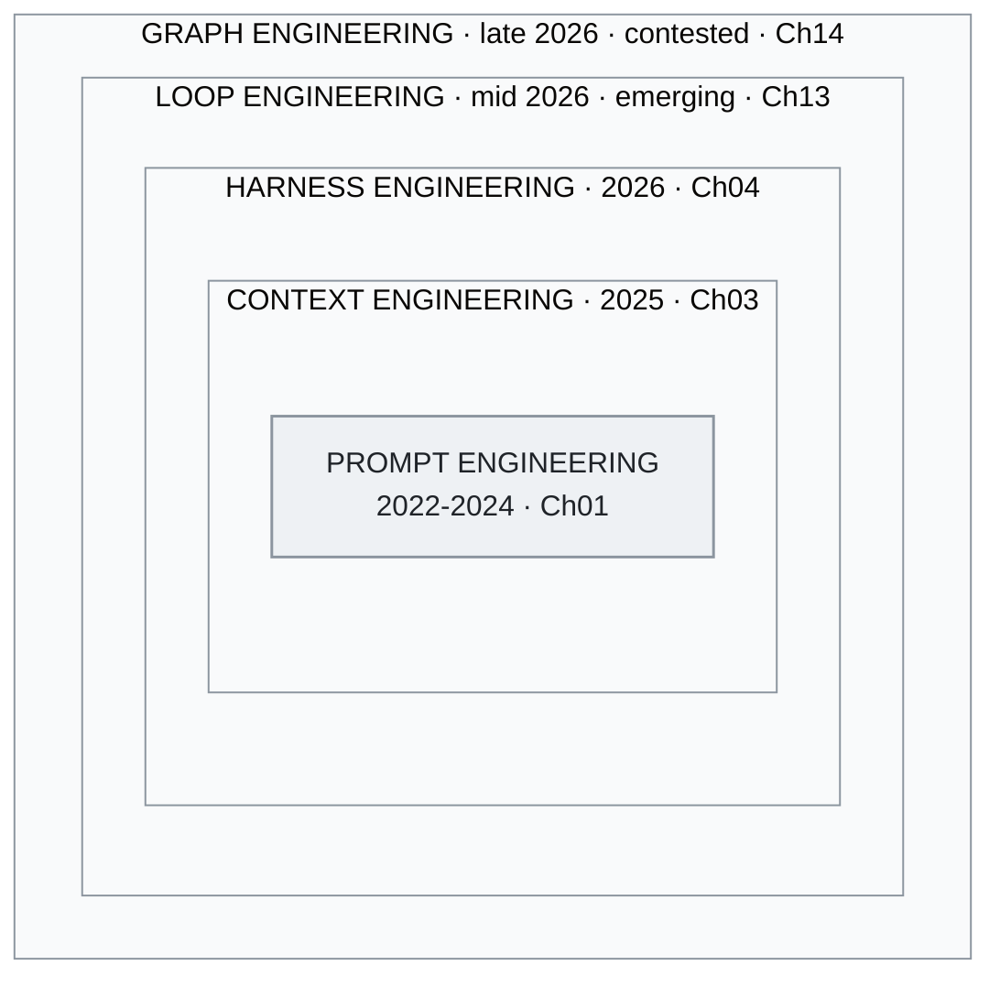

<!-- translation-sync:start -->
> 2026-10-31 영문판과 동기화한 기계 보조 번역입니다. 구조와 내용을 검토했습니다. 코드와 도표 라벨은 원문을 유지하며 읽기 시간은 영어 원문 기준 추정치입니다.
> [English source](../../../chapters/01-evolution.md) · [Sync record](../../SYNC.md)
<!-- translation-sync:end -->

<a id="chapter-01-the-three-generations"></a><!-- i18n-anchor -->

# 01장: 세 세대

> **한 문장으로:** AI 엔지니어링은 좋은 prompt를 작성하는 것에서, AI 모델 주변에 운영 체제 전체를 설계하는 것으로 진화했다.
>
> **왜 중요한가:** 이 분야가 어디로 향하는지 이해하면 적합한 도구를 선택하고 시대에 뒤떨어진 접근을 피할 수 있다.
>
> **읽기 시간:** 약 14분 (3,108단어 / 분당 230단어)

**Prompt engineering에서 context engineering으로, 그리고 harness engineering으로 —— 그리고 이 셋의 경계가 생각만큼 중요하지 않은 이유.**

---

<a id="generation-1-prompt-engineering-2022-2024"></a><!-- i18n-anchor -->

## 제 1세대: Prompt Engineering (2022–2024)

November 2022에 ChatGPT가 출시됐을 때 사람과 대규모 언어 모델을 연결하는 인터페이스는 텍스트 상자 하나뿐이었다. 여기서 프롬프트 엔지니어링이라는 분야가 생겨났다. 더 나은 출력을 얻기 위해 입력 텍스트를 다듬는 기술이자 과학이었다.

핵심 기법들이 빠르게 발전했다:

**Few-shot prompting**(Brown 외, 2020)은 prompt에 예시를 포함시키는 것만으로도 fine-tuning 없이 작업 성능이 극적으로 개선될 수 있음을 보였다. 감정 분류를 위해 모델을 훈련하는 대신, 예시 세 개를 보여주고 네 번째를 분류하게 한 것이다.

**Chain-of-thought (CoT) prompting**(Wei 외, 2022)은 "Let's think step by step"을 덧붙이거나 예시에 추론 흔적을 포함시키는 것만으로 표준 prompting에서는 보이지 않던 다단계 추론 능력이 나타남을 보였다. 이는 아마도, *문맥을 어떻게 구조화하는가*가 *무엇을 묻는가*만큼 중요하다는 첫 번째 단서였다.

**Prompt template**이 표준적인 추상화가 되었다. LangChain, LlamaIndex, 그리고 수십 개의 프레임워크가 정교하게 설계된 prompt 구조에 변수를 주입할 수 있는 템플릿 시스템을 제공했다. 멘탈 모델은 명확했다: prompt가 프로그램이고 모델이 런타임이다.

이 시대의 다른 기법들에는 다음이 포함된다:

- **ReAct**(Yao 외, 2022): 추론 단계와 행동 단계를 번갈아, 단일 prompt 구조 안에서 모델이 계획과 도구 호출을 실행하게 한다.
- **Tree of Thought**(Yao 외, 2023): 여러 추론 경로를 탐색하고 최선의 것을 선택한다.
- **Self-consistency**(Wang 외, 2022): 여러 추론 사슬을 샘플링하고 다수결을 취한다.

이 시대의 한계는 LLM 상호작용의 품질이 주로 프롬프트의 품질에 따라 결정된다는 전제에 있었다. 컨텍스트 창이 4K-8K 토큰이고 사용자 텍스트만 입력할 수 있을 때는 맞는 말이었다. 모델이 100K개 이상의 토큰을 받아들이고 외부 도구를 호출할 수 있게 되자 더 이상 성립하지 않았다.

<a id="what-this-era-got-right"></a><!-- i18n-anchor -->

### 이 시대가 옳게 본 것

Prompt engineering은 *구조가 중요하다*는 것을 확립했다. 좋은 prompt와 나쁜 prompt의 차이는 감각이 아니라 ——정보 아키텍처다. 그 통찰은 그 다음 모든 것으로 이어졌다.

<a id="what-this-era-missed"></a><!-- i18n-anchor -->

### 이 시대가 놓친 것

Context window를 정적인 산출물로 취급했다. Prompt를 작성하고, 제출하고, 응답을 받는다. Context window 자체가 실행 시점에 여러 소스로부터 *동적으로 구성될 수 있다*는 발상 ——그것이 다음 세대의 통찰이었다.

---

<a id="generation-2-context-engineering-2025"></a><!-- i18n-anchor -->

## 제 2세대: Context Engineering (2025)

2025년 중반, Andrej Karpathy가 prompt engineering과 context engineering 사이에 날카로운 선을 그으며, AI 엔지니어링 커뮤니티에서 가장 많이 공유된 관찰 중 하나를 게시했다:

> "I've been thinking about this and I think the right term for what most people actually need to get good at is not 'prompt engineering' but 'context engineering.' The art and science of filling the context window with just the right information for the next step."

이 리프레이밍이 중요했던 이유는, 주의를 *지시*(prompt)에서 *정보 패키지 전체*(context window)로 옮겼기 때문이다. 현대 LLM 호출의 context window에는 사용자 prompt보다 훨씬 더 많은 것이 들어 있다:

- 동작과 제약을 정의하는 시스템 지시
- RAG 파이프라인에서 검색된 문서
- 도구 정의와 스키마
- 대화 이력(선택적으로 압축됨)
- 동적으로 선택된 few-shot 예시
- 현재 작업에 관한 구조화된 메타데이터

Prompt는 한 구성 요소일 뿐이다. Context engineering은 이 모두를 편성하는 것이다.

<a id="the-six-techniques"></a><!-- i18n-anchor -->

### 여섯 가지 기법

[Towards AI의 분석](https://towardsai.net/)은 이 분야를 정의하는 여섯 가지 핵심 기법을 식별했다:

1. **Retrieval-Augmented Generation (RAG)**: 질의 시점에 관련 문서를 가져온다
2. **Tool 및 API 통합**: 구조화된 스키마로 모델에 외부 능력 접근을 부여한다
3. **Memory management**: 대화 턴과 세션 횡단으로 관련 정보를 유지한다
4. **동적 prompt 구축**: 템플릿, 검색된 콘텐츠, 실행 시점 상태로부터 prompt를 조립한다
5. **Context window 최적화**: 한정된 토큰 예산에 무엇을 넣고 무엇을 빼는지 관리한다
6. **지시 계층**: 시스템, 개발자, 사용자 지시를 명확한 우선순위로 계층화한다

<a id="lessons-from-manus"></a><!-- i18n-anchor -->

### Manus의 교훈

[Manus](https://manus.im/) ——2025년 가장 많이 언급된 AI 에이전트 플랫폼 중 하나 —— 는 스케일에서의 context engineering에 대한 중요한 교훈을 공유했다:

**KV-cache 통찰**: Manus는 KV-cache 적중률을 높게 유지하도록 context window를 설계했다 ——어텐션 메커니즘에서 이전에 계산된 key-value 쌍이 턴 횡단으로 재사용되도록. 이는 지연과 비용을 극적으로 낮추었다. 원칙: 호출 사이에 *접두부는 안정적*으로 유지하고 *접미부만 변하도록* context를 구조화하라.

**100:1 비율**: Manus는 모델 출력 1 토큰당 약 100 토큰의 context가 소비된다고 보고했다. 이는 출력 토큰이 주요 비용 요인이라는 일반적 가정을 뒤집었다. 진정한 엔지니어링 과제는 텍스트를 생성하는 것이 아니라 ——*어떤 context를 투입할지 선택하는 것* —— 이었다.

**제품으로서의 context**: Manus는 context window 구축을 구현 세부 사항이 아니라 핵심 제품 기능으로 취급했다. 에이전트의 품질은 context 조립 파이프라인의 품질에 직접 비례했다.

<a id="the-taxonomy-shift"></a><!-- i18n-anchor -->

### 분류 체계의 전환

Context engineering은 LLM 애플리케이션 개발을 "write good prompts"에서 "build good information pipelines."으로 리프레이밍했다. 모델은 받은 context 위에서 동작하는 추론 엔진이 되었다. 엔지니어링 과제는 상류로 옮겨갔다 ——검색, 필터링, 랭킹, 압축, 조립으로.

그러나 이 프레이밍에도 천장이 있었다. *모델에 들어가는 것*은 기술했지만 *모델 주변 시스템이 어떻게 동작하는가*는 기술하지 못했다. 그것에는 또 다른 전환이 필요했다.

---

<a id="generation-3-harness-engineering-2026"></a><!-- i18n-anchor -->

## 제 3세대: Harness Engineering (2026)

2025년 후반부터 2026년 초까지, 영향력 있는 두 작품이 다음 진화를 형식화했다:

**Birgitta Böckeler** (ThoughtWorks)는 April 2026에 Martin Fowler의 *Exploring Generative AI* 메모 시리즈에 분석을 발표했다. LLM 애플리케이션에서 가장 큰 영향을 미치는 엔지니어링 작업은 모델 학습이나 프롬프트 작성이 아니라 *하네스*에서 이루어진다는 주장이었다. 하네스는 도구, 라우팅, 메모리, 계획, 오류 복구를 아우르는 주변 시스템으로, 모델 호출을 조율해 신뢰할 수 있는 작업 흐름으로 만든다.

**OpenAI의 Codex 팀**은 에이전트적 코딩의 harness 측면에 대한 사례 연구 자료를 공개해 왔다 (공식 자료는 openai.com/index/introducing-codex 참조). 널리 인용되는 "three engineers / ~1M lines / ~1,500 PRs" 수치는 2025–2026년 OpenAI 강연과 게시물을 통해 유통되었다; 근저의 관찰은 Codex의 품질이 주로 모델이 아니라 harness ——모델을 *언제* 호출할지, *어떤 context*를 제공할지, *어떤 도구*를 사용 가능하게 할지, 오류를 어떻게 검증하고 회복할지 결정하는 시스템 —— 에 의해 결정되었다는 것이다.

<a id="the-phil-schmid-analogy"></a><!-- i18n-anchor -->

### Phil Schmid의 비유

[Phil Schmid](https://www.philschmid.de/) (Hugging Face)는 이 개념을 결정화한 비유를 제시했다:

- **모델은 CPU** —— 원시 계산 능력
- **Context window는 RAM** —— 현재 작업을 위한 작업 메모리
- **Harness는 운영 체제** —— 스케줄링, 자원 관리, I/O, 오류 처리, 사용자 인터페이스

이 비유는 왜 harness engineering이 중요한지 명확히 한다: 누구도 OS 없이 CPU만 출하하지 않는다. 모델은 필요하지만 충분하지 않다. 모델이 실제로 무엇을 해낼 수 있는지 결정하는 것은 harness다.

<a id="the-meta-harness-paper-and-the-6x-gap"></a><!-- i18n-anchor -->

### Meta-Harness 논문과 6배 격차

2026년 초 발표된 연구는 실무자들이 이미 의심하던 사실을 정량화했다. 복잡한 과제에서 기본 모델과 잘 설계된 하네스를 갖춘 모델 사이에는 약 **6x 차이**가 있었다. 같은 가중치와 같은 학습 데이터를 사용하는 동일한 모델이 하네스의 품질에 따라 여섯 배나 다른 결과를 냈다.

이는 대부분의 실용 애플리케이션에서 harness engineering이 모델 개선보다 더 큰 레버리지를 제공한다는 것을 의미했다. 좋은 모델 위에 나은 harness는, 평범한 harness의 위대한 모델을 능가했다.

<a id="the-impact-framework"></a><!-- i18n-anchor -->

### IMPACT 프레임워크

2020년대 중반 실무자 담론에서, harness 품질을 평가하는 체크리스트로 IMPACT 기억법이 떠올랐다:

- **I**nstructions —— 시스템 지시의 명료함과 완전성
- **M**emory —— 세션 횡단의 지속과 검색
- **P**lanning —— 작업 분해와 시퀀싱
- **A**ctions —— 도구 가용성과 신뢰성
- **C**ontext —— 관련 정보의 동적 조립
- **T**esting —— 평가와 품질 보증 루프

IMPACT는 context engineering을 더 넓은 harness engineering 분야 안의 한 구성 요소("C")로 위치시킨다. 이 중첩이 핵심 구조적 통찰이다: context engineering은 harness engineering으로 *대체되는* 것이 아니라 그 *안에 있다*.

<a id="meta-acquires-manus-2b"></a><!-- i18n-anchor -->

### Meta의 Manus 인수 (약 $2B)

2026년 초 Meta는 약 $2 billion에 Manus를 인수했다. 이는 Meta가 *모델이 아니라 하네스를 산 것*으로 널리 해석됐다. Meta에는 이미 Llama가 있었다. 없었던 것은 컨텍스트 조립, 도구 오케스트레이션, 에이전트 실행 환경 관리를 위한 실서비스에서 검증된 시스템이었다.

이 인수는 다음 테제를 검증했다: LLM 생태계에서 가장 가치 있는 엔지니어링은 점점 모델 계층이 아니라 편성 계층에 있다.

---

<a id="the-key-insight-coexistence-not-replacement"></a><!-- i18n-anchor -->

## 핵심 통찰: 대체가 아니라 공존

이 세 세대는 한 세대가 다음 세대로 대체되는 깔끔한 역사적 시기가 아니다. 본격 시스템 안에서 공존하는 *중첩된 계층*이다:

```
+--------------------------------------------------+
|              HARNESS ENGINEERING                  |
|  +--------------------------------------------+  |
|  |          CONTEXT ENGINEERING                |  |
|  |  +--------------------------------------+  |  |
|  |  |       PROMPT ENGINEERING             |  |  |
|  |  |                                      |  |  |
|  |  |  System prompts, CoT, few-shot,      |  |  |
|  |  |  instruction formatting              |  |  |
|  |  +--------------------------------------+  |  |
|  |                                            |  |
|  |  RAG pipelines, memory, tool schemas,      |  |
|  |  context window optimization               |  |
|  +--------------------------------------------+  |
|                                                  |
|  Skill routing, planning loops, error recovery,  |
|  progressive disclosure, multi-agent coord       |
+--------------------------------------------------+
```

*그림: 같은 중첩 관계를 도식화했다. 실선 상자는 이 장에서 번호를 붙인 세 세대이며, 바깥의 두 상자는 13장과 14장에서 다루는 논쟁 중인 계층이다. 의도적으로 번호 체계 바깥에 그렸다.*



Harness 엔지니어는 여전히 prompt를 쓴다. 여전히 context engineering을 한다. 그러나 더해서 어떤 prompt를 언제 쓸지, 상황마다 어떤 context를 조립할지, 문제가 생기면 어떻게 회복할지 결정하는 *시스템*을 구축한다.

진화는 이전 기법을 버리는 것이 아니다. 그것들이 필요하지만 충분하지 않다는 것을 인식하고 ——그 위에 계층을 쌓아 원시 LLM 능력을 신뢰성 있는, 본격 등급의 애플리케이션으로 만드는 것이다.

상하이자오퉁대와 협력 기관의 저자 19명이 참여한 조사 **"Externalization in LLM Agents: A Unified Review of Memory, Skills, Protocols and Harness Engineering"** (arXiv 2604.08224, April 9, 2026)는 이 장과 같은 세 계층 구조에 독립적으로 도달한다. 이들의 틀에서 분야의 발전은 *가중치*에서 *컨텍스트*, *하네스*로 이어진다. 메모리, 스킬, 프로토콜, 하네스 엔지니어링을 외부화된 네 구성 요소로 보고, 하네스를 통합 계층으로 삼아 하나로 묶는다. 학술 문헌을 통해 접근하는 독자에게 이 수렴은 짚을 만하다. 실무자만의 관점도, 이 가이드만의 관점도 아니다. April 2026 말의 학술 조사 역시 이를 구성 축으로 선택했다.

---

<a id="an-emerging-fourth-generation-loop-engineering-mid-2026"></a><!-- i18n-anchor -->

## 떠오르는 네 번째 세대? 루프 엔지니어링 (mid-2026)

이 장은 의도적으로 *세 세대*라는 제목을 유지한다. 그러나 June 2026에 네 번째 후보 계층이 빠르게 구체화되어, 아직 번호를 붙인 세대로 격상하기에는 너무 새롭지만 여기서 언급할 필요가 생겼다. 단 일주일 사이에 Peter Steinberger가 June 7에 "shouldn’t be prompting coding agents anymore ... You should be designing loops that prompt your agents,"라고 쓴 게시물이 널리 퍼지고, 같은 날 Addy Osmani가 **루프 엔지니어링**이라는 이름을 붙인 글을 발표했으며, Boris Cherny(Claude Code)가 자신의 일을 "writing loops"로 표현했다. 실무자들은 하네스 *위의* 계층, 즉 일정에 따라 대신 에이전트에 프롬프트를 보내고, 보조 에이전트를 띄우며, 스스로 다음 입력을 공급하는 시스템을 설명하기 시작했다.

지지자들은 세대 3과의 관계를 명확히 정의한다. Osmani는 루프 엔지니어링을 "one floor above the harness"에 놓는다. 그의 틀에서 루프는 하네스이되 "but it runs on a timer, it spawns little helpers, and it feeds itself."이다. 이는 이 장에서 이미 사용한 중첩 논리와 같다. 루프는 하네스, 컨텍스트, 프롬프트를 감싸는 가장 바깥 상자일 뿐이므로, 루프 엔지니어도 여전히 프롬프트를 작성하고, 컨텍스트 엔지니어링을 수행하며, 하네스를 만든다. 루프와 단순한 스케줄러를 구별하는 것은 시계에 따라 고정 명령을 실행하는 대신 매번 현재 상태를 읽고 다시 판단한다는 점이다.

두 가지 솔직한 유보 사항 때문에 아직 번호를 붙인 세대로 넣지 않는다. 집필 시점에 이 용어는 약 다섯 주밖에 되지 않았고, 학술 문헌 없이 블로그, 팟캐스트, X 같은 실무자 담론에만 존재한다. 반응도 실제 변화라고 보는 독자와 스케줄링에 너무 일찍 새 이름을 붙였다고 보는 독자로 나뉜다. 따라서 이 가이드는 일차 자료와 시간의 검증을 아직 통과하지 못한 모든 주장에 적용하는 원칙대로, 루프 엔지니어링을 확립된 개념이 아닌 *떠오르는* 개념으로 추적한다. [13장](13-loop-engineering.md)은 핵심 주장마다 출처를 연결하고 빈틈을 억지로 채우지 않고 명시하며 전체 틀을 다룬다.

이름을 만드는 기계는 이후 다시 돌아갔다. 루프가 주목받은 주간에서 여섯 주 뒤인 mid-July 2026에 같은 방식으로 두 번째 후보인 **그래프 엔지니어링**이 구체화됐다. 루프 위에는 그래프가 있다는 주장이다. 어떤 에이전트가 존재하고, 누가 누구에게 위임할 수 있으며, 각자의 루프가 어떻게 서로 감독하고 수정하는지를 명시적으로 연결하는 구조다. 또 다른 Steinberger 게시물이 계기가 됐고(날짜를 명시한 출처에서는 July 18, 2026이며, 미국 시간으로 July 17일 가능성도 있다), 며칠 안에 관련 글이 이어졌으며 반론도 그만큼 빨랐다. LangChain의 공식 응답은 프롬프트, 컨텍스트, 하네스, 루프 엔지니어링 다음에 그래프 엔지니어링을 나열하는 동시에, 에이전트 시스템을 그래프로 표현하는 방식은 이미 세 해 전부터 있었고 루프는 단지 방향성 순환 그래프이므로 새로운 것은 이름뿐이라고 주장한다. 14장은 이 용어의 생존 판정 기준을 명시하고 September 15, 2026에 평가했다. 결과는 갈렸다. 계기 게시물에 대한 답글이 아닌 글이 석 달간 이어졌고, 에이전트 조직이라는 의미로 가르치는 유료 강좌와 September 튜토리얼이 나오는 등 그래프 엔지니어링은 계속 쓰였다. 반면 확인한 문서에서 공급업체가 이 용어를 채택한 사례는 없었고, 두 공급업체는 그 용어가 가리키는 통제 기능을 이름을 쓰지 않은 채 출시했다. 그중 하나는 용어가 생기기 한 달 전부터 시작했다. 거기에 기록된 판정은 다중 에이전트 조정을 가리키는 논쟁적인 이름으로는 살아남았으나 독립 계층이라는 지위는 입증되지 않았다는 것이다. 따라서 번호를 붙인 세대 바깥에 둔다. 이 장이 다중 에이전트 조정을 하네스 상자 안에 넣는 해석은 임시 표기가 아니라 여전히 유효한 대안이다. [14장](14-graph-engineering.md)은 회의론에도 같은 비중을 두고 날짜를 명시한 평가표를 제시한다.

---

<a id="three-things-to-take-away"></a><!-- i18n-anchor -->

## 기억할 세 가지

- **세대는 대체가 아니라 중첩된다.** 하네스 엔지니어도 여전히 프롬프트를 작성하고 컨텍스트 엔지니어링을 한다. 그래서 IMPACT는 "C" 안에 컨텍스트 엔지니어링을 포함한다.
- **Meta는 하네스에 약 $2 billion을 지불했다.** Meta에는 이미 Llama가 있었지만 컨텍스트 조립과 도구 오케스트레이션을 위한 실서비스에서 검증된 시스템이 없었다. 그래서 이 인수는 모델 계층보다 오케스트레이션 계층을 산 것으로 해석됐다.
- **명명은 증거보다 앞선다.** 루프 엔지니어링과 그래프 엔지니어링은 모두 학술 연구가 아니라 글의 유행을 타고 등장했으므로, 이 장은 번호를 붙인 세 세대 바깥에 둔다.

---

## Sources

- Brown, T. et al. (2020). "Language Models are Few-Shot Learners." [arXiv:2005.14165](https://arxiv.org/abs/2005.14165)
- Wei, J. et al. (2022). "Chain-of-Thought Prompting Elicits Reasoning in Large Language Models." [arXiv:2201.11903](https://arxiv.org/abs/2201.11903)
- Yao, S. et al. (2022). "ReAct: Synergizing Reasoning and Acting in Language Models." [arXiv:2210.03629](https://arxiv.org/abs/2210.03629)
- Yao, S. et al. (2023). "Tree of Thoughts: Deliberate Problem Solving with Large Language Models." [arXiv:2305.10601](https://arxiv.org/abs/2305.10601)
- Wang, X. et al. (2022). "Self-Consistency Improves Chain of Thought Reasoning in Language Models." [arXiv:2203.11171](https://arxiv.org/abs/2203.11171)
- Karpathy, A. (mid-2025). "context engineering"을 본 분야의 올바른 용어로 명명한 공개 발언; X와 AI 엔지니어링 커뮤니티 전반에서 널리 공유된 프레이밍.
- Manus. (2025). "Context Engineering Lessons from Building Manus." [manus.im/blog](https://manus.im/blog) — 운영 지표로서 KV-cache 적중률, append-only context, logit bias로 도구 마스킹, 롤링 todo-list 재작성.
- Böckeler, Birgitta. (April 2, 2026). "Harness engineering for coding agent users." martinfowler.com (*Exploring Generative AI* series). [https://martinfowler.com/articles/harness-engineering.html](https://martinfowler.com/articles/harness-engineering.html) — Guides vs. Sensors, Computational vs. Inferential 분류.
- OpenAI. Codex 공식 자료: [https://openai.com/index/introducing-codex](https://openai.com/index/introducing-codex). Codex의 harness 설계 프레이밍을 위한 앵커; 널리 인용되는 "three engineers / ~1M lines / ~1,500 PRs" 수치는 2025–2026년 OpenAI 강연과 게시물에서 유통되었으며, 단일 정전 게시물이 아닌 커뮤니티 인용으로 여기 보고한다.
- Schmid, Philipp. "The New Skill in AI is Not Prompting, It's Context Engineering" 및 후속편. [https://www.philschmid.de/context-engineering](https://www.philschmid.de/context-engineering); [https://www.philschmid.de/context-engineering-part-2](https://www.philschmid.de/context-engineering-part-2) — Model = CPU, Context = RAM, Harness = OS 비유.
- IMPACT 기억법. 의도 / 메모리 / 계획 / 권한 / 제어 흐름 / 도구 --- mid-2020s 실무자 담론에서 등장한 하네스 설계의 여섯 차원 체크리스트. 이 장에서는 교육적 틀로 사용하며 특정 일차 자료에 귀속시키지 않는다.
- Meta/Manus 인수 보도. (2026). 다양한 출처.
- Zhou, C. 외 (April 2026). "Externalization in LLM Agents: A Unified Review of Memory, Skills, Protocols and Harness Engineering." [arXiv:2604.08224](https://arxiv.org/abs/2604.08224) --- 상하이자오퉁대와 협력 기관의 저자 19명이 참여한 조사로, 가중치 → 컨텍스트 → 하네스라는 세 계층의 역사적 틀을 독립적으로 사용한다. 실무자의 논지가 학술 문헌과 수렴한다는 증거로 이 장의 "Coexistence, Not Replacement" 절에서 인용한다.
- Steinberger, Peter (@steipete). "design loops that prompt your agents" 관점을 촉발한 게시물 (June 7, 2026). [https://x.com/steipete/status/2063697162748260627](https://x.com/steipete/status/2063697162748260627) --- "Emerging Fourth Generation" 절에서 인용; 게시물 자체에는 "loop engineering."이라는 표현이 없다.
- Osmani, Addy. "Loop Engineering" (June 7, 2026). [https://addyosmani.com/blog/loop-engineering/](https://addyosmani.com/blog/loop-engineering/) --- 실무 방식에 이름을 붙인 글; 이 장의 네 번째 세대 절에서 사용하는 "one floor above the harness" 관계의 출처.
- Cherny, Boris. Lenny’s Podcast / Lenny’s Newsletter 인터뷰 (mid-2026). [https://www.lennysnewsletter.com/p/head-of-claude-code-what-happens](https://www.lennysnewsletter.com/p/head-of-claude-code-what-happens) --- "my job is to write loops" 관점; 매체마다 다르게 옮겨 적은 구술 인용.
- Runkle, Sydney와 Chase, Harrison (LangChain). "3 Years of Graph Engineering with LangGraph" (July 22, 2026). [https://www.langchain.com/blog/3-years-of-graph-engineering-with-langgraph](https://www.langchain.com/blog/3-years-of-graph-engineering-with-langgraph) --- 프롬프트, 컨텍스트, 하네스, 루프 엔지니어링 다음에 그래프 엔지니어링을 나열하면서도 방식 자체는 세 해 됐다고 주장한다; 이 장의 떠오르는 세대 절에서 사용하는 방향성 순환 그래프로의 환원 해석의 출처.
- Perez, Carlos E. "From Loop Engineering to Graph Engineering?" Intuition Machine (July 19, 2026). [https://medium.com/intuitionmachine/from-loop-engineering-to-graph-engineering-d3ebeb08511c](https://medium.com/intuitionmachine/from-loop-engineering-to-graph-engineering-d3ebeb08511c) --- July 2026 그래프 엔지니어링 관점의 최초 이론적 확장; 루프가 루프를 감독한다는 해석의 출처.

---

*다음: [02장 -- RAG, 긴 컨텍스트와 지식 그래프](02-knowledge-layer.md)*
