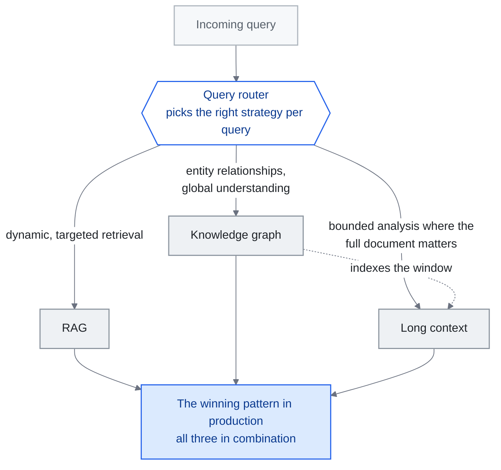

<!-- translation-sync:start -->
> 2026-10-31 영문판과 동기화한 기계 보조 번역입니다. 구조와 내용을 검토했습니다. 코드와 도표 라벨은 원문을 유지하며 읽기 시간은 영어 원문 기준 추정치입니다.
> [English source](../../../chapters/02-knowledge-layer.md) · [Sync record](../../SYNC.md)
<!-- translation-sync:end -->

<!-- i18n-anchor -->

# 02장: RAG, 긴 컨텍스트와 지식 그래프

> **한 문장으로:** AI에게 지식 접근을 부여하는 세 가지 주된 방법: 데이터베이스를 검색하기 (RAG), 긴 문서를 먹이기, 또는 사실을 그래프로 연결하기.
>
> **왜 중요한가:** 자기 데이터를 다루는 어떤 일에든 AI를 쓰고 있다면, 본 장은 당신의 상황에 어떤 접근이 가장 잘 맞는지 설명한다.
>
> **읽기 시간:** 약 16분 (3,453단어 / 분당 230단어)

*그림: "Hybrid Architectures: The Convergence" 절의 세 갈래 선택을 그 절의 성공적인 실서비스 패턴 마지막에 있는 질의 라우터를 중심으로 그렸다. 라우터에서 나오는 각 연결선은 해당 갈래로 질의를 보내는 요구를 명시한다. 점선은 "KG as Semantic Backbone for Long Context" 절의 별도 주장, 즉 그래프가 더 이상 대체할 필요 없는 창의 인덱스 역할을 한다는 뜻이다. 하이브리드 상자로 모이는 연결선들은 엔지니어링의 과제가 선택이 아니라 라우터라는 이 장의 논지를 전달한다.*

**지식 검색 계층 ——무엇이 작동하고, 무엇이 작동하지 않으며, 답이 거의 항상 "hybrid."인 이유.**

---

<!-- i18n-anchor -->

## RAG는 죽지 않았다

큰 컨텍스트 창은 설계 공간을 넓히지만, 창 크기만으로 시스템이 증거를 얼마나 신뢰성 있게 활용하는지 결정되지는 않는다. [Liu 외](https://arxiv.org/abs/2307.03172)는 긴 입력에서 관련 정보의 위치에 따라 답의 품질이 달라질 수 있음을 보였다. 자신의 질문으로 검색 방식과 전체 컨텍스트 방식을 평가하되 답의 품질, 토큰 사용량, 지연 시간, 최신 증거가 모델에 전달되는 경로를 포함하라.

RAG는 죽지 않았다. 진화하고 있다. 질문은 결코 "RAG or not RAG"가 아니었다 ——"what kind of RAG, combined with what else."였다.

---

<!-- i18n-anchor -->

## 비용의 현실

RAG에 대한 경제적 논거는 여전히 압도적이다.

전형적인 RAG 파이프라인은 5–20개의 관련 청크 (대략 2,000–8,000 토큰)를 검색해 모델 호출에 먹인다. 같은 쿼리에 대해 context-stuffing 접근은 500K–1M 토큰의 출처 문서를 로드해야 할 수 있다.

**쿼리당 비용 비교 (대략, 2026년 중반 가격):**

| 접근 | 입력 토큰 | 대략적 비용 | 상대 비용 |
|----------|-------------|-----------------|---------------|
| RAG (타깃 검색) | ~5,000 | ~$0.00008 | 1x |
| Context-stuffing (전체 코퍼스) | ~500,000 | ~$0.10 | 1,250x |

이는 반올림 오차가 아니다. 엔터프라이즈 스케일 ——월 수백만 건의 쿼리 —— 에서는 월 추론 비용 $80과 $100,000의 차이가 프로젝트가 예산 검토를 통과하는지를 결정한다.

검색은 입력 토큰 사용량을 줄일 수 있지만, 전체 비용에는 인덱싱, 검색, 캐싱, 추가 모델 호출도 들어간다. 같은 답변 품질 목표에서 전체 파이프라인과 전체 컨텍스트 기준선을 비교하라. 어느 설계가 더 저렴한지는 문서 집합 크기, 질의량, 모델 가격에 따라 달라진다.

---

<!-- i18n-anchor -->

## Long Context: 작동할 때, 작동하지 않을 때

긴 context window (128K, 200K, 1M+ 토큰)는 특정 사용 사례에 진정으로 변혁적이다:

**Long context가 빛나는 곳:**
- **정적이고 경계가 분명한 문서 분석**: 단일 계약서, 코드베이스 파일, 또는 연구 논문 ——전체 관련 코퍼스가 윈도우에 들어가는 경우 —— 의 분석
- **상호 참조 작업**: 한 번에 로드된 고정된 문서 집합에 걸쳐 연결을 찾기
- **요약**: 크지만 유한한 입력을 구조화된 출력으로 응축

**Long context가 무너지는 곳:**

**"Lost in the middle" 저하.** [Liu et al. (2023)](https://arxiv.org/abs/2307.03172)의 연구는 LLM이 긴 context의 시작이나 끝에 놓인 정보에 비해 중간에 놓인 정보에서 현저히 더 나쁘게 수행한다는 것을 입증했다. 이후의 모델 개선이 이 효과를 줄였지만 제거하지는 못했다. 2026년 초 기준, 모델은 관련 정보가 500K+ 토큰의 context 안에 묻혀 있을 때 여전히 측정 가능한 정확도 저하를 보인다.

**동적 지식 베이스.** 지식 베이스가 매 시간 갱신된다면 (제품 재고, 지원 티켓, 뉴스 피드), 전체 코퍼스를 모든 context window에 다시 임베딩할 수 없다. RAG의 검색 단계는 갱신을 자연스럽게 처리한다 ——새 문서가 인덱싱되어 prompt 구조를 바꾸지 않고 즉시 검색 가능하다.

**멀티테넌트 격리.** Long context 접근은 접근 제어에서 어려움을 겪는다. 여러 사용자나 권한 레벨의 문서가 같은 코퍼스에 존재할 때, RAG 파이프라인은 검색 시점 필터링을 강제할 수 있다. Context-stuffing은 신중한 (그리고 오류가 발생하기 쉬운) 문서 분리를 요구한다.

**규모가 커질 때의 지연 시간.** 추론을 최적화해도 1M 토큰 처리는 5K 토큰 처리보다 상당히 오래 걸린다. 초 미만의 응답 시간이 중요한 사용자용 애플리케이션에서는 필요한 정보만 검색하는 방식이 유리하다.

<!-- i18n-anchor -->

### 2026년 갱신: Titans + MIRAS가 Long-Context 트레이드오프를 다시 짠다

위의 한계는 모두 트랜스포머식 컨텍스트 창을 전제한다. 어텐션으로 읽는 평면적인 토큰 구간이며, 위치와 무관하게 토큰당 비용이 같고 "lost in the middle" 실패 양상도 같다. Google Research의 April 2026 아키텍처 계열 **Titans + MIRAS**는 이 전제를 깬다. Titans의 메모리는 어텐션 창이 아니라 추론 중 경사 하강법으로 자체 가중치를 갱신하는 **학습 가능한 신경 모듈**이다. 모델은 긴 이력을 토큰으로 계속 가져가는 대신 실제로 가중치 갱신에 압축한다. MIRAS는 이런 추론 중 학습을 안정적으로 유지하는 학습법을 제공한다. 비슷한 매개변수 수에서 Google은 Titans가 장기 회상과 다중 홉 추론에서 Mamba-2, Gated DeltaNet, Transformer++를 능가한다고 보고한다. 이는 원래의 긴 컨텍스트 한계를 반박하지 않는다. GPT-4 Turbo, Gemini 1.5, Claude가 계속 쓰는 어텐션 창 패러다임에서는 그 한계가 유효하다. 다만 **"attention budget is scarce"라는 관점이 이제 보편적 제약이 아닌 특정 아키텍처 계열의 속성**임은 보여 준다. 실무자에게 이는 긴 컨텍스트의 절충 관계가 더 이상 하나의 곡선이 아니라는 뜻이다. 중간 정보 손실과 토큰당 비용이 지배하는 어텐션 창 곡선, 비용이 추론 시 가중치 갱신으로 옮겨 가고 실패 양상이 안정성과 망각으로 바뀌는 학습 가능한 메모리 곡선이 적어도 둘 있다. RAG는 양쪽 모두에서 여전히 유력한 기본값이지만, 각 방식에서 유리한 *이유*는 다르다.

<!-- i18n-anchor -->

### 2026 주의: 논쟁적인 12M 토큰 주장

모든 긴 컨텍스트 발표가 검증을 견디는 것은 아니다. 스타트업 **Subquadratic**은 May 5, 2026에 **SubQ**를 출시하며 **Subquadratic Selective Attention (SSA)**으로 **12백만 토큰 창**을 제공한다고 주장했다. 회사가 인용하고 Appen이 실행한 벤치마크는 인상적이다. FlashAttention보다 56x 빠르고, 6-12M 토큰에서 건초더미 바늘 찾기 회상률 98%, RULER-128 실행 비용은 Claude Opus 4.6의 $2,600에 비해 $8이라고 한다. June 19, 2026 MIT Technology Review의 검토는 더 냉정했다. Will Depue 등을 포함한 연구자들은 공개 증거가 "solved quadratic attention"이라는 더 강한 주장을 아직 뒷받침하지 못하며, SubQ가 **처음부터 학습하지 않고 Qwen 가중치를 재사용한다**고 지적했다. 따라서 효율 수치는 입증된 일반적 결과가 아니라 특정 적응 모델의 속성이다. 이 저장소의 과장 금지 원칙도 여기에 적용된다. SSA는 흥미롭지만 동시에 검증되지 않은 주장이다. 긴 컨텍스트 구매자는 독립적 재현이 나올 때까지 12M 수치를 논쟁 중인 것으로 취급해야 한다.

---

<!-- i18n-anchor -->

## GraphRAG: 평면 검색으로 충분하지 않을 때

(명칭 참고: 이 장의 지식 그래프는 시스템이 *무엇을 아는지* 구조화한다. July 2026에 등장해 [14장](14-graph-engineering.md)에서 다루는 별도의 "graph engineering" 관점은 지식 검색이 아니라 다중 에이전트 시스템을 연결하는 방식에 관한 것이다.)

표준 RAG는 문서를 독립적인 청크로 다룬다. 이는 사실 조회 ("What is the return policy?")에는 작동하지만, *관계 추론*을 요구하는 질문 ("Which suppliers are connected to both our delayed shipments and our quality complaints?")에는 실패한다.

[Microsoft의 GraphRAG](https://github.com/microsoft/graphrag) (2024–2025)는 하이브리드 접근을 도입했다: 출처 문서로부터 지식 그래프를 구축한 다음, 쿼리에 답하기 위해 벡터 검색과 함께 그래프 순회를 사용한다.

<!-- i18n-anchor -->

### GraphRAG가 작동하는 방식

1. **인덱싱 단계**: 문서를 처리하여 엔티티 (사람, 조직, 개념)와 그들 사이의 관계를 추출한다. 이들은 전통적 벡터 임베딩과 함께 그래프 구조를 형성한다.
2. **커뮤니티 탐지**: 그래프는 조밀하게 연결된 엔티티들의 커뮤니티로 분할된다. 각 커뮤니티는 요약 설명을 받는다.
3. **쿼리 단계**: 주어진 쿼리에 대해, 관련 context를 검색하기 위해 벡터 유사도 *그리고* 그래프 순회 모두가 사용된다. 엔티티 관계는 평면 검색이 놓치는 다중 홉 추론 경로를 제공한다.

<!-- i18n-anchor -->

### GraphRAG가 중요한 경우

- **다중 홉 쿼리**: "Who are the common investors between companies that went public in 2025 and companies that were acquired?" ——관계 사슬을 순회해야 한다
- **엔티티 중심 추론**: 특정 엔티티와 다른 엔티티에 대한 그들의 연결에 관한 질문
- **전역 요약**: "What are the main themes across all our customer feedback?" ——커뮤니티 요약은 모든 문서를 처리하지 않고 이를 제공한다

<!-- i18n-anchor -->

### GraphRAG가 과한 경우

- 단순 사실 조회 (표준 RAG가 이를 잘 처리한다)
- Long context가 모든 것을 담을 수 있는 작은 코퍼스
- 엔티티 추출 품질이 낮은 사용 사례 (쓰레기 in, 쓰레기 out)

GraphRAG의 인덱싱 비용은 표준 RAG보다 현저히 높다. 관계 추론이 핵심 요구사항인 경우에만 그래프를 구축하라. 기본값으로는 아니다.

<!-- i18n-anchor -->

### 2026년 진화: Long Context를 위한 의미 백본으로서의 KG

2024년과 2025년 대부분의 기간에 GraphRAG는 컨텍스트 창이 제한된 모델에 청크를 검색해 주는 다른 방식, 즉 **RAG의 대안**으로 설명됐다. 2026년에는 관점이 바뀌었다. 최첨단 모델의 컨텍스트 창이 수백만 토큰 범위로 커지면서(Gemini 1.5는 1M, Kimi는 중국어 2M자 초과, 추가 확장 진행 중) 질문은 더 이상 "how do we retrieve a small number of relevant chunks"가 아니라 "how do we navigate a context that is already large enough to hold most of what we need."가 됐다.

이런 환경에서 지식 그래프는 **검색 대체재**를 넘어 **긴 컨텍스트를 위한 구조화 인덱스 계층**이 된다. 어떤 청크를 불러올지 정하는 것이 아니다. 청크는 이미 창 안에 있다. 그래프는 창 안에 어떤 개체가 있고, 어떻게 관계를 맺으며, 어느 절이 어떤 주제에 해당하고, 모순이 어디에 있으며, 질문과 관련 증거를 잇는 다중 홉 경로가 무엇인지 의미 지도를 모델에 제공한다. GraphRAG는 처음 탄생한 8K 토큰 창의 한계를 우회하는 방안이 아니라, 에이전트가 백만 토큰 창을 효율적으로 탐색하는 **의미적 중추**로 다시 나타난다. April 2026의 학습 가능한 메모리 모듈(Titans + MIRAS)도 이 역할을 대체하지 않는다. 초기 증거는 지식 그래프와 학습 가능한 메모리가 실서비스 스택에서 **공존하고 조합될 가능성이 높다**고 시사한다. 학습 가능한 모듈이 이미 가중치에 압축한 내용에 그래프가 유형화되고 질의 가능한 구조를 제공하는 것이다. 이처럼 그래프를 인덱스 계층으로 쓰는 최초의 대규모 운영 사례는 June 2026에 나왔다. **Agents-K1** ("Agents-K1: Towards Agent-native Knowledge Orchestration," arXiv 2606.13669, June 11, 2026)은 **2.46백만 편의 논문**을 에이전트 네이티브 지식 그래프로 처리하고 **1백만 편의 Scholar-KG**를 공개했다. 그래프를 검색 기반으로 쓸 때 Frontierscience-Research에서 큰 후속 성능 향상(Gemini-3 7.9%에서 24.6%, GPT-5.2 25.2%에서 39.4%)을 보고했다. September 2026의 통제 연구는 인덱스 계층 주장에 없던 근거를 더한다. 합성 시험 사례 48개에서 고정 스키마 그래프 메모리는 기반 모델을 교체해도 거의 변하지 않았지만 압축 노트 메모리는 그렇지 않았다. 모델이 바뀌는 스택에서 그래프가 이식 가능한 계층이 되는 셈이다([6장](06-agent-memory.md)에 전체 결과와 소표본에 대한 주의 사항이 있다).

<!-- i18n-anchor -->

### 2026 업데이트: 그래프 도구의 통합과 에이전트 메모리의 분화 (July 2026)

mid-2026 그래프 도구 지형 점검(GitHub 수치는 July 2026 GitHub API로 검증)에서는 서로 다른 세 흐름이 드러난다:

**프레임워크에 새 선두가 생겼다.** 경량 그래프+벡터 이중 수준 프레임워크 [HKUDS/LightRAG](https://github.com/HKUDS/LightRAG)(EMNLP 2025 논문, MIT 라이선스)가 별 약 38k 대 약 35k(July 2026)로 Microsoft 원조를 넘어 가장 많은 별을 받은 그래프 RAG 프레임워크가 됐다. 단일한 대사건보다 꾸준한 기능 성장의 결과다. Microsoft GraphRAG 자체도 v3.x 계열([v3.1.1, July 18, 2026 출시](https://github.com/microsoft/graphrag/releases))로 활발히 개발된다.

**그래프 기반 에이전트 메모리가 독립 범주로 분화한다.** GraphRAG의 문서 검색 계보와 달리 여러 프로젝트가 그래프를 *에이전트 메모리의 기반*으로 쓴다. [getzep/graphiti](https://github.com/getzep/graphiti)(약 29k 별, July 2026; 에이전트 메모리용 실시간 이중 시간 지식 그래프), [Cognee](https://github.com/topoteretes/cognee)([June 26, 2026 출시](https://www.cognee.ai/cognee-1-0-announcement)에서 메모리 수명 주기 작업 제공), Neo4j Labs의 [agent-memory](https://github.com/neo4j-labs/agent-memory)(["Lenny's Memory,"](https://neo4j.com/blog/developer/meet-lennys-memory-building-context-graphs-for-ai-agents/) January 2026 출시)다. 이는 그래프 데이터베이스 공급업체가 지식 그래프 구축에서 에이전트 메모리로 직접 이동하고 있음을 보여 준다. [6장](06-agent-memory.md)은 그래프 저장 너머의 수명 주기와 통제 문제를 다룬다.

**증거 기반은 성숙하지만 주요 프로젝트 하나는 정체됐다.** ICLR 2026에 채택된 [GraphRAG-Bench](https://github.com/GraphRAG-Bench/GraphRAG-Benchmark)("When to use Graphs in RAG: A Comprehensive Analysis for Graph Retrieval-Augmented Generation")는 그래프 기반 RAG가 일반 RAG보다 실제로 언제 나은지에 대한 최초의 널리 인용되는 중립 분석이다. 이 절의 "when GraphRAG matters / when it is overkill" 질문에 직접적인 실증 답을 준다. 반면 중국 생태계의 대표 프로젝트 Ant Group의 [OpenSPG/KAG](https://github.com/OpenSPG/KAG)는 조용해졌다. January 28, 2026 이후 저장소 푸시가 없고 June 2025 이후 출시는 없어 가속보다 관성으로 이어지는 모습이다.

---

<!-- i18n-anchor -->

## 2025-2026 RAG 기법 풍경

RAG 자체가 여러 전문화된 접근으로 분기되었다. 핵심 변종:

### Self-RAG (Asai et al., 2023)

[Self-RAG](https://arxiv.org/abs/2310.11511)는 모델을 *언제* 검색이 필요한지, *무엇을* 검색할지, 그리고 검색된 내용이 실제로 관련이 있는지를 결정하도록 훈련한다. 항상 검색하는 대신, 모델은 검색 과정을 게이트하는 특별한 "reflection tokens"을 생성한다.

**핵심 이점**: 불필요한 검색 호출을 줄이고 무관한 검색 내용을 걸러내어, 효율성과 정확도 모두를 개선한다.

### Corrective RAG (CRAG)

[Corrective RAG](https://arxiv.org/abs/2401.15884) (Yan et al., 2024)는 검색 후 검증 단계를 추가한다. 가벼운 평가자가 검색된 문서가 쿼리와 관련이 있는지를 평가한다. 신뢰도가 낮으면 시스템이 폴백으로 웹 검색이나 대안 검색 전략을 트리거한다.

**핵심 이점**: 주 지식 기반에 답이 없을 때도 완만하게 성능이 저하된다.

### Adaptive RAG

[Adaptive RAG](https://arxiv.org/abs/2403.14403) (Jeong et al., 2024)는 분류기를 사용해 복잡도에 따라 쿼리를 다른 검색 전략으로 라우팅한다. 단순 쿼리는 직접 검색을 받는다. 복잡한 쿼리는 chain-of-thought 추론과 함께 다단계 검색을 받는다. 모호한 쿼리는 결과 융합과 함께 여러 검색 패스를 받는다.

**핵심 이점**: 일률적 파이프라인을 사용하는 대신 검색 비용을 쿼리 복잡도에 맞춘다.

### Golden-Retriever RAG

Golden-Retriever RAG는 검색 전 LLM 자신을 사용해 쿼리를 다시 쓰는 것으로 검색 품질에 초점을 맞춘다. 모델은 "ideal document" 설명을 생성하고, 그것이 원시 사용자 입력 대신 검색 쿼리로 사용된다.

**핵심 이점**: 사용자가 질문하는 방식과 문서가 작성되는 방식 사이의 어휘 격차를 메운다.

---

<!-- i18n-anchor -->

## "Context Engine"으로서의 RAG

오픈소스 RAG 엔진 [RAGFlow](https://github.com/infiniflow/ragflow)는 2025년 말에 연말 리뷰를 발표하며, "Retrieval-Augmented Generation"이라는 용어가 더 이상 현대 RAG 시스템이 하는 일을 포착하지 못한다고 주장했다. 그들이 제안한 재프레임: RAG는 검색 기법에서 **Context Engine** ——이질적 출처로부터 모델의 context window로 관련 정보를 조립하는 범용 시스템 —— 으로 진화했다.

이 관점 전환은 [01장](01-evolution.md)의 컨텍스트 엔지니어링 발전과 맞닿는다. RAG는 단순한 "retrieve and stuff."가 아니다. 현대 RAG 시스템은 다음과 같다:

- 쿼리 의도와 복잡도를 분류한다
- 적절한 검색 전략 (벡터, 키워드, 그래프, 하이브리드)으로 라우팅한다
- 결과를 재순위화하고 필터링한다
- 토큰 예산에 맞도록 검색된 내용을 압축한다
- 적절한 구조와 메타데이터로 결과를 포맷한다
- 인용과 검증을 위한 출처를 추적한다

이는 검색 단계가 아니라 context 어셈블리 파이프라인이다. RAG 시스템 *이* context engine이다.

<!-- i18n-anchor -->

### 2026: RAG가 관리형 클라우드 기본 기능이 되다

컨텍스트 엔진이라는 재정의는 mid-2026에 관리형 인프라에서도 반향을 일으켰다. **June 17, 2026**에 AWS는 **Amazon Bedrock Managed Knowledge Base**를 정식 출시했다. 내장 커넥터 여섯 개(S3, SharePoint, Confluence, Google Drive, OneDrive, Web Crawler), 자동 동기화, 관리형 벡터 저장소, 하이브리드 검색을 갖춘 완전 관리형 RAG 서비스다. 다중 홉 질문의 질의 계획, 중간 응답 평가, 재순위화를 자동 조율하는 **"agentic retrieval"**도 포함한다. 핵심은 기능 목록이 아니라 변화다. 이 장이 컨텍스트 엔진이라 부르는 조립 파이프라인이 팀이 직접 만드는 구성 요소에서 필요할 때 프로비저닝하는 **범용 클라우드 기본 기능**으로 옮겨 간다. 관리형 에이전트 기반(4장)과 마찬가지로 직접 만드는 버전이 사라지지는 않는다. 다만 "stand up RAG over our documents"의 기본 선택이 엔지니어링 프로젝트보다 설정 선택으로 바뀌고 있다.

---

<!-- i18n-anchor -->

## 하이브리드 아키텍처: 수렴

2025–2026의 증거는 하이브리드 접근을 분명히 가리킨다. 어떤 단일 기법도 모든 차원에서 이기지 못한다:

| 차원 | RAG | Long Context | 지식 그래프 |
|-----------|-----|-------------|----------------|
| 쿼리당 비용 | 낮음 | 높음 | 중간 |
| 동적 갱신 | 강함 | 약함 | 중간 |
| 관계 추론 | 약함 | 약함 | 강함 |
| 셋업 복잡도 | 중간 | 낮음 | 높음 |
| 정확도 (타깃) | 높음 | 중간 | 높음 |
| 정확도 (전역) | 중간 | 높음 | 높음 |

**운영에서 이기는 패턴:**

1. 엔티티 관계와 전역 이해를 위한 **지식 그래프**
2. 특정 쿼리에 대한 동적, 타깃 검색을 위한 **RAG**
3. 전체 문서가 중요한 경계가 분명한 분석 작업을 위한 **Long context**
4. 쿼리당 올바른 전략을 선택하는 **쿼리 라우터**

이는 이론이 아니다. 스케일의 운영 시스템 (엔터프라이즈 검색, 코딩 어시스턴트, 고객 지원 에이전트)은 셋 모두를 결합해 사용한다. 엔지니어링 과제는 하나를 고르는 것이 아니다 ——각 쿼리에 맞는 도구를 고르는 라우터를 만드는 것이다.

---

<!-- i18n-anchor -->

## 핵심 프로젝트와 자원

| 프로젝트 | 설명 | 링크 |
|---------|-------------|------|
| Microsoft GraphRAG | 지식 그래프 + RAG 하이브리드 | [github.com/microsoft/graphrag](https://github.com/microsoft/graphrag) |
| LightRAG | 경량 그래프+벡터 RAG 프레임워크(가장 많은 별, 약 38k, July 2026) | [github.com/HKUDS/LightRAG](https://github.com/HKUDS/LightRAG) |
| RAGFlow | 깊은 문서 이해를 갖춘 오픈소스 RAG 엔진 | [github.com/infiniflow/ragflow](https://github.com/infiniflow/ragflow) |
| NirDiamant/RAG_Techniques | RAG 구현의 포괄적 모음 | [github.com/NirDiamant/RAG_Techniques](https://github.com/NirDiamant/RAG_Techniques) |
| LangChain | 광범위한 RAG 도구를 갖춘 프레임워크 | [github.com/langchain-ai/langchain](https://github.com/langchain-ai/langchain) |
| LlamaIndex | LLM 애플리케이션을 위한 데이터 프레임워크 | [github.com/run-llama/llama_index](https://github.com/run-llama/llama_index) |
| Chroma | 오픈소스 임베딩 데이터베이스 | [github.com/chroma-core/chroma](https://github.com/chroma-core/chroma) |

---

<!-- i18n-anchor -->

## 기억할 세 가지

- **창이 커져도 검색 방식 선택이 끝나지는 않는다.** 시스템이 실제로 받는 질문에서 답변 품질, 토큰 사용량, 지연 시간, 증거의 최신성을 비교하라.
- **모든 차원에서 이기는 단일 기법은 없다.** 비용, 관계 추론, 구축 복잡성마다 유리한 방식이 달라, 실서비스 스택은 셋을 동시에 사용한다.
- **어려운 것은 선택이 아니라 라우터다.** 이 장의 성공 패턴은 질의마다 맞는 전략을 고르는 질의 라우터로 끝나며, 그 라우터가 엔지니어링 과제다.

---

## Sources

- Liu, N. F. et al. (2023). "Lost in the Middle: How Language Models Use Long Contexts." [arXiv:2307.03172](https://arxiv.org/abs/2307.03172)
- Microsoft. (2024). "GraphRAG: Unlocking LLM discovery on narrative private datasets." [microsoft.com/research](https://www.microsoft.com/en-us/research/blog/graphrag-unlocking-llm-discovery-on-narrative-private-datasets/)
- Asai, A. et al. (2023). "Self-RAG: Learning to Retrieve, Generate, and Critique through Self-Reflection." [arXiv:2310.11511](https://arxiv.org/abs/2310.11511)
- Yan, S. et al. (2024). "Corrective Retrieval Augmented Generation." [arXiv:2401.15884](https://arxiv.org/abs/2401.15884)
- Jeong, S. et al. (2024). "Adaptive-RAG: Learning to Adapt Retrieval-Augmented Large Language Models through Question Complexity." [arXiv:2403.14403](https://arxiv.org/abs/2403.14403)
- RAGFlow. (2025). "Year-End Review: From RAG to Context Engine." [github.com/infiniflow/ragflow](https://github.com/infiniflow/ragflow)
- NirDiamant. (2025). "RAG Techniques." [github.com/NirDiamant/RAG_Techniques](https://github.com/NirDiamant/RAG_Techniques)
- Google Research. (April 2026). "Titans + MIRAS: Helping AI Have Long-Term Memory." [research.google/blog/titans-miras-helping-ai-have-long-term-memory/](https://research.google/blog/titans-miras-helping-ai-have-long-term-memory/) --- 비슷한 규모에서 Mamba-2 / Gated DeltaNet / Transformer++를 능가하는 학습 가능한 메모리 모듈.
- AWS. "Amazon Bedrock Managed Knowledge Base is now generally available" (June 17, 2026). [https://aws.amazon.com/about-aws/whats-new/2026/06/amazon-bedrock-managed-knowledge-base/](https://aws.amazon.com/about-aws/whats-new/2026/06/amazon-bedrock-managed-knowledge-base/) --- 완전 관리형 RAG; 커넥터 여섯 개; 관리형 벡터 저장소; 하이브리드 검색; 에이전트 검색(질의 계획, 중간 응답 평가, 재순위화).
- MIT Technology Review. "A startup claims it broke through a bottleneck that's holding back LLMs" (June 19, 2026). [https://www.technologyreview.com/2026/06/19/1139313/a-startup-claims-it-broke-through-a-bottleneck-thats-holding-back-llms/](https://www.technologyreview.com/2026/06/19/1139313/a-startup-claims-it-broke-through-a-bottleneck-thats-holding-back-llms/) --- Subquadratic Selective Attention(SSA)을 통한 Subquadratic의 SubQ 12M 토큰 주장; Appen 벤치마크; Will Depue의 반론; SubQ의 Qwen 가중치 재사용. 논쟁적인 주장으로 다룬다.
- "Agents-K1: Towards Agent-native Knowledge Orchestration." arXiv 2606.13669 (June 11, 2026). [https://arxiv.org/abs/2606.13669](https://arxiv.org/abs/2606.13669) --- 에이전트 네이티브 지식 그래프로 논문 2.46M편 처리; 논문 1M편의 Scholar-KG 공개; Frontierscience-Research 기준선 향상(Gemini-3 7.9%→24.6%, GPT-5.2 25.2%→39.4%).
- HKUDS. "LightRAG: Simple and Fast Retrieval-Augmented Generation" (EMNLP 2025). [github.com/HKUDS/LightRAG](https://github.com/HKUDS/LightRAG) --- July 2026 기준 별 약 38k 대 microsoft/graphrag 약 35k(GitHub API).
- Microsoft. GraphRAG 출시 이력. [github.com/microsoft/graphrag/releases](https://github.com/microsoft/graphrag/releases) --- v3.1.1 (July 18, 2026); 프로젝트의 2026 v3.x 계열.
- GraphRAG-Bench. "When to use Graphs in RAG: A Comprehensive Analysis for Graph Retrieval-Augmented Generation" (ICLR 2026). [github.com/GraphRAG-Bench/GraphRAG-Benchmark](https://github.com/GraphRAG-Bench/GraphRAG-Benchmark)
- Cognee. "cognee 1.0" (June 26, 2026). [발표](https://www.cognee.ai/cognee-1-0-announcement).
- Neo4j. "Meet Lenny's Memory: Building Context Graphs for AI Agents" (January 2026). [neo4j.com/blog/developer](https://neo4j.com/blog/developer/meet-lennys-memory-building-context-graphs-for-ai-agents/) --- 그래프 네이티브 에이전트 메모리 라이브러리(neo4j-labs/agent-memory).
- OpenSPG/KAG 출시 이력. [github.com/OpenSPG/KAG/releases](https://github.com/OpenSPG/KAG/releases) --- 마지막 저장소 푸시 January 28, 2026; 마지막 출시 v0.8.0 (June 2025), GitHub API로 검증.
- Goyal, Ankit와 Ray, Jaideep. "Does Your Agent's Memory Survive a Model Upgrade? A Controlled Study of Memory Portability." arXiv 2609.05339 (September 4, 2026). [https://arxiv.org/abs/2609.05339](https://arxiv.org/abs/2609.05339) --- 원시 이력, RAG, 압축 노트, 구조화 지식 그래프에 걸친 합성 사례 48개; 그래프 메모리는 모델 교체에 거의 불변(+0.0004 ± 0.0020)이지만 압축 노트는 +9.91 / -13.28점 변한다. 작은 합성 표본, 저자 두 명, 재현되지 않음. 6장에서 전체 결과를 다룬다.

---

*이전: [01장 -- 세 세대](01-evolution.md)*

*다음: 03장 -- 컨텍스트 엔지니어링 심층 탐구 (예정)*
