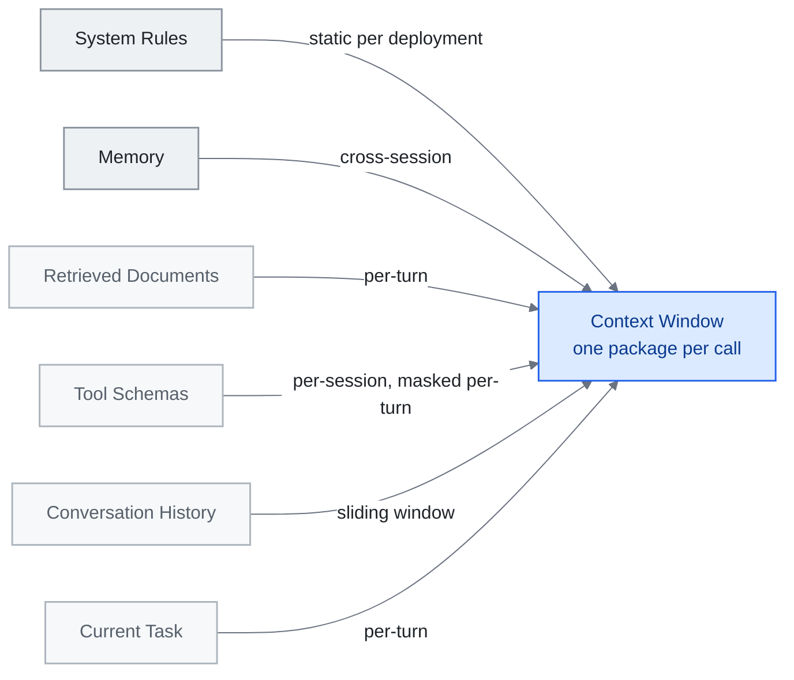

<!-- translation-sync:start -->
> 2026-10-31 영문판과 동기화한 기계 보조 번역입니다. 구조와 내용을 검토했습니다. 코드와 도표 라벨은 원문을 유지하며 읽기 시간은 영어 원문 기준 추정치입니다.
> [English source](../../../chapters/03-context-engineering.md) · [Sync record](../../SYNC.md)
<!-- translation-sync:end -->

<!-- i18n-anchor -->

# 3장: Context Engineering —— 윈도우를 채우는 기예

> **한 문장으로:** Context engineering은 AI에게 적절한 시점에 정확히 적절한 정보를 주는 기예이다 ——너무 많지도, 너무 적지도 않게.
>
> **왜 중요한가:** 더 좋은 context는 더 좋은 AI 답을 의미한다. 어떤 사람들은 AI에서 놀라운 결과를 얻는데 다른 사람들은 일반적인 응답만 얻는 이유가 이것이다.
>
> **읽기 시간:** 약 13분 (2,908단어 / 분당 230단어)

*그림: 3.2절의 여섯 계층을 위의 가장 오래 유지되는 계층부터 아래의 가장 일시적인 계층 순서로 배치했다. 이들은 3.1절에서 정의한 호출당 하나의 컨텍스트 묶음으로 모인다. 화살표 라벨은 각 계층의 갱신 빈도이며, 계층마다 별도의 압축 전략이 필요한 이유다. 이 계층들은 같은 창을 두고 경쟁하기도 한다. 검색된 문서를 지나치게 많이 넣으면 현재 작업의 신호가 묻힌다.*

> "Context engineering is the delicate art and science of filling the context window with just the right information for the next step."
> -- Andrej Karpathy, June 2025

Prompt engineering이 좋은 질문을 작성하는 것이라면, context engineering은 그것을 둘러싼 브리핑 패킷 전체를 만드는 것이다. 한쪽에서 다른 쪽으로의 전환은 실무자들이 LLM 시스템을 어떻게 생각하는가에 대한 근본적 변화를 표시한다: 설계의 단위는 더 이상 단일 지시가 아니라 *정보 환경*이다.

이 장은 이론적 프레임워크부터 실서비스에서 검증된 패턴까지 전체 지형을 정리하고, 이 분야를 정의하는 일차 자료를 안내한다.

---

<!-- i18n-anchor -->

## 3.1 Prompt에서 Context로

"context engineering"이라는 용어는 2025년 중반에 Karpathy가 그것과 prompt engineering 사이에 날카로운 선을 그으면서 주류 사용에 진입했다. Prompt는 정적 문자열이다. Context는 모델이 필요로 하는 모든 것 ——지시, 메모리, 검색된 문서, 도구 정의, 대화 이력, 그리고 즉시 작업 —— 의 동적으로 조립된 패키지로, 프로그래밍 방식으로 구성되고 모든 턴에 갱신된다.

이 구분이 중요한 이유는, 현대 에이전트가 같은 context를 두 번 보내는 일이 드물기 때문이다. 각 추론 호출은 라우팅 로직, 검색 파이프라인, 압축 휴리스틱, 도구 가용성 검사의 산물이며, 이것들이 함께 무엇이 윈도우를 채우고 무엇이 빠지는지를 결정한다.

<!-- i18n-anchor -->

## 3.2 여섯 계층의 컨텍스트 모델

Anthropic의 [Building Effective Agents](https://www.anthropic.com/engineering/building-effective-agents)와 관련 실무 글에 나오는 패턴을 바탕으로, 컨텍스트 창을 가장 오래 유지되는 것부터 가장 일시적인 것까지 여섯 개념 계층으로 나누어 보면 유용하다. 여기의 명칭은 이 가이드가 교육 목적으로 종합한 것이며, Anthropic이 직접 발표한 분류 체계가 아니다:

| 계층 | 내용 | 전형적 영속성 |
|-------|----------|-------------------|
| **System Rules** | 안전 제약, 페르소나 정의, 행동 가드레일 | 배포당 정적 |
| **Memory** | 사용자 선호, 이전 세션 요약, 학습된 사실 | 세션 횡단 |
| **Retrieved Documents** | RAG 결과, 검색 스니펫, 파일 내용 | 턴당 |
| **Tool Schemas** | 함수 정의, API 사양, 능력 선언 | 세션당 또는 턴당 마스킹 |
| **Conversation History** | 이전 메시지, 어시스턴트 응답, 도구 호출 결과 | 슬라이딩 윈도우 |
| **Current Task** | 즉시 사용자 요청 + 작업 특정 주입 | 턴당 |

핵심은 계층마다 갱신 빈도, 압축 전략, 실패 양상이 다르다는 점이다. 검색된 문서 계층을 과도하게 채우면 현재 작업의 신호가 묻힌다. 메모리를 충분히 채우지 않으면 모델은 이미 알아야 할 컨텍스트를 다시 도출해야 한다. 좋은 컨텍스트 엔지니어링은 여섯 계층 모두의 균형을 동시에 맞추는 일이다.

<!-- i18n-anchor -->

## 3.3 Manus의 교훈: 북극성으로서의 KV-Cache

July 2025에 Manus CTO Yichao "Peak" Ji는 실서비스에서 얻은 교훈을 발표하며 컨텍스트 엔지니어링을 하나의 운영 지표인 **KV 캐시 적중률**을 중심으로 재정의했다.

Manus의 에이전트 시스템에서는 입력 토큰과 출력 토큰의 비율이 일관되게 100:1로 관찰됐다. 이 비율에서는 입력 비용이 모든 것을 좌우한다. 이미 계산한 키·값 쌍을 다시 계산하지 않고 재사용하는 KV 캐시 적중이 지연 시간과 비용을 줄이는 핵심 수단이 된다.

이 통찰에서 세 기법이 부상했다:

1. **추가 전용 context 구조.** 이전 부분의 context를 다시 쓰지 마라. 중간에서의 삽입이나 편집은 캐시된 접두사를 무효화하여 전체 재계산을 강제한다. context를 문서가 아니라 로그로 설계하라.

2. **스키마 제거가 아닌 logit bias를 통한 도구 마스킹.** 도구가 일시적으로 사용 불가할 때, Manus는 context에서 도구 정의를 제거하지 않고 logit 레벨 마스킹을 통해 그 선택을 억제했다. 정의를 제거하면 토큰 시퀀스가 바뀌어 캐시가 깨진다. 마스킹은 접두사를 보존하면서 선택을 막는다.

3. **롤링 todo-list 재작성.** 긴 대화 초반의 목표를 모델이 회상하기를 의지하기보다, Manus는 주기적으로 재작성된 todo list를 context의 끝 가까이에 추가했다. 이는 어텐션의 최근성 편향을 활용한다 ——가장 최근 토큰의 목표가 수천 토큰 앞에 묻힌 동일한 목표보다 더 강한 어텐션 가중치를 받는다.

이는 prompt 레벨이 아니라 인프라 레벨 결정이다. 그것은 "context engineering"이 시스템 사고를 요구하는 이유를 보여 준다.

**캐시 원칙에 연구 도구가 더해지다 (mid-2026).** Manus의 규칙은 운영상의 경험 법칙이었다. June 2026의 두 논문은 같은 원칙을 측정 가능한 메커니즘으로 구체화한다. **Still** (arXiv 2606.07878, June 5, 2026)은 고정된 기반 모델을 대상으로 학습한 계층별 Perceiver를 통해 상각 방식의 단일 패스 KV 캐시 압축을 수행하며, **8k-128k 컨텍스트에서 8x-200x 압축**, **RULER에서 가장 강력한 기준선보다 8-22점 향상**을 보고한다. **TokenPilot** (arXiv 2606.17016, June 15, 2026)은 두 세분화 수준을 사용한다. *수집 인지 압축* 단계는 전역적으로 접두부를 안정화하고, *수명 주기 인지 제거* 단계는 각 구간의 유용성을 국소적으로 추적한다. PinchBench와 Claw-Eval에서 독립 세션 설정은 **61% / 56% 비용 절감**, 연속 세션 설정은 **61% / 87%**를 보고한다. TokenPilot이 여기서 중요한 이유는 이 절에서 정성적으로 설명하는 "append-only, don't bust the cache" 원칙을 수치로 실행 가능하게 만들기 때문이다. 제거 단계 덕분에 장기 세션은 무한히 커지지 않으면서도 캐시에 유리한 접두부를 유지할 수 있다.

**언제, 어떻게 압축할 것인가 (August 2026).** 후속 실증 연구인 "Practical Online KV Cache Compaction for LLM Agents" (arXiv 2608.00902, August 2, 2026)는 에이전트 실행 궤적에 대한 압축을 집중적으로 연구해 지침을 더 구체화한다. 즉시 압축하면 정확도가 떨어지지만, 에이전트 자신의 이후 쿼리가 대리 쿼리 신호로 쓰일 때까지 기다리면 손실된 정확도의 대부분을 회복한다. 대리 신호가 불완전할 때는 대리 쿼리가 유도한 어텐션 총량으로 제거할 토큰에 점수를 매기는 토큰 제거(TE)가 어텐션 매칭 재구성(AM)보다 견고하다. BrowseComp-Plus와 WideSearch에서 TE는 KV 캐시를 80% 줄이면서 압축을 전혀 하지 않을 때보다 처리량을 높인다. 이 절에서 정성적으로 제시한 추가 전용 원칙에 대해, 지연한 뒤 재구성 대신 제거하라는 구체적인 규칙을 제공한다.

<!-- i18n-anchor -->

## 3.4 다섯 개의 지배적 패턴

Aurimas Griciūnas는 운영 시스템 전반에 관찰된 다섯 개의 반복 패턴으로 신흥 실무를 종합했다 (정전판: "State of Context Engineering in 2026," SwirlAI Newsletter, March 22, 2026, [https://www.newsletter.swirlai.com/p/state-of-context-engineering-in-2026](https://www.newsletter.swirlai.com/p/state-of-context-engineering-in-2026); "Breaking Down Context Engineering"도 참조):

**Progressive Disclosure.** 모든 것을 미리 로드하지 마라. 가벼운 인덱스를 먼저 제시하고, 모델 (또는 라우팅 로직)이 관련성을 결정할 때만 섹션을 확장하라. 이는 context 윈도우의 lazy loading 등가물이다. Anthropic 자체의 에이전트 스킬 시스템이 이 패턴을 사용한다 ——17개 스킬이 휴면 상태에서 약 1,700 토큰을 소비하고, 호출 시에만 확장된다.

**Context Compression.** 주입 전에 정보를 요약하거나, 절단하거나, 추출하라. 슬라이딩 윈도우 너머의 대화 이력은 요약으로 압축된다. 검색된 문서는 관련 구절로 발췌된다. 목표는 토큰 수를 줄이면서 의미 밀도를 보존하는 것이다.

**Context Routing.** 모든 쿼리가 같은 context를 필요로 하지는 않는다. 라우팅 계층이 들어오는 요청을 살펴보고 어떤 메모리 뱅크, 도구 세트, 문서 컬렉션을 포함할지 선택한다. 이는 데이터베이스 쿼리 플래너의 context-window 등가물이다.

**Retrieval Evolution.** 정적 RAG (한 번 검색하고, 주입하고, 생성)는 모델이 생성 도중 추가 정보를 요청할 수 있는 반복 검색에 길을 내준다. Context는 한 번에 조립되지 않고 생성 과정을 통해 진화한다.

**Tool and Capability Management.** 도구 라이브러리가 커짐에 따라, 모든 스키마를 로드하는 것은 금지적이 된다. 시스템은 도구 계층을 가볍게 유지하기 위해 메타-도구 패턴 (요청 시 관련 도구 스키마를 반환하는 발견 도구) 또는 스킬 그래프 아키텍처를 사용한다.

**최첨단 연구소가 자체 규칙을 수정하다 (July 2026).** 위의 다섯 패턴은 여러 시스템에서 관찰한 실무를 종합한 것이다. July 24, 2026에 Anthropic은 Thariq Shihipar의 "The new rules of context engineering for Claude 5 generation models,"를 통해 자체 지침을 직접 수정해 발표했다. 핵심은 덜어 내기다. Claude Code 팀은 Claude 5 세대 모델의 시스템 프롬프트에서 80% 이상을 제거했으며 코딩 평가에서 측정 가능한 성능 손실이 없었다. 이 수치는 Anthropic 자체 코딩 평가에 따른 것이며 독립적으로 벤치마크한 결과는 아니다. 다른 환경에도 적용할 만한 것은 그 배경 논리다. 글은 규칙에서 판단으로 옮겨 가 유능한 에이전트에게 빈틈없는 지시 대신 원칙과 신뢰를 주고, 처음부터 창을 채우기보다 필요한 순간에 컨텍스트를 점진적으로 불러오며, 사람에게 설명하듯 역할, 제약, 필요성이 입증되는 경우에만 예시를 제공하라고 주장한다. 두 번째 주장은 위의 점진적 공개를 연구소의 실서비스 증거로 뒷받침한다. 첫 번째 주장은 이 분야를 탄생시킨 직관에 맞선다. 모델이 발전할수록 컨텍스트 엔지니어링 작업에서 최적화가 아닌 누적된 불신이 차지하는 몫이 커지고, 그 부분에는 조정보다 삭제가 적절하다는 것이다.

**압축은 단일 정책이 아니다 (August 2026).** 위의 KV 캐시 연구와 이 절의 컨텍스트 압축은 모두 창을 서로 대체 가능한 토큰들의 예산으로 취급한다. 아홉 명의 저자가 참여한 연구(arXiv 2608.31057, August 31, 2026)는 계산 단위부터 잘못됐다고 주장한다. 보관된 코딩 에이전트 실행 궤적 55개를 분석해 작업 메모리의 내용을 지시, 산출물, 도구 출력, 에이전트 생성 상태라는 네 범주로 나눈다. 각각 크기, 보존, 표현 특성이 다르다. 또한 저장 상태, 전달된 컨텍스트, 관리 작업, 과제 또는 프로세스 성과를 구분하는 네 수준의 평가 프레임워크를 제안한다. 저자들의 표현은 "equal token budgets do not imply equal delivered context or management cost."다. 의미를 고려하는 두 전략인 객체 인지 압축과 검색 기반 정책을 시험했으며, 한 과제 집합에서 조정한 보정 효과가 "may not transfer to held-out tasks."라고 경고한다. 실행 궤적이 55개인 이 연구는 확립된 패턴이라기보다 아직 열린 실증적 발견이다. 실무적 함의는 범위는 좁지만 명확하다. 창 전체에 단일 압축 규칙을 일률적으로 적용하는 것 자체가 네 종류의 객체에 대한 정책 선택이며, 그 선택을 아무 구분 없이 내리고 있다는 것이다.

압축의 모니터링 경계는 [4장](04-harness-engineering.md#48-harness-maintenance-the-stress-testing-imperative)을 참조하라.

<!-- i18n-anchor -->

## 3.5 학술 풍경

Mid-2025에는 컨텍스트 엔지니어링을 정식 연구 분야로 다룬 최초의 종합 학술 조사 **"A Survey of Context Engineering for Large Language Models"** (Mei 외, arXiv 2507.13334, July 17-21, 2025)가 나왔다. 이 조사는 연구 논문 1,400편 이상을 체계적으로 분석해 분야의 기술 로드맵을 세웠다. 설계 공간을 **기초 구성 요소**(컨텍스트 검색과 생성, 컨텍스트 처리, 컨텍스트 관리)와 **시스템 구현**(RAG, 메모리 시스템, 도구 통합 추론, 다중 에이전트 시스템)이라는 두 축으로 정리한다. 핵심 발견은 근본적인 역량의 비대칭이다. 현재 모델은 복잡한 컨텍스트를 이해하는 데는 매우 능숙하지만, 그만큼 정교한 장문 결과물을 생성하는 데는 뚜렷한 한계를 보인다. 실무자에게 이 조사는 이 분야의 교과서에 가장 가까운 자료다. 컨텍스트 엔지니어링은 단일 기법이 아니라 서로 독립적인 여러 차원을 갖는 설계 공간이라는 경험적 발견을 정식으로 체계화했다.

## 3.6 Agentic Context Engineering (ACE)

ACE 논문 **"Agentic Context Engineering: Evolving Contexts for Self-Improving Language Models"** (Zhang 외, arXiv 2510.04618, October 6, 2025; 관련 저장소: [github.com/ace-agent/ace](https://github.com/ace-agent/ace))는 컨텍스트를 정적인 조합이 아닌 **발전하는 플레이북**으로 보는 개념 전환을 제시했다. ACE 시스템의 컨텍스트는 에이전트가 직접 관리하는 살아 있는 문서다. 관찰을 추가하고, 계획을 갱신하고, 관련 없는 이력을 덜어 내며, 과제 진행 상황에 따라 자신의 지시를 재구성한다. 보고된 주요 성과는 에이전트 벤치마크 +10.6%, 금융 과제 +8.6%이며, 적응 지연 시간과 실행 비용도 줄었다. AppWorld 순위표에서는 더 작은 오픈소스 모델을 쓰면서도 전체 평균에서 최상위 실서비스 수준 에이전트와 동률을 이루고, 더 어려운 test-challenge 분할에서는 이를 능가한다. ACE는 방지하려는 실패 양상도 명명한다. **간결성 편향**은 간결한 요약을 위해 도메인 통찰을 버리는 것이고, **컨텍스트 붕괴**는 반복적인 재작성으로 세부 사항이 점차 사라지는 것이다.

이는 context engineering을 순수 인프라 관심사 (각 호출 전 harness가 무엇을 조립하는가)에서 협업적 관심사 (harness가 *그리고* 모델이 능동적으로 다시 형성하는 것 무엇을 준비하는가)로 옮긴다. "context the system provides"와 "context the model creates" 사이의 경계가 유동적이 된다.

ACE 시스템은 일반적으로 context 안에 구조화된 스크래치패드를 유지한다 ——모델이 작업 노트, 중간 결과, 수정된 계획을 쓰는 지정된 영역. Harness는 자신의 정책에 따라 주변 계층을 관리하면서 이 영역을 턴에 걸쳐 보존한다.

<!-- i18n-anchor -->

## 3.7 실무적 함의

이 풍경에서 몇 가지 원칙이 부상한다:

- **출력만이 아니라 입력 토큰을 측정하라.** 운영 스케일에서, 100:1 입력/출력 비율은 context 어셈블리 비용이 지배함을 의미한다. 캐시 적중과 최소 중복을 위해 최적화하라.
- **Context를 계층 시스템으로 설계하라.** 각 계층은 자신의 갱신 정책, 압축 전략, 실패 모드를 가진다. 그것들을 독립적으로 다루어라.
- **기본으로 progressive disclosure를 사용하라.** 가볍게 시작하라. 요청 시 확장하라. 무관한 정보를 포함하는 비용은 단지 토큰이 아니다 ——저하된 어텐션과 증가된 환각 위험이다.
- **Prompt만이 아니라 context 구성을 테스트하라.** 다른 context의 같은 prompt는 다른 결과를 낳는다. 당신의 테스트 스위트는 단지 최종 지시가 아니라 context를 변화시켜야 한다.
- **모델 개선을 예상하라.** 모델이 long-context 추론에 더 능해질수록, 어떤 압축과 라우팅 전략은 불필요한 오버헤드가 된다. 계층이 단순화되거나 제거될 수 있도록 명확한 추상 경계로 만들어라.

---

<!-- i18n-anchor -->

## 기억할 세 가지

- **프롬프트는 문자열이고, 컨텍스트는 조립된 묶음이다.** 각 추론 호출은 라우팅 로직, 검색, 압축, 도구 가용성 검사의 산물이므로 설계 단위는 지시문이 아니라 묶음이다.
- **청구 비용을 결정하는 것은 입력 토큰이다.** Manus가 측정한 입력 대 출력 100:1 비율에서는 KV 캐시 적중률이 지연 시간과 비용을 좌우한다. 그래서 컨텍스트를 추가 전용 로그로 구성한다.
- **엔지니어링 대상의 일부는 누적된 불신이다.** Anthropic은 Claude 5 세대 모델의 시스템 프롬프트에서 80% 이상을 제거하고도 코딩 평가에서 측정 가능한 손실이 없었다. 따라서 컨텍스트의 그 부분에는 조정보다 삭제가 적절하다.

---

## Sources

- **Karpathy, Andrej.** "context engineering" 관련 공개 발언(mid-2025). X와 AI 엔지니어링 커뮤니티에 널리 퍼져 분야 전반에서 채택한 실무 정의를 만든 관점.
- **Anthropic.** "Building Effective Agents." Anthropic 엔지니어링 블로그, December 19, 2024. [https://www.anthropic.com/engineering/building-effective-agents](https://www.anthropic.com/engineering/building-effective-agents) --- 오케스트레이터-작업자 패턴과 평가자-최적화자 흐름을 설명; 이 가이드는 §3.2의 여섯 개념 계층에 교육 목적으로 이름을 붙인다.
- **Ji, Yichao "Peak"** (Manus). "Context Engineering Lessons from Building Manus." 블로그 글, July 2025. [manus.im/blog](https://manus.im/blog) --- 운영 지표인 KV 캐시 적중률, 추가 전용 컨텍스트 구조, 로짓 편향으로 도구 가리기, 할 일 목록의 반복 재작성.
- **Griciūnas, Aurimas.** "State of Context Engineering in 2026." SwirlAI Newsletter, March 22, 2026. [https://www.newsletter.swirlai.com/p/state-of-context-engineering-in-2026](https://www.newsletter.swirlai.com/p/state-of-context-engineering-in-2026). "Breaking Down Context Engineering"도 참조: [https://www.newsletter.swirlai.com/p/breaking-down-context-engineering](https://www.newsletter.swirlai.com/p/breaking-down-context-engineering)
- **Mei, Lingrui 외.** "A Survey of Context Engineering for Large Language Models." arXiv 2507.13334, July 17-21, 2025. [https://arxiv.org/abs/2507.13334](https://arxiv.org/abs/2507.13334) --- 논문 1,400편 이상을 검토해 컨텍스트 엔지니어링을 공식 연구 분야로 정립.
- **Zhang, Qizheng 외.** "Agentic Context Engineering: Evolving Contexts for Self-Improving Language Models." arXiv 2510.04618, October 6, 2025. [https://arxiv.org/abs/2510.04618](https://arxiv.org/abs/2510.04618). 관련 저장소: [github.com/ace-agent/ace](https://github.com/ace-agent/ace). 컨텍스트를 발전하는 플레이북으로 설명하며 간결성 편향과 컨텍스트 붕괴를 명명.
- **Schmid, Philipp.** "The New Skill in AI is Not Prompting, It's Context Engineering" and follow-up. [https://www.philschmid.de/context-engineering](https://www.philschmid.de/context-engineering); [https://www.philschmid.de/context-engineering-part-2](https://www.philschmid.de/context-engineering-part-2)
- **LangChain 블로그.** [blog.langchain.com](https://blog.langchain.com)의 컨텍스트 엔지니어링 보도 --- Agent Engineer 관점을 실무 패턴으로 다룸(단일 정본 글은 없으며 담론의 근거로 인용).
- **Willison, Simon.** [simonwillison.net](https://simonwillison.net)의 지속적인 AI 엔지니어링 보도 --- 생태계를 연결하는 이해하기 쉬운 실무자용 소개.
- **Still.** 상각 방식의 단일 패스 KV 캐시 압축. arXiv 2606.07878, June 5, 2026. [https://arxiv.org/abs/2606.07878](https://arxiv.org/abs/2606.07878) --- 고정된 기반 모델을 대상으로 학습한 계층별 Perceiver; 8k-128k 컨텍스트에서 8x-200x 압축; RULER에서 가장 강력한 기준선보다 8-22점 향상.
- **TokenPilot.** 두 세분화 수준의 KV 캐시 관리. arXiv 2606.17016, June 15, 2026. [https://arxiv.org/abs/2606.17016](https://arxiv.org/abs/2606.17016) --- 수집 인지 압축(전역적 접두부 안정화) + 수명 주기 인지 제거(국소적 구간 유용성 추적); PinchBench와 Claw-Eval에서 독립 세션 61% / 56% 비용 절감, 연속 세션 61% / 87%.
- **"Practical Online KV Cache Compaction for LLM Agents."** arXiv 2608.00902, August 2, 2026. [https://arxiv.org/abs/2608.00902](https://arxiv.org/abs/2608.00902) --- 에이전트 실행 궤적의 압축에 대한 체계적 연구; 대리 쿼리 신호가 생길 때까지 압축을 늦추면 즉시 압축으로 손실되는 정확도의 대부분을 회복한다; 불완전한 대리 신호에서 토큰 제거(TE)가 어텐션 매칭 재구성(AM)보다 견고하다; BrowseComp-Plus와 WideSearch에서 TE는 KV 캐시를 80% 줄이면서 압축하지 않을 때보다 처리량을 높인다.
- **Shihipar, Thariq** (Anthropic). "The new rules of context engineering for Claude 5 generation models." Anthropic 블로그, July 24, 2026. [https://claude.com/blog/the-new-rules-of-context-engineering-for-claude-5-generation-models](https://claude.com/blog/the-new-rules-of-context-engineering-for-claude-5-generation-models) --- Claude 5 세대 모델에서 측정된 코딩 평가 손실 없이 시스템 프롬프트를 80%+ 줄였다고 보고(Anthropic 자체 코딩 평가이며, 독립적으로 벤치마크하지 않음); 규칙에서 판단으로, 필요한 순간의 컨텍스트 로딩, 사람에게 하듯 에이전트에게 설명하기.
- **Chen, Le 외.** "Measure Before You Manage: Evaluating Agent Working Memory in Coding Agents" (저자 아홉 명). arXiv 2608.31057, August 31, 2026. [https://arxiv.org/abs/2608.31057](https://arxiv.org/abs/2608.31057) --- 보관된 코딩 에이전트 실행 궤적 55개; 작업 메모리 객체의 네 범주 분류(지시, 산출물, 도구 출력, 에이전트 생성 상태); 네 수준 평가 프레임워크(저장 상태, 전달된 컨텍스트, 관리 작업, 과제 또는 프로세스 성과); 객체 인지 압축과 검색 기반 정책 시험; 저자들은 "equal token budgets do not imply equal delivered context or management cost"이며 보정 효과는 "may not transfer to held-out tasks."라고 명시한다. 작은 표본이며 재현되지 않았다.
