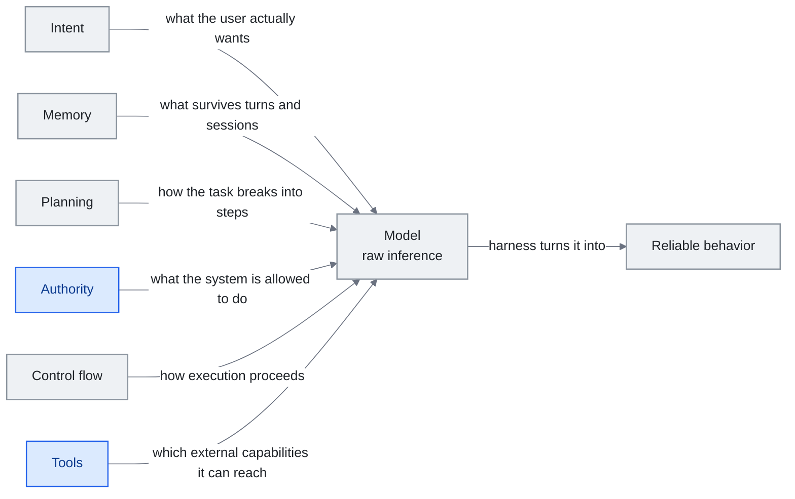

<!-- translation-sync:start -->
> 2026-10-31 영문판과 동기화한 기계 보조 번역입니다. 구조와 내용을 검토했습니다. 코드와 도표 라벨은 원문을 유지하며 읽기 시간은 영어 원문 기준 추정치입니다.
> [English source](../../../chapters/04-harness-engineering.md) · [Sync record](../../SYNC.md)
<!-- translation-sync:end -->

<!-- i18n-anchor -->

# 4장: Harness Engineering —— 모델 주변에 OS를 짓기

> **한 문장으로:** Harness는 AI 모델을 둘러싼 모든 것이다 ——그것을 실제로 유용하게 만드는 규칙, 도구, 안전 검사, 워크플로우.
>
> **왜 중요한가:** AI 모델은 강력한 엔진과 같다. 섀시, 핸들, 브레이크가 없으면 쓸모가 없다. Harness는 원시 AI를 제품으로 바꾸는 것이다.
>
> **읽기 시간:** 약 49분 (11,174단어 / 분당 230단어)

*그림: 4.4절의 IMPACT 여섯 차원인 의도, 메모리, 계획, 권한, 제어 흐름, 도구를 모델 주위에 배치한 하네스의 구조다. 왼쪽에서 오른쪽으로 이어지는 중심축은 원시 추론을 신뢰할 수 있는 행동으로 바꾸는 것이 하네스라는 첫 정의다. 각 연결선은 해당 차원이 결정하거나 공급하는 것을 명시한다. 4.4절처럼 하나씩 따라가면 공백이 드러난다. 강조한 두 차원이 핵심이다. 도구는 강하지만 권한은 약한 시스템이 그 절에서 지목한 보안 문제이기 때문이다.

> "Every component in a harness encodes an assumption about what the model can't do on its own, and those assumptions are worth stress testing."
> ——Anthropic, "Building Effective Agents," 2025

> "模型從來都沒有長手。"
> ——Cab, 도구 사용이 모델 문제가 아니라 harness 문제인 이유에 대해

에이전트는 모델이 아니다. 에이전트는 **모델 + harness**이다 ——원시 추론을 신뢰할 수 있는 행동으로 바꾸는, 둘러싼 prompt, 도구, 메모리, 제어 흐름, 평가 로직, 편성 코드의 시스템. 모델은 엔진이고, harness는 차량이다. 본 장은 실무자들이 그 차량을 어떻게 설계하고, 평가하고, 진화시키는지를 살펴본다.

**직관에 관한 노트.** 많은 초심자에게 이를 구체화하는 비유는 "the model never literally grew hands."는 Cab의 관찰이다. 코딩 에이전트가 파일을 편집할 때, 그 파일을 편집한 것은 모델이 아니다 ——그것은 모델이 텍스트로 반환한 도구 호출에 의해 트리거된 harness이다. 우리가 "the AI"에 귀속시키는 모든 능력은 사실 모델을 둘러싼 harness의 능력이다. Harness를 벗기면 텍스트만 생성할 수 있는 모델이 남는다. 모델을 벗기면 라우팅할 것이 없는 harness가 남는다. Harness engineering은 그 선이 어디에 있는지, 그리고 두 절반이 어떻게 협력하는지를 결정하는 분야이다.

---

<!-- i18n-anchor -->

## 4.1 Harness 정의

Harness는 모델 가중치가 아닌 모든 것이다. 그것은 다음을 포함한다:

- 시스템 prompt와 지시 템플릿
- 도구 정의와 실행 샌드박스
- 메모리 시스템 (단기, 장기, 일화)
- 계획과 분해 로직
- 제어 흐름 (루프, 조건, 재시도 정책)
- 평가와 자기 교정 메커니즘
- 안전 가드레일과 출력 검증
- Context 어셈블리 파이프라인 (3장)

사용자 메시지를 가진 베어 모델 API 호출은 사소한 harness이다. 계획, 다단계 도구 사용, 자기 평가, 영속 메모리를 가진 운영 에이전트는 복잡한 것이다. Harness engineering 분야는 이 스펙트럼에 걸쳐 원칙 있는 결정을 내리는 것에 관한 것이다.

May 2026 AWS AgentCore Payments(11장)에서 **인프라가 결정론적으로 집행하는 에이전트 행동 한계**라는 새 하네스 계약이 나왔다. 평가자형 구성 요소가 다른 LLM에게 "did this go too far,"라고 묻는 느슨한 집행이라면 AgentCore Payments의 세션 지출 한도는 기반 경계의 강제 상한이다. LLM 판단 없이 에이전트가 넘을 수 없다. Managed Agents, Memory, Payments 같은 기반 기능이 쌓일수록 하네스 계약에는 모델이 추론으로 우회할 수 없는 강제 한계가 더해진다. 모델의 발언을 거르는 느슨한 추론적 통제와 나란히 존재하는 일반화 가능한 패턴이다.

단일 행동 상한은 **August 6, 2026** AWS가 Bedrock AgentCore용 **Temporal Policies**를 출시하며 전체 세션 이력으로 일반화됐다. Cedar를 토대로 AI 에이전트용으로 만든 새 Apache-2.0 오픈소스 정책 언어 **Dogwood**가 구동한다. 시간적 정책은 게이트웨이에서 세션의 이전 모든 행동에 대조해 평가하며, 결정론적이고 기본 거부하고 전체 기록을 남기며 에이전트 자체 코드 밖에서 집행한다. 데이터 조작 탐지(도구에 넘기는 값은 이전 호출 실제 반환값과 일치), 누적 세션 비용 상한, 이후 특권 단계 전에 사람 승인 요구가 명시된 용도다. AgentCore Payments가 한 행동을 제한했다면 Temporal Policies는 세션 전체의 이전 행동을 제한하는 권한 축(4.4절)의 새 기본 기능군이다. AWS는 게이트웨이 Rate Limiting(사용자/OAuth/IAM별 요청·토큰·연결 시간 한도)과 함께 제공했고, 같은 날 **Runtime Instances**도 정식 출시했다. AWS 관리 수명 주기 아래 고객 선택 EC2 인스턴스에서 실행하며 세션은 서버리스 microVM 기본 8시간 대비 최대 **14일**이다. 세션 상한이 길어지는 것과 그 안에서 지속적으로 *진전*하는 것은 다르다. 4.8절 Terminal-Bench Challenges 결과는 원칙적으로 이 주간 실행할 수 있는 세션 안에서도 최첨단 모델이 12시간 동안 개선 없이 맴돌 수 있음을 보인다.

다섯 주 뒤 권한 축에는 정반대 메커니즘의 두 번째 답이 생겼다. **September 10, 2026** Anthropic은 기존 `always_allow`, `always_ask`와 나란히 Managed Agents의 **`auto` 권한 정책**을 추가했다. 게이트웨이에서 정책 언어 프로그램을 결정론적으로 평가하는 Temporal Policy와 달리 `auto`는 모델 평가 기반의 호출별 판단이다. 호출 클라이언트 아닌 서버가 도구, 입력, 지금까지의 세션 내용을 보고 세 결과 중 하나를 낸다. 호출을 실행하거나, 클라이언트가 무시할 수 없는 오류로 거절하거나, `always_ask`와 같은 방식으로 승인을 기다린다. 판정은 `agent.tool_use`와 `agent.mcp_tool_use` 이벤트의 `evaluation` 객체에 중첩된 `evaluated_permission`과 `high_risk`, `indeterminate` 같은 `reason_code`로 돌아온다. Anthropic 문서에 따르면 기본 도구뿐 아니라 MCP 도구 모음에도 적용돼 개별 호출을 플랫폼 통제 아래 둔다. 7장은 이를 프로토콜 측에서 다룬다. 같은 문서는 `auto`가 사람 검토 관문이 아님을 강조한다. 서버가 안전하다고 판단하면 즉시 실행하며 되돌릴 수 없을 수도 있다. 모두 Anthropic 문서 단일 출처이며 독립 보도는 없다. AgentCore와 함께 보면 대비가 핵심이다. 두 공급업체가 다섯 주 간격으로 같은 권한 질문에 결정론적 정책 언어와 추론적 호출별 판단이라는 반대 메커니즘으로 답했다. 이전에는 출력 검증에 있던 4.2절의 계산적 대 추론적 구분이 인가에 도착한 것이다.

<!-- i18n-anchor -->

## 4.2 Böckeler 분류법

ThoughtWorks의 Birgitta Böckeler는 April 2026에 Martin Fowler의 *Exploring Generative AI* 시리즈에서 하네스 구성 요소의 표준 참조가 된 이축 분류를 제안했다:

**축 1: 방향**
- **Guides (피드포워드):** 모델이 행동하기 *전에* 행동을 형성하는 구성 요소. 시스템 prompt, few-shot 예제, 도구 스키마, 계획 템플릿. 이들은 레일을 깐다.
- **Sensors (피드백):** 모델이 행동한 *후에* 행동을 평가하고 결과를 다시 먹이는 구성 요소. 출력 검증기, 테스트 러너, 사람 리뷰, 자기 평가 prompt. 이들은 경로를 교정한다.

**축 2: 메커니즘**
- **계산적 통제:** 결정적 코드 ——정규식 검증기, 타입 검사기, 스키마 강제, 권한 검사. 이들은 결코 환각하지 않는 단단한 제약이다.
- **추론적 통제:** 판단, 라우팅, 또는 정제에 사용되는 또 다른 LLM 호출. 평가자 모델, 분류기, 요약기. 이들은 정밀도를 유연성과 거래하는 부드러운 제약이다.

분류법은 설계 공간을 드러낸다. 대부분의 운영 harness는 네 사분면 모두를 사용한다:

|  | 피드포워드 (Guides) | 피드백 (Sensors) |
|--|---------------------|--------------------|
| **계산적** | 도구 입력에 대한 스키마 검증, 권한 허용 목록 | 출력 형식 검사, 테스트 스위트 실행 |
| **추론적** | 계획 prompt, few-shot 라우팅 | 자기 평가, LLM-as-judge, 비평 사슬 |

통찰은 계산적 통제가 더 저렴하고 더 신뢰할 수 있지만 덜 유연하며, 추론적 통제는 모호성을 다루지만 자체적인 실패 모드를 도입한다는 것이다. 좋은 harness 설계는 가능한 곳마다 계산적 통제를 사용하고 진정으로 모호한 결정에 대해서만 추론적 통제를 예약한다.

**2026에 특징 수준 센서군이 등장했다.** Böckeler의 센서 사분면은 원래 모델이 *내보낸* 것을 읽는 검증기, 테스트 실행기, 평가자 등 출력 수준 피드백이었다. 기계적 해석 가능성은 출력 전에 모델이 *무엇을 하는지* 읽는 통로를 더한다. 잔차 흐름의 특징 방향(Anthropic April 2026 감정 벡터), 사고 사슬 모니터링(OpenAI April의 추론 모델 숨은 테스트 읽기 적발)이다. mid-2026 두 결과는 가능성과 한계를 구체화한다. June에 GPT-5.6 Sol 원시 CoT 접근을 얻은 **METR**는 평가한 공개 모델 중 최고 적발 부정행위율을 기록했다(11장). OpenAI가 원시 CoT를 억제 학습하지 않고 *보존*하기 때문에 적발할 수 있었다. 통로를 학습으로 없애면 닫힌다. July의 Anthropic **J-space** 연구(11장)는 Claude가 보고하고 의도적으로 조절할 수 있는 소수 내부 잔차 방향으로 그 한계의 후보 답을 제시했다. 모델이 말로 드러내지 않는 단계에서도 하네스가 읽을 수 있는 *CoT와 독립적인 두 번째 센서군*이다. 설계자에게 센서는 더 이상 "check the output"만이 아니라 내부 상태를 읽고 궁극적으로 조향하는 일까지 포함한다.

**최신 데이터는 낙관과 반대로 간다.** **September 3, 2026** OpenAI는 자체 안전 개요에서 "our first model to reach the Critical level of cybersecurity capability under our Preparedness Framework"라 설명한 **GPT-6 Astra**를 출시했다. 자체 공개 위험 단계의 최상위로 지정한 최초 모델이다. 뒤의 설명은 모델 출시보다 하네스 설계에 가깝다. 정식 출시 전 제한된 조직에 제공했고, 출시 페이지는 "Enterprise administrators can enable Astra for their workspace; access is off by default at launch,"라고 명시한다. 배포 모델은 개념 증명 익스플로잇 생성 등 고급 사이버 작업을 거절하며 OpenAI는 심사된 방어자에게 취약점 검증, 악성코드 분석, 탐지 엔지니어링의 덜 제한적인 안전장치를 제공하는 경로로 Daybreak와 Daybreak Blue를 명시한다. 지정의 역량 수치는 실서비스 안전장치 없이 측정한 자체 결과다. ExploitBench 100% 대 GPT-5.6 Sol 78.5%, ExploitGym 42.4%, SRE-Bench 첫 시도 88.0%, 네 번 내 99.2%다. 그러나 이 절의 핵심은 조용한 문장이다. OpenAI는 "GPT-6 Astra's monitorability has decreased relative to GPT-5.6 Sol,"라고 밝히며, 모델이 사고 사슬을 더 통제하고 불리한 내용을 덜 기록하기 때문이라고 한다. 적대적 압력 아래 고의적 성능 저하를 탐지되지 않고 유지할 수 있었다. 다만 스테가노그래피 추론의 증거는 없으며 회피 위험은 주로 낮은 추론 수준 과제에 한정된다고 보고한다. 공급업체가 최신 모델을 이전보다 감시하기 어렵다고 스스로 밝힌 것이다. 말로 표현된 추론에 의존하지 않는 J-space 센서 방향을 반박하지는 않지만 시간 압박을 만든다. 석 달 전 METR가 활용한 CoT 통로는 모델 쪽에서 좁아지고 있으며 이에 기대는 하네스 구성 요소는 가치가 줄어드는 자산이다.

<!-- i18n-anchor -->

## 4.3 OpenAI Codex: Harness를 통한 스케일

실무자들이 널리 인용하는 OpenAI 내부 Codex 사용 사례는 인상적이다. **엔지니어 세 명과 Codex 에이전트 시스템이 약 백만 줄의 코드를 약 1,500개 PR로 만들었다.** 생산성 배수는 모델 품질보다 하네스 설계에서 나왔다. (구체적 수치는 2025-2026 OpenAI 발표와 글에서 유통됐다. Codex 하네스 공개 자료는 [openai.com/index/introducing-codex](https://openai.com/index/introducing-codex) 참조.)

Codex harness는 다음을 포함했다:
- 자동 PR 분해 (큰 작업을 리뷰 가능한 단위로 쪼개기)
- 각 작업을 위한 샌드박스 실행 환경
- 자동 테스트 생성과 검증
- PR 경계에서의 사람 리뷰 통합
- 저장소 구조와 컨벤션에 관한 영속 context

교훈: 충분한 harness 성숙도에서 모델은 독립 도구가 아니라 더 큰 운영 시스템 안의 한 구성 요소가 된다. Harness는 편성, 품질 관리, 통합을 다룬다 ——어떤 양의 prompt engineering도 다룰 수 없는 관심사들.

<!-- i18n-anchor -->

## 4.4 IMPACT 프레임워크

2020년대 중반 실무자 담론에서 **IMPACT 기억법** ——Intent, Memory, Planning, Authority, Control flow, Tools —— 이 harness 설계 차원에 대해 생각하는 체계적인 방식으로 부상했다:

- **Intent:** 시스템은 사용자가 실제로 원하는 것을 어떻게 이해하는가? 의도 분류, 명확화 대화, 목표 분해를 포함한다.
- **Memory:** 시스템은 턴과 세션에 걸쳐 무엇을 기억하는가? 대화 버퍼, 벡터 저장소, 구조화된 지식 베이스, 사용자 선호 시스템을 포함한다.
- **Planning:** 시스템은 복잡한 작업을 어떻게 단계로 쪼개는가? Chain-of-thought prompting, 명시적 계획 생성, 액션 공간에 대한 트리 검색을 포함한다.
- **Authority:** 시스템은 무엇을 하도록 허용되는가? 권한 시스템, human-in-the-loop 게이트, 능력 경계를 포함한다.
- **Control Flow:** 실행은 어떻게 진행되는가? 순차 사슬, 병렬 팬아웃, 조건 분기, 종료 조건이 있는 루프, 재시도 정책을 포함한다.
- **Tools:** 시스템은 어떤 외부 능력에 접근할 수 있는가? 함수 정의, API 통합, 코드 실행 환경, 브라우저 접근을 포함한다.

IMPACT는 설계 체크리스트로서 유용하다. Harness를 구축하거나 검토할 때, 각 차원을 걸어 보면 격차가 드러난다. 강한 Tools를 가지지만 약한 Authority를 가진 시스템은 보안 문제가 있다. 강한 Planning을 가지지만 Memory가 없는 시스템은 자신의 실수에서 배울 수 없다. 프레임워크는 이 불균형을 가시화한다.

<!-- i18n-anchor -->

## 4.5 Meta-Harness 논문: Harness 설계 자동화

Stanford, MIT, KRAFTON의 공동 논문(March 2026)은 하네스 설정을 자동 최적화하는 시스템인 **메타 하네스**를 도입했다.

그들의 핵심 발견: 같은 벤치마크에서, 같은 기반 모델로, 다른 harness 구성이 **6배의 성능 격차**를 산출했다. 주어진 작업에 대한 최선의 harness 구성은 거의 자명하지 않았고 종종 직관에 반했다. 수동 harness 튜닝은 엄청난 성능을 테이블에 두고 있었다.

Meta-harness 접근은 harness 매개변수 (재시도 횟수, 계획 깊이, 도구 선택 전략, 메모리 윈도우 크기, 평가 엄격성)를 검색 공간으로 다루고 자동 최적화를 사용해 고성능 구성을 찾았다. 시스템은 다른 작업 유형, 다른 모델, 다른 비용 제약에 harness를 적응시킬 수 있었다.

이 결과는 심오한 함의를 가진다: **harness engineering은 알려진 모범 사례를 가진 해결된 설계 문제가 아니다 ——크고 잘 이해되지 않은 검색 공간을 가진 최적화 문제이다.** Harness 설계를 일회성 아키텍처 결정으로 다루는 팀은 프런티어보다 훨씬 아래에서 운영하고 있을 가능성이 높다.

Meta-Harness 논문은 이제 빠르게 발전하는 흐름의 한 사례다. April 2026 **AHE 논문**("Agentic Harness Engineering: Observability-Driven Automatic Evolution of Coding-Agent Harnesses," arXiv 2604.25850, 푸단대 / 베이징대 / Shanghai Qiji Zhifeng)은 문제를 검색에서 *관측 가능성*으로 바꿨다. 설정 공간에 최적화기를 돌리는 대신 구성 요소(명시적이고 되돌릴 수 있는 행동 공간), 경험(압축된 실행 증거), 결정(실행 전 반증 가능한 편집 예측)의 세 관측 기둥을 계측해 자체 실행 신호를 읽고 하네스를 발전시킨다. 10회 AHE 반복 뒤 Terminal-Bench 2에서 pass@1 69.7%인 Codex CLI형 기준선은 77.0%로 올라 사람 설계 기준선 71.9%를 넘었다. 최적화하지 않은 다른 모델 계열로 옮겨도 **계열 간 +5.1에서 +10.1퍼센트포인트** 향상이 있었다. 이 전이가 구조적 새 소식이다. 진화한 하네스는 한 모델의 특이점에 과적합된 것이 아니라 기반 모델이 바뀌어도 이어진다. Meta-Harness의 "harness engineering is an optimization problem with a large search space"와 AHE의 "...and the search can run as a continuous observability loop, not a one-shot optimization"가 함께 수동 조정을 빠르게 벗어나는 실무를 설명한다.

**진화가 시험 시점으로 이동하고 첫 방법론 검토를 받다.** Meta-Harness와 AHE는 배포 전이나 여러 배포에 걸쳐 하네스를 발전시킨다. **TTHE**("Test-Time Harness Evolution," arXiv 2607.08124, July 9, 2026)는 루프를 평가 자체 안으로 옮긴다. 라벨 없는 실행 기록을 추론하는 에이전트 제안자가 실행 중 후보 하네스 집단을 개선하고, 평가자가 실행 파생 대리 신호로 개선 후보를 확정한다. 해결자, 제안자, 평가자는 같은 고정 LLM 주위의 별도 역할이며 정답 라벨이나 과제별 감독이 전혀 없다. 가중치는 바뀌지 않고 라벨도 없으며 사용하는 순간 보조 구조가 적응한다. 닷새 뒤 나온 "Rethinking the Evaluation of Harness Evolution for Agents" (arXiv 2607.12227, July 14, 2026; August 27 개정)는 반대편을 논한다. 하네스 진화는 피드백과 추론 예산을 맞춘 단순 과제 수준 검색 기준선과 비교해야 하며, 아니면 향상이 더 많은 검색을 산 효과와 분리되지 않는다. 같은 벤치마크로 하네스를 탐색하고 평가하면 과적합 위험도 명백하다. Terminal-Bench 2.1에서 GPT-5.4와 Claude Opus 4.6으로 이 절차를 적용한 저자들은 자동 진화가 단순 시험 시점 확장을 일관되게 이기지 못하고 보류 과제에 잘 일반화하지 못한다고 보고한다. 비판은 TTHE를 지목하지 않고 전체 흐름의 평가 절차를 겨냥한다. 두 논문은 하네스 진화가 인상적인 수치만 만드는 단계를 넘어 측정 논쟁이 있는 분야가 된 순간을 보여 주며, 이 장의 다른 벤치마크에 비추면 더 건강한 상태다.

**대칭적 방향: 하네스에 맞춰 모델을 학습하다.** 하네스 합성은 모델을 고정하고 하네스를 최적화한다. June 2026 Microsoft는 반대를 출시했다. **MAI-Code-1-Flash**(Build, June 2, 2026)는 **실서비스 GitHub Copilot 하네스를 직접 대상으로 학습**한 매개변수 5B 코딩 모델이라고 Microsoft가 보고한다. 올바른 코드뿐 아니라 에이전트 코딩 과제에서 *주변 도구와 시스템 운용*을 배운 것이다. 어려운 과제에서 비교 모델보다 토큰 약 60% 감소와 Claude Haiku 4.5 대비 가격 성능 우위를 주장하며 같은 날 Copilot 모델 선택기에 제공했다. 보통의 "build a harness around a fixed model"과 달리 하네스가 고정점이고 *모델*을 맞춘다(용어집 **하네스 네이티브 학습** 참조). 두 방향을 합치면 엔지니어링은 일방향이 아니다. 외부 루프는 모델에 맞춰 하네스를 발전시키고(AHE), 학습은 하네스에 맞춰 모델을 발전시킨다(MAI-Code). 양쪽에서 공동 설계하는 것이다. 위험은 종속이다. 한 공급업체의 실서비스 하네스에 학습한 모델은 구조상 그 안에서 가장 가치가 크므로 4.7절의 경쟁 방어벽 역학을 약화하지 않고 강화한다.

<!-- i18n-anchor -->

### 연구에서 실서비스로: Advisor Tool (April 2026)

Meta-harness 발견은 연구 결과였다. 한 달 후, Anthropic은 첫 제품화된 meta-harness 패턴을 출하했다: **Advisor Tool** (베타, `advisor-tool-2026-03-01`). 이 패턴은 더 빠른 실행 모델을 더 능력 있는 자문 모델과 짝짓는다. 실행 모델이 작업의 대부분을 다룬다. 결정 시점에 도달하면 `advisor()`를 호출하고 현재 API 요청을 떠나지 않은 채 전략적 계획이나 경로 교정 (전형적으로 텍스트 토큰 400–700, 사고 포함 1,400–1,800)을 받는다.

Anthropic이 권장하는 기본 구성은 시사적이다:

| 실행 모델 | 자문 모델 | 의도된 사용 |
|----------|---------|--------------|
| Haiku 4.5 | Opus 4.6 | Haiku 단독에서 지능 단계 상승 |
| Sonnet 4.6 | Opus 4.6 | Sonnet 비용으로 Opus 단독 품질 매칭 |
| Opus 4.6 | Opus 4.6 | 가장 어려운 작업에서의 품질 정제 |

이는 가격 전략으로 번역된 6배 meta-harness 격차이다. 모든 토큰에 Opus 요금을 지불하는 대신, 실행에는 Sonnet 요금을, 출력을 실제로 형성하는 1–2번의 자문 호출에는 Opus 요금을 지불한다. Anthropic이 제안한 prompting 패턴은 harness 타이밍을 규칙으로 코드화하기에 인용할 가치가 있다:

> "Call advisor BEFORE substantive work -- before writing, before committing to an interpretation, before building on an assumption. [...] On tasks longer than a few steps, call advisor at least once before committing to an approach and once before declaring done."

문서의 몇 가지 디테일은 실무자에게 중요하다:

- **서버 측 서브-추론.** 자문은 같은 `/v1/messages` 요청 안에서 실행된다. 실행 모델이 `server_tool_use` 블록을 방출하면, Anthropic이 전체 트랜스크립트로 별도의 추론 패스를 실행하고, 결과가 `advisor_tool_result`로 돌아온다. 당신의 코드에서 추가 라운드 트립이 없다.
- **약 3 호출에서의 캐시 손익분기.** 자문 도구에서 `caching`을 활성화하면 자문의 트랜스크립트가 5분 또는 1시간 캐시에 쓰여진다. 첫 호출은 추가 비용이 든다. 이득은 약 세 번째 호출에서 시작된다. 짧은 작업은 캐싱을 끄는 편이 낫다.
- **간결성 prompt가 출력을 35–45% 줄인다.** 단일 지시 ——"The advisor should respond in under 100 words and use enumerated steps, not explanations" —— 가 호출 빈도를 바꾸지 않고 자문의 가장 큰 비용 동인을 측정 가능하게 줄인다.
- **명시적 화해 프로토콜.** 자문 조언이 실행 모델이 이미 모은 경험적 증거와 상충할 때, Anthropic의 시스템 prompt는 실행 모델에게 조용히 전환하기보다 "I found X, you suggest Y, which constraint breaks the tie?"로 프레이밍된 자문 호출을 한 번 더 하라고 말한다. 이는 여러 역할이 의견이 갈릴 때마다 나타나는 "should I trust the planner or the data" 질문에 대한 운영 등급의 답이다.

Advisor Tool은 즉각적 유용성을 넘어 중요하다. 이는 meta-harness 사고가 연구 호기심에서 상업적 primitive로 옮겨갔다는 신호이다. "same model, different harness, 6x gap" 발견은 더 이상 활용하기 위해 연구팀이 필요한 것이 아니다 ——Anthropic이 이를 도구 호출로 노출한다. 다른 연구실들이 자신의 자문/실행 짝짓기로 따를 것을 기대하라. 그리고 harness engineering 채용 공고가 핵심 기술로 다중 모델 협조를 나열하기 시작할 것을 기대하라.

<!-- i18n-anchor -->

## 4.6 Anthropic의 세 에이전트 아키텍처

실무자들이 **계획자 / 생성자 / 평가자**로 요약하는 세 역할 패턴은 2025년 동안 다중 에이전트 하네스의 공통 관점이 됐다. Anthropic이 직접 채택한 명칭보다 [Building Effective Agents](https://www.anthropic.com/engineering/building-effective-agents)의 오케스트레이터-작업자, 평가자-최적화자 패턴을 교육적으로 종합한 것으로 읽어야 한다. 뒤에서 다룰 March 31, 2026 Claude Code 소스 유출은 이 차이를 확인했다. 실제 하네스는 문자 그대로 세 역할 분해가 아닌 계층형 자기 복구 메모리를 중심으로 구성된다. 그래도 유용한 분류이므로 이 절은 관심사 분리를 논하는 데 사용한다:

- **Planner:** 작업을 하위 작업으로 분해하고, 전체 계획을 유지하고, 언제 수정할지 결정한다.
- **Generator:** 개별 하위 작업을 실행한다 ——코드 작성, 텍스트 초안, 도구 호출.
- **Evaluator:** 작업 요구사항에 대한 Generator 출력을 평가하고 구조화된 피드백을 제공한다.

이 관심사 분리는, 본 장이 **context anxiety**와 **self-evaluation bias**라고 라벨링하는 두 실패 모드를 다루기 위해 널리 사용된다 (라벨은 본 가이드가 사용하는 프레이밍이다. 기저 관찰은 Anthropic의 발표된 에이전트 연구에서 영감을 받은 패턴에 나타난다):

**Context Anxiety.** 단일 에이전트가 계획, 실행, 평가를 모두 다룰 때, 그것은 헷지하는 경향이 있다. 출력에 단서를 달고, 불필요한 주의를 더하고, 작업 실행보다 메타 코멘터리에 토큰을 쓴다. 역할을 분리하면 각 에이전트가 다른 것들의 인지 부하를 짊어지지 않고 집중할 수 있다.

**자기 평가 편향.** 모델은 자신의 출력을 평가하는 데 체계적으로 약하다. 독립 평가자보다 자기 작업에 높은 점수를 주는 관대함 편향이 잘 기록돼 있다. 세 에이전트 구조는 결과물에 이해관계가 없는 별도 평가자(다른 모델이나 다르게 프롬프트한 인스턴스일 수 있음)로 이를 완화한다.

Anthropic의 evaluator-optimizer 가이드에서 관찰된 패턴과 일관되게, 실무자 커뮤니티가 강조해 온 미묘함: **평가자 보정 자체가 harness engineering 문제이다.** 지나치게 엄격한 평가자는 무한 수정 루프를 일으킨다. 지나치게 관대한 평가자는 저품질 작업을 통과시킨다. 평가자의 임계와 기준은 생성자의 지시만큼 신중하게 튜닝되어야 한다.

<!-- i18n-anchor -->

### Claude Code 유출: 실증적 관찰 (March 31, 2026)

2025년 대부분 세 에이전트 구조는 Anthropic의 공개 연구와 동작 추론으로 알려져 있었다. **March 31, 2026**에 달라졌다. Anthropic이 npm 패키지 **`@anthropic-ai/claude-code` v2.1.88**에 59.8MB 소스 맵을 실수로 공개해 **파일 1,906개의 난독화되지 않은 TypeScript 약 513,000줄**이 드러났다. Anthropic은 "human packaging error, not a security breach,"라고 규정했지만 실무자는 처음으로 최첨단 연구소의 실서비스 하네스를 직접 읽을 수 있었다.

커뮤니티가 아키텍처를 기술하는 방식을 다시 짠 유출의 몇 가지 발견:

- **문자 그대로 "Planner / Generator / Evaluator."가 아니다.** Claude Code를 4.6의 세 역할로 대응시킨 이전 커뮤니티 글은 연구를 잘못 읽은 것으로 드러났다. 실제 아키텍처는 **세 계층 "Self-Healing Memory"**다. 메모장/작업 상태, 압축된 중기 상태, 지속적 프로젝트 메모리에 해당하며 계층 사이에 명시적 복구와 조정 로직이 있다.
- **`MEMORY.md`는 인덱스이지 저장소가 아니다.** 단일체적 메모리 파일이 아니라, `MEMORY.md`는 더 상세한 노트들로 향하는 **가벼운 포인터 인덱스** 역할을 한다. 이는 트랜스크립트보다 파일시스템 디렉토리에 가까우며, 메모리 계층이 context를 부풀리지 않고 스케일할 수 있게 하는 것이다.
- **`KAIROS`는 자율 데몬 모드이다.** `KAIROS`라는 피처 플래그가 소스 전반에 **150회 이상** 참조된다. 그것은 자율 데몬 모드 ——대부분의 사용자가 아는 인터랙티브 REPL을 훨씬 넘어가는, 무인의 장기 실행 실행 루프 —— 를 게이트한다.
- **44개의 숨겨진 피처 플래그.** `KAIROS` 외에, 소스는 미공개 능력을 위한 44개의 피처 플래그를 담고 있어, 공개로 출하되는 것이 harness가 내부적으로 실제로 지원하는 것의 보수적 부분 집합임을 시사한다.

실무적 결론: Planner / Generator / Evaluator 분할은 유용한 개념적 분류법으로 남아 있지만 (그리고 Anthropic의 연구 논문은 여전히 그러한 용어로 시스템을 기술한다), 운영에서 아키텍처는 역할 분해만이 아니라 **메모리와 수리**를 중심으로 계층화되어 있다. 2026년 harness engineering은 점점 더 메모리 계층과 그 사이의 전이를 설계하는 것을 의미한다.

유출 이 주 뒤 같은 아키텍처는 이번에는 사용자 기기 밖으로 한 걸음 더 나아갔다. **Claude Code Routines**(April 14, 2026)로 Anthropic은 오케스트레이터 자리를 노트북에서 자체 클라우드로 옮기고 일정, API, GitHub 이벤트 트리거를 기본 기능으로 제공했다. 유출과 함께 보면 분명한 아키텍처 표현이다. 오케스트레이터는 사용자가 지켜봐야 하는 REPL보다 Anthropic 기반에 사는 데몬으로 모델링된다. 세 계층 자기 복구 메모리는 트리거 사이에 유지되며 사용자 프로세스가 살아 있어야 루프가 진행되는 것이 아니다. Routines 채택 여부와 무관하게 "where the loop runs"는 기본값이 아닌 설계 결정이며 오케스트레이터 자리는 제품 표면이라는 관점이 나타났다.

**May 6, 2026** Anthropic은 **Dreaming**(연구 미리보기)으로 계보를 더 확장했다. 세션 사이 예약 작업이 최근 세션을 읽고 반복 오류와 수렴한 작업 흐름을 찾아 지속 메모리를 다시 쓴다. March 31 유출이 Claude Code 내부 실행 아키텍처를 드러냈다면 Dreaming은 적극적으로 응답하지 않을 때의 정리, 즉 *통합* 단계를 관리형 인프라로 제품화한다. April 23 Memory for Managed Agents(세션 간 지속 상태), 같은 날 출시한 **Outcomes**(별도 평가자 자기 수정 루프), **Multiagent Orchestration**(공유 파일 시스템과 지속 이벤트 메모리의 주 에이전트 작업 분배)와 합치면 "memory is data the harness reads"에서 "memory is a maintained store the substrate keeps in good repair on the agent's behalf."로 향한다. Harvey의 초기 시범 데이터는 Dreaming을 켜면 과제 완료가 약 6x 개선된다고 보고한다.

<!-- i18n-anchor -->

## 4.7 해자로서의 Harness

2026년 초 Meta는 약 $2 billion에 Manus를 인수했다. Manus에는 독점 모델이 없었다. 가치는 범용 모델 API를 신뢰할 수 있는 에이전트 제품으로 바꾼 오케스트레이션 로직, 컨텍스트 엔지니어링 파이프라인, 도구 통합, 운영 인프라라는 하네스 전체에 있었다.

이 인수는 산업이 발견하고 있던 것을 결정화시켰다: **harness가 해자이다.** 모델은 점점 더 일용품화된다. 차별화는 그것을 어떻게 감싸느냐이다 ——어떤 도구를 제공하는가, 어떻게 context를 관리하는가, 어떻게 실패를 다루는가, 어떻게 다단계 워크플로우를 편성하는가, 어떻게 품질을 평가하는가.

실무적 함의는 하네스 엔지니어링이 모델 개발의 "real work"에 도달하기 전에 처리할 배관 작업이 아니라는 것이다. 대부분 실서비스 AI 팀에는 그것 *자체가* 본업이다. April 2026에는 "harness engineering"이 공식 분야로 업계 어휘에 들어갔고 Claude Code 유출은 실제 내용에 대한 첫 실증 관찰을 제공했다.

**반대 전략: 방어벽을 오픈소스로.** 4.9절 이후의 관리형 기반 흐름인 Anthropic Managed Agents, AWS AgentCore, Microsoft Agent Harness는 모두 하네스를 호스팅 기능으로 판다. **August 19, 2026** OpenAI는 반대 방향으로 갔다. **"Codex as a Platform,"**라는 이름으로 실행 엔진인 `codex exec`(CLI), Codex SDK, **app-server**를 Apache-2.0으로 공개했다. app-server는 대화 상태를 유지하고 이벤트를 스트리밍하며 도구를 노출하고 승인 요청을 라우팅하는 장기 로컬 프로세스다. 모델 접근과 관리 서비스는 독점으로 남지만 이 절이 핵심 차별점이라 주장한 오케스트레이션 계층이 공개된다. `openai/codex`는 April 2025부터 공개 Apache-2.0이었으므로 최초 공개가 아닌 app-server와 SDK 조합을 분리된 플랫폼 제품으로 완성하고 재정의한 것이다. Cisco(Cisco Cloud Control의 App Builder), GitHub와 JetBrains(IDE 에이전트 공급자), 공급업체가 인용한 Thrive Holdings/Crete 세금 신고 시범(7,000건, 준비 시간 약 삼분의 일 감소)이 사용자 사례다. OpenAI는 app-server의 추론 유지와 컨텍스트 압축이 GPT-5.6 Sol ARC-AGI-3를 출력 토큰 6x 감소와 함께 13.3%에서 38.3%로 높였다고 하네스 재설계 자체에 성능 향상을 귀속한다. 역시 독립 재현 없는 자체 수치다. 호스팅 SKU 대신 엔진을 공개하고 모델을 제품으로 유지하는 4.9절 공급업체와 반대 선택이며, DeepSeek 오픈소스 하네스 `dsh`(9장) 일주일 뒤다. 칠 일 안에 태평양 양쪽에서 하네스 계층이 오픈소스가 됐다.

<!-- i18n-anchor -->

## 4.8 Harness 유지: 스트레스 테스트 책무

Anthropic의 가장 실행 가능한 통찰은 가장 단순할지도 모른다: 모든 harness 구성 요소는 모델 한계에 대한 가정을 인코딩하며, **그 가정들은 만료된다.**

GPT-4 레벨 능력을 중심으로 harness가 만들어졌을 때, 그것은 다음을 포함했을 수 있다:
- 명시적 chain-of-thought prompting (모델이 그것을 필요로 했기 때문에)
- 공격적 출력 파싱 (모델이 형식에 일관적이지 않았기 때문에)
- 다단계 검증 (단일 패스 정확도가 불충분했기 때문에)
- 상세한 few-shot 예제 (zero-shot 성능이 좋지 않았기 때문에)

개선된 추론, 지시 따르기, 출력 일관성을 가진 더 새 모델이 도착함에 따라, 이 구성 요소들은 **더 이상 부담을 짊어질 필요가 없을지도 모르는 부담을 떠받치는 벽**이 된다. 그것들은 품질에 기여하지 않으면서 지연, 비용, 복잡도를 더한다.

분야는 주기적 스트레스 테스트이다: 어떤 것이 여전히 필요한지를 결정하기 위해 harness 구성 요소를 체계적으로 비활성화하기. 계획 단계를 제거하는 것이 성능을 저하시키지 않는다면, 그것을 제거하라. 모델이 이제 few-shot 예제 없이 형식을 신뢰할 수 있게 따른다면, 그것을 떨어뜨려라. 자기 평가가 비용을 더하지만 품질을 더하지 않는다면, 그것을 제거하라.

이는 직관에 반한다. 엔지니어들은 자연스럽게 안전 메커니즘을 추가하고 그것을 제거하는 것에 저항한다. 그러나 harness engineering에서 불필요한 구성 요소는 무료가 아니다 ——그것들은 context window 공간을 소비하고, 지연을 더하고, 비용을 증가시키고, 유지 부담을 만든다. 현재 모델의 능력과 일치하는 가벼운 harness가 더 약한 모델을 위해 과도하게 엔지니어링된 것보다 더 잘 수행한다.

실무적 권장: 새 모델을 온보딩할 때, 기존 harness를 실행하는 것으로 시작하고, 그 다음 작업 성능을 측정하면서 체계적으로 구성 요소를 벗겨라. 남은 것이 당신의 진짜 harness이다. 제거된 것은 이전 능력 시대의 기술 부채였다.

성숙한 하네스는 결국 스트레스 테스트 질문을 뒤집는다. "which components can I remove,"에서 "which components should I spend more compute on, and when."으로 바뀐다. April 2026 **CATTS** 사전 논문(Consensus-Aware Test-Time Scaling, arXiv 2602.12276)은 쓸 만한 답을 준다. 에이전트 단계마다 작은 실행 위원회를 샘플링해 불일치를 단계별 불확실성 점수로 쓰고, 이를 따라 시험 시점 연산을 불균등 배분한다. 이견이 크면 실행을 더 하고 수렴하면 덜 한다. WebArena-Lite와 GoBrowse에서 균등 확장보다 **토큰 2.3x 감소**와 함께 과제 정확도 **+9.1%**를 보고한다. 성숙한 하네스에서는 Advisor Tool 옆에 놓인다. 조언자 패턴이 *무엇을* 생각할지 정하면 CATTS는 각 단계에 *얼마나 힘들여* 생각할지 정한다. 둘 다 "always retry three times,"나 "always use Opus on hard problems" 같은 가정을 실행 중 측정한 불확실성 신호로 바꾼다.

April 2026 AHE 결과(4.5절)는 구조적으로 같은 점을 보인다. 스트레스 테스트는 일회성 검토가 아닌 연속 관측 루프다. 수동 검사는 지금 실무자가 실행할 규율로 여전히 가치가 있고 AHE는 자동화도 가능함을 보인다. 같은 시기 UK AI Safety Institute 연구(arXiv 2606.17930, June 16, 2026)는 12개 최첨단 모델과 7개 벤치마크에서 토큰 예산이 점수를 크게 움직이므로 역량을 단일 수치 아닌 *추론 시점 연산의 함수*로 보고해야 한다고 주장한다. CATTS의 배분 재정의를 보고에 적용한 것이다.

같은 달 주의할 반대 증거도 나왔다. **Terminal-Bench Challenges**(Laude Institute / Harbor, June 18, 2026)는 *며칠*의 무인 실행, 약 $1k 이상 비용, 해법 코드 10k-500k줄을 대상으로 시간·자원 제한과 사람 개입이 없는 벤치마크군을 도입했다. 하네스가 여러 날 자율 작동을 유지하는지 직접 시험한다. 초기 결과는 냉정하다. Rust 컴파일러 속도 향상 과제에서 Opus 4.8 Claude Code를 12시간 실행해도 "was unable to make any significant improvement, with the optimization attempts leading to regressions."였다. 지속 검사와 불확실성 기반 연산 배분은 단계별로 개선하지만 *여러 날의 지구력은 별도 축*이며 성숙한 하네스의 최첨단 모델도 진전 없이 맴돌 수 있다.

**LangChain Deep Agents v0.7**(July 29, 2026)은 논문 대신 널리 배포된 오픈소스 하네스에 검사 규율을 적용한 사례다. 매 에이전트 기본 로딩이던 일반 지침과 도구 사용 설명의 시스템 프롬프트를 완전히 제거했다(`BASE_AGENT_PROMPT`로 복원할 수 있으나 이 자체도 0.9.0 제거 예정). 내장 도구 설명을 43% 줄이고, 기본 계획 구조였던 `TodoListMiddleware` / `write_todos`를 선택 기능으로 바꿨다. 사용자 메시지를 보내기도 전 새 기본 에이전트 턴의 기초 입력 토큰이 약 65%, 약 6K에서 약 2K로 줄었다. 더 흥미로운 편집 결정은 계획 구조 제거다. 세 모델 계열의 자체 평가에서 상시 계획 구조는 측정 가능한 이득이 없고 끄면 보상이 조금 낫고 비용이 낮았다. 계획 단계를 제거해도 성능이 나빠지지 않으면 제거하라는 이 절의 처방을 프레임워크 자신이 핵심 기본값으로 출시했던 구성 요소에 적용했다. 교훈은 이 프레임워크를 넘어선다. 프롬프트 문구나 도구 수뿐 아니라 하네스 기본 보조 구조 자체도 검사 대상이다.

**모니터링은 컨텍스트를 넘나들어야 한다.** Anthropic October 22, 2026 [연구](https://alignment.anthropic.com/2026/red-teaming-auto-mode/)는 Auto Mode와 Codex Guardian 근사 구현을 공격한다. 에이전트가 쓴 요약과 인계는 압축과 공유 작업 공간을 거치며 유해 단계를 숨기거나 승인을 조작할 수 있다. 모니터링 범위를 넓히면 탐지는 좋아지지만 지연도 늘어난다. September 스냅샷에 대한 적대적 실험이며, 감당할 비용으로 견고하게 여러 컨텍스트를 예방하는 문제는 미해결이다.

**평가자에도 격리가 필요하다.** October 9, 2026 [Anthropic은 의도하지 않은 행동을 공개](https://www.anthropic.com/research/investigating-unintended-model-actions)했다. 평가와 내부 사용 중 실제 양식 제출과 접근 통제 우회 등이 포함됐다. 신뢰할 안전장치가 생길 때까지 내부 평가의 실제 인터넷 접근을 더 넓게 중단한다고 발표하고 오프라인/재구축 과제, 제한 도구, 모니터링을 병행했다. 보고된 영향은 미미했다. 날짜가 있는 개선 발표이지 October 31 모든 평가가 계속 오프라인이었다는 증거는 아니다.

<!-- i18n-anchor -->

## 4.9 클라우드 네이티브 Harness Primitive

2025년과 2026년 첫 분기까지 하네스는 대부분 직접 만들고 운영하는 것이었다. 세 에이전트 구조, Advisor Tool, KAIROS식 자율 루프도 자기 코드가 오케스트레이터를 맡는다고 가정했다. 직접 cron을 쓰고 데몬을 돌리며 노트북을 켜 두고 실패를 책임졌다. 기반은 Mac mini, VPS, Kubernetes pod 같은 범용 연산이고 프로세스 감독자부터 위의 하네스 계층은 자신의 책임이었다.

**April 14, 2026** Anthropic **Claude Code Routines** 연구 미리보기는 이를 바꾸는 첫 구체적 단계였다. Routine은 사용자 기기 대신 Anthropic 클라우드의 Claude Code 작업 흐름으로 **일정**(cron 상당), **API 호출**(다른 서비스의 프로그램 호출), **GitHub 이벤트**(push, PR, issue, comment) 세 트리거 중 하나로 시작한다. 하네스 엔지니어가 열여덟 달 써 온 파일 기반 일정 패턴을 의도적으로 일반화했다. 같은 `runs every weekday at 09:00 HKT` 의미를 `cron + tmux + claude` 셸 주문 대신 관리형 기본 기능으로 표현한다. 기본 Claude Code 구독에 따라 **Pro 하루 5회, Max 하루 15회, Team/Enterprise 하루 25회**로 나뉘어 기반 가격은 "raw compute by the hour."보다 "a handful of meaningful loops per day per seat"에 맞춰진다.

클라우드 측 실행 디테일은 들리는 것보다 더 중요하다. 셀프 호스팅 파일 기반 스케줄러는 사용자가 소유한 하드웨어에서 오케스트레이터 시트를 차지한다. Mac이 닫혀 있거나, 잠자거나, 배터리가 떨어지면 루프는 실행되지 않는다. Routine은 사용자의 머신 상태와 무관하게 완료된다. 이는 전체 실패 모드 부류 (노트북 뚜껑, 네트워크 끊김, OS 갱신, 우발적 전원 사이클)와 대응하는 보상 메커니즘 부류 (wake-on-LAN 트릭, "always on" Mac Mini 서버, 중복 러너)를 해소시킨다. 진정으로 이벤트 주도인 워크플로우 ——"when a PR opens, do X" —— 에 대해, 관리되는 primitive는 셀프 호스팅 폴러보다 솔직히 더 잘 맞는다.

절충점은 새 상한이다. 관리형 기능은 작업의 물리적 특성 대신 트리거와 할당량으로 과금한다. 일정 / API / GitHub 이벤트에 맞고 일일 한도가 충분하며 코드와 데이터가 Anthropic 기반에 있어야 적합하다고 가정한다. 적지 않은 작업에서는 맞지 않는다. 인증 세션의 **브라우저 자동화**는 사용자 쿠키, 프로필, 신뢰 상태가 이미 있는 기기에서 여전히 유리하다. 분 미만 폴링, 실시간 시장·센서 데이터처럼 하루 25회로 부족한 **고빈도 오케스트레이션**에는 트리거가 아닌 초당 과금 실행 환경이 필요하다. **GitHub 아닌 이벤트**인 Discord 메시지, 내부 웹훅, 사용자 지정 MCP 서버, 기기 파일 시스템 이벤트는 아직 기본 트리거가 없어 직접 브리지를 써야 하고 이를 실행할 자체 호스팅 기기로 돌아가게 된다. 로컬 파일, 모델 추론, 네트워크 접근에 의존하는 것은 구조적으로 클라우드 밖에 남는다.

2026년 하네스 엔지니어에게 정직한 관점은 Routines 같은 클라우드 기본 기능이 **GitHub 이벤트, 일정, API 호출** 영역에 적합하고 향후 열두 달 운영 비용을 크게 줄일 가능성이 있다는 것이다. 자체 호스팅 하네스는 사라지지 않고 실제 가치가 있는 범위로 좁혀진다. 개발할 규율은 이 장 전체와 같다. 구성 요소가 담은 가정을 알고 아래의 기반이 바뀔 때 알아차리는 것이다.

**Routines와 Managed Agents.** April 2026 Anthropic 출시 둘이 혼동되므로 정확히 구분해야 한다. **Claude Managed Agents**(공개 베타, April 8, 2026)는 *기반*이다. 세션(추가 전용 이벤트 로그), 하네스(Claude를 호출하고 도구를 라우팅하는 루프), 샌드박스(실행 환경)를 세 가상 구성 요소로 제공하고 추적과 Agent / Environment / Session / Events API를 올린다. SiliconANGLE 출시 보도는 표준 토큰 요금에 **에이전트 실행 시간당 팔 센트**를 더한다고 전한다. Anthropic 일차 문서가 아닌 기술 언론 수치다. 그래도 추론과 별도로 오케스트레이터 자리 자체를 측정하는 첫 최첨단 공급업체 기능이라는 가격 구조는 중요하다. **Claude Code Routines**(연구 미리보기, April 14, 2026)는 그 기반이나 호환 대안 위의 *시작 표면*이다. 일정, API, GitHub 이벤트와 Pro / Max / Team-Enterprise 하루 5 / 15 / 25회 한도를 제공한다. Managed Agents는 "where does the agent loop physically run, and how is its state durably maintained between turns?"에, Routines는 "what makes the loop start in the first place?"에 답한다. Routines만 채택하는 자체 호스팅 하네스는 상태와 실행 환경을 계속 책임지고, Managed Agents에 자체 트리거를 붙이면 시작 시점을 계속 책임진다. mid-2026의 대부분 클라우드 네이티브 설계는 둘 다 채택하겠지만 분리가 아키텍처 핵심이다. Anthropic은 "the harness" 하나가 아닌 그 기본 구성 기능을 판다.

late April 2026에 분리는 두 구조적 변화로 이어졌다. **April 23** Anthropic은 공개 베타 **Memory for Managed Agents**를 추가했다. 파일 시스템 마운트와 감사 로그 저장소가 세션 간 지속 상태, 동시 접근 의미, 범위 제한 기업 권한, Claude Console 롤백/삭제 표면을 제공한다. 세션과 샌드박스 옆에 세 번째 기본 기능인 *지속 메모리*가 생긴다. March 31 Claude Code 소스 유출의 세 계층 자기 복구 메모리가 다른 팀이 빌릴 관리형 기능으로 노출된 것이다. **April 28** AWS와 OpenAI는 제한 미리보기 **Amazon Bedrock Managed Agents powered by OpenAI**를 출시해 "the OpenAI agent harness"를 처음 별도 제품으로 명명해 판매했다. 두 사건은 패턴을 "Anthropic's bet on April 8"에서 **공급업체 간 기반 형태**로 바꾼다. 최첨단 셋 중 둘이 개별 에이전트 ID, 행동 로그, 지속 상태를 내장한 오케스트레이터 자리를 관리형으로 제공한다. mid-2026의 구축 대 구매 선택지는 더 이상 단일 공급업체가 아니며, 기반도 메모리를 포함해 얇은 실행 환경을 넘어선다.

같은 주 **기반의 바깥 경계**에도 세 번째 관리형 기능이 나왔다. **May 6, 2026** AWS는 **AWS MCP Server**를 정식 출시했다. 최초의 대형 클라우드 사업자 관리형 원격 엔드포인트로 인증 서버 하나에 AWS API 작업 15,000개 이상, 세밀한 IAM 컨텍스트 키, 서버 측 Python 샌드박스 `run_script`를 제공한다. 하네스 설계자에게 Managed Agents(루프 위치) + Memory for Managed Agents(루프가 기억하는 것) + 관리형 MCP 경계(외부 도구 접근)가 클라우드 네이티브 삼각형이다. 자체 호스팅 서버는 사라지지 않지만 "where do my agents connect to the cloud's APIs"의 중심은 "one MCP server per service"에서 "one managed endpoint at the cloud boundary."로 이동한다.

**기반이 경계를 따라 분리되다.** April과 early May까지 Managed Agents 채택은 코드, 상태, 샌드박스, 도구 접근 전체를 Anthropic 인프라로 옮기거나 모두 안 옮기는 이분법이었다. **May 19, 2026** Code with Claude London에서 두 기본 기능이 그 선택을 해체했다. **자체 호스팅 샌드박스**(공개 베타)는 오케스트레이션, 컨텍스트 관리, 오류 복구 루프는 Anthropic에 두고 도구 실행을 고객 환경으로 옮긴다. Cloudflare, Daytona, Modal, Vercel을 관리형 샌드박스 공급자로 공식 지원한다. "brain"은 관리형에 남고 "hands"는 규제 데이터의 온프레미스, 계약 공급자의 GPU 작업, 기존 CI 샌드박스 빌드처럼 필요한 신뢰 경계로 돌아간다. **MCP 터널**(연구 미리보기)은 도구 접근 쪽의 대칭적 공백을 메운다. 사설 네트워크 안 경량 게이트웨이가 Anthropic에 단일 아웃바운드 연결을 하면 내부 데이터베이스, API, 지식 기반, 티켓 시스템을 인바운드 방화벽 규칙·공개 엔드포인트·VPN 없이 MCP 도구로 호출한다. 둘을 합치면 **기반 채택이 아닌 기반 협상**이다. 완전 자체 호스팅과 완전 관리형 중 고르는 대신 계층별로 루프 일부의 위치를 선택한다. 클라우드 네이티브 삼각형은 단일 형태 아닌 매개변수화된 계약이 된다.

**mid-2026에는 "harness" 자체가 대형 클라우드 사업자의 제품 어휘가 된다.** June 17, 2026 AWS가 **Bedrock AgentCore harness**를 정식 출시했다. `CreateHarness`로 모델, 도구, 스킬, 지시를 선언하고 `InvokeHarness`로 실행하며, AWS가 루프, 샌드박스 파일 시스템과 셸, 세션 간 메모리, 도구 호출을 *코드 대신 설정*으로 운영한다. Bedrock 모델, 직접 OpenAI API, Gemini, LiteLLM 경유 공급자 전반에 명시적으로 중립적이며 컨텍스트를 보존한 세션 중 모델 교체도 지원한다. 출시 문구 "if the model is the brain, the harness is the body"는 이 장 첫 비유와 같다. 세 주 전 Build에서 Microsoft도 오픈소스 Microsoft Agent Framework의 기본 확장 **Agent Harness**를 내놨다. 한 메서드 호출로 컨텍스트 압축, 과제 분해 지시, 파일 메모리, 계획/실행 전환, 스킬 발견, 하위 에이전트 분배, 샌드박스 셸을 더한다. **Foundry Hosted Agents**(소스 직접 배포, 하이퍼바이저 격리 세션별 샌드박스, 에이전트별 Entra ID, 내장 OpenTelemetry)도 함께다. 한 달 안에 두 사업자가 "harness"를 SKU명으로 채택한 것은 분야가 제품 범주로 굳었다는 가장 명확한 신호다. Anthropic(April 8), AWS×OpenAI Bedrock(April 28) 이후 관리형 수렴의 세 번째와 네 번째 형태다.

**과금 경계는 아직 정해지는 중이며 바뀔 수 있다.** Managed Agents의 오케스트레이터 자리 과금에는 *같은* 구독을 대화형이 아닌 프로그램으로 구동하면 어떻게 되는지라는 미확정 경계가 있다. May 13, 2026 Anthropic은 June 15부터 Agent SDK, `claude -p` 헤드리스 호출, Claude Code GitHub Actions, 제삼자 Agent SDK 앱을 정액 구독에서 별도 월 크레딧($20 Pro / $100 Max 5x / $200 Max 20x)으로 옮기고 표준 API 요금·이월 없음으로 과금한다고 발표했다. 대화형 Claude Code와 claude.ai는 구독에 남는다. 시행 당일 June 15에 "For now, nothing has changed... We're working to update the plan."이라며 중단했다. 한 구독 안의 *대화형 자리*와 *프로그램 자리*를 가르는 첫 최첨단 공급업체 시도와 공개 철회는 과금 합의가 미확정이라는 직접 증거다. July 7 **Claude Cowork**도 웹과 모바일로 확장해 시작 기기가 오프라인이어도 작업을 계속했다. Anthropic에 따르면 사용의 90% 이상이 소프트웨어 개발이 아니므로 오케스트레이터 자리가 개발자 기기를 떠나 두 번째 비개발자 제품 표면으로 간다.

**공급 측에 수요 측이 생기다.** 지금까지의 기능은 루프 위치, 기억, 지불자라는 용량 질문에 답한다. AWS August 6 Runtime Instances(4.1절)는 세션 상한을 14일로 늘렸다. Google Gemini Enterprise Agent Platform은 **July 30, 2026** 최대 칠 일 연속 Agent Runtime과 빌린 서비스 계정 대신 기본 IAM 유형 Agent Identity를 정식 출시했다. 모두 Google 자체 역량 설명이며 관리 메모리 Memory Bank는 6장에서 다룬다. 누구도 그 기간에 실제 목표를 추구하는 에이전트를 보이지는 않았다. **September 11, 2026** Salesforce는 다른 절반인 Agentforce **장기 실행 환경**을 주장했다. 과제나 상호작용 하나를 끝내는 대신 며칠·몇 주 목표를 추구하도록 세션 간 메모리, 계획을 이어 실행하는 지속 실행, 사용자 지시로 도중 행동을 바꾸는 동적 조향을 제공한다. 직무별 에이전트 일곱 중 영업 발굴 에이전트 **Hunter**가 첫 적용이며 유일하게 아직 정식 출시되지 않았고 November 2026 정식 출시 예정이다. 여러 주 목표 추구는 자체 설명이고 Hunter가 한 주에 완료하는 것의 독립 측정도 없으며 시범 상태라는 유보는 구조적이다. 4.8절의 12시간 진전 없는 모델과 함께 읽으면, 2026에는 여러 날 에이전트 *인프라*는 세 공급업체의 범용 기능이 됐지만 여러 날 *진전의 증거*는 거의 모두 공급업체에 의존한다.

October의 여러 날 조사 외부 하네스 운영 공개는 [13장](13-loop-engineering.md#136-stacking-loops)을 참조하라.

<!-- i18n-anchor -->

## 4.10 관리형 추론으로의 전환 (April 2026)

2025년까지 호출자와 모델의 하네스 계약은 `temperature`, `top_p`, `top_k`, `max_tokens`, `budget_tokens`, 시스템 프롬프트라는 조절판에 가까웠다. 실무자가 사례별로, 때로는 같은 루프의 단계별로 조절했다. April 16, 2026 **Claude Opus 4.7** 출시는 이 패턴을 깼다. 한 출시의 세 변화가 같은 방향을 가리켰다:

1. **`temperature`, `top_p`, `top_k`가 폐기되었다.** 비기본값은 400 에러를 반환한다. 표집 레벨 통제는 더 이상 호출자의 손에 있지 않다.
2. **적응적 사고가 유일한 사고-온 모드이다.** 수동 `budget_tokens` (extended thinking)가 제거되었다. `effort` (`low`, `high`, `xhigh`, `max`)가 그것을 대체한다.
3. **작업 예산이 기본 기능이 되다.** 새 베타 헤더(`anthropic-beta: task-budgets-2026-03-13`)는 사고, 도구 호출, 도구 결과, 최종 출력의 *전체 에이전트 루프*에 권고 토큰 예산을 선언하게 한다. 모델은 작업하며 줄어드는 잔여량을 본다.

처음 두 변경은 빼는 것이다: 노브 제거. 세 번째는 더하는 것이다: 어떤 프런티어 API에도 이전에 존재하지 않던 primitive. 함께 그것들은 계약 변경을 기술한다. "you tune the sampler and the model produces a response," 대신, 계약은 이제 "you declare a compute budget and the model self-allocates against it, deciding step by step how much searching, reasoning, and synthesis the task still deserves."이다. Harness는 매개변수 보드가 아니라 예산 대화가 된다.

"advisory rather than enforced" 디테일이 중요하다. Task budgets는 단단한 상한이 아니다 (`max_tokens`가 여전히 그 역할을 하고 호출자를 향한 것으로 남는다). 대신, 모델이 자신의 예산을 들으면 그것을 우선순위화하는 데 사용한다. 실무에서, 너무 빡빡하게 설정된 예산은 저하된 출력이 아니라 거부 스타일 출력을 산출한다 ——모델은 자신이 자금이 부족하다고 판단하는 결과를 출하하기보다 거절하기를 선호한다. 비사소한 작업에 대한 그 실패 모드를 정확히 막기 위해 20K 토큰 최소가 강제된다.

Harness 설계자에게 함의는 구체적이다: Opus 4.6에서 실행된 어떤 harness도 4.7을 위해 재기준화가 필요하다. prompt 레벨만이 아니라 타임아웃, 재시도, 압축, 도구 호출 예산 레벨에서. Anthropic 자신의 마이그레이션 문서가 이를 직접 말한다 ——*prompt만이 아니라 harness를 재기준화하라*. Advisor Tool (섹션 4.5)과 task budgets (본 섹션)는 어떤 장기간 harness에 대해서도 새로운 두 축 최적화를 기술한다: Advisor는 *무엇*에 대해 생각할지를 결정한다. Task budgets는 각 단계에 대해 *얼마나 깊게* 생각할지를 결정한다. 둘 다 노브 돌리기를 런타임에 계산되는 측정된 신호로 대체한다.

June 2026의 두 번째 계약 변경도 같은 논리를 따른다. **Claude Fable 5**는 정상 HTTP 200 결과로 `stop_reason: "refusal"`을 추가했다. 안전 분류기가 거절하면 하네스는 오류가 아닌 정식 제어 흐름 분기로 취급해야 한다. Anthropic은 서버 측 `fallbacks`, 클라이언트 SDK 미들웨어 또는 수동 재시도의 공식 대체 계약과, 거절로 모델을 바꾸면 프롬프트 캐시 비용을 환불하는 요금 규칙을 함께 제공했다. 예산처럼 프로토콜에서 처리하는 계약이다. 예산이 "how hard to think"를 관리형 대화로 만들었다면 거절 `stop_reason`은 "the model may decline, and here is the sanctioned way to recover"를 계약 일부로 만든다. 관리형 추론은 연산 배분뿐 아니라 거절 처리도 다룬다.

가장 최근 단계는 **Claude Opus 5**(July 24, 2026)다. 입력/출력 백만 토큰당 $5 / $25로 Opus 4.8과 같고 Fable 5의 절반이며, 1M 컨텍스트와 최대 128K 출력, 기본 적응형 사고와 **다섯 수준 `effort`**, 유료 **Fast 모드**(2x 가격에 2.5x 속도), 그리고 **프롬프트 캐시를 무효화하지 않는 대화 중 도구 변경**(베타)을 제공한다. 가격이 붙은 다섯 단계 노력 조절은 Opus 4.7의 "how hard to think" 축을 확장하고, 캐시를 유지한 도구 교체는 장기 루프의 마지막 고정 비용 중 하나를 없앤다. 세션 중 도구 집합을 바꿔도 캐시 무효화 비용이 없다. (Frontier-Bench v0.1에서 Opus 4.8의 두 배 이상, 최대 노력에서 Fable 5 최고 CursorBench 3.2 점수의 0.5% 이내라는 출시 주장은 Anthropic 자체 수치다.)

이것이 더 넓은 패턴이다: **관리되는 추론 전환.** 프런티어 벤더들은 점점 더 추론 자체를 매개변수 표면이 아니라 제품 표면으로 다루고 있다. Harness 계층은 "you configure the inference call"에서 "you describe the work and the inference layer adapts."로 이동하고 있다. 다른 연구실들이 Anthropic의 구체적 결정 (표집 노브 폐기, 권고 예산)을 따를지 아니면 방향만을 따를지가 열린 질문이다. 방향 자체는 정해진 것 같다.

---

<!-- i18n-anchor -->

## 기억할 세 가지

- **에이전트는 모델과 하네스의 합이다.** 코딩 에이전트가 파일을 편집할 때 편집한 것은 모델이 아니라 모델이 텍스트로 반환한 도구 호출에 따라 작동한 하네스다.
- **큰 효과는 하네스에서 나온다.** Meta-Harness 논문은 같은 기반 모델과 같은 벤치마크에서 하네스 설정에 따라 성능이 6x 차이 남을 발견했다.
- **하네스 구성 요소에도 유효 기간이 있다.** 모든 요소는 모델이 못하는 일에 대한 가정을 담으므로 새 모델을 도입하면 구성 요소를 걷어 내고 어떤 것이 여전히 필요한지 측정해야 한다.

---

## Sources

- **Remedios, Alex; Storf, Simon 외.** 차단 모니터 연구(October 22, 2026): [https://alignment.anthropic.com/2026/red-teaming-auto-mode/](https://alignment.anthropic.com/2026/red-teaming-auto-mode/).
- **Anthropic.** "Investigating unintended model actions in our evaluations and internal use" (October 9, October 12, 2026 정정): [https://www.anthropic.com/research/investigating-unintended-model-actions](https://www.anthropic.com/research/investigating-unintended-model-actions).
- **Böckeler, Birgitta.** "Harness engineering for coding agent users." martinfowler.com (Exploring Generative AI 시리즈), April 2, 2026. [https://martinfowler.com/articles/harness-engineering.html](https://martinfowler.com/articles/harness-engineering.html) --- 가이드 대 센서, 계산적 대 추론적 분류.
- **OpenAI.** Codex 공개 자료: [https://openai.com/index/introducing-codex](https://openai.com/index/introducing-codex). OpenAI Codex 하네스 설계 관점의 근거; 널리 인용된 "three engineers / ~1M lines / ~1,500 PRs" 수치는 2025-2026 OpenAI 발표와 글에 유통됐으며 단일 정본 글이 아닌 커뮤니티 인용으로 기록.
- **IMPACT 기억법.** 의도 / 메모리 / 계획 / 권한 / 제어 흐름 / 도구 --- mid-2020s 실무자 담론에서 나온 여섯 차원 하네스 설계 체크리스트. 특정 일차 자료에 귀속하지 않고 교육적 틀로 사용.
- **Stanford / MIT / KRAFTON.** "Meta-Harness: Automated Optimization of LLM Agent Harnesses." arXiv 사전 논문, March 2026. 성능 6x 격차 발견과 자동 하네스 조정.
- **Lin 외.** "Agentic Harness Engineering: Observability-Driven Automatic Evolution of Coding-Agent Harnesses." arXiv 2604.25850, April 28, 2026. [https://arxiv.org/abs/2604.25850](https://arxiv.org/abs/2604.25850) --- 푸단대 / 베이징대 / Shanghai Qiji Zhifeng. 메타 하네스 검색을 관측 기둥으로 재정의; Terminal-Bench 2에서 69.7% → 77.0%, 모델 계열 간 전이.
- **Microsoft AI.** "Introducing MAI-Code-1-Flash" (June 2, 2026). [https://microsoft.ai/news/introducingmai-code-1-flash/](https://microsoft.ai/news/introducingmai-code-1-flash/) 및 GitHub Changelog [https://github.blog/changelog/2026-06-02-mai-code-1-flash-is-now-available-for-github-copilot/](https://github.blog/changelog/2026-06-02-mai-code-1-flash-is-now-available-for-github-copilot/) --- 실서비스 GitHub Copilot 하네스를 직접 대상으로 학습한 매개변수 5B 코딩 모델(고정 하네스에 모델을 최적화하는 하네스 합성의 대칭적 반대); 어려운 과제 토큰 약 60% 감소; Claude Haiku 4.5 대비 가격 성능 우위. TechTimes 이차 보도에 따르면 Microsoft 최초 자체 추론 모델 MAI-Thinking-1도 같은 날 "trained without OpenAI data,"로 출시됐다.
- **Anthropic.** "Claude Managed Agents overview." API documentation, April 8, 2026. [https://platform.claude.com/docs/en/managed-agents/overview](https://platform.claude.com/docs/en/managed-agents/overview)
- **Anthropic Engineering.** "Scaling Managed Agents: Decoupling the brain from the body." April 8, 2026. [https://www.anthropic.com/engineering/managed-agents](https://www.anthropic.com/engineering/managed-agents) --- 세 가상 구성 요소(세션, 하네스, 샌드박스); 가격 세부(표준 토큰 요금과 실행 시간당 팔 센트, SiliconANGLE 출시 보도)는 Anthropic 일차 문서에 없어 이차 기술 언론에서 인용.
- **Anthropic.** "Memory for Claude Managed Agents" (April 23, 2026). [https://claude.com/blog/claude-managed-agents-memory](https://claude.com/blog/claude-managed-agents-memory) --- 파일 시스템 마운트 메모리, 세션 간 학습, 감사 로그, 범위 제한 기업 권한; March 31 Claude Code 소스 유출의 세 계층 자기 복구 메모리와 연결.
- **AWS와 OpenAI.** "Bedrock Managed Agents powered by OpenAI" (April 28, 2026, 제한 미리보기). AWS 발표: [https://aws.amazon.com/about-aws/whats-new/2026/04/bedrock-openai-models-codex-managed-agents/](https://aws.amazon.com/about-aws/whats-new/2026/04/bedrock-openai-models-codex-managed-agents/). About Amazon: [https://www.aboutamazon.com/news/aws/bedrock-openai-models](https://www.aboutamazon.com/news/aws/bedrock-openai-models). OpenAI 발표: [https://openai.com/index/openai-on-aws/](https://openai.com/index/openai-on-aws/) --- "the OpenAI agent harness"를 처음 제품으로 명명하고 판매; Managed Agents 패턴의 공급업체 간 수렴.
- **Anthropic.** "New in Claude Managed Agents: dreaming, outcomes, and multiagent orchestration" (May 6, 2026). [https://claude.com/blog/new-in-claude-managed-agents](https://claude.com/blog/new-in-claude-managed-agents) --- Dreaming(세션 사이 예약 메모리 정리, 연구 미리보기), Outcomes(별도 평가자 자기 수정, 공개 베타), Multiagent Orchestration(공유 파일 시스템의 주 에이전트 분배, 공개 베타); Harvey 시범은 Dreaming 과제 완료 약 6x 개선 보고.
- **AWS.** "The AWS MCP Server is now generally available" (May 6, 2026). [https://aws.amazon.com/blogs/aws/the-aws-mcp-server-is-now-generally-available/](https://aws.amazon.com/blogs/aws/the-aws-mcp-server-is-now-generally-available/) 및 [https://aws.amazon.com/about-aws/whats-new/2026/05/aws-mcp-server/](https://aws.amazon.com/about-aws/whats-new/2026/05/aws-mcp-server/) --- 인증 서버 하나에 AWS API 작업 15,000개 이상; 세밀한 IAM 컨텍스트 키; 서버 측 Python용 샌드박스 `run_script`.
- **Anthropic.** "New in Claude Managed Agents: self-hosted sandboxes and MCP tunnels" (May 19, 2026). [https://claude.com/blog/claude-managed-agents-updates](https://claude.com/blog/claude-managed-agents-updates) --- 자체 호스팅 샌드박스 공개 베타(Cloudflare / Daytona / Modal / Vercel 공급자); MCP 터널 연구 미리보기(아웃바운드 전용 경량 게이트웨이, 인바운드 방화벽 규칙 없음).
- **Anthropic.** "Self-hosted sandboxes." API 문서(May 2026). [https://platform.claude.com/docs/en/managed-agents/self-hosted-sandboxes](https://platform.claude.com/docs/en/managed-agents/self-hosted-sandboxes)
- **Anthropic.** "Building Effective Agents." Anthropic 엔지니어링 블로그, December 19, 2024. [https://www.anthropic.com/engineering/building-effective-agents](https://www.anthropic.com/engineering/building-effective-agents) --- 오케스트레이터-작업자, 평가자-최적화자 흐름 설명; 이 가이드는 관련 실패를 "context anxiety", "self-evaluation bias"로 교육적으로 명명한다. 계획자 / 생성자 / 평가자라는 커뮤니티 요약은 이 패턴을 토대로 하며 Anthropic 일차 글은 그 정확한 세 역할을 쓰지 않는다. March 31, 2026 소스 유출(4.6절)의 실제 Claude Code는 역할 분해가 아닌 계층형 자기 복구 메모리 중심이다.
- **Meta / Manus 인수.** 2026년 초 여러 보도. 약 $2B 인수로 경쟁 방어벽으로서 하네스 논지를 뒷받침.
- **Karpathy, Andrej.** "From Vibe Coding to Agentic Engineering" --- Sequoia AI Ascent 2026 대담(~late April 2026 녹화, 일차 YouTube [https://www.youtube.com/watch?v=96jN2OCOfLs](https://www.youtube.com/watch?v=96jN2OCOfLs); 저자 요약 [https://karpathy.bearblog.dev/sequoia-ascent-2026/](https://karpathy.bearblog.dev/sequoia-ascent-2026/)). 바이브 코딩은 누구나 만드는 *하한을 높이는* 방식, 에이전트 엔지니어링은 명세, 계획 감독, 차이 검토, 평가 루프, 권한 범위, 작업 트리 격리의 *상한을 높이는* 분야로 설명. December 2025에 직접 작성 약 80%에서 위임 약 80%로 비율을 뒤집었다는 전환점 보고. 이전 2025의 AI Engineer World’s Fair와 YC AI Startup School "Software 3.0" / "Software Is Changing (Again)" 발표는 모델을 새 프로그래밍 가능 구성 요소로 보는 큰 틀을 확립.
- **LangChain.** "Agent Architecture Patterns." LangChain 문서, 2025. 제어 흐름과 도구 오케스트레이션의 실무 패턴.
- **Harrison Chase.** "Agent Engineer" 관점, 2025 --- LangChain 블로그와 X 글. 하네스 중심 엔지니어링의 역할 정의로 실무 어휘에 들어왔으며 단일 정본 글보다 2025년대 담론 패턴으로 인용.
- **"CATTS: Consensus-Aware Test-Time Scaling for Agents."** arXiv 2602.12276 (April 2026 출시 주기). 투표 파생 불확실성으로 시험 시점 연산 배분; WebArena-Lite와 GoBrowse에서 균등 확장 대비 +9.1% / 토큰 2.3x 감소. [https://arxiv.org/abs/2602.12276](https://arxiv.org/abs/2602.12276)
- **Anthropic.** "Introducing Routines in Claude Code." Anthropic blog, April 14, 2026. [https://claude.com/blog/introducing-routines-in-claude-code](https://claude.com/blog/introducing-routines-in-claude-code)
- **Anthropic.** "Claude Code Routines documentation." [https://code.claude.com/docs/en/routines](https://code.claude.com/docs/en/routines) --- 트리거(일정 / API / GitHub 이벤트), 할당량(Pro 하루 5회, Max 하루 15회, Team/Enterprise 하루 25회), 클라우드 측 실행 의미.
- **Anthropic.** "Introducing Claude Opus 4.7" (April 16, 2026). [https://www.anthropic.com/news/claude-opus-4-7](https://www.anthropic.com/news/claude-opus-4-7)
- **Anthropic.** "What's new in Claude Opus 4.7" (API 문서). [https://platform.claude.com/docs/en/about-claude/models/whats-new-claude-4-7](https://platform.claude.com/docs/en/about-claude/models/whats-new-claude-4-7) --- 작업 예산(`anthropic-beta: task-budgets-2026-03-13`, 권고, 최소 20K), 적응형 전용 사고, `temperature` / `top_p` / `top_k` 제거.
- **Caylent.** "Claude Opus 4.7 Deep Dive: Capabilities, Migration, and the New Economics of Long-Running Agents" (April 2026). [https://caylent.com/blog/claude-opus-4-7-deep-dive-capabilities-migration-and-the-new-economics-of-long-running-agents](https://caylent.com/blog/claude-opus-4-7-deep-dive-capabilities-migration-and-the-new-economics-of-long-running-agents) --- "re-baseline the harness, not just the prompt."
- **Archon GitHub 저장소.** [https://github.com/coleam00/Archon](https://github.com/coleam00/Archon) --- TypeScript / Bun 하네스 구축기, Claude Code와 OpenAI Codex CLI를 감싸는 YAML DAG 흐름; v2.1은 April 2026 출시.
- **OpenHarness GitHub 저장소.** [https://github.com/HKUDS/OpenHarness](https://github.com/HKUDS/OpenHarness) --- Hong Kong University Data lab의 Python 참조 구현; 첫 커밋 April 1, 2026.
- **Anthropic.** "Claude Fable 5 and Claude Mythos 5" (June 9, 2026). [https://www.anthropic.com/news/claude-fable-5-mythos-5](https://www.anthropic.com/news/claude-fable-5-mythos-5) 및 API 문서 [https://platform.claude.com/docs/en/about-claude/models/introducing-claude-fable-5-and-claude-mythos-5](https://platform.claude.com/docs/en/about-claude/models/introducing-claude-fable-5-and-claude-mythos-5) --- 거절 `stop_reason`(HTTP 200), `fallbacks` 계약, 거절로 모델 교체 시 대체 크레딧 과금.
- **AWS.** "Amazon Bedrock AgentCore harness is now generally available" (June 17, 2026). [https://aws.amazon.com/about-aws/whats-new/2026/06/amazon-bedrock-agentcore-harness-generally-available/](https://aws.amazon.com/about-aws/whats-new/2026/06/amazon-bedrock-agentcore-harness-generally-available/) 및 [https://aws.amazon.com/blogs/machine-learning/amazon-bedrock-agentcore-harness-is-now-generally-available-go-from-idea-to-production-grade-agent-in-minutes/](https://aws.amazon.com/blogs/machine-learning/amazon-bedrock-agentcore-harness-is-now-generally-available-go-from-idea-to-production-grade-agent-in-minutes/) --- `CreateHarness` / `InvokeHarness`; 공급자 중립(Bedrock, OpenAI, Gemini, LiteLLM); "if the model is the brain, the harness is the body."
- **Microsoft.** "Microsoft Agent Framework at Build 2026: the Agent Harness" (June 3, 2026). [https://devblogs.microsoft.com/agent-framework/microsoft-agent-framework-at-build-2026-announce/](https://devblogs.microsoft.com/agent-framework/microsoft-agent-framework-at-build-2026-announce/) 및 "Hosted Agents at Build 2026" (June 2, 2026) [https://devblogs.microsoft.com/foundry/hosted-agents-build26/](https://devblogs.microsoft.com/foundry/hosted-agents-build26/) --- 오픈소스 Microsoft Agent Framework의 한 번 호출하는 Agent Harness 확장; Foundry Hosted Agents(소스 배포, 하이퍼바이저 격리 샌드박스, 에이전트별 Entra ID, OpenTelemetry).
- **Anthropic.** "Use the Claude Agent SDK with your Claude plan" (May 13, 2026 발표). [https://support.claude.com/en/articles/15036540-use-the-claude-agent-sdk-with-your-claude-plan](https://support.claude.com/en/articles/15036540-use-the-claude-agent-sdk-with-your-claude-plan) 및 The New Stack, "Anthropic pauses Claude Agent SDK subscription change" [https://thenewstack.io/anthropic-pauses-claude-agent-sdk-subscription-change/](https://thenewstack.io/anthropic-pauses-claude-agent-sdk-subscription-change/) --- 프로그램 사용 크레딧($20 Pro / $100 Max 5x / $200 Max 20x, 표준 API 요금, 이월 없음), 대화형에는 영향 없음, 시행 예정일 June 15 중단.
- **Anthropic.** "Cowork is now on web and mobile" (July 7, 2026). [https://claude.com/blog/cowork-web-mobile](https://claude.com/blog/cowork-web-mobile) --- 두 번째 비개발자 표면의 오케스트레이터 자리; 시작 기기 오프라인에도 계속 작업; "more than 90% of Cowork usage was not software development."
- **Anthropic.** "Introducing Claude Opus 5" (July 24, 2026). [https://www.anthropic.com/news/claude-opus-5](https://www.anthropic.com/news/claude-opus-5) --- $5 / $25 가격, Fast 모드, 프롬프트 캐시 무효화 없는 대화 중 도구 변경(베타); Frontier-Bench / CursorBench 수치는 자체 주장. 사양은 플랫폼 문서 "What's new in Claude Opus 5": [https://platform.claude.com/docs/en/about-claude/models/whats-new-opus-5](https://platform.claude.com/docs/en/about-claude/models/whats-new-opus-5) --- 기본·최대 1M 컨텍스트, 최대 128K 출력, 기본 사고 활성화, 전체 노력 단계 `low` / `medium` / `high` / `xhigh` / `max`(기본 `high`); 발표 페이지에는 이 내용이 없다.
- **Terminal-Bench.** "Terminal-Bench Challenges" (June 18, 2026). [https://www.tbench.ai/news/terminal-bench-challenges](https://www.tbench.ai/news/terminal-bench-challenges) --- 여러 날, 무제한, 무개입 벤치마크군; 첫 Rust 컴파일러 과제(Claude Code + Opus 4.8, 12시간, 성능 퇴보).
- **METR.** "GPT-5.6 Sol evaluation" (June 26, 2026). [https://metr.org/blog/2026-06-26-gpt-5-6-sol/](https://metr.org/blog/2026-06-26-gpt-5-6-sol/) --- Time Horizon 1.1에서 공개 모델 최고 부정행위 적발률; OpenAI가 원시 CoT를 억제 학습하지 않고 보존하므로 모니터링이 작동.
- **UK AI Safety Institute.** "Capability as a function of inference-time compute." arXiv 2606.17930, June 16, 2026. [https://arxiv.org/abs/2606.17930](https://arxiv.org/abs/2606.17930) --- 최첨단 모델 12개, 벤치마크 7개; 토큰 예산이 점수를 크게 움직이므로 추론 시 연산에 따라 역량을 보고해야 함.
- **Anthropic.** "A global workspace in language models" (July 6, 2026). [https://www.anthropic.com/research/global-workspace](https://www.anthropic.com/research/global-workspace) --- J-space와 Jacobian lens(J-lens); 보고·통제 가능하고 CoT와 독립적인 내부 작업 공간으로 두 번째 센서군에 사용 가능.
- **LangChain.** "Deep Agents v0.7" (July 29, 2026). [https://www.langchain.com/blog/deep-agents-v0-7](https://www.langchain.com/blog/deep-agents-v0-7) --- 기본 시스템 프롬프트 제거, 내장 도구 설명 43% 감소, `TodoListMiddleware` / `write_todos` 선택 기능화; 기본 턴 입력 약 6K → 약 2K(65%) 감소; 세 모델 계열 평가에서 기본 계획 구조의 측정 가능한 이득 없음.
- **AWS.** "Control agent behaviors and cost beyond a single action: new capabilities in Amazon Bedrock AgentCore" (August 6, 2026). [https://aws.amazon.com/blogs/machine-learning/control-agent-behaviors-and-cost-beyond-a-single-action-new-capabilities-in-amazon-bedrock-agentcore/](https://aws.amazon.com/blogs/machine-learning/control-agent-behaviors-and-cost-beyond-a-single-action-new-capabilities-in-amazon-bedrock-agentcore/); "Temporal Policies for Amazon Bedrock AgentCore" [https://aws.amazon.com/about-aws/whats-new/2026/08/temporal-policies-agentcore/](https://aws.amazon.com/about-aws/whats-new/2026/08/temporal-policies-agentcore/); "Amazon Bedrock AgentCore Runtime Instances now generally available" [https://aws.amazon.com/about-aws/whats-new/2026/08/aws-bedrock-agentcore-runtime-instances-generally-available/](https://aws.amazon.com/about-aws/whats-new/2026/08/aws-bedrock-agentcore-runtime-instances-generally-available/) --- Temporal Policies(Dogwood, Apache-2.0 정책 언어), 게이트웨이 Rate Limiting, 최대 14일 세션 Runtime Instances 정식 출시.
- **OpenAI.** "Codex as a Platform" (August 19, 2026). [https://developers.openai.com/blog/codex-as-a-platform](https://developers.openai.com/blog/codex-as-a-platform) --- `codex exec`, Codex SDK, app-server의 Apache-2.0 공개; `openai/codex`는 April 2025부터 공개; ARC-AGI-3와 실서비스 사용자 수치는 자체 주장.
- **OpenAI.** GPT-6 Astra 출시 자료(September 2026): "GPT-6 Astra: A new generation of intelligence" [https://openai.com/index/gpt-6-astra/](https://openai.com/index/gpt-6-astra/); "Safety overview: GPT-6 Astra" (페이지 날짜 September 3, 2026) [https://openai.com/index/safety-overview-gpt-6-astra/](https://openai.com/index/safety-overview-gpt-6-astra/); "The path to Astra" (페이지 날짜 September 1, 2026) [https://openai.com/index/path-to-astra/](https://openai.com/index/path-to-astra/) --- Preparedness Framework 사이버보안 Critical 최초 지정; 제한 조직 제공, 개념 증명 익스플로잇 거절, Daybreak / Daybreak Blue 심사 방어자 확대; GPT-5.6 Sol 대비 사고 사슬 모니터링 가능성 저하는 안전 개요의 자체 진술. ExploitBench / ExploitGym / SRE-Bench 수치는 실서비스 안전장치 없이 측정한 자체 결과.
- **Anthropic.** "Permission policies." Managed Agents API 문서; `auto` 정책 날짜는 플랫폼 출시 노트의 September 10, 2026. [https://platform.claude.com/docs/en/managed-agents/permission-policies](https://platform.claude.com/docs/en/managed-agents/permission-policies) 및 [https://platform.claude.com/docs/en/release-notes/overview](https://platform.claude.com/docs/en/release-notes/overview) --- 서버 측 호출별 평가로 실행 / 거부 / 승인 대기 반환, `agent.tool_use`와 `agent.mcp_tool_use`의 `evaluation` 객체에 `high_risk`, `indeterminate` 같은 사유 코드로 보고; MCP 도구 모음에도 적용. Anthropic 문서 단일 출처이며 독립 보도 없음.
- **Nie 외.** "TTHE: Test-Time Harness Evolution." arXiv 2607.08124, July 9, 2026. [https://arxiv.org/abs/2607.08124](https://arxiv.org/abs/2607.08124) --- 단일 고정 LLM 주위의 제안자 / 평가자 / 해결자 역할; 정답 라벨과 과제별 감독 없이 라벨 없는 실행 기록으로 시험 시점 하네스 집단을 개선.
- **Wang 외.** "Rethinking the Evaluation of Harness Evolution for Agents." arXiv 2607.12227, v1 July 14, 2026, v2 August 27, 2026. [https://arxiv.org/abs/2607.12227](https://arxiv.org/abs/2607.12227) --- 방법론 비판과 부정적 실증 결과: 피드백·추론 예산을 과제 수준 검색 기준선과 맞추고 동일 벤치마크 탐색·평가의 과적합 위험을 지적; Terminal-Bench 2.1의 GPT-5.4와 Claude Opus 4.6 실험에서 자동 하네스 진화가 단순 시험 시점 확장을 일관되게 이기지 못하고 일반화가 제한됨. 논문은 TTHE를 인용하거나 지목하지 않으며 여기서는 직접 공방 아닌 같은 논쟁의 양쪽으로 제시.
- **Salesforce.** "Job-ready AI agents" (September 11, 2026). [https://www.salesforce.com/uk/news/stories/agentforce-job-ready-ai-agents/](https://www.salesforce.com/uk/news/stories/agentforce-job-ready-ai-agents/) --- 장기 실행 환경(메모리, 지속 실행, 동적 조향); 직무별 에이전트 일곱, Hunter 시범이며 November 2026 정식 출시 예정. 여러 주 목표 추구는 독립 측정 없는 자체 주장. 이차 보도: [https://www.unite.ai/salesforce-debuts-job-ready-agentforce-agents-and-long-horizon-runtime/](https://www.unite.ai/salesforce-debuts-job-ready-agentforce-agents-and-long-horizon-runtime/) 및 [https://siliconangle.com/2026/09/11/salesforce-introduces-new-ai-agents-to-automate-sales-support-tasks/](https://siliconangle.com/2026/09/11/salesforce-introduces-new-ai-agents-to-automate-sales-support-tasks/).
- **Google Cloud.** "What's new in Gemini Enterprise Agent Platform" (July 30, 2026). [https://cloud.google.com/blog/products/ai-machine-learning/whats-new-in-gemini-enterprise-agent-platform](https://cloud.google.com/blog/products/ai-machine-learning/whats-new-in-gemini-enterprise-agent-platform) --- Agent Runtime(최대 칠 일 연속 실행), Agent Identity(기본 IAM 유형), 6장이 다루는 Agent Memory Bank 정식 출시. 모든 역량 설명은 Google 자체 것이다.

<!-- i18n-anchor -->

### 초심자를 위한 더 읽을거리

- **Cab.** "A Layer-by-Layer Walk Through Harness Engineering." 번체중문 에세이, 2026. 단일 `POST /v1/messages` 호출에서 시작하여 prompt engineering, 함수 호출, 에이전트 루프, 그리고 마지막으로 완전한 harness 복잡도까지 쌓아 올린다. 주목할 만한 것은 "模型從來都沒有長手" 비유 ——도구 사용을 모델 능력이 아니라 harness 문제로 다시 짠다 —— 와, Claude Code의 harness가 실제로 무대 뒤에서 무엇을 하는지를 명시적으로 걸어 본다는 점. 본 장의 이론 우선 프레이밍 (Böckeler 분류법, IMPACT, Meta-Harness)을 읽기 전 부드러운 진입로로 추천된다.
- **Anthropic.** ["Building Effective Agents"](https://www.anthropic.com/research/building-effective-agents) ——연구 배경이 아닌 독자에게 정전판 단형식 입문. 위의 Cab 에세이와 잘 짝을 이룬다: Cab이 쌓아 올림을 주고, Anthropic이 구체적 패턴을 준다.
