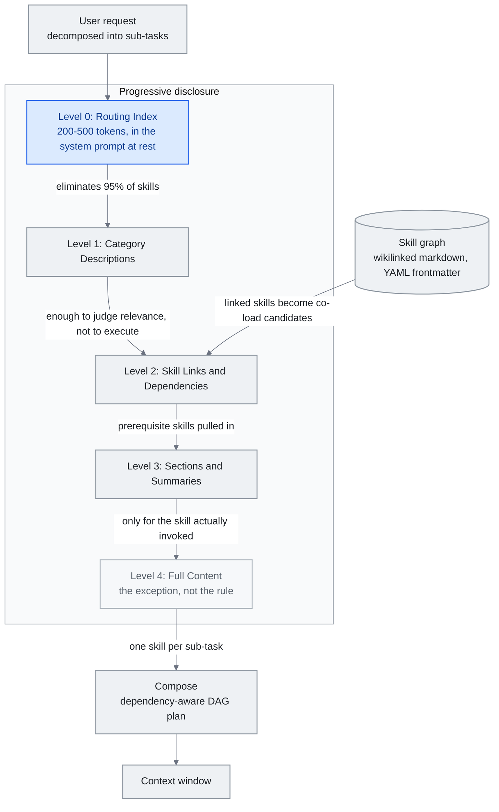

<!-- translation-sync:start -->
> 2026-10-31 영문판과 동기화한 기계 보조 번역입니다. 구조와 내용을 검토했습니다. 코드와 도표 라벨은 원문을 유지하며 읽기 시간은 영어 원문 기준 추정치입니다.
> [English source](../../../chapters/05-skill-systems.md) · [Sync record](../../SYNC.md)
<!-- translation-sync:end -->

<!-- i18n-anchor -->

# 5장: Skill 시스템 —— 스킬, 스킬 그래프, Progressive Disclosure

> **한 문장으로:** 스킬은 AI에게 특정 작업을 어떻게 하는지 알려주는 재사용 가능한 지시 세트이며, 스킬 그래프는 그것들을 항행 가능한 지식 네트워크로 연결한다.
>
> **왜 중요한가:** 매번 같은 것을 AI에게 설명하는 대신, 스킬은 한 번 가르치고 그 지식을 영원히 재사용하게 한다.
>
> **읽기 시간:** 약 22분 (4,929단어 / 분당 230단어)

*그림: 5.4절의 다섯 공개 수준이다. 5.5절의 스킬 그래프는 링크와 의존성을 해석하는 수준에 정보를 제공하고, 5.5절의 조합 계획은 마지막에 불러올 내용을 구성한다. 수준 0에서 나가는 연결선이 핵심이다. 라우팅 인덱스는 전체 파일 하나를 읽기도 전에 스킬의 95%를 제외하므로, 실제로 호출하는 한두 스킬만 수준 4에 도달한다.*

스킬은 사전 패키지된 지시 세트 ——prompt, 도구 구성, 행동 규칙의 자기 완결적 묶음 —— 이며, 특정 능력이 필요할 때 에이전트의 context window에 주입된다. 그것은 모델을 무관한 지시로 익사시키지 않고, 에이전트 시스템이 한 줌의 내장 행동에서 수백 또는 수천 개의 전문화된 능력으로 스케일하는 메커니즘이다.

본 장은 스킬 시스템의 아키텍처, 그것이 만드는 조합 문제, 그리고 그것을 푸는 progressive disclosure 패턴을 다룬다.

---

<!-- i18n-anchor -->

## 5.1 Skill 개념

가장 단순한 스킬은 특정 과제의 지시를 담은 마크다운 파일이나 구조화된 텍스트 블록이다. 사용자 요청이 스킬의 트리거 조건과 맞으면 그 내용을 컨텍스트 창에 불러온다. 본문을 불러오지 않은 상태에서도 공개된 메타데이터는 토큰을 소비한다.

이는 모든 능력을 다루려는 단일체적 시스템 prompt와는 근본적으로 다르다. 90개 도구와 50개 행동 모드를 기술하는 시스템 prompt는 사용자가 메시지를 입력하기도 전에 50,000 토큰 이상을 소비할 수 있다. 스킬 기반 시스템은 관련된 것만 로드하여, 기준 context를 가볍게 유지하고 윈도우 용량을 실제 작업을 위해 예약한다.

설계 패턴은 소프트웨어 엔지니어링에서 빌려왔다: 스킬은 에이전트에게 플러그인이 애플리케이션에게 그러한 것이다. 그것들은 비대해지지 않고 확장성을 제공한다.

<!-- i18n-anchor -->

## 5.2 Anthropic 스킬 생태계

Anthropic은 October 2025에 Claude Code 스킬을 처음에는 프로젝트별 기능으로 출시했다. `.claude/` 디렉터리에 있는 마크다운 파일을 Claude가 필요할 때 호출하는 방식이었다. 설명, 트리거 조건, 지시가 있는 마크다운 파일이라는 의도적으로 단순한 형식이었다.

December 2025에는 Anthropic이 agentskills.io를 통해 스킬을 공개 표준으로 발표해 어떤 에이전트 시스템도 채택할 수 있는 이식 가능한 형식을 정의했다.

현재 [명세](https://agentskills.io/specification)는 `name`과 `description`을 요구한다. 라이선스, 호환성, 임의 메타데이터, 실험적 도구 권한은 선택 필드다. 정규식 트리거와 의존성 선언은 표준 필드가 아닌 호스트의 관례다. 이는 October 31, 2026에 확인한 문서의 설명이며, 특정 날짜의 명세 변경을 뜻하지 않는다.

생태계는 빠르게 반응했다. 2026년 초 공식 저장소의 GitHub 별은 87,000개를 넘었고 커뮤니티 스킬은 700,000개를 넘었다. awesome-llm-skills, 공식 플랫폼 팀의 스킬 1,000개 이상을 포함한 awesome-agent-skills, awesome-claude-code 같은 모음이 주요 발견 경로가 됐다.

이 성장은 스킬이 풀려고 설계된 바로 그 문제를 만들었다: 너무 많은 능력이 제한된 context 공간을 두고 경쟁하는 것.

레지스트리 규모는 mid-2026에 공식적인 기반을 갖췄다. **June 5, 2026**에 Vercel은 오픈소스 생태계의 **600,000개 이상 스킬**을 인덱싱한 질의 가능한 **skills.sh API**를 정식 출시했다. OIDC 토큰 인증(짧은 수명, 자동 교체, 장기 비밀 없음), **팀별 및 프로젝트별** 분당 600요청 제한, 스킬별 보안 감사 조회를 제공한다. 레지스트리가 감사 엔드포인트를 제공한다는 것 자체가 이 규모의 레지스트리는 공격 표면이기도 하다는 암묵적 인정이다. §5.10에서 이어서 다룬다.

스킬 기본 기능은 이 절 앞의 Claude Code 출시 약 열 달 뒤인 August 2026에 실서비스 인프라로의 이동을 마쳤다. Anthropic은 **August 19에 Skills API의 베타를 종료**했고, 관련 블로그는 하루 뒤 August 20 날짜로 나왔다. 이는 서로 다른 사건이라기보다 Anthropic 자체 매체 사이의 게시 지연으로 읽힌다. `/v1/skills`는 이제 안정적인 엔드포인트이며 `skills-2025-10-02` 베타 헤더는 여전히 허용하지만 필수는 아니다. 컴퓨터 사용, 브라우저 사용, Files API와 함께 더 넓은 실서비스 에이전트 정식 출시 흐름에 포함됐으며 Claude Platform과 Microsoft Foundry를 통해 사용할 수 있다.

열이틀 전 **August 7**에는 또 다른 변화인 Managed Agents의 GitHub 호스팅 스킬이 나왔다. 마운트된 저장소 루트의 `.claude/skills`를 별도 게시나 설치 없이 세션 시작 때 자동 발견한다. Anthropic 자체 문서는 중간 검토 단계 없이 마운트한 저장소가 에이전트의 신뢰 경계에 포함된다고 명시한다. 이로써 살아 있는 GitHub 저장소도 §5.10이 AIR, Cloak-and-Detonate, Paperclip 사건에서 추적하는 문제와 같은 범주에 들어간다. 저장소에 쓸 수 있는 사람은 에이전트가 실서비스 지시로 취급하는 내용을 추가하거나 수정할 수 있다.

**이식 가능한 형식이 중립적인 보금자리를 얻다.** October 22, 2026에 [Anthropic은 Agent Skills를 AAIF에 기증](https://www.anthropic.com/news/donating-agent-skills-to-the-agentic-ai-foundation)했다. 이름, 로고, GitHub 조직, 도메인을 포함한다. Anthropic은 에이전트 플랫폼 70개 이상이 통합했다고 보고했다. 이는 공급업체 간 수렴을 강화하지만 안전한 실행을 입증하지는 않는다. 버전별 출시, 제안 절차, 작성자/설치자 보안 지침은 완료된 표준 기능이 아닌 로드맵 제안이었다.

<!-- i18n-anchor -->

## 5.3 스케일링 문제

OpenAI의 에이전트 문서는 실용적 가이드라인을 포함한다: **에이전트당 도구를 20개 미만으로 유지하고, 10개를 넘어서면 정확도 저하를 예상하라.** 여러 모델 패밀리에 걸친 경험적 테스트가 이 임계를 확인한다. 각 추가 도구 정의는 context에 토큰을 더하고 모델의 선택 공간에 결정 분기를 더한다. 90개 도구에서, 스키마 오버헤드만으로도 50,000 토큰을 넘을 수 있다 ——어떤 대화, 메모리, 검색된 문서가 윈도우에 들어오기 전에.

저하는 단지 토큰 수에 관한 것이 아니다. 그것은 결정 복잡도에 관한 것이다. 모델이 90개 도구 중에서 골라야 할 때, 확률 질량이 얇게 퍼진다. 모델은 더 많은 추론 용량을 도구 선택에 쓰고 작업 실행에는 덜 쓴다. 도구 매개변수 구성에서의 오류율이 증가한다. 모델이 그럴듯하지만 틀린 도구를 더 자주 선택하기 시작한다.

스킬은 같은 스케일링 압력에 직면한다. 500개의 사용 가능한 스킬을 가진 시스템은 500개의 설명을 모두 context에 로드할 수 없다. 500개 스킬의 트리거 설명만 로드하더라도 수천 토큰을 소비할 수 있고 모델의 실제 요청 처리 능력을 저하시킬 수 있다.

해결책은 progressive disclosure이다.

<!-- i18n-anchor -->

## 5.4 Progressive Disclosure 아키텍처

점진적 공개는 다음 라우팅 결정을 내릴 만큼의 세부 정보만 각 수준에서 제공하는 다단계 정보 구조다. 아래 다섯 수준은 이 가이드의 아키텍처적 종합이며 표준이 요구하는 로딩 순서는 아니다:

**레벨 0: 라우팅 인덱스.** 카테고리를 스킬 그룹에 매핑하는 컴팩트한 표. 전체 스킬 라이브러리에 대해 200–500 토큰을 소비할 수 있다. 이것이 휴면 상태에서 시스템 prompt에 자리한다.

**레벨 1: 카테고리 설명.** 라우팅 인덱스가 관련 카테고리를 식별할 때, 그 카테고리 안의 스킬에 대한 한 단락 설명을 로드한다. 각 설명은 스캐닝을 위해 최적화되어 있다 ——관련성을 결정하기에 충분하지만, 실행하기에는 충분하지 않다.

**레벨 2: 스킬 링크와 의존성.** 선택된 스킬에 대해, 그 의존성 그래프를 로드한다 ——어떤 다른 스킬이나 도구가 필요한지, 어떤 context를 기대하는지.

**레벨 3: 섹션과 요약.** 스킬의 구조적 개요를 로드한다 ——전체 지시 콘텐츠 없이 섹션 헤더, 핵심 결정 시점, 매개변수 목록.

**레벨 4: 전체 콘텐츠.** 완전한 스킬 지시를 context window에 로드한다. 이는 실제로 호출되는 한두 개의 스킬에 대해서만 일어난다.

Heinrich와 arscontexta 팀에 의해 형식화된 핵심 통찰은, **대부분의 결정이 단일 전체 파일을 읽기 전에 일어난다**는 것이다. 라우팅 인덱스가 스킬의 95%를 제거한다. 카테고리 설명이 나머지 대부분을 제거한다. 전체 콘텐츠 로딩이 규칙이 아니라 예외이다.

운영 시스템에 걸쳐 측정된, progressive disclosure는 모든 스킬 정의를 미리 로드하는 것에 비해 **85–95%**만큼 토큰 오버헤드를 줄인다. Anthropic 자신의 에이전트 스킬 구현이 이를 입증한다: 17개의 운영 스킬이 휴면 상태에서 약 1,700 토큰을 소비하고 (레벨 0 + 레벨 1), 호출 시에만 전체 콘텐츠로 확장된다.

<!-- i18n-anchor -->

## 5.5 Skill Graph

Heinrich의 Skill Graph 아키텍처 (arscontexta, 2025–2026)는 progressive disclosure를 네트워크 구조로 확장한다. 카테고리로 조직된 스킬의 평면 목록이 아니라, 스킬 그래프는 **wikilink로 연결된 상호 연결된 markdown 파일의 네트워크**이며, 각 노드는 다음을 가진다:

- 간결한 설명을 가진 YAML frontmatter 블록 (레벨 1에서의 스캐닝을 위해)
- 관련 스킬, 선행 스킬, 하위 스킬에 대한 wikilink
- 독립적으로 로드될 수 있는 구조화된 섹션

그래프 구조는 평면 스킬 목록이 지원할 수 없는 여러 능력을 가능케 한다:

**문맥적 항행.** 한 스킬이 호출될 때, 링크된 스킬들이 동시 로드의 후보가 된다. "deploy" 스킬은 "test," "rollback," "monitor" 스킬에 링크된다 ——같은 카테고리에 있어서가 아니라 운영적으로 인접하기 때문이다.

**의존성 해결.** 스킬은 선행 조건을 선언할 수 있다. 복잡한 스킬을 호출하면 그것이 의존하는 기초 스킬을 자동으로 끌어들인다. 패키지 의존성 해결과 비슷하다.

**부분 로딩.** 스킬이 명확한 섹션으로 구조화되어 있으므로, 시스템은 전체 문서를 로드하지 않고 특정 섹션 (예: 배포 스킬의 "error handling" 섹션만)을 로드할 수 있다.

그래프 토폴로지 자체가 지식 표현의 한 형태가 된다. 조밀하게 연결된 스킬 클러스터는 높은 내부 일관성을 가진 능력 영역을 가리킨다. 고립된 스킬은 시스템 커버리지의 격차나 통합 기회를 가리킬 수 있다.

라우팅 연구는 mid-2026에 단일 스킬 선택을 넘어섰다. **"Compositional Skill Routing for LLM Agents: Decompose, Retrieve, and Compose"** (arXiv 2606.18051, June 16, 2026, 단독 저자 Xueping Gao, Alibaba Cloud)는 하나로 라우팅하기보다 *조합*을 형식화한다. 질의를 하위 과제로 나누고 각 과제에 스킬 하나를 검색한 뒤 의존성을 고려한 DAG 계획을 조립한다. **CompSkillBench**는 24개 범주의 실제 MCP 서버 스킬 2,209개에 대한 조합 질의 300개로, 하나를 고르는 대신 *여러* 스킬의 조합을 시험한 최초의 벤치마크다. 반복적 스킬 인지 분해는 분해 정확도를 **51.0% → 67.7%**(상대 +32.7%, Wilcoxon p < 10⁻⁶)로 높이고, 라이브러리 전체 로딩 대비 컨텍스트 창 소비를 **99% 이상** 줄이며, 대상 범주가 검색 후보군에 없어도 상대 +35.6% 향상을 더한다.

<!-- i18n-anchor -->

## 5.6 SkillReducer 논문

March 2026에 발표된 연구는 여러 에이전트 플랫폼의 스킬 55,315개를 조사해 스킬 품질에 대한 순진한 전제에 도전하는 결과를 냈다:

- **스킬의 26.4%가 라우팅 설명을 완전히 결여했다.** 그것들은 전체 지시 콘텐츠는 가졌지만 라우팅 시스템이 언제 호출할지 식별하는 데 도움이 되는 메타데이터가 없었다. 이 스킬들은 정확한 이름으로만 트리거될 수 있었다 ——어떤 지능적 라우팅 계층에도 보이지 않는다.

- **스킬 본문 콘텐츠의 60% 이상이 실행 불가능했다.** 그것은 모델이 실행할 수 있는 구체적 지시가 아니라 배경 context, 동기, 주의, 설명 텍스트로 구성되어 있었다. 이 콘텐츠는 작업 성능에 기여하지 않으면서 토큰을 소비했다.

- **압축된 스킬이 원본보다 출력 품질을 2.8% 개선했다.** 연구자들이 실행 불가능한 콘텐츠를 벗기고 지시 언어를 다지자, 모델 성능이 실제로 개선되었다. 적은 것이 더 많았다 ——context의 줄어든 노이즈가 모델로 하여금 실행 가능한 지시에 집중할 수 있게 했다.

스킬 저작에 대한 함의는 직접적이다:

1. **모든 스킬은 라우팅 설명이 필요하다.** 그것 없이는 스킬이 progressive disclosure 시스템에 사실상 보이지 않는다.
2. **지시 콘텐츠는 조밀하고 실행 가능해야 한다.** 배경 context는 context window에 주입되는 스킬 본문이 아니라 문서에 속한다.
3. **스킬 품질 측정은 토큰 효율을 포함해야 한다** ——단지 "does it work"가 아니라 "does it work per token consumed."

<!-- i18n-anchor -->

## 5.7 MCP를 위한 Meta-Tool 패턴

Model Context Protocol (MCP)은 에이전트가 제공자 전반에 걸쳐 도구를 발견하고 호출하는 표준화된 방법을 도입했다. 그러나 MCP의 원래 설계는 연결 시점에 모든 사용 가능한 도구 스키마를 로드하여, 스킬이 직면하는 같은 스케일링 문제를 만들었다.

Meta-tool 패턴은 두 구성 요소로 이를 푼다:

- **Discovery Tool:** 자연어 설명을 받아 전체 레지스트리에서 관련 도구 스키마를 반환하는 단일 도구. 이것이 기준에서 로드되는 유일한 도구이다.
- **Execution Tool:** 발견을 통해 스키마가 검색된 후 어떤 도구도 이름으로 호출할 수 있는 일반 도구 호출 래퍼.

시스템은 수백 개 대신 두 개의 도구 스키마를 로드한다. 모델이 능력이 필요하다고 결정하면, discovery tool을 호출하고, 관련 스키마를 받고, 그 다음 특정 도구를 호출한다. 이 패턴은 한 번의 추가 추론 라운드 트립을 거대한 context 절감과 거래한다.

이는 도구 관리에 적용된 progressive disclosure이다: 모델은 모든 연락처 파일의 내용이 아니라 전화번호부를 받는다.

<!-- i18n-anchor -->

## 5.8 저작 가이드라인

SkillReducer 발견과 운영 경험에서 도출하여, 스킬 저작 모범 사례 세트가 부상했다:

- **라우팅 설명을 앞에 두라.** YAML frontmatter 설명은 파일에서 가장 중요한 줄이다. 그것은 스킬이 호출될지 여부를 결정한다. 인간 독자가 아니라 분류기를 위해 그것을 작성하라.
- **실행 가능한 지시를 앞에 두라.** 스킬 본문의 첫 200 토큰은 핵심 행동 지시를 담아야 한다. 배경과 context는 뒤따라야 한다.
- **구조화된 섹션을 사용하라.** 헤더, 목록, 명확한 구분이 부분 로딩과 섹션 레벨 검색을 가능케 한다.
- **호스트별 의존성을 명시하라.** 필요한 스킬이나 도구를 이를 사용하는 호스트가 해석할 수 있는 위치에 기록하라.
- **트리거 예제를 포함하라.** 스킬을 활성화해야 하는 3–5개의 예제 사용자 메시지를 제공하라. 이들은 라우팅 계층을 위한 문서이자 테스트 케이스 역할을 한다.
- **토큰 비용을 측정하라.** 각 스킬의 토큰 수를 추적하고 예산을 설정하라. 스킬이 2,000 토큰을 넘으면, 분할되거나 압축될 수 있는지 고려하라.

다른 연구 흐름은 스킬 *구축* 자체를 자동화한다. **Workflow-to-Skill** (arXiv 2606.06893, June 5, 2026; Yuyang Zhang, Xinyuan Han, Xudong Jiang, Run Wang; 우한대 / 난창대)은 이질적인 상호작용 기록(시연, 실행 궤적, 도구 로그)을 스킬로 바꾸는 구조화 중간 표현 RWSA를 도입한다. 기록을 단순히 요약하는 대신 작업 흐름 구조, 실행 의미, 실행 시 부속 정보(안전, 롤백, 상태)로 분해한다. 스킬 70개의 WSASkill 데이터셋에서 Anthropic Skill Creator 등을 포함한 기준선 대비 행동 재현 일관성 **상대 +10.5%**를 보고했다. 수작업 모범 관행에 견주어 자동화된 스킬 구축을 처음 형식화했다.

두 번째 흐름은 완성된 스킬을 산문이 아닌 인프라로 취급하는 반대 방향으로 간다. Anthropic의 **`ant apply`**(September 3, 2026, CLI v1.30.0 이상에 출시)는 Terraform의 계획/적용 모델을 에이전트 자원에 적용한다. 에이전트, 환경, 스킬, 메모리 저장소, 배포를 저장소 파일로 선언하고, 실제 API 상태와 차이를 비교해 계획을 보여 주며, 승인 후 생성하거나 갱신한다. `claude-lock.json` 잠금 파일이 보낸 내용과 API 반환 내용을 지문으로 기록한다. 이 모델의 스킬은 루트에 `SKILL.md`가 있는 디렉터리이며 GitHub URL에서 직접 가져올 수 있다. `--upgrade`를 실행할 때까지 확정된 커밋에 고정된다. 자원은 상대 경로로 서로를 참조하므로 의존 순서와 버전은 계획 시점에 결정된다. Anthropic 문서에 따르면 CI용으로 설계됐으며, `--dry-run`은 PR 시점에 계획을 만들고 정적 API 키보다 Workload Identity Federation을 권장한다. 커밋 고정 덕분에 단순한 패키징 편의를 넘어선다. 검증과 사용 사이에 GitHub 스킬 자체를 다시 쓸 수 없으므로 5.10절의 검사 시점과 사용 시점 간극을 실제로 완화한다. 완전한 해결은 아니다. 잠금 파일은 파일을 고정할 뿐 실행 중 파일이 가져오는 내용은 고정하지 않는다. 바로 그 통로를 June 2026의 `brand-landingpage` 스킬이 이용했다.

<!-- i18n-anchor -->

## 5.9 업계 수렴: Google Agent Skills Spec (April 2026)

2025년 대부분 점진적 공개는 주로 Anthropic의 관례였고, October 2025 Claude Code 스킬과 December agentskills.io 공개 표준을 통해 체계화됐다. **April 2026**에 Google Developers Blog는 같은 아키텍처를 채택하고 확장한 자체 **Agent Skills Spec**을 공식화했다. 명세는 점진적 공개의 세 수준을 명시한다:

- **레벨 1 —— 메타데이터 (스킬당 ~100 토큰).** 스킬의 이름, 한 줄 설명, 트리거 힌트, 버전을 담은 컴팩트한 기술자. 모든 사용 가능한 스킬에 대한 레벨 1 메타데이터가 에이전트의 기준 context에 자리한다. 10개 스킬이 로드되면, 이는 약 1,000 토큰의 일정한 오버헤드이다.
- **레벨 2 —— 지시 (<5K 토큰).** 스킬을 위한 전체 행동 지시이며, 레벨 1 매칭이 스킬을 관련 있다고 식별할 때 요청 시 로드된다. 레벨 2 콘텐츠는 스킬이 실제로 선택될 때까지 context에 들어가지 않는다.
- **레벨 3 —— 외부 자원.** 완전히 context window 밖에 사는 자산 ——참조 문서, 데이터셋, 도구 스키마, 코드 샘플 —— 이며, 실행 도중 스킬이 명시적으로 그것들을 요구할 때만 가져온다.

헤드라인 효율성 주장: 10개 스킬을 가진 에이전트의 경우, 기준 context 사용은 약 **10K 토큰** (전체 스킬 콘텐츠를 미리 로딩)에서 약 **1K 토큰** (레벨 1 메타데이터만)으로 떨어진다. 즉 **90% 감소**. 레벨 2 콘텐츠는 한 번에 한 스킬씩 로드되고, 레벨 3 자원은 실행 중 필요할 때만 로드된다.

두 디테일이 Google 사양을 숫자를 넘어 주목할 만하게 한다:

1. **보편적 `agentskills.io` 명세를 사용한다.** 형식을 분기하지 않고 Google은 Anthropic이 December 2025에 발표한 공개 표준에 맞췄다. 한 명세에 맞춰 작성한 스킬은 다른 플랫폼의 에이전트도 최소한의 수정으로 사용할 수 있다.
2. **점진적 공개를 관례에서 공식적인 시스템 설계 패턴으로 격상한다.** 약 일 년간 점진적 공개는 "what Anthropic does with skills."로 설명됐다. Google이 채택하고 공식화하면서 이름 있는 아키텍처와 측정 가능한 목표를 갖춘 공급업체 간 업계 패턴이 된다. "MVC"나 "REST"가 특정 구현에서 범용 패턴으로 발전한 것과 비슷하다.

실질적인 효과는 스킬 라이브러리가 공급업체 사이에서 이식 가능해지고, "how many tokens does your baseline agent context consume"가 공급업체들이 경쟁하는 주요 지표가 됐다는 것이다.

**May 6, 2026**에 AWS가 **AWS MCP Server**를 정식 출시하고 **"Skills over SOPs"**를 표준 에이전트 진입점으로 채택하면서 수렴은 더 넓어졌다. December 2025의 Anthropic / OpenAI / Google 공개 표준인 Skills를 실서비스 에이전트 지침으로 출시한 최초의 대형 클라우드 사업자다. Anthropic, OpenAI, Google, AWS 네 공급업체가 일치하면서 Skills는 "the convention three frontier labs use"에서 "the way agent capabilities are described across the cloud stack."으로 넘어간다. 실무적으로 agentskills.io 명세에 맞춘 스킬은 이제 실서비스 에이전트 대다수가 실행되는 플랫폼들 사이에서 이식 가능하다.

<!-- i18n-anchor -->

## 5.10 스킬 보안과 공급망 문제

스킬 파일은 효율적이지만 *모델이 따르는 실행 가능한 지시 집합*이기도 하다. mid-2026에는 레지스트리로 이런 파일을 배포하는 보안상 결과가 구체화됐다. Cisco skill-scanner, mid-June 2026 오픈소스로 공개된 NVIDIA **SkillSpector**, skills.sh 내장 보안 감사 같은 검사 생태계가 생겼지만, 두 공개 사례는 정적 검사의 구조적 한계를 보였다.

**June 22, 2026**에 보안업체 AIR는 Instagram 광고로 배포한 `brand-landingpage`라는 가짜 스킬 하나로 **에이전트 약 26,000개를 탈취**했다고 공개했다. "including corporate accounts' agents"도 포함됐으며, 스킬은 몰래 피해자의 이메일을 수집했다. 시험한 *모든* 검사기를 통과했다. 원인은 **검사 시점과 사용 시점의 간극(TOCTOU)**이다. 정적 검사기는 제출된 패키지 스냅샷을 평가하지만, 스킬은 검증 뒤 내용을 바꿀 수 있는 공격자 통제 외부 URL을 가리켰다. 검증한 스냅샷은 실제 실행된 내용이 아니었다.

열흘 뒤 **July 2, 2026**에 HKUST 연구진은 이 간극을 형식화했다. **"Cloak and Detonate: Scanner Evasion and Dynamic Detection of Agent Skill Malware"** (arXiv 2607.02357)는 자체 추출 패킹으로 기능을 보존하면서 정적 검사기를 피하도록 악성 스킬을 다시 쓰는 **SkillCloak**을 제시한다. 설치 시에는 검사 사각지대에 페이로드를 숨기고 에이전트 실행 중에만 복원한다. 실제 악성 스킬 1,613개로 8개 검사기를 시험했을 때 SFS 패킹은 **모든 검사기에서 90% 이상** 회피했다(여덟 중 여섯에서 99.8-99.9%). 같은 팀은 **오탐률 2%에서 공격 97%**를 탐지하는 실행 중 행동 검사기 **SkillDetonate**도 제공한다(실제 악성 스킬에서는 87%).

그로부터 다섯 주 뒤 세 번째 사건이 나왔다. **August 6, 2026**에 Zenity Labs는 skills.sh 자체를 겨냥한 공급망 공격을 공개했다. 공격자는 paperclipai와 browser-use GitHub 조직을 사칭해 July 2에 `getpaperclipp.com`을 등록하고 모방 조직 `getpaperclipai`를 만들었다. July 5에 무해한 스킬로 시작해 July 11에 무기화했고 레지스트리 인기 #8까지 올랐다. curl에서 base64, node로 이어지는 자격 증명 수집 페이로드는 SSH 키, AWS/GCP/Azure 자격 증명, Kubernetes 설정, npm 토큰, 데이터베이스 자격 증명 등 경로 138개를 겨냥했다. 직접 스킬 지시, 악성 PyPI 패키지, npm postinstall 훅, API 라우트 핸들러라는 네 트리거 경로를 사용했다. 목록의 설치 카운터는 **1.7백만**을 넘었지만 고유한 피해 에이전트 수가 아닌 합산값이다. AIR의 June 공개에서도 대표 수치를 부풀린 것과 같은 모호함이다. Vercel과 GitHub는 공개 후 12시간 안에 목록과 저장소를 내렸다. (하루 전 공개된 CVE-2026-41679 등 별도의 Paperclip 제품 CVE와는 다른 사건이다. 그것들은 정상 Paperclip 제품의 취약점이지 skills.sh 사칭 공격이 아니다.) 여섯 주 조금 넘는 동안 같은 TOCTOU/검증 후 무기화 실패가 에이전트 26,000개를 탈취한 Instagram 광고 하나에서 체계적 검사 회피를 입증한 논문으로, 다시 레지스트리 규모에서 네 독립 트리거를 악용한 인기 스킬 제품군으로 일반화됐다.

프레임워크 차원의 교훈은 MCP 보안이 일 년 전 배운 것과 같다(7장의 IETF 보안 고려 사항 초안). 점진적 공개와 레지스트리 규모의 생태계는 스킬 파일 자체를 공격 표면으로 만든다. 따라서 신뢰는 *게시 시점 검사*에서 *실행 중 격리 제약*으로 옮겨 가야 한다. 실행 중 실제 동작을 가져오거나 풀어 내는 스킬은 제출 시 모습만 검사해서 인증할 수 없다. 방어 가능한 입장은 실행할 때 무엇을 하는지 지켜보는 것이다.

Zenity 공개 후 한 달 안에 이 입장은 상용 시장을 얻었다. **September 1, 2026**에 CrowdStrike는 Fal.Con에서 새 AI 탐지·대응 제품군의 일부인 **Falcon Guardian**을 출시했다. Windows와 macOS 엔드포인트에서 알려진 AI 및 비인가 AI 에이전트를 발견하고 목록화하며, 배포자를 기록하고, 에이전트의 실제 행동에 접근 통제, 정책 집행, 실행 중 탐지를 적용해 사후에 악성 실행 사슬을 재구성한다. CrowdStrike의 설명은 정상처럼 보인 프롬프트가 비정상 행동을 낳는다는 정적 검토의 사각지대를 정확히 지목한다. 발표에는 탐지율이나 효능 수치가 없으므로, 실행 중 격리가 제품 범주가 됐다는 시장 신호이지 효과가 입증됐다는 뜻은 아니다. 같은 날 이 절 앞의 June 22 공개를 한 AIR가 두 시드 라운드로 **$50백만**(Sequoia 주도 $10M, Greenoaks 주도 $40M)을 조달하며 비공개 활동을 끝냈다. 이전에 스킬 하나로 보였던 패턴의 생태계 규모 수치도 공개했다. AIR 자체 집계로 **공개 AI 부가 기능 17,800개 이상, 약 6.7백만 설치가 신뢰할 수 없는 외부 지시 소스에 의존**하며, 플랫폼 검토를 통과하려고 Anthropic과 OpenAI를 사칭하는 스킬도 발견했다고 한다. 브랜드 사칭은 Paperclip 공격에 한 번 나타난 사건이 아니라 되풀이되는 기법이다. AIR는 어느 수치의 방법론도 공개하지 않았으므로 둘 다 자기가 판매하는 시장에 대한 공급업체 자체 측정이다. 두 발표를 함께 보면 상업적 흐름이 완성된다. 열 주 동안 이 실패는 단일 공개에서 체계적 검사 회피 입증, 레지스트리 규모 공격, 투자받아 측정을 파는 업체와 집행을 파는 엔드포인트 업체로 이어졌다.

---

<!-- i18n-anchor -->

## 기억할 세 가지

- **대부분의 라우팅 결정은 전체 파일 하나를 읽기 전에 끝난다.** 라우팅 인덱스가 스킬의 95%를 제외하고 범주 설명이 나머지 대부분을 제외하므로, 수준 4의 전체 내용은 실제 호출하는 한두 스킬에만 로드된다.
- **라우팅 설명이 없는 스킬은 보이지 않는다.** SkillReducer는 스킬 55,315개 중 26.4%에 완전한 지시 내용은 있지만 라우팅 계층이 연결할 메타데이터가 없어 정확한 이름으로만 호출할 수 있음을 발견했다.
- **레지스트리 규모에서는 신뢰를 게시 시점 검사에서 실행 중 격리로 옮겨야 한다.** 실행 중 실제 동작을 가져오거나 푸는 스킬은 제출된 스냅샷만으로 인증할 수 없다. AIR, Cloak-and-Detonate, Paperclip 공개가 공유하는 실패 양상이다.

---

## Sources

- **Agent Skills.** 형식 명세(현재 문서 October 31, 2026 확인): [https://agentskills.io/specification](https://agentskills.io/specification).
- **Anthropic.** Agent Skills 기증 발표(October 22, 2026): [https://www.anthropic.com/news/donating-agent-skills-to-the-agentic-ai-foundation](https://www.anthropic.com/news/donating-agent-skills-to-the-agentic-ai-foundation).
- **Anthropic.** "Claude Code Skills." 문서와 공개 표준 명세, October 2025 출시, December 2025 agentskills.io 공개 표준. 2026년 초 GitHub 별 87K개 이상.
- **OpenAI.** "Agent Design Best Practices." OpenAI 문서, 2025. 에이전트당 도구 20개 미만 권고, 10개를 넘으면 정확도 저하.
- **Heinrich (@arscontexta).** 스킬 그래프 개념과 구현. X 글(2026): [https://x.com/arscontexta/status/2023957499183829467](https://x.com/arscontexta/status/2023957499183829467) (Skill Graphs > SKILL.md). GitHub: [https://github.com/agenticnotetaking/arscontexta](https://github.com/agenticnotetaking/arscontexta) --- 위키 링크와 YAML 머리말 검색으로 개인화된 마크다운 그래프 지식 시스템을 만드는 Claude Code 플러그인. 이차 분석: Linas Substack, "Skill Graphs: The Architecture That Solves the AI Agent Context Window Problem." [https://linas.substack.com/p/skill-graphs](https://linas.substack.com/p/skill-graphs)
- **SkillReducer 논문.** "Less Is More: Compressing Agent Skills for Improved Performance." March 2026. 스킬 55,315개 분석, 26.4%에 라우팅 설명 없음, 실행에 도움이 안 되는 내용 60% 이상, 압축으로 품질 2.8% 개선.
- **Model Context Protocol (MCP).** Anthropic 명세, 2024-2025. 표준화된 도구 발견·호출 프로토콜.
- **awesome-llm-skills.** GitHub 커뮤니티 모음. 여러 플랫폼의 선별 스킬 라이브러리.
- **awesome-agent-skills.** GitHub 모음, 공식 플랫폼 팀의 스킬 1,000개 이상.
- **awesome-claude-code.** GitHub 모음. Claude Code 전용 스킬과 설정.
- **OpenAI.** "Function Calling Best Practices." 2025. 도구 수와 정확도의 절충에 대한 실증 데이터.
- **Griciūnas, Aurimas.** "State of Context Engineering in 2026." SwirlAI Newsletter, March 2026. [https://www.newsletter.swirlai.com/p/state-of-context-engineering-in-2026](https://www.newsletter.swirlai.com/p/state-of-context-engineering-in-2026) --- 점진적 공개 / 압축 / 슬라이딩 창 패턴; 메타 도구 패턴. "Breaking Down Context Engineering"도 참조: [https://www.newsletter.swirlai.com/p/breaking-down-context-engineering](https://www.newsletter.swirlai.com/p/breaking-down-context-engineering)
- **AWS.** "AWS MCP Server now generally available" (May 6, 2026): [https://aws.amazon.com/about-aws/whats-new/2026/05/aws-mcp-server/](https://aws.amazon.com/about-aws/whats-new/2026/05/aws-mcp-server/)
- **AWS News Blog.** "The AWS MCP Server is now generally available" (May 6, 2026): [https://aws.amazon.com/blogs/aws/the-aws-mcp-server-is-now-generally-available/](https://aws.amazon.com/blogs/aws/the-aws-mcp-server-is-now-generally-available/) --- "Skills over SOPs" 채택으로 AWS는 Skills를 실서비스 에이전트 지침으로 출시한 최초의 대형 클라우드 사업자가 됐다.
- **Vercel.** "The skills.sh API is now available" (June 5, 2026): [https://vercel.com/changelog/the-skills-sh-api-is-now-available](https://vercel.com/changelog/the-skills-sh-api-is-now-available) --- 질의 가능한 레지스트리 API; OIDC 토큰 인증; 팀별 및 프로젝트별 분당 600요청; 600,000개 이상 스킬 인덱싱; 스킬별 보안 감사.
- **Gao, Xueping** (Alibaba Cloud). "Compositional Skill Routing for LLM Agents: Decompose, Retrieve, and Compose." arXiv 2606.18051, June 16, 2026. [https://arxiv.org/abs/2606.18051](https://arxiv.org/abs/2606.18051) --- CompSkillBench(24개 범주, MCP 스킬 2,209개에 대한 조합 질의 300개); 반복적 스킬 인지 분해 51.0%→67.7%; 라이브러리 전체 로딩 대비 컨텍스트 >99% 감소.
- **Zhang, Yuyang; Han, Xinyuan; Jiang, Xudong; Wang, Run** (우한대 / 난창대). "Workflow-to-Skill." arXiv 2606.06893, June 5, 2026. [https://arxiv.org/abs/2606.06893](https://arxiv.org/abs/2606.06893) --- RWSA 구조화 중간 표현(작업 흐름 구조 / 실행 의미 / 실행 시 부속 정보); 스킬 70개의 WSASkill 데이터셋에서 Anthropic Skill Creator를 포함한 기준선 대비 행동 재현 일관성 상대 +10.5%.
- **AIR (Niv Hoffman & Or Nevo).** "The Story of Skills --- How We Hijacked 26,000 Agents With One Instagram Ad" (June 22, 2026): [https://www.air.security/blog-posts/the-story-of-skills](https://www.air.security/blog-posts/the-story-of-skills) --- 가짜 `brand-landingpage` 스킬, 시험한 모든 검사기(Cisco skill-scanner, NVIDIA SkillSpector, skills.sh)를 통과한 외부 URL TOCTOU 우회. 이차 자료: The Hacker News (June 23): [https://thehackernews.com/2026/06/fake-ai-agent-skill-passed-security.html](https://thehackernews.com/2026/06/fake-ai-agent-skill-passed-security.html).
- **Ji, Zimo 외.** (HKUST). "Cloak and Detonate: Scanner Evasion and Dynamic Detection of Agent Skill Malware." arXiv 2607.02357, July 2, 2026 제출. [https://arxiv.org/abs/2607.02357](https://arxiv.org/abs/2607.02357) --- 악성 스킬 1,613개로 8개 검사기에서 SkillCloak >90% 회피; SkillDetonate 실행 중 탐지 97%, 오탐 2%. 이차 자료: The Hacker News (July 6): [https://thehackernews.com/2026/07/new-skillcloak-technique-lets-malicious.html](https://thehackernews.com/2026/07/new-skillcloak-technique-lets-malicious.html).
- **NVIDIA.** SkillSpector 오픈소스 스킬 검사기(mid-June 2026 공개) --- NVIDIA 자체 저장소에 명시된 정적 검사기; AIR/THN 사건 보도에는 이름이 나오지 않는다.
- **Zenity Labs.** "Attackers Target Agents via the Skill Supply Chain" (August 6, 2026): [https://labs.zenity.io/post/attackers-target-agents-via-the-skill-supply-chain](https://labs.zenity.io/post/attackers-target-agents-via-the-skill-supply-chain) --- skills.sh의 Paperclip 사칭 공격; 자격 증명 경로 138개; 트리거 네 종류; 합산 설치 카운터 1.7M+. 이차 자료: CSO Online: [https://csoonline.com/article/4206851/](https://csoonline.com/article/4206851/); Business Wire: [https://businesswire.com/news/home/20260806707467/en/](https://businesswire.com/news/home/20260806707467/en/).
- **Anthropic.** 출시 노트 개요: [https://platform.claude.com/docs/en/release-notes/overview](https://platform.claude.com/docs/en/release-notes/overview) --- Skills API의 베타 종료 August 19, 2026. 블로그: "Computer use, Skills API, and Files API" (August 20, 2026): [https://claude.com/blog/computer-use-skills-api-files-api](https://claude.com/blog/computer-use-skills-api-files-api). Managed Agents 스킬 문서(GitHub 호스팅 스킬, August 7, 2026): [https://platform.claude.com/docs/en/managed-agents/skills](https://platform.claude.com/docs/en/managed-agents/skills).
- **CrowdStrike.** Falcon Guardian 출시 발표, Fal.Con 2026 (September 1, 2026): [https://www.crowdstrike.com/en-us/press-releases/crowdstrike-unveils-falcon-guardian-ai-agent-security/](https://www.crowdstrike.com/en-us/press-releases/crowdstrike-unveils-falcon-guardian-ai-agent-security/) --- Windows와 macOS 엔드포인트의 알려진 AI 및 비인가 AI 에이전트 발견과 목록화, 접근 통제, 정책 집행, 에이전트 행동의 실행 중 탐지; 탐지율과 효능 수치 없음. 이차 자료: SiliconANGLE (September 1): [https://siliconangle.com/2026/09/01/crowdstrike-launches-falcon-guardian-to-police-ai-agents-at-the-endpoint/](https://siliconangle.com/2026/09/01/crowdstrike-launches-falcon-guardian-to-police-ai-agents-at-the-endpoint/); SC World: [https://www.scworld.com/brief/crowdstrike-unveils-falcon-guardian-to-secure-ai-agents](https://www.scworld.com/brief/crowdstrike-unveils-falcon-guardian-to-secure-ai-agents).
- **AIR.** $50백만 투자와 생태계 규모 부가 기능 연구를 공개하며 비공개 활동 종료. TechCrunch (September 1, 2026): [https://techcrunch.com/2026/09/01/air-raises-50m-to-help-companies-vet-the-skills-and-add-ons-ai-agents-use/](https://techcrunch.com/2026/09/01/air-raises-50m-to-help-companies-vet-the-skills-and-add-ons-ai-agents-use/); SecurityWeek (September 3, 2026): [https://www.securityweek.com/ai-agent-firewall-startup-air-security-emerges-from-stealth-with-50-million/](https://www.securityweek.com/ai-agent-firewall-startup-air-security-emerges-from-stealth-with-50-million/) --- Sequoia 주도 $10M와 Greenoaks 주도 $40M; 신뢰할 수 없는 외부 지시 소스에 의존하는 공개 부가 기능 17,800개 이상과 약 6.7M 설치, Anthropic과 OpenAI를 사칭하는 스킬을 보고했다. 모두 방법론이 공개되지 않은 AIR 자체 집계다. 매체 간 이틀 차이는 발표 하나의 게시 지연이지 두 사건이 아니다.
- **Anthropic.** `ant apply` CLI 문서(September 3, 2026 출시, CLI v1.30.0 이상): [https://platform.claude.com/docs/en/cli-sdks-libraries/cli/apply](https://platform.claude.com/docs/en/cli-sdks-libraries/cli/apply) --- 에이전트, 환경, 스킬, 메모리 저장소, 배포를 저장소 파일로 선언; 실제 API 상태와 plan/apply 차이 비교; `claude-lock.json` 잠금 파일; GitHub 스킬을 `--upgrade`까지 확정 커밋에 고정; CI용 `--dry-run` 계획과 권장 CI 자격 증명 Workload Identity Federation. Anthropic 문서 단일 출처이며 독립 보도는 찾지 못했다.
