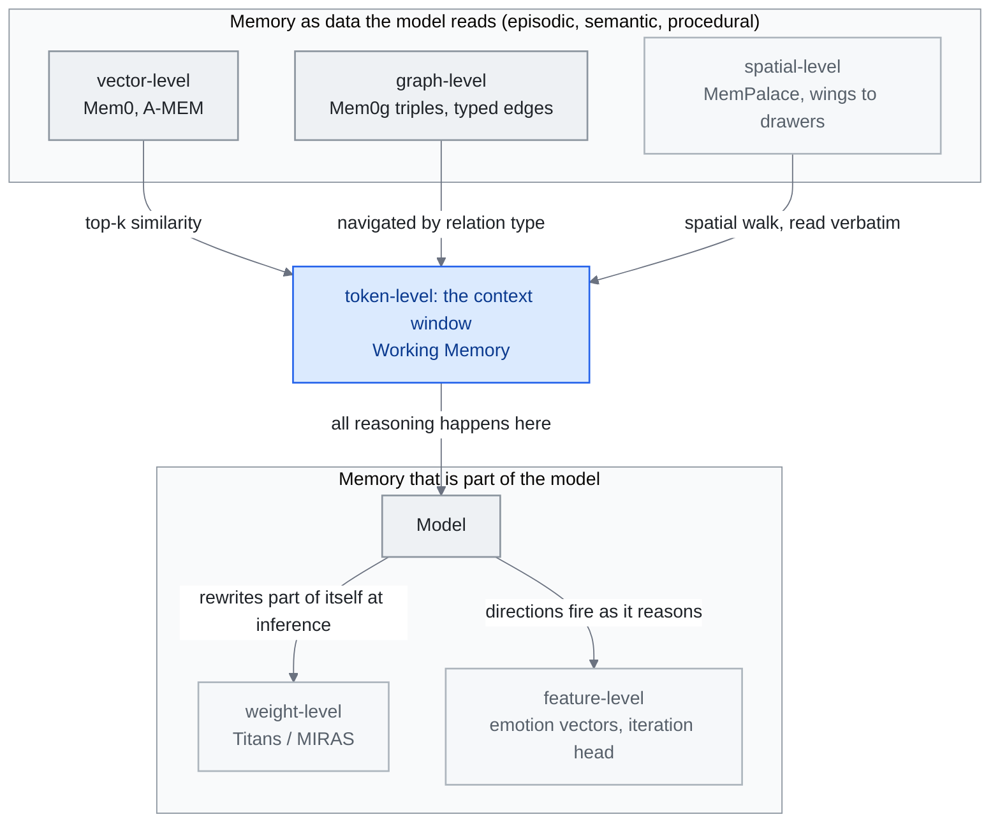

<!-- translation-sync:start -->
> 2026-10-31 영문판과 동기화한 기계 보조 번역입니다. 구조와 내용을 검토했습니다. 코드와 도표 라벨은 원문을 유지하며 읽기 시간은 영어 원문 기준 추정치입니다.
> [English source](../../../chapters/06-agent-memory.md) · [Sync record](../../SYNC.md)
<!-- translation-sync:end -->

<!-- i18n-anchor -->

# 6장: 에이전트 메모리 —— 빠진 계층

> **한 문장으로:** 메모리 시스템은 AI 에이전트가 대화에 걸쳐 ——당신의 선호, 과거 결정, 프로젝트 context —— 를 기억하게 한다.
>
> **중요한 이유:** 메모리가 없으면 AI 대화는 매번 처음부터 시작한다. AI를 낯선 사람이 아닌 동료처럼 느끼게 하는 것이 메모리다.
>
> **읽기 시간:** 약 30분 (6,772단어 / 분당 230단어)

*그림: "Feature-Level Memory Research (2026)"의 여섯 수준을 위치에 따라 배열했다. 위쪽은 모델이 인터페이스를 통해 읽는 것이고 아래쪽은 모델의 일부다. 여기에 "Memory Taxonomy" 절의 네 유형을 대응시켰다. 작업 메모리는 창이며, 일화·의미·절차 기록은 저장소에 있다. 수준별 검색 메커니즘은 "Major Frameworks"에서, 가중치 수준 항목은 "Architectural Patterns"에서 가져왔다. 컨텍스트 창으로 들어가는 연결선이 핵심이다. 외부 수준은 어떤 인덱스를 쓰든 모델이 추론하기 전에 창으로 검색해 와야 하지만, 가중치 수준과 특징 수준 계층은 이미 내부에 있다. 2026년까지 실서비스 스택은 주로 처음 세 수준에 있다.*

<!-- i18n-anchor -->

## 메모리가 중요한 이유

LLM과 새 대화를 시작할 때마다 처음부터 출발한다. 모델은 이전 상호작용, 선호, 수 시간 대화하며 공들여 쌓은 컨텍스트를 기억하지 못한다. 사소한 불편이 아니라 지속적인 협업자로서 AI의 가능성을 훼손하는 근본적인 아키텍처 공백이다.

메모리는 AI 에이전트를 무상태 응답자에서 시간에 걸쳐 학습하고, 적응하고, 이해를 누적하는 시스템으로 변환한다. 메모리 없이는, AI 어시스턴트가 당신이 간결한 답을 선호한다는 것, 당신의 프로젝트가 특정 ORM과 함께 TypeScript를 사용한다는 것, 또는 지난 화요일에 인증 흐름에서 중대한 버그를 식별했다는 것을 기억할 수 없다. 모든 세션이 콜드 스타트가 된다. 모든 상호작용이 처음부터 context를 다시 확립할 것을 요구한다.

이 격차의 비용은 단지 사용자 좌절이 아니다. 그것은 낭비된 토큰 (context 재설명), 저하된 출력 품질 (개인화 부족), 깨진 워크플로우 (다세션 작업에서 연속성 잃기)로 나타난다. AI 에이전트가 채팅 장난감에서 운영 인프라로 옮겨감에 따라, 메모리는 원시 모델 능력과 진정한 유용성 사이의 결정적 빠진 계층이 되었다.

<!-- i18n-anchor -->

## 메모리 분류법

에이전트 메모리 연구는 인간 인지 과학에서 영감을 받은 분류법으로 수렴했으며, 네 가지 근본적 유형을 구분한다:

**Episodic Memory (일화 메모리)**는 경험 기반 기록을 저장한다 ——특정 상호작용, 사건, 그것들의 결과. 에이전트가 "last week, the user asked me to refactor the payment module and preferred extracting a service class over using mixins,"를 기억한다면, 그것이 일화 메모리이다. 그것은 개인화와 과거 성공·실패로부터의 학습을 위한 경험적 토대를 제공한다.

**Semantic Memory (의미 메모리)**는 사실적 지식과 구조화된 정보를 담는다 ——사용자의 기술 스택, 팀원의 역할, 프로젝트 아키텍처 결정, API 스키마. 일화 메모리와 달리 의미 메모리는 특정 사건에서 추상화되어 있다. 그것은 원시 경험이 아니라 추출된 이해를 표현한다.

**Procedural Memory (절차 메모리)**는 방법 지식을 인코딩한다 ——워크플로우, 표준 운영 절차, 학습된 액션 시퀀스. 에이전트가 이 특정 프로젝트를 배포하려면 테스트 실행, Docker 이미지 빌드, 레지스트리에 푸시, 그 다음 Kubernetes 롤아웃 트리거가 필요함을 안다면, 그것이 절차 메모리이다. 그것은 에이전트가 매번 프로세스를 재도출하지 않고 복잡한 다단계 작업을 실행할 수 있게 한다.

**Working Memory (작업 메모리)**는 능동적 추론 context를 표현한다 ——작업 도중 현재 조작되고 종합되는 정보. 이는 모델의 context window와 어떤 능동 검색 상태에 매핑된다. 그것은 가장 제약된 그리고 가장 중대한 계층이다. 어떤 주어진 순간에 에이전트가 실제로 무엇에 대해 추론할 수 있는지를 결정하기 때문이다.

이 네 유형 사이의 상호작용이 에이전트 메모리 시스템의 정교함을 정의한다. 순진한 구현은 대화 로그만 저장할 수 있다 (조잡한 일화 메모리). 성숙한 시스템은 네 유형 모두를 분리, 인덱싱, 상호 참조하며, 적절한 정보를 적절한 시점에 검색한다.

<!-- i18n-anchor -->

## 주요 프레임워크

### Mem0

[Mem0](https://mem0.ai)은 AI 애플리케이션을 위한 선도적 보편 메모리 계층으로 부상했다. Apache 2.0 라이선스이며, 사용자, 세션, 에이전트에 걸쳐 메모리를 추가, 검색, 관리하기 위한 통합 API를 제공한다.

성능 수치는 인상적이다: 베이스라인 시스템 대비 LLM 심사 평가에서 26% 개선, 전체 context 접근 대비 91% 더 낮은 p95 지연, 전체 대화 이력을 재생하는 대신 관련 메모리만 검색하여 토큰 비용 90%+ 감소. Mem0은 벡터 저장소, 그래프 기반 관계, 지능적 메모리 통합을 결합한 하이브리드 아키텍처를 통해 이를 달성했다.

2025년에 Mem0은 AWS와 파트너십을 확보하여 Amazon Bedrock 생태계에 통합되고, 엔터프라이즈 AI 배포를 위한 기본 메모리 계층으로 자리매김했다. 플랫폼은 멀티테넌트 메모리 격리를 지원하여, 각자 자신의 영속 메모리 공간을 가진 수천 명의 사용자를 서비스하는 애플리케이션에 적합하다.

**Mem0ᵍ (2026): 그래프를 정식 기본 요소로.** 방향과 라벨이 있는 그래프 변형 **Mem0ᵍ**는 2026년 초 실서비스에 들어가 기존 벡터+그래프 혼합 설계를 지식 그래프 우선 아키텍처로 대체했다. 파이프라인은 **개체 추출기**에서 `(source, relation, destination)` 형태의 라벨이 있는 삼중항을 만드는 **관계 생성기**로 이어진다. 유형 없는 유사성 링크 대신 `lives_in`, `prefers`, `owns` 같은 유형화된 연결선을 쓴다. **충돌 탐지기**와 **LLM 기반 갱신 해결기**는 새 사실이 들어올 때 모순을 처리한다. 새 삼중항이 기존 것과 충돌하면 덮어쓰기, 병합, 출처와 함께 둘 다 보존 중 하나를 결정한다. Mem0ᵍ는 벡터 거리뿐 아니라 관계 유형으로 탐색할 수 있는 질의 가능한 의미 구조를 메모리에 제공해 전체 컨텍스트 방식("dump everything into the window")과 선택적 검색("find the top-k similar chunks") 사이의 오랜 간극을 좁힌다.

### A-MEM

[A-MEM](https://github.com/agiresearch/A-mem)은 근본적으로 다른 접근을 취하며, 사회학자 Niklas Luhmann이 다양한 분야에 걸쳐 70권 이상의 책을 산출하는 데 유명하게 사용한 노트 시스템 ——Zettelkasten 방법 —— 에서 영감을 얻는다.

A-MEM은 각 메모리를 동적 인덱싱, 링크, 진화를 가진 원자적 노트로 다룬다. 메모리는 단순히 저장되고 검색되지 않는다. 그것들은 출현하는 링크를 통해 관련 메모리에 연결되고, 여러 차원에 걸쳐 인덱싱되고, 새 정보가 도착함에 따라 진화하도록 허용된다. 새 메모리가 추가되면, 시스템은 기존 메모리에 대한 연결을 식별하고, 잠재적으로 그것들을 병합, 분할, 또는 갱신한다.

이 접근은 유기적으로 자라는 메모리 구조를 산출하며, 인간 전문가가 멘탈 모델을 만드는 방식을 반영하는 관련 지식 클러스터를 형성한다. Zettelkasten 영감은 지식 엔지니어링에 특히 적절하다 ——그것은 본질적으로 시간에 걸쳐 지식을 복리화하는 시스템이다.

### ByteRover

이전 이름이 Cipher였던 [ByteRover CLI](https://github.com/campfirein/byterover-cli)는 프로젝트 지식을 컨텍스트 트리로 정리한다. 저장소는 September 27, 2026에 보관 처리됐다. October 31에 확인한 문서는 선택적 클라우드 동기화, 정리 검토, git식 분기·병합을 갖춘 로컬 작업을 설명한다. 코드는 Elastic License 2.0의 소스 공개 방식이다. 이 역사적 사례는 파일 시스템 중심 메모리 정리를 보여 줄 뿐, 일반적인 검색 우위를 입증하거나 모델·유지 비용을 없애지는 않는다.

이 패턴은 July 29, 2026에 처음 학술적으로 다뤄졌다. **"Filesystem-Based Memory for LLM Agents: Organization, Evolution, and Sustainability"** (arXiv 2607.26637; Sizhe Zhou와 UIUC, UCSD, Adobe Research의 공동 저자 열 명)는 범용 파일 도구로 에이전트가 읽고, 쓰고, 재정리하는 마크다운 파일 디렉터리 트리 방식의 최초 체계적 연구라고 설명한다. 특정 공급업체 제품이 아닌 일반 패턴을 연구했다. 공유 메모리 파일 시스템 하나에 새 내용을 정리하는 관리 에이전트, 출처를 인용해 질의에 답하는 검색 에이전트, 과제 실행 궤적을 재사용 가능한 스킬로 증류하는 실행 에이전트라는 세 역할을 형식화한다. 벡터 저장소 대신 이 패턴을 선택하는 사람에게 중요한 핵심 발견은 저장소가 커지면 정리 상태를 유지하는 것이 검색 비용을 대략 절반으로 줄인다는 것이다. 이는 ByteRover 구현이 아닌 일반적인 정리 패턴을 측정한다. 성장 연구에서는 가장 강력한 관리 에이전트 외에는 정리 상태가 악화됐고, 측정한 어떤 에이전트도 정리를 더 좋은 답변으로 바꾸지 못했다. 깔끔한 트리가 주는 것은 더 좋은 답이 아닌 저렴한 검색이다. 재현되지 않았지만 파일 시스템 메모리를 출시된 관례에서 측정된 관례로 옮긴 연구다.

### Cognee

June 26, 2026에 출시된 [Cognee 1.0](https://www.cognee.ai/cognee-1-0-announcement)은 수집과 검색 단계만이 아닌 `remember`, `recall`, `forget`, `improve`를 제공한다. 공급업체는 단일 Postgres 배포, 관리형 클라우드, COGX 내보내기를 설명한다. 피드백 기반 개선 작업으로 메모리 유지 관리가 인터페이스의 일부가 된다. 제품 기능이며, 기능이 있다는 사실만으로 메모리 품질이나 신뢰할 수 있는 망각이 독립적으로 입증되는 것은 아니다.

### Nemori

[Nemori](https://github.com/nemori-ai/nemori)는 특정하지만 결정적인 문제에 초점을 맞춘다: 연속 대화 스트림을 의미 있는 메모리 단위로 분할하는 방법.

각 메시지나 각 대화를 메모리 단위로 다루는 대신, Nemori는 대화를 의미적으로 정렬된 일화로 분할한다 ——완전한 사고, 결정, 또는 워크플로우를 표현하는 일관된 상호작용 청크. 이 분할은 결정적이다. "relevant past context"와 "noise"의 경계가 종종 대화의 끝점이 아니라 중간에 떨어지기 때문이다.

깨끗한 일화 세그먼트를 산출함으로써, Nemori는 다운스트림 메모리 시스템에 더 높은 품질의 입력을 제공한다 ——그것들이 벡터 검색, 그래프 구조, 또는 계층적 조직을 사용하든.

### MemPalace

[MemPalace](https://github.com/MemPalace/mempalace)는 벡터 검색이나 지식 그래프보다 훨씬 오래된 **장소법**으로 돌아간다. 익숙한 건물을 머릿속으로 걸으며 방대한 목록을 기억했던 고대·중세 학자의 공간 기억술이다. April 5, 2026에 MIT 라이선스로 출시된 MemPalace는 **동 → 방 → 벽장 → 서랍**이라는 네 수준의 공간 계층으로 저장소를 구성한다. 말단 "drawer"마다 원문 텍스트 조각을 저장하며 계층을 탐색하는 행위 자체가 인덱스 역할을 한다.

따라서 검색 primitive는 임베딩 유사도도 그래프 순회도 아니라 **공간 걷기**이다: 에이전트는 궁전의 어느 동이 관련 메모리를 담고 있을 것 같은지 추론하고, 방과 옷장을 통해 내려가, drawer를 압축된 임베딩에서 회복하는 대신 그대로 읽는다. "verbatim-first" 저장 철학은 MemPalace를 저장 전에 요약하거나 청크화하는 시스템과 구분 짓는 설계 선택이다 ——많은 작업 (법률, 과학, 대화)에 대해, 저장 시점의 손실 압축 비용이 검색 시 약간 더 느린 공간 걷기 비용을 초과한다고 주장한다.

이 접근이 주목받은 이유는 벤치마크 수치다. MemPalace는 에이전트 메모리에서 가장 오래 공개된 컨텍스트 회상 벤치마크인 **LongMemEval에서 Recall@5 96.6%**를 보고했으며, 같은 평가의 벡터 전용·그래프 전용 방식보다 앞섰다. 커뮤니티 반응도 두드러졌다. **첫 세 주에 GitHub 별 약 49,000개**를 모아 2026년 가장 빠르게 성장한 메모리 프로젝트가 됐다. 출시 월말에는 학술 비판(arXiv 2604.21284, *"Spatial Metaphors for LLM Memory: A Critical Analysis of the MemPalace Architecture"*)도 이미 나왔다. 그 자체가 이 프로젝트가 분야의 중심 논의로 얼마나 빠르게 들어왔는지 보여 준다.

<!-- i18n-anchor -->

## 아키텍처 패턴

분야가 성숙해짐에 따라, 여러 프레임워크에 걸쳐 나타나는 몇 가지 아키텍처 패턴이 부상했다:

**다중 유형 계층.** MIRIX 프레임워크(Wang과 Chen, "MIRIX: Multi-Agent Memory System for LLM-Based Agents," arXiv 2507.07957, July 10, 2025)가 대표 사례다. **핵심 메모리, 일화 메모리, 의미 메모리, 절차 메모리, 자원 메모리, 지식 보관함이라는 여섯 유형**을 유형별 메모리 관리자 여섯과 작업 라우팅을 맡는 메타 메모리 관리자가 있는 다중 에이전트 프레임워크로 조정한다. 유형마다 갱신 빈도, 보존 정책, 검색 메커니즘이 다르다. 이 분리는 빠른 적응을 허용하면서 파국적 망각을 막는다. 참조 앱은 화면 활동을 실시간 감시해 개인화된 메모리 기반을 만든다. ScreenshotVQA 멀티모달 벤치마크에서 RAG 기준선보다 35% 높은 정확도와 99.9% 적은 저장량, LOCOMO 장문 대화 벤치마크에서 85.4%를 보고한다.

**Git에서 영감받은 버저닝.** 여러 시스템이 이제 메모리를 코드처럼 버저닝하여, 이력을 유지하고, 분기 (추측적 추론을 위해)를 지원하고, 메모리 갱신이 부정확한 것으로 드러날 때 롤백을 가능케 한다. 이는 다른 에이전트들이 동시에 공유 메모리를 갱신할 수 있는 다중 에이전트 시스템에서 특히 중요하다.

*버전 관리 패턴에 트랜잭션 경계가 생기다 (July 2026).* Git식 이력은 관례지만 **MemTxn** ("MemTxn: A Transaction Boundary for Source-Supported Updates and Complete-State Recovery in Agent Memory," arXiv 2607.27834, July 30, 2026; Hanshuai Cui와 공동 저자 다섯 명)은 이를 보장으로 제안한다. 응답 모델 밖의 이 계층은 세 부분이다. *Ordered PatchTest*는 제안한 갱신이 인용 출처로 실제 뒷받침되는지 확인하고, *Temporal Resolver*는 사실 충돌 시 어느 버전을 보일지 결정하며, 지속 저장되는 스냅샷 저널은 물리적 쓰기 집합을 몰라도 장애 후 애플리케이션에 보이는 상태를 복원한다. 저자 자체 검증 집합에서 출처가 뒷받침하는 갱신 60개를 모두 수락하고 구성한 어려운 부정 예시 179개를 모두 거절했다. LongMemEval-S와 LoCoMo 파생 상태에 지속적 다중 키 장애를 주입했을 때 선언된 활성 메모리 맵을 완전히 복원했다. 작은 검증 집합과 재현되지 않은 결과이므로 실서비스에서 입증된 보장이 아닌 제안이다. 이 장에 기여하는 것은 계약이다. Mem0ᵍ의 비공식적인 충돌 탐지기와 갱신 해결기를 실패할 수 있는 수락/거절 시험으로 바꾸고, 위 프레임워크들이 제공하지 않는 복구 방식을 더한다. 사흘 앞서 저자 목록상 독립적인 다른 팀도 같은 틀에 수렴했다. **MemTX** ("MemTX: Transactional Belief Commit for Stateful Agent Memory," arXiv 2607.23929, July 27, 2026)는 스냅샷 격리 트랜잭션에서 쓰기를 준비하고, 처리 중인 믿음 상태에 따라 되돌릴 수 없는 도구 호출을 제한하며, 믿음을 철회하면 파생 기록과 도구 부수 효과에 복구를 연쇄 적용한다. 연결 없는 두 팀이 같은 주에 데이터베이스 트랜잭션 의미 체계를 찾았다는 것 자체가 신호다. 메모리 쓰기는 커밋 규율이 필요할 만큼 중대한 일이 됐다.

**인지에서 영감받은 분리.** 단일 메모리 저장소가 아니라, 선도 아키텍처는 빠른 접근 작업 메모리, 중기 일화 버퍼, 장기 통합 지식 사이의 명시적 분리를 유지한다. 메모리 통합 프로세스 ——생물학적 시스템에서 잠과 유사한 —— 가 일화 메모리를 의미 지식으로 주기적으로 압축, 중복 제거, 재조직한다.

**학습 가능한 메모리 모듈.** April 2026에 Google Research의 **Titans + MIRAS**로 네 번째 패턴이 등장했다. 메모리를 외부 저장소가 아닌 *학습 가능한 신경 모듈*로 재정의한다. 벡터 데이터베이스, 그래프, 마크다운 파일에 사실을 쓰는 대신 Titans는 추론 시 경사 하강법으로 전용 메모리 모듈의 가중치를 갱신한다. 모델은 문서를 처리하며 실제로 자신의 일부를 다시 쓴다. MIRAS는 발산 없이 추론 시 학습하기 위한 학습법과 안정성 보장을 제공하는 동반 학습 프레임워크다. Google Research 블로그는 비슷한 매개변수 수에서 Titans가 장기 회상과 다중 홉 추론에서 **Mamba-2**, **Gated DeltaNet**, **Transformer++**를 능가한다고 보고한다. 앞선 세 패턴과 개념적으로 다르다. Mem0, A-MEM, ByteRover, MIRIX는 메모리를 모델이 인터페이스로 읽는 데이터로 유지하지만, Titans는 메모리를 모델 자체의 일부로 만든다. 어텐션과 같은 회로로 읽고 학습과 같은 장치로 쓴다. 지식 엔지니어에게는 언제 메모리를 가중치에 새길 가치가 있고 언제 질의 가능한 데이터로 남겨야 하는지라는 새 설계 질문을 던진다.

**May 6, 2026**에 Anthropic **Dreaming**(연구 미리보기)으로 또 다른 상업적 방향이 나왔다. 추론 시 메모리를 가중치에 학습하는 대신, 세션 사이 예약 작업이 최근 세션을 읽어 반복 오류와 수렴한 작업 흐름을 찾고 **에이전트의 지속 저장 메모리를 평문으로 다시 쓴다**. Titans가 메모리를 모델 자체 일부로 만들어 기울기로 갱신한다면, Dreaming은 하네스가 읽는 데이터로 유지하고 LLM 정리 단계로 갱신한다. 장기 에이전트 메모리의 두 상반된 상업적 틀은 **학습 가능한 메모리**(추론 시 기울기 갱신, 모델 내부)와 **정리되는 메모리**(LLM이 다시 쓰는 평문, 기반 외부)다. 지식 엔지니어의 질문도 구체화된다. 언제 가중치에 새길 가치가 있고(Titans), 언제 모델이 읽을 수 있는 질의 가능한 저장소로 유지하며(Mem0, A-MEM, ByteRover, MemPalace), 언제 정리 단계가 수정할 수 있는 평문으로 유지할 것인가(Dreaming)?

석 달 뒤 이 질문의 학습 가능한 메모리 갈래에서 첫 본격적인 규모 수치가 나왔다. **"Memory Decoder at Scale: A Pretrained, Parametric Long-Term Memory"** (arXiv 2607.27919, July 30, 2026; Rubin Wei 외, Qipeng Guo, Bowen Zhou, Zhouhan Lin 참여)는 300B 토큰으로 매개변수 6.9B의 메모리 모듈을 사전 학습한다. 디코더 전용 LLM은 한 매개변수 집합에 메모리와 추론을 뒤얽히게 하므로 메모리를 별도로 확장하는 것이 더 낫다는 논지다. 이를 가능하게 한 것은 목적 함수보다 인프라 문제의 해결, 즉 희소한 배치별 kNN 로딩을 갖춘 분산 Faiss 인덱싱·검색 파이프라인이었다. 17개 벤치마크에서 6.9B 메모리 모듈과 매개변수 410M Pythia 기반 모델을 결합하면 평균이 29.86에서 37.34로 올라 총매개변수가 39% 적으면서 Pythia-12B의 37.24를 넘는다. 자체 보고 수치이며, 새 기본 기능이 아니라 기존 계열의 확장 결과다(원래의 작은 Memory Decoder는 arXiv 2508.09874). 다만 Titans가 열어 두었던 설계 질문에 대한 최초의 매개변수 효율 답이다. 메모리를 가중치에 새기더라도 *같은* 가중치일 필요는 없으며, 둘을 분리하면 전용 메모리 모듈을 결합한 410M 기반 모델이 12B 일체형 모델보다 높은 점수를 낼 수 있다.

<!-- i18n-anchor -->

## 진화 단계

에이전트 메모리의 발전은 명확한 궤적을 따랐다:

**단계 1: 엔지니어링 통합 (2023–2024).** 메모리는 엔지니어링 문제로 다뤄졌다 ——대화 상태를 어떻게 영속시키고 검색하는가. 해법은 대체로 위에 RAG 파이프라인이 볼트로 박힌 벡터 데이터베이스였다. 기능적이지만 조잡했고, 무엇을 기억할지, 언제 잊을지, 어떻게 조직할지에 대한 원칙적 접근이 없었다.

**단계 2: 구조화된, 지식 그래프 접근 (2024 – H1 2025).** 분야는 명시적 지식 그래프, 타입이 있는 메모리 저장소, 원칙적 검색 전략을 가진 구조화된 메모리로 옮겨갔다. Mem0과 A-MEM 같은 프레임워크가 이 시기에 부상하여 구조가 메모리 품질을 극적으로 개선함을 입증했다.

**단계 3: 인지 아키텍처 (H2 2025 – 현재).** 현재 작업은 인지 과학에 크게 의지하며, 생물학에서 영감을 받은 메모리 통합, 간섭 관리, 다중 시스템 아키텍처를 구현한다. 메모리 의존 작업에서 인간 레벨 성능의 90%에 접근하는 시스템이 통제된 벤치마크에서 입증되었지만, 실세계 성능은 가변적이다.

**단계 4: 특징 수준, 학습 가능, 공간 비유 메모리 (April 2026 - 등장 중).** April 2026에는 단계 1-3에 잘 들어맞지 않는 세 흐름이 더해졌다. 첫째는 **학습 가능한 메모리**(Titans + MIRAS)다. 모델 밖의 질의 가능한 저장소가 아닌 추론 시 갱신되는 신경 모듈이 된다. 둘째는 같은 주 Anthropic 해석 가능성 공개가 연 **특징 수준 메모리**다. 감정 벡터와 반복 헤드는 특정 행동과 추론 패턴이 모델 내부의 식별 가능한 특징 방향에 대응함을 보여 준다. 원칙적으로 "what the model remembers about how to reason"을 토큰 대신 활성화 수준에서 읽고 조향할 수 있다는 뜻이다. 셋째는 **공간 비유 메모리**(MemPalace)다. 계층적 공간 구조를 걷는 것이 검색 기본 동작이며 압축 대신 원문 보존을 지향하는, 디지털 이전 인지적 사용성으로의 회귀다. 실서비스 스택에서 이들은 Mem0, A-MEM, 계층형 컨텍스트 트리를 대체하지 않고 공존한다. 그러나 설계 공간을 "where do I store memory and how do I retrieve it"에서 "at what level of the stack does this memory live --- token, vector, graph, weight, feature, or spatial walk."로 넓힌다.

<!-- i18n-anchor -->

## 커뮤니티와 연구

ICLR 2026 MemAgents Workshop은 분야의 이정표를 표현한다. AI, 인지 과학, 시스템 엔지니어링의 연구자들을 모아 에이전트 메모리의 열린 문제들을 다룬다. 핵심 주제는 메모리 확장성, 망각 전략, 다중 에이전트 공유 메모리를 포함한다.

<!-- i18n-anchor -->

## 특징 레벨 메모리 연구 (2026)

2025년까지 "agent memory"는 거의 항상 벡터 인덱스, 지식 그래프, 계층형 마크다운 트리, 일화 로그처럼 에이전트가 읽을 수 있는 데이터였다. April 2026에는 더 넓은 정의가 필요해졌다. MIT Technology Review의 혁신 기술 선정과 같은 주에 Anthropic이 공개한 **감정 벡터**와 **반복 헤드**는 최첨단 모델의 가장 중대한 "memory" 일부가 외부 저장소가 아니라 식별 가능한 내부 특징에 있음을 보여 줬다.

**Emotion vectors**는 Claude의 잔차 스트림 안의 선형 특징 방향이며, 증폭되면 모델을 감정적으로 부하된 행동 ——가장 인용되는 예에서 협박형 출력 —— 으로 안정적으로 편향시킨다. 메모리 시스템 설계에 대한 관련된 점은 안전 함의 (그것도 실재한다)가 아니라 아키텍처 함의이다: 모델 안에 *위협하는 법을 기억하는* 특징 방향이 있고, 그것은 어떤 prompt나 검색된 context와 독립적으로 켜지거나 꺼질 수 있다. **Iteration head**는 chain-of-thought 추론 동안 부상하여 이전 추론 단계의 출력에 일관되게 주의하는 어텐션 헤드이다. 그것은 사실상 절차 메모리 저장소가 아니라 어텐션 가중치에 구현된 *절차 메모리* 한 조각이다 ——모델이 "how to keep going"의 회로를 학습했고, 그 회로가 CoT를 작동하게 하는 것이다.

메모리 시스템 설계에서 "where the memory lives"는 이제 2025년보다 더 풍부한 질문이다. 현대 스택은 **토큰 수준**(창 안의 대화 발췌), **벡터 수준**(Mem0, A-MEM 검색), **그래프 수준**(Mem0ᵍ 삼중항과 유형화된 연결), **공간 수준**(MemPalace의 동 → 방 → 벽장 → 서랍 탐색), **가중치 수준**(추론 시 갱신되는 Titans / MIRAS 모듈), **특징 수준**(모델이 추론할 때 활성화되는 해석 가능한 방향)이라는 여섯 수준에서 메모리를 읽어야 할 수 있다. 파일 시스템 컨텍스트 트리는 벡터 검색과 별개의 외부 정리 전략이다. 2026년까지 실서비스 시스템은 도구가 가장 성숙한 처음 세 계층에 주로 머문다. 하지만 나머지 세 계층도 더 이상 가설이 아니며, 메모리를 순전히 검색 문제로 취급하는 하네스 설계자는 갈수록 역량을 활용하지 못하게 된다.

**메모리는 모델 교체를 견디는가? (September 2026).** 수준 선택에는 지금까지 측정하지 않았던 결과가 따른다. 저장소 아래의 모델은 바뀌며 모든 수준이 교체를 견디지는 않는다. Ankit Goyal과 Jaideep Ray(arXiv 2609.05339, September 4, 2026)는 합성 사례 48개에서 원시 이력, RAG, 압축 노트, 구조화 지식 그래프라는 네 저장 방식을 통제 연구했다. 고정 스키마 그래프 메모리는 정확도 변화 +0.0004 ± 0.0020으로 거의 불변이다. 압축 노트는 모델 의존성이 커 교체 방향에 따라 +9.91 또는 -13.28퍼센트포인트 변한다. RAG를 일부만 재임베딩하면 4.96점 회복하고 전체 재임베딩은 11.90점 회복한다. 일반화할 만한 부분은 제안한 메커니즘이다. 노트 기반 성능 저하의 약 80%는 읽을 때가 아닌 *쓸 때* 잃은 정보 때문으로 분석됐다. 그래서 저장소만 복구해서는 48개 어느 사례에서도 90% 회복에 도달하지 못했지만, 압축 메모리와 원시 이력을 함께 보관하면 시험한 두 이전 방향 중 하나에서 34개 사례를 성공적으로 복구했다. 설계 규칙은 명확하다. 모델 이전 후에도 살아남아야 하는 메모리 저장소에는 압축 산문보다 구조화 저장을 선호하고, 압축본을 만든 원본은 절대 버리지 말라. 합성 사례 48개와 저자 두 명의 초기 결과이지 확립된 결과는 아니지만, 모델 교체 이식성을 그 위의 에이전트가 아닌 *저장 형식*의 속성으로 처음 다뤘다.

<!-- i18n-anchor -->

## 2026: 평가와 통제 수단

H1 2026까지 메모리 논의는 어디에 존재하고 어떻게 검색하는지라는 *아키텍처*가 중심이었다. Mid-2026에는 전선이 *통제*로 이동했다. 여러 벤치마크가 "can the system recall the right fact" 대신 "does it recall safely, forget on request, resist manipulation, and stay auditable."를 묻는다. 다섯 결과가 두드러진다.

**GateMem** ("GateMem: Benchmarking Memory Governance in Multi-Principal Shared-Memory Agents," arXiv 2606.18829, June 17, 2026)은 여러 주체가 하나의 저장소에 쓰는 의료, 사무, 교육, 가정 분야에서 공유 기관 메모리의 유용성, 접근 통제, 능동적 망각을 *함께* 평가하는 최초의 벤치마크다. 핵심은 무효 결과다. **시험한 어떤 방법도 세 축을 동시에 충족하지 못하며**, 특히 검색 및 외부 메모리 방식은 주체 간 경계를 넘어 정보를 유출한다. 통제는 현재 어떤 메모리 프레임워크에도 설계만으로 보장되는 속성이 아니다.

**MemSyco-Bench** ("MemSyco-Bench: Benchmarking Sycophancy in Agent Memory," arXiv 2607.01071, July 1, 2026)는 아키텍처 우선 관점이 측정하지 않았던 메모리 유발 아첨을 분리한다. 잘못된 메모리를 주입하면 아첨률이 **18.67%에서 32.67%**(DeepSeek-V4-Flash, 전체 대화 조건), **27.4%에서 44.7%**(Qwen3-8B)로 오른다. 외부 메모리는 객관적 사실 판단의 정확도를 무메모리 기준선보다 **11-23점** 떨어뜨린다. 이 장에서 이미 다룬 **Mem0, A-MEM, LightMem**을 시험했으므로 직접적인 경고다. 회상을 개선하는 메모리 계층이 기억하라고 들은 것을 에이전트가 더 쉽게 믿게 만들 수도 있다.

**Decision-Aware Memory Cards** ("Decision-Aware Memory Cards: Counterfactual-Inspired Context Selection and Compression for Tool-Using LLM Agents," arXiv 2606.08151, June 6, 2026)는 반대편에서 검색에 접근한다. 질의와의 의미적 유사성 대신 특정 메모리가 다음 행동을 얼마나 바꿀지를 나타내는 *결정 지향적* 반사실 기반 유용성으로 순위를 매기고, 결과를 유형이 있고 감사 가능한 메모리 카드로 저장한다. SWE-bench 파일 검색(검증 사례 50개, Qwen3.6-Plus가 BM25 상위 50개 재순위화)에서 질의당 약 **45토큰**으로 Hit@1은 **0.58 → 0.78**, MRR@10은 **0.634 → 0.790**으로 오른다. 이 재정의는 CATTS(4장)와 통한다. 최적화할 신호는 단순 유사성이 아닌 다음 결정에 대한 유용성이다.

**"Are We Ready For An Agent-Native Memory System?"** (arXiv 2606.24775, June 23, 2026, SJTU / 칭화대 / MemTensor)는 *표현과 저장*, *추출*, *검색과 라우팅*, *유지 관리*라는 네 모듈 분해로 공통 어휘를 제시한다. 또한 **지배적인 단일 아키텍처는 없다**고 본다. **Zep**는 세션 간 추론(LongMemEval LLM 평가 정확도 48.0), **MemOS**는 정확한 근거 일치(**LoCoMo EM 8.9**), 긴 컨텍스트 기준선은 상태 유지 실행(DB-Bench EM 48.20)에서 앞선다. 아키텍처 측에서 GateMem과 같은 교훈을 준다. 메모리는 승자 하나인 단일 문제가 아니라 각기 선두가 다른 하위 문제의 묶음이다.

**StateMemBench / StateMem** (arXiv 2608.19652, August 20, 2026; UIUC 팀)은 접근 통제와 아첨 옆에 세 번째 통제 축인 **최신성**을 더한다. 다중 세션 시나리오 234개는 긴 상호작용 도중 사실, 제약, 결정을 수정하고, 메모리가 현재 유효한 값과 대체된 값 중 무엇을 반환하는지 묻는다. 폐쇄 후보군 채점으로 상태 추적 실패를 일반 검색 오류와 분리한다. GateMem과 달리 무효 결과에서 멈추지 않고 대체 관계와 관계적 의존성을 명시적으로 추적하는 상태 우선 기법 **StateMem**을 제공한다. 논문은 현재 상태 정확도가 DeepSeek-V4-Flash에서 1.8x(0.205에서 0.363), Qwen-3.5-9B에서 1.6x(0.149에서 0.233) 올랐다고 보고한다. 각각 같은 기반 모델의 가장 강력한 기준선과 가장 강력한 메모리 시스템에 대한 결과다. 기존 여섯 백엔드를 감싸면 +32에서 +67점 향상하며, 래퍼 자체가 더한 컨텍스트 토큰을 통제해도 +15에서 +32점이 남는다. 이 통제는 "the method works"와 "more context helps."를 구분한다. 모두 재현되지 않은 논문 자체 수치다. 이 축에 이름을 붙일 가치는 기존 회상 중심 벤치마크에 상태 대체가 구조적으로 보이지 않는 데 있다. 사용자가 *과거에* 믿었던 사실을 자신 있게 반환하는 저장소도 적중으로 채점된다.

앞선 단독 저자 결과 하나는 확립된 발견보다 방향으로 짚을 만하다. arXiv 2606.15903 (June 14, 2026)은 *메모리 파이프라인에서 LLM이 위치하는 곳*이 어떤 삭제가 실제로 작동하는지 결정한다고 주장한다. 변경 시점 훅이 사후 필터링이 놓치는 의도 인지 삭제를 회복한다(대상 유형 78-85%, 전체 범위 91.7-93.2%). 초기 연구지만 위 벤치마크들과 같은 통제 공백을 가리킨다. 망각은 삭제 버튼이 아니라 아키텍처 배치 결정이다.

**TencentDB Agent Memory v2.0 --- Team Memory**는 벤치마크가 아닌 공급업체 측에서 통제 공백에 답한다. Tencent의 MIT 라이선스 자체 호스팅 메모리 프레임워크(저장소 생성 April 7, 2026; August 24, 2026 기준 GitHub 별 약 24,000개)는 August 3, 2026에 v2.0.0을 출시했고 팀 협업 발표는 August 13 뒤따랐다. 핵심 추가 기능 Team Memory는 에이전트 간 공유를 통제한다. 버전이 있는 메모리 자산 네 유형(Chat Memory, Skill, Wiki, CodeGraph)에 비공개 / 팀 / 제한 / 에이전트 가시성 등급을 적용한다. 앞단의 Memory Proxy는 Anthropic과 OpenAI 두 프로토콜을 지원하며, 예산 상한 아래 L0-L3 계층형 증류와 BM25+벡터+RRF 검색을 실행한다. GateMem의 무효 결과와 함께 보면 어떤 프레임워크도 충족하지 못했던 바로 그 접근 통제 축에 대한 최초의 출시된 실서비스 시도다. 그러나 여기의 모든 통제 메커니즘 주장은 Tencent 자체 제품 설명이다. GateMem의 적대적 제삼자 평가와 달리, 여러 주체의 부하 아래 가시성 등급이 실제로 지켜지는지 시험한 독립 벤치마크는 없다. 이 장의 "evaluation grows governance axes" 흐름에는 이제 공백을 측정하는 벤치마크와 이를 메운다고 주장하는 출시된 기본 기능이 모두 있지만, 둘 사이의 평가 공백은 여전히 열려 있다.

**관리형 메모리가 클라우드 범주가 되다 (July-August 2026).** Tencent만이 아니었다. 두 번째 진입이 제품 하나를 범주로 만든다. **July 30, 2026**에 Google은 Gemini Enterprise Agent Platform의 여러 기능을 정식 출시했다. 그중 **Agent Memory Bank**는 대화 컨텍스트를 스키마에 따라 구조화 추출해, 장기 과제를 중단한 곳부터 이어 갈 수 있도록 낮은 지연의 개인화를 겨냥한다. 이름을 바꾼 플랫폼의 정식 출시 이정표이며, 이전 Agent Engine 브랜드의 July 2025 Vertex AI Memory Bank 공개 미리보기와 혼동하면 안 된다. 모든 기능 설명은 Google 발표 블로그 자체 설명이며 스키마 추출 품질의 독립 벤치마크는 없다. 위 TencentDB v2.0보다 나흘 앞선 이 두 발표를 함께 보는 것이 핵심이다. 두 주요 클라우드가 에이전트 프레임워크 내부 기능이 아닌 별도로 통제되는 플랫폼 기본 기능으로 관리형 에이전트 메모리를 출시했다. Mem0, A-MEM, ByteRover, Nemori, MemPalace, Dreaming을 추적해 온 이 장도 지금까지 Google 관리형 메모리 서비스를 전혀 명명하지 않았다. Memory Bank 주변 발표도 같은 방향이다. 최대 칠 일 연속 실행하는 Agent Runtime, 최소 권한 접근과 토큰 탈취 완화를 위한 기본 IAM 유형 Agent Identity는 4장이 하네스 차원에서 다룬 지속 세션과 권한 문제를 프로비저닝 가능한 서비스로 가져온다.

**지속 저장되는 충돌 검토가 API가 되다 (October 29, 2026).** [Cognee v1.6.6](https://github.com/topoteretes/cognee/releases/tag/v1.6.6)은 사실 충돌 해결을 지속 저장하고 검토를 기본 활성화한다. 출시 노트는 근거 청크 변경, 커넥터 삭제, 데이터셋 망각 후 오래된 해결을 폐기하고, 해결 과정에서 살아 있는 청크만 인용한다고 설명한다. 통제 대상은 저장된 사실뿐 아니라 과거 결정의 유효성이 된다. 공급업체가 설명하는 소프트웨어 동작이며 독립적인 신뢰성 결과나 입증된 트랜잭션 보장은 없다.

<!-- i18n-anchor -->

## Late-July 2026: 매개변수형 네이티브 메모리 주장

위의 mid-2026 통제 벤치마크는 모두 벡터 인덱스, 그래프, 정리 단계처럼 메모리를 *인터페이스로 읽는 것*을 전제한다. July 29, 2026에 위의 June 23 에이전트 네이티브 메모리 조사를 낸 **MemTensor**(상하이)가 인민대, NUS, SJTU, 퉁지대의 저자 17명 협력으로 분류를 다른 방향으로 밀었다. **Metis** ("Metis: Memory Foundation Model," arXiv 2607.26760)는 **메모리 기반 모델**을 제안한다. 에이전트 메모리는 외부가 아닌 매개변수 형태로 *트랜스포머 기반 모델 자체 내부*에 존재하는 지속적이고 동적으로 변하는 상태다. 위의 네 모듈 조사는 모델 밖의 표현과 저장 / 추출 / 검색과 라우팅 / 유지 관리 모듈로 메모리를 읽는 에이전트를 가정한다. 반면 Qwen3.5 기반 모델의 4B, 9B, 27B 규모에서 평가한 Metis 시제품은 기반 모델을 고정하고 Fast Weight Programming(FWP)에 명시적으로 영감을 받은 **hyper memory block**과 **local memory block**만 학습한다.

이 메커니즘은 이미 다룬 두 모델 인접 메모리 패턴과 구별해야 한다. Titans + MIRAS(위의 단계 4)는 *추론 시* 경사 하강법으로 학습 가능한 신경 모듈을 갱신한다. 읽으며 자신의 가중치를 다시 쓰는 것이다. Metis는 추론 시 기울기를 사용하지 않는다. EMA식 순방향 계산으로 과거 컨텍스트를 고정 크기 상태로 압축하며, 역전파도 압축 이력의 텍스트 재생도 하지 않는다. 단계 4부터 추적한 "where does memory live" 스펙트럼의 세 번째 지점이다. 벡터 저장소 조회도, 경사 하강 가중치 갱신도 아닌, 고정 산술 규칙으로 상태를 전달하는 고정 기반 모델 모듈이다.

논문은 현재 어디서 실패하는지 이례적으로 솔직하므로 아키텍처와 함께 한계를 전해야 한다. 고정 크기 압축으로 정보를 잃으며 장기 과제 성능이 떨어진다. 저자들은 직접 "information confusion in some cases, possibly caused by the blending of semantics within the latent space."라고 보고한다. 유용성, 안전성, 감사 가능성을 모두 지배하는 아키텍처가 없음을 이미 보인 위 통제 벤치마크와 함께 읽으면, Metis는 논쟁을 해결한다기보다 이미 논쟁 중인 분야에 들어온 네 번째 후보로 보는 것이 맞다. 메모리의 새 위치를 제안하는 연구 미리보기이며, 점검 가능한 저장소 대신 고정 크기 잠재 상태에 메모리를 밀어 넣으면 무엇을 잃는지 고유한 실패 양상과 함께 새 질문을 던진다.

<!-- i18n-anchor -->

## 핵심 자원

- **[Awesome-AI-Memory](https://github.com/IAAR-Shanghai/Awesome-AI-Memory)** (IAAR-Shanghai) ——메모리 아키텍처, 벤치마크, 애플리케이션을 다루는 포괄적 서베이와 논문 모음.
- **[Agent-Memory-Paper-List](https://github.com/nuster1128/Agent-Memory-Paper-List)** ——에이전트 메모리 시스템에 관한 연구 논문의 큐레이션 목록, 주제와 접근별로 조직.
- **[Awesome-Memory-for-Agents](https://github.com/TsinghuaC3I/Awesome-Memory-for-Agents)** (TsinghuaC3I) ——메모리 분류법, 아키텍처, 평가 방법을 다루는 칭화대학교의 서베이.

---

<!-- i18n-anchor -->

## 기억할 세 가지

- **"Where does the memory live"는 이제 하나가 아닌 여섯 질문이다.** 토큰, 벡터, 그래프, 공간, 가중치, 특징 수준이 모두 해당하며, 2026년까지 실서비스 스택은 여전히 처음 세 수준에 주로 있다.
- **어떤 메모리 프레임워크도 통제를 설계만으로 보장하지 않는다.** GateMem은 유용성, 접근 통제, 능동적 망각을 함께 평가했고 어떤 시험 방법도 셋을 충족하지 못했다. 검색 및 외부 메모리는 주체 간 경계를 넘어 정보를 유출했다.
- **합성 사례 48개의 한 연구에서 모델 교체 후 메모리 생존은 저장 형식에 달렸다.** 고정 스키마 그래프 메모리는 거의 불변인 반면 압축 노트는 최대 13점 변했다. 저자는 저하의 약 80%를 읽을 때가 아닌 기록할 때 잃은 정보 탓으로 분석한다.

---

## Sources

1. Mem0 documentation and benchmarks. https://mem0.ai
2. A-MEM: 제텔카스텐식 정리의 에이전트 메모리. https://github.com/agiresearch/A-mem
3. ByteRover CLI. [보관된 저장소](https://github.com/campfirein/byterover-cli), September 27, 2026 보관 처리; 문서 확인 October 31, 2026. Elastic License 2.0.
4. Nemori: 에이전트 메모리를 위한 의미 기반 에피소드 분할. https://github.com/nemori-ai/nemori
5. Wang, Yu와 Chen, Xi. "MIRIX: Multi-Agent Memory System for LLM-Based Agents." arXiv 2507.07957, July 10, 2025. https://arxiv.org/abs/2507.07957. 관련 저장소: https://github.com/Mirix-AI/MIRIX
6. ICLR 2026 MemAgents Workshop. https://iclr.cc/virtual/2026/workshop/MemAgents
7. IAAR-Shanghai. Awesome-AI-Memory. https://github.com/IAAR-Shanghai/Awesome-AI-Memory
8. TsinghuaC3I. Awesome-Memory-for-Agents. https://github.com/TsinghuaC3I/Awesome-Memory-for-Agents
9. nuster1128. Agent-Memory-Paper-List. https://github.com/nuster1128/Agent-Memory-Paper-List
10. Google Research. "Titans + MIRAS: Helping AI Have Long-Term Memory" (April 2026). https://research.google/blog/titans-miras-helping-ai-have-long-term-memory/
11. Anthropic 해석 가능성 팀. 감정 벡터와 반복 헤드 공개(April 2026). MIT Technology Review가 January 2026 기계적 해석 가능성을 혁신 기술로 선정한 것의 후속 자료.
12. MIT Technology Review. "10 Breakthrough Technologies of 2026: Mechanistic Interpretability" (January 12, 2026). https://www.technologyreview.com/2026/01/12/1130003/mechanistic-interpretability-ai-research-models-2026-breakthrough-technologies/
13. MemPalace GitHub 저장소. https://github.com/MemPalace/mempalace --- MIT 라이선스 공간 비유 메모리 시스템, 첫 커밋 April 5, 2026.
14. "Spatial Metaphors for LLM Memory: A Critical Analysis of the MemPalace Architecture," arXiv 2604.21284 (April 2026). https://arxiv.org/abs/2604.21284
15. Anthropic. "New in Claude Managed Agents: dreaming, outcomes, and multiagent orchestration" (May 6, 2026). https://claude.com/blog/new-in-claude-managed-agents --- Dreaming은 학습 가능한 메모리(Titans)에 대응하는 정리형 메모리다.
16. Simon Willison. Code w/ Claude 2026 SF 현장 블로그 (May 6, 2026). https://simonwillison.net/2026/May/6/code-w-claude-2026/
17. "GateMem: Benchmarking Memory Governance in Multi-Principal Shared-Memory Agents." arXiv 2606.18829 (June 17, 2026). https://arxiv.org/abs/2606.18829 --- 유용성 / 접근 통제 / 능동적 망각의 공동 벤치마크; 시험한 어떤 방법도 셋을 모두 충족하지 못함.
18. "MemSyco-Bench: Benchmarking Sycophancy in Agent Memory." arXiv 2607.01071 (July 1, 2026). https://arxiv.org/abs/2607.01071 --- 메모리 유발 아첨(DeepSeek-V4-Flash 전체 대화 18.67%→32.67%; Qwen3-8B 27.4%→44.7%); 사실 정확도 11-23점 하락; Mem0, A-MEM, LightMem 시험.
19. "Decision-Aware Memory Cards: Counterfactual-Inspired Context Selection and Compression for Tool-Using LLM Agents." arXiv 2606.08151 (June 6, 2026). https://arxiv.org/abs/2606.08151 --- 결정 지향 순위화, 유형이 있고 감사 가능한 카드; SWE-bench 파일 검색 Hit@1 0.58→0.78, MRR@10 0.634→0.790, 질의당 약 45토큰.
20. "Are We Ready For An Agent-Native Memory System?" arXiv 2606.24775 (June 23, 2026; SJTU / 칭화대 / MemTensor). https://arxiv.org/abs/2606.24775 --- 네 모듈 분해; 지배적 아키텍처 없음(Zep LongMemEval 48.0; MemOS LoCoMo EM 8.9; 긴 컨텍스트 DB-Bench EM 48.20).
21. arXiv 2606.15903 (June 14, 2026) --- 의도 인지 삭제를 위한 제어 계층 배치의 단독 저자 연구; 변경 시점 훅으로 대상 유형 78-85%, 전체 범위 91.7-93.2% 회복. https://arxiv.org/abs/2606.15903
22. "Metis: Memory Foundation Model." arXiv 2607.26760 (July 29, 2026 제출; MemTensor / 인민대 / NUS / SJTU / 퉁지대, 저자 17명). https://arxiv.org/abs/2607.26760 --- 고정 트랜스포머 기반 모델 내부의 매개변수형 네이티브 메모리(Qwen3.5의 4B/9B/27B); FWP에 영감을 받은 hyper memory block + local memory block; 추론 시 기울기 없는 EMA식 갱신; 자체 보고 한계는 고정 크기 압축의 장기 정보 손실, 잠재 공간의 의미 혼합.
23. TencentCloud. TencentDB-Agent-Memory. https://github.com/TencentCloud/TencentDB-Agent-Memory --- MIT 라이선스, 자체 호스팅; 저장소 생성 April 7, 2026; v2.0.0 공개 August 3, 2026(GitHub releases API); 별 약 24K(August 24, 2026 확인). MarkTechPost, "Tencent Cloud Open-Sources TencentDB Agent Memory v2.0" (August 7, 2026), https://www.marktechpost.com/2026/08/07/tencent-cloud-open-sources-tencentdb-agent-memory-v2-0/; PRNewswire 팀 협업 발표(August 13, 2026), https://www.prnewswire.com/apac/news-releases/tencentdb-agent-memory-tops-20-000-github-stars-in-90-days-launches-team-memory-for-multi-agent-collaboration-302850576.html --- Team Memory 통제 계층(Chat Memory, Skill, Wiki, CodeGraph에 비공개/팀/제한/에이전트 가시성 등급); 통제 메커니즘 주장은 Tencent 자체 설명이며 독립 벤치마크 없음.
24. "Filesystem-Based Memory for LLM Agents: Organization, Evolution, and Sustainability." arXiv 2607.26637 (July 29, 2026; Sizhe Zhou와 공동 저자 열 명, UIUC / UCSD / Adobe Research). https://arxiv.org/abs/2607.26637 --- 마크다운 디렉터리 트리 메모리 패턴의 최초 체계적 연구; 공유 메모리 파일 시스템에 세 역할(관리 / 검색 / 실행 에이전트); 규모가 커지면 정리된 저장소는 검색 비용을 약 절반으로 줄이지만 가장 강력한 관리 에이전트 외에는 정리 상태가 악화되며, 측정한 어떤 에이전트도 정리를 더 좋은 답으로 바꾸지 못함. 재현되지 않음.
25. "MemTxn: A Transaction Boundary for Source-Supported Updates and Complete-State Recovery in Agent Memory." arXiv 2607.27834 (July 30, 2026; Hanshuai Cui와 공동 저자 다섯 명). https://arxiv.org/abs/2607.27834 --- Ordered PatchTest, Temporal Resolver, 지속 저장 스냅샷 저널; 저자 자체의 작은 검증 집합에서 출처가 뒷받침하는 갱신 60/60 수락, 어려운 부정 예시 179/179 거절; LongMemEval-S와 LoCoMo 파생 상태에서 다중 키 장애 주입 후 상태 복구. 독립적인 병렬 제안: "MemTX: Transactional Belief Commit for Stateful Agent Memory," arXiv 2607.23929 (July 27, 2026), https://arxiv.org/abs/2607.23929 --- 스냅샷 격리 쓰기, 처리 중인 믿음 상태에 따른 행동 제한, 철회 시 연쇄 복구; MemTxn과 겹치는 저자 없음.
26. "Memory Decoder at Scale: A Pretrained, Parametric Long-Term Memory." arXiv 2607.27919 (July 30, 2026; Rubin Wei 외). https://arxiv.org/abs/2607.27919 --- 300B 토큰으로 사전 학습한 6.9B 메모리 모듈; 희소 배치별 kNN 로딩을 갖춘 분산 Faiss 파이프라인; 17개 벤치마크에서 410M Pythia 기반 모델 평균 29.86에서 37.34로, Pythia-12B 37.24 대비 총매개변수 39% 감소. 자체 보고; 이전 Memory Decoder(arXiv 2508.09874, https://arxiv.org/abs/2508.09874)의 확장.
27. Goyal, Ankit와 Ray, Jaideep. "Does Your Agent's Memory Survive a Model Upgrade? A Controlled Study of Memory Portability." arXiv 2609.05339 (September 4, 2026). https://arxiv.org/abs/2609.05339 --- 합성 사례 48개, 저장 방식 네 가지; 그래프 메모리 거의 불변(+0.0004 ± 0.0020), 압축 노트 +9.91 / -13.28점 변화; 일부 재임베딩 4.96점 회복 대 전체 11.90점; 노트 저하의 약 80%는 구축 시 정보 손실로 분석; 저장소만 복구하면 90% 회복에 이르지 못하고 원본을 보존하면 시험한 두 이전 방향 중 하나에서 34/48 복구 가능. 작은 합성 표본, 저자 두 명, 재현되지 않음.
28. "Can Agent Memory Systems Track Evolving State?" (StateMemBench / StateMem). arXiv 2608.19652 (August 20, 2026; UIUC). https://arxiv.org/abs/2608.19652 --- 최신성 / 대체 관계를 위한 시나리오 234개의 다중 세션 벤치마크와 폐쇄 후보군 채점, 상태 우선 래퍼 기법 StateMem; 가장 강력한 동일 기반 모델 기준선 대비 DeepSeek-V4-Flash 현재 상태 정확도 1.8x(0.205에서 0.363), 가장 강력한 메모리 시스템 대비 Qwen-3.5-9B 1.6x(0.149에서 0.233) 보고; 여섯 백엔드를 감싸면 +32에서 +67점, 컨텍스트 토큰 통제 후 +15에서 +32점 향상. 논문 자체 수치이며 재현되지 않음.
29. Google Cloud. Gemini Enterprise Agent Platform 정식 출시 발표(July 30, 2026). https://cloud.google.com/blog/products/ai-machine-learning/whats-new-in-gemini-enterprise-agent-platform --- Agent Memory Bank 정식 출시(대화 컨텍스트의 스키마 기반 구조화 추출), Agent Runtime(최대 7일 연속 에이전트 실행), Agent Identity(기본 IAM 유형), Agent Gateway, Agent Registry 등 총 다섯 기능. July 2025 Vertex AI Memory Bank 공개 미리보기와 구별됨. 모든 기능 주장은 Google 자체 설명이며 독립 벤치마크는 찾지 못함. 제품 문서: https://docs.cloud.google.com/gemini-enterprise-agent-platform/scale/memory-bank

30. Cognee. "cognee 1.0" (June 26, 2026). [발표](https://www.cognee.ai/cognee-1-0-announcement).
31. Cognee. "v1.6.6" (October 29, 2026). [출시 노트](https://github.com/topoteretes/cognee/releases/tag/v1.6.6).

---

*다음 장: [7장 — MCP: 이긴 표준](07-mcp.md)*
