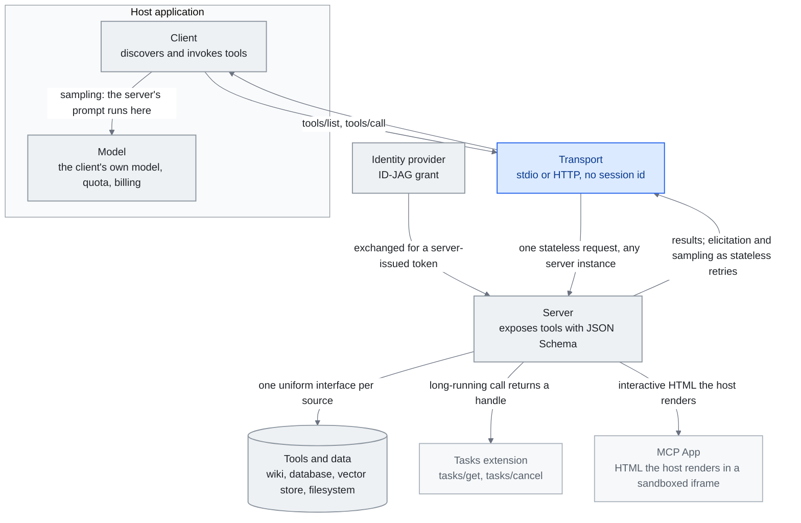

<!-- translation-sync:start -->
> 2026-10-31 영문판과 동기화한 기계 보조 번역입니다. 구조와 내용을 검토했습니다. 코드와 도표 라벨은 원문을 유지하며 읽기 시간은 영어 원문 기준 추정치입니다.
> [English source](../../../chapters/07-mcp.md) · [Sync record](../../SYNC.md)
<!-- translation-sync:end -->

<!-- i18n-anchor -->

# 7장: MCP —— 이긴 표준

> **한 문장으로:** MCP는 AI가 단일 프로토콜을 통해 어떤 외부 도구나 데이터 출처에도 연결할 수 있게 하는 보편 표준이다.
>
> **왜 중요한가:** MCP를 AI를 위한 USB라고 생각하라 ——그것 이전에는 모든 도구가 자기만의 커스텀 연결을 필요로 했다. 이제 모든 곳에서 작동하는 한 플러그가 있다.
>
> **읽기 시간:** 약 24분 (5,386단어 / 분당 230단어)

*그림: "Why It Won" 절의 세 핵심 개념인 클라이언트, 서버, 전송이다. 클라이언트는 호스트 앱 안에 호스트가 소유하는 모델과 함께 그렸고 전송과 서버는 바깥에 있다. 주변에는 2026 명세가 추가한 확장 Tasks, 렌더링된 UI인 MCP Apps, IdP 프로비저닝 인가를 배치했다. Tasks와 MCP Apps는 "2026-05-21: The 2026-07-28 Release Candidate", ID-JAG 토큰 교환은 "2026-06-18: Enterprise-Managed Authorization", 세션 없는 핵심은 "2026-07-28: The Specification Ships Final" 절에서 가져왔다. 서버에서 돌아 나오는 연결선은 "The Stateful MCP Transition"의 논지를 보여 준다. 서버는 응답뿐 아니라 구조화된 입력을 요청하고 샘플링을 요청할 수 있다. 확정된 무상태 핵심은 열린 연결을 유지하는 대신 일반 재시도로 이를 전달한다.*

<!-- i18n-anchor -->

## MCP란 무엇인가?

Model Context Protocol (MCP)은 AI 모델이 외부 도구, 데이터 출처, 서비스에 연결하는 방식을 표준화하기 위해 Anthropic이 만든 오픈 프로토콜이다. MCP 이전에는 모든 AI 통합이 맞춤 작업이었다 ——커스텀 함수 정의, 독점 도구 형식, 직접 만든 인증, 깨지기 쉬운 글루 코드. MCP는 이 파편화를 보편 인터페이스로 대체했다: 어떤 모델도 사용해 어떤 도구도 발견하고, 인증하고, 호출할 수 있는 단일 프로토콜.

MCP를 AI를 위한 USB라고 생각하라. USB 이전에는 모든 주변 장치가 자기만의 커넥터, 드라이버, 프로토콜을 필요로 했다. USB는 주변 장치를 더 강력하게 만들지 않았다 ——그것들을 상호 운용 가능하게 만들었다. MCP는 AI 도구 생태계에 같은 일을 한다. 단일 MCP 서버 구현이 Claude, GPT, Gemini, 또는 프로토콜을 말하는 어떤 다른 모델에도 서비스할 수 있다. 단일 MCP 클라이언트가 커스텀 통합 코드 없이 수천 개의 서버에 연결할 수 있다.

<!-- i18n-anchor -->

## 타임라인: 출시에서 Linux Foundation까지

**November 2024.** Anthropic이 Python과 TypeScript 참조 구현과 함께 MCP를 오픈소스 명세로 출시한다. 초기 출시는 파일 시스템, GitHub, Slack 등 소수의 참조 서버와 사용자 지정 서버용 SDK 지원을 포함한다. AI 커뮤니티는 이전에도 상호운용성 표준 제안을 봤기에 조심스러운 낙관으로 반응한다.

**April 2025.** 출시 여섯 달 뒤 MCP는 누적 SDK 다운로드 8백만 회를 넘고 커뮤니티는 서버 5,800개 이상을 만들었다. 예상보다 빠르게 성장한다. 중요한 점은 경쟁 AI 연구소가 대안을 만들기보다 프로토콜을 채택하기 시작했다는 것이다.

**2025년 후반.** MCP가 Linux Foundation 산하의 새 단체 Agentic AI Foundation에 기증된다. 창립 거버넌스에 Anthropic, Block, OpenAI가 참여한다. 이 움직임은 "Anthropic controls the standard"는 우려를 중화시키고, MCP를 벤더 특정 프로토콜이 아니라 진정한 산업 표준으로 확립한다.

**2026.** 모든 패키지 레지스트리를 합친 MCP SDK 다운로드는 Q1 2026 기준 월 97백만 회를 넘었다. 재단이 관리하는 공식 커넥터 75개 이상과 수천 개의 커뮤니티 서버가 있다. REST가 웹 API의 기본이 됐듯 MCP는 AI 앱의 기본 통합 계층이 됐다.

프로토콜이 인프라로 정착하는 순간은 **May 6, 2026** AWS가 **AWS MCP Server**를 정식 출시했을 때다. 최초의 대형 클라우드 사업자 관리형 원격 MCP 엔드포인트로, 인증된 서버 하나에 AWS API 작업 15,000개 이상, 세밀한 접근을 위한 IAM 컨텍스트 키, 서버 측 Python용 샌드박스 `run_script` 도구를 제공한다. Linux Foundation 기증(Dec 2025)과 다운로드 97M(Q1 2026)이 표준 지위를 세웠다면 AWS 정식 출시는 그 표준이 인프라가 되는 순간이다. S3가 객체 저장소를 통합한 패턴과 닮았다. 자체 호스팅 서버가 사라지지는 않지만 중심은 "one managed endpoint at the cloud boundary."로 이동한다.

Skills도 MCP에 이어 AAIF로 갔다. [5장의 October 업데이트](05-skill-systems.md#52-the-anthropic-skills-ecosystem) 참조.

<!-- i18n-anchor -->

## 그것이 이긴 이유

MCP의 빠른 지배를 설명하는 몇 가지 요인:

**처음부터 오픈 표준.** MCP는 단지 SDK가 아니라 전체 사양과 함께 관대한 라이선스로 공개되었다. 이는 경쟁자들이 Anthropic의 코드나 호의에 의존하지 않고 그것을 구현할 수 있음을 의미했다.

**단순한 아키텍처.** 프로토콜은 세 가지 핵심 개념을 가진다: 클라이언트 (AI 모델 측), 서버 (도구/데이터 측), 트랜스포트 (그것들이 어떻게 통신하는가). 서버는 JSON Schema 설명을 가진 도구를 노출한다. 클라이언트는 그것들을 발견하고 호출한다. 트랜스포트는 통신 계층 (stdio, SSE를 가진 HTTP, WebSocket)을 다룬다. 이 단순함이 채택을 사소하게 만들었다 ——유능한 개발자가 한 시간 안에 MCP 서버를 만들 수 있다.

**공급업체 중립 운영.** OpenAI가 공동 운영 구성원인 상태에서 Linux Foundation에 기증되며 마지막으로 설득력 있던 이의가 사라졌다. 주요 경쟁자가 함께 운영하는 표준은 진정 중립적이다.

**네트워크 효과.** 모든 새 MCP 서버가 모든 클라이언트에 대해 프로토콜을 더 가치 있게 만들고, 그 반대도 마찬가지다. 생태계가 유용한 서버의 임계 질량을 넘자, MCP를 지원하지 않는 비용이 그것을 채택하는 비용보다 더 높아졌다.

<!-- i18n-anchor -->

## 핵심 채택자

MCP 채택의 폭은 그 지배의 이야기를 말한다:

- **OpenAI**가 ChatGPT 플랫폼과 Agents SDK에 MCP 지원을 통합하여, GPT 모델이 어떤 MCP 서버도 사용하게 했다.
- **Google DeepMind**는 생태계 호환성을 주된 동기로 들며 Gemini에 MCP 클라이언트 지원을 추가했다.
- **Microsoft**가 가장 멀리 갔다. Windows에 OS 레벨에서 MCP 지원을 구축하고 Azure AI 서비스, Copilot, GitHub Copilot에 걸쳐 통합했다.
- **Amazon / AWS**는 April 2026에 첫 실서비스 양방향 MCP 실행 환경 **Bedrock AgentCore Runtime**을 출시해 표준 프로토콜 위에 입력 요청과 샘플링을 더했다(아래 "The Stateful MCP Transition" 참조).
- **GitHub**가 자사의 Copilot 확장 시스템을 MCP 위에 다시 만들어, 그들의 독점 도구 형식을 대체했다.
- **Figma, Slack, Block, Notion**은 모두 공식 MCP 서버를 제공해 어느 AI 작업 흐름에서도 해당 플랫폼을 기본 지원 대상으로 만든다.
- **Hugging Face**가 자사의 모델 허브와 함께 커뮤니티 MCP 서버 레지스트리를 호스팅한다.
- **LangChain**과 다른 편성 프레임워크가 네이티브 MCP 클라이언트 지원을 제공하여, 그것을 기본 도구 통합 방법으로 만들었다.

**합성의 한 차원으로서 MCP.** 2026의 더 미묘한 변화는 MCP 도구 선택이 고정 기반이 아니라 자동 하네스 합성 시스템의 *변수* 중 하나가 되기 시작했다는 점이다. AgentFlow 논문(arXiv 2604.20801, April 2026)은 에이전트 역할, 프롬프트, *도구*, 통신 토폴로지, 조정 프로토콜을 합성 루프가 탐색하는 유형화 그래프 DSL의 다섯 차원으로 취급한다. MCP를 고려하는 하네스 설계자에게 양면적이다. 표준화 덕분에 통합 계층을 다시 쓰지 않고 MCP 서버를 교체할 수 있어 도구 차원을 실제로 탐색할 수 있다. 그러나 서버 자체가 선택 후보가 되기도 한다. 질문은 더 이상 "which servers do I install"이 아니라 "which servers does my harness *evolve into using* under observability pressure."다.

**도구에는 MCP, 가치에는 x402.** **May 7, 2026** AWS는 Coinbase, Stripe와 함께 만든 최초의 자율 에이전트 관리형 결제 기본 기능 **AgentCore Payments**를 미리보기로 발표했다. 기계 사이 인밴드 스테이블코인 결제를 위해 HTTP 상태 코드 402 ("Payment Required")를 되살린 공개 프로토콜 **x402**를 기반으로 한다. Coinbase x402는 late April 2026까지 활성 에이전트 69,000개, 거래 165M회, 누적 거래액 약 $50M으로 이미 대형 클라우드 사업자의 지원 전에 규모를 갖췄다. MCP가 도구 호출 계층, x402가 가치 이전 계층을 맡으며 에이전트에는 프로토콜 간 스택이 생겼다. MCP가 API 접근을 표준화하면 x402는 API 결제를 표준화한다. 지식 엔지니어링에는 프리미엄 데이터, 라이선스 콘텐츠, 제한 API 같은 유료 자원이 에이전트 행동 공간의 기본 요소가 되고 예산 집행을 LLM 판단 규칙 대신 프로토콜 계층에서 결정론적으로 처리한다는 점이 중요하다.

<!-- i18n-anchor -->

## 지식 엔지니어링과의 연결

MCP는 그 자체로 지식 엔지니어링 기법이 아니다 ——그것은 지식 엔지니어링을 스케일 가능하게 만드는 인프라 계층이다. 본 보고서에서 논의된 모든 접근 ——RAG 파이프라인, 지식 그래프, 메모리 시스템, context engineering 패턴 —— 은 외부 지식을 모델에 먹이는 것을 요구한다. MCP는 그 먹이는 일이 일어나는 방식을 표준화한다.

실용적 예를 고려하라: 회사 위키에 접근하고, 데이터베이스를 쿼리하고, 벡터 저장소를 검색하고, 파일 시스템에서 읽어야 하는 지식 강화 AI 에이전트. MCP 없이는 이 통합 각각이 커스텀 코드, 커스텀 인증, 커스텀 오류 처리를 요구한다. MCP와 함께라면 각각이 MCP 서버이며, 에이전트는 통합된 인터페이스를 통해 그 모두에 연결된다.

이것이 MCP가 지식 엔지니어링 생태계에 중심인 이유이다. 그것은 RAG나 메모리를 대체하지 않는다 ——그것은 그것들이 모델과 플랫폼 전반에 걸쳐 구성 가능하고, 이식 가능하고, 상호 운용 가능하게 만드는 배관을 제공한다.

<!-- i18n-anchor -->

## Meta-Tool 패턴

MCP 채택에서 부상한 가장 중요한 아키텍처 패턴 중 하나는 Meta-Tool 패턴이며, 도구를 위한 progressive disclosure라고도 불린다.

문제: MCP 생태계가 자라면서, 에이전트가 수십 또는 수백 개의 도구에 접근할 수 있다. 그것들의 모든 스키마를 context window에 로드하는 것은 낭비이다 ——대부분의 도구가 어떤 주어진 작업에도 무관하다. 29개의 도구 스키마가 로드되면, 모델이 결코 사용하지 않을 도구 설명에 수천 토큰을 태우고, 모델이 잘못된 도구를 선택할 가능성을 증가시킨다.

해결책: 모든 도구 스키마를 미리 로드하는 대신, 두 개의 메타 도구를 로드하라: 에이전트가 설명으로 관련 도구를 검색할 수 있게 하는 **discovery tool**과, 발견된 도구를 참조로 호출하는 **execution tool**. 에이전트는 먼저 자신의 현재 작업에 어떤 도구가 사용 가능한지 발견하고, 그 다음 필요한 스키마만 로드한다.

이 패턴은 도구가 많은 환경에서 context window 소비를 80–90% 줄이고 결정 공간을 줄여 도구 선택 정확도를 개선한다. 그것은 10–15개 이상의 사용 가능한 도구를 가진 어떤 배포에 대해서도 모범 사례가 되었다.

<!-- i18n-anchor -->

## 2026년 과제

성공에도 불구하고, MCP는 의미 있는 열린 과제에 직면해 있다:

**감사 추적.** 엔터프라이즈 환경에서, 모든 도구 호출이 로깅, 귀속, 컴플라이언스 추적을 필요로 한다. 현재 MCP 사양은 감사 추적 형식을 처방하지 않아, 일관성 없는 구현으로 이어진다.

**SSO 통합 인증.** MCP의 인증 이야기는 출시 이래 의미 있게 개선되었지만, 전체 클라이언트-서버-트랜스포트 사슬에 걸쳐 엔터프라이즈 SSO 시스템 (SAML, OIDC)과 통합하는 것은 여전히 마찰이 많다. 최근 비준된 MCP를 위한 OAuth 2.1 흐름이 이 일부를 다루지만, 채택은 여전히 진행 중이다.

**게이트웨이 행동.** 조직들이 MCP를 스케일에서 배포함에 따라, 그들은 속도 제한, 접근 통제, 요청 라우팅, 모니터링을 위한 게이트웨이 계층을 필요로 한다. 생태계는 표준 MCP 게이트웨이 사양을 결여하여, 독점 해법으로 이어진다.

**구성 이식성.** MCP 서버 구성 (어떤 서버에 어떤 자격으로 어떤 순서로 연결할지)은 표준화되지 않았다. 머신, 팀, 또는 조직 사이에서 MCP 셋업을 옮기는 것은 수동 재구성을 요구한다.

**도구 설명 품질.** MCP의 효과는 전적으로 도구 설명의 품질에 의존한다. 잘못 설명된 도구는 부정확한 호출로 이어진다. 도구 설명 품질에 대한 표준이 없고, 린팅이 없고, 인증이 없다.

**스키마 버저닝.** MCP 서버가 자신의 도구 스키마를 갱신하면, 기존 클라이언트가 깨질 수 있다. 프로토콜은 내장 버저닝과 호환성 협상 메커니즘을 결여한다.

**도구 중복.** 수천 개의 커뮤니티 서버와 함께, 여러 서버가 종종 겹치는 기능을 제공한다. 프로토콜은 중복 제거나 선호 표현을 위한 메커니즘을 제공하지 않는다.

<!-- i18n-anchor -->

## 2026: Stateful MCP 전환

첫 열여덟 달간 MCP는 근본적으로 **무상태 RPC 프로토콜**이었다. 클라이언트가 서버를 호출하면 서버가 결과를 반환하고 대화는 계속된다. 파일 읽기, API 질의, 메시지 게시 같은 단순 도구 호출에는 적합했지만 장기 실행이나 대화형 작업에는 어려웠다. April 2026에 두 변화가 MCP를 진정한 오케스트레이션 계층으로 밀기 시작했다.

**SEP-1686: Tasks 기본 기능.** April 2026 MCP Dev Summit에서 소개된 **SEP-1686**은 프로토콜에 지속 저장되는 과제 상태 기계를 추가한다. 장기 도구 호출마다 지속 ID와 `working`, `input_required`, `completed`, `failed`, `cancelled` 다섯 상태 중 하나를 갖는 **과제**가 된다. 클라이언트는 과제를 시작하고 연결을 끊었다가 나중에 다시 연결해 상태나 결과를 가져올 수 있다. **지금 호출하고 나중에 가져오는** 패턴이다. 과제 ID가 서버 발신 알림과 연계돼 연결을 계속 열지 않고 진행 이벤트를 구독할 수 있다. 기존 MCP에서 개별 우회 구현을 요구했던 작업 흐름을 직접 겨냥한다:

- 완료에 분이나 시간이 걸리는 **데이터 파이프라인**
- 큰 저장소에 걸친 **코드 마이그레이션**
- 전체 CI 스위트를 위한 **테스트 실행**
- 서브 에이전트를 생성하고 외부 API를 기다리는 **심화 연구**
- 한 에이전트가 다른 에이전트에게 작업을 비동기적으로 넘기는 **다중 에이전트 시스템**

SEP-1686은 April 2026 MCP 명세에 실험적으로 제공된다. 무상태 RPC에서 지속적이고 재개 가능한 오케스트레이션으로 나아가는 최초의 본격적 단계다.

**Amazon Bedrock AgentCore: 최초의 양방향 실행 환경.** 같은 April 2026에 AWS는 **양방향** 통신을 구현한 최초의 실서비스 MCP 실행 환경 **Bedrock AgentCore Runtime**을 출시한다. 표준 MCP는 클라이언트가 도구를 호출하고 서버가 응답하는 클라이언트 시작형이다. AgentCore는 서버가 시작하는 두 기능을 더한다:

- **Elicitation.** 실행 도중에, 서버가 일시 정지하고 JSON 스키마에 대해 사용자로부터 구조화된 입력을 요청할 수 있다. 이는 이전에 커스텀 UI 계층을 필요로 했던 다단계 워크플로우를 프로토콜 레벨 상호작용으로 바꾼다. 마이그레이션 도구가 멈추고 "which branch should I target?"를 타입이 있는 응답과 함께 물을 수 있다.
- **Sampling.** 서버가 자체 모델 자격을 보유하지 않고 클라이언트로부터 LLM 생성 완성을 요청할 수 있다. 서버가 prompt와 표집 매개변수를 제공한다. 클라이언트가 자기 모델을 실행하고 완성을 반환한다. 이는 도구 서버가 LLM 기반 작업 (요약, 분류, 추출)을 할 수 있게 하면서, 사용자의 모델, 쿼터, 청구는 클라이언트 측에 남는다.

함께, elicitation과 sampling이 MCP의 양방향 프로토콜 표면을 완성한다. 서버는 이제 단지 호출에 응답하지 않고 대화의 일부를 **운전**할 수 있다.

**함의.** MCP의 2025년 관점은 "a uniform plug for stateless tools."였다. 2026년에는 **상태 유지형, 대화형, 양방향 에이전트 오케스트레이션**의 프로토콜 계층이라는 더 넓은 관점이 된다. 도구 서버는 수동 응답을 넘어 지속 상태를 보관하고, 사용자 입력을 기다리며 멈추고, 클라이언트에 LLM 작업을 요청할 수 있다. 지식 엔지니어링에서는 장기 검색 파이프라인, 단계적 데이터 보강, 사람 개입 작업 흐름을 위한 기본 프로토콜이 마침내 생긴다는 뜻이다.

<!-- i18n-anchor -->

## 2026-05-21: 2026-07-28 릴리스 후보

April-2026의 "stateful MCP" 이야기는 최종 목적지가 아닌 긴 흐름의 한 단계였다. **May 21, 2026**에 MCP 운영위원회는 **2026-07-28 릴리스 후보**를 확정했다. July 28에 최종 2026 기준판으로 출시될 명세로, SDK 관리자와 호스트 구현자에게 열 주의 검증 기간을 연다. 세 변화가 프로토콜 표면을 바꾸고 네 번째 묶음이 기반을 강화한다.

**무상태 프로토콜 핵심.** `initialize` / `initialized` 핸드셰이크와 `Mcp-Session-Id` 헤더가 제거된다. 클라이언트 메타데이터가 매 요청의 `_meta`에 실려 어떤 서버 인스턴스에도 요청이 도달할 수 있다. 고정 라우팅, 공유 세션 저장소, 준비 단계가 필요 없다. 2025년 후반 Streamable HTTP 도입에서 드러난 가장 큰 실서비스 공백인 **로드 밸런서 뒤의 수평 확장**을 직접 해소한다. 프로토콜 첫 열여덟 달의 *상태 유지형* 전환(April 2026 SEP-1686 Tasks, AgentCore 양방향 실행 환경)을 거쳐, 2026-07-28 RC는 핵심 자체를 *다시 무상태화*한다. 그 전환의 동기가 된 지속 상태 기능은 매 요청에 내장하는 대신 위쪽 확장으로 재구현한다.

**MCP Apps.** 서버가 대화형 HTML 인터페이스를 제공하고 호스트는 이를 샌드박스 iframe에 렌더링할 수 있다. 보안 검토와 캐싱을 위해 UI 템플릿은 미리 선언한다. **도구 호출이 아닌** 첫 MCP 네이티브 산출물이다. 지식 기반 서버는 자체 디바운싱과 페이지 처리가 있는 검색창을, 연구 서버는 결과 비교 화면을, 구매 서버는 구매 확인 모달을 제공할 수 있다. 별도 명세를 덧붙이지 않고 프로토콜에 UI 표면이 생긴다.

**Tasks가 실험적 핵심에서 확장으로 이동.** 장기 호출을 재개 가능한 상태 기계로 바꾼 SEP-1686의 지금 호출/나중 수신 패턴은 프로토콜 핵심에서 확장 프레임워크로 옮겨 간다. 수명 주기도 무상태로 재설계된다. `tools/call`은 과제 핸들을 반환하고, 클라이언트는 각각 일반 무상태 요청인 `tasks/get`, `tasks/update`, `tasks/cancel`로 진행을 이끈다. 역량은 같고 형태가 무상태 핵심과 일치하게 됐다.

**기반 강화.** 같은 흐름에서 **확장 프레임워크**(역방향 DNS ID로 기능을 식별하고 공식 Standards Track으로 협상해 핵심과 독립적으로 버전을 매기는 방식), **OAuth 2.0 / OIDC 인가 강화**(필수 `iss` 검증, 클라이언트 등록의 앱 유형 선언, 최신 OAuth 모범 관행과의 정렬을 다루는 여섯 SEP), 최초의 **공식 폐기 정책**(Roots, Sampling, Logging을 폐기 예정으로 하고 호환성 깨짐 전 최소 12개월 유예)도 나온다. 열여덟 달간 기능을 키운 명세가 출시 주기 하나를 기반 강화에 쓴다.

**지식 엔지니어링의 함의.** RC는 더 작은 핵심과 더 많은 확장이라는 구조적 *축소*인 동시에 UI 표면을 더하는 *역량 확장*이다. 지식 하네스 설계자에게 두 효과가 즉각적이다. 첫째, **수평 확장이 배포 패턴 문제가 아닌 배포 설정 문제가 된다**. 프로토콜이 더 이상 로드 밸런서와 충돌하지 않는다. 둘째, **"tool"과 "interface"의 경계가 흐려진다**. 지식 서버는 같은 대화 안에서 도구 호출로 질의에 답하고, 과제로 결과 핸들을 반환하며, MCP App으로 후속 구분 질문을 보여 줄 수 있다. 프로토콜은 무상태 RPC 배관을 넘어 **상태 유지형 다중 표면 에이전트 상호작용의 기반**이 되지만, 그 위에 상태 작업을 전달해도 자체 핵심은 무상태로 유지하는 규율을 지킨다.

**베타 SDK와 최종 확정 기간 (June 29).** June 29, 2026에 MCP 프로젝트는 Python, TypeScript, Go, C# 베타 SDK를 출시해 July 28, 2026 명세 확정 전 사 주간의 시험을 열었다. TypeScript v2 SDK는 기존 일체형 패키지를 `@modelcontextprotocol/server`와 `@modelcontextprotocol/client`로 나눈다. 베타는 **Multi Round-Trip Requests (SEP-2322, 상태: Final, 생성 2026-02-03)**도 제공한다. 샘플링과 입력 요청을 포함한 서버 시작 요청의 전달 방식을 다시 구성한다. 열린 SSE 스트림과 서버 측 상태 대신, 도구가 `InputRequiredResult`를 반환하면 클라이언트가 호출을 다시 보내는 *무상태 재시도*를 쓴다. 샘플링과 입력 요청의 역량은 같고 SEP-2322는 전송만 바꾼다. 따라서 양방향 기능이 장기 연결 없이 무상태 핵심에 맞게 된다.

<!-- i18n-anchor -->

## 2026-06-01: 보안 고려 사항이 IETF로 이동

RC는 필수 `iss` 검증과 OAuth 2.0 / OIDC 정렬의 여섯 SEP로 *인가*를 강화했다. 그러나 인가된 요청 이후 서버의 행동은 정의하지 않았고 명시적으로 정의 대상이 아니다. **June 1, 2026**에 이 공백을 다루는 첫 MCP 보안 **IETF Internet-Draft**, `draft-mohiuddin-mcp-security-considerations-00`(Anas Mohiuddin Syed)이 나왔다. 첫 문장이 논지다. *"The MCP specification does not define normative security requirements."*

초안은 출시된 MCP 서버에서 이미 공개 보고된 여섯 취약점 유형을 나열한다. 프로토콜이 구현자에게 맡긴 영역을 훑는 듯한 목록이다:

- **SSRF**: 서버가 모델이 준 URL의 최종 IP를 검증하지 않고 가져와, 에이전트가 클라우드 메타데이터 엔드포인트나 사설 네트워크로 들어가는 프록시가 된다.
- **과도한 도구 권한**: 개별 도구에 필요한 것보다 많은 파일 시스템이나 API를 서버가 노출한다.
- **프롬프트 주입 노출**: 입력이 아닌 도구 *출력* 안에 숨긴 지시가 이를 읽는 모델을 탈취한다.
- **MCP 수명 주기 우회**: 초기화 핸드셰이크가 끝나기 전에 도구 호출을 처리해 핸드셰이크의 제한을 우회한다.
- **정보 유출**: 오류 메시지나 도구 응답이 호출자에게 허용된 것보다 많은 내부 상태를 반환한다.
- **인증 집행 공백**: "local"이면 "trusted."라고 가정해 localhost 서버를 인증 없이 운영한다.

초안은 각 유형에 구현 가능한 완화책을 제안한다. 연결 시 최종 IP 검증(RFC 1918, 루프백, 링크 로컬 차단), OS 수준 외부 통신 제한, 기본 HTTP 리디렉션 비활성화와 매 대상 재검증, 최소 파일 접근 범위, 도구 호출 전 핸드셰이크 완료, 모든 도구 호출의 구조화 로그다. 오픈소스 탐지 도구 **mcp-safeguard**를 CI 검사(`scan --target ./my-mcp-server/`)로 함께 제시해 검토 때 한 번이 아닌 모든 커밋에서 감사하게 한다.

구조적으로 새로운 것은 개별 발견보다 *문서의 위치*다. 대다수는 익숙한 웹 보안 실패를 에이전트 맥락에 옮긴 것이다. MCP 보안은 공급업체 블로그에서 독립적인 표준화 절차의 검토로 이동한다. 관리 조직 밖의 누군가가 공백을 명시하고 인용할 수 있는 명세로 다뤄야 한다고 판단할 만큼 중요한 프로토콜이 되면 IETF 보안 초안이 생긴다. 실서비스에 MCP 서버를 연결하는 지식 하네스 설계자에게 여섯 유형은 배포 전 점검 항목이고, 프로토콜에는 성숙의 표지다. 명세가 의도적으로 비워 둔 RFC가 작성되기 시작했다.

<!-- i18n-anchor -->

## 2026-06-18: 기업 관리형 인가

IETF 초안은 인증 집행 공백과 기업 SSO 마찰을 미해결 문제로 명명했다. 같은 달 MCP 관리자들은 기업 쪽에 안정적인 답을 출시했다. 핵심 관리자 **Paul Carleton**이 June 18, 2026에 발표한 **Enterprise-Managed Authorization (EMA)**는 조직이 ID 공급자를 통해 MCP 서버 접근을 중앙에서 프로비저닝하게 한다. 사용자는 한 번 로그인하면 승인된 서버가 이미 연결돼 있으며, 서버별 앱 OAuth 동의 화면이 없다.

메커니즘은 두 단계 토큰 교환이다. SSO 중 클라이언트는 IdP에서 **Identity Assertion JWT Authorization Grant (ID-JAG)**를 받아 MCP 서버 *자체* 인가 서버가 발급한 접근 토큰으로 교환한다. 사용자나 클라이언트가 기존 서버별 OAuth 동의 절차를 거치지 않는다. IdP가 사용자를 보증하고 각 서버의 인가 서버가 그 보증으로 무엇을 허용할지 결정한다.

주목할 부분은 실제 표준과 제안을 구별하는 첫날 지원 범위다. IdP **Okta**(Cross App Access 확장), 클라이언트 **Anthropic**(Claude, Claude Code, Cowork)과 **VS Code**, Asana, Atlassian, Canva, Figma, Granola, Linear, Supabase의 일곱 서버가 지원하고 Slack도 적극적으로 지원을 추가 중이다. EMA는 이 장 자체의 2026 과제 절이 지목한 *"SSO-integrated authentication remains friction-heavy"* 공백을 메운다. 기업 SSO는 서버별 연결 작업이 아니라 IdP에서 한 번 내리는 프로비저닝 결정이 된다.

다만 프로비저닝 시점 인가는 호출별 인가가 아니다. **September 10, 2026** Anthropic은 Managed Agents의 `auto` 권한 정책으로 후자에 답했다. 클라이언트가 아닌 서버가 각 도구 호출을 평가해 실행하거나, 클라이언트가 무시할 수 없는 오류로 거부하거나, 승인을 기다리며 멈춘다. Anthropic 문서에 따르면 내장 에이전트 도구뿐 아니라 MCP 도구 모음에도 적용된다. 개별 MCP 호출을 플랫폼 통제 아래 두며 [4장](04-harness-engineering.md)의 결정론적 AWS AgentCore Temporal Policies와 나란히 놓인다.

<!-- i18n-anchor -->

## 2026-07-28: 명세 최종 출시

열 주의 검증 기간은 예정대로 끝났다. **July 28, 2026** MCP 관리자 David Soria Parra와 Den Delimarsky는 **2026-07-28 명세**를 최종 출시했다. 인가 추가 이후 최대 개정이며 May 21부터 이 장이 추적한 릴리스 후보의 흐름이 설계대로 도착했음을 확인한다. 핵심은 이제 **무상태 요청 / 응답**이다. `initialize` / `initialized` 핸드셰이크와 `Mcp-Session-Id` 헤더가 완전히 사라지고, **Multi Round-Trip Requests**(SEP-2322)가 서버 시작 상호작용을 무상태 재시도로 전달하며, **확장 프레임워크**가 공식화됐다. Tasks는 프로토콜 핵심 대신 `io.modelcontextprotocol/tasks`에 있다.

인가는 RC보다 한 단계 더 강화됐다. 최종 명세는 **RFC 9207 발급자 검증**을 의무화하고 동적 클라이언트 등록을 **Client ID Metadata Documents (CIMD)**로 대체한다. 클라이언트는 서버별 등록 절차 대신 호스팅된 메타데이터 문서로 식별된다. Roots, Sampling, Logging, 원래의 HTTP+SSE 전송은 최소 12개월 제거 유예와 함께 폐기 예정이 됐다. Tier 1 SDK 네 개(Python, TypeScript, Go, C#) 모두 대응 업데이트를 출시했고 AWS, Google Cloud, Microsoft, Cloudflare가 지지했다.

지식 엔지니어링의 실질 결과는 RC가 약속한 두 가지가 실제 출시됐다는 것이다. 원격 MCP 서버는 고정 라우팅 없이 일반 로드 밸런서 뒤에 놓을 수 있고 클라이언트는 `tools/list`를 캐시할 수 있다. 보통의 무상태 웹 서비스와 같은 배포 형태다. April의 상태 유지형 전환, May의 재무상태화 RC, June의 독립 보안 검토, 핵심을 의도적으로 작게 두고 상태 유지·대화형·기업별 기능을 확장으로 보내는 최종 명세로 프로토콜의 2026 흐름이 완성됐다.

<!-- i18n-anchor -->

## 2026-08-22: 최종 확정 이후

July 28 최종 명세는 April 2026 상태 유지형 전환부터 추적한 흐름을 마무리했다. **August 22, 2026** MCP 핵심 관리자들은 최종 확정 이후 로드맵을 발표했다. 명세가 의도적으로 답하지 않는 "what's next"에 답하는 명시적 운영 체계와 우선순위 문서다.

**운영 체계의 공식화.** 핵심 명세가 변하는 목표에서 고정점이 되자 로드맵은 의사 결정 방식을 정비한다. 수준을 정의한 **Contributor Ladder**, 중앙 병목에서 분야별 **작업 그룹**으로 이동하는 SEP(명세 개선 제안) 분류, July 28 명세가 Roots, Sampling, Logging에 적용한 임시 제거 유예를 향후 모든 기능의 상설 절차로 일반화하는 공식 기능 수명 주기와 폐기 정책이다.

**다섯 우선순위.** 다음 기본 기능 흐름의 방향은 (1) **에이전트 메시징**: 서버 시작 이벤트(webhooks, channels)와 Tasks 확장을 다시 핵심 명세에 완전히 포함하도록 성숙시키기; (2) July 28 명세의 HTTP 네이티브 전송 통합을 로컬 배포로 확장해 남은 stdio/HTTP 분리 해소; (3) **에이전트 ID와 기업 보안** 표준화: 특히 DPoP와 Workload Identity Federation으로 EMA(June 18)의 IdP 프로비저닝을 기계 간 ID로 확장; (4) 도구 결과 처리 개선과 대규모 도구 목록의 점진적 탐색으로 앞의 메타 도구 패턴을 관리자 차원에서 지지; (5) Tier 1 SDK 전반의 개발자 경험과 적합성 시험이다. 같은 날 Hacker News에서 241점과 댓글 142개를 얻어 운영 문서로서는 큰 반응이었지만, 지속 지표가 아닌 당일 스냅샷으로 인용한다.

지식 엔지니어링에서는 우선순위 (1)을 지켜볼 만하다. Tasks가 확장에서 다시 핵심으로 승격되면 지속적이고 재개 가능한 검색·정보 보강 파이프라인이 현재의 잠정적 지위보다 확고한 지위를 얻는다.

<!-- i18n-anchor -->

## 시장 맥락

업계 분석가들은 MCP가 주된 프로토콜인 AI 도구 통합 시장을 2025년 $1.8 billion으로 추정하고, 기업 도입이 빨라지며 크게 성장할 것으로 전망한다. MCP 인프라, 서버 개발, 게이트웨이 서비스, 관련 도구를 아우르는 수치다.

<!-- i18n-anchor -->

## 핵심 자원

- **[modelcontextprotocol.io](https://modelcontextprotocol.io)** ——공식 사양, SDK, 문서.
- **Anthropic MCP Courses** —— [Skilljar](https://anthropic.skilljar.com)와 [DeepLearning.AI](https://www.deeplearning.ai/short-courses/)에서 가용, 프로토콜 기초와 서버 개발을 다룬다.
- **The New Stack** —— MCP 아키텍처, 채택, 과제에 대한 지속적 기술 보도. Meta-tool 패턴과 엔터프라이즈 배포 패턴에 관한 주목할 만한 기사.
- **MCP SDK 다운로드 통계**: 직접적인 채택 지표는 npm(`@modelcontextprotocol/sdk`, [https://www.npmjs.com/package/@modelcontextprotocol/sdk](https://www.npmjs.com/package/@modelcontextprotocol/sdk))과 PyPI(`mcp`, [https://pypi.org/project/mcp/](https://pypi.org/project/mcp/)) 참조.

---

<!-- i18n-anchor -->

## 기억할 세 가지

- **MCP의 성공 이유는 세 개념과 중립 운영이다.** 클라이언트, 서버, 전송은 유능한 개발자가 한 시간 안에 서버를 만들 만큼 단순하다. 명세를 Linux Foundation에 기증하고 OpenAI가 공동 운영하며 채택의 마지막 설득력 있는 이의가 사라졌다.
- **2026 명세는 보통 방식으로 배포할 수 있도록 핵심을 다시 무상태로 만들었다.** 핸드셰이크와 `Mcp-Session-Id` 헤더가 사라져 요청이 어느 서버 인스턴스에나 도달할 수 있다. 원격 서버는 일반 로드 밸런서 뒤에 두고 클라이언트는 `tools/list`를 캐시할 수 있다.
- **프로토콜 자체는 규범적 보안 요건을 정의하지 않는다.** June 2026 IETF 초안은 출시 서버에서 이미 보고된 SSRF, 과도한 도구 권한, 도구 출력의 프롬프트 주입, 수명 주기 우회, 정보 유출, 인증 누락의 여섯 유형을 나열한다. 완화는 각각 구현자의 몫이다.

---

## Sources

1. Anthropic. "Introducing the Model Context Protocol." November 2024. https://www.anthropic.com/news/model-context-protocol
2. Model Context Protocol 명세. https://modelcontextprotocol.io
3. Linux Foundation. "Agentic AI Foundation Established." 2025. https://www.linuxfoundation.org/press/agentic-ai-foundation
4. MCP SDK 다운로드 통계, npm: [https://www.npmjs.com/package/@modelcontextprotocol/sdk](https://www.npmjs.com/package/@modelcontextprotocol/sdk) 및 PyPI: [https://pypi.org/project/mcp/](https://pypi.org/project/mcp/) (Q1 2026 누적 약 97M 다운로드, 이차 보도에 널리 인용).
5. The New Stack. "The Meta-Tool Pattern: Progressive Disclosure for AI Tools." 2025.
6. Anthropic. MCP Course. Skilljar. https://anthropic.skilljar.com
7. DeepLearning.AI. "Building MCP Servers." https://www.deeplearning.ai/short-courses/
8. Microsoft. "MCP Support in Windows and Azure." 2025. https://devblogs.microsoft.com
9. OpenAI. "Agents SDK: MCP Integration." 2025. https://openai.com/index/new-tools-for-building-agents
10. AgentFlow / "Synthesizing Multi-Agent Harnesses for Vulnerability Discovery." arXiv 2604.20801, April 2026. [https://arxiv.org/abs/2604.20801](https://arxiv.org/abs/2604.20801)
11. AWS. "AWS MCP Server now generally available" (May 6, 2026). [https://aws.amazon.com/about-aws/whats-new/2026/05/aws-mcp-server/](https://aws.amazon.com/about-aws/whats-new/2026/05/aws-mcp-server/) 및 [https://aws.amazon.com/blogs/aws/the-aws-mcp-server-is-now-generally-available/](https://aws.amazon.com/blogs/aws/the-aws-mcp-server-is-now-generally-available/) --- 최초의 정식 출시된 대형 클라우드 사업자 관리형 원격 MCP 엔드포인트; 인증 서버 하나에 API 작업 15,000개 이상.
12. AWS. "Agents that transact: Amazon Bedrock AgentCore now includes Payments (preview)" (May 7, 2026). [https://aws.amazon.com/about-aws/whats-new/2026/04/amazon-bedrock-agentcore-payments-preview/](https://aws.amazon.com/about-aws/whats-new/2026/04/amazon-bedrock-agentcore-payments-preview/) 및 [https://aws.amazon.com/blogs/machine-learning/agents-that-transact-introducing-amazon-bedrock-agentcore-payments-built-with-coinbase-and-stripe/](https://aws.amazon.com/blogs/machine-learning/agents-that-transact-introducing-amazon-bedrock-agentcore-payments-built-with-coinbase-and-stripe/) --- URL 경로는 `/04/`이지만 출시는 May 7, 2026이다.
13. x402 명세. [https://www.x402.org/](https://www.x402.org/) 및 Coinbase 참조 구현 [https://github.com/coinbase/x402](https://github.com/coinbase/x402).
14. Model Context Protocol 블로그. "The 2026-07-28 MCP Specification Release Candidate" (May 21, 2026 확정). [https://blog.modelcontextprotocol.io/posts/2026-07-28-release-candidate/](https://blog.modelcontextprotocol.io/posts/2026-07-28-release-candidate/) --- 무상태 프로토콜 핵심, 확장 프레임워크, MCP Apps, Tasks의 확장 이동, OAuth 2.0 / OIDC 인가 강화(여섯 SEP), 공식 폐기 정책. 최종 명세는 July 28, 2026 출시.
15. The New Stack. "MCP's biggest growing pains for production use will soon be solved" (May 2026). [https://thenewstack.io/model-context-protocol-roadmap-2026/](https://thenewstack.io/model-context-protocol-roadmap-2026/) --- 2026-07-28 RC 우선순위에 대한 독립적인 이차 보도.
16. IETF Internet-Draft. "Security Considerations for Model Context Protocol (MCP) Implementations in AI Agent Systems," `draft-mohiuddin-mcp-security-considerations-00` (June 2026; December 3, 2026 만료). [https://datatracker.ietf.org/doc/draft-mohiuddin-mcp-security-considerations/](https://datatracker.ietf.org/doc/draft-mohiuddin-mcp-security-considerations/) --- 저자 Anas Mohiuddin Syed; 여섯 취약점 유형과 오픈소스 `mcp-safeguard` 탐지 도구. 관련 설명: [https://dev.to/syedanas01/i-built-the-first-security-scanner-for-mcp-servers-heres-what-i-found-2np2](https://dev.to/syedanas01/i-built-the-first-security-scanner-for-mcp-servers-heres-what-i-found-2np2) (연결된 GitHub 저장소는 초안 시점에 확인 불가하여 검증 필요로 표시).
17. Model Context Protocol 블로그. "Enterprise-Managed Authorization" (June 18, 2026). [https://blog.modelcontextprotocol.io/posts/enterprise-managed-auth/](https://blog.modelcontextprotocol.io/posts/enterprise-managed-auth/) 및 명세 [https://modelcontextprotocol.io/extensions/auth/enterprise-managed-authorization](https://modelcontextprotocol.io/extensions/auth/enterprise-managed-authorization) --- 핵심 관리자 Paul Carleton 발표; ID-JAG 토큰 교환; 첫날 Okta(IdP) / Anthropic + VS Code(클라이언트) / 일곱 서버.
18. Model Context Protocol 블로그. "MCP SDK betas ahead of the 2026-07-28 finalization" (June 29, 2026). [https://blog.modelcontextprotocol.io/posts/sdk-betas-2026-07-28/](https://blog.modelcontextprotocol.io/posts/sdk-betas-2026-07-28/) 및 SEP-2322 [https://modelcontextprotocol.io/seps/2322-MRTR](https://modelcontextprotocol.io/seps/2322-MRTR) --- Python / TypeScript / Go / C# 베타; July 28 확정 전 사 주 시험; TypeScript v2 서버/클라이언트 패키지 분리; Multi Round-Trip Requests(SEP-2322, Final, 생성 2026-02-03).
19. Model Context Protocol 블로그. "The 2026-07-28 specification" (July 28, 2026). [https://blog.modelcontextprotocol.io/posts/2026-07-28/](https://blog.modelcontextprotocol.io/posts/2026-07-28/) --- 최종 명세: 무상태 핵심, MRTR(SEP-2322), RFC 9207 발급자 검증, 동적 클라이언트 등록을 대체하는 CIMD, 확장 프레임워크(`io.modelcontextprotocol/tasks`), Roots / Sampling / Logging / HTTP+SSE에 최소 12개월 폐기 유예.
20. TechCrunch. "AI's most important protocol is getting a little bit easier to use" (July 20, 2026). [https://techcrunch.com/2026/07/20/ais-most-important-protocol-is-getting-a-little-bit-easier-to-use/](https://techcrunch.com/2026/07/20/ais-most-important-protocol-is-getting-a-little-bit-easier-to-use/) --- 최종 확정 전 무상태 핵심 변화에 대한 이차 보도.
21. The Register. "Model Context Protocol prepares to break with its stateful past" (July 23, 2026). [https://www.theregister.com/devops/2026/07/23/model-context-protocol-prepares-to-break-with-its-stateful-past/5276722](https://www.theregister.com/devops/2026/07/23/model-context-protocol-prepares-to-break-with-its-stateful-past/5276722)
22. WorkOS. "MCP 2026 spec: agent authentication" (July 2026). [https://workos.com/blog/mcp-2026-spec-agent-authentication](https://workos.com/blog/mcp-2026-spec-agent-authentication) --- CIMD와 인가 강화에 대한 이차 보도.
23. Model Context Protocol 블로그. "The MCP Roadmap" (August 22, 2026). [https://blog.modelcontextprotocol.io/posts/mcp-roadmap/](https://blog.modelcontextprotocol.io/posts/mcp-roadmap/) --- 최종 확정 이후 우선순위: 에이전트 메시징(webhooks/channels, Tasks 핵심 편입), 로컬 배포 HTTP 네이티브 전송, 에이전트 ID/기업 보안(DPoP, Workload Identity Federation), 도구 결과 처리/점진적 탐색, SDK 개발자 경험/적합성. 운영 체계: Contributor Ladder, 작업 그룹 SEP 분류, 공식 기능 수명 주기 정책. 당일 Hacker News 토론: 241점 / 댓글 142개(당일 스냅샷).
24. Anthropic. 권한 정책, Managed Agents 문서(`auto` 정책 날짜는 플랫폼 출시 노트의 September 10, 2026). [https://platform.claude.com/docs/en/managed-agents/permission-policies](https://platform.claude.com/docs/en/managed-agents/permission-policies) 및 출시 노트 [https://platform.claude.com/docs/en/release-notes/overview](https://platform.claude.com/docs/en/release-notes/overview) --- 서버 측 호출별 평가가 실행, 거부, 승인 대기를 반환한다. `agent.tool_use`와 `agent.mcp_tool_use` 이벤트의 `evaluation` 객체에 `high_risk`, `indeterminate` 같은 사유 코드를 보고한다. 명시적 재정의가 없으면 기본 정책이 `always_ask`인 MCP 도구 모음에도 적용된다. Anthropic 문서 단일 출처이며 독립 보도는 찾지 못했다.

---

*이전 장: [6장 — 에이전트 메모리: 빠진 계층](06-agent-memory.md) | 다음 장: [8장 — 도구 풍경: AI 네이티브 지식 관리](08-tools-landscape.md)*
