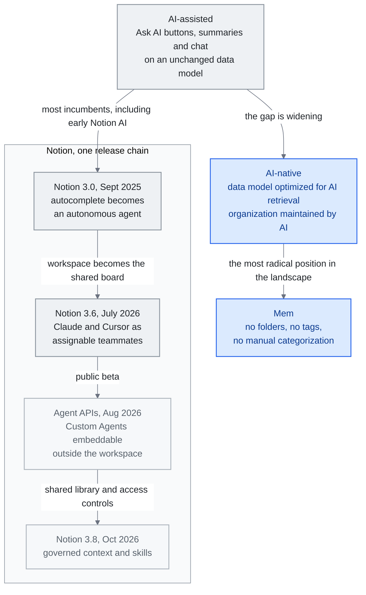

<!-- translation-sync:start -->
> 2026-10-31 영문판과 동기화한 기계 보조 번역입니다. 구조와 내용을 검토했습니다. 코드와 도표 라벨은 원문을 유지하며 읽기 시간은 영어 원문 기준 추정치입니다.
> [English source](../../../chapters/08-tools-landscape.md) · [Sync record](../../SYNC.md)
<!-- translation-sync:end -->

<!-- i18n-anchor -->

# 8장: 도구 풍경 —— AI 네이티브 지식 관리

> **한 문장으로:** AI 기반 지식 관리를 위한 도구 풍경은 AI 강화 노트 앱부터 완전 AI 네이티브 플랫폼까지 걸쳐 있다.
>
> **왜 중요한가:** 노트를 하거나, 지식을 관리하거나, 정보를 조직한다면, AI는 이 공간의 모든 도구가 작동하는 방식을 바꾸고 있다.
>
> **읽기 시간:** 약 13분 (2,912단어 / 분당 230단어)

*그림: "The AI-Assisted vs. AI-Native Gap"의 스펙트럼으로, 초기 Notion AI는 보조형 쪽에, 수작업 정리가 필요 없는 Mem의 설계는 네이티브 쪽에 있다. Notion의 출시 흐름은 이 장의 전개를 따른다. 3.0은 에이전트를 도입하고, 3.6은 외부 팀원을 수용하며, August의 Agent APIs는 다른 제품에 삽입할 수 있게 하고, October의 3.8은 통제되는 공유 컨텍스트와 스킬을 추가한다. 도구가 사람만 사용하는 작업 흐름에 맞춘 데이터 모델에 묶여 있으면 격차가 커진다. 공유 라이브러리 연결선은 절차적 지식이 어떻게 작업 공간에 합류하는지 보여 준다.*

<!-- i18n-anchor -->

## 풍경

사람들이 지식을 조직하고, 검색하고, 추론하는 데 사용하는 도구들이 AI를 중심으로 다시 만들어지고 있다. 본 장은 AI 기반 지식 관리의 주요 플랫폼을 ——제품 리뷰가 아니라 본 보고서 전반에 걸쳐 논의된 지식 엔지니어링 원칙의 구현으로서 —— 살펴본다. 각 도구는 인간과 AI가 어떻게 지식 작업에 협력해야 하는지에 대해 다른 아키텍처적 베팅을 한다.

## Notion AI

Notion은 협업 지식 관리 시장의 약 25%를 차지하며, 이는 자사의 AI 전략을 전체 공간에 결과적으로 만든다.

**Notion 3.0** (September 2025)은 근본적인 변화를 나타냈다. Notion은 AI 계층을 자동 완성 기능에서 자율 에이전트로 다시 만들었다. 이제 Notion AI 에이전트는 작업 공간에 대한 자동 완성 제안이나 질문 응답에 그치지 않고, 독립적으로 작업 공간을 탐색하고, 페이지를 만들거나 수정하고, 데이터베이스를 갱신하며, 다단계 작업 흐름을 실행할 수 있다. 작업 공간의 구조를 이해하고, 여러 페이지의 정보를 대조하며, 사용자의 정리 방식에 대한 컨텍스트를 유지한다.

January 2026에 Notion은 여러 모델을 지원하기 시작해 사용자가 과제별로 서로 다른 모델에 라우팅할 수 있게 했다. 창의적 글쓰기에는 GPT-5.2, 분석 과제에는 Claude Opus 4.6, 멀티모달 작업에는 Gemini 3를 사용한다. 이 모델 라우팅 방식에는 모든 일에 뛰어난 단일 모델은 없고, 지식 관리 계층은 특정 모델에 종속되지 않아야 한다는 성숙해진 이해가 반영돼 있다.

Notion의 강점은 구조화된 데이터 (데이터베이스, 관계, 롤업)와 비구조화된 콘텐츠 (페이지, 블록)의 결합이다. 이 하이브리드 구조는 AI 에이전트에게 작업할 풍부한 메타데이터를 준다 ——단지 검색할 텍스트가 아니라 타입이 있는 속성, 엔티티 사이의 관계, 명시적 계층.

**Notion 3.6** (July 1, 2026)은 작업 공간을 *다른 공급업체* 에이전트를 위한 조정 기반으로 바꾸었다. **External Agents** 기능의 첫 두 외부 에이전트는 **Claude**와 **Cursor**다. 공유 Notion 작업 보드에서 눈에 보이고 배정 가능한 팀원으로 동작하며, 사람 협업자가 쓰는 같은 화면에서 @멘션하고, 지켜보고, 책임을 확인할 수 있다. (이는 Codex와 Decagon을 External Agents API 파트너로 명시했던 앞선 May 13, 2026의 **3.5 Developer Platform** 출시와는 구별된다.) 같은 출시에서 **Notion Workers**(Windows를 포함해 사용자 지정 코드를 빌드하고 배포 가능), 새 MCP 커넥터 다섯 개(Mercury, Mixpanel, Miro, Box, ClickHouse), 기본 PPTX / XLSX / DOCX 읽기·쓰기, Custom Agent 작업의 감사 로그도 추가됐다. Notion은 MCP의 "usage has 10×'d in the past month."라고 보고한다. 핵심은 역할의 역전이다. 이전의 Notion AI가 Notion *내부에서* 활동하는 에이전트였다면, 이제 Notion은 *다른* 에이전트 제품이 팀원으로 참여하는 공유 보드다.

**August 20, 2026**에 Notion은 세션 기반 **Agent APIs**를 비공개 알파에서 공개 베타로 전환했다. Custom Agent와 채팅을 시작하고, 응답을 스트리밍하고, 작업을 제출하고, 세션 이벤트 이력을 페이지 단위로 조회할 수 있다. 목적은 삽입형 통합이다. 이제 Custom Agent는 Notion 작업 공간 내부뿐 아니라 Slack 봇, 내부 도구, 모바일 앱 안에서도 동작할 수 있다. 알파 경로 통합은 September 30, 2026까지 새로운 sessions/events 모델로 이전해야 한다. 3.5(May 13, External Agents API 파트너)와 3.6(July 1, Claude/Cursor를 배정 가능한 보드 팀원으로 도입)을 함께 보면 같은 흐름의 세 번째 단계다. 작업 공간을 다른 공급업체의 에이전트에 개방하고, Notion 자체 Custom Agents를 배정 가능한 팀원으로 만든 다음, 공개 API를 통해 어디에나 삽입할 수 있게 하는 것이다.

**Notion 3.8** ([October 13, 2026](https://www.notion.com/releases/2026-10-13))은 이 흐름을 통제되는 공유 컨텍스트로 확장한다. Skills API는 Notion이 관리하는 라이브러리를 GitHub를 통해 공개한다. 이번 출시에는 사용자별 MCP 접근 취소, 작성자 정보와 복구 기능을 갖춘 수정 이력, 데이터베이스 속성 권한이 추가됐다. 이는 공급업체가 설명한 통제 수단이며, 모든 에이전트가 이를 올바르게 유지한다는 독립적 증거는 없다.

## Obsidian

Obsidian은 전체 지식 관리 시장의 약 8%를 차지한다. 그러나 그 숫자는 그 영향력을 극적으로 과소평가한다. AI 강화 지식 시스템을 가장 능동적으로 실험하는 인구통계 ——개발자, 연구자, 기술 지식 노동자 —— 사이에서 Obsidian이 개인 지식 관리 (PKM) 틈새를 지배한다.

February 2026 기준으로 Obsidian은 활성 사용자 1.5백만 명 이상(전년 대비 22% 증가)과 2,700개 이상의 커뮤니티 플러그인 생태계를 갖췄다. 아키텍처상의 선택 덕분에 AI 통합에 특히 적합하다:

**로컬 우선 markdown.** 모든 노트가 자신의 파일시스템에 있는 평문 markdown 파일이다. 독점 데이터베이스가 없고, 클라우드 의존성이 없고, 벤더 종속이 없다. 이는 파일을 읽고 쓸 수 있는 어떤 AI 도구도 Obsidian vault와 작동할 수 있음을 의미한다. API 키가 없고, OAuth 흐름이 없고, 속도 제한이 없다 ——단지 파일이다.

**양방향 링크.** Obsidian의 `[[wikilink]]` 구문은 암묵적으로 지식 그래프를 만든다. 모든 링크가 관계이다. 결과 그래프 구조는 정확히 AI 검색과 추론을 강화하는 종류의 구조화된 지식이다.

**플러그인 확장성.** 플러그인 생태계는 여러 두드러진 AI 통합을 산출했다:

- **[Copilot for Obsidian](https://github.com/logancyang/obsidian-copilot)** (6,500개 이상의 GitHub 스타) ——어떤 LLM으로도 vault와 채팅. RAG 기반 검색을 위해 노트를 인덱싱하고, 여러 임베딩 제공자를 지원하고, 세션 전반에 대화 context를 유지한다.

- **[Smart Connections](https://github.com/brianpetro/obsidian-smart-connections)** (4,700개 이상의 GitHub 스타, $25/월 Pro 등급) ——글을 쓰면서 의미적으로 관련된 노트를 표면화하는 AI 기반 노트 발견. 외부 서비스에 데이터를 보내지 않고 vault 전반에 유사도 인덱스를 만들기 위해 로컬 임베딩을 사용한다.

- **[Claudian](https://github.com/claudian-ai/claudian)** (5,800개 이상의 GitHub 스타) ——Claude와 Obsidian 사이의 깊은 통합으로, Claude가 전체 context 인식과 함께 vault 콘텐츠를 읽고, 쓰고, 추론하게 한다.

Obsidian의 로컬 우선 아키텍처는 그것을 프라이버시 의식이 있는 사용자와, 지식 베이스 자체가 민감한 (연구 노트, 독점 분석, 개인 일지) 워크플로우에 자연스럽게 맞춘다. 트레이드오프는 협업 기능이 Notion 같은 클라우드 네이티브 도구보다 뒤처진다는 것이다.

## Mem

[Mem](https://mem.ai)은 이 지형에서 가장 급진적인 입장을 취한다. 지식 관리에는 수작업 정리가 전혀 필요 없어야 한다는 것이다. 폴더도, 태그도, 수동 분류도 없다. 사용자가 노트를 쓰면 관련 내용을 묶고, 필요할 때 관련 정보를 보여 주며, 사용자의 정리 노동 없이 일관된 지식 기반을 유지하는 나머지 모든 일을 Mem의 AI가 처리한다.

이 접근은 AI 검색이 인간 큐레이션을 대체할 만큼 충분히 좋아졌다는 직접적 베팅이다. 전통적 PKM 시스템이 너무 까다롭다고 느끼는 사용자에게, Mem은 매력적인 대안을 제공한다. 위험은 인간이 읽을 수 있는 조직 없이는 사용자가 자기 자신의 지식 베이스를 감사하고, 디버그하고, 이해하는 능력을 잃는다는 것이다.

<!-- i18n-anchor -->

## 부상하는 플랫폼

여러 더 새로운 플랫폼들이 대안 접근을 탐험하고 있다:

**[Heptabase](https://heptabase.com)**는 무한한 공간 위에 노트를 카드로 놓는 시각적 캔버스 모델을 사용한다. 사용자가 노트를 시각적으로 배치하고, 연결하고, 묶어 텍스트 링크를 보완하는 공간 관계를 만든다. 이런 공간적 차원은 텍스트 기반 시스템이 재현할 수 없는 정리 계층을 더한다. **v1.98.0** (June 2, 2026)부터 AI Agent는 태그 데이터베이스를 직접 편집할 수 있으며, 스냅샷으로 되돌릴 수 있다.

**[Capacities](https://capacities.io)**는 객체 기반 지식 관리를 도입한다. 모든 콘텐츠는 속성과 관계가 정의된 유형화된 객체(사람, 프로젝트, 회의, 개념)다. 이 강한 유형화 방식은 자유 형식 노트보다 AI가 사용하기에 더 깔끔한 구조화 데이터를 만든다. **AI Chat Connectors 2.0** (June 2026)부터 모든 MCP 클라이언트인 외부 AI 앱은 유형화된 객체 그래프에 대해 완전한 CRUD를 수행할 수 있다(페이지와 과제 생성, 유형화된 객체 인스턴스 생성, 속성 갱신).

**[Tana Outliner](https://outliner.tana.inc)**는 슈퍼태그를 구현한다. 노드에 유형을 지정하면 그 유형이 구조, 필드, 동작을 정의하는 시스템이다. 슈퍼태그는 아웃라이너 위에 사용자가 정의하는 스키마 계층을 만들어, 자유 형식 노트의 유연성을 유지하면서 구조화 데이터를 수집할 수 있게 한다. *명칭 참고:* March 2026에 Tana Inc.는 **"Tana"** 브랜드와 `tana.inc`를 새로운 에이전트 기반 회의 제품으로 재배정했다(영상 통화 중 실시간으로 활동하며 지속적으로 저장되는 컨텍스트 그래프를 채우는 AI 에이전트). 여기서 설명하는 슈퍼태그 아웃라이너는 현재 **Tana Outliner** (`outliner.tana.inc`)에 있다. Tana 자체 설명에 따르면 "web content describing 'Tana' as a note-taking app, PKM, or outliner refers to this product, Tana Outliner."

<!-- i18n-anchor -->

## AI 보조 vs. AI 네이티브 격차

이 풍경에서 결정적 구분이 부상하고 있다: 기존 아키텍처에 AI 기능을 볼트로 박는 도구와, 처음부터 AI를 중심으로 설계된 도구의 차이.

**AI 보조 도구**는 기존 지식 베이스 위에 "Ask AI" 버튼, AI 생성 요약, 채팅 인터페이스 같은 기능을 더한다. 기저 데이터 모델, 조직 패러다임, 사용자 경험은 근본적으로 변하지 않은 채로 남는다. 대부분의 기존 도구 ——Notion AI의 초기 버전 포함 —— 가 이 카테고리에 속한다.

**AI 네이티브 도구**는 AI가 지식 작업의 정식 참여자라고 전제하고 핵심 아키텍처를 설계한다. 데이터 모델은 AI 검색에 최적화돼 있다. 정리 구조는 사람 대신 AI가 유지하도록 설계한다. 사용자 경험은 지식 관리의 번거로운 부분(분류, 연결, 관련 정보 제시)을 AI가 맡고, 사람은 창작과 의사 결정에 집중한다고 가정한다.

이 접근들 사이의 격차가 넓어지고 있다. AI 보조 도구는 인간 전용 워크플로우를 위해 설계된 데이터 모델에 의해 항상 제약될 것이다. AI 네이티브 도구는 점점 더 지식 작업을 정의하는 인간-AI 협업을 위해 최적화될 수 있다.

<!-- i18n-anchor -->

## 이 도구들이 생태계와 어떻게 연결되는가

본 장의 도구들은 본 보고서에 기술된 지식 엔지니어링 생태계와 별개가 아니다 ——그것들은 그 생태계의 소비자 대면 구현이다. 모든 개념이 직접 매핑된다:

**RAG**는 Copilot for Obsidian에 질문하고 그것이 vault에서 관련 노트를 검색할 때 일어나는 일이다. 3장의 청킹 전략, 임베딩 모델, 검색 알고리즘이 무대 뒤에서 실행되고 있다.

6장의 **메모리 시스템**은 Notion AI와 Mem의 개인화를 추진한다 ——당신의 선호를 학습하고, 당신의 프로젝트를 기억하고, 시간에 걸쳐 적응하는 능력.

5장의 **Context engineering**은 응답을 생성할 때 이 도구들이 어떤 정보를 포함할지 결정하는 방식을 결정한다. 윈도우 관리, 우선순위화, 압축 기법이 AI 기능을 일반적이지 않고 지능적으로 느끼게 만드는 것이다.

7장의 **MCP**는 점점 더 이 도구들이 외부 데이터 출처에 연결하는 데 사용하는 프로토콜이며, 당신의 지식 베이스가 표준화된 인터페이스를 통해 GitHub, Slack, 이메일, 데이터베이스에서 가져올 수 있게 한다.

이 도구들은 지식 엔지니어링의 추상 원칙들이 구체적 일상 실무가 되는 곳이다. 그것들은 개인이 자기 개인적·전문적 지식에 RAG, 메모리, context engineering을 구현하는 harness이다.

<!-- i18n-anchor -->

## AI Velocity Paradox

*개인* 지식 관리 도구의 지형과 나란히 개발자 도구에서도 비슷한 변화가 진행되고 있다. April 2026에는 그해 가장 많이 논의된 데이터 중 하나가 나왔다. Harness.io와 Infosys가 공동 발표한 **"State of DevOps 2026"** 보고서의 핵심 발견은 **AI 속도 역설**이라는 이름으로 알려졌다:

> **45% 더 빠른 AI 보조 코딩에도 불구하고, 69%의 팀이 배포 병목을 보고한다.**

메커니즘은 직설적이다. AI 코딩 어시스턴트 (Copilot, Cursor, Claude Code, Codex)가 코드 생성을 극적으로 더 빠르게 만들었다. 더 많은 PR이 열리고, 더 많은 diff가 도착하고, 더 많은 후보 구현이 리뷰와 배포 단계에 쌓인다. 그러나 생성 다운스트림 시스템들 ——코드 리뷰, 테스트 인프라, 보안 스캐닝, 컴플라이언스 검사, 배포 파이프라인, 사고 응답 —— 은 같은 속도로 스케일하지 않았다. 생성은 더 이상 제약이 아니다. **평가와 거버넌스가 새 제약이다.**

보고서는 실무자들이 비공식적으로 제각기 다른 이름으로 부르던 패턴에 **"Harness Fatigue."**라는 이름을 붙였다. AI 생성 코드가 쏟아지는 속도에 맞춰 자동화된 가드레일을 구축하려는 팀의 어려움을 가리킨다. 새로운 모델이 출시될 때마다 검토할 코드를 더 쉽게, 더 많이 생성하게 되어 문제가 심해진다.

이 프레이밍은 본 보고서가 4장 이후로 만들어 온 같은 점을, 그러나 반대 방향에서 안착시킨다: 산업이 2025년에 걸쳐 "the harness is the moat"를 이야기했을 때, 부텍스트는 훌륭한 harness를 만든 엔지니어링 팀이 앞서 나갈 것이라는 것이었다. 2026년에 Velocity Paradox는 같은 관찰을 경고로 바꾼다: 평가와 거버넌스 계층을 스케일하지 않고 생성을 스케일하는 팀은 자신이 더 빠르지 않고 전반적으로 더 느리게 가고 있음을 발견한다. 병목이 옮겨갔지만, 총 처리량은 반드시 개선되지 않았다.

지식 엔지니어링에 대한 실무적 시사점: "harness"는 더 이상 단지 운영 사용을 위해 모델을 감싸는 것이 아니다. 그것은 또한 생성 속도와 보조를 맞춰 스케일해야 하는 것이다 ——그렇지 않으면 모두가 AI가 자신을 더 빠르게 만든다고 주장하는 동안 배포 처리량이 조용히 상한에 닿는다.

**기반 자체도 이제 이동 가능해졌다.** April 27, 2026에 Microsoft와 OpenAI는 수정된 파트너십 계약을 발표했다. OpenAI의 Azure 클라우드 독점이 끝나 이제 AWS, Google Cloud 또는 어떤 공급업체를 통해서든 API 접근을 제공할 수 있게 됐고, 수익 배분 지급액에는 비대칭적인 상한이 생겼으며, OpenAI가 일방적으로 AGI를 선언하면 재정적 의무에서 벗어날 수 있게 했던 오랜 논쟁의 AGI 조항은 삭제됐다. 지식 엔지니어링 팀에게 이는 사업 뉴스보다 기반의 변화로서 중요하다. 가장 큰 비공개 가중치 최첨단 모델이 더 이상 한 클라우드에 묶여 있지 않다. 적어도 GPT 계열에서는 "Which cloud do you run on"이 "which models do you have access to"의 제약이 아니게 됐으며, 공개 가중치 생태계가 이미 누리던 조건과 같아졌다. DeepSeek V4의 출시 당일 Ascend NPU 지원(11장, April 24)과 함께 보면, 2026년 하반기는 이동 가능한 기반이 예외가 아닌 기본 기대가 된 상태로 시작한다.

**관리형 기반도 이제 학습하고 스스로 수정한다.** **May 6, 2026**에 Anthropic은 Managed Agents 기반에 세 기본 기능을 추가했다. **Dreaming**(세션 사이에 예약된 메모리 정리), **Outcomes**(별도 평가자가 평가 기준에 따라 반복하는 루프), **Multiagent Orchestration**(공유 파일 시스템을 사용하는 주 에이전트의 작업 분배)다. 같은 날 AWS는 자사 **MCP Server**를 정식 출시했으며, 최초로 대형 클라우드 사업자가 공식 지원하는 **Skills** 배포도 제공했다. 속도 역설의 틀과 함께 읽으면 함의는 명확하다. 보고서가 지목한 병목은 생성이 아니라 평가와 통제이며, 바로 그 영역에서 새로운 관리형 기본 기능들이 경쟁한다. 2025년에 생성 규모를 키웠던 자체 호스팅 하네스는 이제 2026년에 *학습과 평가*의 규모를 키우는 관리형 경쟁자를 마주한다. 속도 역설은 코드를 더 빨리 생성해서 해결되지 않는다. 자신의 오류가 어디서 되풀이되는지 학습하는 인프라가 해결한다. 그것이 Anthropic과 AWS가 막 출시한 기반이다.

---

<!-- i18n-anchor -->

## 기억할 세 가지

- **격차는 기능이 아니라 데이터 모델에서 생긴다.** AI 보조형 도구는 사람만 사용하는 작업 흐름을 위해 설계된 데이터 모델에 계속 제약되므로, Ask AI 버튼을 아무리 많이 붙여도 격차를 줄일 수 없다.
- **Notion은 에이전트에 더해 보드이기도 하다.** 3.6에서는 다른 공급업체의 에이전트인 Claude와 Cursor를 배정하고 지켜볼 수 있는 팀원으로 자체 Custom Agents와 함께 수용한다. 자체 에이전트는 August 2026 Agent APIs를 통해 작업 공간 외부에도 삽입할 수 있게 됐다.
- **생성은 더 이상 병목이 아니다.** State of DevOps 2026의 발견은 AI 보조 코딩이 45% 빨라졌는데도 팀의 69%가 배포 병목을 보고한다는 것이다. 따라서 하네스도 생성과 함께 확장해야 하며, 그렇지 않으면 처리량이 눈에 띄지 않게 한계에 부딪힌다.

---

## Sources

1. Notion. "Introducing Notion 3.0." September 2025. https://www.notion.so/blog
2. Notion. "Multi-Model AI." January 2026. https://www.notion.so/blog
3. Obsidian 사용 통계. February 2026. https://obsidian.md
4. Copilot for Obsidian. https://github.com/logancyang/obsidian-copilot
5. Smart Connections. https://github.com/brianpetro/obsidian-smart-connections
6. Claudian. https://github.com/claudian-ai/claudian
7. Mem. https://mem.ai
8. Heptabase. https://heptabase.com --- 변경 이력(v1.98.0, June 2, 2026): https://wiki.heptabase.com/changelog (AI Agent가 태그 데이터베이스를 편집할 수 있으며 스냅샷으로 되돌릴 수 있음).
9. Capacities. https://capacities.io --- "What's new: release 66" (June 2026): https://capacities.io/whats-new/release-66 (AI Chat Connectors 2.0, MCP 클라이언트가 유형화된 객체 그래프에 CRUD 수행).
10. Tana Outliner. https://outliner.tana.inc --- 슈퍼태그 아웃라이너; "Tana as it is now" (March 2026): https://outliner.tana.inc/articles/tana-current-march-2026 및 Tana Inc. 변경 이력 https://tana.inc/changelog/2026-06-26-transcription-language (`tana.inc` 브랜드가 March 2026에 새로운 에이전트 기반 회의 제품으로 재배정됨).
11. Microsoft. "The next phase of the Microsoft-OpenAI partnership." April 27, 2026. [https://blogs.microsoft.com/blog/2026/04/27/the-next-phase-of-the-microsoft-openai-partnership/](https://blogs.microsoft.com/blog/2026/04/27/the-next-phase-of-the-microsoft-openai-partnership/)
12. OpenAI. "The next phase of the Microsoft partnership." April 27, 2026. [https://openai.com/index/next-phase-of-microsoft-partnership/](https://openai.com/index/next-phase-of-microsoft-partnership/)
13. Anthropic. "New in Claude Managed Agents: dreaming, outcomes, and multiagent orchestration." May 6, 2026. [https://claude.com/blog/new-in-claude-managed-agents](https://claude.com/blog/new-in-claude-managed-agents)
14. AWS. "The AWS MCP Server is now generally available." May 6, 2026. [https://aws.amazon.com/blogs/aws/the-aws-mcp-server-is-now-generally-available/](https://aws.amazon.com/blogs/aws/the-aws-mcp-server-is-now-generally-available/)
15. Notion. "Release notes" (July 1, 2026): [https://www.notion.com/releases/2026-07-01](https://www.notion.com/releases/2026-07-01) 및 (May 13, 2026): [https://www.notion.com/releases/2026-05-13](https://www.notion.com/releases/2026-05-13) --- 3.6 External Agents (Claude, Cursor); 3.5 Developer Platform (Codex, Decagon을 API 파트너로 지정); Notion Workers; 새 MCP 커넥터 다섯 개; 기본 PPTX/XLSX/DOCX; Custom Agent 감사 로그; MCP "usage has 10×'d in the past month."
16. Notion Developers. "Changelog" (August 20, 2026 항목): [https://developers.notion.com/page/changelog](https://developers.notion.com/page/changelog) --- 세션 기반 Agent APIs(Custom Agent와 채팅 시작, 응답 스트리밍, 작업 제출, 세션 이벤트 이력의 페이지별 조회)를 비공개 알파에서 공개 베타로 전환; 알파 경로 통합은 September 30, 2026까지 sessions/events 모델로 이전해야 함.

17. Notion. "Notion 3.8: Context for your agents" (October 13, 2026). [출시 노트](https://www.notion.com/releases/2026-10-13).

---

*이전 장: [7장 — MCP: 이긴 표준](07-mcp.md)*
