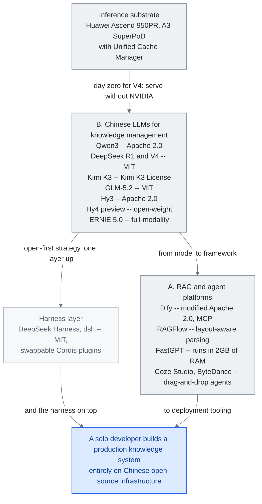

<!-- translation-sync:start -->
> 2026-10-31 영문판과 동기화한 기계 보조 번역입니다. 구조와 내용을 검토했습니다. 코드와 도표 라벨은 원문을 유지하며 읽기 시간은 영어 원문 기준 추정치입니다.
> [English source](../../../chapters/09-china-ecosystem.md) · [Sync record](../../SYNC.md)
<!-- translation-sync:end -->

<!-- i18n-anchor -->

# 9장: 중국 AI 지식 엔지니어링 풍경

> **한 문장으로:** 중국은 자체 오픈소스 플랫폼, 모델, 커뮤니티를 가진 평행 AI 생태계를 만들었다 ——종종 서양과 다른 방향으로 혁신한다.
>
> **왜 중요한가:** 세계 AI 연구자의 절반이 중국에 있다. 이 생태계를 무시하는 것은 혁신의 절반을 놓치는 것을 의미한다.
>
> **읽기 시간:** 약 27분 (6,092단어 / 분당 230단어)

*그림: A절과 B절의 스택을 위에서 아래로 읽는다. 중국 모델 계열 아래의 자국 추론 칩에서 출발해 두 병렬 갈래, 즉 그 위에 출시된 하네스와 기업이 실제 배포하는 시각 중심 플랫폼으로 이어진다. C절이 "Open-Source as Strategic Imperative"라 부르는 전략이 라이선스이므로 노드 라벨에 라이선스를 적었다. 핵심 연결선은 둘이다. 첫날 Ascend 적응은 "train without NVIDIA"가 아닌 "serve without NVIDIA"라는 주장을 만들고, 아래의 두 연결선은 두 갈래가 중국 오픈소스 인프라로 처음부터 끝까지 만든 실서비스 지식 시스템에서 합류함을 보여 준다.*

중국 생태계를 살피지 않으면 LLM 지식 엔지니어링의 세계적 논의는 불완전하다. December 2025까지 규제 기관에 등록된 AI 서비스가 748개를 넘는 중국은 대규모 언어 모델로 지식 시스템을 만드는 데 병행하면서도 일부는 다른 길을 발전시켰다. 이 장은 중국 개발자와 기업의 지식 엔지니어링 접근을 형성하는 주요 플랫폼, 모델, 문화적 차이를 정리한다.

<!-- i18n-anchor -->

## A. 오픈소스 RAG와 에이전트 플랫폼

중국의 오픈소스 AI 생태계는 GitHub 인기에서 서양 대응물에 필적하거나 능가하는 여러 플랫폼을 산출했다. 이 프로젝트들을 구분 짓는 것은 시각 워크플로우, 엔터프라이즈 배포 준비성, 깊은 문서 이해에 대한 강조이다 ——중국 엔터프라이즈 고객의 실용적 수요를 반영한다.

<!-- i18n-anchor -->

### Dify (136K+ GitHub 스타)

[Dify](https://github.com/langgenius/dify)는 세계에서 GitHub 별이 가장 많은 에이전트 AI 플랫폼이다. RAG 파이프라인, 에이전트 작업 흐름, 다단계 추론 사슬을 만드는 시각적 캔버스를 제공한다. 1.0부터 MCP(Model Context Protocol)를 지원해 외부 도구 서버와 원활하게 통합한다. 시각적으로 흐름을 설계하는 노코드 사용자와 프로그래밍 제어가 필요한 개발자 사이의 간극을 메우는 것이 강점이다. 기업 사용자는 전체 스택을 자체 호스팅할 수 있다. 데이터 주권 요건이 클라우드 전용 해법을 막는 경우가 많은 중국 시장에서 중요하다.

Dify 라이선스는 **수정된 Apache 2.0**이며 다중 테넌트 운영과 프런트엔드 로고/저작권 변경에 추가 조건을 둔다. 자체 호스팅이 가능하다고 SaaS 재배포에 제한이 없는 것은 아니다. 배포 팀은 용도에 맞는 실제 라이선스를 확인해야 한다. 이는 이 장의 공개 인프라 논지에 플랫폼 계층에서 조건을 더한다.

<!-- i18n-anchor -->

### RAGFlow (62-75K+ GitHub 스타)

[RAGFlow](https://github.com/infiniflow/ragflow)는 깊은 문서 이해를 통해 자신을 차별화한다. 문서를 평면 텍스트로 다루는 대신, RAGFlow는 스캔된 PDF, 스프레드시트, 슬라이드 덱을 포함하여 20개 이상의 파일 형식에 걸쳐 레이아웃 인식 파싱, OCR, 테이블 추출을 적용한다. 그것의 "agentic RAG" 접근은 시스템이 쿼리 유형에 따라 어떤 검색 전략을 적용할지 자율적으로 결정할 수 있음을 의미한다. 레거시 문서 아카이브 ——중국 국유 기업과 제조 회사에서 흔한 시나리오 —— 를 다루는 기업에게, 이 능력은 있으면 좋은 것이 아니라 요구사항이다.

<!-- i18n-anchor -->

### FastGPT (27K+ GitHub 스타)

[FastGPT](https://github.com/labring/FastGPT)는 자원 효율성에 초점을 두고 엔터프라이즈 지식 베이스 Q&A를 겨냥한다. 그것의 QA 쌍 추출 파이프라인은 자동으로 문서를 질문-답 쌍으로 변환하며, 그 다음 검색과 fine-tuning 모두에 사용될 수 있다. 플랫폼은 RAM 2GB 정도로 적은 머신에서 실행되도록 설계되어, 전용 GPU 인프라를 감당할 수 없는 중소 기업에 접근 가능하게 한다. 이 검약은 중국 생태계의 더 넓은 패턴을 반영한다: 제약 아래에서의 최적화.

<!-- i18n-anchor -->

### MaxKB (18K+ GitHub 스타)

[MaxKB](https://github.com/1Panel-dev/MaxKB)는 원클릭 배포를 가진 엔터프라이즈 에이전트 플랫폼으로 자신을 자리매김한다. 도구 통합을 위한 MCP를 지원하고 흔한 엔터프라이즈 시나리오 ——고객 서비스, 내부 지식 검색, 문서 요약 —— 를 위한 사전 만들어진 템플릿을 제공한다. 그것의 매력은 "we want an AI assistant"에서 "we have one running"까지의 시간을 몇 주에서 몇 시간으로 줄이는 데 있다.

<!-- i18n-anchor -->

### Coze Studio (15K+ GitHub 스타, ByteDance)

[Coze Studio](https://github.com/coze-dev/coze-studio)는 ByteDance의 오픈소스 시각적 에이전트 개발 플랫폼이다. 원래 비공개 제품이었지만 July 2025에 공개해 사흘 만에 GitHub 별 10,000개를 모았다. 억눌린 수요와 ByteDance의 배포력을 모두 보여 준다. 내장 메모리, 도구 사용, 다중 턴 대화 관리를 갖춘 에이전트를 드래그 앤드 드롭으로 만들 수 있다. ByteDance의 Doubao 모델 계열과 통합돼 중국어 과제에 기본적인 이점이 있다.

이 독립 제품 관점은 접히고 있다. 36kr는 **August 24, 2026**에 ByteDance가 TRAE 코딩 플랫폼과 Coze를 Doubao 챗봇의 사무 도구 조직에 넣는 내부 합병을 마쳤다고 보도했다. TRAE IDE와 CLI는 독립 제품으로 남지만, TRAE Work와 Coze는 Doubao 사무 기능과 함께 출시 예정 단일 브랜드 "Doubao Work."로 합쳐진다. 같은 기사는 앱이 "as soon as this week" 출시될 수 있다고 전하지만 ByteDance 자체 답변은 조직 개편만 다뤘으므로 날짜는 회사 확인이 아닌 보도다. IDE와 에이전트 구축 도구를 소비자 채팅 제품과 분리하는 서구 관행과 반대다. 개발자 도구가 슈퍼앱 주변을 도는 대신 그 안으로 흡수된다.

<!-- i18n-anchor -->

### DB-GPT (17K+ GitHub 스타)

[DB-GPT](https://github.com/eosphoros-ai/DB-GPT)는 AI 네이티브 데이터 상호작용을 전문으로 한다. 그것의 핵심 능력은 자연어 SQL 변환이며, 비기술 사용자가 데이터베이스를 대화적으로 쿼리할 수 있게 한다. 그것은 시각화 생성과 다중 에이전트 데이터 분석 파이프라인으로 이를 확장한다. 큰 구조화된 데이터셋 위에 앉아 있는 기업 ——금융, 물류, 제조의 대부분의 중국 회사를 기술 —— 에게 DB-GPT는 AI 강화 분석에 접근 가능한 진입점을 제공한다.

<!-- i18n-anchor -->

## B. 지식 관리를 위한 중국 LLM

중국의 기반 모델 풍경은 빠르게 성숙했으며, 여러 모델이 이제 특정 벤치마크에서 서양 대응물과 경쟁적이거나 우월하다.

### Qwen3 (Alibaba Cloud)

Qwen3는 Alibaba의 주력 모델 계열이다. 가장 큰 변형은 Apache 2.0으로 출시된 매개변수 235십억의 전문가 혼합(MoE) 모델이다. 코딩 특화 Qwen3-Coder-480B는 256K에서 1M 토큰까지 지원한다. Apache 2.0은 제한 없는 상업적 사용을 허용해 독점 API 비용을 감당하기 어려운 중국 스타트업의 도입을 이끌었다는 전략적 의미가 있다. Qwen의 다국어 역량은 서구 모델이 역사적으로 약했던 중국어, 일본어, 한국어에서 특히 강하다.

### Qwen-Scope (Alibaba, May 2026)

Alibaba Qwen 팀은 가중치에서 해석 가능성 도구로 같은 공개 기조를 확장했다. **Qwen-Scope**(**May 12, 2026** arXiv 사전 논문 제출)는 **Qwen3와 Qwen3.5의 일곱 변형**에서 학습한 **희소 오토인코더 14개 그룹**의 공개 모음이다. 밀집형과 MoE를 포함하고 **매개변수 1.7B에서 35B**(Qwen3-1.7B부터 Qwen3.5-35B-A3B)를 아우르며, SAE 폭과 희소성은 총특징 수 대신 기반 모델별 표로 제시한다. 연구 산출물과 다른 점은 패키징이다. 논문은 SAE 특징을 네 방향의 개발 도구로 제시한다. 프롬프트 엔지니어링 없이 내부 특징을 조작하는 추론 시 조향, 활성 특징으로 벤치마크 중복과 역량 범위를 대리 측정하는 평가 분석, 데이터 분류와 정리, 지도 미세 조정과 RL을 위한 사후 학습 지원이다. 이 장에 중요한 것은 출처다. 최첨단 공개 가중치 계열의 해석 가능성 인프라를 그 모델을 학습한 연구소가 공개한 것은, 중국 생태계가 흔히 소비자로 묘사되는 연구 축에 기여한 사례다. 도구 자체가 산출물이므로 아래 mHC 같은 아키텍처 결과 주장과도 다르다.

### DeepSeek R1

DeepSeek R1은 MIT 라이선스로 출시되며 수학·과학 추론 벤치마크에서 OpenAI o1과 동등한 성과를 냈다. 자주 함께 언급되는 $6백만 미만 수치는 R1이 아닌 **DeepSeek-V3**의 것이다. 기술 보고서는 H800 GPU 시간당 $2를 가정해 공식 학습을 **$5.576백만**으로 추정하며, 이전 연구와 제거 실험은 제외한다. 공급업체 추정치이지 R1 전체 개발 예산이 아니다. R1의 아키텍처적 의미는 최첨단 추론을 공개 가중치로 제공한 데 있다.

April 2026 DeepSeek는 Transformer++식 모델의 잔차 연결을 일반화한 **다양체 제약 하이퍼 연결(mHC)**로 아키텍처 기여를 더했다. 표준 잔차 흐름이 층 사이로 정보 채널 하나를 전달한다면 mHC는 각각 학습된 저차원 다양체에 제한되는 **여러 내부 흐름**을 전달한다. 규모가 커질 때 단순 다중 잔차 흐름에 생기는 차원 붕괴 없이 이후 층이 초기 표현에 더 풍부하게 접근하도록 설계됐다. DeepSeek 블로그는 비슷한 매개변수 수에서 장기 추론 벤치마크 향상을 보고하며, 많은 중간 층을 건너 정보를 전달해야 하는 과제에서 개선이 가장 크다고 한다. April 2026 기준 결과는 **독립적 재현을 기다리는 것으로 표시**해야 한다. 단일 연구소의 자체 모델 공개이며, 제삼자 재현을 견디지 못한 아키텍처 주장으로 이 분야가 이미 손해를 본 바 있다. 결과가 유지된다면 mHC는 MoE, MLA, DeepSeek의 이전 다중 토큰 예측 연구와 함께 중국 공개 가중치 생태계에서 시작해 주류로 확산된 세 번째 또는 네 번째 아키텍처 기본 기능이 된다.

### DeepSeek V4 (April 2026)

DeepSeek **V4 미리보기**(April 24, 2026)는 R1의 이야기를 경제성, 역량, **추론 기반**이라는 세 축에서 동시에 확장한다. Hugging Face에 MIT 라이선스의 두 공개 가중치 MoE 모델을 제공한다. **V4-Pro는 매개변수 1.6 trillion / 활성 49B**, **V4-Flash는 284B / 활성 13B**이며, 1백만 토큰 컨텍스트 창을 별도 등급이 아닌 기본값으로 제공한다. API 요금은 2026 최첨단급 모델 중 가장 공격적이다. **V4-Flash는 출력 백만 토큰당 $0.28**, V4-Pro는 $3.48이다. 하드웨어 최적화뿐 아니라 아키텍처 변경으로 V3 대비 **토큰당 추론 FLOPs 73% 감소**를 반영한다. R1이 처음 신뢰를 얻은 코딩 벤치마크에서 V4-Pro는 **LiveCodeBench 93.5%**(Gemini 3.1 Pro 91.7%, Claude Opus 4.6 88.8%보다 높음), **Codeforces 3206**(GPT-5.4 3168 추월)으로 선두에 오른다.

그러나 이 장에서 가장 중요한 구조적 세부는 가격이나 벤치마크가 아닌 **추론 기반**이다. V4 학습에는 NVIDIA A100과 H20이 포함된 혼합 클러스터가 쓰였다. NVIDIA 스택 밖에서만 최첨단 *학습*을 할 수 있는지는 여전히 어려운 질문이다. 반면 모델은 **공개 첫날 Huawei Ascend 950PR에 적응**됐으며 DeepSeek와 Huawei는 실서비스에서 모델을 제공하는 Ascend NPU와 NVIDIA GPU 사이의 동등한 추론, 이 아키텍처에서 NVIDIA H20 대비 약 **2.8x 연산 처리량**을 공동 보고했다. 이는 "we trained without NVIDIA"가 아닌 **"we serve without NVIDIA."**라는 더 미묘한 자국 칩 논지다. 미국 수출 통제에 직면한 중국 기업에게 V4는 최첨단 공개 가중치 모델이 첫날부터 신뢰할 만한 자국 칩 서비스 경로를 갖춰 출시된 최초 사례다. 이 장이 설명한 배포 중심 생태계에서는 학습 선택지보다 이것이 핵심 제약에 가깝다. R1의 January 2025 전환과 함께 보면 V4는 일 년의 흐름을 완성한다. 중국 공개 가중치 생태계는 최첨단 코딩 모델**과** 서비스 기반을 같은 날 내놓을 수 있다.

**June 29-30, 2026** DeepSeek는 이 V4 미리보기가 전 모델 1M 컨텍스트로 **mid-July 2026 공식 출시**된다고 발표했다. 구조적인 가격 변경도 함께다. 베이징 시간 **혼잡 시간대 API 가격**(9:00-12:00, 14:00-18:00)은 **비혼잡 시간대의 2x**이며 비혼잡 기준은 유지된다(V4-Pro 캐시 미적중 입력 백만 토큰당 $0.435, 출력 $0.87; V4-Flash $0.14 / $0.28). 최첨단 공개 가중치 추론 API의 수요 반응형 시간대 가격은 *가격을 일정 관리 기본 기능으로 바꾼다*. 배치 에이전트 작업을 비혼잡 시간대로 옮겨 비용을 절반으로 줄일 수 있다. 클라우드 현물 시장이 연산에 십 년간 제공했던 수단과 같다.

<!-- i18n-anchor -->

### 통신사 규모의 자국 칩 (Huawei + China Mobile, June 2026)

"serve without NVIDIA" 논지는 June에 처음 통신 업계 검증을 얻었다. MWC Shanghai(June 24, 2026)에서 **Huawei와 China Mobile Hubei**는 Huawei **AI Inference Acceleration Solution**의 중국 최초 실제 네트워크 검증을 수행했다. **Ascend A3 SuperPoD**, **OceanStor A800** 저장소, 페타바이트급 KV 캐시를 관리하는 **Unified Cache Manager (UCM)**를 결합했다. *실제 통신사 상용 네트워크에서 모의 8K-190K 토큰 긴 컨텍스트 부하로 검증*했으며 실제 통신 트래픽은 아니다. GLM-5.1의 첫 토큰까지 시간을 **51-93%** 줄이고, 시퀀스 길이 128K에서 처리량을 최대 **+372%** 높였다. 모델 출시 당시 DeepSeek가 보인 자국 칩 서비스 경로가 이제 인프라 공급업체와 통신사의 별도 실서비스 규모 시연을 얻었다. 지식 엔지니어링에서는 KV 캐시 관리 계층(3장)이 자국 칩 경제성의 승패를 가르는 전장이 된다는 의미다.

같은 논지 뒤에 훨씬 큰 투자가 형성될 수 있지만 아무것도 확정되지는 않았다. Bloomberg는 **September 4, 2026** 관계자를 인용해 DeepSeek가 내몽골 우란차부의 약 1GW 데이터센터에 **Huawei Ascend 950DT 가속기 최소 160,000개**를 배치하고 late 2027 또는 early 2028 일부 가동을 목표로 한다고 보도했다. 칩은 추론에 쓰고 학습은 기존 NVIDIA 하드웨어에서 유지할 예정으로, V4의 모델 규모 "serve without NVIDIA, train with it" 분리를 시설 규모에 제안한 것이다. 공급에는 일 년 이상 걸릴 수 있다. 메모리 부품 공급 때문에 Huawei 950DT의 2026 전체 생산량이 수십만 개 초반으로 제한된다고 보도됐다. DeepSeek와 Huawei 어느 쪽도 주문을 확인하지 않았으며 익명 취재원에 의존하는 보도이므로 배포된 용량이 아닌 전해진 의도로 기록한다.

<!-- i18n-anchor -->

### DeepSeek Harness (dsh) --- 오픈소스 에이전트 하네스 (August 2026)

**August 13, 2026** DeepSeek는 **DeepSeek Harness (dsh)**를 MIT 라이선스 개발자 미리보기로 출시했다(github.com/deepseek-ai/deepseek-harness). 동반 백서 "A Programming Paradigm for Spatiotemporal Composability"에서 설명한 **"Cordis" 플러그인 패러다임**을 따른다. 모델 어댑터, 도구 레지스트리, 세션 로그, 샌드박스, 저장소, 일정 루프, UI 계층은 실행 환경에 고정 연결된 구성 요소가 아닌 교체 가능한 플러그인이다. 추가 전용 세션 로그는 시스템 프롬프트, 추론 기록, 도구 호출과 결과, 하위 에이전트 일정 결정 등 모든 컨텍스트 주입을 기록한다. 자체 일정 루프 안에서 Claude Code나 Codex를 일회성 하위 에이전트로 호출하는 것은 언론 주장이 아닌 직접 제공 기능이다. 저장소의 `@deepseek-ai/dsh-subagent-claude-code`와 `@deepseek-ai/dsh-subagent-codex` 패키지가 공식 Claude Agent SDK와 Codex `app-server`를 호출하며, 저장소 자체 August 4, 2026 설계 노트에 따라 구현됐다. 언론은 그 코드에서 기능을 확인했다. 성장도 빠르다. 출시 11일 안에 별 190,630개와 포크 21,319개, 그로부터 세 주 뒤 별 224,004개와 포크 26,637개였다(각각 August 24와 September 15, 2026 GitHub API로 검증; 이후 인용 시 값이 바뀌므로 다시 확인). 언론은 이를 개발 도구에서 기록된 가장 빠른 도입 곡선 중 하나라고 정성적으로 설명했다.

### Kimi K2.5 (Moonshot AI)

Kimi K2.5는 단일 질의에서 최대 100개 하위 에이전트를 띄워 약 1,500회의 도구 호출로 조정하는 "Agent Swarm"을 도입했다. 연구 시연이 아닌 실서비스 기능이며, 수십 에이전트가 동시에 웹 검색, 문서 분석, 종합을 병렬 수행하는 복잡한 연구 과제에 쓰인다. 앞서 Kimi는 약 March 2025에 중국어 2백만 자 컨텍스트 창을 제공해 중국어 텍스트 특화 모델 중 가장 긴 컨텍스트를 갖췄다.

### Kimi K3 (Moonshot AI, July 2026)

**July 17, 2026** Moonshot은 **Kimi K3**를 출시했다. **매개변수 2.8 trillion**(MoE)으로 역대 최대 공개 가중치 모델이며 1M 토큰 컨텍스트와 기본 시각 기능을 갖췄다. 공개 가중치 모델로 Arena 프런트엔드 코딩 순위 선두에 올랐고, Artificial Analysis Intelligence Index에서 Fable 5와 GPT-5.6 Sol 구성 다음으로 189개 중 4위(57점)다. 전체 가중치는 **July 27**에 자체 **Kimi K3 License**로 뒤따랐다. Moonshot 자체 표현은 "open weight,"이며 "open source,"가 아니고, 일정 매출 이상 상업적 사용에는 별도 계약이 필요하다. Qwen Apache 2.0과 비공개 출시 사이의 길이다. Fortune은 시장에 대한 "new DeepSeek shock"으로 묘사했다. 상하이 WAIC 2026 개막과 같은 주라는 시점도 생태계 July 흐름의 중심으로 만들었다. 실무적 주의점은 매개변수 2.8T인 K3는 서버급 전용이므로 공개 가중치 최전선을 대규모 방향으로 넓힐 뿐 로컬 배포 상황은 바꾸지 않는다는 것이다.

### ERNIE 5.0 (Baidu)

ERNIE 5.0은 텍스트, 이미지, 음성, 영상 이해와 생성을 단일 모델에서 기본 지원하는 Baidu의 매개변수 2.4 trillion 모델이다. January 2026에 출시됐으며, 지식 시스템의 미래가 텍스트 모델에 나중에 붙인 멀티모달이 아니라 처음부터 멀티모달이라는 Baidu의 판단을 보여 준다.

### GLM-4.5/5 (Zhipu AI)

Zhipu AI의 GLM 계열은 매개변수 744 billion MoE GLM-5에 이르며 에이전트 하네스를 위해 설계됐다. 기본 도구 사용 토큰과 구조화 출력 보장으로 신뢰할 수 있는 에이전트의 보조 코드를 줄인다. 이 "agent-native" 설계는 실서비스 파이프라인 통합에서 프롬프트 엔지니어링과 재시도를 줄인다는 뜻이다. **June 13, 2026** Zhipu는 **GLM-5.2**(Hugging Face MIT 라이선스)를 출시했다. 네 희소 어텐션 층마다 같은 인덱서를 재사용하는 **IndexShare**로 **전체 1M 컨텍스트에서 토큰당 FLOPs를 2.9x** 줄이고, 개선된 다중 토큰 예측 층으로 추측 디코딩의 수락 길이를 **최대 20%** 높인다. Hugging Face 카드에 따르면 GLM-5.2는 HLE 40.5(도구 포함 54.7), SWE-Bench Pro 62.1, AIME 2026 99.2다.

### Hunyuan 3.0 / Hy3 (Tencent, July 2026)

**July 6, 2026** Tencent는 256K 컨텍스트의 전체 **Hunyuan 3.0 ("Hy3")**를 공개했다. **매개변수 295B MoE**(활성 21B, 전문가 192개와 상위 8 라우팅, 3.8B 다중 토큰 예측 층)다. 더 중요한 것은 April 2026 제한 미리보기 라이선스에서 **제한 없는 Apache 2.0**으로 옮겨 EU, 영국, 한국의 지리적 제외를 없앤 점이다. Tencent 모델 카드는 미리보기 대비 환각률 **12.5%에서 5.4%**, 전문가 블라인드 평가 **2.67/4 대 GLM-4 2.51/4**를 보고한다. 아래의 "open-source as strategic imperative" 논의와 같은 해석이다. Hy3는 마지막 주요 비공개 중국 최첨단 연구소가 *완전히 제한 없는 공개 가중치*를 기본으로 삼으며 공급업체 간 수렴을 완성하고, 공개 가중치를 도전자 전술이 아닌 생태계 기본값으로 만든다.

Tencent는 **August 28, 2026**에 공개 가중치 **Hy4 미리보기**로 흐름을 이었다. **전체 매개변수 770B, 활성 49B**, 1M+ 컨텍스트이며 Tencent Cloud TokenHub와 OpenRouter로 제공된다. 버전 변경 기준으로 새 기본 기능보다 Hy3의 확장이지만 예외 하나는 기록할 만하다. Tencent는 Hy4가 "participating for the first time in the automated optimization of training methods, data strategies, evaluation frameworks, and low-level operators,"로 자체 개발에 기여했고 추론 병목을 자율 조정해 **처리량 31.8% 향상**을 냈다고 한다. 자신의 학습, 데이터, 평가, 연산자 파이프라인을 조정하는 모델은 벤치마크 점수와 다른 종류의 자기 개선 주장으로 13장의 루프 엔지니어링과 같은 영역이다. Tencent 자체 블라인드 평가(전문가 163명, 엔지니어링 과제 203개)는 Hy4 **2.99/4.00**, GLM-5.3 2.92, Kimi K3 2.94다. 모든 수치, 특히 자기 최적화 주장은 Tencent 자체 것이며 DeepSeek mHC와 같은 주의를 붙인다. 단일 연구소의 자체 모델 공개로 독립적 재현을 기다린다.

<!-- i18n-anchor -->

## C. 서양 생태계와의 핵심 차이

중국 지식 엔지니어링 풍경을 이해하는 것은 도구와 모델을 카탈로그하는 것 이상을 요구한다. 생태계는 첫날부터 아키텍처 결정을 형성하는 근본적으로 다른 제약과 인센티브 아래에서 운영된다.

<!-- i18n-anchor -->

### 도구 선호: 시각 우선 vs. 코드 우선

가장 인기 있는 중국 플랫폼들 ——Dify, Coze Studio, FastGPT —— 은 시각 우선이다. 사용자는 캔버스에 노드를 드래그함으로써 지식 파이프라인을 만든다. 대조적으로, 서양 생태계의 지배적 프레임워크 (LangChain, LlamaIndex, Haystack)는 코드 우선이며, 시각 도구는 부차적 추가이다. 이 분기는 다른 사용자 인구를 반영한다: 중국의 AI 채택은 Python을 쓰지 않을 수 있는 엔터프라이즈 IT 부서와 "citizen developers"에 의해 크게 추진되며, 서양 초기 채택자들은 코드에 편안한 소프트웨어 엔지니어인 경향이 있다.

<!-- i18n-anchor -->

### 배포: 온프레미스 vs. API 우선

중국에서는 온프레미스 배포가 지배한다. 이는 두 강화하는 요인에 의해 추진된다: 데이터 주권을 위한 규제 요구사항 (특히 금융, 의료, 정부)과 대규모 클라우드 GPU 접근을 더 비싸게 만드는 미국 칩 수출 통제로부터의 실용적 제약. 결과는 중국 플랫폼이 양자화, 증류, 효율성에 크게 투자한다는 것이다 ——무제한 클라우드 컴퓨트를 가정하는 대신 모델이 가용 하드웨어에서 잘 실행되게 만든다. 대조적으로 서양 플랫폼은 모델이 제공자의 인프라에서 실행되는 API 우선 아키텍처를 기본으로 한다.

<!-- i18n-anchor -->

### 규제 아키텍처

December 2025까지 생성형 AI 관리 조치에 따라 AI 서비스 748개가 중국 규제 기관에 등록됐다. 준수는 선택이나 희망 사항이 아니라 설계 단계부터 기술 아키텍처를 형성한다. 콘텐츠 필터링, 감사 로그, 사용자 신원 확인은 출시 직전 부착물이 아닌 플랫폼 핵심 기능이다. 역설적으로 모두 같은 준수 요건을 구현해야 하므로 이를 쉽게 하는 플랫폼이 이기는 압력이 더 표준화된 아키텍처를 낳았다.

**April 10, 2026** 발표, **July 15** 시행인 **인간 모방 AI 상호작용 서비스 임시 조치**는 일반 에이전트 규제보다 좁은 경계를 정한다. 2조는 인간 특성을 모사하는 지속적인 감정 상호작용을 대상으로 하고, 그런 상호작용이 없는 지식 질의응답과 업무 보조 등은 명시적으로 제외한다. 해당 서비스에는 16조의 상호작용 데이터 복사/삭제 선택지와 19조의 접근하기 쉬운 종료 수단이 필요하다. 따라서 지속적인 동반자 메모리는 일반 기업 지식 어시스턴트와 준수 경계가 다르다. 후자는 다른 적용 규정의 대상이다.

July 2026에는 국제적 층위도 더해졌다. **World AI Conference (WAIC) 2026**과 세계 AI 거버넌스 고위급 회의가 July 17-20 상하이에서 열려 100개국 이상이 참여하고 Guterres 유엔 사무총장이 참석했다. AI 전담 최초의 정부 간 국제기구 **World Artificial Intelligence Cooperation Organization (WAICO)** 설립 협정이 체결됐으며 본부는 상하이다. 앞으로 운영상 무엇이 되든, 설립은 이 절의 패턴을 국내 등록 체계에서 중국에 본부를 둔 국제 제도 구축으로 확장한다.

<!-- i18n-anchor -->

### 커뮤니티와 지식 공유

중국 개발자 커뮤니티는 근본적으로 다른 플랫폼에서 활동한다. 실시간 논의는 Slack이나 Discord 대신 WeChat 그룹이 중심이다. 긴 기술 질의응답에서는 Zhihu가 Stack Overflow 역할을 하고 CSDN(China Software Developer Network)에 튜토리얼과 블로그가 올라온다. 코드는 GitHub를 쓰지만 논의는 다른 곳에서 한다. 이 파편화 때문에 서구 개발자가 중국 도구의 도움을 GitHub Issues나 Discord에서 찾으면 영어 지원이 드문 반면, 중국어 커뮤니티는 활발하지만 비중국어 사용자에게 보이지 않을 뿐이다.

<!-- i18n-anchor -->

### 제약을 통한 혁신

미국 칩 수출 통제는 예상 밖의 혁신 역학을 만들었다. 단순히 연산 규모를 키울 수 없는 중국 AI 연구소는 알고리즘 효율에 더 많이 투자했다. 앞서 설명한 회계 범위 안의 DeepSeek-V3 공식 학습 비용 보고가 이를 보여 준다. 패턴은 더 나은 추론 최적화의 작은 모델, 적극적인 양자화, FLOP당 역량을 최대화하는 아키텍처로 생태계 전반에 이어진다. 연산 자원이 더 많은 서구 생태계는 규모로 혁신하는 경향이 있다. 둘 다 최첨단 성과를 내지만 경로가 다르다.

<!-- i18n-anchor -->

### 전략적 책무로서의 오픈소스

중국 오픈웨이트 모델 릴리스는 이제 양에서 서양을 능가한다. 이는 이타심이 아니다 ——전략이다. 오픈소스화는 생태계 종속을 만들고 (개발자가 당신의 모델 위에 짓는다), 인재를 끌어들이고 (연구자들이 사람들이 사용하는 모델에서 일하기 원한다), 글로벌 개발자 커뮤니티에 외교적 호의를 만든다. Alibaba의 Qwen에 대한 Apache 2.0 라이선스, DeepSeek의 MIT 라이선스, ByteDance의 Coze Studio 오픈소스화 모두 이 패턴을 따른다. 결과는 세계 어디든 단독 개발자가 이제 모델에서 프레임워크에서 배포 도구까지 완전히 중국 오픈소스 인프라 위에 운영 지식 시스템을 만들 수 있다는 것이다.

이 논리는 가중치에서 그 위의 하네스로 한 계층 더 올라간다. 위의 DeepSeek Harness(dsh)는 같은 공개 우선 전략을 모델이 아닌 에이전트 실행 환경 자체에 적용한다. 며칠 뒤 태평양 건너 OpenAI도 모델은 독점적으로 유지하면서 Codex 실행 엔진(4장)을 Apache 2.0으로 공개했다. 전략적 목적은 달라도 양쪽에서 며칠 차이로 하네스 계층이 오픈소스가 됐다는 시점이 요점을 분명히 한다.

이 전략이 작동한다는 가장 명확한 사용 측 증거는 **July 29, 2026**에 나왔다. 중국 모델이 처음으로 OpenRouter 세계 주간 토큰 사용 순위 상위 다섯을 모두 차지했다. Xiaomi MiMo-V2.5 다음으로 DeepSeek, MiniMax, Alibaba Qwen, Moonshot Kimi가 뒤따랐으며 당시 라우터는 주당 20 trillion 토큰 이상을 처리했다. 그 주의 분석은 중국 모델이 트래픽 **60%** 이상이라고 추정했다. 선두는 September까지 유지됐다. early September 2026 별도 보도는 중국 연구소 **46.4%**, 미국 모델 **35.7%**로 집계했다. 두 비율은 추세선이 아닌 별도 수치로 읽어야 한다. "Chinese-origin"과 토큰 모집단을 다르게 정의한 이차 분석이며 어느 쪽도 다른 것의 수정값으로 발표하지 않았다. OpenRouter 순위는 과거 기록을 공개하지 않는 실시간 이동 화면이므로 두 수치 모두 인용 가능한 일차 시계열이 아닌 당시 스냅샷의 이차 보도에 의존한다.

<!-- i18n-anchor -->

### 증류 분쟁

이 전략적 해석에는 September 2026 적대적 대응도 생겼다. **September 10, 2026** Anthropic은 "Detecting and countering misuse of AI: September 2026," 위협 정보 보고서를 발표했다. December 2025부터 August 2026까지 저지했다고 주장하는 일곱 피해 영역 중 하나가 불법 증류다. Anthropic은 Moonshot AI가 **사기로 표시한 계정 5,380개**를 통해 일부 Kimi 고객 요청을 Claude로 보내고, 열흘간 **약 300,000개 요청**을 중계하며, Claude 답을 Kimi 출력으로 반환한 뒤 학습 데이터로 보존했다고 주장한다. May부터 July 2026에 Moonshot의 **Claude 교환 23백만 회 이상**을 귀속시킨다. 가장 큰 수치는 다른 연구소로, 같은 May-July 기간 **Alibaba**에 "over 151 million exchanges observed"를 기록해 Moonshot 총계의 약 여섯 배 반이다. 같은 절은 **DeepSeek, Z.ai(Zhipu), Xiaomi, MiniMax, SenseTime**도 거론하며 DeepSeek가 세션 간 재생으로 Claude 추론 기록을 추출했다고 설명한다.

한 가지 유보가 증거의 무게를 결정한다. 위 수치는 모두 명명된 연구소의 상업적 경쟁자가 발표한 **Anthropic의 주장**이며 제삼자의 판단을 거치지 않았다. 이 장은 실제로 발생했는지가 아니라 무엇을 주장했는지 기록한다. 수치는 보고서 자체의 증류 절에서 읽었다. 누구의 설명이 맞든 분쟁이 확립하는 것은 "the weights are open"과 "how the model behind them was trained"가 별개 질문이라는 점이다. 위의 생태계 종속 논리는 학습 출처에 답하지 않으며, 이제 출처가 두 최첨단 생태계의 공개 논쟁 축이다.

<!-- i18n-anchor -->

## D. Bilibili 콘텐츠에 관한 노트

Bilibili (B站)는 큰 양의 AI 튜토리얼을 호스팅하지만, 실무자들은 많은 것이 영어 YouTube 콘텐츠의 재업로드나 번역임을 알아야 한다. Bilibili의 AI 콘텐츠의 원래 가치는 중국 특정 도구 튜토리얼에 있다: 단계별 Dify 배포 가이드, Qwen 통합 워크스루, 영어로 존재하지 않는 엔터프라이즈 배포 사례 연구. Bilibili에서 연구할 때, 항상 콘텐츠를 그것의 원래 출처로 추적하라. 튜토리얼이 중국어로 더빙된 영어 내레이션을 가진 LangChain을 시연한다면, 원본 YouTube 버전이 더 최신일 가능성이 높다.

---

<!-- i18n-anchor -->

## 기억할 세 가지

- **공개 가중치는 이타심이 아닌 전략이다.** Qwen의 Apache 2.0, DeepSeek의 MIT, ByteDance의 Coze Studio 공개는 생태계 종속, 인재, 호감을 얻는다. 함께 쓰면 누구나 처음부터 끝까지 중국 인프라로 실서비스 시스템을 만들 수 있다.
- **자국 칩은 학습이 아닌 서비스 제공 주장이다.** V4는 NVIDIA 혼합 클러스터로 학습했지만 첫날 Huawei Ascend 950PR에 적응됐다. 별도의 June 2026 Huawei·China Mobile 시연은 실제 통신망의 모의 긴 컨텍스트 부하에서 GLM-5.1 첫 토큰 시간을 51-93% 줄였다.
- **이제 출처가 논쟁 축이다.** Anthropic의 September 2026 불법 증류 주장에서는 누구의 말이 맞든 "the weights are open"과 "how the model behind them was trained"가 별개 질문임이 드러난다.

---

## Sources

- Dify GitHub Repository: [https://github.com/langgenius/dify](https://github.com/langgenius/dify)
- Dify. 라이선스(October 31, 2026 열람). [https://raw.githubusercontent.com/langgenius/dify/main/LICENSE](https://raw.githubusercontent.com/langgenius/dify/main/LICENSE) -- 다중 테넌트 및 프런트엔드 추가 조건을 둔 수정 Apache 2.0.
- DeepSeek-AI. "DeepSeek-V3 Technical Report" (December 27, 2024; February 18, 2025 개정), 서론과 표 1. [https://arxiv.org/html/2412.19437v2](https://arxiv.org/html/2412.19437v2) -- 공식 학습 추정 $5.576M; 이전 연구와 제거 실험 제외. R1 전체 개발 비용이 아니다.
- 중국 국가인터넷정보판공실 및 다른 네 기관. "Interim Measures for Anthropomorphic AI Interaction Services" (April 10, 2026; July 15, 2026 시행), 2, 16, 19조. [https://www.cac.gov.cn/2026-04/10/c_1777558395078289.htm](https://www.cac.gov.cn/2026-04/10/c_1777558395078289.htm) -- 지속적 감정 상호작용이 범위이며, 그런 상호작용이 없는 다른 서비스는 제외.
- RAGFlow GitHub Repository: [https://github.com/infiniflow/ragflow](https://github.com/infiniflow/ragflow)
- FastGPT GitHub Repository: [https://github.com/labring/FastGPT](https://github.com/labring/FastGPT)
- MaxKB GitHub Repository: [https://github.com/1Panel-dev/MaxKB](https://github.com/1Panel-dev/MaxKB)
- Coze Studio GitHub Repository: [https://github.com/coze-dev/coze-studio](https://github.com/coze-dev/coze-studio)
- DB-GPT GitHub Repository: [https://github.com/eosphoros-ai/DB-GPT](https://github.com/eosphoros-ai/DB-GPT)
- Qwen3 기술 보고서와 모델 카드, Alibaba Cloud (2025) --- 주요 진입점: [https://huggingface.co/Qwen](https://huggingface.co/Qwen)와 Qwen 팀 Hugging Face 글. Apache 2.0 라이선스 세부는 저장소 LICENSE 파일로 확인.
- DeepSeek R1 논문: "DeepSeek-R1: Incentivizing Reasoning Capability in LLMs via Reinforcement Learning" (January 2025). [https://github.com/deepseek-ai/DeepSeek-R1](https://github.com/deepseek-ai/DeepSeek-R1)는 모델을 호스팅하고 기술 보고서 PDF를 연결한다.
- Moonshot AI. Kimi K2.5 Agent Swarm 보도는 2026년 초 Moonshot 블로그와 기술 언론에 유통됐다. 여기의 하위 에이전트 100개 / 도구 호출 약 1500회는 이차 기술 언론 요약에서 보고한 수치다. 일차 진입점: [https://platform.moonshot.ai](https://platform.moonshot.ai).
- Baidu. ERNIE 5.0 출시(January 2026); 매개변수 2.4T / 기본 전 모달리티 주장은 Baidu 공식 채널과 중국 기술 언론에 유통됐다. 단일 일차 URL은 인용하지 않으므로 수치를 널리 보도된 이차 정보로 취급하라.
- Zhipu AI. Hugging Face GLM-4/5 모델 카드와 공식 ZhipuAI 블로그; "744B MoE GLM-5"와 에이전트 네이티브 도구 토큰은 모델 카드·블로그 보도에서 보고한다. 일차 진입점: [https://www.zhipuai.cn](https://www.zhipuai.cn).
- 중국 국가인터넷정보판공실, "Generative AI Service Filing" 공개(December 2025) --- 서비스 748개 수치는 중국 기술 언론에 널리 재인용되며 기반 등록부는 CAC 공식 사이트에 묶음으로 게시된다.
- 편집자 주: 이전에 인용한 R1 이후 기업 도입 증가에는 검증 가능한 일차 조사가 고정돼 있지 않아 이 장은 수치 도입 주장을 쓰지 않는다.
- DeepSeek. "DeepSeek mHC: Manifold-Constrained Hyper-Connections" (April 2026). [https://deepseek.ai/blog/deepseek-mhc-manifold-constrained-hyper-connections](https://deepseek.ai/blog/deepseek-mhc-manifold-constrained-hyper-connections) --- 독립적 재현 대기로 표시.
- DeepSeek. Hugging Face V4 모델 출시(April 24, 2026). MIT 라이선스; V4-Pro 1.6T(활성 49B) / V4-Flash 284B(활성 13B); 기본 1M 토큰 컨텍스트.
- Fortune. "DeepSeek unveils V4 model, with rock-bottom prices and close integration with Huawei's chips" (April 24, 2026). [https://fortune.com/2026/04/24/deepseek-v4-ai-model-price-performance-china-open-source/](https://fortune.com/2026/04/24/deepseek-v4-ai-model-price-performance-china-open-source/)
- South China Morning Post. "DeepSeek unveils next-gen AI model as Huawei vows 'full support' with new chips" (April 24, 2026). [https://www.scmp.com/tech/big-tech/article/3351239/deepseek-releases-next-gen-ai-model-world-leading-efficiency](https://www.scmp.com/tech/big-tech/article/3351239/deepseek-releases-next-gen-ai-model-world-leading-efficiency)
- Phemex News. "DeepSeek V4 Matches NVIDIA on Huawei Ascend, Dispels Rumors" (April 2026). [https://phemex.com/news/article/deepseek-v4-matches-nvidia-performance-on-huawei-ascend-dispels-delay-rumors-75616](https://phemex.com/news/article/deepseek-v4-matches-nvidia-performance-on-huawei-ascend-dispels-delay-rumors-75616) --- 추론 동등성 주장, Ascend 950PR에서 NVIDIA H20 대비 연산 처리량 약 2.8x.
- TechNode. "DeepSeek to launch V4 in mid-July with new peak-time API pricing" (June 30, 2026). [https://technode.com/2026/06/30/deepseek-to-launch-v4-in-mid-july-with-new-peak-time-api-pricing/](https://technode.com/2026/06/30/deepseek-to-launch-v4-in-mid-july-with-new-peak-time-api-pricing/) 및 ExplainX [https://explainx.ai/blog/deepseek-v4-official-release-peak-pricing-mid-july-2026](https://explainx.ai/blog/deepseek-v4-official-release-peak-pricing-mid-july-2026) --- mid-July 공식 출시; 혼잡 시간 가격은 비혼잡의 2x(June 29-30 발표).
- Zhipu AI. Hugging Face GLM-5.2 모델 카드(June 13, 2026). [https://huggingface.co/zai-org/GLM-5.2](https://huggingface.co/zai-org/GLM-5.2) --- IndexShare(1M 컨텍스트에서 토큰당 FLOP 2.9x 감소); MTP 수락 길이 최대 +20%; HLE 40.5(도구 포함 54.7), SWE-Bench Pro 62.1, AIME 2026 99.2.
- Tencent. Hugging Face Hy3(Hunyuan 3.0) 모델 카드(July 6, 2026). [https://huggingface.co/tencent/Hy3](https://huggingface.co/tencent/Hy3) --- 295B MoE(활성 21B), 256K 컨텍스트, Apache 2.0; 환각 12.5%→5.4%; 전문가 블라인드 평가 2.67/4 대 GLM-4 2.51/4. 이차 자료: LetsDataScience [https://letsdatascience.com/news/tencent-open-sources-hy3-295b-moe-model-c3d05258](https://letsdatascience.com/news/tencent-open-sources-hy3-295b-moe-model-c3d05258).
- Huawei. "MWC Shanghai 2026: China Mobile and Huawei on the token economy" (June 24, 2026). [https://www.huawei.com/en/news/2026/6/mwcs-cmcc-token-economy](https://www.huawei.com/en/news/2026/6/mwcs-cmcc-token-economy) --- Ascend A3 SuperPoD + OceanStor A800 + Unified Cache Manager; 실제 통신망의 모의 8K-190K 토큰 부하; GLM-5.1 TTFT 51-93% 감소, 128K 처리량 최대 +372%.
- PureAI. "China's Moonshot AI Releases Kimi K3" (July 17, 2026). [https://pureai.com/articles/2026/07/17/china-moonshot-ai-releases-kimi-k3.aspx](https://pureai.com/articles/2026/07/17/china-moonshot-ai-releases-kimi-k3.aspx) --- 2.8T MoE, 1M 컨텍스트, 기본 시각 기능; Artificial Analysis Intelligence Index 189개 중 4위(57점); July 27 가중치 공개.
- The New Stack. "Kimi K3 tops Arena's coding leaderboard --- and it's open-weight" (July 2026). [https://thenewstack.io/kimi-k3-open-weight-coding/](https://thenewstack.io/kimi-k3-open-weight-coding/) --- 공개 가중치 모델의 순위 결과.
- Reeve, Jonas (Unite.AI). "Moonshot Opens Kimi K3 Weights Under a Revenue-Tiered License" (July 27, 2026). [https://www.unite.ai/moonshot-opens-kimi-k3-weights-under-a-revenue-tiered-license/](https://www.unite.ai/moonshot-opens-kimi-k3-weights-under-a-revenue-tiered-license/) 및 Willison, Simon. "moonshotai/Kimi-K3" (July 27, 2026). [https://simonwillison.net/2026/Jul/27/kimi-k3/](https://simonwillison.net/2026/Jul/27/kimi-k3/) --- 자체 "Kimi K3 License" 명시; 매출에 따른 상업적 조건; Moonshot의 표현은 "open source"가 아닌 "open weight".
- Bloomberg. "China's Powerful New Moonshot AI Model Closes Gap With US Rivals" (July 17, 2026). [https://www.bloomberg.com/news/articles/2026-07-17/china-s-powerful-new-moonshot-ai-model-closes-gap-with-us-rivals](https://www.bloomberg.com/news/articles/2026-07-17/china-s-powerful-new-moonshot-ai-model-closes-gap-with-us-rivals)
- Fortune. "China's Moonshot Kimi K3 and the markets" (July 17, 2026). [https://fortune.com/2026/07/17/china-moonshot-kimi-k3-markets-china-ai/](https://fortune.com/2026/07/17/china-moonshot-kimi-k3-markets-china-ai/) --- "new DeepSeek shock" 관점.
- Xinhua. "World AI Conference opens in Shanghai" (July 17, 2026). [https://english.news.cn/20260717/7691cc6c17d249089fdcd7afd840c3ba/c.html](https://english.news.cn/20260717/7691cc6c17d249089fdcd7afd840c3ba/c.html) --- WAIC 2026 / WAICO 설립 협정; Guterres 참석.
- 중국 외교부. WAICO 설립 발표(July 17, 2026). [https://www.mfa.gov.cn/mfa_eng/xw/zyxw/202607/t20260717_11984715.html](https://www.mfa.gov.cn/mfa_eng/xw/zyxw/202607/t20260717_11984715.html)
- DeepSeek. DeepSeek Harness(dsh) GitHub 저장소(개발자 미리보기, August 13, 2026). [https://github.com/deepseek-ai/deepseek-harness](https://github.com/deepseek-ai/deepseek-harness) 및 [https://deepseek.com/harness/en/](https://deepseek.com/harness/en/) --- MIT 라이선스; "Cordis" 플러그인 패러다임; 추가 전용 세션 로그. GitHub API 검증: 2026-08-24 별 190,630개 / 포크 21,319개; 2026-09-15 별 224,004개 / 포크 26,637개. Claude Code / Codex 하위 에이전트 패키지(`@deepseek-ai/dsh-subagent-claude-code`, `@deepseek-ai/dsh-subagent-codex`)는 저장소 자체에 있다. 이차 보도(도입 곡선 관점): [https://cryptobriefing.com/deepseek-harness-open-source-developer-preview/](https://cryptobriefing.com/deepseek-harness-open-source-developer-preview/) ; [https://www.mindstudio.ai/blog/deepseek-harness-agentic-coding](https://www.mindstudio.ai/blog/deepseek-harness-agentic-coding) ; [https://www.digitalapplied.com/blog/deepseek-harness-open-source-agent-framework-2026](https://www.digitalapplied.com/blog/deepseek-harness-open-source-agent-framework-2026) ; [https://flowtivity.ai/blog/deepseek-harness-open-source-agent-explained/](https://flowtivity.ai/blog/deepseek-harness-open-source-agent-explained/).
- Deng, Boyi 외. "Qwen-Scope: Turning Sparse Features into Development Tools for Large Language Models," arXiv:2605.11887 (May 12, 2026 제출). [https://arxiv.org/abs/2605.11887](https://arxiv.org/abs/2605.11887) --- Qwen3 / Qwen3.5 일곱 변형의 SAE 14개 그룹(1.7B에서 35B, 밀집형과 MoE); 총특징 수 대신 기반 모델별 SAE 폭과 희소성; 조향, 평가 분석, 데이터 분류, 사후 학습 용도. Qwen 팀 X 발표는 가져오지 못해 arXiv 제출만 확정 날짜다.
- Tencent. "Tencent releases and open-sources Tencent Hy4 preview" (August 28, 2026). [https://www.tencent.com/tencent-releases-and-open-sources-tencent-hy4-preview/](https://www.tencent.com/tencent-releases-and-open-sources-tencent-hy4-preview/) --- 전체 770B / 활성 49B, 1M+ 컨텍스트; 전문가 163명, 엔지니어링 과제 203개의 블라인드 평가 2.99/4.00 대 GLM-5.3 2.92, Kimi K3 2.94; 처리량 31.8% 향상과 자기 최적화 주장은 Tencent 자체 설명. 이차 자료: TechNode [https://technode.com/2026/08/28/tencent-open-sources-hy4-preview-with-770b-parameters-and-a-1m-token-context/](https://technode.com/2026/08/28/tencent-open-sources-hy4-preview-with-770b-parameters-and-a-1m-token-context/).
- 36kr (영문판). "Exclusive ByteDance AI Productivity Integration: TRAE & Coze Merged into Doubao, Unified Office Brand 'Doubao Work' to Launch" (August 24, 2026). [https://eu.36kr.com/en/p/3953230805876099](https://eu.36kr.com/en/p/3953230805876099) --- 조직 개편 보도; "as soon as this week" 출시는 ByteDance 확인 날짜가 아닌 보도된 시간 범위다.
- Bloomberg. "DeepSeek Plans Big Huawei AI Chip Order to Power New Data Center" (September 4, 2026). [https://www.bloomberg.com/news/articles/2026-09-04/deepseek-plans-big-huawei-ai-chip-order-to-power-new-data-center](https://www.bloomberg.com/news/articles/2026-09-04/deepseek-plans-big-huawei-ai-chip-order-to-power-new-data-center) --- 사정을 아는 사람들을 인용한다. 유료 기사로 이 항목을 위해 독립적으로 확보하지 않았으므로 위 수치는 이를 다룬 이차 보도에서 가져왔다: TechPowerUp [https://www.techpowerup.com/352416/huawei-prepares-160-000-ascend-950dt-accelerators-for-deepseek-data-centar](https://www.techpowerup.com/352416/huawei-prepares-160-000-ascend-950dt-accelerators-for-deepseek-data-centar) ; TFTC [https://www.tftc.io/deepseek-huawei-ascend-160000-chips-inner-mongolia-nvidia-sanctions](https://www.tftc.io/deepseek-huawei-ascend-160000-chips-inner-mongolia-nvidia-sanctions). DeepSeek와 Huawei 모두 주문을 확인하지 않았다.
- Anthropic. "Detecting and countering misuse of AI: September 2026" (September 10, 2026). [https://www.anthropic.com/threat-intelligence-report-september-2026](https://www.anthropic.com/threat-intelligence-report-september-2026) --- 일차 자료; 증류 절에서 Moonshot 계정 5,380개, 요청 약 300,000개, 교환 23M회와 Alibaba 귀속 "over 151 million exchanges observed"를 직접 읽었다. 이차 보도: CNBC [https://www.cnbc.com/2026/09/11/chinese-ai-labs-moonshot-deepseek-alibaba-anthropic.html](https://www.cnbc.com/2026/09/11/chinese-ai-labs-moonshot-deepseek-alibaba-anthropic.html) ; Dealroom [https://dealroom.co/news/150366-anthropic-alleges-moonshot-routed-some-kimi-user-requests-to-claude-then/](https://dealroom.co/news/150366-anthropic-alleges-moonshot-routed-some-kimi-user-requests-to-claude-then/) ; TechNode Global [https://technode.global/2026/09/11/anthropic-ai-orchestrated-cyberattacks-model-distillation/](https://technode.global/2026/09/11/anthropic-ai-orchestrated-cyberattacks-model-distillation/). 모든 수치는 Anthropic 자체 주장이다.
- OpenRouter 모델 순위: [https://openrouter.ai/rankings](https://openrouter.ai/rankings) --- 과거 보관을 공개하지 않는 실시간 이동 화면이므로 위 날짜별 수치는 당시 스냅샷의 이차 보도에 의존한다. July 29, 2026 중국 모델 상위 다섯 독점과 "above 60% of routed traffic" 수치: Dataconomy [https://dataconomy.com/2026/07/29/chinese-ai-models-openrouter-top-five/](https://dataconomy.com/2026/07/29/chinese-ai-models-openrouter-top-five/) ; TechBriefly [https://techbriefly.com/2026/07/29/chinese-ai-models-lead-openrouter-for-first-time/](https://techbriefly.com/2026/07/29/chinese-ai-models-lead-openrouter-for-first-time/). Early-September 46.4% / 35.7%: Yahoo Finance [https://finance.yahoo.com/technology/ai/articles/chinese-ai-models-now-capture-020440715.html](https://finance.yahoo.com/technology/ai/articles/chinese-ai-models-now-capture-020440715.html). 두 점유율은 서로 다른 분석에서 나온 다른 측정값이다.

---

*다음 장: [10장 — 실세계 지식 Harness 구축하기](10-case-study.md)*
