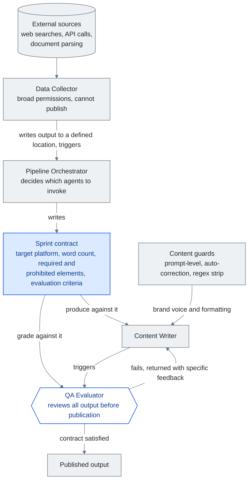

<!-- translation-sync:start -->
> 2026-10-31 영문판과 동기화한 기계 보조 번역입니다. 구조와 내용을 검토했습니다. 코드와 도표 라벨은 원문을 유지하며 읽기 시간은 영어 원문 기준 추정치입니다.
> [English source](../../../chapters/10-case-study.md) · [Sync record](../../SYNC.md)
<!-- translation-sync:end -->

<!-- i18n-anchor -->

# 10장: 실세계 지식 Harness 구축하기

> **한 문장으로:** 한 명의 개발자가 4-에이전트 팀, progressive disclosure 라우팅, 자동 콘텐츠 파이프라인을 갖춘 완전한 AI 지식 시스템을 구축했다.
>
> **왜 중요한가:** 이는 적절한 아키텍처가 있다면 한 사람이 과거 팀이 필요했던 규모를 구축할 수 있음을 증명한다. 본 가이드의 개념들은 이론에 머물지 않는다.
>
> **읽기 시간:** 약 11분 (2,476단어 / 분당 230단어)

*그림: "Harness Engineering: The Agent Team" 절의 네 에이전트 팀이다. 스프린트 계약은 에이전트 셋이 공유하는 하나의 문서로 표시했다. 오케스트레이터가 계약을 작성하고, 작성자는 그 계약에 따라 결과물을 만들며, QA 평가자는 게시 전에 같은 기준으로 평가한다. 핵심을 보여 주는 연결선은 평가자에서 작성자로 돌아가는 경로다. 한 번만 재시도하는 것이 아니므로 네 에이전트는 파이프라인이 아니라 루프를 이룬다.*

본 장은 수개월의 반복 개발을 거쳐 완전한 지식 harness를 구축한 단독 개발자 ——여기서는 "the builder"라 부른다 —— 의 익명화된 사례 연구를 제시한다. 여기서 기술하는 시스템은 실재하며 현재도 일상적으로 본격 운용된다. 이는 context engineering, progressive disclosure, skill systems, 에이전트 편성과 같은 앞 장들에서 논의된 개념이 실제로 어떻게 결합되는지 보여준다.

<!-- i18n-anchor -->

## 출발점

빌더는 단순한 문제에서 시작했다: 지식이 너무 많고 구조는 부족하다. 개인 지식 vault는 진행 중인 프로젝트, 기술 레퍼런스, 회의 로그, 단편적 아이디어에 걸쳐 300개 이상의 노트로 자라났다. 표준 접근 ——필요할 때 검색한다 —— 은 vault가 커짐에 따라 무너졌다. 노트는 잊혀지고, 통찰은 검색되는 대신 재발견되며, 작업 세션 사이에 context가 사라졌다.

초기 해법은 절제되었다: vault에 접근할 수 있는 LLM 어시스턴트를 사용한다. 그러나 300+ 노트에 대한 원시 접근은 context window를 흘러넘치게 했다. 진정한 엔지니어링 과제는 "can the LLM read my notes"가 아니라 "how do I give the LLM the right notes at the right time."였다.

<!-- i18n-anchor -->

## 지식 계층: 암묵적 지식 그래프로서의 vault

이 시스템의 토대는 의도적으로 설계된 폴더 계층으로 조직된 Obsidian vault이다:

- **Inbox** : 수집용 (모든 새 노트가 여기 착지)
- **Active** : 일상 사용 노트 (5–10개로 유지)
- **Projects** : 마감일 있는 시간 제약 작업
- **Areas** : 마감일 없는 지속 책임
- **Notes**: 원자적 지식용 (노트 하나에 아이디어 하나, 제목은 주장을 나타내는 문장)
- **Daily** : 일지와 리뷰 보고
- **Archive** : 완료되었거나 시대에 뒤떨어진 자료

모든 노트는 wikilink로 관련 노트에 연결되어, 형식적 그래프 DB 없이 암묵적 지식 그래프를 형성한다. 링크 규약은 단순하지만 엄격하다: 노트 A가 노트 B가 상술하는 개념을 언급하면, A는 B에 링크해야 한다. 이로써 시간이 흐르며 어느 진입점에서든 관련 context로 이어지는, 항행 가능한 지식의 망이 형성된다.

Vault는 리뷰 사이클로 유지된다: 일일 리뷰는 inbox를 처리하고 새 노트를 분류한다. 주간 리뷰는 지식 누적 추세를 분석하고 가치 있는 옛 노트를 부상시킨다. 월간 리뷰는 모순을 점검하고, 중복 노트를 통합하고, 완료된 프로젝트를 보관한다. 이 유지는 선택 사항이 아니다. 없으면 노트가 낡고, 중복되고, 고립되며, 지식 계층은 몇 주 안에 열화된다.

<!-- i18n-anchor -->

## Context Engineering: 인덱스로서의 시스템 prompt

빌더의 context engineering 접근은 시스템 prompt를 일체형 지시 집합이 아니라 더 깊은 자원으로의 인덱스로 다룬다. 중앙 구성 파일(AI를 위한 README에 비유될 수 있는)은 다음을 포함한다:

- **환경 세부**: OS, shell, 피해야 할 알려진 특이점
- **언어 설정**: 빌더의 작업 언어와 형식 규약
- **라우팅 테이블**: 트리거 키워드와 라우팅 파일 포인터를 가진 스킬 카테고리의 우선순위 목록

이 구성 파일은 항상 로드된다. 페이로드가 아니라 포인터를 담기에 컴팩트하게 유지된다 ——2,000 토큰 미만. LLM은 사용자 요청을 받으면 라우팅 테이블과 매칭하고 해당 라우팅 파일만 로드하며, 그 파일은 다시 필요한 특정 스킬을 가리킨다.

별도의 메모리 시스템이 세션 횡단 지속성을 처리한다. 다음을 저장한다:

- 활성 프로젝트의 위치와 구조
- 피드백에서 학습된 사용자 설정
- 각 프로젝트에 특화된 기술 패턴과 규약
- 복잡한 주제에 대한 상세 하위 파일 참조

메모리 파일은 유기적으로 성장한다. 빌더가 어시스턴트의 동작을 수정하면, 그 수정은 설정으로 기록된다. 프로젝트의 구조가 확립되면 한 번 문서화되고 이후 참조된다. 이는 무상태 LLM 상호작용에 따라붙는 "let me re-explain my project" 반복 문제를 제거한다.

<!-- i18n-anchor -->

## Harness Engineering: 에이전트 팀

시스템은 역할이 정해진 네 에이전트로 구성된 팀을 사용한다:

1. **Data Collector**: 외부 소스(웹 검색, API 호출, 문서 파싱)에서 정보를 수집한다. 폭넓은 권한으로 동작하지만 게시 능력은 없다.
2. **Pipeline Orchestrator**: 워크플로를 조율하고, 어떤 에이전트를 호출할지 결정하고, 시퀀싱을 관리한다. "sprint contracts" ——각 작업의 기대 출력 기준을 명시하는 문서 —— 를 작성한다.
3. **Content Writer**: 출력(보고서, SNS 게시물, 기술 문서)을 생산한다. 브랜드 보이스와 형식 기준을 강제하는 content guard 아래에서 동작한다.
4. **QA Evaluator**: 게시되기 전 모든 출력을 sprint contract에 비추어 검토한다. 사실 정확성, 형식 준수, 브랜드 정렬을 점검한다.

Sprint contract 메커니즘은 상술할 가치가 있다. Orchestrator가 콘텐츠 작업을 시작할 때, 단지 "write a post about X."라고 하지 않는다. 다음을 명시하는 계약을 생성한다: 대상 플랫폼, 단어 수 범위, 필수 요소(예: 통계 한 개를 포함, CTA로 종료), 금지 요소(예: 최상급 표현 금지, 미검증 주장 금지), 평가 기준. Content writer는 이 계약에 대해 생산한다. QA evaluator는 이 계약에 대해 평가한다. 출력이 평가에서 떨어지면, 계약 기준을 참조하는 구체적 피드백과 함께 writer에게 반환된다. 이는 단발 재시도가 아니다 ——계약이 충족되거나 인간이 개입할 때까지 루프가 계속된다.

Content guard는 세 계층에서 동작한다:

- **Prompt 수준 가드**: 에이전트가 무엇을 해야 하고 무엇을 하지 말아야 하는지 정의하는, 시스템 prompt에 박힌 지시
- **Auto-correction**: 흔한 문제를 잡아내고 수정하는 생성 후 처리(예: 원치 않는 형식 패턴 제거, 일관된 용어 강제)
- **Regex strip**: 출력에 절대 나타나면 안 되는 특정 패턴을 제거하는 최종 패스(예: 하류 시스템을 깨는 특정 문자, 모델에서 새는 메타데이터 토큰)

에이전트 간 통신은 트리거 기반이다. 에이전트는 서로를 폴링하지 않는다. Data collector가 정보 수집을 마치면, 정의된 위치에 출력을 작성하고 orchestrator를 트리거한다. Writer가 콘텐츠를 생산하면 evaluator를 트리거한다. 이 이벤트 주도 아키텍처는 불필요한 계산 없이 시스템을 응답성 있게 유지한다.

<!-- i18n-anchor -->

## 스킬 시스템의 진화

스킬 시스템은 본격 운용에서 발견된 실용적 한계에 의해 추동된, 네 개의 뚜렷한 진화 단계를 거쳤다.

**1단계: 평면 스킬 파일.** 각 스킬은 지시를 담은 독립 markdown 파일이었다. LLM은 세션 시작 시 모든 스킬 파일을 로드했다. 5–10개 스킬에서는 작동했지만, 수집물이 자라면서 지속 불가능해졌다. Context window가 스킬 정의로 채워져 실제 작업의 여지가 거의 남지 않았다.

**2단계: 풍부한 YAML frontmatter.** 스킬이 구조화된 메타데이터 ——트리거 조건, 필요 context, 의존 관계, 버전 번호 —— 를 얻었다. 이로써 시스템은 관련성으로 스킬을 필터링할 수 있었지만, 필터링 로직 자체가 토큰을 소비하고 지연을 더했다.

**3단계: 스킬 간 wikilink.** 스킬들이 서로 링크하기 시작해 스킬 그래프를 형성했다. "deploy" 스킬은 전제 조건으로 "run tests"에 링크했다. 이로써 시스템은 개별 스킬이 아니라 스킬 사슬을 로드할 수 있게 되었지만, 그래프 항행 자체가 그래프 인덱스 로딩을 요구했다.

**4단계: 라우팅 파일을 통한 점진적 공개.** 최종 아키텍처는 일곱 개의 범주별 라우팅 파일을 가리키는 간결한 인덱스(시스템 프롬프트의 라우팅 테이블)를 사용한다. 각 라우팅 파일은 해당 범주의 스킬과 트리거 조건을 나열한다. LLM은 일치하는 범주의 라우팅 파일만 불러온 뒤 필요한 스킬만 불러온다. 어느 시점이든 시스템이 불러온 것은 시스템 프롬프트 인덱스(약 2K 토큰) + 라우팅 파일 하나(약 500 토큰) + 스킬 파일 하나(약 1-2K 토큰)다. 전체 부가 비용은 시스템에 스킬이 얼마나 많든 4K 토큰 미만이다.

빌더는 이 라우팅 아키텍처를 모든 카테고리에 걸친 85개 테스트 쿼리로 검증해 85/85 정확 라우팅 ——100% 정확도 —— 를 달성했다. 엣지 케이스(여러 카테고리에 매칭될 수 있는 모호한 쿼리)는 라우팅 테이블의 명시적 모호성 해소 규칙으로 처리된다.

<!-- i18n-anchor -->

## 결과

이 아키텍처의 측정 가능한 결과:

- **65% 토큰 감소** (평면 파일 방식 대비, progressive disclosure에 의한). 이전에 8–12K 토큰의 스킬 context를 소비하던 동일 작업이 이제 4K 미만을 요구한다.
- **자동 콘텐츠 파이프라인** : 여러 플랫폼에 일관된 품질로 일일 출력, 한 사람이 관리.
- **지식 유지 보수** : 자동 vault 린트가 모순, 고립 노트, 시대에 뒤떨어진 정보를 검출 ——이전에는 수동 리뷰 세션을 요구한 문제들.
- **세션 횡단 연속성** : "cold start" 문제 해소. 메모리 시스템 덕분에 어시스턴트가 매번 끊긴 곳에서 이어서 시작한다.

<!-- i18n-anchor -->

## 배운 점

**단순하게 시작한 뒤 복잡성을 더하라.** 빌더는 첫날부터 네 에이전트와 스프린트 계약으로 이루어진 시스템을 설계하지 않았다. 지시문 텍스트 파일을 사용하는 단일 에이전트로 시작했다. 복잡성은 구체적인 실패 양상에 대응해 한 층씩 추가됐다. 에이전트가 환각을 일으키자 QA 평가자를 추가했고, 결과물이 일관되지 않자 콘텐츠 가드를 추가했으며, 컨텍스트 창이 넘치자 점진적 공개를 도입했다. 성급하게 아키텍처부터 설계했다면 실제 문제가 아닌 상상 속 문제에 최적화된 시스템이 되었을 것이다.

**점진적 공개는 초기 설정 비용을 들일 가치가 있다.** 라우팅 테이블, 일곱 개의 라우팅 파일, 개별 스킬 파일을 만들고 유지하려면 지속적인 노력이 필요하다. 그러나 토큰을 65% 줄이는 효과는 매번 상호작용할 때마다 그 비용을 보상한다. 더 중요한 것은 확장성이다. 새 스킬을 추가할 때 전체 프롬프트를 재구성할 필요 없이 라우팅 파일 하나에 항목 하나를 넣으면 된다.

**덜어 내면 더 좋아진다.** 압축되고 정확한 스킬 정의는 장황한 정의보다 낫다. "search the vault for notes matching the query, return file paths and relevant excerpts, suggest connections"라고 적힌 스킬 파일이 같은 지시를 500단어로 풀어 쓴 것보다 잘 작동한다. LLM에는 일일이 손잡아 주는 설명보다 명확한 의도가 필요하다.

**Harness가 곧 제품이다.** 빌더의 경쟁 우위는 어떤 단일 스킬이나 에이전트도 아니다. 그것은 harness ——라우팅 로직, sprint contract, content guard, 리뷰 사이클, 메모리 시스템 —— 다. 개별 구성 요소는 단순하다. 가치가 깃드는 곳은 통합이다. 이는 지식 엔지니어링에 관한 더 넓은 진리를 반영한다: 모델은 상품화되고 있지만, 그것을 편성하는 시스템은 그렇지 않다.

<!-- i18n-anchor -->

## 사이드바: 참조 구현으로서의 Claude Code

빌더의 시스템이 발전하던 기간 대부분에는 Anthropic의 자체 내부 도구가 블랙박스였다. 실무자는 Claude Code의 동작을 보고 원리를 추론할 수 있었지만 Anthropic 외부에서는 아무도 소스를 보지 못했다. **March 31, 2026**에 Anthropic이 npm 패키지 `@anthropic-ai/claude-code` v2.1.88에 59.8MB 소스 맵을 실수로 포함하면서 상황이 바뀌었다. 이는 1,906개 파일에 걸친 난독화되지 않은 TypeScript 약 513,000줄이었다(전체 이야기는 4장 참조). 이 유출로 커뮤니티는 최첨단 연구소의 실서비스 하네스를 처음으로 실증적으로 살펴볼 수 있었으며, 그 패턴 중 몇 가지는 빌더가 독자적으로 도달한 방식과 매우 유사했다:

- **하나의 거대한 파일이 아닌 자기 복구 메모리.** 유출된 Claude Code 아키텍처는 계층 사이의 복구 로직이 명시된 세 계층 "Self-Healing Memory" 시스템을 중심으로 구성된다. 빌더의 보관함 + 메모리 파일 + 스프린트 계약 루프는 같은 발상의 소박한 버전이다. 단기 작업 상태(현재 세션), 중기 압축 상태(메모리 파일), 장기적으로 저장되는 지식(보관함)이 있다. 두 시스템 모두에서 "memory"는 장소가 아니라 서로 전환하는 계층들의 집합이다.
- **MEMORY.md는 인덱스이지 저장소가 아니다.** Claude Code 내부에서 `MEMORY.md`는 더 상세한 노트로의 가벼운 포인터식 인덱스다 ——일체형 트랜스크립트가 아니다. 빌더의 구성 파일이 정확히 같은 역할을 한다: 페이로드가 아니라 라우팅 테이블과 포인터를 담고 있고, 이것이 베이스라인 context를 2K 토큰 미만으로 유지하는 이유다.
- **`KAIROS`와 자율 데몬 모드.** Claude Code 소스는 `KAIROS` 피처 플래그를 150회 이상 참조한다. 이는 자율 데몬 모드를 ——대화형 REPL을 훨씬 넘어서는, 무인의 장시간 실행 루프 —— 게이트한다. 빌더의 트리거 기반, 이벤트 주도 에이전트 간 통신은 같은 발상의 수공 버전이다: 이벤트로 깨어나고, 작업하고, 인계하는 에이전트들. 매 단계에서 인간 없이.

이 보충 설명의 요점은 빌더의 시스템이 사실상 Claude Code라는 뜻이 아니다. 두 시스템에 투입된 엔지니어링 노력은 몇 자릿수나 차이 나며, Anthropic이 TypeScript 오십만 줄로 하는 일을 빌더의 버전은 수백 개의 마크다운 파일로 한다. 요점은 **두 시스템이 독립적으로 같은 형태에 수렴했다**는 것이다. 인덱스를 갖춘 계층형 메모리, 실제 내용을 싣는 대신 라우팅하는 방식, 이벤트 기반 오케스트레이션이 그것이다. 이는 이 패턴들이 단순한 스타일 선택이 아님을 시사한다. 실제 작업 부하를 견뎌 낸 실서비스 하네스가 결국 갖추게 되는 모습이다.

<!-- i18n-anchor -->

## 실무자에게의 함의

이 사례는 개발자 한 명이 몇 달간 반복적으로 작업하면 이 년 전에는 엔지니어 팀이 필요했을 지식 하네스를 만들 수 있음을 보여 준다. 핵심 기반은 복잡한 다단계 지시를 수행할 만큼 충분한 역량을 갖춘 LLM, 도구 통합을 위한 공개 프로토콜(MCP), 그리고 이런 시스템의 설계 패턴을 제공하는 신흥 분야인 컨텍스트 엔지니어링이다.

빌더의 시스템은 복사할 템플릿이 아니다. 본 가이드의 원칙 ——progressive disclosure, context engineering, 스킬 그래프, 에이전트 편성 —— 이 본격 운용에서 측정 가능한 결과를 생산한다는 개념 증명이다. 당신의 harness는 다르게 보일 것이다. 아키텍처는 같아야 한다.

---

<!-- i18n-anchor -->

## 기억할 세 가지

- **계약은 작성자와 평가자에게 공통 목표를 준다.** 오케스트레이터는 대상 플랫폼, 단어 수, 필수 요소와 금지 요소를 미리 명시한다. 평가자는 같은 문서를 기준으로 평가하며, 계약이 충족되거나 사람이 개입할 때까지 이를 반복한다.
- **점진적 공개는 컨텍스트 부가 비용을 일정하게 제한한다.** 스킬이 아무리 많아도 인덱스와 라우팅 파일 하나, 스킬 파일 하나의 합은 4K 토큰 미만으로 유지된다. 기존의 평면 파일 방식보다 65% 적다.
- **하네스가 곧 제품이다.** 개별 구성 요소는 단순하다. 가치가 생기는 곳은 라우팅 로직, 스프린트 계약, 콘텐츠 가드, 검토 주기, 메모리 시스템을 통합하는 부분이다.

---

*다음 장: [11장 — LLM 지식 엔지니어링의 핵심 순간들](11-timeline.md)*
