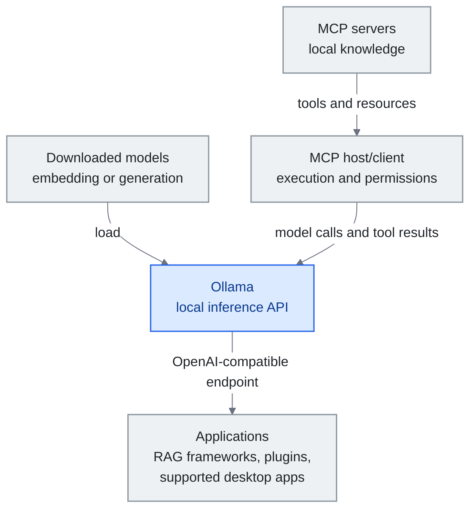

<!-- translation-sync:start -->
> 2026-10-31 영문판과 동기화한 기계 보조 번역입니다. 구조와 내용을 검토했습니다. 코드와 도표 라벨은 원문을 유지하며 읽기 시간은 영어 원문 기준 추정치입니다.
> [English source](../../../chapters/12-local-models.md) · [Sync record](../../SYNC.md)
<!-- translation-sync:end -->

<a id="chapter-12-local-models-for-knowledge-engineering"></a><!-- i18n-anchor -->

# 12장: 지식 엔지니어링을 위한 로컬 모델

> **한 문장으로:** 로컬 모델은 추론을 자체 하드웨어로 옮겨 공급업체에 대한 정보 노출과 토큰당 API 청구액을 줄이는 대신 로컬 운영 비용을 더한다.
>
> **중요한 이유:** 민감한 지식과 개인용 미세 조정은 추론 경계를 아키텍처상의 선택으로 만든다. 도구, 로그, 동기화에는 여전히 각각의 통제가 필요하다.
>
> **읽기 시간:** 약 14분 (3,052단어 / 분당 230단어)

*그림: Ollama는 다운로드한 모델을 추론 API를 통해 애플리케이션에 제공한다. MCP 호스트/클라이언트는 별도로 도구를 실행하고 권한을 적용하며, 모델 호출과 도구 결과를 Ollama에 전달한다. 엔드포인트 호환성만으로 MCP 오케스트레이션이 제공되지는 않는다. 구체적인 모델과 애플리케이션 통합은 아래에서 설명한다.*

*좁은 화면에서는 도표를 가로로 스크롤하면 전체 크기로 읽을 수 있다.*



이전 장들은 클라우드 API 접근을 대체로 가정하는 지식 엔지니어링 스택을 기술한다 ——자신의 context window를 Anthropic, OpenAI, 또는 Google에 보내고 응답을 받기. 이는 대부분의 사용자에게 잘 작동한다. 그러나 클라우드 추론이 실용적이지 않거나 바람직하지 않은 실무자 부분이 늘어나고 있다: 민감한 기업 데이터로 작업하는 사람, 엄격한 데이터 거주 요구사항을 가진 관할에 있는 사람, 그리고 자신이 컴파일한 지식으로 모델을 fine-tune함으로써 루프를 완전히 닫고 싶은 사람.

본 장은 로컬 모델과 지식 엔지니어링의 교차를 다룬다. GPU 구매 가이드, 벤치마크 비교, 양자화 기법은 다루지 않는다 ——그 주제들은 다른 자원에서 잘 다뤄진다. 대신, 모델을 자신의 인프라 안으로 가져올 때 중요한 아키텍처 결정에 초점을 맞춘다.

---

<a id="why-local-matters-for-knowledge-engineering"></a><!-- i18n-anchor -->

## 지식 엔지니어링에 로컬이 중요한 이유

세 가지 힘이 지식 시스템에서 로컬 모델 채택을 추진한다:

**개인정보 보호는 정책이 아닌 아키텍처다.** 클라우드 기반 RAG는 검색한 문서 청크를 공급업체에 보낼 수 있다. 전체 경로가 로컬에 머무르면 로컬 추론은 모델 공급업체로의 전송을 없앤다. 도구 호출, 원격 측정, 로그, 동기화는 여전히 검토해야 한다. 일부 법률, 의료, 정부 작업에는 이런 경계가 필요하며, 요건은 배포 환경에 따라 달라진다.

**규모가 커질 때의 비용.** 보관함 린트 검사, 자동 노트 컴파일, 주기적 재인덱싱처럼 백그라운드 작업을 계속 수행하는 지식 시스템은 하루에 수천 번 API를 호출할 수 있다. 로컬 실행은 토큰당 공급업체 청구액을 없애지만 전기, 하드웨어 용량, 유지 보수에는 여전히 돈이 든다. 상시 지식 유지 관리(Karpathy 아키텍처의 Lint 작업)에는 추론이 무료라고 가정하지 말고 이런 비용을 API 사용 비용과 비교하라.

**Fine-tuning 엔드게임.** 이것이 아마도 가장 설득력 있는 이유다. 지식 베이스가 충분한 품질에 도달하면 ——Ingest 연산을 통해 컴파일된 잘 구조화된, 상호 링크된 수백 개의 노트 —— 그것은 깨끗한 합성 데이터셋이 된다. 이 데이터셋으로 작은 로컬 모델을 fine-tune하여, 런타임에 검색을 필요로 하지 않고 자신의 도메인을 본질적으로 "knows" 모델을 산출할 수 있다. 지식이 context window가 아니라 가중치에 있다.

---

<a id="architecture-where-local-models-fit"></a><!-- i18n-anchor -->

## 아키텍처: 로컬 모델이 들어가는 곳

지식 harness의 모든 구성 요소가 로컬 추론으로부터 동등하게 이득을 얻는 것은 아니다. 여기 로컬 모델이 가장 가치를 제공하는 곳이 있다:

<a id="embedding-models-high-value"></a><!-- i18n-anchor -->

### 임베딩 모델 (높은 가치)

임베딩은 어떤 RAG 파이프라인의 토대이다. vault에 노트를 더할 때마다, 유사도 검색을 위해 벡터로 변환되어야 한다. 이는 대량, 저복잡도 연산이다 ——로컬 추론에 완벽하다.

인기 있는 선택:
- **nomic-embed-text** (137M 파라미터): 강력한 범용 임베딩, CPU에서 실행
- **mxbai-embed-large** (335M): 더 높은 품질, 적당한 하드웨어에서도 다룰 만함
- **bge-m3** (568M): 다국어, 혼합 언어 콘텐츠를 가진 vault에 탁월

이 모델들은 GPU 없이 어떤 현대 노트북에서도 실행할 만큼 작다. 로컬과 클라우드 임베딩 (OpenAI의 text-embedding-3, Cohere의 embed) 사이의 품질 차이는 현저히 좁아졌다 ——대부분의 지식 관리 사용 사례에 대해 로컬 임베딩은 충분하다.

Ollama로 로컬 실행:
```
ollama pull nomic-embed-text
```

<a id="query-and-reasoning-medium-value"></a><!-- i18n-anchor -->

### 쿼리와 추론 (중간 가치)

자신의 vault에 대한 질문에 답하기 위해 로컬 모델을 사용하는 것 ——Query 연산 —— 은 트레이드오프가 더 미묘해지는 곳이다. 클라우드 모델 (Claude Opus, GPT-4o)은 여전히 복잡한 추론, 다단계 종합, 미묘한 지시 따르기에서 의미 있게 더 낫다. 그러나 단순 검색 기반 Q&A ("what did I write about X last month?")에 대해서는 7–14B 파라미터 범위의 로컬 모델이 잘 수행한다.

실용적 옵션:
- **Qwen3-14B**: 강력한 다국어 성능, Apache 2.0 라이선스
- **Llama 3.1-8B-Instruct**: 8B 규모의 지시 조정 모델 선택지; Llama 3.3은 별개의 70B 모델이다
- **DeepSeek-R1-Distill-Qwen-7B**: 전체 R1에서 추론 역량을 증류한 모델, MIT 라이선스
- **Gemma 3-12B**: Google의 효율적 아키텍처, 구조화된 출력에 좋음

가장 잘 작동하는 패턴은 **계층적 접근**이다: 일상 쿼리와 vault 유지에는 로컬 모델을 사용하고, 복잡한 종합과 창의적 작업에는 클라우드 API로 에스컬레이션한다. 이는 progressive disclosure의 harness engineering 원칙이 모델 선택에 적용되는 방식을 반영한다 ——각 작업에 최소 능력 모델을 사용하라.

<a id="knowledge-compilation-high-value"></a><!-- i18n-anchor -->

### 지식 컴파일 (높은 가치)

Ingest 연산 ——원시 출처를 읽고 구조화된 위키 페이지로 컴파일 —— 은 놀랍게도 로컬 모델에 잘 맞는다. 작업이 잘 정의되어 있다: 기사를 읽고, 핵심 점을 추출하고, wikilink를 가진 구조화된 노트를 생성한다. 좋은 지시 따르기를 가진 14B 모델이 이를 신뢰할 수 있게 다룰 수 있다. 특히 출력 형식이 시스템 prompt에 정확히 명시된 경우.

경제성 주장이 가장 강해지는 지점이다. Web Clipper로 하루에 5-10개 기사를 수집한다면, 가용 연산 자원과 운영 비용 범위 안에서 로컬 컴파일을 통해 토큰당 API 청구 없이 지식 기반을 계속 키울 수 있다.

<a id="vault-maintenance-high-value"></a><!-- i18n-anchor -->

### Vault 유지 (높은 가치)

모순, 오래된 정보, 고립된 노트를 찾는 Lint 작업은 로컬 추론의 이점을 얻는 배치 처리다. 컴퓨터의 연산 예산 안에서 매시간, 매일 또는 지속적으로 실행할 수 있다. 로컬 모델이 보관함을 검사하고 상태 보고서를 만든다. 이 작업 흐름을 비공개로 유지하려면 도구와 저장소도 로컬에 있어야 한다.

---

<a id="the-fine-tuning-endgame"></a><!-- i18n-anchor -->

## Fine-Tuning 엔드게임

Andrej Karpathy는 많은 실무자가 이제 추구하고 있는 비전을 개관했다: LLM이 유지하는 위키가 충분한 품질에 도달하면, 그것을 사용해 개인 Small Language Model (SLM)을 fine-tune하라.

워크플로우:

1. **컴파일**: 수개월의 Ingest 연산을 통해 지식 베이스를 컴파일하라. 위키가 잘 구조화된, 상호 링크된 수백 개 노트로 자란다.
2. **추출**: 위키에서 훈련 쌍을 추출하라: 각 노트가 (질문, 답) 쌍이 되거나, (context, completion) 쌍이 된다.
3. **Fine-tune**: LoRA 또는 QLoRA를 사용해 이 데이터셋으로 작은 모델 (1–3B 파라미터)을 fine-tune하라.
4. **배포**: fine-tune된 모델을 로컬에 배포하라. 그것은 이제 검색 없이 자신의 가중치에서 자신의 도메인에 관한 질문에 답한다.

이는 RAG를 완전히 대체하지 않는다 ——fine-tune된 모델은 여전히 최근 정보와 특정 디테일을 위해 검색에서 이득을 얻는다. 그러나 검색 부담을 극적으로 줄인다. 모델이 자신의 도메인의 기초 개념, 관계, 패턴을 "knows" RAG는 단지 새롭거나 매우 특정한 정보로 보충할 필요가 있다.

이 파이프라인을 위한 도구들은 성숙하다:
- 효율적 fine-tuning을 위한 **Unsloth** (2배 더 빠름, 60% 더 적은 메모리)
- 관리되는 훈련 구성을 위한 **Axolotl**
- fine-tune된 모델의 로컬 추론을 위한 **MLX** (Apple Silicon) 또는 **llama.cpp**

---

<a id="integration-patterns"></a><!-- i18n-anchor -->

## 통합 패턴

<a id="pattern-1-ollama-as-universal-backend"></a><!-- i18n-anchor -->

### 패턴 1: 보편 백엔드로서의 Ollama

Ollama는 OpenAI 호환 API로 로컬 모델을 실행하는 통합 인터페이스를 제공한다. 이는 OpenAI API와 작동하는 어떤 도구도 base URL을 바꿈으로써 로컬 모델로 향할 수 있음을 의미한다:

```
base_url: http://localhost:11434/v1
model: qwen3:14b
```

이는 LangChain, LlamaIndex, Dify, 그리고 대부분의 RAG 프레임워크와 작동한다. Obsidian 사용자에게는 Smart Connections와 같은 플러그인이 클라우드 API 대신 로컬 Ollama 모델을 사용하도록 구성될 수 있다.

2026년 말에는 이 패턴이 반대로도 나타났다. 제삼자 도구가 Ollama를 가리키는 대신, 비공개 모델 공급업체의 자체 데스크톱 앱이 Ollama를 가리키기 시작했다. Ollama **v0.33.0** (August 21, 2026)은 Claude Desktop이 Ollama를 제삼자 게이트웨이 공급자로 쓰도록 하는 설정을 제공했다. **v0.34.0** (September 5, 2026)은 ChatGPT Desktop 통합을 추가해, Ollama macOS 앱에서 설정하면 ChatGPT Desktop 자체에서 Ollama 모델을 선택할 수 있게 했다. 같은 v0.34.0 출시에는 OpenAI 호환 클라이언트 도구 검색, 응답 압축, Apple Silicon의 더 빠른 구조화 출력도 추가됐다. 로컬 지식 하네스에 대한 결과는 범위는 좁지만 분명하다. 소비자용 채팅 클라이언트가 더 이상 질의를 기기 밖으로 보내야 하는 이유가 되지 않는다. 기기에서 실행하는 모델로 클라이언트의 연결 대상을 바꿀 수 있기 때문이다. 이는 아래에서 설명하는 OS 수준 `LanguageModel` 프로토콜에 대응하는 공급업체 애플리케이션 측 변화다. 로컬 백엔드를 정식 지원 대상으로 만드는 같은 움직임이 플랫폼 소유자가 아닌 비공개 모델 공급업체에서 나타난다.

<a id="pattern-2-hybrid-cloud-local"></a><!-- i18n-anchor -->

### 패턴 2: 하이브리드 클라우드-로컬

대부분의 사용자에게 가장 실용적인 아키텍처:
- **로컬**: 임베딩, vault 유지, 일상 쿼리, 지식 컴파일
- **클라우드**: 복잡한 추론, 창의적 종합, 다단계 에이전트 워크플로우

이는 진정으로 그것을 요구하는 작업에 대한 프런티어 모델 능력 접근을 유지하면서, 대량 연산에 로컬 추론의 프라이버시와 비용 이점을 제공한다.

<a id="pattern-3-mcp-with-local-models"></a><!-- i18n-anchor -->

### 패턴 3: 로컬 모델과 함께하는 MCP

통합에는 [7장](07-mcp.md)에서 보여 주듯 **MCP 호스트/클라이언트**가 필요하다. 호스트는 서버 도구를 발견하고, 도구 정의와 결과를 모델 API로 전달하며, 승인된 호출을 실행하고 권한을 적용한다. Ollama는 추론을 제공한다. OpenAI 호환 엔드포인트만으로는 MCP 호스트가 되지 않는다. 호스트, 서버, 모델, 저장소가 모두 로컬에서 실행되면 하네스를 로컬에 유지할 수 있다.

---

<a id="2026-local-models-get-an-os-native-api-and-vendor-qat"></a><!-- i18n-anchor -->

## 2026: 로컬 모델에 OS 네이티브 API와 공급업체 QAT가 더해지다

2026년의 세 출시는 이 장에서 설명하는 로컬 추론의 모습을 바꾸었다.

**Apple이 Foundation Models를 모든 공급자에게 개방하다 (WWDC26, June 8).** 스트리밍, 도구 호출, `@Generable` 구조화 출력으로 Apple Intelligence를 구동하는 Swift API인 Apple Foundation Models 프레임워크에 공개 **`LanguageModel` / `LanguageModelExecutor` 프로토콜**이 제공됐다. Apple은 실행 시 Hugging Face의 mlx-community 모델을 불러와 디스크에 캐시하는 참조 **`MLXLanguageModel`** 백엔드도 제공한다. 로컬 지식 엔지니어링에서 이는 중요하다. 로컬 오픈소스 모델이 제삼자 통합이 아닌 *정식 지원되는 OS 네이티브 백엔드*가 된다. 이제 macOS나 iOS 지식 앱은 하나의 Swift API를 대상으로 하면서 추론 계층을 다시 쓰지 않고 Apple의 온디바이스 모델과 다운로드한 공개 가중치 모델을 교체할 수 있다(Anthropic과 Google은 이 규약에 맞는 Swift 패키지를 제공하고 있다). 위의 범용 Ollama 백엔드 패턴에 Apple 네이티브 형제가 생긴 셈이다.

**Gemma 4 QAT (June 5).** Google은 다섯 Gemma 4 크기(E2B, E4B, 12B, 26B-A4B, 31B) 모두에 대해 **양자화 인지 학습 체크포인트**를 공개했다. 학습 *중에* 4비트 정밀도를 모사해 사후 압축에서 품질을 잃는 대신, 양자화 가중치가 BF16 품질 대부분을 회복하게 한다. **llama.cpp(GGUF), Ollama, LM Studio, MLX 전반에 출시 첫날부터 산출물**을 제공했으며, vLLM도 E2B, E4B, 12B, 31B를 첫날부터 지원했다. 26B-A4B MoE는 전문가 차원 704에서 4비트 품질 손실이 너무 커 vLLM w4a16-ct QAT 형식에서 제외됐다. 메모리의 경우 Google 자체 블로그는 백분율 수치를 내놓지 않았다. 제삼자 분석은 **BF16 대비 약 72% VRAM 감소**로 추정하지만, Google이 직접 밝힌 수치는 모바일 형식을 사용하면 E2B가 1GB 미만이 된다는 것뿐이다. 주목할 부분은 *출시 패턴 자체*다. 공급업체 자체 QAT와 여러 실행 환경에 대한 동시 첫날 배포가 본격적인 공개 가중치 출시의 기본 형태가 되어 가며, 이는 이 장이 주장하는 "run it locally" 결정의 마찰을 줄인다.

**Meta가 로컬 에이전트용 공개 가중치 모델을 출시하다 (Muse Glimmer, August 10).** Meta Superintelligence Labs는 비공개 Muse Spark에서 증류한 30B 밀집 모델 **Muse Glimmer**를 Apache 2.0으로 공개했다. 연구 산출물을 작게 줄인 것이 아니라 기기 내 사용을 위한 공개 에이전트 모델로 명확히 포지셔닝했다. 4비트 양자화 시 20GB 미만으로, 단일 소비자용 GPU, Mac 또는 PC의 24-32GB 메모리 예산에 의도적으로 맞췄다. Meta 자체 벤치마크는 **DFlash** 추측 디코딩으로 **RTX 5090에서 3.1x**, **M5-Max에서 1.8x**, **M4-Max에서 1.5x** 속도 향상과 Gemma4-31B 및 Qwen3.6-27B 대비 벤치마크 우위를 보고한다. 이는 독립적으로 재현된 수치가 아닌 Meta 자체 수치다. 보통의 가중치 공개와 구별되는 것은 배포다. Hugging Face, Ollama, llama.cpp, MLX, ExecuTorch, LM Studio, Unsloth, vLLM, SGLang, Together AI, Fireworks AI, OpenRouter에서 공개 직후부터 실행을 지원했다. 이 책이 지금까지 로컬 배포의 맥락에서 다룬 공개 가중치 모델은 모두 서버급이었다(9장의 Kimi K3는 매개변수 2.8T로 로컬 이야기에서 명시적으로 제외됨). Muse Glimmer는 처음부터 단일 소비자용 GPU의 로컬 에이전트 사용을 위해 설계하고 벤치마크한 최초의 미국 최첨단 연구소 모델이며, 앞선 Gemma 4 QAT 출시에서 보인 공급업체 자체 QAT와 여러 실행 환경의 첫날 지원이라는 같은 패턴으로 출시됐다. 이 장이 Google의 패턴으로 짚었던 방식은 더 이상 Google만의 것이 아니다. (Meta는 이후 Muse Spark 1.2 가중치도 공개할 예정이라고 별도로 밝혔지만, 날짜가 정해지지 않은 별개 사건이므로 여기서는 다루지 않는다.)

---

<a id="local-context-and-decision-services"></a><!-- i18n-anchor -->

## 로컬 컨텍스트 및 의사 결정 서비스

**기기에서 공유되는 컨텍스트 (September 23, 2026).** Liquid AI는 Qualcomm Hexagon NPU에 최적화된 **Liquid Context**를 발표했다. 임베디드, 클라우드, 하이브리드 에이전트가 사용할 수 있고, 로컬에서 관리되며 접근 권한을 적용하는 컨텍스트 계층이다. 컨텍스트 유지 관리와 이를 사용하는 에이전트가 별도 구성 요소가 되어, [6장의 메모리 아키텍처](06-agent-memory.md)를 에이전트별 저장소 너머로 확장한다. 발표는 OEM을 대상으로 하며, 예시는 설명용이지 소비자 기기에 널리 출시됐다는 증거가 아니다. 로컬 메모리 계층이 있다고 해서 연결된 클라우드 에이전트도 로컬이 되는 것은 아니다.

**유형이 지정된 로컬 판단 (September 29, 2026).** Ollama 0.35는 상태와 이름 및 유형이 있는 질문을 받아, 범위가 제한된 판단과 확률을 반환하는 **`/v1/systemone`**을 도입했다. Nimble 9B와 실험적 Tev1 모델을 통해 라우팅, 우선순위 분류, 콘텐츠 조정을 생성된 산문 응답 대신 로컬 판단 인터페이스로 수행할 수 있다. 아키텍처상의 변화는 벤치마크 순위가 아니라 인터페이스다. 확률은 작업 부하별로 여전히 검증해야 하며, 권한과 상위 단계로 넘기는 규칙은 결정론적 호스트 코드가 적용해야 한다.

**October 1**에는 Cloudflare가 Jev 호환 유형 지정 출력을 제공하는 Apache 2.0 **Clef/Clef-flash**를 발표하며 공급업체 간 수렴이 이어졌다. Ollama는 **October 19**에 로컬 및 클라우드 Clef 지원을 발표했다. 이는 같은 판단 계약을 여러 배포 위치로 확장한다. 공급업체의 출시 발표이며, 판단 확률의 보정이나 안전한 자율 실행에 대한 독립적 증거는 아니다.

---

<a id="what-this-chapter-does-not-cover"></a><!-- i18n-anchor -->

## 본 장이 다루지 않는 것

본 장은 의도적으로 다음을 생략한다:
- **하드웨어 권장**: GPU 선택, VRAM 요구사항, 클라우드 GPU 임대는 r/LocalLLaMA의 위키와 Ollama 문서 같은 자원에서 광범위하게 다뤄진다.
- **모델 벤치마크**: 순위는 매월 변한다. 현재 순위는 [Open LLM Leaderboard](https://huggingface.co/spaces/open-llm-leaderboard/open_llm_leaderboard)를 확인하라.
- **양자화 디테일**: GGUF 형식, INT4 vs INT8, 품질/속도 트레이드오프는 llama.cpp와 Ollama 커뮤니티에서 잘 문서화되어 있다.
- **훈련 인프라**: 멀티 GPU 셋업, 분산 훈련, 클라우드 훈련 플랫폼은 지식 엔지니어링의 범위 밖이다.

여기서의 초점은 아키텍처적 질문이다: 로컬 모델이 자신의 지식 harness 어디에 맞고, 그것들이 무엇이 가능한지를 어떻게 바꾸는가?

---

<a id="key-takeaways"></a><!-- i18n-anchor -->

## 핵심 시사점

1. **로컬 임베딩은 기본 선택지로 평가할 만하다.** 모델 공급업체에 대한 정보 노출과 토큰당 청구액을 줄이지만, 하드웨어와 운영 비용은 여전히 예산에 포함해야 한다.

2. **계층적 추론이 실용적 선택이다.** 일상 연산에는 로컬, 복잡한 추론에는 클라우드. 7B 모델이 프런티어 모델이 더 잘하는 일을 하도록 강제하지 마라.

3. **컴파일 용도는 과소평가돼 있다.** Ingest를 로컬에서 실행하면 반복 작업의 비용이 공급업체 청구서에서 자체 연산 예산으로 옮겨 간다.

4. **Fine-tuning은 시작점이 아니라 엔드게임이다.** 위키를 먼저 만들어라. 수백 개의 품질 노트를 컴파일하라. 그 다음에 fine-tune하라. 훈련 데이터 ——자신의 위키 —— 의 품질이 결과 모델의 품질을 결정한다.

5. **개인정보 보호는 아키텍처상의 결정이다.** 민감한 지식에는 추론, 도구, 저장소, 동기화 경계를 명시해야 한다. 로컬 추론은 그 경로의 일부를 통제한다.

---

<a id="three-things-to-take-away"></a><!-- i18n-anchor -->

## 기억할 세 가지

- **로컬 추론은 데이터 경계를 통제한다.** 도구, 로그, 동기화도 의도한 경계를 지킬 때만 공급업체에 대한 정보 노출이 줄어든다.
- **상시 작업에서는 경제성이 달라진다.** 임베딩, 지식 컴파일, Lint 단계는 토큰당 API 청구액을 로컬 하드웨어와 운영 비용으로 바꾼다.
- **이제 로컬 서비스에는 컨텍스트와 판단도 포함된다.** Liquid Context가 발표한 공유 메모리 계층과 Ollama의 유형 지정 판단 엔드포인트는 반복적인 컨텍스트 관리와 범위가 제한된 판단을 일반 텍스트 생성에서 분리한다.

---

## Sources

- Ollama: [https://ollama.ai](https://ollama.ai)
- Ollama. FAQ (October 31, 2026 열람). [https://docs.ollama.com/faq](https://docs.ollama.com/faq) -- 로컬 처리와 클라우드 처리의 구분; `OLLAMA_NO_CLOUD=1`은 클라우드 모델과 웹 검색을 비활성화한다.
- Liquid AI. "Liquid AI, in Collaboration with Qualcomm Technologies, Brings Personal AI Context to Devices Powered by Snapdragon" (September 23, 2026). [https://www.liquid.ai/blog/liquid-context-qualcomm](https://www.liquid.ai/blog/liquid-context-qualcomm) -- OEM 대상의 접근 권한을 적용하는 로컬 컨텍스트 계층에 대한 공급업체 발표; 예시 경험이며 소비자 배포 현황 조사가 아니다.
- Ollama. "Ollama now supports Jev-style decision models" (September 29, 2026). [https://ollama.com/blog/ollama-now-supports-jev-style-decision-models](https://ollama.com/blog/ollama-now-supports-jev-style-decision-models) -- Ollama 0.35 `/v1/systemone` 인터페이스와 로컬 출시 모델.
- Cloudflare. "Introducing Clef: our open-source decision models, and new RL fine-tuning platform" (October 1, 2026). [https://blog.cloudflare.com/clef-decision-models](https://blog.cloudflare.com/clef-decision-models) -- Apache 2.0 가중치와 Jev 호환 판단 API; 벤치마크 주장은 공급업체의 것이다.
- Ollama. "Clef is available on Ollama's cloud" (October 19, 2026). [https://registry.ollama.com/blog/clef](https://registry.ollama.com/blog/clef) -- 공급업체가 호스팅하는 글이며 로컬 실행 지원도 기록한다.
- Meta. Llama 모델 카드: [https://huggingface.co/meta-llama/Llama-3.1-8B-Instruct](https://huggingface.co/meta-llama/Llama-3.1-8B-Instruct) (July 23, 2024) 및 [https://huggingface.co/meta-llama/Llama-3.3-70B-Instruct](https://huggingface.co/meta-llama/Llama-3.3-70B-Instruct) (December 6, 2024) -- 8B 지시 조정 예시와 Llama 3.3의 70B 출시를 구분한다.
- DeepSeek. DeepSeek-R1 저장소와 증류 모델 목록 (January 2025). [https://github.com/deepseek-ai/DeepSeek-R1](https://github.com/deepseek-ai/DeepSeek-R1) -- 정확한 모델 식별자는 `DeepSeek-R1-Distill-Qwen-7B`다.
- Ollama. v0.33.0 출시 (August 21, 2026). [https://github.com/ollama/ollama/releases/tag/v0.33.0](https://github.com/ollama/ollama/releases/tag/v0.33.0) --- Claude Desktop이 Ollama를 제삼자 게이트웨이 공급자로 사용하도록 설정 가능.
- Ollama. v0.34.0 출시 (September 5, 2026). [https://github.com/ollama/ollama/releases/tag/v0.34.0](https://github.com/ollama/ollama/releases/tag/v0.34.0) --- Ollama macOS 앱을 통한 ChatGPT Desktop 통합; OpenAI 호환 클라이언트 도구 검색, 응답 압축, Apple Silicon의 더 빠른 구조화 출력.
- llama.cpp: [https://github.com/ggml-org/llama.cpp](https://github.com/ggml-org/llama.cpp)
- Unsloth: [https://github.com/unslothai/unsloth](https://github.com/unslothai/unsloth)
- Karpathy, Andrej. "LLM Wiki" 패턴 --- 이 장에서 참조하는 raw → wiki → schema 계층 구조와 수집 / 컴파일 / 린트 / 질의 작업을 정의한 Gist. [https://gist.github.com/karpathy/442a6bf555914893e9891c11519de94f](https://gist.github.com/karpathy/442a6bf555914893e9891c11519de94f)
- Open LLM Leaderboard: [https://huggingface.co/spaces/open-llm-leaderboard](https://huggingface.co/spaces/open-llm-leaderboard)
- Nomic Embed: [https://huggingface.co/nomic-ai/nomic-embed-text-v1.5](https://huggingface.co/nomic-ai/nomic-embed-text-v1.5)
- r/LocalLLaMA: [https://reddit.com/r/LocalLLaMA](https://reddit.com/r/LocalLLaMA)
- Apple. "Bring an LLM provider to the Foundation Models framework," WWDC26 세션 339 (June 8, 2026). [https://developer.apple.com/videos/play/wwdc2026/339/](https://developer.apple.com/videos/play/wwdc2026/339/) 및 세션 241 [https://developer.apple.com/videos/play/wwdc2026/241/](https://developer.apple.com/videos/play/wwdc2026/241/) --- 공개 `LanguageModel` / `LanguageModelExecutor` Swift 프로토콜; Hugging Face mlx-community 모델용 참조 `MLXLanguageModel` 백엔드.
- Google. "Quantization-Aware Training for Gemma 4" (June 5, 2026). [https://blog.google/innovation-and-ai/technology/developers-tools/quantization-aware-training-gemma-4/](https://blog.google/innovation-and-ai/technology/developers-tools/quantization-aware-training-gemma-4/) --- 다섯 크기 모두의 QAT 체크포인트; llama.cpp / Ollama / LM Studio / MLX 첫날 지원; vLLM은 26B-A4B MoE를 제외하고 첫날 지원. 제삼자 VRAM 분석(BF16 대비 약 72%; Google 자체 수치는 모바일 형식에서 E2B가 1GB 미만이 된다는 것뿐): [https://runaihome.com/blog/gemma-4-qat-local-ai-hardware-update-2026/](https://runaihome.com/blog/gemma-4-qat-local-ai-hardware-update-2026/).
- Meta Superintelligence Labs. "Introducing Muse Glimmer: an open agentic model" (August 10, 2026). [https://research.meta.ai/blog/introducing-muse-glimmer-open-agentic-model](https://research.meta.ai/blog/introducing-muse-glimmer-open-agentic-model) --- 30B 밀집 모델, Apache 2.0, Muse Spark에서 증류; DFlash 속도 향상 및 벤치마크 수치는 Meta 자체 수치다. 이차 자료: Phoronix [https://phoronix.com/news/Meta-Muse-Glimmer](https://phoronix.com/news/Meta-Muse-Glimmer) ; CNBC [https://www.cnbc.com/2026/08/10/meta-muse-glimmer-open-weight-ai.html](https://www.cnbc.com/2026/08/10/meta-muse-glimmer-open-weight-ai.html) ; Ghacks (August 11, 2026) [https://www.ghacks.net/2026/08/11/meta-releases-muse-glimmer-a-30-billion-parameter-open-weight-ai-model-that-runs-on-a-single-consumer-gpu/](https://www.ghacks.net/2026/08/11/meta-releases-muse-glimmer-a-30-billion-parameter-open-weight-ai-model-that-runs-on-a-single-consumer-gpu/).

---

*이전 장: [11장 — LLM 지식 엔지니어링의 핵심 순간들](11-timeline.md)*

*다음: [13장 - 루프 엔지니어링](13-loop-engineering.md)*
