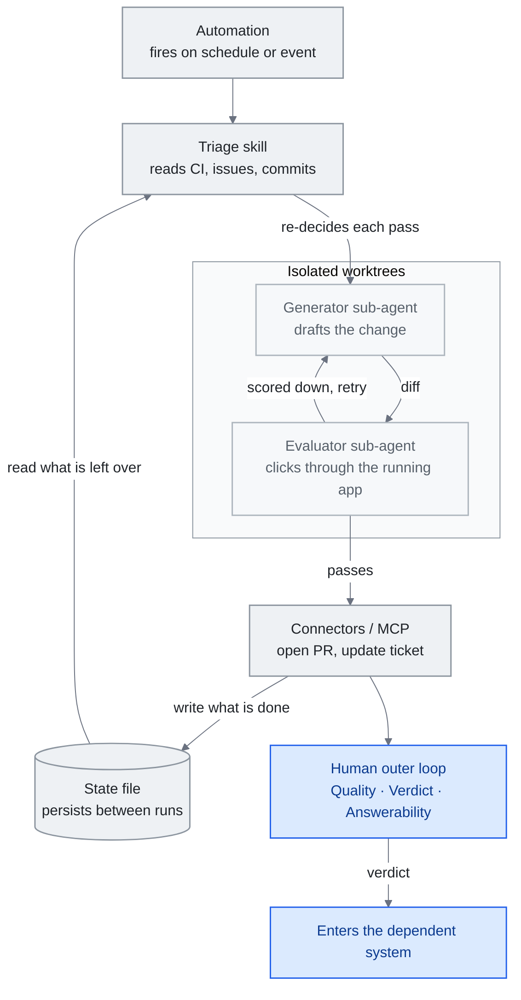

<!-- translation-sync:start -->
> 2026-10-31 영문판과 동기화한 기계 보조 번역입니다. 구조와 내용을 검토했습니다. 코드와 도표 라벨은 원문을 유지하며 읽기 시간은 영어 원문 기준 추정치입니다.
> [English source](../../../chapters/13-loop-engineering.md) · [Sync record](../../SYNC.md)
<!-- translation-sync:end -->

<!-- i18n-anchor -->

# 13장: Loop Engineering —— 에이전트에게 prompt하는 시스템을 설계하기

> **한 문장으로:** Loop engineering이란 에이전트에게 prompt하는 시스템을 직접 만드는 실천이다 —— 매 턴을 손으로 운전하는 것을 멈추고, 스스로 실행하고, 점검하고, 자신을 먹여 살리는 루프를 설계하기 시작하는 것.
>
> **중요한 이유:** 이 가이드의 발전 과정에서 가장 새롭고 가장 덜 확립된 계층이며, 앞으로 일 년간 자율 에이전트 작업의 실제 일정 관리, 검증, 검토 방식을 가장 크게 바꿀 가능성이 있는 계층이다.
>
> **읽기 시간:** 약 18분 (4,035단어 / 분당 230단어)

*그림: 13.3절의 다섯 요소와 13.3절에서 별도로 구분하는 외부 상태를 조합한 루프 한 회차다. 끝에는 사람의 바깥 루프와 13.7의 판정이 있다. 핵심을 전달하는 연결선은 두 개다. 실행이 어떤 결정이든 내리기 전에 상태 파일을 읽고(13.2), 초안을 만드는 에이전트와 점수를 매기는 에이전트는 다르다(13.4).*

이 가이드에서 가장 역사가 짧은 아이디어다. (그 지위는 여섯 주간 유지됐다. July 2026 말에 같은 방식으로 루프 위의 다음 계층인 그래프 엔지니어링 주장이 나왔으며, [14장](14-graph-engineering.md)에서 다룬다.) "loop engineering"이라는 용어는 집필 시점에 약 다섯 주밖에 되지 않았다. June 2026 초에 이름이 붙었고, 며칠 만에 실무자 블로그, 팟캐스트, X로 퍼졌으며, 아직 이를 뒷받침하는 학술 문헌은 없다. 따라서 아래 설명에는 의도적으로 유보를 둔다. 어떤 주장이 세 가지 형태로 옮겨 적힌 팟캐스트 구술 인용에 기대거나, 아무 이름도 붙이지 않은 인기 게시물에 기대고 있다면 이 장은 그대로 밝힌다. 목표는 떠오르는 관점을 정확하게 설명하는 것이지 확립된 세대로 인증하는 것이 아니다.

이 프레임은 서술할 가치가 있다. 실무자 담론에서 실제로 일을 하고 있기 때문이다: 4장의 harness engineering이 암시했지만 분리해내지는 못한 전환 —— *에이전트에게 prompt하기*에서 *에이전트에게 prompt하는 시스템을 설계하기*로의 이동 —— 에 이름을 준다. 그것이 자기만의 계층을 가질 자격이 있는지, 아니면 그냥 스케줄러가 붙은 harness engineering일 뿐인지가 바로 본 장이 열어 둔 질문이다.

본 장은 이 용어가 어디서 왔는지, 그 지지자들이 이를 harness와 어떻게 관계 짓는지, 루프가 무엇으로 이루어지는지, 루프를 정직하게 유지하는 generator-evaluator 분할, 하나의 대규모 프로덕션 사례, 스택된-루프 프레이밍, 인간이 지키라고 요구받는 판단, 그리고 채택의 초기 신호를 다룬다 —— 논쟁적인 부분들은 곳곳에서 명시적으로 표시된다.

---

<!-- i18n-anchor -->

## 13.1 이름이 붙은 주간 (June 2026)

계기는 게시물 하나였다. June 7, 2026에 **Peter Steinberger** (@steipete)가 글을 올렸다. 그는 **OpenClaw**의 제작자로, Y Combinator는 이 프로젝트가 React를 제치며 "from a weekend project to the most-starred software repo on GitHub in under 5 months, with 346k+ stars,"가 됐다고 설명했다. 현재 OpenAI 소속인 그는 다음과 같이 썼다:

> 코딩 에이전트에게 더 이상 prompt하면 안 된다는 매달의 리마인더입니다.
>
> 여러분은 에이전트에게 prompt하는 루프를 설계해야 합니다.

이 게시물은 **mid-July 2026 기준 8.4M회 이상의 노출**을 기록했다. 아무 이름도 붙이지 않았다. Steinberger는 "loop engineering,"이라는 표현을 쓰지 않았으며, 그 단어들은 글 어디에도 없다. 이름은 그가 촉발한 아이디어에 반응한 다른 사람들에게서 나왔다.

같은 날 **Addy Osmani** (Google)는 이 실무 방식에 이름을 붙인 글을 발표했다(*Loop Engineering*, addyosmani.com/blog/loop-engineering/, June 7; June 22에 O’Reilly Radar에 재게재). 이후 담론이 인용하는 정의는 그의 것이다:

> Loop engineering is replacing yourself as the person who prompts the agent. You design the system that does it instead.

같은 전환이 프런티어 연구실 내부에서도 나타난다. Anthropic의 Claude Code 창시자이자 책임자인 **Boris Cherny**는 2026년 중반 팟캐스트에서 자신의 워크플로우를 같은 방식으로 프레이밍했다. 가장 많이 인용되는 Lenny's Podcast 인터뷰 받아쓰기에 따르면:

> I don't prompt Claude anymore. I have loops running that prompt Claude and figuring out what to do. My job is to write loops.

이 인용에는 주의가 필요하다. 이 장이 존재하는 이유가 바로 이런 주의를 밝히기 위해서다. 이는 *구술* 발언이며, 매체별로 일관되지 않게 전사됐다(일부는 Lenny’s가 아닌 Acquired 팟캐스트를 출처로 든다). 정본이 되는 축어 텍스트나 전체 전사본은 없다. Cherny가 더 이상 직접 프롬프트를 쓰지 않고 Claude에 프롬프트를 보내고 다음 행동을 결정하는 루프를 작성한다는 요지는 여러 이차 자료에서 뒷받침된다. 그러나 정확한 문구는 확정되지 않았다.

종합하면 June 7 주간에는 계기(Steinberger), 이름과 정의(Osmani), 내부 실무자의 호응(Cherny)이 나왔다. 합의는 나오지 않았다. 몇 주 만에 실무자 담론에서 용어가 굳어졌지만, 실제 변화라고 보는 독자와 너무 이른 명명이라며 스케줄링을 새로 포장하거나 "the harness with a cron job."이라고 보는 독자로 반응이 나뉜다. 동료 심사를 거친 연구에서는 이 용어를 사용하지 않는다. 이 가이드는 루프 엔지니어링을 새로 떠오르는 논쟁적인 관점으로 취급한다(1장의 네 번째 세대 절 참조). 따라서 아래의 핵심 주장마다 일차 자료를 연결하고, 빈틈은 억지로 채우지 않고 명시한다.

---

<!-- i18n-anchor -->

## 13.2 Harness 바로 한 층 위

그 지지자들이 만드는 가장 깔끔한 정의적 움직임은 루프를 4장의 harness 바로 위에 놓는 것이다. Osmani는 그 관계를 노골적으로 말한다:

> Loop engineering은 harness 바로 한 층 위에 있다.

루프가 *무엇인지*에 대한 그의 심상 모델은 harness를 구성 요소로 유지한다: 루프란 "runs on a timer, it spawns little helpers, and it feeds itself." harness다. 그는 이것이 앞선 작업을 대체하는 것이 아니라 확장하는 것이라고 명시한다 —— 그는 "wrote before about the cousin of this, agent harness engineering, which is making the environment one single agent runs inside."고 말한다.

중국 개발자 **程序员鱼皮** (liyupi)는 이 관계를 가장 구조적으로 설명한다. June 16 가이드(codefather.cn)에서 프롬프트 기법, 컨텍스트 관리, 하네스 구축, 루프를 **層層包含**, 즉 계층별로 중첩되는 관계로 배치한다:

> 这四者是层层包含的关系。提示词技巧、上下文管理、Harness 搭建，这些能力在 Loop 里面全都要用上。

(이 넷은 층층이 포함되는 관계다; prompt 기법, context 관리, harness 구축은 모두 Loop *안에서* 사용되어야 한다.) 이는 1장이 prompt → context → harness에 적용하는 것과 같은 중첩-계층 논리이며, 바깥쪽으로 상자 하나가 확장된 것이다. 귀속에 관해 정확할 필요가 있다: 鱼皮는 중국 개발자 독자를 위해 기존 용어를 재포장하고 구조화하는 것이지, 용어를 만들어낸 것이 아니다 —— "harness engineering"과 "loop engineering"은 Claude Code와 Cherny의 담론으로 거슬러 올라간다.

그의 말 비유는 그 누구보다도 harness/loop의 경계선을 날카롭게 그린다:

> 如果把 AI 比作一匹马，Harness 就是你给马装上的缰绳、马鞍和围栏，然后你骑在马上手动驾驭它。

(AI를 말에 비유한다면, harness는 당신이 말에게 채운 고삐, 안장, 울타리다 —— 그런 다음 당신은 말에 올라타 손수 조종한다.)

> 而 Loop 呢，是你设定好一条巡逻路线后，不用上马，让马自己按路线一圈一圈地跑。

(Loop이란 당신이 순찰 경로를 정한 다음, *올라타지 않고*, 말이 스스로 그 경로를 한 바퀴 한 바퀴 달리게 두는 것이다.)

그 비유는 loop engineering을 "cron for agents"으로 무너지지 않게 지키는 단 하나의 구분을 인코딩한다: **루프는 스케줄러가 아니다.** 스케줄러는 시각에 맞춰 발화한다. 루프는 시각에 맞춰 발화*하고 나서* 이번 회차에 무엇을 할지 결정하기 위해 현재 상태를 읽는다. CI 상태, 열린 이슈, 지난 실행의 남은 것을 살핀 다음 행동을 선택하는 부분 —— 런타임 결정자 ——은 정확히 cron 항목이 갖지 못한 것이다. 루프는 스케줄러에 매 통과마다 다시 결정하는 상태-읽기 에이전트를 더한 것이다. (교차 참조: 1장, "The Key Insight: Coexistence, Not Replacement.")

---

<!-- i18n-anchor -->

## 13.3 루프는 무엇으로 이루어지는가

Osmani의 에세이는 가장 구체적인 목록을 제공한다. 그의 절은 **"The five pieces, and then notes"**라는 제목을 갖는다 —— 그리고 그 개수가 중요한 것은, 부풀리기 쉽기 때문이다. *다섯 조각과 외부 상태*이지, 여섯 개의 동등한 building block이 아니다:

- **오토메이션** —— 루프를 발화시키는 트리거 (스케줄, 이벤트).
- **워크트리** —— 병렬 에이전트가 충돌하지 않도록 하는 격리된 작업 사본.
- **스킬** —— 5장의 재사용 가능한 능력 묶음.
- **커넥터 (MCP)** —— 7장의 도구와 데이터 접근 범위.
- **서브에이전트** —— 하나의 실행이 낳는 작은 helper들.

"then notes"는 **외부 상태 / 메모리**다 —— 실행 사이에 진행 상황을 지속시키는 markdown 파일이나 Linear 보드. 이것은 여섯 번째 동등한 block이 아니다; 이는 다섯 조각이 쓰고 읽는 기반이다.

그의 실제 사례는 아침 트리아지 루프이며, 다섯 조각 하나하나가 매핑되기 때문에 유용하다. **오토메이션**이 매일 아침 발화한다. 트리아지 **스킬**이 CI 실패, 열린 이슈, 최근 커밋을 읽는다. 격리된 **워크트리**가 수정을 작성하는 **서브에이전트** 하나와 그것을 리뷰하는 두 번째 서브에이전트를 호스팅한다. **커넥터**가 PR을 열고 티켓을 업데이트한다. 해결되지 않은 항목은 트리아지 인박스에 표면화되고, **상태 파일**이 진행 상황을 지속시켜 다음 날 아침 실행이 처음부터 다시 시작하는 대신 이어지게 한다. 상태 파일이 하중을 견디는 부분이다: 그것 없이는, 루프가 어제를 기억하지 못하고 매 실행이 차갑게 시작된다.

---

<!-- i18n-anchor -->

## 13.4 Generator 대 Evaluator

스스로 프롬프트를 보내는 루프는 어려운 문제도 이어받는다. *누가 작업을 검토하는가?* 변경을 만든 에이전트가 직접 점수도 매기면 루프는 자기 칭찬을 향해 최적화된다. 가장 많이 인용되는 일차 자료는 이름이 붙은 주간보다 앞서며, 이는 실무가 명칭보다 먼저였음을 보여 준다. **Prithvi Rajasekaran**의 *"Harness design for long-running application development"* (anthropic.com/engineering/harness-design-long-running-apps, March 24, 2026)는 실패 양상을 직접 기록한다. 자신의 결과물을 평가하라는 요청을 받으면 에이전트는 "tend to respond by confidently praising the work"하며 "reliably skew positive when grading their own work."

그의 해결책은 적대적 훈련에서 구조를 빌린다:

> Taking inspiration from Generative Adversarial Networks (GANs), I designed a multi-agent structure with a generator and evaluator agent.

비대칭이 그 통찰의 전부이며, 그것이 여분의 에이전트를 들일 가치가 있는 이유다:

> Tuning a standalone evaluator to be skeptical turns out to be far more tractable than making a generator critical of its own work.

결정적으로, evaluator는 diff가 아니라 *행동*을 검증한다. Rajasekaran의 설계에서 evaluator는 "used the Playwright MCP to click through the running application the way a user would, testing UI features, API endpoints, and database states,", 그리고 "would navigate the page on its own, screenshotting and carefully studying the implementation before scoring each criterion and writing a detailed critique." 코드를 읽는 것은 검증이 아니다; 그것을 실행하는 것이 검증이다.

이 generator-evaluator 분할은 이제 출시된 루프-제어 primitive들에서 눈에 보이며, 그 사이에서 중요한 구분은 *루프가 언제 멈춰야 하는지를 어떻게 아는가*이다:

- **`/loop`** (Claude Code v2.1.71)는 일정한 간격으로 프롬프트나 슬래시 명령을 재실행한다. 변경 이력의 문장은 "Added `/loop` command to run a prompt or slash command on a recurring interval (e.g. `/loop 5m check the deploy`)."이다. 반복 작업은 생성 후 칠 일이 지나면 만료되며, 마지막으로 한 번 실행한 뒤 스스로 삭제된다.
- **`/goal`** (Claude Code v2.1.139+)은 *조건이 성립할 때까지* 실행된다: "a small fast model checks whether the condition holds" (기본값은 Haiku), 이는 "after every turn, so completion is decided by a fresh model rather than the one doing the work." 조건을 확인하는 별도의 evaluator이며, 그래서 완료는 작업을 하는 모델이 아니라 신선한 모델에 의해 결정된다. 물밑에서, `/goal`은 "a wrapper around a session-scoped prompt-based Stop hook."다.
- **Cloud Routines**는 "on Anthropic-managed cloud infrastructure, so they keep working when your laptop is closed" 실행된다. 최소 간격은 한 시간이며, 매 실행은 새로 복제한 저장소에서 시작한다.
- **Codex scheduled automations**는 매일 및 매주 스케줄을 지원하거나, RFC 5545 반복 규칙 (RRULE)을 통해 설정된 커스텀 주기를 지원한다.

`/loop` 대 `/goal`의 대비는 generator-evaluator 분할이 제품 설계로 표면화된 것이다. `/loop`는 *간격 재실행*이다 —— 상태와 무관하게 시계 위에서 다시 발화한다. `/goal`은 *조건-판단 종료*다 —— 두 번째의 독립적인 모델이 작업이 끝났는지를 결정한다. 하나는 반복하고, 다른 하나는 판결한다. 진지한 루프는 보통 둘 다 필요하다: 실행할 트리거와, 언제 멈출지를 아는 evaluator.

---

<!-- i18n-anchor -->

## 13.5 실서비스 사례: Stripe의 Minions (March 2026)

공개된 것 중 실서비스에서 가장 큰 규모로 실행되는 루프는 Stripe의 **"minions."**다. Stripe 엔지니어 **Steve Kaliski**는 March 2026에 Claire Vo가 진행하는 *"How I AI"* 팟캐스트에서 시스템을 설명했다. Stripe 자체 개발자 블로그도 두 편의 *Minions* 글에서 내부를 기록한다. (이차 자료마다 에피소드 공개일이 달라 여기서는 월만 적는다.)

핵심 숫자는 무인 산출물의 볼륨이다. Kaliski는 Stripe가 "landing about 1,300 PRs that have no human assistance besides review per week."고 말한다. Stripe의 블로그는 같은 수치를 더 보수적으로 진술한다: "over a thousand pull requests merged each week at Stripe are completely minion-produced,"이며, 이들은 "human-reviewed,"하지만 "contain no human-written code."

minion은 Slack에서 트리거된다 —— 특정 이모지 반응을 추가하거나 Slack 앱을 태그함으로써. Stripe의 말로: "by tagging our Slack app, engineers can kick off a minion directly from the thread discussing a change."

본 가이드에 대해, 하중을 견디는 디테일은 *Stripe가 결정론적/확률론적 경계를 어디에 긋는가*이다. Context 조립은 모델이 실행되기 **전에** 일어나며, 그것은 결정론적이다: "We deterministically run relevant MCP tools over likely-looking links before a minion run even starts, to better hydrate the context." 그다음에야 확률론적 부분이 시작된다. 핵심 에이전트 루프는 Block의 오픈소스 **Goose**의 fork다 —— "the core agent loop runs on a fork of Block's coding agent goose ... which we forked early on." 실행은 Stripe **devbox**에서 샌드박스화된다; Stripe 개발자 블로그에 따르면 (팟캐스트가 아니라), "a Stripe devbox is an AWS EC2 instance,"이며, "cattle, not pets"로 다뤄진다 —— 맞춤화되고 장수하는 것이 아니라 표준화되고 처분 가능한 것으로.

이 프레임워크의 핵심: 신뢰성은 더 똑똑한 모델에서 오지 않는다. 그것은 *경계 배치*에서 온다 —— 확률론적 생성 이전의 결정론적 context hydration —— 그리고 인간이 쓰기 경로에서 나와 리뷰 경로로 옮겨간 것에서 온다. 모든 minion PR은 여전히 엔지니어가 리뷰한다. 루프는 작성을 스케일했다; 인간을 제거하지 않았고, 재배치했다.

---

<!-- i18n-anchor -->

## 13.6 루프 쌓기

**LangChain**의 *"The Art of Loop Engineering"* (Sydney Runkle, June 16, 2026)은 이 계층에 내부 구조를 부여하려는 가장 명확한 시도다. 기본 사례부터 시작한다:

> The core agent algorithm is simple: give the LLM context and let it call tools in a loop until it's done.

거기서부터 네 단이 쌓인다. 페이지 자체의 제목은 "Loop"과 "Level" 라벨을 섞어 쓰며, 여기서는 쓰인 그대로 재현한다 —— **"Loop 1: The Agent," "Level 2: Verification loop," "Level 3: Event driven loop," "Level 4: Hill climbing loop."** 그 진행:

1. **루프 1: 에이전트**: 컨텍스트를 받아 완료할 때까지 도구를 호출하는 기본 루프.
2. **수준 2: 검증 루프**: 에이전트 출력을 독립적으로 점검하며 §13.4의 생성자-평가자 분리를 한 단계로 적용한다.
3. **수준 3: 이벤트 기반 루프**: 정기 간격이나 사람의 지시뿐 아니라 실제 사건에 반응해 실행한다.
4. **수준 4: 언덕 오르기 루프**: 반복 실행을 거듭할수록 시스템이 나아지는 자기 개선 루프.

이차 보도가 과장하므로 정확히 짚을 점이 있다. 원문은 네 번째 단계를 자신의 하네스를 다시 쓰는 시스템이 아니라 *실행을 거듭하며 자기 개선하는 것*으로 설명한다. 더 강한 주장은 출처에 없다. Runkle은 **"loopcraft"**라는 용어도 빌려 쓰지만, Swyx의 "loopcraft: the art of stacking loops." 글을 인용하며 그에게 출처를 돌린다. 이 조어는 LangChain 자체가 만든 것이 아니라 LangChain이 인용한 Swyx의 것이다.

**공개된 여러 날짜에 걸친 외부 하네스.** OpenAI의 October 14, 2026 [Third Moment Research 사례](https://openai.com/index/third-moment-research/)는 동시 에이전트 10,000개와 36-48시간 조사를 보고한다. Codex는 미완료 실행 궤적을 점검해 재시도, 종료, 사람에게 상신 중 하나를 선택하는 다른 하네스 안에서 실행된다. 이는 위의 중첩 루프 패턴을 운영에 적용한다. 공급업체와 고객의 공개 내용이며 완료율은 독립적으로 검증되지 않았다. 며칠 동안 실행됐다는 사실이 유용한 진전을 계속 냈다는 증거는 아니다.

---

<!-- i18n-anchor -->

## 13.7 아우터 루프: 인간이 지키는 것

§13.1--13.6이 에이전트가 실행하는 루프를 설명한다면, Osmani의 후속 글은 사람이 유지해야 할 루프를 설명한다. *"Own the Outer Loop"* (addyo.substack.com/p/own-the-outer-loop)는 July 8, 2026에 X에서 발표됐다(Substack 본문에는 July 9 작성일이 붙어 있다). 구분은 이렇다. 에이전트는 이제 조사, 구현, 테스트/검증, 보고로 구성된 **내부 실행 루프**를 돌리고, 엔지니어는 **바깥 루프**를 맡는다. 그의 핵심 문장은 직설적이다:

> 엔지니어는 아우터 루프를 소유한다.

아우터 루프는 위임되지 않는 판단이며, 그의 정확한 표현으로 세 기둥으로 구조화된다 —— **Quality**, **Verdict**, **Answerability**. Quality는 에이전트가 행동하기 전에 실행되는 점검들의 back-pressure다. **Verdict**는 "the final decision we make before work enters our dependent system."이다. **Answerability**는 "the guarantee that if someone asks, I can explain why."이다. (그의 용어는 단수형 *Verdict*이며, "quality bar"는 그의 표현이 아니다 —— 그 기둥은 그냥 *Quality*다.) 이것들을 인간에게 남겨두는 이유:

> An agent can write it. But before it reaches users, someone must explain why it should exist, why it's safe enough to be part of production, and what they will do when it is wrong.

그는 아우터 루프를 과잉 위임하는 세 가지 실패 모드를 명명한다: **cognitive debt** ("erosion of your understanding and memory of how to solve problems"), **cognitive surrender** ("blindly accepting what AI gives you"), 그리고 **orchestration tax** (당신의 판단이 실제로 감당할 수 있는 것보다 더 많은 에이전트를 띄우는 것의 부담). 이것들은 "go"를 누르면서도 엔지니어로 남지 않는 것의 비용이다.

June 7 글과 이어지는 맥락은 마지막 지시에서 드러나며, 바로 그런 상황에 대한 경고로 읽힌다:

> Build the loop. But build it like someone who intends to stay the engineer, not just the person who presses go.

그리고 루프가 스스로를 정당화한다는 어떤 가정도 무너뜨리는 문장:

> 두 사람이 똑같은 루프를 지어도 완전히 상반된 결과를 얻을 수 있다.

루프는 그 주위의 아우터 루프만큼만 좋다. 그것이 이 프레임 전체의 정직한 중심이다.

---

<!-- i18n-anchor -->

## 13.8 채택 신호

세 가지 표지가 이 프레임이 그 발원자를 넘어 퍼지고 있음을 보여준다. 각각은 검증 가능한 것에 한정되며, 그것들과 함께 돌던 과장된 주장들은 제외한다.

**공급업체.** Anthropic 공식 개발자 계정 **@ClaudeDevs**는 July 6, 2026에 X Article *"Getting started with loops"*를 게시했다(mid-July 기준 약 **6.0M회 노출과 38K개 이상의 북마크**). 자료는 에이전트 루프를 직접 가르친다. "Every prompt you send starts a manual loop with you directing each turn. Claude gathers context, takes action, checks its work, repeats if needed, and responds"라고 설명하며, 턴 기반, 목표 기반(`/goal`), 시간 기반(`/loop`, `/schedule`) 루프를 안내한다. 편집상 차이를 유지할 필요가 있다. X 글 자체의 제목은 *"loops,"*이지 *"loop engineering."*이 아니다. "loop engineering"이라는 명칭은 제품 용어 자체가 아니라 정본 Claude 블로그 미러의 설명(claude.com/blog/getting-started-with-loops)에 나온다. 공급업체가 루프를 가르친다는 신호는 해당 용어를 채택했다는 신호보다 약하며, 검증된 것은 더 약한 쪽뿐이다.

**중국.** 鱼皮의 June 16 保姆级 ("nanny-level") 가이드는 중국 개발자 담론으로 들어가는 출발점이다. 제목은 「提示词工程已死，Loop Engineering 称王！保姆级教程 + 项目实战」 ("Prompt engineering is dead, Loop Engineering reigns! Nanny-level tutorial + project practice")이며, 已死 ("is dead")를 앞세운다. 그러나 이 도입부의 과장은 본문 자체가 거둬들인다. 가이드 자체의 層層包含 논리(§13.2)는 프롬프트 기법이 루프 안에서 *사용된다*는 것이지 사라졌다는 주장이 아니다. 대략적인 도달 범위의 대리 지표로 그의 GitHub 계정에는 **23.9k 팔로워**가 있다. (더 큰 전체 팔로워 수가 돌아다니지만 일차 자료로 확인할 수 없어 생략한다.)

**메모리와 평가.** 루프가 가장 의존하는 하위 문제 —— 실행 사이에서 살아남는 세션 간 상태 —— 는 이제 별도로 벤치마크된다. Snorkel의 **Continual Learning Bench** (arXiv 2606.05661; Snorkel AI / UC Berkeley SkyRL / UW-Madison)는 결과를 에이전트, 메모리 시스템, 작업으로 인수분해한다. 그 위에서, **Fable을 메모리 백본으로 사용한 에이전트 시스템이 Opus나 Sonnet 위에 지어진 것들을 능가**했다 (Snorkel의 Benchtalks 인터뷰; 정성적 발견 —— arXiv 논문의 모델 명부는 Opus 4.7 / Sonnet 4.6 / Gemini 3.1 Pro / Gemini 3 Flash / GPT-5.4이며, Fable에는 어떤 숫자 점수도 붙어 있지 않다). 출시 시점에, 최고 수준 시스템은 약 **25% 정규화 이득**에 도달했으며, in-context learning이 리더보드를 이끌었다. 신호는 그 숫자가 아니다; *어떤 메모리가 루프를 뒷받침하는가*가 이제 측정된 축이라는 것이다.

이름이 붙고 다섯 주가 지난 시점에 루프 엔지니어링에는 정의, 하네스와의 명시된 관계, 대형 실서비스 사례, 프레임워크 공급업체의 교육 과정, 중국 주류 개발자용 가이드, 공급업체 자체의 루프 자료가 있다. 학술 문헌, 확립된 반응, 스케줄러와 상태 파일을 붙인 하네스 엔지니어링이 아닌 진정한 네 번째 세대라는 합의는 없다. 이 가이드는 이를 확립된 것이 아닌 떠오르는 개념으로 추적한다. 같은 루프를 두 사람이 만들어도 정반대 결과를 얻을 수 있다는 Osmani 자신의 경고가 그 이유를 가장 공정하게 요약한다.

---

<!-- i18n-anchor -->

## 기억할 세 가지

- **루프는 스케줄러와 다르다.** 정해진 시간에 실행된 뒤 현재 상태를 읽고 이번 회차에 할 일을 다시 결정한다.
- **작성자가 평가자여서는 안 된다.** 자기 작업에 점수를 매기라는 요청을 받은 에이전트는 긍정적으로 치우친다. 별도의 회의적인 평가자가 해결책이다.
- **Stripe의 신뢰성은 더 똑똑한 모델이 아니라 경계를 어디에 두었는지에서 나왔다.** 루프는 작성 규모를 늘렸고, 사람의 역할은 검토로 옮겼다.

---

## Sources

- OpenAI. Third Moment Research 사례 연구 (October 14, 2026): [https://openai.com/index/third-moment-research/](https://openai.com/index/third-moment-research/).
- Steinberger, Peter (@steipete). "loops, not prompts" 관점을 촉발한 게시물 (June 7, 2026): [https://x.com/steipete/status/2063697162748260627](https://x.com/steipete/status/2063697162748260627) --- mid-July 2026 기준 8.4M회 이상 노출; 게시물 자체는 "loop engineering."이라는 표현을 사용하지 않는다.
- Osmani, Addy. "Loop Engineering" (June 7, 2026): [https://addyosmani.com/blog/loop-engineering/](https://addyosmani.com/blog/loop-engineering/); O’Reilly Radar에 재게재 (June 22, 2026): [https://www.oreilly.com/radar/loop-engineering/](https://www.oreilly.com/radar/loop-engineering/) --- 이름을 붙인 글; 정의, "one floor above the harness," 다섯 요소, 아침 분류 작업 예제.
- Osmani, Addy. "Own the Outer Loop" (July 8, 2026에 X에서 발표; Substack 작성일 July 9, 2026): [https://addyo.substack.com/p/own-the-outer-loop](https://addyo.substack.com/p/own-the-outer-loop) --- 내부 루프와 바깥 루프; 품질 / 판정 / 설명 책임; 인지 부채, 인지적 포기, 오케스트레이션 부담.
- Cherny, Boris. "Head of Claude Code: what happens next" 인터뷰, Lenny's Podcast / Lenny's Newsletter (2026년 중반): [https://www.lennysnewsletter.com/p/head-of-claude-code-what-happens](https://www.lennysnewsletter.com/p/head-of-claude-code-what-happens) —— "I don't prompt Claude anymore ... my job is to write loops" 문장; 매체마다 일관되지 않게 받아 적힌 구어체 인용이며, 그 유보와 함께 여기 인용된다.
- Rajasekaran, Prithvi. "Harness design for long-running application development," Anthropic Engineering (March 24, 2026): [https://www.anthropic.com/engineering/harness-design-long-running-apps](https://www.anthropic.com/engineering/harness-design-long-running-apps) --- 생성자/평가자 분리(GAN에서 영감); 회의적인 독립 평가자; Playwright-MCP 동작 검증.
- Runkle, Sydney. "The Art of Loop Engineering," LangChain 블로그 (June 16, 2026): [https://www.langchain.com/blog/the-art-of-loop-engineering](https://www.langchain.com/blog/the-art-of-loop-engineering) --- 네 중첩 단계("Loop 1: The Agent" / "Level 2/3/4"); "loopcraft"의 출처를 Swyx로 명시.
- Kaliski, Steve. Stripe "minions," Claire Vo의 *How I AI* 출연 (March 2026); Stripe 개발자 블로그, *Minions* (Parts 1 & 2): [https://stripe.dev/blog/minions-stripes-one-shot-end-to-end-coding-agents](https://stripe.dev/blog/minions-stripes-one-shot-end-to-end-coding-agents) --- 주당 약 1,300개의 minion PR(사람이 검토하며 사람이 작성한 코드는 없음); 결정론적 MCP 사전 공급; Goose 포크; devbox = EC2, "cattle, not pets" (개발자 블로그).
- 程序员鱼皮 (liyupi). 「提示词工程已死，Loop Engineering 称王！保姆级教程 + 项目实战」, codefather.cn (June 16, 2026): [https://www.codefather.cn/post/2066793761979092994](https://www.codefather.cn/post/2066793761979092994) --- 層層包含 중첩; 말/기수 비유; GitHub @liyupi 팔로워 23.9k.
- Anthropic (@ClaudeDevs). X Article "Getting started with loops" (July 6, 2026): [https://x.com/ClaudeDevs/status/2074208949205881033](https://x.com/ClaudeDevs/status/2074208949205881033); 정본 미러: [https://claude.com/blog/getting-started-with-loops](https://claude.com/blog/getting-started-with-loops) --- 약 6.0M회 노출 / 38K개 이상 북마크(mid-July); "loops,"를 가르치며 "loop engineering"이라는 명칭은 블로그 미러의 설명이다.
- Claude Code 제품 문서: `/loop`와 예약 작업 [https://code.claude.com/docs/en/scheduled-tasks](https://code.claude.com/docs/en/scheduled-tasks) (v2.1.71; 7일 반복-작업 만료); `/goal` [https://code.claude.com/docs/en/goal](https://code.claude.com/docs/en/goal) (v2.1.139+; 신선한-모델 조건 확인; prompt 기반 Stop hook wrapper); Cloud Routines [https://code.claude.com/docs/en/routines](https://code.claude.com/docs/en/routines) (Anthropic이 관리하는 인프라; 1시간 최소; 실행마다 신선한 클론).
- Codex scheduled automations (ChatGPT/Codex docs): [https://learn.chatgpt.com/docs/automations](https://learn.chatgpt.com/docs/automations) —— 매일/매주 스케줄에 더해 커스텀 RFC 5545 RRULE 주기.
- Snorkel AI / UC Berkeley SkyRL / UW-Madison. "Continual Learning Bench," arXiv 2606.05661 (June 2026): [https://arxiv.org/abs/2606.05661](https://arxiv.org/abs/2606.05661) --- 에이전트 / 메모리 시스템 / 과제를 요인으로 분리; Snorkel Benchtalks 인터뷰의 정성적인 Fable 기반 모델 발견; 출시 당시 동급 최고 정규화 향상률 약 25%, 인컨텍스트 학습이 우세.

---

*이전 장: [12장 — 지식 엔지니어링을 위한 로컬 모델](12-local-models.md)*

*다음 장: [14장 — Graph Engineering](14-graph-engineering.md)*
