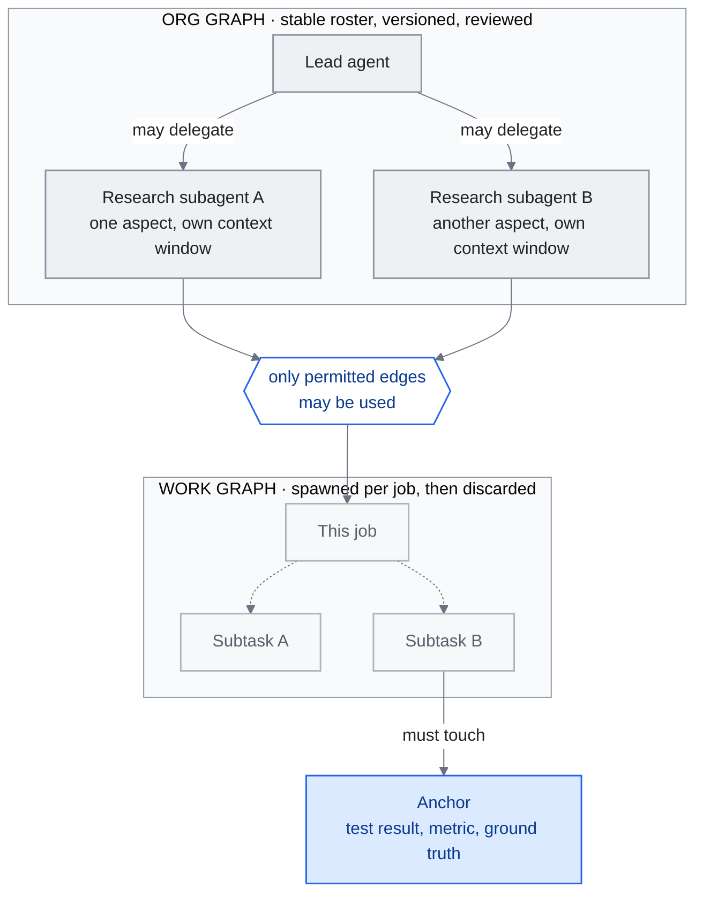

<!-- translation-sync:start -->
> 2026-10-31 영문판과 동기화한 기계 보조 번역입니다. 구조와 내용을 검토했습니다. 코드와 도표 라벨은 원문을 유지하며 읽기 시간은 영어 원문 기준 추정치입니다.
> [English source](../../../chapters/14-graph-engineering.md) · [Sync record](../../SYNC.md)
<!-- translation-sync:end -->

<!-- i18n-anchor -->

# 14장: Graph Engineering —— 에이전트 조직을 배선하기

> **한 문장으로:** 그래프 엔지니어링은 루프 엔지니어링 위의 다음 계층이 어떤 에이전트가 있고, 누가 누구에게 위임하며, 루프가 어떻게 서로 감독하고 수정하는지를 명시적으로 연결하는 그래프라는 July 2026의 주장이다.
>
> **왜 중요한가:** 이 주장이 살아남는다면, 이는 멀티-에이전트 시스템이 루프들의 임기응변적 모음이기를 멈추고 설계된 조직이 되는 계층에 이름을 준다; 살아남지 못한다면, 이는 이런 세대적 라벨들이 어떻게 만들어지는지 —— 그리고 어떻게 만들어지지 않게 되는지 —— 를 보여주는 가장 명확한 살아있는 사례 연구다.
>
> **읽기 시간:** 약 29분 (6,600단어 / 분당 230단어)

*그림: 14.2절이 구분하는 두 객체, 즉 허용된 위임 연결의 안정적인 조직 그래프와 그 안에서 작업 하나가 만드는 일시적인 작업 그래프다. 서로 검토하는 에이전트가 자신만만한 합의에 수렴하지 않게 하는 외부 근거 점검인 Perez의 앵커도 있다. 그래프 엔지니어링이라는 용어는 논쟁적이지만(14.3) 이 구조 자체는 그렇지 않다.*

이 장은 용어가 약 이 주 됐던 late July 2026에 처음 쓰였고 13장에서 이 가이드 최단기 아이디어라는 지위를 가져왔다. "Graph engineering"은 July 17-18, 2026 뒤 며칠간 구체화됐으며 학술 문헌 없이 실무자 블로그와 공급업체 글에만 존재했다. 여전히 이 가이드에서 가장 논쟁적인 용어다. 가장 강한 반응은 말 그대로 그래프의 이름을 딴 프레임워크 공급업체 LangChain의 것으로, 실무는 세 해 됐고 새것은 명칭뿐이라는 주장이었다.

첫 초안은 판결 대신 September 2026에 확인할 네 신호의 판정 기준으로 끝났다. **September 15, 2026에 점검했고 결과는 갈렸다. 용어는 실제로 명시한 유통 검사를 통과했지만 독립적인 엔지니어링 계층이라는 지위는 입증되지 않았다.** 14.7절은 날짜를 명시한 평가표, 신호별 근거, 점검 때문에 July 초안에서 고친 두 사항을 담는다. 그 사이 절들은 여덟 주간 들어온 증거, 즉 이름 없이 구조를 출시한 두 번째 공급업체, 명명보다 일 년 이상 앞선 실서비스 설명, 오픈소스 에이전트 회사, 유료 강좌, 어느 용어가 죽었는지 논쟁하는 두 번째 글 흐름을 다룬다.

아래에는 의도적으로 유보를 둔다. 회의론자에게 지지자만큼 지면을 주고, 출처별 조회 수가 충돌하면 그대로 밝힌다. 별도 언급이 없으면 "at the time of writing"는 late July 2026을 뜻한다.

본 장은 촉매가 된 포스트와 그것이 촉발한 에세이 물결, 새 프레임이 실제로 주장하는 것, 그에 대한 반발, 그 이름이 필요하게 만드는 지식 그래프와의 구별, 만약 이것이 계층이라면 어디에 놓이는지, 중국 생태계의 메아리, 그리고 실무자가 지금 신경 써야 하는지를 다룬다.

---

<!-- i18n-anchor -->

## 14.1 시작점이 된 트윗 (July 17-18, 2026)

이 가이드가 방금 본 방식이라 익숙하다. June 7 게시물로 루프 엔지니어링을 촉발한 지 여섯 주 뒤(13.1장), OpenClaw 제작자이자 현 OpenAI 소속 **Peter Steinberger**가 다시 글을 올렸다. [Carlos E. Perez](https://medium.com/intuitionmachine/from-loop-engineering-to-graph-engineering-d3ebeb08511c)와 [Yash Thakker](https://explainx.ai/blog/graph-engineering-ai-agents-multi-agent-organizations-2026)가 축어 인용한 문장은 다음과 같다:

> 우리는 아직도 루프 얘기를 하고 있나요, 아니면 이미 그래프로 넘어갔나요?

먼저 두 출처상 주의가 필요하다. 첫째, 이 가이드는 게시물 자체를 직접 가져오지 못했고 별도로 확보한 이차 자료도 동일하게 싣지 않는다. 이 정확한 영어 문구를 인용하는 것은 Perez와 Thakker뿐이다. [LangChain](https://www.langchain.com/blog/3-years-of-graph-engineering-with-langgraph)과 Perez는 텍스트 인용 없이 게시물을 연결하고, [36kr](https://eu.36kr.com/en/p/3904771418867330)와 Tony Bai는 중국어로 옮긴다. 36kr 영문판은 이를 "Are we still talking about loops, or have we moved on to graphs?"로 역번역한다. [Eigent](https://www.eigent.ai/blog/graph-engineering-ai-agents)는 의역한다. 위 문구를 실은 근거는 축어 인용 두 건이다.

둘째, 관련 숫자가 일치하지 않는다. 날짜를 명시한 모든 출처는 July 18로 적는다. 제목의 July 17은 미국 시간일 가능성이며 출처 사이에 확인된 날짜 불일치는 아니다. 조회 수는 실제 충돌하지만 같은 순간의 경쟁 측정보다 서로 다른 때의 스냅샷이다. Thakker는 수 시간 내 575K, 36kr는 이틀 내 2.6M(같은 기사에서 여섯 주 전 루프 게시물은 8.4M), Tony Bai는 이틀간 약 800K라고 한다. 여기서는 어느 숫자 하나도 사실로 확정하지 않는다.

June 게시물처럼 Steinberger는 이름을 붙이지 않았다. "graph engineering"은 글 어디에도 없다. 며칠 안에 반응 글들이 프롬프트, 컨텍스트, 하네스, 루프 엔지니어링을 의식적으로 본떠 합성어를 만들었고 흐름은 빨랐다:

- **July 18**: [Yash Thakker의 explainx.ai 가이드](https://explainx.ai/blog/graph-engineering-ai-agents-multi-agent-organizations-2026)(July 26까지 갱신)가 트윗을 계기로 지목하고 조직 그래프 / 작업 그래프 구분을 제시한다.
- **July 19**: **Carlos E. Perez**(Intuition Machine)가 첫 본격적인 이론적 확장을 발표한다.
- **July 20**: 기업용 공급업체 **TrueFoundry**가 통제 체크리스트를 갖춘 [실서비스 중심 가이드](https://www.truefoundry.com/blog/graph-engineering-enterprise-guide)를 내놓는다.
- **July 21**: **eigent.ai**가 공급업체 글을 내고 중국의 **Tony Bai**와 **36kr**도 같은 날 담론을 보도한다(14.6).
- **July 22**: Sydney Runkle과 Harrison Chase의 **LangChain** 공식 응답이 계기 나흘 뒤 나온다(14.3).

촉매, 에세이 물결, 벤더의 반대-프레임, 그리고 중국-생태계 메아리, 이 모두가 일주일 안에: loop-engineering 명명 시퀀스가 더 빠른 속도로 재연된 것이다.

---

<!-- i18n-anchor -->

## 14.2 Graph Engineering이 주장하는 것

에세이들을 압축하면 세 가지 주장이 반복된다.

**에이전트 행동이 아니라 에이전트 조직.** Thakker의 프레이밍이 이 진행에서 가장 인용하기 좋은 버전이다:

> 루프는 에이전트의 행동을 프로그래밍 가능하게 만들었다. 그래프는 에이전트 조직을 프로그래밍 가능하게 만든다.

그의 가이드는 그래프를 두 개의 별개 대상으로 나눈다:

- **org 그래프** —— 어떤 에이전트가 존재하는지, 각각이 무엇을 위한 것인지, 어떤 위임 엣지가 허용되는지를 나타내는 안정적인 차트;
- **work 그래프** —— 특정 작업이 낳고, 실행하고, 폐기하는 일시적인 작업 분해.

주장은, 이 둘 모두가 이제 4장이 harness를 다루고 13장이 루프를 다루는 방식과 같이, 설계되고, 버전 관리되고, 리뷰되어야 할 엔지니어링 산출물이라는 것이다.

**앵커로 고정된 루프 감독 구조.** 첫 이론 확장인 July 19 [Perez 글](https://medium.com/intuitionmachine/from-loop-engineering-to-graph-engineering-d3ebeb08511c)은 그래프를 서로 감독하고 제약하는 루프의 네트워크로 설명한다. 고유한 추가점은 **앵커**다. 그래프의 어떤 노드가 반드시 확인해야 하는 테스트 결과, 지표, 실제 사실 대조 같은 논란 없는 외부 기반 측정이다. 앵커가 없으면 서로 검토하는 그래프는 정확성보다 자신만만한 합의에 수렴하는 반향실로 변한다고 주장한다. 13.4장이 단일 루프에서 기록한 자기 평가 실패의 다중 에이전트 버전이다.

**통제되는 토폴로지.** [TrueFoundry](https://www.truefoundry.com/blog/graph-engineering-enterprise-guide)(July 20)와 [Eigent](https://www.eigent.ai/blog/graph-engineering-ai-agents)(July 21; Steinberger의 계기와 Perez의 루프 네트워크 확장을 모두 인정)의 글은 같은 운영적 해석에 수렴한다. 그래프 엔지니어링은 에이전트 토폴로지의 통제와 관측 가능성이다. 이 관점이 맡는 질문은 다음과 같다:

- 에이전트 사이의 어떤 전환이 허용되고, 어떤 것이 구조적으로 불가능한가;
- 어디에서 실패가 조직 전체로 연쇄되기 전에 격리되는가;
- work 그래프의 폭주하는 가지가 어떻게 탐지되고 잘려나가는가;
- 에이전트 조직에 대한 감사란 애초에 어떤 모습인가.

TrueFoundry는 이를 위한 엔터프라이즈 체크리스트를 출시한다; 그 체크리스트가 존재하는 데 새로운 학문 이름이 필요했는지는 정확히 다음 절이 다루는 질문이다.

**공급업체가 이름 아닌 구조를 출시하다.** August 7, 2026(Claude Code v2.1.224, August 23까지 v2.1.241로 발전)에 Anthropic은 세션 간 에이전트 메시지를 출시했다. `ListAgents`가 하위 에이전트, 에이전트 팀원, 다른 로컬 세션, 클라우드 세션, 다른 기기의 Remote Control 세션 등 이름 있는 세션을 발견한다. `SendMessage`는 이름으로 평문을 전달하며 세션별 수신 통제(수락 / 보류 / 거절), 권한 모드별 기본값, 크기/연속 전송/루프 제한을 적용한다. 범위는 의도적으로 좁다. 대화 이력이나 파일은 넘기지 않고 세션 간 권한 승인도 없으며 Bedrock, Claude Platform on AWS, Google Cloud Agent Platform, Microsoft Foundry에서는 제공하지 않는다. 위에서 정의한 이름 있는 에이전트 명단과 허용 위임 연결의 안정적인 조직 그래프와 비교하면 이름으로 접근하는 세션과 통제된 메시지 연결이라는 출시 사례로 보인다. 그러나 어휘 채택은 아니다. Anthropic 문서와 변경 이력은 이 기능을 설명하며 "graph engineering"을 전혀 쓰지 않는다. 주요 하네스 공급업체가 패턴을 운영화하면서 명칭은 쓰지 않는 이 간극은 용어가 아닌 기본 기능의 증거이며 두 주장은 다르다.

**두 번째 공급업체는 이름이 생기기 한 달 전에 먼저 출시했다.** OpenAI Codex는 다른 경로로 더 일찍 도달했다. June 19, 2026 병합된 [#28792](https://github.com/openai/codex/pull/28792), "Expose thread-level multi-agent mode"와 June 22, 2026 병합된 [#29324](https://github.com/openai/codex/pull/29324), "Simplify multi-agent mode controls"는 위임 동작을 세 상태의 `multiAgentMode` 설정으로 통합했다. 두 번째 PR의 문서는 `none`, "Keep multi-agent tools available without adding mode instructions"; `explicitRequestOnly`, "Only delegate after an explicit user request"; `proactive`, "Delegate when parallel work materially improves speed or quality."로 설명한다. 셋을 모두 포함한 첫 출시는 June 22, 2026의 Codex `rust-v0.142.0`이며 출시 노트는 "App-server clients can configure multi-agent delegation as disabled, explicit-request-only, or proactive at the thread and turn level."이다. Steinberger 글보다 한 달, Anthropic 세션 간 메시지보다 일곱 주 앞선다.

이 통제가 무엇인지 결정하는 `none`을 자세히 읽어야 한다. 도구는 남으며 바뀌는 것은 모드 지시를 추가하는지다. 모델에게 말하는 내용을 바꾸는 위임 정책은 *프롬프트 수준 정책*이지 집행되는 인가가 아니다. 4장이 지시와 구별하는 게이트웨이식 기본 거부 검사도 아니며 어느 PR도 그렇게 주장하지 않는다. 따라서 "a vendor shipped org-graph governance"보다 좁게 읽어야 한다. 공급업체가 조직 그래프 모양의 *설정*을 프롬프트와 같은 방식으로 적용한 것이다. Claude Code처럼 어휘 신호도 비어 있다. 병합 주변 세 버전 출시 노트에 "graph engineering"은 없고 두 PR도 그 용어로 설명하지 않는다.

**명칭보다 열세 달 앞선 실서비스 설명.** 실제 실행되는 에이전트 조직의 가장 상세한 공개 설명은 용어보다 앞서 나왔지만 이 장 초안에서 놓쳤다. Anthropic의 ["How we built our multi-agent research system"](https://www.anthropic.com/engineering/multi-agent-research-system)(June 13, 2025)은 Claude Research의 오케스트레이터-작업자 구조를 설명한다. 주 에이전트가 "analyzes it, develops a strategy, and spawns subagents to explore different aspects simultaneously,"하며 하위 에이전트마다 컨텍스트 창이 있고 별도 CitationAgent가 출처를 귀속한다. 실서비스 세부까지 다룬다. 평가는 "a set of about 20 queries representing real usage patterns"를 LLM 평가자로 사실 정확도, 인용 정확도, 완결성, 출처 품질, 도구 효율에 채점하는 데서 시작했다. 오류는 "that can resume from where the agent was when the errors occurred"인 시스템으로 다루며, 출시는 "rainbow deployments to avoid disrupting running agents, by gradually shifting traffic from old to new versions while keeping both running simultaneously."를 사용한다. 주요 비교는 Anthropic 자체 내부 결과다. Opus 4가 Sonnet 4 하위 에이전트를 이끄는 시스템은 "outperformed single-agent Claude Opus 4 by 90.2%,"였지만 채팅 상호작용의 약 15배 토큰을 썼다. "graph engineering"은 어디에도 없다. 정확히 말해 *실무*의 공개 실서비스 사례가 *명칭*보다 일 년 앞섰다는 증거이며, Anthropic 쪽에서 나온 LangChain의 논지다.

**특정 업체 소속이 아닌 개발자도 만들었다.** 이 패턴은 공급업체에만 있지 않다. [`headcount`](https://github.com/cbrock84/headcount)(GitHub 사용자 cbrock84, August 28, 2026 저장소 생성, MIT 라이선스)는 Claude Code용 에이전트 조직 전체를 패키징한다. README는 "a chief executive over 16 departments, 172 skills in total,"을 설명하며 각 부서는 독립 설치 플러그인이다. 흥미로운 통제 아이디어는 둘이다. Security와 Legal & Risk는 의견을 더하는 대신 작업을 멈추고 감사 대상 기능 밖으로 보고하는 **검토자 유형** 부서다. 또한 "a topic split has no checkable boundary."라는 이유로 에이전트를 "exclusive write surface, not by topic,"에 따라 나눈다. 독립 개발자가 기존 하위 에이전트와 플러그인 기본 기능만으로 만든 명시적인 권한 모델의 조직 그래프다. 성숙도 증거는 얇다. 작업량, 신뢰성, 비용 데이터가 없고 GitHub 설명은 오래된 "15+ departments, 125+ skills,"를 여전히 내세우며 README에도 "graph engineering"은 없다.

조직 전체의 모니터링 경계는 [4장](04-harness-engineering.md#48-harness-maintenance-the-stress-testing-imperative)을 참조하라.

---

<!-- i18n-anchor -->

## 14.3 반발

회의론자들은 여기서 예의상의 단락이 아니라 동등한 지면을 받을 자격이 있다. 나흘 안에 이 담론이 스스로 가장 강력한 반론을 —— 그것을 낼 자격이 가장 큰 당사자에게서 —— 만들어냈기 때문이다.

**LangChain: 이미 세 해 된 방식이다.** [*3 Years of Graph Engineering with LangGraph*](https://www.langchain.com/blog/3-years-of-graph-engineering-with-langgraph)(Sydney Runkle, Harrison Chase, July 22, 2026)는 두 일을 동시에 한다. "prompt engineering, context engineering, harness engineering, and loop engineering," 다음에 그래프 엔지니어링을 명시해 이 가이드의 세대 흐름에 한 단을 더하며 용어를 정당화한다. 동시에 용어의 거품도 뺀다:

> 에이전트 시스템을 그래프로 표현하는 것은 새로운 일이 아니다. 우리는 세 해 동안 해 왔다.

환원은 명확하다. **루프는 단지 방향성 순환 그래프다.** LangGraph는 2023년부터 노드, 연결선, 조건부 전이, 순환으로 에이전트를 모델링했다. 이 관점에서는 July 2026에 바뀐 것은 어휘뿐이다. 실무가 명칭보다 세 해 앞서며 명칭이 더하는 것은 역량이 아닌 이름이다.

이것이 증거 기반에 하는 일에 주목하라. graph engineering이 가진 가장 강한 채택 신호 —— 대형 프레임워크 벤더가 나흘 안에 응답한 것 ——은 동시에 그것의 가장 강한 회의적 출처이기도 하다. 같은 문서가 둘 다이며, 정직한 설명이라면 이를 둘 다로 지고 가야 한다.

**Tony Bai: 오늘의 틀이 내일의 폐기물이 될 수 있다.** 중국 개발 인프라 필자의 [July 21 글](https://tonybai.com/2026/07/21/from-loop-engineering-to-graph-engineering/)은 루프가 루프를 감독하고 앵커로 고정하는 관점을 호의적으로 설명한 뒤 반전한다. 루프 엔지니어링이 인기를 얻은 지 두 달도 안 돼 실리콘밸리는 다음 용어를 만들었고 "graph"도 내일 버려질 유행어일 수 있다는 것이다. 루프 관점의 초기 신중한 해설자이므로 반사적 과장 반대가 아니며 경고가 더 무겁다.

**증거 부재가 말했던 것과 여덟 주의 변화.** 이 주가 지난 late July 2026에는 이 용어를 쓰는 학회 발표, 강좌, 채용 공고가 없었고 이 가이드를 위한 검색에도 없었다. 이 주도 안 된 용어와도, 지속되지 않을 용어와도 부합해 당시 증거로 둘을 구별할 수 없다는 것이 정직한 결론이었다. September 점검까지 셋 중 하나만 변했다. [Graph Engineering Mastery](https://graphengineerings.com/)라는 유료 강좌가 생겨 실제 조직 그래프 의미로 가르친다. 여섯 모듈을 평생 $6.93 또는 월 $19.63에 팔고, [Module 2](https://graphengineerings.com/course/module-2.html)의 "Orchestration and Multi-Agent Topology,"는 라우팅, 분배와 합류, 감독자-전문가 계층, 병합 로직, 앵커를 열한 강의와 단위 테스트 가능한 실습("Build a support-ticket router... The branch condition must be a unit-testable pure function")으로 다룬다. 광고가 아닌 교육 자료다. 다만 익명에 가깝다. 강사 이름 없이 캘리포니아 Newark 주소와 전화번호 옆 "© 2026 GraphEngineerings.com" 하단에서 "The Case006 for Justdoit.work"로만 식별한다. 인가를 주장하지 않고 나열한 업계 인물은 "are not presented as formal faculty or endorsers."라고 명시한다. 나머지 두 신호는 변하지 않았다. AgentEng London(October 16, 2026, Everyman Cinema, Crossrail Place)은 "disciplines such as context, harness, memory, evaluation, inference, protocols, and agentic coding"을 나열한다. 완전한 분류가 아닌 예시 목록이지만 그래프는 없고 페이지 다른 곳에도 "graph"는 없다. mid-September 기준 공개 연사 명단도 없다. 채용 검색은 14.4에서 구별하는 기존 지식 그래프 데이터베이스 직무만 반환한다.

**September 글들은 누구의 사망 선언과 싸우는가.** 가장 강한 계승 주장은 Steinberger 질문이 아닌 "Loop Engineering Is Dead. Enter Graph Engineering,"라는 글 제목이다. SmartScope는 Hamel Husain의 July 18, 2026 글로 귀속시키고 Steinberger의 00:34 UTC 게시물 약 네 시간 반 뒤로 본다. Towards Data Science는 제목과 저자는 밝히지만 날짜는 주지 않는다. 이 가이드는 해당 글을 직접 가져오지 못했으며 제목·날짜·저자를 그 이차 자료의 설명대로만 기록한다. 증거에서 중요한 것은 September 반론의 방향이며 거꾸로 읽기 쉽다. [SmartScope September 1, 2026 글](https://smartscope.blog/en/blog/graph-engineering-loop-engineering-logic-review/)은 그래프 엔지니어링의 사망 선언이 아닌 *그 사망 선언에 대한* 반박이다. 논지는 "Graph Engineering is not the successor to Loop Engineering; it is a design lens for connecting multiple loops and agents through shared state, branches, permissions, and failure paths."다. 따라서 September 논쟁은 계승 이야기를 낮추면서 도구는 옹호한다. 용어가 계속 쓰인다는 증거이면서 그 기반의 세대 주장에는 반대한다. 출처 자체의 한정도 따른다. 글은 "as of July 20, the cited posts and public materials do not provide a standard definition, a canonical reference architecture, peer-reviewed evidence of effectiveness, or a comparative benchmark against Loop Engineering."라고 적는다.

---

<!-- i18n-anchor -->

## 14.4 지식 그래프가 아니다

이름에는 이 가이드가 해소해야 하는 충돌이 있다. 2장은 처음부터 그래프를 다뤘기 때문이다. "Knowledge graph engineering"은 시맨틱 웹, 온톨로지, 삼중항 저장소 등 십 년 넘게 확립된 분야다. GraphRAG(2장)는 개체와 관계 그래프로 시스템이 아는 것을 검색하고 추론하게 한다. July 2026 의미의 그래프 엔지니어링은 단어 외에는 공통점이 없다. TrueFoundry의 구분이 가장 명확하므로 경계로 인용한다:

> Knowledge graphs structure what a system knows; graph engineering in the 2026 sense structures who the system is --- its members, mandates, and message paths.

나란히 놓으면, 두 그래프는 데이터 구조라는 단어 말고는 아무 공통점이 없다:

| | 지식 그래프 / GraphRAG (Ch02) | 그래프 엔지니어링 (이 장) |
|---|---|---|
| 노드 | 엔티티 | 에이전트 |
| 엣지 | 라벨이 붙은 관계 | 허용된 위임 |
| 구축 | 인덱싱 시점에 | 아키텍처 시점에 |
| 사용 | 검색 시점에 | 런타임에 (순회되고, 변형된다) |
| 답하는 질문 | 시스템은 무엇을 아는가? | 시스템은 누구인가? |

2장의 GraphRAG 절에서 본 장으로 넘어온 독자는, 공유된 단어를 어휘의 우연으로 대해야지, 공유된 계보로 대해서는 안 된다. (2장은 반대 방향 포인터를 지닌다.)

---

<!-- i18n-anchor -->

## 14.5 어디에 놓이는가 —— 다섯 번째 세대인가, 네 번째의 리팩터인가?

이 프레임이 살아남는다면, 본 가이드의 진화 서사에서 어디로 가는가? 본 가이드의 척추는 prompt (1장)에서 context (1-3장)로, harness (4장)로, loop (13장)로 이어진다. 지지자들의 답은: 한 층 더. LangChain 자체의 나열 —— graph engineering을 prompt, context, harness, loop 뒤에 놓는 것 ——은 그 참신함을 반박하면서도 이를 다섯 번째 단으로 자리매김한다.

해당 기간의 가장 유용한 구조적 설명은 가장 최근 것이기도 하다. [MarkTechPost July 29 글](https://www.marktechpost.com/2026/07/29/prompt-engineering-vs-loop-engineering-vs-graph-engineering-what-changes-at-each-layer/)은 계층이 후계자가 아닌 쌓인 제어 단위라고 주장한다:

- **harness** (4장)는 하나의 에이전트를 둘러싼 환경이다;
- **loop** (13장)은 하나의 에이전트의 행동 사이클이다;
- **graph**는 안정적인 조직 그래프와 일시적인 work 그래프를 통해 여러 에이전트를 조율한다.

그 관통선 —— "graphs are built from loops, and loops are built from prompts" ——는 1장의 공존 테제가 한 상자 확장된 것이며, 본 가이드가 이미 앞선 계층들을 다루는 방식과 가장 잘 맞는 해석이다.

축소 해석도 같은 사실에 들어맞는다. LangChain 말처럼 루프가 방향성 순환 그래프라면 루프들의 그래프는 더 큰 루프 시스템이며, "graph engineering"은 한 에이전트 대신 N개에 적용한 하네스+루프 엔지니어링이다. 다섯 번째보다 네 번째 계층의 재구성이다. 13장은 루프가 실제 계층인지 "harness engineering with a scheduler attached"인지 열어 뒀다. 그래프 엔지니어링은 그 열린 질문을 이어받고 자체 질문도 더한다. 이 가이드는 July에도 September에도 해결하지 않았다.

두 달의 변화는 답이 아닌 질문의 모양이다. 여러 에이전트가 한 작업을 하면 누가 누구에게 넘길 수 있고, 실패가 어디서 멈추며, 어떤 것을 감사 대상에게 종속되지 않는 쪽이 검토할지 결정해야 한다는 설계 범위는 실제로 존재하며 이름 붙일 가치가 있다. 이제 Codex의 세 위임 상태, `headcount` 검토자 부서, Anthropic 주 에이전트+하위 에이전트 구조처럼 읽을 수 있는 산출물도 있다. 입증되지 않은 것은 그 범위가 아래 계층에서 *독립적*이라는 점이다. 여기서 명명 가능한 모든 출시 사례는 하네스 기능이나 루프 정책이다. Claude Code 세션 간 메시지는 하네스 기능, Codex 위임 모드는 스레드 설정, Anthropic 연구 시스템은 하위 루프를 띄우는 오케스트레이터 루프, `headcount`는 기존 하위 에이전트 위의 플러그인 배치다. September 글들도 다른 방향을 당긴다. [Towards Data Science September 14 글](https://towardsdatascience.com/graph-engineering-for-ai-agents-from-prompts-and-loops-to-workflows/)(Nhu Hoang)은 "you define the nodes, routing logic, and checkpoints in advance"와 "the graph decides what happens next,"라며 그래프를 미리 정한 제어 흐름으로 정의한다. 이는 에이전트 조직보다 작업 흐름의 결정성 주장이다. 아래 계층의 설정으로만 관찰되고 지지자도 양립하기 어려운 두 방식으로 설명하는 범위가 유용한 관심 지점일 수는 있지만, 독립적인 층을 얻지는 못했다. 1장은 다중 에이전트 조정을 하네스 상자에 두며, 이는 임시 표기가 아닌 유효한 대안 해석이다.

---

<!-- i18n-anchor -->

## 14.6 중국-생태계 메아리

한 프레임이 자신이 발원한 거품을 벗어났다는 더 강한 신호 중 하나는 중국 개발자 생태계가 얼마나 빨리 그것을 받아들이는지이며, 여기서 그 메아리는 사흘 안에 도착했고, 이미 정착된 번역어를 달고 있었다: **图工程**.

검증된 근거는 둘이다. [Tony Bai July 21 글](https://tonybai.com/2026/07/21/from-loop-engineering-to-graph-engineering/)의 제목은 「Loop Engineering才火两个月，硅谷已经卷出"Graph Engineering"了」다. 중국 인프라 독자에게 Perez의 루프 감독과 앵커를 설명하며 14.3의 유행어 경고도 붙인 실질적 해설이다. [36kr 영문판 보도](https://eu.36kr.com/en/p/3904771418867330)(같은 July 21)는 담론을 뉴스로 다뤄 14.1의 조회 수 비교를 싣고 Geoffrey Huntley, Boris Cherny, Addy Osmani, Luis Catacora를 참여자로 거론한다. (이 귀속은 36kr에만 의존하므로 그렇게만 인용한다.)

이 둘을 넘어서면, 메아리는 제목 수준으로 얇아진다. 중국어 검색은 CSDN 智能体开发者社区의 두 편을 표면화했다 —— 하나는 「从Loop Engineering到Graph Engineering」로 담담하게 제목이 붙었고, 하나는 「Loop工程已死，Graph工程永生」 ("Loop engineering is dead, graph engineering lives forever" —— 13.8장이 loop 물결에 대해 문서화하는 것과 같은 已死 훅)이라는 완전한 과대광고 템플릿을 달렸다 ——그리고 번체 중문 해설 하나. 셋 중 어느 것도 본 가이드를 위해 독립적으로 fetch되지 않았다; 이들은 검색 결과의 제목으로서, CN 콘텐츠 파이프라인이 이 용어와 관여했다는 증거로서만 인용되며, 그 이상은 아니다.

13장에서 본 패턴이다. 루프 엔지니어링 해설을 대량 생산한 파이프라인이 July에는 图工程을 처리했다. 계기와 다음 계기 사이는 약 여섯 주지만 계기에서 반향까지는 며칠이었다.

**September 상태: 조용함이 아니라 미검증.** September 점검은 중국어 반향의 지속을 확인하지 못했다. 이 가이드가 접근 가능한 중국 플랫폼 검색에서는 September 2026 날짜의 관련 图工程 자료가 없었지만, 접근이 너무 약해 부재를 증거로 삼을 수 없다. 위 July 기록도 확보한 두 근거 너머로는 이미 얇았다. 따라서 신호 상태는 July 보도 검증, September 지속 미확인이다. 중국어 반향이 조용해졌다는 뜻으로 읽으면 안 되며, 누구든 그렇게 쓰기 전에 현지 플랫폼에 접근하는 담당자가 다시 점검해야 한다.

---

<!-- i18n-anchor -->

## 14.7 아직 관심을 가져야 할까? 판정 기준과 September 15 평가표

late July 2026의 실무자에게는 이름과 문제가 분리되므로 두 답이 필요했다. 아래 두 문단은 당시 그대로 보존하며, 뒤의 평가표는 그 문단이 설정한 September 점검이다.

**이름과 관계없이 문제는 실제다.** 하네스 하나와 루프 하나로 에이전트 하나를 실행한다면 이 장은 일을 바꾸지 않으며 4장과 13장이 여전히 작동 계층이다. 이미 여러 에이전트를 연결한다면 허용 위임 연결, 연쇄 확산 전 실패 격리 위치, 관측·감사 대상, 자기 합의로 흘러가지 않도록 앵커를 확인할 노드 같은 질문은 "graph engineering"이라는 이름의 생존과 관계없이 존재한다. TrueFoundry 체크리스트와 Perez 앵커는 어떤 어휘로도 지금 쓸 수 있다. LangChain의 반론도 이 점에서는 동의다. 세 해 동안 이런 그래프를 설계했다면 문제도 적어도 세 해 됐다는 뜻이다.

**명칭에 대한 내기에 참여할 필요는 없다.** 이 가이드는 루프 엔지니어링이 다섯 주 됐을 때 13장을 추가했다. 그래프 엔지니어링은 더 빠른 글 흐름, 같은 주의 프레임워크 공급업체 응답, 더 빠른 중국어 반향이라는 더 강한 초기 증거와, Stripe minions급 실서비스 사례·공급업체 교육 과정·벤치마크가 없다는 더 약한 성숙도 아래 이 주 만에 한 장을 얻는다. 따라서 주장 대신 판정 기준으로 끝난다. **생존 검사는 September 2026에도 이 용어가 계속 쓰이는지다.** 구체적으로 다음을 보라:

- 프레임워크나 벤더 문서가 블로그 프레이밍만이 아니라 제품 어휘로 이 용어를 채택하는 것;
- 컨퍼런스 발표, 강좌, 또는 채용 공고가 이를 쓰는 것 (이 글을 쓰는 시점: 없음);
- loop engineering에 Stripe의 minions가 준 무게에 견줄 만한, 이름이 붙은 프로덕션 사례 연구;
- 한 포스트에 대한 응답으로 쓰이지 않은 두 번째 에세이 물결.

이 신호들이 오면 이 장도 13장처럼 자란다. 오지 않으면 이 주간의 명명 사건 기록으로 남고 축소 해석이 이긴다.

<!-- i18n-anchor -->

### September 15, 2026 점검 평가표

판정일 22일 전인 August 24, 2026에 중간 집계를 했다. 변화를 주장만 하지 않고 보여 주기 위해 두 결과를 함께 싣는다.

| July에 명시한 신호 | Aug 24, 2026 | Sept 15, 2026 | September 판정 근거 |
|---|---|---|---|
| 1. 프레임워크나 공급업체 문서가 제품 어휘로 용어 채택 | 미충족 | **미충족** | 이 절에서 직접 확인한 Claude Code 세션 간 메시지 문서와 변경 이력, Codex 위임 PR과 출시 노트는 이름 없이 구조를 설명한다(14.2). LangChain 글은 제목에 용어가 있지만 기준은 블로그 관점이 아닌 제품 어휘다. 모든 공급업체 문서의 체계적인 날짜별 감사는 하지 않았으므로 보편적 부재를 입증한 것이 아닌 수집 증거상 미충족이다. |
| 2. 용어를 쓰는 학회 발표, 강좌, 채용 공고 | 미충족 | **약하게 충족** | Graph Engineering Mastery는 실제 조직 그래프 수업을 판다(14.3). 학회 트랙은 없다. AgentEng London 페이지 어디에도 "graph"가 없고 분야 목록은 예시("disciplines such as...")이지 전체 목록은 아니다. 채용은 기존 지식 그래프 직무 외에 없다. |
| 3. Stripe minions가 루프 엔지니어링에 준 무게에 해당하는 이름 있는 실서비스 사례 | 부분 충족 | **사후적으로 충족** | Anthropic June 2025 다중 에이전트 연구 시스템 설명: 배포 구조, LLM 평가, 실패 후 재개, 무지개 배포, 내부 비교 90.2%(14.2). |
| 4. 게시물 하나의 답글이 아닌 두 번째 독립 글 흐름 | 충족 | **충족** | August까지 석 달간 독립 글, September 1 SmartScope와 September 14 실제 예제의 Towards Data Science 튜토리얼(14.3, 14.5). |

**합산 방법은 기준에 없었으므로 암시하지 않고 여기서 명시한다.** July 원문은 정족수, 가중치, 합산 규칙 없이 네 항목 뒤 "if those arrive."라고 썼다. 엄밀히 읽으면 원문 자체 문장의 검사는 항목보다 좁은 *September 2026에도 용어가 계속 쓰이는지*다. 답글이 아닌 석 달간의 글, 조직 그래프를 가르치는 유료 강좌, September 튜토리얼로 실제로 그렇다. 나머지 세 항목은 유통과 제도적 성숙을 함께 갖춘 모습을 설명했지 만장일치 요건으로 쓰지 않았다. 증거를 본 뒤 그렇게 읽으면 기준 적용이 아닌 이동이다.

**점검으로 July 초안을 고친 두 가지.** 첫째, July 원문은 "no production case study comparable to Stripe's minions."라고 단정했다. Anthropic 연구 시스템 설명이 당시 이미 열세 달 됐으므로 사례가 있었다. 13장은 Stripe minions가 명칭보다 앞서도 실서비스 사례로 세며, 같은 기준을 적용하면 Anthropic 설명도 해당한다. 이를 놓쳐 July 성숙도 평가가 증거보다 가혹했다. 둘째, 이 가이드 자체 판정 메모를 포함해 처음에는 September 글을 그래프 엔지니어링의 사망 선언 논쟁으로 읽었다. 실제 논쟁은 루프 엔지니어링의 사망 선언이다(14.3).

**September 15, 2026 판정: 용어는 유통 검사를 통과했지만 독립 엔지니어링 계층 지위는 입증되지 않았다.** 둘 다 중요하다. 생존이 정당성 입증은 아니다. 분야와 담론을 구별할 신호 1은 여덟 주 뒤에도 비어 있고, 가장 강한 새 증거는 용어보다 반대 방향이다. 두 공급업체는 용어가 이름 붙인 통제 기능을 만들었고 하나는 용어보다 한 달 먼저 시작했지만 둘 다 그 단어가 필요 없었다. 미입증이 기각도 아니다. 석 달간의 독립 글은 이 주 명명 사건이라는 해석을 반증하고 실무에는 공개 실서비스 사례와 강좌가 있다. 따라서 판정 기준대로 장을 확장하되 번호 붙인 세대로 승격하지 않는다. 그래프 엔지니어링은 다중 에이전트 조정의 논쟁적인 이름으로 남아 확립 계층 아닌 시험 중 주장으로 추적한다. 오늘의 틀이 내일의 유행어 폐기물이 될 수 있다는 Tony Bai 경고가 여전히 가장 공정한 한 줄 요약이다.

판정을 바꿀 다음 조건은 좁고 명확하다. 공급업체가 자체 제품 어휘에 용어를 쓰거나 이름 있는 학회 트랙이 생기는 것이다. September 15, 2026까지 수집한 증거는 둘 다 확립하지 못했다.

<!-- i18n-anchor -->

### October 31, 2026 업데이트: 유통 확대와 의미 분화

September 평가표는 역사적 점검으로 유지한다. October에는 제도적 유통이 더해졌지만 이제 명칭에는 더 많은 한정이 필요하다:

| 신호 | October 증거 | 확립하는 것 |
|---|---|---|
| 공급업체 어휘 | Neo4j [October 6 웨비나](https://neo4j.com/events/on-demand/)가 절차 메모리와 유형화된 AIP 스킬 그래프에 그래프 엔지니어링을 쓴다. | 공급업체 교육적 사용이며 제품 문서의 조직 그래프 의미 채택은 검증되지 않음. |
| 학회 발표와 교육 | [보관된 AI Engineer NYC 일정](https://ai.engineer/nyc/2026/schedule)에 Zachary Blumenfeld의 "Graph Engineering 101: Predictability, Governance, Portability"가 October 14에 기재돼 있다. O’Reilly [목록](https://www.oreilly.com/library/view/graph-engineering/9781808812477/)에는 Packt의 October 2026 출간 Volodymyr Pavlyshyn 저 *Graph Engineering: The Loop Memory Model*이 있다. | 이름 있는 예정 발표와 책으로 교육 신호가 강해짐. 일정은 실제 발표, 정확한 의미, 전용 학회 트랙을 검증하지는 않음. |
| 실서비스 증거 | September의 실서비스 설명은 조정되는 에이전트의 증거로 남는다. | 실서비스 토폴로지가 별도 엔지니어링 계층을 확립한다는 새 주장은 없음. |
| 지속적 유통 | October 공급업체 행사, 학회 목록, 책은 기록을 September 너머로 확장한다. | 용어는 계속 쓰이지만 제도적 가시성은 정의를 확정하지 않음. |

Neo4j의 [웨비나 설명](https://go.neo4j.com/WBR-EDU-261006-Procedural-knowledge_Registration.html?utm_campaign=dev&utm_medium=event-hub&utm_source=website)은 절차, 의존성, 출처에 관한 것이다. 자동으로 허용 위임 연결 옆에 놓을 것이 아니라 스킬 그래프와 메모리 옆에 속한다. 책 목록은 루프, 스웜, DAG, 지식 그래프를 아우르지만 메타데이터와 목차만으로 기술적 합의는 확립되지 않는다. 따라서 October 판정은 유통이 더 강해졌으나 조직 그래프 의미와 독립적인 다섯 번째 세대는 입증되지 않았다는 두 구분을 유지한다.

---

<!-- i18n-anchor -->

## 기억할 세 가지

- **조직 그래프와 작업 그래프는 다른 객체다.** 허용된 위임 연결의 안정적인 명단은 그 안에서 개별 작업이 만드는 일시적인 그래프보다 오래 유지된다.
- **앵커가 없으면 서로 검토하는 에이전트는 정확성보다 합의에 수렴한다.** Perez의 해법은 어떤 노드가 논란 없는 외부 기반 측정을 반드시 확인하게 하는 것이다.
- **용어는 유통 검사를 통과했으나 독립 계층 지위는 입증되지 않았다.** 두 공급업체는 단어를 전혀 쓰지 않으며 서로 다른 집행 방식으로 관련 조정 기능을 출시했다. Codex 위임 설정은 집행되는 인가가 아닌 프롬프트 수준 정책이다. 따라서 이 가이드는 번호 붙인 세대 바깥에 둔다.

---

## Sources

- AI Engineer NYC. October 17, 2026 저장한 일정; October 14 세션 목록: [https://ai.engineer/nyc/2026/schedule](https://ai.engineer/nyc/2026/schedule).
- Neo4j. October 6, 2026 행사 목록: [https://neo4j.com/events/on-demand/](https://neo4j.com/events/on-demand/). 웨비나 설명: [Neo4j 등록 페이지](https://go.neo4j.com/WBR-EDU-261006-Procedural-knowledge_Registration.html?utm_campaign=dev&utm_medium=event-hub&utm_source=website).
- O’Reilly Learning. Packt 도서 목록, October 2026: [https://www.oreilly.com/library/view/graph-engineering/9781808812477/](https://www.oreilly.com/library/view/graph-engineering/9781808812477/).
- Steinberger, Peter. X 게시물, "Are we still talking loops or did we shift to graphs yet?" (아래 날짜를 명시한 모든 출처는 July 18, 2026) --- 직접 확보하지 못해 해당 출처를 통해서만 인용한다. Perez와 Thakker(explainx)는 축어 인용, LangChain과 Perez는 인용 없이 링크, 36kr와 Tony Bai는 중국어 번역, Eigent는 의역한다. 조회 수 보고는 출처별로 충돌한다.
- Runkle, Sydney와 Harrison Chase (LangChain). "3 Years of Graph Engineering with LangGraph" (July 22, 2026): [https://www.langchain.com/blog/3-years-of-graph-engineering-with-langgraph](https://www.langchain.com/blog/3-years-of-graph-engineering-with-langgraph) --- 프롬프트/컨텍스트/하네스/루프 다음에 그래프 엔지니어링 나열; "a loop is just a directed, cyclic graph"; 세 해 된 실무라는 반론.
- Perez, Carlos E. (Intuition Machine). "From Loop Engineering to Graph Engineering?" (July 19, 2026): [https://medium.com/intuitionmachine/from-loop-engineering-to-graph-engineering-d3ebeb08511c](https://medium.com/intuitionmachine/from-loop-engineering-to-graph-engineering-d3ebeb08511c) --- 첫 이론적 확장; 루프가 루프를 감독; 반향실을 막는 논란 없는 측정으로서 앵커.
- Thakker, Yash (explainx.ai). "Graph Engineering: After Loops, This Is How You Wire Multi-Agent Orgs (2026)" (July 18, July 26, 2026까지 갱신): [https://explainx.ai/blog/graph-engineering-ai-agents-multi-agent-organizations-2026](https://explainx.ai/blog/graph-engineering-ai-agents-multi-agent-organizations-2026) --- 조직 그래프와 작업 그래프; "Loops made agent behavior programmable. Graphs make agent organizations programmable."
- TrueFoundry. "Graph Engineering for Multi-Agent Systems: Architecture, Governance, and Observability" (July 20, 2026): [https://www.truefoundry.com/blog/graph-engineering-enterprise-guide](https://www.truefoundry.com/blog/graph-engineering-enterprise-guide) --- 기업 체크리스트; 지식 그래프 구분 인용("what a system knows" 대 "who the system is").
- Eigent. "Graph Engineering for AI Agents" (July 21, 2026): [https://www.eigent.ai/blog/graph-engineering-ai-agents](https://www.eigent.ai/blog/graph-engineering-ai-agents) --- Steinberger 계기와 Perez 확장에 출처를 돌림; 서로 수정하는 루프의 통제된 토폴로지.
- 36kr (영문판). "Father of Lobster's One Tweet: Is the Loop Era Over?" (July 21, 2026): [https://eu.36kr.com/en/p/3904771418867330](https://eu.36kr.com/en/p/3904771418867330) --- 트윗 조회 2.6M 대 루프 시기 글 8.4M 보고; 추가 참여자 명명; 용어를 떠오르는 것으로 취급.
- Bai, Tony. 「Loop Engineering才火两个月，硅谷已经卷出"Graph Engineering"了」 (July 21, 2026): [https://tonybai.com/2026/07/21/from-loop-engineering-to-graph-engineering/](https://tonybai.com/2026/07/21/from-loop-engineering-to-graph-engineering/) --- 중국 생태계용 图工程 해설; "graph" 자체도 버려질 유행어가 될 수 있다고 경고.
- MarkTechPost. "Prompt Engineering vs Loop Engineering vs Graph Engineering: What Changes at Each Layer" (July 29, 2026): [https://www.marktechpost.com/2026/07/29/prompt-engineering-vs-loop-engineering-vs-graph-engineering-what-changes-at-each-layer/](https://www.marktechpost.com/2026/07/29/prompt-engineering-vs-loop-engineering-vs-graph-engineering-what-changes-at-each-layer/) --- 쌓인 제어 단위 해석; 조직 그래프 + 작업 그래프; "graphs are built from loops, and loops are built from prompts."
- Claude Code (Anthropic). 세션 간 메시지 문서와 변경 이력(Aug 7, 2026, v2.1.224; Aug 23, 2026까지 v2.1.241로 발전): [https://code.claude.com/docs/en/cross-session-messaging](https://code.claude.com/docs/en/cross-session-messaging) ; [https://code.claude.com/docs/en/changelog](https://code.claude.com/docs/en/changelog) --- ListAgents/SendMessage는 이름 있는 에이전트 발견과 세션 간 통제된 메시지 연결을 제공; 두 페이지 어디에도 "graph engineering"은 없음.
- Anthropic. "How we built our multi-agent research system" (June 13, 2025): [https://www.anthropic.com/engineering/multi-agent-research-system](https://www.anthropic.com/engineering/multi-agent-research-system) --- Claude Research의 오케스트레이터-작업자 구조; 대표 질의 약 20개의 LLM 평가; 오류 후 재개와 무지개 배포; "outperformed single-agent Claude Opus 4 by 90.2%"; 채팅의 약 15x 토큰; "graph engineering"이라는 표현은 전혀 없음. 신호 3의 사후적 실서비스 사례.
- OpenAI Codex. "Expose thread-level multi-agent mode", PR #28792 (June 19, 2026 병합): [https://github.com/openai/codex/pull/28792](https://github.com/openai/codex/pull/28792) ; "Simplify multi-agent mode controls", PR #29324 (June 22, 2026 병합): [https://github.com/openai/codex/pull/29324](https://github.com/openai/codex/pull/29324) --- `multiAgentMode` 세 상태와 축어 설명; `none`은 위임 도구를 유지하고 지시만 빼므로 집행되는 인가가 아닌 프롬프트 수준 정책임.
- OpenAI Codex `rust-v0.142.0` 출시(June 22, 2026 공개): [https://github.com/openai/codex/releases/tag/rust-v0.142.0](https://github.com/openai/codex/releases/tag/rust-v0.142.0) --- 두 PR을 모두 포함한 첫 빌드(출시 노트는 #28685도 함께 인정): "App-server clients can configure multi-agent delegation as disabled, explicit-request-only, or proactive at the thread and turn level."
- cbrock84. `headcount` (저장소 생성 August 28, 2026, MIT): [https://github.com/cbrock84/headcount](https://github.com/cbrock84/headcount) --- "a chief executive over 16 departments, 172 skills in total"; 검토자 유형 Security와 Legal & Risk 부서; 에이전트는 "exclusive write surface, not by topic"으로 분리; 운영 지표 미공개; GitHub 자체 설명은 오래된 "15+ departments, 125+ skills" 상태.
- Graph Engineering Mastery. 강좌 사이트와 Module 2, "Orchestration and Multi-Agent Topology": [https://graphengineerings.com/](https://graphengineerings.com/) ; [https://graphengineerings.com/course/module-2.html](https://graphengineerings.com/course/module-2.html) --- 라우팅, 분배/합류, 감독자-전문가 계층, 병합 로직, 앵커의 열한 강의와 단위 테스트 가능한 실습; 평생 $6.93 또는 월 $19.63; 강사 이름 없이 하단은 캘리포니아 Newark 주소의 "The Case006 for Justdoit.work"로만 식별, 인가 주장 없음, 나열한 업계 인물은 "are not presented as formal faculty or endorsers"임. 신호 2의 증거이며 약하게 표시한 이유.
- SmartScope. "Graph Engineering and Loop Engineering: a logic review" (September 1, 2026): [https://smartscope.blog/en/blog/graph-engineering-loop-engineering-logic-review/](https://smartscope.blog/en/blog/graph-engineering-loop-engineering-logic-review/) --- Hamel Husain에게 귀속된 July 18의 "Loop Engineering Is Dead. Enter Graph Engineering" 관점 반박; "Graph Engineering is not the successor to Loop Engineering; it is a design lens for connecting multiple loops and agents through shared state, branches, permissions, and failure paths"; 글은 평가 범위를 July 20으로 한정하며 당시 인용 게시물과 공개 자료에는 표준 정의, 정본 참조 아키텍처, 동료 심사된 효과 증거, 루프 엔지니어링과의 비교 벤치마크가 없다고 명시.
- Hoang, Nhu (Towards Data Science). "Graph Engineering for AI Agents: From Prompts and Loops to Workflows" (September 14, 2026): [https://towardsdatascience.com/graph-engineering-for-ai-agents-from-prompts-and-loops-to-workflows/](https://towardsdatascience.com/graph-engineering-for-ai-agents-from-prompts-and-loops-to-workflows/) --- 미리 정한 제어 흐름 중심의 실제 예제: "you define the nodes, routing logic, and checkpoints in advance"; "the graph decides what happens next"; 배경으로 Steinberger 게시물과 Husain 제목 인용.
- AgentEng London 2026 (October 16, 2026, Everyman Cinema, Crossrail Place): [https://agentengineering.world/london/](https://agentengineering.world/london/) --- 페이지의 "disciplines such as context, harness, memory, evaluation, inference, protocols, and agentic coding"은 전체가 아닌 예시 목록; "graph"는 페이지 어디에도 없고 September 15, 2026 기준 공개 연사 명단도 없음.

---

*이전 장: [13장 — Loop Engineering](13-loop-engineering.md)*
