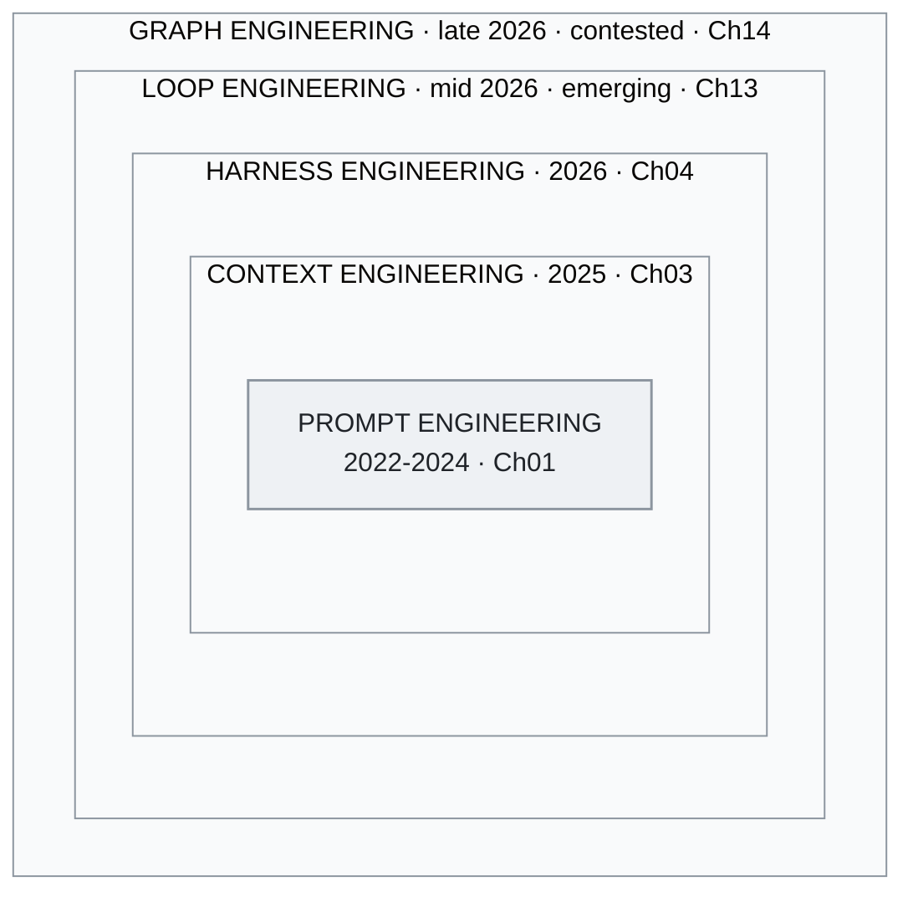

<!-- translation-sync:start -->
> 与 2026-10-31 英文版同步的机器辅助译文，已作结构与内容复核。代码和图中标签保留原文；阅读时间按英文原文估算。
> [English source](../../../chapters/01-evolution.md) · [Sync record](../../SYNC.md)
<!-- translation-sync:end -->

<a id="chapter-01-the-three-generations"></a><!-- i18n-anchor -->

# 第 01 章：三个世代

> **一句话总结：** AI 工程已经从写好 prompt 演进到围绕 AI 模型设计整个操作系统。
>
> **为什么重要：** 理解这个领域的走向, 帮助你挑选合适的工具, 避免过时的方法。
>
> **阅读时间：** ~14 分钟（按英文原文估算：3,108 个单词 / 230 wpm）

**从 prompt engineering 到 context engineering 再到 harness engineering——以及为什么这些边界其实没有你想的那么重要。**

---

<a id="generation-1-prompt-engineering-2022-2024"></a><!-- i18n-anchor -->

## 世代 1：Prompt Engineering（2022-2024）

2022 年十一月 ChatGPT 上线时，人和大型语言模型之间唯一的接口就是一个文本框。由此诞生的学科叫做提示工程：精心设计输入文本以获得更好输出的艺术与科学。

核心技术快速演进:

**Few-shot prompting**（Brown 等, 2020）证明在 prompt 内放入几个例子就能显著提升任务表现, 而完全不需要 fine-tuning。要让模型分类情感, 你不再训练模型, 而是给它三个例子, 然后问它第四个该怎么分。

**Chain-of-thought（CoT）prompting**（Wei 等, 2022）显示, 加一句"Let's think step by step"或在例子里加上推理过程, 能解锁标准 prompting 看不到的多步推理能力。这可以说是首个迹象——**结构怎么写**和**问什么内容**一样重要。

**Prompt 模板** 成为标准抽象。LangChain、LlamaIndex 以及十几个框架都提供了模板系统, 把变量注入精心设计的 prompt 结构。当时的心智模型很清楚：prompt 是程序, 模型是 runtime。

这个时代的其他技术包括:

- **ReAct**（Yao 等, 2022）: 在单一 prompt 结构内交错推理与行动, 让模型在一个 prompt 里规划并执行工具调用。
- **Tree of Thought**（Yao 等, 2023）: 探索多条推理路径, 选择最佳的一条。
- **Self-consistency**（Wang 等, 2022）: 采样多条推理链, 取多数票决。

这个时代的局限在于它的预设：LLM 互动的质量主要由 prompt 质量决定。当上下文窗口只有 4K-8K token、唯一输入只有用户文字时, 这是对的; 当模型可以吃下 100K+ token 并调用外部工具之后, 这就不再成立。

<a id="what-this-era-got-right"></a><!-- i18n-anchor -->

### 这个时代做对了什么

Prompt engineering 确立了一件事: **结构很重要**。好 prompt 和坏 prompt 的差别不是 vibes, 而是信息架构。这个洞察延续到了之后的一切。

<a id="what-this-era-missed"></a><!-- i18n-anchor -->

### 这个时代漏掉了什么

它把 context window 当成静态产物。你写好一个 prompt, 提交, 拿到回应。Context window 本身可以**在 runtime 由多个来源动态构建**——这是下一代的洞察。

---

<a id="generation-2-context-engineering-2025"></a><!-- i18n-anchor -->

## 世代 2：Context Engineering（2025）

2025 年中, Andrej Karpathy 发了一段后来被疯狂转传的话:

> "I've been thinking about this and I think the right term for what most people actually need to get good at is not 'prompt engineering' but 'context engineering.' The art and science of filling the context window with just the right information for the next step."

这次重构很重要, 因为它把焦点从**指令**（prompt）转移到**整个信息包**（context window）。一次现代 LLM 调用的 context window 远不止用户 prompt:

- 定义行为与限制的系统指令
- RAG 流程检索到的文件
- 工具定义和 schema
- 对话历史（选择性压缩过）
- 动态选择的 few-shot 例子
- 关于当前任务的结构化元数据

Prompt 只是其中一块组件。Context engineering 是把这些全部协同安排。

<a id="the-six-techniques"></a><!-- i18n-anchor -->

### 六大技术

[Towards AI 的分析](https://towardsai.net/) 指出 context engineering 的六大核心技术:

1. **Retrieval-Augmented Generation（RAG）**: 在查询时拉取相关文件
2. **工具与 API 整合**: 用结构化 schema 给模型外部能力
3. **记忆管理**: 在对话回合与 session 间维持相关信息
4. **动态 prompt 构建**: 由模板、检索内容和 runtime 状态组装 prompt
5. **Context window 优化**: 管理在有限 token 预算内放什么、不放什么
6. **指令层级**: 系统、开发者、用户指令之间的优先序

<a id="lessons-from-manus"></a><!-- i18n-anchor -->

### 来自 Manus 的教训

[Manus](https://manus.im/) 是 2025 年话题度最高的 AI agent 平台之一, 分享了大规模 context engineering 的关键教训:

**KV-cache 洞察**: Manus 把 context window 工程化, 维持高 KV-cache 命中率——确保之前 attention 计算出来的 key-value 对可以跨回合重用。这大幅降低 latency 和成本。原则是: 安排 context 让**前缀稳定**, 仅**后缀**在调用之间变。

**100:1 比率**: Manus 报告每 1 个输出 token 大约消耗 100 个 context token。这翻转了输出 token 主导成本的常见假设。真正的工程挑战不是产生文字, 而是**选择什么 context 给模型**。

**Context 是产品**: Manus 把 context window 构建当作核心产品功能, 不是实现细节。他们 agent 的质量直接对应 context 组装管线的质量。

<a id="the-taxonomy-shift"></a><!-- i18n-anchor -->

### 分类的转变

Context engineering 把 LLM 应用开发从"write good prompts"重构为"build good information pipelines."。模型变成对收到的任何 context 进行推理的引擎。工程挑战往上游移动——到检索、过滤、排序、压缩与组装。

但即使这个框架也有上限。它说明了**进入模型的是什么**, 但没说明**模型周围的系统如何运作**。这需要再一次转变。

---

<a id="generation-3-harness-engineering-2026"></a><!-- i18n-anchor -->

## 世代 3：Harness Engineering（2026）

2025 年末到 2026 年初, 两份有影响力的内容把下一次演进正式化:

**Birgitta Böckeler**（ThoughtWorks）于 2026 年四月在 Martin Fowler 的 *Exploring Generative AI* 备忘录系列中发表分析，主张 LLM 应用最有影响力的工程工作不是模型训练或提示词设计，而是*系统编排层*，即围绕模型的工具、路由、记忆、规划和错误恢复系统，将模型调用编排成可靠的工作流程。

**OpenAI 的 Codex 团队**已经发布了关于智能体编码中系统编排层的案例资料（公开材料见 openai.com/index/introducing-codex）。广为引用的"three engineers / ~1M lines / ~1,500 PRs"数字，在 2025-2026 年 OpenAI 的演讲和文章中流传；其核心观察是，Codex 的质量主要取决于编排层而非模型，即决定*何时*调用模型、提供*什么上下文*、开放*哪些工具*，以及*如何*验证与从错误中恢复的系统。

<a id="the-phil-schmid-analogy"></a><!-- i18n-anchor -->

### Phil Schmid 的类比

[Phil Schmid](https://www.philschmid.de/)（Hugging Face）提出了让这个概念清晰成形的类比：

- **模型是 CPU**——原始计算能力
- **Context window 是 RAM**——当前操作的工作内存
- **Harness 是操作系统**——调度、资源管理、I/O、错误处理、用户界面

这个类比说明了为什么 harness engineering 重要: 没人会出货一个没有 OS 的 CPU。模型必要但不充分。Harness 决定模型实际能完成什么。

<a id="the-meta-harness-paper-and-the-6x-gap"></a><!-- i18n-anchor -->

### Meta-Harness 论文与 6x 差距

2026 年初发表的研究量化了从业者此前已有的猜测：在复杂任务中，一个裸模型与一个配有良好编排层的模型，表现大约相差 **6x**。同一模型，权重相同、训练数据相同，却会因编排层质量不同而产生六倍的结果差距。

这意味着对大多数实际应用来说, harness engineering 比模型改进有更大杠杆。一个好 harness 配上好模型, 跑赢一个一般 harness 配顶尖模型。

<a id="the-impact-framework"></a><!-- i18n-anchor -->

### IMPACT 框架

2020s 中期的从业者讨论中，IMPACT 助记词逐渐成为评估系统编排层质量的检查清单：

- **I**nstructions——系统指令的清晰度与完整度
- **M**emory——跨 session 的持续与检索
- **P**lanning——任务分解与排序
- **A**ctions——工具可用性与可靠性
- **C**ontext——相关信息的动态组装
- **T**esting——评估与质量保证回路

IMPACT 把 context engineering 定位为更广 harness engineering 学科里的**一个组件**（"C"）。这种嵌套是关键的结构洞察: context engineering 在 harness engineering **之内**, 不是被它取代。

<a id="meta-acquires-manus-2b"></a><!-- i18n-anchor -->

### Meta 收购 Manus（~$2B）

2026 年初，Meta 以约 $2 billion 收购 Manus。这场收购被广泛解读为 Meta 购买的是*编排层，而非模型*。Meta 已经拥有 Llama，缺少的是一套在生产中得到验证、用于上下文组装、工具编排及智能体运行时管理的系统。

收购验证了那个论点: LLM 生态系统里最有价值的工程, 越来越多在编排层, 而非模型层。

---

<a id="the-key-insight-coexistence-not-replacement"></a><!-- i18n-anchor -->

## 关键洞察：共存而非取代

这三个世代不是清晰的历史阶段, 不是后一个取代前一个。它们是**嵌套层**, 在每个生产系统内共存:

```
+--------------------------------------------------+
|              HARNESS ENGINEERING                  |
|  +--------------------------------------------+  |
|  |          CONTEXT ENGINEERING                |  |
|  |  +--------------------------------------+  |  |
|  |  |       PROMPT ENGINEERING             |  |  |
|  |  |                                      |  |  |
|  |  |  System prompts, CoT, few-shot,      |  |  |
|  |  |  instruction formatting              |  |  |
|  |  +--------------------------------------+  |  |
|  |                                            |  |
|  |  RAG pipelines, memory, tool schemas,      |  |
|  |  context window optimization               |  |
|  +--------------------------------------------+  |
|                                                  |
|  Skill routing, planning loops, error recovery,  |
|  progressive disclosure, multi-agent coord       |
+--------------------------------------------------+
```

*图：将同样的嵌套关系绘制成图。实线框是本章编号的三个世代；外侧两个框是第 13 章与第 14 章讨论的争议层，有意放在编号体系之外。*



一个 harness 工程师仍然写 prompt, 仍然做 context engineering。但他还要建构**系统**——决定何时用哪个 prompt、为每种情境组装哪些 context、出错时如何恢复。

演进不是抛弃早期技术, 而是认识到它们必要但不充分——并在它们之上建构那些把原始 LLM 能力转化为可靠、生产级应用程序的层。

上海交通大学及合作机构的 19 位作者在综述 **"Externalization in LLM Agents: A Unified Review of Memory, Skills, Protocols and Harness Engineering"**（arXiv 2604.08224，April 9, 2026）中，独立采用了与本章相同的三层组织方式：在其框架里，领域从*权重*走向*上下文*，再走向*编排层*，并将记忆、技能、协议和系统编排工程视为由编排层统一整合的四个外化组件。对于来自学术文献的读者，这种趋同值得标注：这一框架既非从业者专属，也非本指南独创，2026 年四月下旬的学术综述同样选择了这一组织主轴。

---

<a id="an-emerging-fourth-generation-loop-engineering-mid-2026"></a><!-- i18n-anchor -->

## 新兴的第四世代？循环工程（2026 年中）

本章标题有意保留为*三个世代*。但在 2026 年六月，第四个候选层的成形速度值得在此记录，尽管它还太新，尚不适合纳入编号序列。一周之内，Peter Steinberger 在六月 7 日广泛传播的帖子指出，你"shouldn’t be prompting coding agents anymore ... You should be designing loops that prompt your agents,"，Addy Osmani 同日的文章为其命名为**循环工程**，Boris Cherny（Claude Code）则将自己的工作概括为"writing loops"。从业者开始描述*编排层之上*的一个层次：系统按计划替你提示智能体、生成辅助智能体，并自行补充输入。

倡导者对其与第 3 世代的关系给出了明确界定。Osmani 将循环工程放在"one floor above the harness"：在他的框架中，循环就是编排层，"but it runs on a timer, it spawns little helpers, and it feeds itself."。这延续了本章已有的嵌套逻辑：循环只是最外面的框，包裹编排、上下文和提示，因此循环工程师仍然写提示词、做上下文工程、构建编排层。循环与普通调度器的差别，是每次运行都读取当前状态、重新作出决定，而非按时执行固定命令。

有两项诚实限定，使它暂时留在编号世代之外。撰写时，这个术语约出现五周，完全存在于从业者讨论之中，包括博客、播客与 X，尚无学术文献支撑；读者反应也分成两派，一派认为是真正的转变，另一派认为只是对调度过早重新包装。因此，本指南将循环工程列为*新兴概念*而非定论，对其他尚未经原始来源及时间考验的主张也采取同样立场。[第 13 章](13-loop-engineering.md)完整介绍该框架，将每个关键论断关联到来源，并明确指出空白，而非自行补齐。

命名机器此后又运行了一轮。2026 年七月中旬，距离循环工程那一周六周后，第二个候选概念依照同样路径形成：**图工程**，主张循环之上还有图，即明确连线规定存在哪些智能体、谁可以向谁委派，以及各个循环如何相互监督和纠正。另一篇 Steinberger 帖子成为催化剂（标注日期的来源写作 July 18, 2026，也可能是美国时间七月 17 日），数天内便出现一波文章，反对意见也迅速出现：LangChain 的官方回应把图工程列在提示、上下文、编排与循环工程之后，同时指出，将智能体系统表示为图已有三年实践，循环只是有向循环图，所以新出现的只有名称。第 14 章为这个术语设置了明确的存续检查关口，并于 September 15, 2026 执行。结果分成两部分：图工程仍在流传，证据包括跨越三个月、并非回应最初帖子的文章，一个教授智能体组织含义的付费课程，以及一篇九月教程；然而，在所检查的文档中未发现厂商采用这个术语，两家厂商推出了该术语所指的治理能力，却从未使用其名称，其中一家甚至在术语出现前一个月便已开始。记录的结论是：这个术语作为多智能体协调的争议性名称存活了下来，但其作为独立层次的地位尚未得到证明，因此仍不纳入编号世代。本章将多智能体协调放在编排层内的处理，仍是一种有效的替代解释，而非临时占位。[第 14 章](14-graph-engineering.md)附有注明日期的评分表，并给予怀疑意见同等分量。

---

<a id="three-things-to-take-away"></a><!-- i18n-anchor -->

## 三个要点

- **各世代相互嵌套，而非彼此取代。** 系统编排工程师仍然编写提示词、进行上下文工程，这也是 IMPACT 用"C"将上下文工程包含在内的原因。
- **Meta 花了约 $2 billion 购买编排层。** Meta 已有 Llama，缺少的是经过生产验证的上下文组装与工具编排系统，因此这次收购被理解为购买编排层，而非模型层。
- **命名跑在证据之前。** 循环工程和图工程都由文章浪潮推动出现，而非学术浪潮，因此本章把它们保留在编号的三个世代之外。

---

<a id="sources"></a><!-- i18n-anchor -->

## 来源

- Brown, T. 等（2020）. "Language Models are Few-Shot Learners." [arXiv:2005.14165](https://arxiv.org/abs/2005.14165)
- Wei, J. 等（2022）. "Chain-of-Thought Prompting Elicits Reasoning in Large Language Models." [arXiv:2201.11903](https://arxiv.org/abs/2201.11903)
- Yao, S. 等（2022）. "ReAct: Synergizing Reasoning and Acting in Language Models." [arXiv:2210.03629](https://arxiv.org/abs/2210.03629)
- Yao, S. 等（2023）. "Tree of Thoughts: Deliberate Problem Solving with Large Language Models." [arXiv:2305.10601](https://arxiv.org/abs/2305.10601)
- Wang, X. 等（2022）. "Self-Consistency Improves Chain of Thought Reasoning in Language Models." [arXiv:2203.11171](https://arxiv.org/abs/2203.11171)
- Karpathy, A.（2025 年中）. 关于 "context engineering" 的公开发言; 在 X 与 AI engineering 社群广为流传, 奠定了这个领域采用的工作定义。
- Manus.（2025）. "Context Engineering Lessons from Building Manus." [manus.im/blog](https://manus.im/blog) ——KV-cache 命中率作为运营指标、append-only context、工具 logit-bias masking、滚动 todo-list 重写。
- Böckeler, Birgitta.（2026 年四月 2 日）. "Harness engineering for coding agent users." martinfowler.com（*Exploring Generative AI* 系列）。[https://martinfowler.com/articles/harness-engineering.html](https://martinfowler.com/articles/harness-engineering.html) ——Guides vs. Sensors、Computational vs. Inferential 分类。
- OpenAI. Codex 公开材料：[https://openai.com/index/introducing-codex](https://openai.com/index/introducing-codex)。用于支撑 Codex 的编排层设计框架；广为引用的"three engineers / ~1M lines / ~1,500 PRs"数字在 2025-2026 年 OpenAI 演讲与文章中流传，此处作为社区引述报告，而非归于某一篇权威原文。
- Schmid, Philipp. "The New Skill in AI is Not Prompting, It's Context Engineering" 与续篇。[https://www.philschmid.de/context-engineering](https://www.philschmid.de/context-engineering); [https://www.philschmid.de/context-engineering-part-2](https://www.philschmid.de/context-engineering-part-2) ——模型 = CPU、Context = RAM、Harness = OS 类比。
- IMPACT 助记词。Intent / Memory / Planning / Authority / Control flow / Tools，即意图、记忆、规划、权限、控制流与工具，是 2020s 中期从业者讨论中出现的六维编排层设计清单。本章将它用作教学框架，不归于某一特定原始来源。
- Meta/Manus 收购报道.（2026）. 多个来源。
- Zhou, C. 等（2026 年四月）. "Externalization in LLM Agents: A Unified Review of Memory, Skills, Protocols and Harness Engineering." [arXiv:2604.08224](https://arxiv.org/abs/2604.08224) ——上海交通大学等机构 19 位作者的综述，独立使用权重 → 上下文 → 编排层的三层历史框架。在本章"Coexistence, Not Replacement"一节中引用，用以说明从业者论点与学术文献的趋同。
- Steinberger, Peter（@steipete）. 推动"design loops that prompt your agents"框架出现的帖子（2026 年六月 7 日）。[https://x.com/steipete/status/2063697162748260627](https://x.com/steipete/status/2063697162748260627) ——在"Emerging Fourth Generation"一节引用；帖子本身没有使用"loop engineering."这个词。
- Osmani, Addy. "Loop Engineering"（2026 年六月 7 日）。[https://addyosmani.com/blog/loop-engineering/](https://addyosmani.com/blog/loop-engineering/) ——为该实践命名的文章；本章第四世代一节中"one floor above the harness"关系的来源。
- Cherny, Boris. Lenny's Podcast / Lenny's Newsletter 访谈（2026 年中）。[https://www.lennysnewsletter.com/p/head-of-claude-code-what-happens](https://www.lennysnewsletter.com/p/head-of-claude-code-what-happens) ——"my job is to write loops"的框架；这是一句口述引文，不同媒体转写并不一致。
- Runkle, Sydney 和 Chase, Harrison（LangChain）. "3 Years of Graph Engineering with LangGraph"（2026 年七月 22 日）。[https://www.langchain.com/blog/3-years-of-graph-engineering-with-langgraph](https://www.langchain.com/blog/3-years-of-graph-engineering-with-langgraph) ——将图工程列在提示、上下文、编排与循环工程之后，同时主张该实践已有三年；本章新兴世代一节中可归约为有向循环图的来源。
- Perez, Carlos E. "From Loop Engineering to Graph Engineering?" Intuition Machine（2026 年七月 19 日）。[https://medium.com/intuitionmachine/from-loop-engineering-to-graph-engineering-d3ebeb08511c](https://medium.com/intuitionmachine/from-loop-engineering-to-graph-engineering-d3ebeb08511c) ——对 2026 年七月图工程框架的首次理论扩展；用以支持循环监督循环的解释。

---

*下一章：[第 02 章：RAG、长上下文与知识图谱](02-knowledge-layer.md)*
