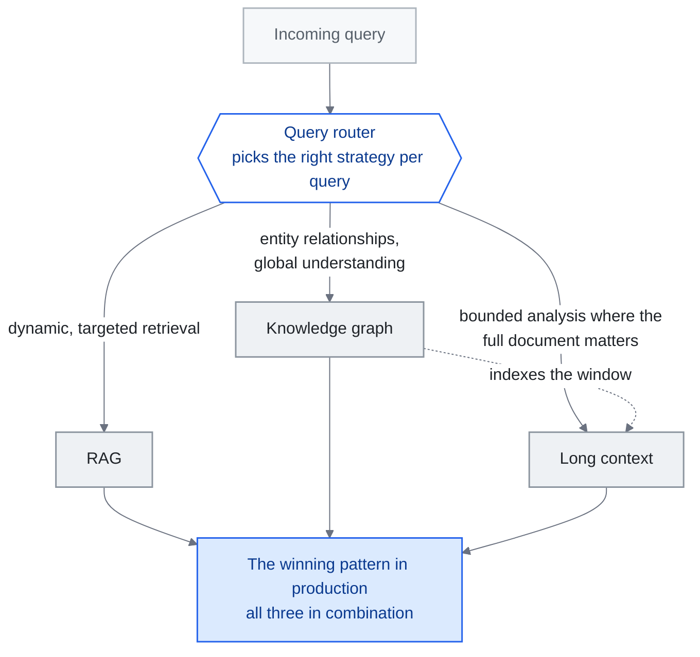

<!-- translation-sync:start -->
> 与 2026-10-31 英文版同步的机器辅助译文，已作结构与内容复核。代码和图中标签保留原文；阅读时间按英文原文估算。
> [English source](../../../chapters/02-knowledge-layer.md) · [Sync record](../../SYNC.md)
<!-- translation-sync:end -->

<!-- i18n-anchor -->

# 第 02 章：RAG、长上下文与知识图谱

> **一句话总结：** 给 AI 取得知识有三种主要方法: 搜数据库（RAG）、喂长文件、或在图里连结事实。
>
> **为什么重要：** 如果你用 AI 处理任何关于自己数据的事情, 这章解释哪种做法最适合你的情境。
>
> **阅读时间：** ~16 分钟（按英文原文估算：3,453 个单词 / 230 wpm）

*图："Hybrid Architectures: The Convergence" 部分的三路选择，围绕该部分放置在其获胜生产模式末尾的查询路由器绘制。路由器外的每个边缘都会命名沿该分支发送查询的需求。虚线边缘是 "KG as Semantic Backbone for Long Context" 部分的单独声明——该图索引了一个它不再需要替换的窗口——并且汇聚在混合盒上的边缘承载了本章的论点，即工程工作是路由器，而不是选择。*

**知识检索层——什么有效、什么无效, 为什么答案几乎永远是"hybrid."。**

---

<!-- i18n-anchor -->

## RAG 没死

更大的上下文 windows 扩展了设计空间，但窗口大小本身并不能决定系统使用证据的可靠性。 [Liu et al.](https://arxiv.org/abs/2307.03172) 表明答案质量可能取决于相关信息在长输入中出现的位置。针对您自己的问题评估检索和全上下文方法，包括答案质量、token使用、延迟以及当前证据如何到达模型。

RAG 没死, 它在演化。问题从来不是"RAG or not RAG"——而是"what kind of RAG, combined with what else."。

---

<!-- i18n-anchor -->

## 成本现实

RAG 的经济论点仍然压倒性。

一个典型 RAG 管线检索 5-20 个相关 chunk（约 2,000-8,000 token）, 把它们喂入模型调用。同样查询的 context-stuffing 做法可能需要加载 500K-1M token 的来源文件。

**每查询成本对比（约略, 2026 年中价格）:**

| 做法 | 输入 token | 约略成本 | 相对成本 |
|------|-----------|---------|---------|
| RAG（针对性检索） | ~5,000 | ~$0.00008 | 1x |
| Context-stuffing（全库） | ~500,000 | ~$0.10 | 1,250x |

这不是四舍五入的误差。在企业规模——每月数百万查询——每月推论成本 $80 与 $100,000 的差异决定项目是否能撑过预算审查。

检索可以减少输入token的使用，但总成本还包括索引、检索、缓存和任何额外的模型调用。将完整的管道与相同答案质量目标的完整上下文基线进行比较；更便宜的设计取决于语料库大小、查询量和模型定价。

---

<!-- i18n-anchor -->

## 长上下文：何时有效, 何时无效

长上下文窗口（128K、200K、1M+ token）对特定用例是真正变革性的:

**长上下文擅长的地方:**
- **静态、有边界的文件分析**: 分析单一合同、codebase 档、研究论文, 整个相关语料能放进窗口
- **交叉参照任务**: 在一组固定、一次加载的文件中找连结
- **总结**: 把大量但有限的输入浓缩成结构化输出

**长上下文崩溃的地方:**

**"Lost in the middle"退化。** [Liu et al.（2023）](https://arxiv.org/abs/2307.03172) 的研究显示, LLM 对放在长 context 中间的信息表现, 显著差于放在头或尾的。后续模型改进减少但没消除这个效应。截至 2026 年初, 当相关信息埋在 500K+ token 的 context 中时, 模型仍显示可衡量的准确度退化。

**动态知识库。** 如果你的知识库每小时更新（产品库存、客服工单、新闻流）, 你不能在每次 context window 都重新 embed 整个语料。RAG 的检索步骤天然处理更新——新文件被索引并立即可检索, 不需改 prompt 结构。

**多租户隔离。** 长上下文在权限控制上挣扎。当来自多个用户或权限级别的文件存在同一语料中, RAG 管线能在检索时强制过滤。Context-stuffing 需要小心（且容易出错）的文件分隔。

**规模扩大时的延迟。** 即使经过推理优化，处理 1M token 所需时间也显著长于处理 5K token。对于要求亚秒响应的用户应用，针对性检索更有优势。

<!-- i18n-anchor -->

### 2026 更新：Titans + MIRAS 重构长上下文取舍

上面所有限制都假设 Transformer 风格的上下文窗口: 一段被 attention 读取的扁平 token, 每 token 成本不分位置都一样, 同样的"lost in the middle"失效模式。**Titans + MIRAS**, Google Research 2026 年 四月的架构家族, 打破这个假设。在 Titans 中, 记忆不是 attention 窗口——它是**可训练神经模块**, 在推论期间用梯度下降更新自己的权重, 所以模型字面上把长历史压缩成权重更新, 而非作为 token 向前携带。MIRAS 提供让这种边推论边学过程稳定的训练配方。在参数量相当下, Google 报告 Titans 在长距回忆与多跳推理上优于 Mamba-2、Gated DeltaNet、Transformer++。这并不反驳原本的长上下文限制——那些对 GPT-4 Turbo、Gemini 1.5、Claude 仍在用的 attention 窗口范式仍成立——但它确立**"attention budget is scarce"框架现在是单一架构家族的属性, 不是普遍约束**。对从业者, 这意味着长上下文取舍不再是单一曲线。现在至少有两条: attention 窗口曲线（迷失在中间和每 token 成本主导）与可训练记忆曲线（成本转向推论时权重更新, 失效模式转向稳定性与遗忘）。RAG 在两者中都仍是强默认, 但 RAG 胜出的*理由*在每个范畴里不同。

<!-- i18n-anchor -->

### 2026 年注意事项：有争议的 12M token索赔

并非每项长上下文公告都经得起审视。初创企业 **Subquadratic** 在 May 5, 2026 推出 **SubQ**，声称通过 **Subquadratic Selective Attention（SSA）**提供 **12-million-token 窗口**。公司引用、由 Appen 运行的基准引人注目：比 FlashAttention 快 56x，在 6-12M token 下针藏干草堆召回率为 98%，运行 RULER-128 花费 $8，相比 Claude Opus 4.6 的 $2,600。June 19, 2026，《MIT Technology Review》的调查作出更审慎的解读。Will Depue 等研究者反驳，公开证据尚不足以支持更强的"solved quadratic attention"表述，而且 SubQ **复用 Qwen 权重，而非从头训练**，因此效率数字是某个特定改造模型的性质，并非已经证明的通用结果。本仓库不炒作的规则在此同样适用：SSA 同时是一项有趣且未经验证的主张；在独立复现之前，长上下文使用者应将 12M 视为有争议的数字。

---

<!-- i18n-anchor -->

## GraphRAG：当扁平检索不够

（命名说明：本章中的知识图结构了系统*知道*的内容；2026 年 七月出现的单独的 "graph engineering" 框架 --- 涵盖在 [第 14 章](14-graph-engineering.md) --- 是关于多智能体系统如何连接，而不是关于知识检索。）

标准 RAG 把文件当独立的 chunk。这对事实查找有效（"What is the return policy?"）, 但对要求*关系推理*的问题失败（"Which suppliers are connected to both our delayed shipments and our quality complaints?"）。

[Microsoft GraphRAG](https://github.com/microsoft/graphrag)（2024-2025）引入混合做法: 从来源文件构建知识图, 然后用图遍历配合向量检索回答查询。

<!-- i18n-anchor -->

### GraphRAG 怎么运作

1. **索引阶段**: 文件被处理以提取实体（人、组织、概念）和它们之间的关系。这些与传统向量 embedding 一起形成图结构。
2. **社群侦测**: 图被分割成密集连接实体的社群。每个社群得到一个总结描述。
3. **查询阶段**: 给定查询, 向量相似度*与*图遍历都被用来检索相关 context。实体关系提供扁平检索错过的多跳推理路径。

<!-- i18n-anchor -->

### GraphRAG 何时重要

- **多跳查询**: "Who are the common investors between companies that went public in 2025 and companies that were acquired?"——需要遍历关系链
- **以实体为中心的推理**: 关于特定实体与它们对其他实体之连结的问题
- **全局总结**: "What are the main themes across all our customer feedback?"——社群总结提供这, 而不需处理每份文件

<!-- i18n-anchor -->

### GraphRAG 何时过度

- 简单事实查找（标准 RAG 处理得很好）
- 长上下文能容纳一切的小语料
- 实体提取质量低的用例（垃圾进, 垃圾出）

GraphRAG 的索引成本显著高于标准 RAG。只在关系推理是核心需求时建图, 不要作为默认。

<!-- i18n-anchor -->

### 2026 演化：KG 作为长上下文的语意骨干

整个 2024 年及 2025 年的大部分时间，GraphRAG 被界定为 **RAG 的替代方案**，即为上下文窗口有限的模型换一种方式检索文本块。到 2026 年，这一框架已改变。随着前沿模型将上下文窗口推至数百万 token 的范围，例如 Gemini 1.5 的 1M、Kimi 超过 2M 中文字符且仍在继续扩大，问题不再是"how do we retrieve a small number of relevant chunks"，而是"how do we navigate a context that is already large enough to hold most of what we need."。

在这种情况下，知识图谱不再是**检索替代品**，而成为**长上下文的结构化索引层**。图谱不负责决定加载哪些文本块，因为文本块已在窗口之中；它为模型提供窗口内容的语义地图：有哪些实体、关系如何、哪些章节对应哪些主题、矛盾位于哪里，以及哪些多跳路径将问题连接到相关证据。GraphRAG 重新成为**语义骨架**，使智能体能够高效遍历百万 token 窗口，而不只是为其诞生时的 8K-token 窗口绕路。2026 年四月出现的可训练记忆模块 Titans + MIRAS 不会取代这一角色；早期证据表明，知识图谱与可训练记忆将在生产栈中**共存，而且很可能组合使用**，图谱在可训练模块已压缩进权重的内容之上提供带类型、可查询的结构。2026 年六月，**Agents-K1**（"Agents-K1: Towards Agent-native Knowledge Orchestration,"，arXiv 2606.13669，June 11, 2026）成为这一图谱索引层角色的首个大规模运行案例：将 **2.46 million 篇论文**处理为智能体原生知识图谱，公开发布 **1-million-paper Scholar-KG**，报告图谱用作检索底座后，Frontierscience-Research 下游成绩显著提升，Gemini-3 从 7.9% 至 24.6%，GPT-5.2 从 25.2% 至 39.4%。2026 年九月的一项对照研究又为索引层主张增加此前缺少的论据：在 48 个合成案例中，更换底层模型后，固定模式的图记忆几乎不变，压缩笔记记忆却并非如此。因此，在模型不断更替的系统栈里，图谱成为可移植的一层（[第 6 章](06-agent-memory.md)记录完整结果及小样本限定）。

<!-- i18n-anchor -->

### 2026 年更新：图形工具整合，智能体记忆分裂（2026 年七月）

2026 年中期对图形工具格局的检查（通过 GitHub API 验证的 GitHub 数据，2026 年七月）显示了三个不同的故事：

**框架领域出现了新的领先者。** 轻量级图+向量双层框架 [HKUDS/LightRAG](https://github.com/HKUDS/LightRAG)（EMNLP 2025 论文；MIT 许可）已超过 Microsoft 最初的 GraphRAG，成为 GitHub 星标最多的图 RAG 框架：截至 2026 年七月，LightRAG 约有 38k 个星标，对比 Microsoft GraphRAG 约 35k 个。这一领先来自功能的持续增长，而非某一次标志性突破。Microsoft GraphRAG 本身已进入 v3.x 系列（[v3.1.1 于 2026 年七月 18 日发布](https://github.com/microsoft/graphrag/releases)），仍在积极开发中。

**基于图的智能体记忆分离为自己的类别。** 与 GraphRAG 的文档检索谱系不同，一组项目现在使用图作为*智能体的记忆基础*：[getzep/graphiti](https://github.com/getzep/graphiti)（~29k 星，2026 年七月；智能体记忆的实时双时态知识图）、[Cognee](https://github.com/topoteretes/cognee) （其 [六月 26, 2026 release](https://www.cognee.ai/cognee-1-0-announcement) 公开了内存生命周期操作），以及 Neo4j Labs 的 [agent-memory](https://github.com/neo4j-labs/agent-memory)（["Lenny's Memory,"](https://neo4j.com/blog/developer/meet-lennys-memory-building-context-graphs-for-ai-agents/) 于 2026 年 一月推出），这标志着图数据库供应商从 KG 构建直接转向智能体记忆。 [第 6 章](06-agent-memory.md) 涵盖了图存储之外的生命周期和治理问题。

**证据基础成熟 --- 一个旗舰产品停滞不前。** [GraphRAG-Bench](https://github.com/GraphRAG-Bench/GraphRAG-Benchmark) ("When to use Graphs in RAG: A Comprehensive Analysis for Graph Retrieval-Augmented Generation") 在 ICLR 2026 上被接受，是第一个被广泛引用的关于基于图的 RAG 何时实际优于普通 RAG 的中性分析 --- 对本节的直接实证答案"when GraphRAG matters / when it is overkill" 问题。与此同时，蚂蚁集团的 [OpenSPG/KAG](https://github.com/OpenSPG/KAG)，中国生态系统的重要入口，却陷入了沉寂：自 2026 年 一月 28 日以来没有存储库推送，自 2025 年六月以来也没有发布——只是滑行而不是加速。

---

<!-- i18n-anchor -->

## 2025-2026 RAG 技术地景

RAG 本身已分支出多个专门做法。关键变体:

<!-- i18n-anchor -->

### Self-RAG（Asai et al., 2023）

[Self-RAG](https://arxiv.org/abs/2310.11511) 训练模型决定 *何时* 需要检索、*检索什么*、检索内容是否真的相关。不是总是检索, 模型生成特殊的"reflection tokens"来 gate 检索过程。

**关键好处**: 减少不必要的检索调用, 过滤掉不相关的检索内容, 同时改善效率与准确度。

<!-- i18n-anchor -->

### Corrective RAG（CRAG）

[Corrective RAG](https://arxiv.org/abs/2401.15884)（Yan et al., 2024）在检索后加一个验证步骤。一个轻量评估器评估检索文件是否与查询相关。如果信心低, 系统触发网页搜寻或替代检索策略作为后备。

**关键好处**: 主要知识库不含答案时优雅退化。

### Adaptive RAG

[Adaptive RAG](https://arxiv.org/abs/2403.14403)（Jeong et al., 2024）用分类器根据复杂度把查询路由到不同检索策略。简单查询直接检索。复杂查询多步检索配思维链推理。模糊查询多次检索 pass 配结果融合。

**关键好处**: 把检索成本与查询复杂度匹配, 而非用一刀切管线。

### Golden-Retriever RAG

Golden-Retriever RAG 聚焦于检索质量, 让 LLM 自己改写查询再检索。模型生成一个"ideal document"描述, 然后用作检索查询而非原始用户输入。

**关键好处**: 桥接用户提问方式与文件写作方式之间的词汇差距。

---

<!-- i18n-anchor -->

## RAG 作为"Context Engine"

[RAGFlow](https://github.com/infiniflow/ragflow), 开源 RAG 引擎, 2025 年底发表年度回顾, 主张"Retrieval-Augmented Generation"一词不再捕捉现代 RAG 系统在做的事。他们提议的重构: RAG 已从检索技术演化为 **Context Engine**——一个通用系统, 用于把异质来源的相关信息组装到模型 context window。

这一重新界定与[第 01 章](01-evolution.md)所述的上下文工程演进一致。RAG 不只是"retrieve and stuff."。现代 RAG 系统：

- 分类查询意图与复杂度
- 路由到合适的检索策略（向量、关键字、图、混合）
- 重排与过滤结果
- 压缩检索内容以符合 token 预算
- 用合适结构与 metadata 格式化结果
- 追踪溯源以便引用与验证

这是一个 context 组装管线, 不是检索步骤。RAG 系统*就是* context engine。

<!-- i18n-anchor -->

### 2026：RAG 成为托管云基础能力

Context Engine 重构在 2026 年中期产生了托管基础设施的影响。 2026 年六月 17 日，AWS 在 GA 发布了 **Amazon Bedrock 托管知识库**：完全托管的 RAG 服务，具有六个内置连接器（S3、SharePoint、Confluence、Google Drive、 OneDrive、Web Crawler）、自动同步、托管矢量存储和混合搜索 --- 加上 **"agentic retrieval"**，可自动编排查询计划、临时响应评估和多跳问题重新排名。重点不是功能列表，而是它标志着的转变：本章称为上下文引擎的组装管道正在从组件团队手工构建转向**商品云基础能力**团队提供。与托管智能体运行底座（第 4 章）一样，DIY 版本并没有消失——但 "stand up RAG over our documents" 的默认设置逐渐成为一种配置选择，而不是一个工程项目。

---

<!-- i18n-anchor -->

## 混合架构：收敛

2025-2026 的证据清楚指向混合做法。没有单一技术在所有维度都胜出:

| 维度 | RAG | 长上下文 | 知识图 |
|------|-----|---------|--------|
| 每查询成本 | 低 | 高 | 中 |
| 动态更新 | 强 | 弱 | 中 |
| 关系推理 | 弱 | 弱 | 强 |
| 设置复杂度 | 中 | 低 | 高 |
| 准确度（针对性） | 高 | 中 | 高 |
| 准确度（全局） | 中 | 高 | 高 |

**生产中胜出的 pattern:**

1. **知识图** 处理实体关系与全局理解
2. **RAG** 处理特定查询的动态、针对性检索
3. **长上下文** 处理整份文件重要的有界分析任务
4. **查询路由器** 为每个查询挑对的策略

这不是理论。规模化生产系统（企业搜寻、编程助手、客服 agent）三者并用。工程挑战不是选一个——是建那个为每个查询挑对工具的路由器。

---

<!-- i18n-anchor -->

## 关键项目与资源

| 项目 | 描述 | 链接 |
|------|------|------|
| Microsoft GraphRAG | 知识图 + RAG 混合 | [github.com/microsoft/graphrag](https://github.com/microsoft/graphrag) |
| LightRAG |轻量级图+向量 RAG 框架（星级最高，约 38k，2026 年七月）| [github.com/HKUDS/LightRAG](https://github.com/HKUDS/LightRAG) |
| RAGFlow | 配深度文件理解的开源 RAG 引擎 | [github.com/infiniflow/ragflow](https://github.com/infiniflow/ragflow) |
| NirDiamant/RAG_Techniques | 综合 RAG 实现集合 | [github.com/NirDiamant/RAG_Techniques](https://github.com/NirDiamant/RAG_Techniques) |
| LangChain | 含广泛 RAG 工具的框架 | [github.com/langchain-ai/langchain](https://github.com/langchain-ai/langchain) |
| LlamaIndex | LLM 应用的数据框架 | [github.com/run-llama/llama_index](https://github.com/run-llama/llama_index) |
| Chroma | 开源 embedding 数据库 | [github.com/chroma-core/chroma](https://github.com/chroma-core/chroma) |

---

<!-- i18n-anchor -->

## 需要带走的三件事

- **较大的窗口并不能解决检索选择。** 比较系统实际服务的问题的答案质量、token使用、延迟和证据新鲜度。
- **没有一种技术能够在每个维度上获胜。** 成本、关系推理和设置复杂性各自选择不同的获胜者，这就是生产堆栈同时运行这三个方面的原因。
- **困难的部分是路由器，而不是选择。** 本章的获胜模式以查询路由器结束，该查询路由器为每个查询选择正确的策略，而该路由器是工程挑战。

---

<!-- i18n-anchor -->

## 来源

- Liu, N. F. 等（2023）. "Lost in the Middle: How Language Models Use Long Contexts." [arXiv:2307.03172](https://arxiv.org/abs/2307.03172)
- Microsoft.（2024）. "GraphRAG: Unlocking LLM discovery on narrative private datasets." [microsoft.com/research](https://www.microsoft.com/en-us/research/blog/graphrag-unlocking-llm-discovery-on-narrative-private-datasets/)
- Asai, A. 等（2023）. "Self-RAG: Learning to Retrieve, Generate, and Critique through Self-Reflection." [arXiv:2310.11511](https://arxiv.org/abs/2310.11511)
- Yan, S. 等（2024）. "Corrective Retrieval Augmented Generation." [arXiv:2401.15884](https://arxiv.org/abs/2401.15884)
- Jeong, S. 等（2024）. "Adaptive-RAG: Learning to Adapt Retrieval-Augmented Large Language Models through Question Complexity." [arXiv:2403.14403](https://arxiv.org/abs/2403.14403)
- RAGFlow.（2025）. "Year-End Review: From RAG to Context Engine." [github.com/infiniflow/ragflow](https://github.com/infiniflow/ragflow)
- NirDiamant.（2025）. "RAG Techniques." [github.com/NirDiamant/RAG_Techniques](https://github.com/NirDiamant/RAG_Techniques)
- Google Research.（2026 年 四月）. "Titans + MIRAS: Helping AI Have Long-Term Memory." [research.google/blog/titans-miras-helping-ai-have-long-term-memory/](https://research.google/blog/titans-miras-helping-ai-have-long-term-memory/) ——可训练记忆模块在相当尺寸下优于 Mamba-2 / Gated DeltaNet / Transformer++。
- AWS。 "Amazon Bedrock Managed Knowledge Base is now generally available"（2026 年六月 17 日）。 [https://aws.amazon.com/about-aws/whats-new/2026/06/amazon-bedrock-managed-knowledge-base/](https://aws.amazon.com/about-aws/whats-new/2026/06/amazon-bedrock-managed-knowledge-base/) ---完全托管的RAG；六个连接器；托管矢量存储；混合搜索；智能体检索（查询计划、临时响应评估、重新排序）。
- 麻省理工学院技术评论。 "A startup claims it broke through a bottleneck that's holding back LLMs"（2026 年六月 19 日）。 [https://www.technologyreview.com/2026/06/19/1139313/a-startup-claims-it-broke-through-a-bottleneck-thats-holding-back-llms/](https://www.technologyreview.com/2026/06/19/1139313/a-startup-claims-it-broke-through-a-bottleneck-thats-holding-back-llms/) --- Subquadratic 通过 Subquadratic Selective Attention (SSA) 获得 SubQ 12M token；澳鹏基准；威尔·德普埃（Will Depue）表示反对； SubQ 重复使用 Qwen 权重。框架有争议。
- "Agents-K1: Towards Agent-native Knowledge Orchestration." arXiv 2606.13669（2026 年六月 11 日）。[https://arxiv.org/abs/2606.13669](https://arxiv.org/abs/2606.13669)：将 2.46M 篇论文处理为智能体原生知识图谱；公开发布含 1M 篇论文的 Scholar-KG；Frontierscience-Research 的基线提升为 Gemini-3 7.9%→24.6%、GPT-5.2 25.2%→39.4%。
- HKUDS。 "LightRAG: Simple and Fast Retrieval-Augmented Generation"（EMNLP 2025）。截至 2026 年 七月，[github.com/HKUDS/LightRAG](https://github.com/HKUDS/LightRAG) --- 约 38k 星 vs microsoft/graphrag 约 35k (GitHub API)。
- Microsoft。 GraphRAG发布。 [github.com/microsoft/graphrag/releases](https://github.com/microsoft/graphrag/releases) --- v3.1.1（2026年七月18日）；该项目的 2026 v3.x 系列。
- GraphRAG-工作台。 "When to use Graphs in RAG: A Comprehensive Analysis for Graph Retrieval-Augmented Generation"（ICLR 2026）。 [github.com/GraphRAG-Bench/GraphRAG-Benchmark](https://github.com/GraphRAG-Bench/GraphRAG-Benchmark)
- Cognee。 "cognee 1.0"（2026 年六月 26 日）。 [Announcement](https://www.cognee.ai/cognee-1-0-announcement)。
- Neo4j。 "Meet Lenny's Memory: Building Context Graphs for AI Agents"（2026 年一月）。 [neo4j.com/blog/developer](https://neo4j.com/blog/developer/meet-lennys-memory-building-context-graphs-for-ai-agents/) --- 图本机智能体记忆库（neo4j-labs/agent-memory）。
- OpenSPG/KAG 发布。 [github.com/OpenSPG/KAG/releases](https://github.com/OpenSPG/KAG/releases) --- 最后一次存储库推送 2026 年 一月 28 日；最新版本 v0.8.0（2025 年六月），通过 GitHub API 验证。
- 戈亚尔（Ankit）和雷·贾迪普（Ray Jaideep）。 "Does Your Agent's Memory Survive a Model Upgrade? A Controlled Study of Memory Portability." arXiv 2609.05339（2026 年九月 4 日）。 [https://arxiv.org/abs/2609.05339](https://arxiv.org/abs/2609.05339) --- 跨越原始历史、RAG、压缩笔记和结构化知识图的 48 个合成案例；图形内存对模型交换几乎不变 (+0.0004 ± 0.0020)，而压缩音符摆动 +9.91 / -13.28 点。小合成样本，两位作者，尚未复现。第 6 章中有完整介绍。

---

*上一篇：[第 01 章 -- The Three Generations](01-evolution.md)*

*下一页：第 03 章——上下文工程深入探讨（即将推出）*
