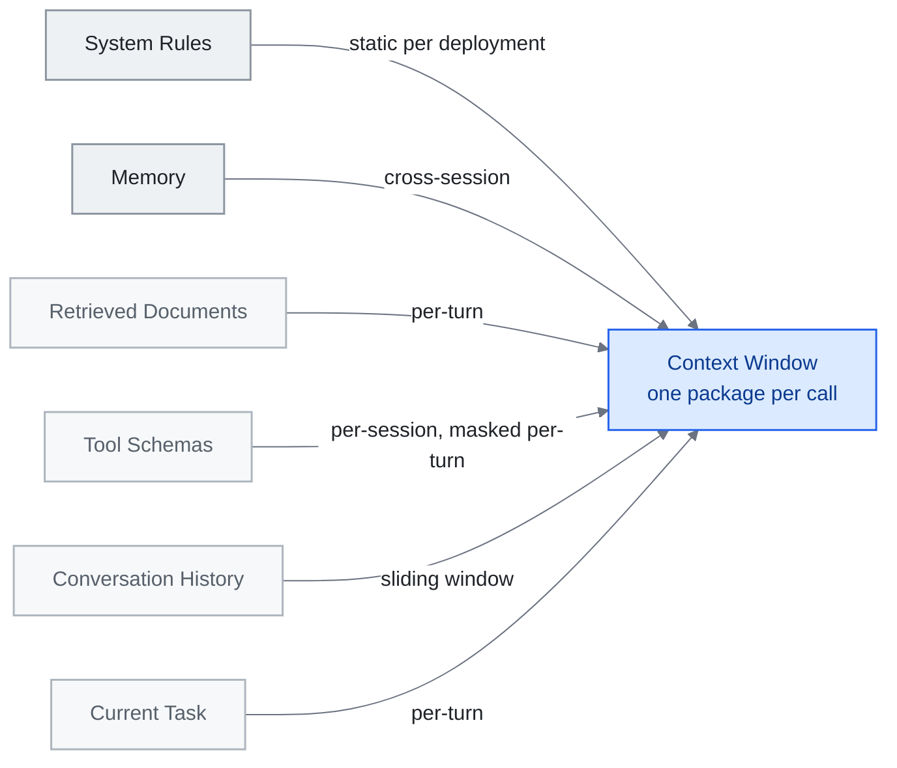

<!-- translation-sync:start -->
> 与 2026-10-31 英文版同步的机器辅助译文，已作结构与内容复核。代码和图中标签保留原文；阅读时间按英文原文估算。
> [English source](../../../chapters/03-context-engineering.md) · [Sync record](../../SYNC.md)
<!-- translation-sync:end -->

<!-- i18n-anchor -->

# 第 3 章：Context Engineering —— 填充窗口的艺术

> **一句话总结：** Context engineering 是给 AI 在对的时间正好对的信息的艺术——不多不少。
>
> **为什么重要：** 更好的 context 意味着更好的 AI 答覆。这就是为什么有些人从 AI 取得惊艳结果, 而其他人只得到普通回应。
>
> **阅读时间：** ~13 分钟（按英文原文估算：2,908 个单词 / 230 wpm）

*图：第 3.2 节的六层，从顶部最持久到底部最短暂，收敛于第 3.1 节定义的每次调用一个包上下文。箭头标签是每层的更新频率——这就是每层需要自己的压缩策略的原因。它们还争夺相同的窗口：过度填充检索的文档会淹没当前任务信号。*

> "Context engineering is the delicate art and science of filling the context window with just the right information for the next step."
> —— Andrej Karpathy, 2025 年 六月

如果 prompt engineering 是写好一个问题, context engineering 就是建构围绕它的整套简报包。从一者到另一者的转变, 标志着从业者思考 LLM 系统方式的根本变化: 设计单元不再是单一指令, 而是*信息环境*。

本章绘制这个地景——从理论框架到生产验证的 pattern——并指向定义这个学科的主要来源。

---

<!-- i18n-anchor -->

## 3.1 从 Prompt 到 Context

"context engineering"一词在 2025 年中进入主流, 当 Karpathy 在它与 prompt engineering 之间画下清楚分界。Prompt 是静态字符串。Context 是模型所需一切的动态组装包——指令、记忆、检索文件、工具定义、对话历史、当下任务——以程式化方式组成, 每一回合都更新。

这个区分重要, 因为现代 agent 极少送两次相同 context。每次推论调用都是路由逻辑、检索管线、压缩启发法、工具可用性检查的产物——这些一起决定窗口装什么、什么被排除。

<!-- i18n-anchor -->

## 3.2 一个六层 Context 模型

参考 Anthropic 的 [Building Effective Agents](https://www.anthropic.com/engineering/building-effective-agents) 与相邻从业者写作中的 pattern, context window 可以有用地被分解为六个概念层, 由最持久到最短暂排序。这里的标签是本指南的教学综合, 不是 Anthropic 自己发表的分类:

| 层 | 内容 | 典型持续 |
|----|------|---------|
| **System Rules（系统规则）** | 安全限制、角色定义、行为护栏 | 每部署静态 |
| **Memory（记忆）** | 用户偏好、先前 session 总结、学到的事实 | 跨 session |
| **Retrieved Documents（检索文件）** | RAG 结果、搜寻片段、档案内容 | 每回合 |
| **Tool Schemas（工具 schema）** | 函数定义、API 规格、能力声明 | 每 session 或每回合 mask |
| **Conversation History（对话历史）** | 先前讯息、助手回应、工具调用结果 | 滑动窗口 |
| **Current Task（当下任务）** | 当下的用户请求, 加上任何任务专属注入 | 每回合 |

关键洞察是: 每一层有不同的更新频率、不同的压缩策略、不同的失效模式。把检索文件层塞太满会淹没当下任务讯号。记忆层填得不够会迫使模型重新推导它本应已经有的 context。好的 context engineering 是六个层同时的平衡。

<!-- i18n-anchor -->

## 3.3 来自 Manus 的教训：KV-Cache 是北极星

2025 年 七月, Yichao"Peak"Ji（Manus CTO）发布一组生产教训, 把 context engineering 围绕单一运营指标重构: **KV-cache 命中率**。

Manus 在他们 agent 系统中观察到稳定的 100:1 输入对输出 token 比。在那个比例下, 输入成本主导一切。KV-cache 命中——之前算过的 key-value 对被重用而非重算——成为 latency 与成本的主要杠杆。

三个技术从这个洞察浮现:

1. **Append-only context 结构。** 永不重写 context 的早期部分。中间的插入或编辑会让快取的前缀失效, 强制完全重算。把你的 context 设计为一份 log, 不是文档。

2. **用 logit bias 作工具 mask, 不要移除 schema。** 当一个工具暂时不可用, Manus 在 logit 层级压制它的选择, 而非把工具定义从 context 移除。移除定义改变 token 序列, 破坏快取。Mask 保留前缀同时阻止选择。

3. **滚动 todo-list 重写。** 不是依赖模型从长对话早期回想目标, Manus 周期性在 context 末尾附上重写过的 todo list。这利用 attention 中的近因偏差——最近 token 中的目标得到比埋在数千 token 之前同样目标更强的 attention 权重。

这些是基础设施级决策, 不是 prompt 级。它们说明为什么"context engineering"需要系统思维。

**缓存原则有了研究工具包（2026 年中）。** Manus 的规则原本是运行经验；2026 年六月的两篇论文将同一原则转化为可测机制。**Still**（arXiv 2606.07878，June 5, 2026）以针对冻结基础模型训练的逐层 Perceiver，实现摊销式、单遍 KV-cache 压缩，报告在 **8k-128k 上下文中压缩 8x-200x**，并在 **RULER 上比最强基线高 8-22 个点**。**TokenPilot**（arXiv 2606.17016，June 15, 2026）采用双粒度设计：*摄取感知压缩*阶段在全局稳定前缀，*生命周期感知驱逐*阶段在局部追踪各片段的效用；在 PinchBench 和 Claw-Eval 上，独立会话设置成本减少 **61% / 56%**，连续会话设置则减少 **61% / 87%**。TokenPilot 的意义在于，以实际数字落实了本节定性描述的"append-only, don't bust the cache"原则：驱逐阶段让长期会话既保留有利于缓存的前缀，又不会无限增长。

**何时压缩，怎样压缩（2026 年八月）。** 后续实证研究 "Practical Online KV Cache Compaction for LLM Agents"（arXiv 2608.00902，August 2, 2026），专门研究智能体轨迹的压缩，进一步收窄建议：立即压缩会损害准确率；等智能体自身未来查询可充当代理查询信号时再压缩，能恢复大部分损失。代理不理想时，按代理查询诱发的注意力质量评分、驱逐 token 的方法（TE），比注意力匹配重建（AM）更稳健。在 BrowseComp-Plus、WideSearch 上，TE 将 KV 缓存减少 80%，吞吐量还高于完全不压缩，为本节定性描述的仅追加原则提供具体规则：等待信号，然后驱逐，而非重建。

<!-- i18n-anchor -->

## 3.4 五种主导 Pattern

Aurimas Griciūnas 把浮现实务综合为在生产系统中观察到的五个反复 pattern（标准写作: "State of Context Engineering in 2026,", SwirlAI Newsletter, 2026 年 三月 22 日, [https://www.newsletter.swirlai.com/p/state-of-context-engineering-in-2026](https://www.newsletter.swirlai.com/p/state-of-context-engineering-in-2026); 也见"Breaking Down Context Engineering"）:

**渐进式揭露。** 不要前置加载一切。先呈现一个轻量索引; 只在模型（或路由逻辑）判定相关时展开段落。这是 context window 的 lazy loading 等价物。Anthropic 自家 agent skills 系统用这个 pattern——17 个技能在静态时消耗约 1,700 token, 仅在调用时展开。

**Context 压缩。** 在注入前总结、截断、或蒸馏信息。滑动窗口之外的对话历史被压成总结。检索文件被节录成相关段落。目标是保留语意密度同时减少 token 数。

**Context 路由。** 不是所有查询都需要相同 context。路由层检视进来的请求, 选择要包含哪些记忆库、工具集、文件集合。这是数据库查询规划器的 context window 类比。

**检索演化。** 静态 RAG（检索一次、注入、产生）让位给迭代检索, 模型可以在生成中途请求额外信息。Context 不是一次组装, 而是在生成过程中演化。

**工具与能力管理。** 当工具库变大, 加载所有 schema 变得不可行。系统用 meta-tool pattern（按需返回相关工具 schema 的发现工具）或技能图架构来保持工具层精简。

**前沿实验室修改了自己的规则（2026 年 七月）。** 上述五种模式是根据在许多系统中观察到的实践综合得出的。 2026年七月24日，Anthropic发布了Thariq Shihipar对其自身指南的第一方修订版"The new rules of context engineering for Claude 5 generation models,"——标题是减法。 Claude Code 团队为其 Claude 5 代型号删除了超过 80% 的系统提示，编码评估没有明显损失。 Anthropic 从其自己的编码评估中报告了该数字；它没有独立进行基准测试。其背后的原因是旅行的部分。这篇文章主张从规则转向判断，给予有能力的智能体原则和信任，而不是详尽的指示；用于渐进式、即时上下文加载，而不是预先填充窗口；向智能体介绍情况的方式与向个人介绍情况的方式相同，仅在他们赢得职位的情况下提供角色、限制和示例。第二个重申了上面的渐进式披露，现在有实验室的生产证据支持。第一个削减违背了该学科建立的本能：它说，随着模型的改进，上下文工程工作中越来越多的份额不是优化，而是积累的不信任，而针对该份额的正确举措是删除而不是调整。

**压缩不是一项策略（2026 年八月）。** 上面的 KV-cache 工作和本节中的上下文压缩都将窗口视为可互换token的预算。一项九位作者的研究（arXiv 2608.31057，2026 年八月 31 日）认为这是错误的记账单位。通过分析 55 个存档的编码智能体轨迹，它将工作记忆内容分为四类——指令、工件、工具输出和智能体生成的状态——具有不同的大小、保留和表示配置文件，并提出了一个四级评估框架，将存储状态、交付上下文、管理工作和任务或流程结果分开。用作者的话说，"equal token budgets do not imply equal delivered context or management cost." 他们测试了两种语义信息策略，即对象感知压缩和基于检索的策略，并警告校准增益在一个任务集上调整 "may not transfer to held-out tasks." 在 55 个轨迹上，这是一个开放的经验发现，而不是一个固定的模式。实际后果是狭窄但尖锐的：跨窗口统一应用的单一压缩规则已经对四种不同类型的对象做出了策略选择，并且使该选择变得盲目。

Compaction的监控边界请参见[第 4 章](04-harness-engineering.md#48-harness-maintenance-the-stress-testing-imperative)。

<!-- i18n-anchor -->

## 3.5 学术地景

2025 年中带来了 context engineering 作为正式研究领域的第一份综合学术综述: **"A Survey of Context Engineering for Large Language Models"**（Mei et al., arXiv 2507.13334, 2025 年 七月 17-21 日）, 它透过对 1,400+ 篇研究论文的系统分析, 为这个领域建立技术 roadmap。该综述把设计空间沿两个轴组织: **基础组件**（context 检索与生成、context 处理、context 管理）与**系统实现**（RAG、记忆系统、工具整合推理、多 agent 系统）。它的承重发现是基本能力不对称: 当前模型在理解复杂 context 上极擅长, 但在产生同样精致的长篇输出上有显著局限。对从业者, 这份综述是这个领域最接近教科书的东西——它把一直在经验上发现的事正式化: context engineering 不是单一技术而是有多个独立维度的设计空间。

<!-- i18n-anchor -->

## 3.6 Agentic Context Engineering（ACE）

ACE 论文 **"Agentic Context Engineering: Evolving Contexts for Self-Improving Language Models"**（Zhang et al., arXiv 2510.04618, 2025 年 十月 6 日; 配套 repo 在 [github.com/ace-agent/ace](https://github.com/ace-agent/ace)）引入概念转变: 把 context 视为不是静态组装而是**演化的 playbook**。在 ACE 系统中, context 是一份 agent 自己维护的活文件——加观察、更新计画、修剪不相关历史、根据任务进展重组自己的指令。报告中头条收益: 在 agent 基准上 +10.6%, 在金融任务上 +8.6%, 配 adaptation latency 与 rollout 成本的减少; 在 AppWorld 排行榜上, ACE 在整体平均上和顶尖生产级 agent 持平, 在更难的 test-challenge split 上超越它, 即使用较小的开源模型。ACE 也命名它要工程对抗的失效模式: **简洁偏差**（为简洁总结丢掉领域洞察）与 **context 崩塌**（迭代重写久了侵蚀细节）。

这把 context engineering 从纯基础设施关切（harness 在每次调用前组装什么）移到协作的（harness 准备的*以及*模型主动重塑的）。"context the system provides"与"context the model creates"之间的边界变得流动。

ACE 系统典型在 context 内维持一个结构化 scratchpad——一个指定区域, 模型在那里写工作笔记、中间结果、修订的计画。Harness 跨回合保留这个区域, 同时按它自己的政策管理周围的层。

<!-- i18n-anchor -->

## 3.7 实务含义

几个原则从这个地景浮现:

- **衡量输入 token, 不只输出。** 在生产规模, 100:1 输入/输出比意味着 context 组装成本主导。为快取命中与最少冗余优化。
- **把 context 设计为分层系统。** 每一层有自己的更新政策、压缩策略、失效模式。独立处理它们。
- **默认用渐进式揭露。** 起步精简。按需展开。包含不相关信息的成本不只是 token——是退化的 attention 与增加的幻觉风险。
- **测试 context 组成, 不只 prompt。** 同样 prompt 在不同 context 中产生不同结果。你的测试套件应该变化 context, 不只最终指令。
- **预期模型改进。** 当模型在长 context 推理上变好, 一些压缩与路由策略变成不必要的开销。用清楚的抽象边界建构, 让层可以被简化或移除。

---

<!-- i18n-anchor -->

## 需要带走的三件事

- **提示是字符串，上下文是程序集。** 每个推理调用都是路由逻辑、检索、压缩和工具可用性检查的产物，因此设计单元是包，而不是指令。
- **输入token就是账单。** 在 Manus 测量的 100:1 输入输出比下，KV-cache 命中率是延迟和成本的杠杆，这就是上下文构建为仅附加日志的原因。
- **您设计的部分内容是积累的不信任。** Anthropic 为其 Claude 5 代模型删除了超过 80% 的系统提示，没有可测量的编码评估损失，因此针对该部分上下文的正确做法是删除而不是调整。

---

<!-- i18n-anchor -->

## 来源

- **Karpathy, Andrej.** 关于"context engineering"的公开发言（2025 年中）。在 X 与 AI engineering 社群广为流传的框架, 奠定这个领域采用的工作定义。
- **Anthropic.** "Building Effective Agents." Anthropic 工程博客, 2024 年 十二月 19 日。[https://www.anthropic.com/engineering/building-effective-agents](https://www.anthropic.com/engineering/building-effective-agents) ——描述 orchestrator-worker pattern 与 evaluator-optimizer workflow; 本指南把第 3.2 节的六层概念框架作教学使用。
- **Ji, Yichao "Peak"**（Manus）. "Context Engineering Lessons from Building Manus." 博文, 2025 年 七月。[manus.im/blog](https://manus.im/blog) ——KV-cache 命中率作为运营指标、append-only context 结构、用 logit bias 作工具 mask、滚动 todo-list 重写。
- **Griciūnas, Aurimas.** "State of Context Engineering in 2026." SwirlAI Newsletter, 2026 年 三月 22 日。[https://www.newsletter.swirlai.com/p/state-of-context-engineering-in-2026](https://www.newsletter.swirlai.com/p/state-of-context-engineering-in-2026)。也见 "Breaking Down Context Engineering": [https://www.newsletter.swirlai.com/p/breaking-down-context-engineering](https://www.newsletter.swirlai.com/p/breaking-down-context-engineering)
- **Mei, Lingrui et al.** "A Survey of Context Engineering for Large Language Models." arXiv 2507.13334, 2025 年 七月 17-21 日。[https://arxiv.org/abs/2507.13334](https://arxiv.org/abs/2507.13334) ——1,400+ 论文综述, 把 context engineering 确立为正式研究领域。
- **Zhang, Qizheng et al.** "Agentic Context Engineering: Evolving Contexts for Self-Improving Language Models." arXiv 2510.04618, 2025 年 十月 6 日。[https://arxiv.org/abs/2510.04618](https://arxiv.org/abs/2510.04618)。配套 repo: [github.com/ace-agent/ace](https://github.com/ace-agent/ace)。把 context 框为演化的 playbook; 命名简洁偏差与 context 崩塌。
- **Schmid, Philipp.** "The New Skill in AI is Not Prompting, It's Context Engineering" 与续篇。[https://www.philschmid.de/context-engineering](https://www.philschmid.de/context-engineering); [https://www.philschmid.de/context-engineering-part-2](https://www.philschmid.de/context-engineering-part-2)
- **LangChain 博客.** Context engineering 报道在 [blog.langchain.com](https://blog.langchain.com) ——「Agent Engineer」作为从业者 pattern 的框架（无单一标准帖; 在此作为讨论锚点引用）。
- **Willison, Simon.** [simonwillison.net](https://simonwillison.net) 上持续的 AI engineering 报道——把生态系串连的可亲实务介绍。
- **仍然。** 摊销单通 KV-cache 压缩。 arXiv 2606.07878, 六月 5, 2026。 [https://arxiv.org/abs/2606.07878](https://arxiv.org/abs/2606.07878) --- 针对冻结基础模型训练的每层感知器； 8k-128k 上下文下的 8x-200x 压缩；比 RULER 上最强基线高出 8-22 点。
- **TokenPilot.** 双粒度 KV-cache 管理。 arXiv 2606.17016, 六月 15, 2026. [https://arxiv.org/abs/2606.17016](https://arxiv.org/abs/2606.17016) --- Ingestion-Aware Compaction（全局前缀稳定）+ Lifecycle-Aware Eviction（本地段实用程序跟踪）；在 PinchBench 和 Claw-Eval 上，独立会话成本降低 61% / 56%，连续会话成本降低 61% / 87%。
- **"Practical Online KV Cache Compaction for LLM Agents."** arXiv 2608.00902，August 2, 2026。[https://arxiv.org/abs/2608.00902](https://arxiv.org/abs/2608.00902)：智能体轨迹压缩的系统研究；延迟至代理查询信号可用，恢复立即压缩损失的大部分准确率；代理不理想时，token 驱逐 TE 比注意力匹配重建 AM 更稳健；TE 将 KV 缓存减少 80%，同时在 BrowseComp-Plus、WideSearch 上提高相对不压缩的吞吐量。
- **Shihipar，塔里克** (Anthropic)。 "The new rules of context engineering for Claude 5 generation models." Anthropic 博客，2026 年 七月 24 日。[https://claude.com/blog/the-new-rules-of-context-engineering-for-claude-5-generation-models](https://claude.com/blog/the-new-rules-of-context-engineering-for-claude-5-generation-models) --- 报告 Claude 5 代模型的系统提示减少了 80% 以上，没有测量编码评估损失（Anthropic 自己的编码评估，未进行独立基准测试）；判断规则，及时加载上下文，向智能体提供简报，就像对待一个人一样。
- **Chen, Le 等人** "Measure Before You Manage: Evaluating Agent Working Memory in Coding Agents"（九位作者）。 arXiv 2608.31057，2026年八月31日。[https://arxiv.org/abs/2608.31057](https://arxiv.org/abs/2608.31057) --- 55个存档的编码智能体轨迹；工作记忆对象的四类分类（指令、工件、工具输出、智能体生成的状态）；四级评估框架（存储状态、交付上下文、管理工作、任务或流程结果）；测试了基于对象感知的压缩和检索策略；作者指出，"equal token budgets do not imply equal delivered context or management cost" 和校准增益 "may not transfer to held-out tasks." 小样本，未重复。
