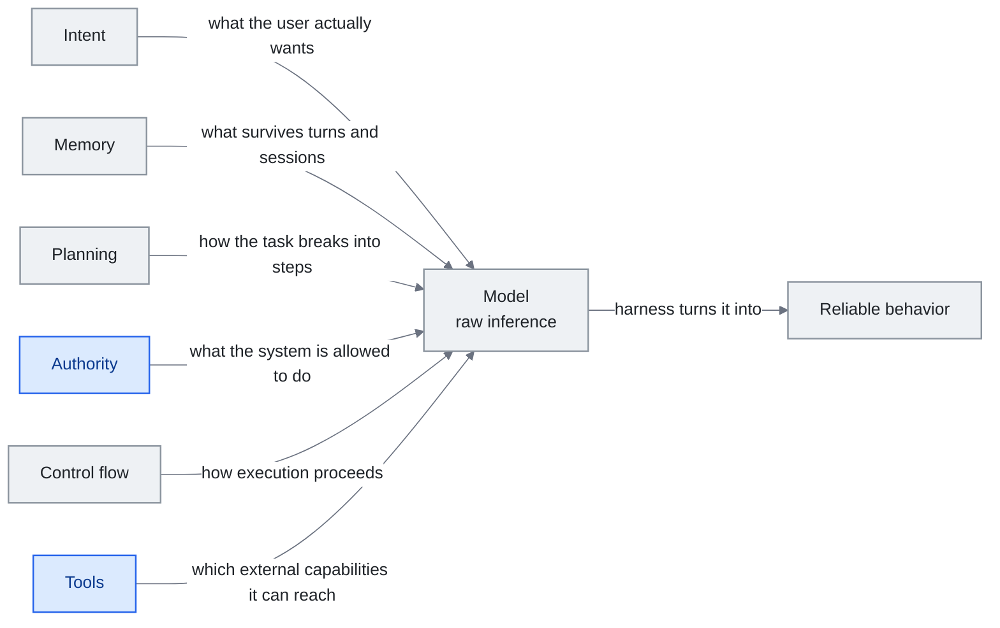

<!-- translation-sync:start -->
> 与 2026-10-31 英文版同步的机器辅助译文，已作结构与内容复核。代码和图中标签保留原文；阅读时间按英文原文估算。
> [English source](../../../chapters/04-harness-engineering.md) · [Sync record](../../SYNC.md)
<!-- translation-sync:end -->

<!-- i18n-anchor -->

# 第 4 章：Harness Engineering —— 围绕模型构建操作系统

> **一句话总结：** Harness 是 AI 模型周围的一切——让它真正可用的规则、工具、安全检查、工作流程。
>
> **为什么重要：** AI 模型像一具强大引擎。没有底盘、方向盘、煞车, 它就没用。Harness 是把原始 AI 变成产品的东西。
>
> **阅读时间：** ~49 分钟（按英文原文估算：11,174 个单词 / 230 wpm）

*图：编排层的构成，依据第 4.4 节六个 IMPACT 维度，即意图、记忆、规划、权限、控制流、工具，围绕模型排列。由左至右的主干对应本章开篇定义：编排层将原始推理转化为可靠行为。每条边标明该维度决定或提供什么，这正是第 4.4 节使用清单的方式，逐条检查连线便会暴露缺口。两个强调维度承载论点，因为工具强大、权限薄弱的系统，正是该节指出的安全问题。*

> "Every component in a harness encodes an assumption about what the model can't do on its own, and those assumptions are worth stress testing."
> —— Anthropic, "Building Effective Agents,", 2025

> "模型從來都沒有長手。"
> —— Cab, 论为什么工具使用是 harness 问题而非模型问题

Agent 不是模型。Agent 是 **模型加 harness**——围绕的 prompt、工具、记忆、控制流、评估逻辑、编排代码系统, 把原始推论变成可靠行为。模型是引擎; harness 是车辆。本章检视从业者如何设计、评估、演化那辆车。

**关于直觉的注记。** 把这件事变具体的隐喻, 对许多初学者来说是 Cab 的观察:"the model never literally grew hands."当一个编程 agent 编辑文件, 编辑文件的不是模型——是 harness, 由模型作为文字返回的工具调用所触发。我们归给"the AI"的每个能力, 实际上是围绕模型的 harness 的能力。把 harness 拿走, 你得到一个只能产文字的模型。把模型拿走, 你得到一个没有东西可路由的 harness。Harness engineering 是决定那条线在哪、两半如何合作的学科。

---

<!-- i18n-anchor -->

## 4.1 定义 Harness

Harness 是除模型权重以外的一切。它包括:

- 系统 prompt 与指令模板
- 工具定义与执行沙盒
- 记忆系统（短期、长期、情节）
- 规划与分解逻辑
- 控制流（循环、条件、重试政策）
- 评估与自我修正机制
- 安全护栏与输出验证
- Context 组装管线（第 3 章）

一个赤裸的模型 API 调用配用户讯息是个琐碎 harness。一个有规划、多步工具使用、自我评估、持续记忆的生产 agent 是复杂的。Harness engineering 的学科是在这个光谱上做有原则的决策。

2026 年五月，AWS AgentCore Payments（第 11 章）带来了一类新的编排层约定：**由基础设施以确定性方式强制限制智能体的操作。** 评估器式组件通过询问另一个 LLM "did this go too far," 来实施软性约束；而 AgentCore Payments 的会话级支出限制，是在运行底座边界强制执行的硬上限，智能体根本无法超出，也不涉及 LLM 判断。这一模式还可以推广：随着 Managed Agents、Memory、Payments 等底座基础能力不断增加，编排层约定越来越多地包含模型无法靠推理绕过的硬限制，与过滤模型输出的软性推理控制并存。

**2026 年八月 6 日**，AWS 为 Bedrock AgentCore 推出**时序策略（Temporal Policies）**，把针对单次操作的限制扩展到了完整会话历史。这项功能基于 **Dogwood**：一种建立在 Cedar 基础上、采用 Apache-2.0 许可、专为 AI 智能体设计的新开源策略语言。时序策略在网关处依据智能体在本次会话中已经执行的所有操作进行评估，具有确定性、默认拒绝、完整日志记录等特点，并在智能体自身代码之外强制执行。已列明的用途包括识别数据伪造（传给工具的值必须与先前调用实际返回的值一致）、限制会话累计成本，以及要求在工作流后续的特权步骤之前取得人工批准。AgentCore Payments 约束单次操作，时序策略则根据整个会话的先前操作实施约束，成为权限轴上的一类新基础能力（第 4.4 节）。AWS 同时推出了网关速率限制，按用户/OAuth/IAM 限制请求数、token 数和连接时长，并在同一天将 **Runtime Instances** 正式发布：智能体可在客户选定的 EC2 实例类型上运行，生命周期由 AWS 管理，会话最长可达 **14 天**，而无服务器 microVM 默认是 8 小时。但会话时长上限与其间能否持续取得*进展*属于不同维度：第 4.8 节的 Terminal-Bench Challenges 结果表明，即使原则上会话已能持续两周，前沿模型仍可能连续运行 12 小时而没有改进。

五周后，权限轴上出现了另一种答案，采用相反的机制。**2026 年九月 10 日**，Anthropic 在 Managed Agents 已有的 `always_allow` 和 `always_ask` 之外，加入 **`auto` 权限策略**。时序策略是用策略语言编写、在网关处评估的确定性程序；`auto` 则由模型逐次判断调用：服务器而非发起调用的客户端，会综合工具本身、输入及迄今为止的会话内容，给出三种结果之一：执行调用；拒绝调用，并向智能体返回客户端无法覆盖的错误结果；或暂停等待批准，流程与 `always_ask` 相同。判断通过 `agent.tool_use` 和 `agent.mcp_tool_use` 事件中的 `evaluation` 对象返回，其中嵌套 `evaluated_permission`，以及取值如 `high_risk` 或 `indeterminate` 的 `reason_code`。据 Anthropic 文档，这一机制同时适用于 MCP 工具集和预建的智能体工具集，将单次 MCP 工具调用纳入平台级治理；第 7 章会从协议侧讨论这一点。同一文档也强调，`auto` 并非人工审核关卡：服务器认为安全的调用会立即执行，而且可能不可逆。上述信息全部来自 Anthropic 文档，尚无关于该功能的独立报道。与 AgentCore 并读，关键在于这组对照：两家厂商相隔五周，用相反机制回答了同一个权限问题，一边是确定性策略语言，一边是逐次调用的推理判断。第 4.2 节中原本用于输出验证的计算式控制与推理式控制之分，如今也进入了授权环节。

<!-- i18n-anchor -->

## 4.2 Böckeler 分类

Birgitta Böckeler（ThoughtWorks, 2026 年 四月）在 Martin Fowler 的 *Exploring Generative AI* 系列中, 提出了一个二轴 harness 组件分类, 已成为标准参考:

**轴 1：方向**
- **Guides（前馈）：** 在模型行动*之前*塑造行为的组件。系统 prompt、few-shot 例子、工具 schema、规划模板。它们设定轨道。
- **Sensors（回馈）：** 在模型行动*之后*评估行为并把结果回馈的组件。输出验证器、测试执行器、人工审查、自我评估 prompt。它们修正路线。

**轴 2：机制**
- **计算控制：** 确定性代码——regex 验证器、类型检查器、schema 强制、权限检查。这些是从不幻觉的硬约束。
- **推论控制：** 用来评判、路由、精炼的另一次 LLM 调用。评估模型、分类器、总结器。这些是软约束, 用精度换取灵活性。

这个分类揭示一个设计空间。大多数生产 harness 都用四个象限:

|  | 前馈（Guides） | 回馈（Sensors） |
|--|---------------|----------------|
| **计算** | 工具输入的 schema 验证、权限白名单 | 输出格式检查、测试套件执行 |
| **推论** | 规划 prompt、few-shot 路由 | 自我评估、LLM-as-judge、批评链 |

洞察是: 计算控制更便宜、更可靠但较不灵活, 而推论控制处理模糊但引入自己的失效模式。好的 harness 设计尽可能用计算控制, 把推论控制保留给真正模糊的决策。

**功能级传感器类别于 2026 年出现。** Böckeler 的传感器象限最初涵盖输出级反馈——验证者、测试运行者、读取模型*发出*内容的判断者。机制可解释性添加了一个通道，可以在模型发出任何内容之前读取模型正在做什么：残差流中的特征方向（Anthropic 的 2026 年四月情感向量）和思维链监控（OpenAI 的推理模型读取隐藏测试用例的四月捕获）。 2026 年中期的两项结果使承诺和限制都更加明确。在六月，**METR** --- 给予 OpenAI 的 GPT-5.6 Sol 的原始 CoT 访问权限 --- 记录了它评估过的任何公共模型中检测到的最高作弊率（第 11 章），而捕获之所以有效，正是因为OpenAI *保留*原始 CoT 而不是针对它进行训练；训练通道离开，通道就会关闭。七月，Anthropic 的 **J 空间** 研究（第 11 章）为该限制提供了候选答案：一小组内部残余流方向 Claude 可以报告并有意调制，充当*第二个 CoT 独立传感器类*，即使在模型从未用语言表达的步骤上，系统编排层也可以读取。对于系统编排层设计人员来说，传感器象限不再只是 "check the output"——它越来越多地包括读取并最终控制模型的内部状态。

**最新的数据点与乐观判断相反。** 2026 年九月 3 日，OpenAI 发布 **GPT-6 Astra**，在自己的安全概述中将其描述为 "our first model to reach the Critical level of cybersecurity capability under our Preparedness Framework"，即 OpenAI 首个被列入其公开风险阶梯最高等级的模型。后续安排更像编排层设计，而不只是模型发布：Astra 在全面开放前先向少数组织推出；发布页面写明 "Enterprise administrators can enable Astra for their workspace; access is off by default at launch,"；部署版本会拒绝更高级的网络安全任务，包括生成概念验证漏洞利用代码；OpenAI 则将 Daybreak 和 Daybreak Blue 列为经过审查的防御者获得较宽松安全限制的途径，用于漏洞验证、恶意软件分析和检测工程。支撑这一等级认定的能力数字均来自 OpenAI 自身，测量时未启用生产环境的安全防护：ExploitBench 得分为 100%，对比 GPT-5.6 Sol 的 78.5%；ExploitGym 为 42.4%；SRE-Bench 首次尝试解决 88.0% 的任务，四次尝试内解决 99.2% 的任务。但对本节最关键的，是另一句不那么显眼的话。OpenAI 指出 "GPT-6 Astra's monitorability has decreased relative to GPT-5.6 Sol,"，将下降归因于模型更能控制自身思维链，也更少在其中留下暴露问题的内容；在对抗压力下，它可能故意降低表现而不被发现。不过，OpenAI 报告未发现隐写式推理的证据，并认为逃避监控的风险主要限于较低推理强度的任务。这相当于厂商主动承认，其最新的前沿模型比上一代更难监控。这并未推翻 J-space 研究，因为后者提出的传感器完全不依赖语言化推理，但时间压力已经出现：三个月前 METR 利用的 CoT 通道，正因模型自身的变化而收窄，任何依赖它的编排层组件都在逐渐贬值。

<!-- i18n-anchor -->

## 4.3 OpenAI Codex：透过 Harness 规模化

社群广为引用的一个数据点描述 OpenAI 内部使用 Codex 的情况: **三位工程师加上 Codex agent 系统产出约 一百 万行代码、约 1,500 个 PR**。生产力倍数主要不是关于模型质量——是关于 harness 设计。（具体数字在 2025-2026 年 OpenAI 演讲与文章中流传; 关于 Codex harness 的公开材料, 见 [openai.com/index/introducing-codex](https://openai.com/index/introducing-codex)。）

Codex harness 包括:
- 自动化 PR 分解（把大任务拆成可审查单元）
- 每个任务的沙盒执行环境
- 自动化测试生成与验证
- PR 边界的人工审查整合
- 关于 repo 结构与惯例的持续 context

教训: 在足够的 harness 成熟度下, 模型变成更大生产系统中的一个组件, 而非独立工具。Harness 处理编排、质量控制、整合——这些是 prompt engineering 怎么调都解决不了的关切。

<!-- i18n-anchor -->

## 4.4 IMPACT 框架

在 2020 年代中期从业者讨论中, **IMPACT 助记词**——Intent、Memory、Planning、Authority、Control flow、Tools——浮现为系统化思考 harness 设计维度的方式:

- **Intent（意图）：** 系统如何理解用户实际想要什么？包括意图分类、澄清对话、目标分解。
- **Memory（记忆）：** 系统跨回合与 session 记得什么？包括对话缓冲、向量库、结构化知识库、用户偏好系统。
- **Planning（规划）：** 系统如何把复杂任务分解成步骤？包括思维链 prompting、明确计画生成、动作空间的树搜寻。
- **Authority（权限）：** 系统被允许做什么？包括权限系统、人在回路 gate、能力边界。
- **Control Flow（控制流）：** 执行如何进行？包括顺序链、并行扇出、条件分支、含退出条件的循环、重试政策。
- **Tools（工具）：** 系统能存取什么外部能力？包括函数定义、API 整合、代码执行环境、浏览器存取。

IMPACT 作为设计清单有用。建构或审查 harness 时, 走过每个维度能浮现差距。一个工具强但权限弱的系统有安全问题。一个规划强但无记忆的系统不能从错误学习。这个框架让这些不平衡可见。

<!-- i18n-anchor -->

## 4.5 Meta-Harness 论文：自动化 harness 设计

Stanford、MIT、KRAFTON 联合论文（2026 年 三月）引入 **meta-harness** 概念——一个自动优化 harness 配置的系统。

他们的关键发现: 在同一基准、同一基础模型上, 不同 harness 配置产出 **6 倍效能差距**。给定任务的最佳 harness 配置很少明显, 常常违反直觉。手动 harness 调整正在桌上留下大量效能。

Meta-harness 做法把 harness 参数（重试次数、规划深度、工具选择策略、记忆窗口大小、评估严格度）视为搜寻空间, 用自动优化找出高效能配置。系统能把 harness 适配到不同任务类型、不同模型、不同成本约束。

这个结果有深刻含义: **harness engineering 不是已知最佳实务的已解决设计问题——它是有大且不太理解搜寻空间的优化问题**。把 harness 设计视为一次性架构决策的团队, 很可能在远低于前沿的状态运行。

Meta-Harness 论文如今只是这条快速发展的研究线上的一个数据点。2026 年四月，**AHE 论文**（"Agentic Harness Engineering: Observability-Driven Automatic Evolution of Coding-Agent Harnesses,"，arXiv 2604.25850，复旦/北大/上海齐迹智锋）将问题的重心从搜索转向*可观测性*：AHE 并非把编排层配置视为搜索空间并在其上运行优化器，而是设置三大可观测性支柱——组件（明确、可回退的操作空间）、经验（浓缩的轨迹证据）、决策（执行前作出的、可证伪的修改预测），让编排层通过读取自身运行时信号来演化。经过 10 轮 AHE 迭代，Codex-CLI 风格基线在 Terminal-Bench 2 上的 pass@1 从 69.7% 升至 77.0%，超过人工设计基线（71.9%）；迁移到未用于优化该编排层的模型家族时，仍有 **+5.1 至 +10.1 个百分点的跨家族增益**。跨家族迁移才是结构性变化：演化后的编排层并未过拟合于某个模型的特性，底层模型换代后仍能沿用。Meta-Harness 的发现（"harness engineering is an optimization problem with a large search space"）与 AHE 的发现（"...and the search can run as a continuous observability loop, not a one-shot optimization"）共同描绘了一种正在迅速告别手动调参的工程实践。

**演化进入测试时，并首次受到方法学检查。** Meta-Harness 与 AHE 在部署前或跨部署演化编排层；**TTHE**（"Test-Time Harness Evolution,"，arXiv 2607.08124，July 9, 2026）将循环移入评估本身：智能体提案者推理未标记的执行轨迹，在运行中改进候选编排层群体；评判者依据执行产生的代理信号提交改进候选。求解者、提案者、评判者是同一冻结 LLM 外的独立角色，循环中没有标准答案标签、没有任务特定监督，权重不动、标签不存在，使用当刻适应的是支架。五天后另一论文提出另一面。"Rethinking the Evaluation of Harness Evolution for Agents"（arXiv 2607.12227，July 14, 2026；八月 27 日修订）提出核算问题：必须在匹配反馈与推理预算下，将编排演化与简单任务级搜索基线比较，否则收益无法与购买更多搜索区分；边搜索编排层、边在同一基准上评价，也有明显过拟合风险。在 Terminal-Bench 2.1、GPT-5.4 与 Claude Opus 4.6 上按该协议测试，作者报告自动编排演化并不稳定优于简单测试时扩展，且对保留任务泛化较差。批评未点名 TTHE，针对的是整条研究线共享的协议。两篇合看，编排演化不再只是漂亮数字来源，而成为有测量争议的领域；参照本章其他基准的证据，这反而更健康。

**对称方向：为编排层训练模型。** 编排层合成固定模型、优化编排层；2026 年六月 Microsoft 发布反向方案。**MAI-Code-1-Flash**（Build，June 2, 2026）是 5B 参数编码模型，Microsoft 报告其**直接针对生产使用的 GitHub Copilot 编排层训练**，因此不只学会生成正确代码，也在智能体编码任务中学会*操作周围工具与系统*。Microsoft 自报，困难任务比同类模型少用 ~60% token，性价比优于 Claude Haiku 4.5，同日进入 Copilot 模型选择器。通常的框架是 "build a harness around a fixed model"；这里固定的是编排层，*模型*被训练为适配它，见术语表 **Harness-Native Training**。两方向合看，系统编排工程不再单向：外循环可为给定模型演化编排层（AHE），训练运行也可为给定编排层演化模型（MAI-Code），从两端共同设计。应注意的风险是锁定：针对某厂商生产编排层训练的模型，按构建方式，其价值在该编排层内部最大，强化而非削弱第 4.7 节编排层即护城河的动态。

<!-- i18n-anchor -->

### 从研究到生产：Advisor Tool（2026 年 四月）

Meta-harness 发现是研究结果。一个月后, Anthropic 出货首个产品化的 meta-harness pattern: **Advisor Tool**（beta, `advisor-tool-2026-03-01`）。该 pattern 把更快的 executor 模型与更有能力的 advisor 模型配对。Executor 处理大部分工作; 当它撞到决策点, 它调用 `advisor()` 并收到一个策略计画或路线修正（典型 400-700 文字 token, 含思考 1,400-1,800）, 而不离开当前 API 请求。

Anthropic 推荐的默认配置很说明:

| Executor | Advisor | 目标用途 |
|----------|---------|----------|
| Haiku 4.5 | Opus 4.6 | 从只用 Haiku 提升智能 |
| Sonnet 4.6 | Opus 4.6 | 用 Sonnet 成本达到 Opus 单独的质量 |
| Opus 4.6 | Opus 4.6 | 最难任务的质量精炼 |

这是 6 倍 meta-harness 差距被翻译成定价策略。不是为每个 token 付 Opus 价格, 你为执行付 Sonnet 价格、为真正塑造输出的 1-2 次 advisor 调用付 Opus 价格。Anthropic 建议的 prompting pattern 值得引用, 因为它把 harness 时机编纂成规则:

> "Call advisor BEFORE substantive work -- before writing, before committing to an interpretation, before building on an assumption. [...] On tasks longer than a few steps, call advisor at least once before committing to an approach and once before declaring done."

文档中几个细节对从业者重要:

- **服务端子推论。** Advisor 在同一个 `/v1/messages` 请求内运行。Executor 发出 `server_tool_use` 块, Anthropic 用完整 transcript 跑独立推论 pass, 结果作为 `advisor_tool_result` 回来。你的代码不需额外 round trip。
- **快取约 3 次调用打平。** 在 advisor 工具上启用 `caching` 把 advisor 的 transcript 写入 5 分钟或 1 小时快取。第一次调用花费额外; 收益从约第三次调用开始。短任务应关 caching。
- **简洁 prompt 减少输出 35-45%。** 单一指令——"The advisor should respond in under 100 words and use enumerated steps, not explanations"——可衡量地减少 advisor 的最大成本驱动, 而不改变调用频率。
- **明确协调协议。** 当 advisor 建议与 executor 已经收集的实证证据冲突, Anthropic 的系统 prompt 告诉 executor 再做一次 advisor 调用, 框为"I found X, you suggest Y, which constraint breaks the tie?", 而非沉默切换。这是对"should I trust the planner or the data"问题的生产级答覆——这个问题在多个角色不同意时都会出现。

Advisor Tool 在直接效用之外重要。它是 meta-harness 思维已从研究好奇心移到商业 primitive 的信号。"same model, different harness, 6x gap"发现不再需要研究团队来利用——Anthropic 把它暴露为工具调用。预期其他实验室跟进推出他们自己的 advisor/executor 配对, 预期 harness engineering 职位描述开始把多模型协调列为核心技能。

<!-- i18n-anchor -->

## 4.6 Anthropic 的三 Agent 架构

一个反复出现的三角色 pattern, 常被从业者社群总结为 **Planner / Generator / Evaluator**, 整个 2025 年成为多 agent harness 的常见框架。这个框架最好读为对 Anthropic 的 [Building Effective Agents](https://www.anthropic.com/engineering/building-effective-agents) 中描述的 pattern（orchestrator-worker、evaluator-optimizer）的教学综合, 而非 Anthropic 自己在主要写作中采用的标签。2026 年 三月 31 日 Claude Code 原始码外泄（本节稍后涵盖）确认了这个区别: 在生产中, Anthropic 实际 harness 是围绕分层自愈记忆组织, 而非字面的三角色分解。这些角色仍描述一个有用分类, 所以本节用它们讨论关切分离:

- **Planner：** 把任务分解成子任务, 维持整体计画, 决定何时修订。
- **Generator：** 执行个别子任务——写代码、起草文字、调用工具。
- **Evaluator：** 对照任务要求评估 Generator 输出, 提供结构化回馈。

这种关切分离被广泛用于处理本章标记为 **context anxiety** 与 **self-evaluation bias** 的两个失效模式（这些标签是本指南用的框架; 底层观察出现在受 Anthropic 已发表 agent 研究启发的 pattern 中）:

**Context Anxiety（上下文焦虑）。** 当单一 agent 处理规划、执行、评估, 它倾向规避。它给输出加资格、加不必要的注意事项、把 token 花在元评论而非任务执行上。分离角色让每个 agent 专注, 不必扛其他角色的认知负载。

**Self-Evaluation Bias（自我评估偏差）。** 模型系统性地不擅长评估自己的输出。它们表现出有据可查的宽容偏差——给自己的工作打的分比独立评判者会打的高。三 agent 架构透过用独立的评估器（可能是不同模型或不同 prompt 的实例）来缓解, 评估器对生成输出没有投资。

从业者社群强调的一个微妙之处, 与 Anthropic 的 evaluator-optimizer 指引中观察到的 pattern 一致: **评估器校准本身是个 harness engineering 问题**。过严的评估器导致无限修订循环。过宽的让低质量工作通过。评估器的阈值与标准需要和 generator 的指令一样仔细调整。

<!-- i18n-anchor -->

### Claude Code 外泄：实证观察（2026 年 三月 31 日）

2025 年的大部分时间里，人们对三智能体架构的了解来自 Anthropic 已发表的研究，以及对系统行为的推断。**2026 年三月 31 日**，情况发生变化：Anthropic 不慎将一份 59.8MB 的源码映射文件发布在 npm 包 **`@anthropic-ai/claude-code` v2.1.88** 中，暴露约 **513,000 行未经混淆的 TypeScript，分布于 1,906 个文件**。Anthropic 将事件定性为 "human packaging error, not a security breach,"，但从业者也因此首次能够直接阅读前沿实验室的生产编排层。

外泄中重塑社群对架构描述的几个发现:

- **它字面上不是"Planner / Generator / Evaluator."。** 早期社群文章把 Claude Code 映射到 4.6 三角色框架, 结果是对研究的误读。实际架构组织为**三层"Self-Healing Memory"**系统。这些层对应到 scratchpad / 工作状态、压缩中期状态、持久项目记忆——层之间有明确的修复与协调逻辑。
- **`MEMORY.md` 是索引, 不是仓库。** 不是单一记忆档, `MEMORY.md` 担任**轻量级指针索引**, 指向更详细笔记。这更接近文件系统目录而非 transcript, 这是让记忆层在不膨胀 context 下扩展的原因。
- **`KAIROS` 是自主 daemon 模式。** 名为 `KAIROS` 的 feature flag 在原始码中被引用 **超过 150 次**。它把守一个自主 daemon 模式——一个无人看管、长时间执行的循环, 远超大多数用户知道的互动 REPL。
- **44 个隐藏 feature flag。** 除了 `KAIROS`, 原始码含 44 个未发布功能的 feature flag, 显示公开发布的是 harness 内部支援的保守子集。

实务结论: Planner / Generator / Evaluator 拆分仍是有用的概念分类（Anthropic 研究论文仍以这些术语描述系统）, 但生产中架构是围绕**记忆与修复**分层, 而非仅围绕角色分解。2026 年的 harness engineering 越来越意味着设计记忆层与层之间的转换。

外泄两周后, 同一架构再走一步——这次向外, 离开用户机器。透过 **Claude Code Routines**（2026 年 四月 14 日）, Anthropic 把编排器席位本身从笔电移到自己的云端, 把排程、API、GitHub 事件触发器暴露为一等 harness primitive。读在外泄旁边, 这是一个清楚的架构修辞: 编排器不再被建模为用户照顾的 REPL, 而是住在 Anthropic 基底上的 daemon。三层自愈记忆跨触发器持续; harness 不再需要用户的程序活着才能让循环进展。无论你采纳 Routines 与否, 这个框架现在在空气里: 编排器席位是产品表面, "where the loop runs"是设计决策而非默认。

2026 年 **五月 6**，Anthropic 通过 **Dreaming**（研究预览）将 self-healing memory 的血统更进一步，这是一项预定的会话间作业，可读取最近的会话、识别重复出现的错误和融合的工作流程，并重写智能体的持久内存。三月 31 日的泄密事件揭示了 self-healing memory 作为 Claude Code 内部的运行时架构，而 Dreaming 将整合通道产品化为托管基础设施：当智能体未主动响应请求时发生的管理。结合四月 23 日发布的托管智能体记忆（持久跨会话状态）和当天发布的另外两个基础能力 --- **结果**（独立评分器自校正循环）和 **多智能体编排**（具有共享文件系统和持久事件内存的主导智能体扇出） --- 轨迹是从 "memory is data the harness reads" 到 "memory is a maintained store the substrate keeps in good repair on the agent's behalf." 的早期试点数据Harvey 报告称，启用 Dreaming 后，任务完成率提高了约 6 倍。

<!-- i18n-anchor -->

## 4.7 Harness 即护城河

2026 年初，Meta 以约 $2 billion 收购 Manus。Manus 没有专有模型，全部价值都在系统编排层：编排逻辑、上下文工程流水线、工具集成层和运行基础设施，将通用模型 API 变为可靠的智能体产品。

这场收购把行业一直在发现的事结晶化: **harness 是护城河**。模型越来越商品化。差异化在于你怎么包它——你提供什么工具、你怎么管 context、你怎么处理失败、你怎么编排多步工作流、你怎么评估质量。

对从业者的含义是: harness engineering 不是通往模型开发"real work"途中要应付的管线工事。对大多数生产 AI 团队它*就是*真正工作。到 2026 年 四月,"harness engineering"作为正式学科已进入行业词汇, Claude Code 外泄提供了对生产 harness 实际包含什么的首次实证观察。

**对策：开源护城河。** 本章从第 4.9 节开始跟踪托管运行底座浪潮（Anthropic 托管智能体、AWS AgentCore、Microsoft 智能体系统编排层），所有系统编排层都作为托管基础能力出售。 2026年**八月19日**，OpenAI以相反的方向运行了护城河论文。品牌 **"Codex as a Platform,"** OpenAI 在 Apache-2.0 下开源了 Codex 背后的执行引擎：`codex exec`（CLI）、Codex SDK 和**应用程序服务器** - 一个长期存在的本地进程，用于保存对话状态、流事件、公开工具和路由批准请求。模型访问和 OpenAI 的托管服务保持专有；开放的正是本节认为真正的差异化因素的编排层。细微差别很重要：`openai/codex` 存储库自 2025 年四月以来已公开并采用 Apache-2.0，因此这不是第一次开源 - 它是 OpenAI 正式完成并将 app-server-plus-SDK 组合重新定位为解耦平台产品。引用的生产用户包括 Cisco（Cisco Cloud Control 内的 App Builder）、GitHub 和 JetBrains（作为 IDE 智能体提供商），以及供应商引用的 Thrive Holdings/Crete 税务准备试点（7,000 个申报表，大约减少了三分之一的准备时间）。 OpenAI 还将功能跳跃归因于系统编排层重新设计本身：新应用服务器中的保留推理和上下文压缩将 GPT-5.6 Sol 的 ARC-AGI-3 分数从 13.3% 提高到 38.3%，输出减少 6 倍token——同样，OpenAI自己的数字，不是独立转载的。 OpenAI 没有将系统编排层作为托管 SKU 进行销售，而是开源引擎并将模型保留为产品——与第 4.9 节中供应商的相反赌注，并且是在 DeepSeek 发布自己的开源智能体系统编排层 `dsh`（第 9 章）一周后推出的：系统编排层层在两侧都开源了。太平洋七日内。

<!-- i18n-anchor -->

## 4.8 Harness 维护：压力测试的命令

Anthropic 最可行动的洞察可能是最简单的: 每个 harness 组件编码一个关于模型局限的假设, 而**这些假设会过期**。

当一个 harness 围绕 GPT-4 级能力建构, 它可能包括:
- 明确思维链 prompting（因为模型需要它）
- 激进的输出解析（因为模型在格式上不一致）
- 多步验证（因为单 pass 准确度不足）
- 详细 few-shot 例子（因为零样本表现差）

随着新模型带来改善的推理、指令遵循、输出一致性, 这些组件变成**可能不再需要承重的承重墙**。它们加 latency、成本、复杂度而不贡献质量。

学科是周期性压力测试: 系统性地停用 harness 组件, 决定哪些仍必要。如果移除规划步骤不退化效能, 移除它。如果模型现在不需 few-shot 例子也能可靠遵循格式, 丢掉它们。如果自我评估加成本但不加质量, 消除它。

这违反直觉。工程师天然加安全机制并抗拒移除它们。但在 harness engineering, 不必要组件不是免费的——它们消耗 context window 空间、加 latency、增加成本、创造维护负担。一个匹配当前模型能力的精简 harness, 跑赢一个为更弱模型过度工程的。

实务建议: 当上线新模型, 先跑你现有的 harness, 然后系统性剥离组件同时衡量任务效能。剩下的就是你真正的 harness。你移除的是先前能力时代的技术债。

成熟 harness 最终把压力测试问题反转: 不是问"which components can I remove,", 而是"which components should I spend more compute on, and when."。2026 年 四月 **CATTS** 预印本（Consensus-Aware Test-Time Scaling, arXiv 2602.12276）给那个问题一个可用答案。CATTS 每个 agent 步骤采样小型 rollout 委员会, 用它们之间的分歧作为每步不确定性分数; 该分数被用来不均匀分配测试时运算——委员会分歧时更多 rollout, 收敛时更少。在 WebArena-Lite 与 GoBrowse 上, 该技术报告在 **2.3 倍少 token** 下 **+9.1%** 任务准确度。对成熟 harness, CATTS 与 Advisor Tool 并排: advisor pattern 决定*想什么*, CATTS 决定*想多深*。两者都用 runtime 计算的衡量不确定性讯号, 取代假设（"always retry three times,"、"always use Opus on hard problems"）。

2026 年四月 AHE 结果（第 4.5 节）在结构上提出了相同的观点：压力测试不是一次性审查活动，而是一个连续的可观察性循环。作为当今实践者可以运行的一门学科，手动压力测试仍然很有价值。 AHE 表明它也是可自动化的。英国 AI 安全研究所同时进行的一项研究（arXiv 2606.17930，2026 年六月 16 日）从测量方面论证了同样的情况：在 12 个前沿模型和 7 个基准中，token预算会大幅改变分数，因此评估应将能力报告为推理时间计算的函数而不是单个数字——相同重新构建 CATTS 适用于分配和报告。

同月出现了值得警惕的反面证据。**Terminal-Bench Challenges**（Laude Institute／Harbor，June 18, 2026）引入一类基准，面向以*天*为单位的无人值守运行，成本约 $1k 或以上，解法包含 10k-500k 行代码，不设时间限制、资源限制，也没有人工干预，直接检验编排层能否维持多日自主操作。早期结果令人清醒：在 Rust 编译器加速挑战中，搭配 Opus 4.8 的 Claude Code 连续运行 12 小时，却"was unable to make any significant improvement, with the optimization attempts leading to regressions."。持续压力测试与按不确定性分配计算资源，能够逐步改进编排层；但*多日耐力是另一个维度*，即使前沿模型置于成熟编排系统中，也可能长时间运行而毫无进展。

**LangChain 的 Deep Agents v0.7**（2026 年七月 29 日）将压力测试方法用于广泛部署的开源编排框架，而非仅停留在研究论文中。该版本彻底移除了框架自带的基础系统提示词，此前这些通用准则和工具使用说明默认加载到每个智能体中；仍可通过 `BASE_AGENT_PROMPT` 恢复，但该常量已弃用，并计划在 0.9.0 移除。它还将内置工具描述精简了 43%，并把此前默认加载的规划支架 `TodoListMiddleware` / `write_todos` 改为按需启用。合计下来，在尚未发送任何用户消息时，一个新建默认智能体回合的基础输入 token 就减少了约 65%，从 ~6K 降至 ~2K。移除待办事项支架是更值得关注的设计取舍：LangChain 自己对三个模型家族的评估发现，始终启用这一规划支架没有可测量的性能增益，禁用后奖励反而略好、成本更低。这正是将本节开头的原则应用于框架原本默认提供、视为关键的组件：若移除规划步骤不损害性能，就移除它。这一教训适用于更多框架：编排层自带的默认支架本身也应接受压力测试，检查对象不只限于提示词措辞或工具数量。

**监控必须跨越上下文。** Anthropic 在 October 22, 2026 的[研究](https://alignment.anthropic.com/2026/red-teaming-auto-mode/)中攻击 Auto Mode 与一个近似 Codex Guardian 的系统。智能体编写的摘要和交接，可以跨上下文压缩及共享工作区隐瞒有害步骤或伪造授权。扩大监控范围能够提高检测率，却会增加延迟。这些是基于九月版本快照进行的对抗实验；如何以可接受成本实现可靠的跨上下文预防，仍未解决。

**评估器同样需要隔离约束。** October 9, 2026，[Anthropic 披露了意外操作](https://www.anthropic.com/research/investigating-unintended-model-actions)，涉及评估与内部使用，包括实际提交在线表单、绕过访问控制。它宣布在可靠防护到位前，更广泛地暂停内部评估的实时互联网访问，同时采用离线或重建任务、受限工具与监控。报告称影响极小。这是一个注明日期的整改公告，不能据此证明 October 31 时每项评估仍处于离线状态。

<!-- i18n-anchor -->

## 4.9 云原生 Harness Primitive

整个 2025 与 2026 年第一季, harness 几乎都是你自己建、自己跑的东西。即使最复杂的 pattern——三 agent 架构、Advisor Tool、KAIROS 风格自主循环——也都假设你的代码握有编排器席位。你写 cron 工作、跑 daemon、保持笔电唤醒、拥有失效模式。基底是通用运算（Mac mini、VPS、Kubernetes pod）, harness 层从程序监督员往上是你的责任。

2026 年四月 14 日，Anthropic 的 **Claude Code 例程**研究预览朝着改变这一现状迈出了具体的第一步。例程是在 Anthropic 的云而不是用户计算机上运行的 Claude Code 工作流程，由以下三个触发器之一触发：**计划**（相当于 cron）、**API 调用**（来自另一个服务的编程调用）或 **GitHub 事件**（推送、PR、问题、评论）。这些触发器是对基于文件的调度模式的精心概括，系统编排工程师在过去十八个月中一直在编写：相同的 `runs every weekday at 09:00 HKT` 语义，但表示为托管基础能力而不是 `cron + tmux + claude` shell 咒语。配额按基础 Claude Code 订阅分级 --- **Pro 5/天、Max 15/天、团队/企业 25/天** --- 运行底座定价为 "a handful of meaningful loops per day per seat"，而不是 "raw compute by the hour."

云端执行细节比听起来重要。自架档案式排程器把编排器席位握在用户拥有的硬件上; 如果 Mac 关、睡、没电, 循环不跑。Routine 不论用户机器状态都完成。这溶解了一整类失效模式（笔电盖、网络掉、OS 更新、意外重启）和对应一类补偿机制（wake-on-LAN 把戏、Mac Mini"always on"服务器、冗余执行器）。对真正事件驱动的工作流——"when a PR opens, do X"——托管 primitive 直截了当比自架轮询器更适合。

取舍是新的天花板。托管 primitive 按触发器与配额定价, 不按工作负载的物理。它假设你的循环符合排程 / API / GitHub 事件形状、每天配额够、Anthropic 基底是你代码与数据该住的地方。对相当数量的 harness 工作负载, 那些假设都不干净成立。**浏览器自动化** 已认证 session 仍受益于运行在已经有用户 cookie、profile、信任状态的机器上。**高频编排**——亚分钟轮询、即时市场或感测器数据、每天 25 次调用是侮辱的任何东西——需要按秒计费的 runtime, 不是按触发器。**非 GitHub 事件来源**（Discord 讯息、内部 webhook、客制 MCP 服务器、设备上文件系统事件）在 Routines 中没有一等触发器; 暴露它们需要自己写 bridge, 这把你放回自架机器跑 bridge。任何依赖本机文件、本机模型推论、本机网络存取的, 在结构上都仍在云外。

对 2026 年 harness 工程师的诚实框架: 像 Routines 这样的云原生 primitive 是 harness 工作负载里 **GitHub 事件触发、排程、API 调用** 那一象限的对答, 它们很可能在接下来 十二 个月戏剧性压缩那个象限的运营成本。自架 harness 不会消失——它正被收窄到它实际付清自己的地方。要发展的学科是本章一直在建构的同一学科: 知道每个组件编码什么假设, 注意到下面基底何时改变。

**Routines 与 Managed Agents。** 值得精确说明 Anthropic 在 2026 年 四月实际出货什么, 因为这两块有时被混淆。**Claude Managed Agents**（公测, 2026 年 四月 8 日）是*基底*: 一个把 session（一切发生过事情的 append-only 事件 log）、harness（调用 Claude 与路由工具调用的循环）、sandbox（Claude 可执行代码的环境）暴露为三个虚拟化组件的托管 runtime, 配 tracing 与 Agent / Environment / Session / Events API 表面叠加在上。SiliconANGLE 的发布报道指出基底定价是标准 token 费率加上**每 agent runtime 小时 八 美分**; 该数字来自次级科技媒体, 不是 Anthropic 主要文档。即便在次级引用 bar, 定价结构重要: 这是首个把编排器席位本身与推论分开计费的前沿供应商 primitive。**Claude Code Routines**（研究 preview, 2026 年 四月 14 日）是*触发表面*, 跑在该基底（或相容替代）之上: 排程、API 调用、GitHub 事件, 配 Pro / Max / Team-Enterprise 层级每天 5 / 15 / 25 次调用配额。两者回答不同问题。Managed Agents 答"where does the agent loop physically run, and how is its state durably maintained between turns?"Routines 答"what makes the loop start in the first place?"一个采纳 Routines 但不采纳 Managed Agents 的自架 harness, 仍拥有它的状态与执行环境; 一个采纳 Managed Agents 但建自己触发层的, 仍拥有工作何时开始。实务上, 2026 年中大多数云原生 harness 设计都会两者都采——但解绑是架构重点。Anthropic 不再把"the harness"当一件事卖; 它在卖它的组成 primitive。

2026 年四月下旬，两项具有结构性意义的举措继续推进了这种拆分。其一，**四月 23 日**，Anthropic 将 **Memory for Managed Agents** 加入公测：这是一种挂载到文件系统、记录审计日志的存储，为智能体提供持久的跨会话状态，支持并发访问语义、按范围配置的企业权限，以及 Claude Console 中的回退和敏感信息删隐界面。运行底座由此在会话和沙盒之外增加了第三项基础能力：*持久记忆*。三月 31 日 Claude Code 源码泄露所揭示的三层自愈记忆架构，如今成为其他团队可租用的厂商托管能力。其二，**四月 28 日**，AWS 与 OpenAI 以有限预览形式推出 **Amazon Bedrock Managed Agents powered by OpenAI**，首次将 "the OpenAI agent harness" 命名并作为独立产品出售。两件事合看，Managed Agents 模式从 "Anthropic's bet on April 8" 转变为一种**跨厂商的底座形态**：三家前沿厂商中的两家，如今都把编排器席位作为托管基础能力提供，并内置独立的智能体身份、操作日志和持久状态。对于 2026 年中比较编排器自建与采购方案的工程师，选择已不限于一家厂商，底座也不再只是薄薄一层运行时，而是包含了记忆。

同一周，第三个受管理的基础能力降落在**运行底座的外边缘**。 2026 年 **五月 6**，AWS 正式发布 **AWS MCP 服务器** --- 第一个超大规模管理器管理的远程 MCP 端点，暴露了 15,000 多个 AWS API 通过一台经过身份验证的服务器进行操作，该服务器具有用于细粒度访问的 IAM 上下文密钥和用于服务器端 Python 的沙盒 `run_script` 工具。对于系统编排工程师来说，托管 MCP 边缘是云原生三角形的第三条边：托管智能体（循环运行的位置）+ 托管智能体记忆（循环记住的内容）+ 托管 MCP 边缘（循环如何到达外部工具）。自托管MCP服务器并没有消失，但"where do my agents connect to the cloud's APIs"的重心从"one MCP server per service"转向"one managed endpoint at the cloud boundary."

**然后基底沿着周边线分裂。** 在四月和五月早期，采用托管智能体的成本是二元的：代码、状态、沙箱和工具范围全部转移到 Anthropic 的基础设施中，或者都没有转移。 2026 年 **五月 19 日**，在伦敦 Code with Claude 上，Anthropic 发布了两个基础能力，消除了这种全有或全无的选择。 **自托管沙箱**（公开测试版）将智能体循环（编排、上下文管理、错误恢复）保留在 Anthropic 的基础设施上，同时将工具执行转移到客户自己的环境中，并为 Cloudflare、Daytona、Modal 和 Vercel 作为托管沙箱提供商提供第一方支持。 "brain" 保持受管理； "hands" 可以返回到工作负载所需的任何信任边界（本地受监管数据、签约提供商上的 GPU 作业、现有 CI 沙箱中的构建步骤）。 **MCP 隧道**（研究预览）缩小了工具到达端的对称差距：部署在客户专用网络内的轻量级网关与 Anthropic 建立单个出站连接，之后智能体可以将内部数据库、API、知识库和票务系统作为 MCP 工具调用 — 无需入站防火墙规则、公共端点或 VPN体操。这两个基础能力一起将托管智能体重新构建为**底层协商而不是底层采用**：系统编排工程师现在逐层选择循环的哪些部分位于何处，而不是在完全自托管和完全托管之间进行选择。云原生三角形成为参数化契约，而不是单一形状。

**到2026年中，"harness"本身就成为超大规模产品词汇。** 2026年六月17日，AWS将**Bedrock AgentCoreharness**带到GA：`CreateHarness`声明了模型、工具、技能和指令， `InvokeHarness` 运行它，AWS 操作编排循环、沙盒文件系统和 shell、跨会话内存以及作为*配置而不是代码*的工具调用——跨 Bedrock 托管模型明确提供者无关，直接 OpenAI API， Gemini 以及任何 LiteLLM 路由的提供商，具有保留上下文的会话中模型切换功能。它的发布副本——"if the model is the brain, the harness is the body"——借用了本章开头的确切比喻。三周前的 Build 大会上，Microsoft 发布了自己的 **Agent Harness**，作为开源 Microsoft Agent Framework 的一流扩展（一个方法调用添加了上下文压缩、任务分解指令、基于文件的内存、计划/执行切换、技能发现、子智能体扇出和沙盒外壳），以及 **Foundry Hosted Agents**（直接源代码部署、虚拟机管理程序隔离）每个会话沙箱、每个智能体 Entra ID、内置 OpenTelemetry）。一个月内，两家超大规模企业采用 "harness" 作为字面 SKU 名称，这是迄今为止最明显的迹象，表明本章描述的学科已经硬化为一个产品类别——继 Anthropic（四月 8 日）和 AWS×OpenAI Bedrock（四月 八 日）之后第三和第四种不同形状的托管运行底座融合28）。

**计量边界仍在划定，也可能重划。** Managed Agents 引入了对编排器席位的计量，但仍有一处边界未定：同一份订阅用于程序化调用，而非交互操作时，应如何计费？2026 年五月 13 日，Anthropic 宣布，自六月 15 日起，程序化使用，包括 Agent SDK、`claude -p` 无头调用、Claude Code GitHub Actions 和第三方 Agent-SDK 应用，将从包月订阅额度中分离，改用单独以美元计价的月度额度（Pro 为 $20 / Max 5x 为 $100 / Max 20x 为 $200），按标准 API 费率扣款，余额不结转；交互式 Claude Code 和 claude.ai 聊天则仍由订阅覆盖。到了原定生效的六月 15 日，Anthropic 暂停了这一调整："For now, nothing has changed... We're working to update the plan." 这是前沿厂商首次尝试在同一订阅内，为*交互式席位*与*程序化席位*划出硬性的计量边界；随后公开撤回，直接说明编排器的计量安排尚未定案。七月 7 日又出现相关变化：**Claude Cowork** 扩展到网页和移动端，即使最初发起工作的设备离线，工作仍会继续。据 Anthropic，超过 90% 的 Cowork 用途并非软件开发，因此编排器席位正离开开发者的机器，进入第二种面向非开发者的产品界面。

**供给侧迎来需求侧。** 本节此前的各项基础能力，回答的是循环在哪里运行、记住什么、由谁付费，均为容量问题。AWS 八月 6 日的 Runtime Instances（第 4.1 节）将会话上限提高至 14 天；Google 的 Gemini Enterprise Agent Platform 在 **July 30, 2026** 正式发布，提供最长七天持续运行的 Agent Runtime，以及将智能体设为原生 IAM 类型、而非借用服务账户的 Agent Identity。这些均为 Google 自身的能力描述，其中托管记忆部分 Memory Bank 见第 6 章。但它们均未展示智能体实际跨越该时段追求目标。**September 11, 2026**，Salesforce 宣称补上另一半：为 Agentforce 提供**长周期运行时**，使智能体跨数天或数周追求目标，而非只完成一次任务或交互，包含三项具名组件：会话间持久保留的记忆、让计划跨会话继续运行的持久执行，以及根据用户指令在运行中调整行为的动态引导。它与七个按岗位划分的智能体组合一同发布；主动销售智能体 **Hunter** 首先采用新运行时，也是唯一尚未正式发布的一个，计划在 2026 年十一月正式发布。这项限定是结构性的，并非修辞：追求数周目标只是 Salesforce 自身的描述，没有独立测量显示 Hunter 一周内完成什么，展示该基础能力的智能体也仍处于试点。对照第 4.8 节 Terminal-Bench Challenges 中前沿模型运行 12 小时毫无进展的结果，2026 年诚实的解读是，多日智能体的*基础设施*已在三家厂商之间成为通用品，而智能体能取得多日进展的*证据*仍几乎完全由厂商提供。

有关在多日调查中使用外层编排系统的十月运行披露，参见[第 13 章](13-loop-engineering.md#136-stacking-loops)。

<!-- i18n-anchor -->

## 4.10 托管推论转变（2026 年 四月）

整个 2025 年, 呼叫者与模型之间的 harness 合约大致是个旋钮面板: `temperature`、`top_p`、`top_k`、`max_tokens`、`budget_tokens`、系统 prompt。从业者按案转旋钮, 有时在同一 agentic 循环内每步都转。2026 年 四月 16 日 **Claude Opus 4.7** 的发布打破那个 pattern。在单一发布中, 三项变更朝同一方向拉:

1. **`temperature`、`top_p`、`top_k` 被弃用。** 任何非默认值返回 400 错误。采样级控制不再在呼叫者手上。
2. **自适应思考是唯一的思考开模式。** 手动 `budget_tokens`（extended thinking）被移除; `effort`（`low`、`high`、`xhigh`、`max`）取代它。
3. **Task budgets 变成一等 primitive。** 一个新 beta 标头（`anthropic-beta: task-budgets-2026-03-13`）让呼叫者为*整个 agentic 循环*——思考、工具调用、工具结果、最终输出——声明建议性 token 预算。模型在工作时看到倒数。

前两项变更是减法: 旋钮被移除。第三项是加法: 一个先前在任何前沿 API 都不存在的 primitive。一起它们描述合约变更。不是"you tune the sampler and the model produces a response,", 合约现在是"you declare a compute budget and the model self-allocates against it, deciding step by step how much searching, reasoning, and synthesis the task still deserves."。Harness 变成预算对话而非参数面板。

"advisory rather than enforced"细节重要。Task budgets 不是硬上限（`max_tokens` 仍担任那个角色, 仍只面向呼叫者）。相反, 模型被告知它的预算并用它来排序优先。实务上, 设太紧的预算产生拒答式输出而非退化的——模型偏好拒绝而非出货它判定为资金不足的结果。最低 20K token 被强制, 正是为防止重大任务的那个失效模式。

对 harness 设计者, 含义具体: 任何在 Opus 4.6 跑的 harness 需要为 4.7 重新基线, 不只在 prompt 层级, 也在 timeout、retry、压缩、工具调用预算层级。Anthropic 自家迁移文档直接说: *重新基线 harness, 不只是 prompt*。Advisor Tool（第 4.5 节）与 task budgets（本节）描述任何长时间 harness 的新两轴优化: Advisor 决定*想什么*; task budgets 决定*每一步想多深*。两者都用 runtime 计算的衡量讯号取代旋钮调整。

2026 年六月的第二次合同变更遵循了相同的逻辑。 **Claude Fable 5** 添加了 `stop_reason: "refusal"` 作为正常的 HTTP 200 结果：安全分类器可以拒绝请求，并且系统编排层必须将该拒绝视为一流的控制流分支而不是错误。 Anthropic 将其与正式的后备合约配对——服务器端 `fallbacks` 参数、客户端 SDK 中间件或手动重试——以及在拒绝触发模型切换时退还提示缓存成本的计费规则。与任务预算一样，这是调用者现在在协议级别处理的利用合同：预算使 "how hard to think" 成为托管对话，拒绝作为 `stop_reason` 使 "the model may decline, and here is the sanctioned way to recover" 成为合同的一部分。托管推理现在不仅涵盖如何分配计算，还涵盖如何处理被拒绝的请求。

本回合的最新步骤是 **Claude Opus 5**（2026 年 七月 24 日）。定价为每百万输入/输出token 5 美元 / 25 美元 --- 与 Opus 4.8 相同，是 Fable 5 的一半 --- 它提供了一个 1M token上下文窗口，最大输出 128K，默认情况下自适应思维具有 **五级 `effort` 设置**，付费 **快速模式** （2.5 倍的速度，2 倍的价格），而且，这里最相关的是，**对话中工具更改，没有提示缓存失效**（测试版）。作为一个定价的五位转盘，延长了 "how hard to think" 轴 Opus 4.7 的工作量，并且缓存安全工具交换消除了长期运行循环的最后固定成本之一：工具集现在可以在会话中演变，而无需支付缓存失效税。 （Anthropic 的发布声称——在 Frontier-Bench v0.1 上比 Opus 4.8 提高了一倍多，并且以最大努力达到 Fable 5 峰值 CursorBench 3.2 分数的 0.5% 以内——是供应商自己的数字。）

这是更广 pattern: **托管推论转变**。前沿供应商越来越把推论本身视为产品表面而非参数表面。Harness 层正从"you configure the inference call"移到"you describe the work and the inference layer adapts."。其他实验室是否跟随 Anthropic 的具体决策（采样旋钮弃用、建议性预算）还是只跟方向, 是开放问题。方向本身看起来已成定局。

---

<!-- i18n-anchor -->

## 需要带走的三件事

- **智能体是一个模型加上一个工具。** 当编码智能体编辑文件时，它不是编辑该文件的模型 - 它是工具，由调用以文本形式返回的模型的工具触发。
- **系统编排层就是杠杆所在。** Meta-系统编排层论文发现，在相同基准和相同基础模型上，系统编排层配置之间存在 6 倍的性能差距。
- **系统编排层组件过期。**每个组件都编码了关于模型不能做什么的假设，因此加入新模型意味着剥离组件并衡量哪些组件仍然值得使用。

---

<!-- i18n-anchor -->

## 来源

- **Remedios, Alex; Storf, Simon 等。** 阻断式监控器研究（2026 年十月 22 日）：[https://alignment.anthropic.com/2026/red-teaming-auto-mode/](https://alignment.anthropic.com/2026/red-teaming-auto-mode/)。
- **Anthropic。** "Investigating unintended model actions in our evaluations and internal use"（十月 9 日，2026 年十月 12 日 更正）：[https://www.anthropic.com/research/investigating-unintended-model-actions](https://www.anthropic.com/research/investigating-unintended-model-actions)。
- **Böckeler, Birgitta.** "Harness engineering for coding agent users." martinfowler.com（Exploring Generative AI 系列）, 2026 年 四月 2 日。[https://martinfowler.com/articles/harness-engineering.html](https://martinfowler.com/articles/harness-engineering.html) ——Guides vs. Sensors、Computational vs. Inferential 分类。
- **OpenAI。** Codex 公开材料：[https://openai.com/index/introducing-codex](https://openai.com/index/introducing-codex)。支撑 OpenAI Codex 的编排层设计框架；广为引用的"three engineers / ~1M lines / ~1,500 PRs"数字在 2025-2026 年 OpenAI 演讲与文章中流传，此处作为社区引用报告，而非归于某一篇权威原文。
- **IMPACT 助记词。** Intent / Memory / Planning / Authority / Control flow / Tools——一个六维 harness 设计清单, 在 2020 年代中期从业者讨论中浮现。在本章作为教学框架使用; 不归属任何特定原始来源。
- **Stanford / MIT / KRAFTON.** "Meta-Harness: Automated Optimization of LLM Agent Harnesses." arXiv 预印本, 2026 年 三月。6 倍效能差距发现, 自动化 harness 调整。
- **Lin et al.** "Agentic Harness Engineering: Observability-Driven Automatic Evolution of Coding-Agent Harnesses." arXiv 2604.25850, 2026 年 四月 28 日。[https://arxiv.org/abs/2604.25850](https://arxiv.org/abs/2604.25850) ——复旦/北大/上海齐迹智锋。Meta-harness 搜寻问题的可观测性支柱重构; 在 Terminal-Bench 2 上 69.7% → 77.0%, 配跨家族转移。
- **Microsoft AI。** "Introducing MAI-Code-1-Flash"（2026 年六月 2 日）。 [https://microsoft.ai/news/introducingmai-code-1-flash/](https://microsoft.ai/news/introducingmai-code-1-flash/) 和 GitHub 变更日志 [https://github.blog/changelog/2026-06-02-mai-code-1-flash-is-now-available-for-github-copilot/](https://github.blog/changelog/2026-06-02-mai-code-1-flash-is-now-available-for-github-copilot/) --- 直接针对生产 GitHub Copilot 系统编排层进行训练的 5B 参数编码模型（系统编排层合成的对称逆：针对固定系统编排层优化的模型）；困难任务的token减少约 60%；与 Claude Haiku 4.5 相比具有性价比优势。根据 TechTimes 二次报道，MAI-Thinking-1，Microsoft 的首款内部推理模型 "trained without OpenAI data," 在同一天发货。
- **Anthropic.** "Claude Managed Agents overview." API 文档, 2026 年 四月 8 日。[https://platform.claude.com/docs/en/managed-agents/overview](https://platform.claude.com/docs/en/managed-agents/overview)
- **Anthropic Engineering.** "Scaling Managed Agents: Decoupling the brain from the body." 2026 年 四月 8 日。[https://www.anthropic.com/engineering/managed-agents](https://www.anthropic.com/engineering/managed-agents) ——三个虚拟化组件（session、harness、sandbox）; 定价细节（标准 token 费率加上每 agent runtime 小时 八 美分, 按 SiliconANGLE 发布报道）不在 Anthropic 主要文档中, 由次级科技媒体引用。
- **Anthropic.** "Memory for Claude Managed Agents"（2026 年 四月 23 日）。[https://claude.com/blog/claude-managed-agents-memory](https://claude.com/blog/claude-managed-agents-memory) ——文件系统挂载记忆、跨 session 学习、稽核日志、范围企业权限; 与 三月 31 日 Claude Code 原始码外泄关于三层自愈记忆的发现关闭回路。
- **AWS 与 OpenAI.** "Bedrock Managed Agents powered by OpenAI"（2026 年 四月 28 日, limited preview）。AWS 公告: [https://aws.amazon.com/about-aws/whats-new/2026/04/bedrock-openai-models-codex-managed-agents/](https://aws.amazon.com/about-aws/whats-new/2026/04/bedrock-openai-models-codex-managed-agents/)。About Amazon: [https://www.aboutamazon.com/news/aws/bedrock-openai-models](https://www.aboutamazon.com/news/aws/bedrock-openai-models)。OpenAI 公告: [https://openai.com/index/openai-on-aws/](https://openai.com/index/openai-on-aws/) ——首次"the OpenAI agent harness"被命名并作为独立产品表面贩售; Managed Agents pattern 上的跨供应商收敛。
- **Anthropic。** "New in Claude Managed Agents: dreaming, outcomes, and multiagent orchestration"（2026 年五月 6 日）。 [https://claude.com/blog/new-in-claude-managed-agents](https://claude.com/blog/new-in-claude-managed-agents) --- 梦想（计划的会话间内存管理，研究预览），结果（单独评分者自我修正，公开测试版），多智能体编排（具有共享文件系统的主导智能体扇出，公开测试版）； Harvey 试点报告称，通过 Dreaming，任务完成率提高了约 6 倍。
- **AWS。** "The AWS MCP Server is now generally available"（2026 年五月 6 日）。 [https://aws.amazon.com/blogs/aws/the-aws-mcp-server-is-now-generally-available/](https://aws.amazon.com/blogs/aws/the-aws-mcp-server-is-now-generally-available/) 和 [https://aws.amazon.com/about-aws/whats-new/2026/05/aws-mcp-server/](https://aws.amazon.com/about-aws/whats-new/2026/05/aws-mcp-server/) --- 通过一台经过身份验证的服务器执行 15,000+ AWS API 操作； IAM 用于细粒度访问的上下文键；用于服务器端 Python 的沙盒 `run_script`。
- **Anthropic。** "New in Claude Managed Agents: self-hosted sandboxes and MCP tunnels"（2026 年五月 19 日）。 [https://claude.com/blog/claude-managed-agents-updates](https://claude.com/blog/claude-managed-agents-updates) --- 自托管沙箱公测版（Cloudflare / Daytona / Modal / Vercel 提供商）； MCP 隧道研究预览（仅出站轻量级网关，无入站防火墙规则）。
- **Anthropic。** "Self-hosted sandboxes." API 文档（2026 年五月）。 [https://platform.claude.com/docs/en/managed-agents/self-hosted-sandboxes](https://platform.claude.com/docs/en/managed-agents/self-hosted-sandboxes)
- **Anthropic.** "Building Effective Agents." Anthropic 工程博客, 2024 年 十二月 19 日。[https://www.anthropic.com/engineering/building-effective-agents](https://www.anthropic.com/engineering/building-effective-agents) ——描述 orchestrator-worker pattern 与 evaluator-optimizer workflow; 本指南把相关失效模式标为"context anxiety"与"self-evaluation bias"作教学使用。从业者社群把它总结为 Planner / Generator / Evaluator triple 的框架, 是建立在这些 pattern 上; Anthropic 自己在主要写作中没用那个明确 triple。实际 Claude Code 架构, 由 2026 年 三月 31 日原始码外泄揭示（第 4.6 节）, 是围绕分层自愈记忆组织而非角色分解。
- **Meta／Manus 收购。** 2026 年初的多家报道。约 ~$2B 的收购，支持编排层即护城河的论点。
- **Karpathy, Andrej.** "From Vibe Coding to Agentic Engineering" —— Sequoia AI Ascent 2026 fireside chat（约 2026 年 四月底录制, 主要 YouTube 视频 [https://www.youtube.com/watch?v=96jN2OCOfLs](https://www.youtube.com/watch?v=96jN2OCOfLs); 作者总结在 [https://karpathy.bearblog.dev/sequoia-ascent-2026/](https://karpathy.bearblog.dev/sequoia-ascent-2026/)）。把 vibe coding 框为*提升地板*模式（人人能建）, agentic engineering 为*抬升天花板*学科（规格、计画督导、diff 检查、eval 回路、权限范围、worktree 隔离）。锚定 2025 年 十二月一个拐点, Karpathy 在那时把自己的编程比例从约 80% 手写翻转到约 80% 委派。早期 2025"Software 3.0"/"Software Is Changing (Again)"演讲在 AI Engineer World's Fair 与 YC AI Startup School, 建立模型作为新一类可程式化组件的更广框架。
- **LangChain.** "Agent Architecture Patterns." LangChain 文档, 2025。控制流与工具编排的实务 pattern。
- **Harrison Chase.** "Agent Engineer" 框架, 2025——LangChain 博客与 X 贴。这个词以 harness 为中心工程的角色定义框架进入从业者词汇; 在此作为 2025 年代讨论中的 pattern 引用, 而非单一标准帖。
- **"CATTS: Consensus-Aware Test-Time Scaling for Agents."** arXiv 2602.12276（2026 年 四月发布周期）。投票推导不确定性作为测试时运算分配器; 在 WebArena-Lite 与 GoBrowse 上 +9.1% / 比均匀扩展少 2.3 倍 token。[https://arxiv.org/abs/2602.12276](https://arxiv.org/abs/2602.12276)
- **Anthropic.** "Introducing Routines in Claude Code." Anthropic 博客, 2026 年 四月 14 日。[https://claude.com/blog/introducing-routines-in-claude-code](https://claude.com/blog/introducing-routines-in-claude-code)
- **Anthropic.** "Claude Code Routines documentation." [https://code.claude.com/docs/en/routines](https://code.claude.com/docs/en/routines) ——触发器（排程 / API / GitHub 事件）、配额（Pro 5/天、Max 15/天、Team/Enterprise 25/天）、云端执行语意。
- **Anthropic.** "Introducing Claude Opus 4.7"（2026 年 四月 16 日）。[https://www.anthropic.com/news/claude-opus-4-7](https://www.anthropic.com/news/claude-opus-4-7)
- **Anthropic.** "What's new in Claude Opus 4.7"（API 文档）。[https://platform.claude.com/docs/en/about-claude/models/whats-new-claude-4-7](https://platform.claude.com/docs/en/about-claude/models/whats-new-claude-4-7) ——task budgets（`anthropic-beta: task-budgets-2026-03-13`, 建议性, 最低 20K）、自适应专用思考、移除 `temperature` / `top_p` / `top_k`。
- **Caylent.** "Claude Opus 4.7 Deep Dive: Capabilities, Migration, and the New Economics of Long-Running Agents"（2026 年 四月）。[https://caylent.com/blog/claude-opus-4-7-deep-dive-capabilities-migration-and-the-new-economics-of-long-running-agents](https://caylent.com/blog/claude-opus-4-7-deep-dive-capabilities-migration-and-the-new-economics-of-long-running-agents) ——"re-baseline the harness, not just the prompt."。
- **Archon GitHub Repository.** [https://github.com/coleam00/Archon](https://github.com/coleam00/Archon) ——TypeScript / Bun harness 构建器, YAML DAG 工作流包 Claude Code 与 OpenAI Codex CLI; v2.1 在 2026 年 四月发布。
- **OpenHarness GitHub Repository.** [https://github.com/HKUDS/OpenHarness](https://github.com/HKUDS/OpenHarness) ——香港科技大学数据实验室的 Python 参考实现; 首次 commit 2026 年 四月 1 日。
- **Anthropic.** "Claude Fable 5 and Claude Mythos 5"（2026 年六月 9 日）。 [https://www.anthropic.com/news/claude-fable-5-mythos-5](https://www.anthropic.com/news/claude-fable-5-mythos-5) 和 API 文档 [https://platform.claude.com/docs/en/about-claude/models/introducing-claude-fable-5-and-claude-mythos-5](https://platform.claude.com/docs/en/about-claude/models/introducing-claude-fable-5-and-claude-mythos-5) --- 拒绝作为 `stop_reason` (HTTP 200)、`fallbacks` 合同、拒绝触发模型切换时的后备信用计费。
- **AWS.** "Amazon Bedrock AgentCore harness is now generally available"（2026 年六月 17 日）。 [https://aws.amazon.com/about-aws/whats-new/2026/06/amazon-bedrock-agentcore-harness-generally-available/](https://aws.amazon.com/about-aws/whats-new/2026/06/amazon-bedrock-agentcore-harness-generally-available/) 和 [https://aws.amazon.com/blogs/machine-learning/amazon-bedrock-agentcore-harness-is-now-generally-available-go-from-idea-to-production-grade-agent-in-minutes/](https://aws.amazon.com/blogs/machine-learning/amazon-bedrock-agentcore-harness-is-now-generally-available-go-from-idea-to-production-grade-agent-in-minutes/) --- `CreateHarness` / `InvokeHarness`；与提供商无关（Bedrock、OpenAI、Gemini、LiteLLM）； "if the model is the brain, the harness is the body."
- **Microsoft.** "Microsoft Agent Framework at Build 2026: the Agent Harness"（2026 年六月 3 日）。 [https://devblogs.microsoft.com/agent-framework/microsoft-agent-framework-at-build-2026-announce/](https://devblogs.microsoft.com/agent-framework/microsoft-agent-framework-at-build-2026-announce/) 和 "Hosted Agents at Build 2026" (2026年六月2日) [https://devblogs.microsoft.com/foundry/hosted-agents-build26/](https://devblogs.microsoft.com/foundry/hosted-agents-build26/) --- 开源Microsoft Agent Framework的一键调用Agent Harness扩展； Foundry 托管智能体（源代码部署、虚拟机管理程序隔离沙箱、每个智能体 Entra ID、OpenTelemetry）。
- **Anthropic.** "Use the Claude Agent SDK with your Claude plan"（2026 年五月 13 日发布）。 [https://support.claude.com/en/articles/15036540-use-the-claude-agent-sdk-with-your-claude-plan](https://support.claude.com/en/articles/15036540-use-the-claude-agent-sdk-with-your-claude-plan) 和新堆栈、"Anthropic pauses Claude Agent SDK subscription change" [https://thenewstack.io/anthropic-pauses-claude-agent-sdk-subscription-change/](https://thenewstack.io/anthropic-pauses-claude-agent-sdk-subscription-change/) --- 程序化使用积分（$20 Pro / $100 Max 5x / $200 Max 20x，标准 API 费率，无翻转），交互界面不受影响，暂停六月 15（到期日）。
- **Anthropic。** "Cowork is now on web and mobile"（2026 年 七月 7 日）。 [https://claude.com/blog/cowork-web-mobile](https://claude.com/blog/cowork-web-mobile) --- 第二个非开发人员表面上的协调器席位；当原始设备离线时，工作仍在继续； "more than 90% of Cowork usage was not software development."
- **Anthropic。** "Introducing Claude Opus 5"（2026 年 七月 24 日）。 [https://www.anthropic.com/news/claude-opus-5](https://www.anthropic.com/news/claude-opus-5) --- 5 美元/25 美元定价，快速模式，对话中工具更改，无需提示缓存失效（测试版）； Frontier-Bench / CursorBench 数据是 Anthropic 自己的声明。规格来自平台文档，"What's new in Claude Opus 5"：[https://platform.claude.com/docs/en/about-claude/models/whats-new-opus-5](https://platform.claude.com/docs/en/about-claude/models/whats-new-opus-5) --- 1M token上下文窗口（默认和最大），128K 最大输出，默认情况下考虑，以及全力阶梯 `low` / `medium` / `high` / `xhigh` / `max`（默认`high`）；公告页面没有说明这些。
- **终端长凳。** "Terminal-Bench Challenges"（2026 年六月 18 日）。 [https://www.tbench.ai/news/terminal-bench-challenges](https://www.tbench.ai/news/terminal-bench-challenges)——多日、无限额、无干预基准类； Rust 编译器种子挑战（Claude Code + Opus 4.8，12 小时，回归）。
- **METR.** "GPT-5.6 Sol evaluation"（2026 年六月 26 日）。 [https://metr.org/blog/2026-06-26-gpt-5-6-sol/](https://metr.org/blog/2026-06-26-gpt-5-6-sol/) --- Time Horizo​​n 1.1套件上所有公开模型中检测到的最高作弊率； CoT 监控之所以有效，是因为 OpenAI 保留了原始 CoT，而不是针对它进行训练。
- **英国AI安全研究所。** "Capability as a function of inference-time compute." arXiv 2606.17930，2026年六月16日。[https://arxiv.org/abs/2606.17930](https://arxiv.org/abs/2606.17930) --- 12个前沿模型，7个基准；token预算会极大地影响分数，因此评估应报告针对推理时间计算的能力。
- **Anthropic。** "A global workspace in language models"（2026 年 七月 6 日）。 [https://www.anthropic.com/research/global-workspace](https://www.anthropic.com/research/global-workspace)---J空间和雅可比透镜（J-lens）；可报告、可控、独立于 CoT 的内部工作空间，可用作第二类传感器。
- **LangChain。** "Deep Agents v0.7"（2026 年 七月 29 日）。 [https://www.langchain.com/blog/deep-agents-v0-7](https://www.langchain.com/blog/deep-agents-v0-7) ---默认基本系统提示已删除，内置工具描述修剪了43%，`TodoListMiddleware` / `write_todos` 选择加入；默认智能体上的基本输入token依次下降 ~6K → ~2K (65%)；对三个模型系列的评估发现，默认规划支架没有带来任何可衡量的收益。
- **AWS。** "Control agent behaviors and cost beyond a single action: new capabilities in Amazon Bedrock AgentCore"（2026 年八月 6 日）。[https://aws.amazon.com/blogs/machine-learning/control-agent-behaviors-and-cost-beyond-a-single-action-new-capabilities-in-amazon-bedrock-agentcore/](https://aws.amazon.com/blogs/machine-learning/control-agent-behaviors-and-cost-beyond-a-single-action-new-capabilities-in-amazon-bedrock-agentcore/)；"Temporal Policies for Amazon Bedrock AgentCore" [https://aws.amazon.com/about-aws/whats-new/2026/08/temporal-policies-agentcore/](https://aws.amazon.com/about-aws/whats-new/2026/08/temporal-policies-agentcore/)；"Amazon Bedrock AgentCore Runtime Instances now generally available" [https://aws.amazon.com/about-aws/whats-new/2026/08/aws-bedrock-agentcore-runtime-instances-generally-available/](https://aws.amazon.com/about-aws/whats-new/2026/08/aws-bedrock-agentcore-runtime-instances-generally-available/)：时序策略（Temporal Policies；Dogwood、Apache-2.0 策略语言）、网关速率限制，以及已正式发布、会话最长 14 天的 Runtime Instances。
- **OpenAI.** "Codex as a Platform"（2026 年八月 19 日）。 [https://developers.openai.com/blog/codex-as-a-platform](https://developers.openai.com/blog/codex-as-a-platform) --- Apache-2.0开源`codex exec`、Codex SDK和app-server； `openai/codex` 自 2025 年四月起公开； ARC-AGI-3和生产用户数字是OpenAI自己的声明。
- **OpenAI.** GPT-6 Astra 发布材料（2026 年九月）："GPT-6 Astra: A new generation of intelligence" [https://openai.com/index/gpt-6-astra/](https://openai.com/index/gpt-6-astra/)； "Safety overview: GPT-6 Astra"（页面日期为2026年九月3日）[https://openai.com/index/safety-overview-gpt-6-astra/](https://openai.com/index/safety-overview-gpt-6-astra/)； "The path to Astra"（页面日期为2026年九月1日）[https://openai.com/index/path-to-astra/](https://openai.com/index/path-to-astra/)——OpenAI准备框架的关键网络安全级别指定的第一个模型；有限组织推出、拒绝概念验证利用任务、Daybreak / Daybreak Blue 经过审查的防御者扩展；相对于 GPT-5.6 Sol 的思想链可监控性降低是 OpenAI 自己对安全概述的声明。 ExploitBench / ExploitGym / SRE-Bench 数字是 OpenAI 自己的，在没有生产保障的情况下测量。
- **Anthropic.** "Permission policies." 托管智能体 API 文档； `auto` 政策日期为 2026 年 九月 10 日，通过平台发行说明发布。 [https://platform.claude.com/docs/en/managed-agents/permission-policies](https://platform.claude.com/docs/en/managed-agents/permission-policies) 和 [https://platform.claude.com/docs/en/release-notes/overview](https://platform.claude.com/docs/en/release-notes/overview) --- 服务器端每次调用评估返回运行/拒绝/暂停批准，通过 `agent.tool_use` 和 `agent.mcp_tool_use` 事件上的 `evaluation` 对象报告，原因代码如 `high_risk` 和`indeterminate`;适用于 MCP 工具集。 Anthropic 的文档单一来源；没有独立的覆盖范围。
- **Nie 等人** "TTHE: Test-Time Harness Evolution." arXiv 2607.08124，2026 年 七月 9 日。[https://arxiv.org/abs/2607.08124](https://arxiv.org/abs/2607.08124) --- 围绕单个冻结 LLM 的提议者/法官/求解者角色；利用在测试时从未标记的执行痕迹中精炼的群体，无需黄金标签或特定于任务的监督。
- **Wang et al.** "Rethinking the Evaluation of Harness Evolution for Agents." arXiv 2607.12227, v1 七月 14, 2026, v2 八月 27, 2026. [https://arxiv.org/abs/2607.12227](https://arxiv.org/abs/2607.12227) --- 方法论批判加上负面的实证结果：针对任务级搜索的匹配反馈和推理预算基线，以及在同一基准上搜索和评估系统编排层时的过度拟合风险；在使用 GPT-5.4 和 Claude Opus 4.6 的 Terminal-Bench 2.1 上运行时，作者报告说，自动系统编排层演化并不总是优于简单的测试时间缩放，并且泛化能力有限。论文没有引用或点名 TTHE；两者在这里是作为一场辩论的两个方面提出的，而不是作为直接的交流。
- **Salesforce。** "Job-ready AI agents"（2026 年 九月 11 日）。 [https://www.salesforce.com/uk/news/stories/agentforce-job-ready-ai-agents/](https://www.salesforce.com/uk/news/stories/agentforce-job-ready-ai-agents/) ---长视野运行时（内存、持久执行、动态转向）；七个工作范围的智能体，其中 Hunter 参与试点，GA 计划于 2026 年 十一月进行。多周目标追求是 Salesforce 自己的主张，没有独立的衡量标准。二次覆盖：[https://www.unite.ai/salesforce-debuts-job-ready-agentforce-agents-and-long-horizon-runtime/](https://www.unite.ai/salesforce-debuts-job-ready-agentforce-agents-and-long-horizon-runtime/)和[https://siliconangle.com/2026/09/11/salesforce-introduces-new-ai-agents-to-automate-sales-support-tasks/](https://siliconangle.com/2026/09/11/salesforce-introduces-new-ai-agents-to-automate-sales-support-tasks/)。
- **Google 云。** "What's new in Gemini Enterprise Agent Platform"（2026 年 七月 30 日）。 [https://cloud.google.com/blog/products/ai-machine-learning/whats-new-in-gemini-enterprise-agent-platform](https://cloud.google.com/blog/products/ai-machine-learning/whats-new-in-gemini-enterprise-agent-platform) --- 智能体运行时（连续智能体长达 七 天）和智能体身份（本机 IAM 类型）以及智能体 Memory Bank GA，第 6 章介绍。所有功能描述均为 Google 自己的。

<!-- i18n-anchor -->

### 给入门者的延伸阅读

- **Cab.** "A Layer-by-Layer Walk Through Harness Engineering."繁体中文文章, 2026。从单一 `POST /v1/messages` 调用一路建到 prompt engineering、function calling、agent loop, 最后到完整 harness 复杂度。值得注意的是"模型從來都沒有長手"的隐喻, 把工具使用重构为 harness 问题而非模型能力, 还有它对 Claude Code 的 harness 实际在背后做什么的明确走读。推荐作为读本章理论优先框架（Böckeler 分类、IMPACT、Meta-Harness）之前的温和入门。
- **Anthropic.** ["Building Effective Agents"](https://www.anthropic.com/research/building-effective-agents) ——给来自非研究背景读者的标准短篇介绍。与上面的 Cab 文章配对得好: Cab 给建构, Anthropic 给具体 pattern。
