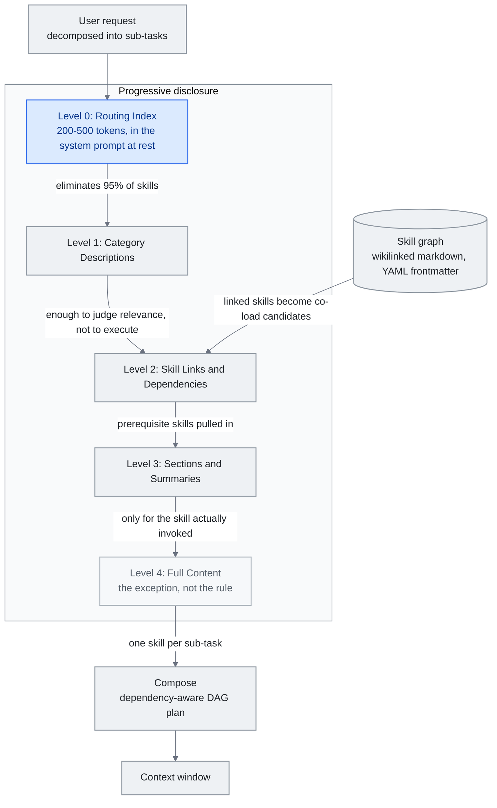

<!-- translation-sync:start -->
> 与 2026-10-31 英文版同步的机器辅助译文，已作结构与内容复核。代码和图中标签保留原文；阅读时间按英文原文估算。
> [English source](../../../chapters/05-skill-systems.md) · [Sync record](../../SYNC.md)
<!-- translation-sync:end -->

<!-- i18n-anchor -->

# 第 5 章：Skill Systems —— 技能、技能图与渐进式揭露

> **一句话总结：** Skill 是可重用的指令集, 告诉 AI 如何做特定任务; skill graph 把它们连成可导航的知识网络。
>
> **为什么重要：** 不用每次都跟 AI 解释同一件事, skill 让你教一次就永远复用那份知识。
>
> **阅读时间：** ~22 分钟（按英文原文估算：4,929 个单词 / 230 wpm）

*图：第 5.4 节的五个公开级别，第 5.5 节的技能图提供了解决链接和依赖关系的级别，以及第 5.5 节组装最终加载内容的组合计划。 0 级的边缘带有这样的论点：在读取单个完整文件之前，路由索引消除了 95% 的技能，这就是为什么只有实际调用的一两个技能才达到 4 级的原因。*

Skill 是预先打包的指令集——内含 prompt、工具配置、行为规则的自足束——在需要某种特定能力时被注入 agent 的 context window。它们是 agent 系统从少数内建行为扩展到数百上千专门能力, 同时不让模型淹没在不相关指令中的机制。

本章涵盖技能系统的架构、它们造成的组合问题, 以及解决它的渐进式揭露 pattern。

---

<!-- i18n-anchor -->

## 5.1 技能概念

技能最简单的形式是包含特定任务指令的 markdown 文件（或结构化文本块）。当用户请求与技能的触发条件匹配时，技能的内容将加载到上下文窗口中。当主体保持卸载状态时，其广告元数据仍然需要花费token。

这与一个想涵盖每种能力的整体系统 prompt 根本不同。一个描述 90 个工具与 50 种行为模式的系统 prompt 在用户开始打字之前就可能消耗 50,000 token 以上。基于技能的系统只加载相关的, 让基线 context 精简, 把窗口容量保留给实际任务。

设计 pattern 借自软件工程: skill 之于 agent 就像 plugin 之于应用。它们提供可扩展性而不臃肿。

<!-- i18n-anchor -->

## 5.2 Anthropic 技能生态系

Anthropic 在 2025 年 十月为 Claude Code 推出技能, 最初是个项目专用功能——`.claude/` 目录下的 markdown 档, Claude 在相关时能调用。格式刻意简单: 一个含描述、触发条件、指令的 markdown 档。

到 2025 年 十二月，Anthropic 通过 Agentskills.io 将技能作为开放标准发布，定义了任何智能体系统都可以采用的可移植格式。

当前[规范](https://agentskills.io/specification)要求 `name` 与 `description`；可选字段涵盖许可证、兼容性、任意元数据，以及实验性工具权限。正则触发器与依赖声明属于宿主约定，并非标准化字段。这描述的是 October 31, 2026 检查时的文档，不代表该日发生过规范变更。

生态系反应迅速。到 2026 年初, 官方仓库累积超过 87,000 GitHub stars, 社群贡献的技能超过 700,000。awesome-llm-skills、awesome-agent-skills（含来自官方平台团队的 1,000+ 技能）、awesome-claude-code 等收集成为主要发现频道。

这种成长创造了技能本来要解决的问题: 太多能力争抢有限 context 空间。

注册规模于 2026 年中期正式建立。 2026 年六月 5 日，Vercel 将 **skills.sh API** 全面发布——一个可查询的注册表 API，索引来自开源生态系统的 **600,000 多个技能**，采用 OIDC token身份验证（短暂、自动轮换、无长期秘密），速率限制为每分钟**每个团队和每个项目** 600 个请求，以及每个技能的安全审核查找。注册表附带审计端点就隐含地承认这种规模的注册表也是一个攻击面——第 5.10 节中的线程。

该技能基础能力于 2026 年 八月完成了向生产基础设施的迁移，大约是在本节开头的 Claude Code 发布后十个月。 Anthropic 在八月 19 日取消了 **技能 API 的测试版**，并在一天后的八月 20 日发布了一篇配套博客文章——Anthropic 自己的表面上存在差异，读取为发布滞后而不是两个单独的事件。 `/v1/skills` 现在是一个稳定的终点；不再需要 `skills-2025-10-02` beta 标头，但仍被接受。这一举措作为更广泛的生产智能体 GA 浪潮的一部分与计算机使用、浏览器使用和文件 API 一起发布，而 API 可通过 Claude 平台和 Microsoft Foundry 获得。

第二个更改于 十二 天前（即 **八月 7**）发生：GitHub 托管智能体的托管技能。已安装存储库的根 `.claude/skills` 目录会在会话启动时自动发现 - 无需单独的发布或安装步骤。 Anthropic 自己的文档明确指出，安装的存储库成为智能体信任边界的一部分，中间没有审查步骤，它将实时 GitHub 存储库折叠到同一类问题 §5.10 通过 AIR、Cloak-and-Detonate 和 Paperclip 事件进行跟踪：任何可以写入该存储库的人都可以添加或编辑智能体视为生产指令的内容。

**可移植格式有了中立归属。** October 22, 2026，[Anthropic 将 Agent Skills 捐赠给 AAIF](https://www.anthropic.com/news/donating-agent-skills-to-the-agentic-ai-foundation)，包括名称、标志、GitHub 组织和域名。Anthropic 报告已有超过 70 个智能体平台集成。这加强了跨厂商趋同的证据，并非宣称执行安全：版本化发布、提案流程与面向作者和安装者的安全指南，均属于拟议路线图工作，尚非已完成的标准功能。

<!-- i18n-anchor -->

## 5.3 扩展问题

OpenAI 的 agent 文档含一个实务指引: **保持 agent 在 20 个工具以下, 预期超过 10 个会准确度退化**。跨多个模型家族的实证测试确认这个阈值。每个额外工具定义都加 token 到 context, 加决策分支到模型选择空间。在 90 个工具时, schema 开销本身就可能超过 50,000 token——在任何对话、记忆、检索文件进入窗口之前。

退化不只是 token 数。是关于决策复杂度。当模型必须在 90 个工具间选, 概率质量分薄。模型把更多推理容量花在工具选择上, 较少在任务执行上。工具参数构造的错误率上升。模型开始更频繁选「合理但错」的工具。

技能面对同样的扩展压力。一个有 500 个可用技能的系统不能把全部 500 个描述都加载到 context。即使只加载 500 个技能的触发描述, 也可能消耗数千 token, 退化模型处理实际请求的能力。

解法是渐进式揭露。

<!-- i18n-anchor -->

## 5.4 渐进式揭露架构

渐进式披露是一种多级信息架构，其中每个级别都为下一个路由决策提供足够的详细信息。以下五个级别是本指南的架构综合，而不是标准所需的加载顺序：

**第 0 层: 路由索引。** 一个把类别映射到技能群组的精简表。整个技能库可能总共消耗 200-500 token。这是静态时坐在系统 prompt 里的东西。

**第 1 层: 类别描述。** 当路由索引识别相关类别, 加载该类别中技能的一段描述。每个描述为扫读优化——足以判断相关性, 不足以执行。

**第 2 层: 技能链接与依赖。** 对选中的技能, 加载它的依赖图——它需要哪些其他技能或工具、它预期什么 context。

**第 3 层: 段落与摘要。** 加载技能的结构大纲——段落标题、关键决策点、参数清单——不含完整指令内容。

**第 4 层: 完整内容。** 把完整技能指令加载到 context window。这只对实际被调用的一两个技能发生。

由 Heinrich 与 arscontexta 团队正式化的关键洞察是: **大多数决策在读到任一完整文件之前就发生**。路由索引消除 95% 技能。类别描述消除大多数剩余。完整内容加载是例外, 不是规则。

跨生产系统衡量, 渐进式揭露相对于前置加载所有技能定义, 把 token 开销减少 **85-95%**。Anthropic 自家 agent skills 实现示范这一点: 17 个生产技能在静态时消耗约 1,700 token（第 0 层 + 第 1 层）, 仅在调用时展开到完整内容。

<!-- i18n-anchor -->

## 5.5 技能图

Heinrich 的 Skill Graph 架构（arscontexta, 2025-2026）把渐进式揭露延伸到网络结构。不是按类别组织的扁平技能清单, 技能图是 **由 wikilink 连结的互联 markdown 档网络**, 每个节点带:

- 含简洁描述的 YAML frontmatter 区块（用于第 1 层扫读）
- 指向相关技能、前置技能、子技能的 wikilink
- 能独立加载的结构化段落

图结构启用扁平技能清单不能支援的几个能力:

**情境式导航。** 当一个技能被调用, 它链接的技能成为共载候选。一个"deploy"技能链接到"test,"、"rollback,"、"monitor"技能——不是因为它们在同一类别, 而是因为它们在运营上相邻。

**依赖解析。** 技能能声明前置条件。调用复杂技能自动拉入它依赖的基础技能, 类似套件依赖解析。

**部分加载。** 因为技能用清晰段落结构化, 系统能加载特定段落（例如部署技能的"error handling"段落）而不加载完整文件。

图拓扑本身变成一种知识表示。密集连接的技能群指出有高内部一致性的能力领域。孤立技能可能指出系统涵盖的差距或整合机会。

路线研究在 2026 年中期超越了单一技能选择。 **"Compositional Skill Routing for LLM Agents: Decompose, Retrieve, and Compose"**（arXiv 2606.18051，2026年六月16日，单作者高雪平，Alibaba云）形式化*组合*而不是路由到一个：将查询分解为子任务，为每个子任务检索一项技能，并组装一个依赖项感知的DAG计划。它的 **CompSkillBench** --- 跨 24 个类别的 2,209 个真实 MCP 服务器技能进行 300 次组合查询 --- 是第一个测试组合 * 多个 * 技能而不是选择一个技能的基准。迭代技能感知分解提高了分解精度 **51.0% → 67.7%**（相对+32.7%，Wilcoxon p < 10⁻⁶），与加载库相比，上下文窗口消耗减少了**超过 99%**，即使检索池中不存在目标类别，仍然相对增加 +35.6%。

<!-- i18n-anchor -->

## 5.6 SkillReducer 论文

2026 年 三月发表的研究检视跨多个 agent 平台的 55,315 个技能, 产生挑战对技能质量天真假设的发现:

- **26.4% 技能完全缺路由描述**。它们有完整指令内容但无元数据帮路由系统识别何时调用。这些技能只能透过精确名字触发——对任何智能路由层都不可见。

- **超过 60% 技能 body 内容是非可行动的**。它包含背景 context、动机、注意事项、解释性文字, 而非模型能执行的具体指令。这些内容消耗 token 而不贡献任务效能。

- **压缩过的技能比原版改善输出质量 2.8%**。当研究者剥离非可行动内容并紧缩指令语言, 模型效能实际改善。少即是多——context 中减少的噪音让模型聚焦于可行动指令。

技能撰写的含义直接:

1. **每个技能都需要路由描述**。没有它, 技能对渐进式揭露系统等于不可见。
2. **指令内容应密集且可行动**。背景 context 属于文档, 不是被注入 context window 的技能 body。
3. **技能质量衡量应包含 token 效率**——不只"does it work"而是"does it work per token consumed."。

<!-- i18n-anchor -->

## 5.7 MCP 的 Meta-Tool Pattern

Model Context Protocol（MCP）引入跨供应商 agent 发现并调用工具的标准方式。但 MCP 原本设计在连线时加载所有可用工具 schema, 创造与技能面对的同样扩展问题。

Meta-tool pattern 用两个组件解决:

- **发现工具:** 一个接受自然语言描述、从完整注册表返回相关工具 schema 的单一工具。这是基线时唯一加载的工具。
- **执行工具:** 一个通用工具调用包装器, 一旦工具的 schema 透过发现取得, 就能按名调用任何工具。

系统加载两个工具 schema 而非数百。当模型判定需要某能力, 它调用发现工具, 收到相关 schema, 然后调用具体工具。该 pattern 用一次额外推论 round-trip 换取大量 context 节省。

这是渐进式揭露应用到工具管理: 模型拿到电话簿, 不是每个联络人档案的内容。

<!-- i18n-anchor -->

## 5.8 撰写指引

从 SkillReducer 发现与生产经验, 一组技能撰写最佳实务浮现:

- **以路由描述领头。** YAML frontmatter 描述是档案中最重要一行。它决定技能是否会被调用。为分类器写, 不是为人类读者写。
- **前置可行动指令。** 技能 body 头 200 token 应含核心行为指令。背景与 context 在后。
- **用结构化段落。** 标题、清单、清楚分隔启用部分加载与段落级检索。
- **明确声明特定于主机的依赖关系。** 记录消费主机可以解决的所需技能或工具。
- **包含触发例子。** 提供 3-5 个该激活技能的用户讯息例子。这些既是文档也是路由层的测试案例。
- **衡量 token 成本。** 追踪每个技能的 token 数并设预算。如果技能超过 2,000 token, 考虑它能否被拆或压缩。

平行线使技能构建本身自动化。 **工作流到技能**（arXiv 2606.06893，2026年六月5日；张宇阳、韩新元、蒋旭东、王润——武汉大学/南昌大学）介绍了RWSA，一种结构化中间表示，通过将异构交互轨迹（演示、轨迹、工具日志）分解为工作流结构、执行语义和运行时附件，将异构交互轨迹（演示、轨迹、工具日志）转化为技能（安全、回滚、状态）---而不是将跟踪到技能视为总结。在他们的 70 项技能 WSASkill 数据集上，报告显示行为重播一致性相对于基线（包括 Anthropic 的 Skill Creator）有**+10.5% 相对**改进，这是针对手动最佳实践的自动化技能构建的第一个形式化。

另一条路线方向相反，把已完成的技能视为基础设施，而非文字说明。Anthropic 的 **`ant apply`**（2026 年九月 3 日随 CLI v1.30.0 发布，后续版本继续提供）将 Terraform 的先计划、后应用模式用于智能体资源：在仓库中用文件声明智能体、环境、技能、记忆存储和部署，与实时 API 状态比较差异，展示执行计划，经批准后创建或更新；`claude-lock.json` 锁文件则记录发送内容与 API 返回内容的指纹。在这一模式下，技能是一个根目录包含 `SKILL.md` 文件的目录，可直接从 GitHub URL 获取，并固定在解析得到的提交上，直到执行 `--upgrade` 才更新；资源通过相对路径互相引用，因此依赖顺序和版本会在计划阶段解析。根据 Anthropic 文档，这套流程面向 CI：`--dry-run` 在拉取请求阶段生成计划，凭证则推荐使用工作负载身份联合，而非静态 API 密钥。固定提交的意义不只是方便打包：它确实缓解了第 5.10 节讨论的检查时间与使用时间之间的差距，因为来自 GitHub 的技能不能再在审核与使用之间被改写。但这并未解决全部问题：锁文件固定的是文件本身，无法固定文件在运行时访问的外部内容；2026 年六月的 `brand-landingpage` 技能利用的恰好就是这条通道。

<!-- i18n-anchor -->

## 5.9 行业收敛：Google Agent Skills 规格（2026 年 四月）

整个 2025 年大部分时间, 渐进式揭露主要是 Anthropic 惯例——透过 2025 年 十月 Claude Code 技能与 十二月 agentskills.io 开放标准正式化。在 **2026 年 四月**, Google Developers Blog 把它自己的 **Agent Skills 规格** 正式化, 采纳并延伸同一架构。规格描述渐进式揭露的三个明确层级:

- **第 1 层 —— 元数据（每技能约 100 token）。** 含技能名称、单行描述、触发提示、版本的精简描述符。每个可用技能的第 1 层元数据坐在 agent 的基线 context 中。加载 10 个技能, 这是约 1,000 token 的恒定开销。
- **第 2 层 —— 指令（< 5K token）。** 一个技能的完整行为指令, 在第 1 层匹配识别该技能为相关时按需加载。第 2 层内容在技能实际被选中前永不进入 context。
- **第 3 层 —— 外部资源。** 完全住在 context window 外的资产——参考文件、数据集、工具 schema、代码范例——只在技能在执行时明确需要才取。

头条效率主张: 对一个有 10 个技能的 agent, 基线 context 用量从约 **10K token**（前置加载完整技能内容）降到约 **1K token**（仅第 1 层元数据）, **90% 减少**。第 2 层内容一次加载一个技能, 第 3 层资源只在执行中需要时加载。

两个细节让 Google 规格在数字之外显著:

1. **它用通用的 `agentskills.io` 规格**。不是分叉, Google 把它的格式与 Anthropic 在 2025 年 十二月发布的开放标准对齐。对一个规格写的技能, 能由另一个平台的 agent 以最少调整消费。
2. **它把渐进式揭露从惯例提升到正式系统设计 pattern**。约一年时间, 渐进式揭露被描述为"what Anthropic does with skills."。随 Google 的采纳与正式化, 它变成有命名架构与可衡量目标的跨供应商行业 pattern——可比作"MVC"或"REST"如何从特定实现演化为通用 pattern。

实务效果是技能库正变得跨供应商可移植, "how many tokens does your baseline agent context consume"已变成供应商竞争的一等指标。

2026 年 **五月 6 日**，当 AWS 发布其通用版本 **AWS MCP 服务器** 并采用 **"Skills over SOPs"** 作为规范智能体入口点时，融合再次扩大——这是第一个发布技能的超大规模器（ Anthropic / OpenAI / Google 从2025年十二月开始开放标准）作为生产智能体指导。现在有四家供应商达成一致——Anthropic、OpenAI、Google和AWS——技能跨越了从"the convention three frontier labs use"到"the way agent capabilities are described across the cloud stack."的门槛。对于从业者来说，实际效果是，针对从业者编写的技能Agentskills.io 规范现在可以跨大多数生产智能体运行的平台移植。

<!-- i18n-anchor -->

## 5.10 技能保障和供应链问题

就其效率而言，技能文件也是一个模型将遵循的可执行指令集——到 2026 年中期，通过注册表传送这些文件的安全后果将变得具体。扫描生态系统已经出现（思科的技能扫描器、NVIDIA 的 **SkillSpector**、2026 年六月中旬开源，以及 Skills.sh 的内置安全审计），但两项披露显示静态扫描存在结构性上限。

**2026 年六月 22 日**，安全公司 AIR 披露，仅凭一个名为 `brand-landingpage` 的虚假技能，它就**劫持了约 26,000 个智能体**，其中 "including corporate accounts' agents"。该技能通过 Instagram 广告传播，暗中收集受害者的电子邮箱地址，并通过了接受测试的*每一个*扫描器。原因在于**检查时间与使用时间之间的差距（TOCTOU）**：静态扫描器评估的是提交包的快照，但这个技能指向攻击者控制的外部 URL，其内容可在审核后被改写。通过审核的快照，并不是最终运行的内容。

十天后，即 **2026 年七月 2 日**，香港科技大学的研究人员对这一漏洞作出了形式化描述。**"Cloak and Detonate: Scanner Evasion and Dynamic Detection of Agent Skill Malware"**（arXiv 2607.02357）提出 **SkillCloak**：通过重写恶意技能来逃避静态扫描，同时以自解压打包保留功能；载荷在安装时藏于扫描盲点，仅在智能体运行时恢复。在 1,613 项实际恶意技能上针对 8 个扫描器测试，其 SFS 打包的**逃避成功率在每个扫描器上均超过 90%**，其中六个达到 99.8-99.9%。同一团队还推出运行时行为检查器 **SkillDetonate**，在 **2% 的误报率下检出 97% 的攻击**，针对现实中的恶意技能时检出率为 87%。

五周后出现第三波。**August 6, 2026**，安全公司 Zenity Labs 披露针对 skills.sh 本身的供应链攻击：攻击者冒充 paperclipai 与 browser-use 的 GitHub 组织，在七月 2 日注册 `getpaperclipp.com` 并建立仿冒 `getpaperclipai` 组织，发布的技能七月 5 日仍然无害，七月 11 日被武器化，之后升至注册站热门 #8。收集凭证的载荷是一条 curl→base64→node 链，通过四条触发路径瞄准 138 个凭证路径，包括 SSH 密钥、AWS／GCP／Azure 凭证、Kubernetes 配置、npm token 与数据库凭证；四条路径分别为直接技能指令、恶意 PyPI 包、npm postinstall 钩子和 API 路由处理器。页面安装计数超过 **1.7 million**，这是汇总次数，不是独立受感染智能体数量，与 AIR 六月披露中放大标题数字的歧义相同。Vercel 与 GitHub 在披露后 12 小时内下架页面与仓库。（此事不同于前一天公布的 Paperclip 产品 CVE，例如 CVE-2026-41679；后者是合法 Paperclip 产品的漏洞，而非 skills.sh 冒充攻击。）短短六周多的三次披露中，相同的 TOCTOU／通过审核后再武器化的失效模式，从一次号称劫持 26,000 个智能体的 Instagram 广告活动，扩展为证明可系统规避扫描器的研究论文，再发展为注册站规模、利用四种独立触发机制的热门技能家族。

框架教训是MCP安全一年前学到的一个（第7章的IETF安全考虑草案）：渐进式披露和注册表规模的生态系统使技能文件本身成为攻击面，因此信任必须从*发布时扫描*转向*运行时遏制*。在运行时获取或解包其真实行为的技能无法通过检查它在提交时的样子来进行认证——合理的立场是观察它运行时的行为。

Zenity 披露后的一个月，这一主张出现了商业市场。**September 1, 2026**，CrowdStrike 在 Fal.Con 大会上推出 **Falcon Guardian**，属于新的 AI 检测与响应产品线：发现并盘点 Windows 和 macOS 端点上运行的已知与未纳管 AI 智能体，记录每个智能体的部署者，对实际行为执行访问控制、策略执行与运行时检测，并在事后重建恶意执行链。CrowdStrike 的描述点明了静态审核无法覆盖的情况：提示看起来合法，产生的行为却异常；公告未提供检测率或有效性数字，因此它证明运行时隔离已成为产品类别，不证明产品有效。同日，本节开头六月 22 日披露背后的 AIR 结束隐身运营，公布两轮种子融资共 **$50 million**，其中 Sequoia 领投 $10M、Greenoaks 领投 $40M，并将此前在单个技能展示的模式扩大至生态统计：按 AIR 自报，超过 **17,800 个公共 AI 插件、约 6.7 million 次安装，依赖不受信任的外部指令源**；它还报告发现冒充 Anthropic 与 OpenAI 以通过平台审核的技能，说明品牌冒充是一种反复出现的手法，不只发生于 Paperclip 活动。AIR 未公布两个数字的方法，因此两者都是厂商对自身所售市场的测量。两项公告共同闭合商业环：十周之内，这种失效模式从一次披露，走向证明扫描器可系统规避、注册站规模攻击活动，再走向获融资厂商出售测量、端点厂商出售执行控制。

---

<!-- i18n-anchor -->

## 需要带走的三件事

- **大多数路由决策发生在读取单个完整文件之前。** 路由索引消除了 95% 的技能，而类别描述消除了其余大部分，因此 4 级完整内容仅加载实际调用的一两个技能。
- **没有路由描述的技能是不可见的。** SkillReducer 发现 55,315 项技能中有 26.4% 包含完整的教学内容，但没有路由层可以匹配的元数据，因此只能通过确切的名称来触发它们。
- **在注册表规模上，信任必须从发布时扫描转向运行时遏制。** 在运行时获取或解压其真实行为的技能无法通过其提交的快照进行认证，这是 AIR、Cloak-and-Detonate 和 Paperclip 披露所共享的故障模式。

---

<!-- i18n-anchor -->

## 来源

- **Agent Skills。** 格式规范（当前文档检查日期 2026 年十月 31 日）：[https://agentskills.io/specification](https://agentskills.io/specification)。
- **Anthropic。** Agent Skills 捐赠公告（2026 年十月 22 日）：[https://www.anthropic.com/news/donating-agent-skills-to-the-agentic-ai-foundation](https://www.anthropic.com/news/donating-agent-skills-to-the-agentic-ai-foundation)。
- **Anthropic.** "Claude Code Skills." 文档与开放标准规格, 2025 年 十月（推出）, 2025 年 十二月（透过 agentskills.io 的开放标准）。2026 年初 87K+ GitHub stars。
- **OpenAI.** "Agent Design Best Practices." OpenAI 文档, 2025。建议每 agent 少于 20 个工具, 超过 10 个会准确度退化。
- **Heinrich (@arscontexta).** Skill Graphs 概念与实现。X 贴（2026）: [https://x.com/arscontexta/status/2023957499183829467](https://x.com/arscontexta/status/2023957499183829467)（Skill Graphs > SKILL.md）。GitHub: [https://github.com/agenticnotetaking/arscontexta](https://github.com/agenticnotetaking/arscontexta) ——Claude Code 插件, 生成含 wikilink 与 YAML frontmatter 扫描的个人化 markdown-graph 知识系统。次级分析: Linas Substack, "Skill Graphs: The Architecture That Solves the AI Agent Context Window Problem." [https://linas.substack.com/p/skill-graphs](https://linas.substack.com/p/skill-graphs)
- **SkillReducer Paper.** "Less Is More: Compressing Agent Skills for Improved Performance." 2026 年 三月。分析 55,315 个技能, 26.4% 缺路由描述, 60%+ 非可行动内容, 压缩后 2.8% 质量改善。
- **Model Context Protocol（MCP）.** Anthropic 规格, 2024-2025。标准化工具发现与调用协议。
- **awesome-llm-skills.** GitHub 上的社群收集。跨平台编纂的技能库。
- **awesome-agent-skills.** GitHub 收集, 来自官方平台团队的 1,000+ 技能。
- **awesome-claude-code.** GitHub 收集。Claude Code 专属技能与配置。
- **OpenAI.** "Function Calling Best Practices." 2025。工具数量与准确度取舍的实证数据。
- **Griciūnas, Aurimas.** "State of Context Engineering in 2026." SwirlAI Newsletter, 2026 年 三月。[https://www.newsletter.swirlai.com/p/state-of-context-engineering-in-2026](https://www.newsletter.swirlai.com/p/state-of-context-engineering-in-2026) ——渐进式揭露 / 压缩 / 滑动窗口 pattern; meta-tool pattern。也见 "Breaking Down Context Engineering": [https://www.newsletter.swirlai.com/p/breaking-down-context-engineering](https://www.newsletter.swirlai.com/p/breaking-down-context-engineering)
- **AWS.** "AWS MCP Server now generally available"（2026年五月6日）：[https://aws.amazon.com/about-aws/whats-new/2026/05/aws-mcp-server/](https://aws.amazon.com/about-aws/whats-new/2026/05/aws-mcp-server/)
- **AWS 新闻博客。** "The AWS MCP Server is now generally available"（2026 年五月 6 日）：[https://aws.amazon.com/blogs/aws/the-aws-mcp-server-is-now-generally-available/](https://aws.amazon.com/blogs/aws/the-aws-mcp-server-is-now-generally-available/) --- "Skills over SOPs" 的采用使 AWS 成为第一个将技能作为生产智能体指导的超大规模企业。
- **Vercel.** "The skills.sh API is now available"（2026年六月5日）：[https://vercel.com/changelog/the-skills-sh-api-is-now-available](https://vercel.com/changelog/the-skills-sh-api-is-now-available) --- 可查询注册表API； OIDC-token授权；每个团队和每个项目 600 个请求/分钟； 600,000+ 索引技能；每项技能的安全审核。
- **高雪平**（Alibaba 云）。 "Compositional Skill Routing for LLM Agents: Decompose, Retrieve, and Compose." arXiv 2606.18051, 六月 16, 2026。 [https://arxiv.org/abs/2606.18051](https://arxiv.org/abs/2606.18051) --- CompSkillBench（超过 2,209 个 MCP 技能的 300 个组合查询，24 个类别）；迭代技能感知分解51.0%→67.7%；与加载库相比，上下文减少了 >99%。
- **Zhang, Yuyang; Han, Xinyuan; Jiang, Xudong; Wang, Run**（武汉大学／南昌大学）。"Workflow-to-Skill." arXiv 2606.06893，2026 年六月 5 日。[https://arxiv.org/abs/2606.06893](https://arxiv.org/abs/2606.06893)：RWSA 结构化中间表示（工作流结构／执行语义／运行时附件）；在含 70 项技能的 WSASkill 数据集上，相比包括 Anthropic Skill Creator 在内的基线，行为重放一致性相对提升 +10.5%。
- **AIR（Niv Hoffman 与 Or Nevo）。** "The Story of Skills --- How We Hijacked 26,000 Agents With One Instagram Ad"（2026 年六月 22 日）：[https://www.air.security/blog-posts/the-story-of-skills](https://www.air.security/blog-posts/the-story-of-skills)。伪造 `brand-landingpage` 技能，利用外部 URL 的 TOCTOU 绕过全部受测扫描器（Cisco skill-scanner、NVIDIA SkillSpector、skills.sh）。二手来源：The Hacker News（六月 23 日）：[https://thehackernews.com/2026/06/fake-ai-agent-skill-passed-security.html](https://thehackernews.com/2026/06/fake-ai-agent-skill-passed-security.html)。
- **Ji, Zimo 等**（HKUST）。"Cloak and Detonate: Scanner Evasion and Dynamic Detection of Agent Skill Malware." arXiv 2607.02357，2026 年七月 2 日 提交。[https://arxiv.org/abs/2607.02357](https://arxiv.org/abs/2607.02357)：在 1,613 项恶意技能、8 个扫描器上，SkillCloak 逃避检测率 >90%；SkillDetonate 的运行时检测率为 97%，误报率为 2%。二手来源：The Hacker News（七月 6 日）：[https://thehackernews.com/2026/07/new-skillcloak-technique-lets-malicious.html](https://thehackernews.com/2026/07/new-skillcloak-technique-lets-malicious.html)。
- **NVIDIA。** SkillSpector 开源技能扫描器（2026 年六月中旬开源），是 NVIDIA 自身仓库点名的静态扫描器；AIR／THN 的事件报告没有点名该工具。
- **Zenity Labs。** "Attackers Target Agents via the Skill Supply Chain"（2026 年八月 6 日）：[https://labs.zenity.io/post/attackers-target-agents-via-the-skill-supply-chain](https://labs.zenity.io/post/attackers-target-agents-via-the-skill-supply-chain)。skills.sh 上的 Paperclip 冒充攻击活动；138 个凭证路径；四种触发机制；1.7M+ 的汇总安装计数。二手来源：CSO Online：[https://csoonline.com/article/4206851/](https://csoonline.com/article/4206851/)；Business Wire：[https://businesswire.com/news/home/20260806707467/en/](https://businesswire.com/news/home/20260806707467/en/)。
- **Anthropic。** 发布说明总览：[https://platform.claude.com/docs/en/release-notes/overview](https://platform.claude.com/docs/en/release-notes/overview)。Skills API 于 2026 年八月 19 日 结束测试。博客："Computer use, Skills API, and Files API"（2026 年八月 20 日）：[https://claude.com/blog/computer-use-skills-api-files-api](https://claude.com/blog/computer-use-skills-api-files-api)。Managed Agents 技能文档（GitHub 托管技能，2026 年八月 7 日）：[https://platform.claude.com/docs/en/managed-agents/skills](https://platform.claude.com/docs/en/managed-agents/skills)。
- **CrowdStrike。** Falcon Guardian 发布公告，Fal.Con 2026（2026 年九月 1 日）：[https://www.crowdstrike.com/en-us/press-releases/crowdstrike-unveils-falcon-guardian-ai-agent-security/](https://www.crowdstrike.com/en-us/press-releases/crowdstrike-unveils-falcon-guardian-ai-agent-security/)。发现并盘点 Windows 与 macOS 端点上已知及未纳管的 AI 智能体，提供访问控制、策略执行及智能体行为的运行时检测；没有提供检测率或有效性数字。二手来源：SiliconANGLE（九月 1 日）：[https://siliconangle.com/2026/09/01/crowdstrike-launches-falcon-guardian-to-police-ai-agents-at-the-endpoint/](https://siliconangle.com/2026/09/01/crowdstrike-launches-falcon-guardian-to-police-ai-agents-at-the-endpoint/)；SC World：[https://www.scworld.com/brief/crowdstrike-unveils-falcon-guardian-to-secure-ai-agents](https://www.scworld.com/brief/crowdstrike-unveils-falcon-guardian-to-secure-ai-agents)。
- **AIR。** 结束隐身运营，公布 $50 million 融资及生态规模的插件研究。TechCrunch（2026 年九月 1 日）：[https://techcrunch.com/2026/09/01/air-raises-50m-to-help-companies-vet-the-skills-and-add-ons-ai-agents-use/](https://techcrunch.com/2026/09/01/air-raises-50m-to-help-companies-vet-the-skills-and-add-ons-ai-agents-use/)；SecurityWeek（2026 年九月 3 日）：[https://www.securityweek.com/ai-agent-firewall-startup-air-security-emerges-from-stealth-with-50-million/](https://www.securityweek.com/ai-agent-firewall-startup-air-security-emerges-from-stealth-with-50-million/)。Sequoia 领投 $10M，Greenoaks 领投 $40M；17,800+ 个公共插件、约 6.7M 次安装依赖不受信任的外部指令源，另有冒充 Anthropic 与 OpenAI 的技能。这些均为 AIR 自报统计，方法未公开。两家媒体相差两天，是同一公告的刊登时差，并非两个事件。
- **Anthropic.** `ant apply` CLI 文档（2026 年 九月 3 日发布，CLI v1.30.0 及更高版本）：[https://platform.claude.com/docs/en/cli-sdks-libraries/cli/apply](https://platform.claude.com/docs/en/cli-sdks-libraries/cli/apply) --- 声明为存储库文件的智能体、环境、技能、内存存储和部署；计划/应用与实时 API 状态的差异； `claude-lock.json` 锁定文件； GitHub 来源的技能固定到已解决的提交，直到 `--upgrade`； `--dry-run` 计划将 CI 和工作负载身份联合作为推荐的 CI 凭证。 Anthropic 的文档单一来源；没有独立的覆盖范围。
